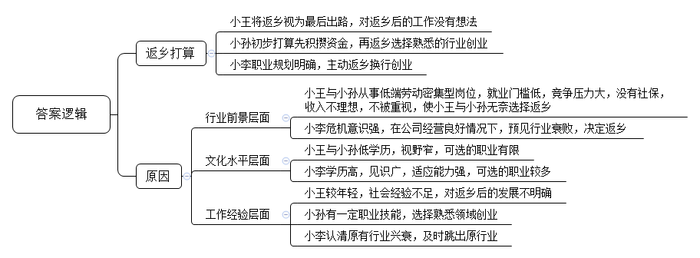
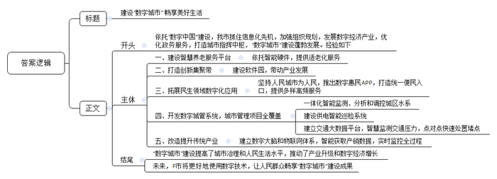

# 2021年公务员多省联考《申论》题（青海县级卷）

> 候选采集稿。参考答案及解析来自粉笔页面，不代表官方答案或真实高分答卷；来源使用许可与原卷对应关系仍需人工核实。

## 给定材料

### 材料 material-76266882ac5a1d5f

永济村在解放前是“光山秃岭乱石沟，十人见了十人愁；旱涝风雹年年有，庄稼十年九不收”。全村有大大小小239条干涸贫瘠的沟壑，332座光秃秃的山头，森林覆盖率不到2%。50年代初，22岁的张一雁成为了永济村的党支部书记。为了改变生存环境，张一雁带着村民上山种树。由于经验不足，树的成活率极低，村民们泄了气。张一雁鼓励大家说：“我们改不了天，但我们可以换地！不管前方的路有多苦多难，只要方向正确，我们的日子一定会一天比一天红火。”

时光荏苒，转眼就到了2015年。这一年，从省里某部门退休的副厅级干部阎永强经过村干部换届选举成为了永济村新一任村支书。阎永强带回来的不仅是身份，还有服务家乡的赤子之心。他把自己的户口、党组织关系全部转回村里，“又成了一个真正的永济人。”“为了村里的发展，我不会领取任何报酬工资，只希望能像老书记一样，让家乡百姓的日子一天比一天好。”

阎永强向记者介绍起了永济村的致富史。1980年冬，张一雁率几名村干部到南方考察。所到之处，乡镇企业给农民带来的巨大变化令张一雁一行眼热心跳。经过慎重考虑，村委决定利用本地丰富的铁矿资源建一座钢铁厂，这也是省里当年的第一家村办企业。剪彩那天，当第一炉火红的铁水滚滚流出的时候，许多党员激动得哭了。后来，永济村又先后创办了铝合金厂、石料厂等企业。张一雁说：“办企业不同于当年我们上山栽树，不是光有憨劲儿就行。企业需要的是懂技术、会管理的人才。”这以后，永济村与许多大学联系，送青年农民到那里学企业管理、财务、农作物栽培等科学技术。

阎永强说，老书记最爱说的一句话是：“有了好头头，群众不发愁。”这好头头就是党支部，就是共产党员的先锋带头作用。在村办企业多年发展的背后，高耗能重污染的弊端日渐显现。2015年，村两委邀请了省农业大学农村发展研究所的专家，完成了新的村级规划。根据新规划，要淘汰一批落后产能，当时许多村民都担心“下岗”，不太情愿。全体党员以身作则，并动员家属、亲戚支持村两委的决定。2016年，村两委引来了展望农业科技有限公司，在铝合金厂的旧址上，建起一条年产500吨食用保健油的冷榨加工生产线，同时建立了一个集餐饮、住宿、观光于一体的田园综合体。广大村民不仅实现了“再就业”，收入还比过去翻了一番。

“小时候村周围到处是荒山秃岭，现在满眼都是郁郁葱葱。”2020年春，在永济村不远处的一座山坡上，阎永强正带队搞绿化工程。“50年前为吃饱饭，我跟着父亲拿着镰刀、背着松籽儿在永济的大山上种树，如今的永济村森林覆盖率超过87%，曾经的一座座荒山变成了一条条‘绿龙’，成了村民的‘绿色银行’。”阎永强说：“看到村里环境一天天变美，老百姓日子一天天富裕，我耳边常常回想起老书记那句话：‘只要方向正确，我们的日子一定会一天比一天红火。’”

### 材料 material-faf152dd3dce3387

进工厂曾是一代人的梦想。时移世易。在23岁的小王看来，工厂工人和外卖员的工作体验是完全不一样的，他曾在一个工厂做过装卸工。“每天都待在厂子里，搬东西很累，还被呼来喝去。”小王坦言：“我们这个年纪的，谁会喜欢这样的工作呢？”数据显示，2018年，外卖骑手平均月薪为7750元左右，制造业员工平均月薪6000元左右。

今年33岁的小孙从事外卖工作近两年，他曾是家乡县城一家汽车工厂的喷漆工人。小孙不是科班出身，最早由师傅带入行，工作四年，月工资从3500元涨到了5000元左右。2018年7月，小孙到省城当外卖员，每月到手收入一度维持在8000元到10000元之间，他很满意，“这相当于我们当地一家4S店高级汽修技师的收入了。”当高级汽修技师曾是小孙的梦想，但由于理论知识、技能证书等门槛，初中文化的小孙并未选择这条路。不过，今年以来，小孙送外卖的收入再没有回到从前的高峰期。

转行两个月，作为外卖新手的小王并没有拿到传说中“月入过万”的收入。几乎无门槛的外卖行业正成为吸纳就业的重要蓄水池。小王很无奈，“5月份订单量刚涨起来，又新来了很多兼职外卖员。”数据显示，外卖骑手中56%的骑手有第二职业。“我们没有基本的社会保障，只能多赚点算点，为以后早做打算。”在他看来，返乡是最后一条路，但也是最现实的一条路。“像我这样只有高中文化的人，在互联网时代很难在大城市找到满意的工作了。”言语间，小王的无奈与心酸尽显。

不过，时至今日，机器虽然已经替代了工厂流水线上的基础岗位，但并未能完全替代快递外卖配送线上的基础岗位。在配送线上的“最后一公里”，在面对面的服务环节，依然需要人工。S大学林教授认为，未来中国服务业的增加值比重和就业份额将继续稳步提升。但一个残酷的现实是，服务业中的高端知识型岗位和低端劳动密集型岗位之间的收入差距将会进一步扩大。谈及未来，小孙说：“先干着，攒点钱，以后看能不能返乡开个汽车美容店。”

相比小王和小孙，小李正为自己的决定感到庆幸。小李是一所知名大学财经专业的毕业生。两年前，他从一家生产自动取款机的公司离职，回到家乡创业。“行业已经要变天了，我必须早做打算。公司当时营业收入、利润增长还不错，但我心里没有底。移动支付发展太快了！”小李如此解释自己两年前的担忧。

现金时代，一台台自动取款机就是其生产厂商的“印钞机”。上世纪90年代，存取款都只能在固定的储蓄所；2005年前后，自动取款机开始遍布街头巷尾；2015年，中国成为全球最大的自动取款机销售市场。当年年末，全球自动取款机行业协会会长充满激情地说，盛宴即将开始。但事后回看，这已是盛宴的尾声。

就在2015年，银行纷纷推出互联网金融战略，并开始减少自助银行、自动取款机，用户使用自动取款机的频次也大幅下滑。与此同时，各个银行的网络金融业务占比大幅提升。根据上市公司的财报显示，2018年多家自动取款机厂商从净利润下滑开始转向大幅度亏损，2019年亏损进一步加剧。小李感叹：“时代在抛弃你时，连一声招呼都不会打。”

### 材料 material-a97a8860eae1b48a

“你好小福，我想订餐。”78岁的孙奶奶按下开关，向机器人小福发出语音指令。“有两荤两素加米饭13元的和两荤一素加米饭10元的两种，您选哪一种？”稚嫩的童声清脆悦耳。“13元的。”“好的，稍后会有工作人员与您联系。”不一会儿，福龄老年服务中心工作人员刘大姐拎着盒饭，一路小跑，来到孙奶奶的家。“对我们老年人来说这个太好了！我不会用手机，现在只需要对机器人发个语音指令，立马有人上门。”孙奶奶说。

变化，缘于智慧养老服务平台的建成。2019年，坐落于F市北区物联网产业园的乐享科技有限公司利用物联网、云计算及大数据等技术打造了这一平台。该平台的建成是F市绘制“数字城市”蓝图的靓丽一笔。乘着“数字中国”建设的东风，F市抓住信息化先机，积极拥抱数字浪潮，从成立“数字城市”建设领导小组到制定“数字城市”中长期发展规划；从“一枝独秀”的软件园到“百花齐放”的数字经济产业；从最早的办事“跑多趟”到如今“一趟不用跑”……F市的“神经网络”正在加速形成，一个能看、能用、能思考的指挥中枢，既连接起经济、生态、交通、公共安全、城市治理等信息数据，也能打通司法、安监、消防、环保等条状业务系统，“数字城市”建设蓬勃发展。

2000年6月，F市东区软件园创业楼迎来首批入园企业。“当时，园区内的研发楼宇只有寥寥几栋，产业规模仅12.7亿元。”东区软件园管委会负责人回忆道。如今，东区软件园产业发展突飞猛进，总收入已超千亿元。F市汪副市长说，在空间布局上，F市重点打造环中心城区“东区软件园-西区高新园-北区物联网产业园-南区大数据产业园”的数字经济创新集聚带，带动产业发展。

一座城市留给人们的印象，不能仅仅停留在拥有鳞次栉比的高楼大厦，更应让生活在其中的人感到温馨、舒适和便利。在推进“数字城市”建设过程中，F市坚持人民城市为人民的发展理念，不断拓展众多与百姓息息相关的数字化应用服务。“易民”APP是F市全力打造的数字惠民品牌，居民足不出户轻点手机APP，日常生活用品最快10多分钟送到家，出门购物、地铁进站，“刷脸”几秒钟即可完成付款。上线两年多来，该APP已发展成F市移动互联网的统一便民入口，为市民提供各类高频的便民服务、公共服务、政务服务等近80项。

打开F市数字城管系统，一张覆盖全市所有公用设施、道路交通、市容环境等城市管理项目的“电子地图”便呈现在眼前。在城区水系联排联调中心，工作人员可对城区上千个库、湖、池、河、闸、站实现一体化在线监测、实时分析和远程调控。通过建设城市供电智能巡检系统，由传统人工巡视需20天才能完成的工作量，目前只需要2小时。超级“大脑”交通大数据平台则为全市交通编织了一张智慧大网，全程感知的十字路口可智慧监测交通压力，实现点对点，快速处置堵点。

“数字城市”在提高城市治理和人民生活水平的同时，也为F市改造提升传统产业、推动新旧动能转换提供了新机遇。如锦绣家纺公司依托数字大脑，实现“产、供、销、人、财、物”数据的实时获取和智能挖掘，让生产更高效智能；福仙茶业集团建立了物联网体系，对基地种植到终端销售全过程进行实时监控。

产业更兴旺，城市更智慧，生活更美好。目前，数字经济占地区生产总值的比重提高到45%，数字经济上市企业占全市上市企业的一半。展望未来，F市市委李书记说，运用大数据、云计算、区块链、人工智能等前沿技术推动城市管理手段、管理模式、管理理念创新，从数字化到智能化再到智慧化，让城市更聪明一些、更智慧一些，是推动城市治理体系和治理能力现代化的必由之路，前景广阔。“数字城市”的建设是民之所望、政之所向，F市将更好地使用数字技术，不断释放数字红利，让人民群众畅享数字城市建设成果。

### 材料 material-9823a8c4dc16b18d

1949年3月23日下午，西柏坡阳光明媚，毛泽东同志从住了10个月的小院里走出来，正好碰到迎上来的周恩来同志。他望着远处连绵雄伟的太行山，意味深长地说：“今天是进京赶考的日子。”周恩来答道：“我们都应当考及格，不要退回来。”毛泽东坚定地说：“退回来就失败了。我们决不当李自成！我们共产党人进北平，是要继续革命，建设社会主义，直到实现共产主义。”

2013年7月，习近平总书记在河北省调研时指出：“当年党中央离开西柏坡时，毛泽东同志说是‘进京赶考’。60多年过去了，我们取得了巨大进步，中国人民站起来了，富起来了，但我们面临的挑战和问题依然严峻复杂，应该说，党面临的‘赶考’远未结束。”

2020年10月，党的十九届五中全会审议通过了《中共中央关于制定国民经济和社会发展第十四个五年规划和二〇三五年远景目标的建议》。对于中国发展来说，“五年规划”是党治国理政的重要方式，也是量度中国步伐的显著路碑。从1953年新中国开始实行第一个“五年计划”，到2020年“十三五”规划完成，一个又一个五年，诠释了不同时期的历史标识，推动中华民族迎来了从站起来、富起来到强起来的伟大飞跃。

《管子·乘马》言：“是故事者生于虑，成于务，失于傲。不虑则不生，不务则不成，不傲则不失。”虽说前路并非一片坦途，但要坚信的是，一往无前、永不止步，戒骄戒躁，从来都是成就伟大事业的最正确姿态。

## 题目

### 第 1 题

**“给定资料**2**”介绍了永济村的致富史，请归纳其经验做法。（20分）**

关联材料：材料 material-76266882ac5a1d5f

作答要求：

要求：全面、准确、有条理，不超过200字。

### 第 2 题

**根据****“给定资料**3**”，请概括小王、小孙、小李三人各自的“返乡”打算有何不同，并分析其原因。（25分）**

关联材料：材料 material-faf152dd3dce3387

作答要求：

要求：紧扣材料，全面分析，条理清晰，不超过300字。

### 第 3 题

**省里召开****“数字城市”建设座谈会，F市被邀请做经验介绍，假设由汪副市长参加此次会议，请根据“给定资料**6**”为汪副市长拟写一份发言提纲。（25分）**

关联材料：材料 material-a97a8860eae1b48a

作答要求：

要求：

（1）紧扣材料，要点完整；

（2）内容具体，条理清晰；

（3）不超过400字。

### 第 4 题

**请深入理解****“给定资料**4**”中划线句子“****风****后面是****风****，天空上面是天空，道路****的****前面****还****是道路****”，联系实际，自拟题目，自选角度，写一篇文章。****（****50分）**

关联材料：材料 material-9823a8c4dc16b18d

作答要求：

要求：

（1）观点明确，见解深刻；

（2）参考给定资料，但不拘泥于给定资料；

（3）思路清晰，语言流畅；

（4）总字数1000-1200字。

## 答案与解析

第 1 题

**参考答案（粉笔题库参考内容）**

1.党员带头垂范。鼓励村民，坚定方向；以赤子之心服务家乡，无私奉献；以身作则，动员亲属，支持村两委工作。

2.发展村办企业。到发达地区考察学习，因地制宜，利用本地资源优势，开办工厂；保持与大学合作，输送本地青年人才，学习科学技术与管理知识。

3.转变发展方式。邀请专家更新村级规划，淘汰落后产能；引进科技型企业，发展农业加工工业，建设田园综合体。

4.实现生态宜居。实施绿化工程，提高森林覆盖率，创造综合效益。

**解析**

**参考答案说明：**本参考答案从“党员带头垂范”“发展村办企业”“转变发展方式”“实现生态宜居”等四个方面进行了分条撰写。各条要点之间在内容上相互并列，没有交叉。

**考点**：考点经验启示类

**来源**：来源2021年公务员多省联考《申论》题（青海县级卷）

粉笔申论页面对本题只提供「解析视频」入口，该入口是会员推广位，页面无视频地址与文字解析。

第 2 题

**参考答案（粉笔题库参考内容）**

返乡打算不同：小王将返乡视为最后出路，对返乡后的工作没有想法；小孙初步打算先积攒资金，再返乡选择熟悉的行业创业；小李职业规划明确，主动返乡换行创业。

原因：1.行业前景层面。小王与小孙从事低端劳动密集型岗位，就业门槛低，竞争压力大，没有社保，收入不理想，不被重视，使小王与小孙无奈选择返乡；小李危机意识强，在公司经营良好情况下，预见行业衰败，决定返乡。2.文化水平层面。小王与小孙低学历，视野窄，可选的职业有限；小李学历高，见识广，适应能力强，可选的职业较多。3.工作经验层面。小王较年轻，社会经验不足，对返乡后的发展不明确；小孙有一定职业技能，选择熟悉领域创业；小李认清原有行业兴衰，及时跳出原行业。

**解析**

**参考答案说明：**本参考答案先分析了小王、小孙、小李三人不同的“返乡打算”，然后分析了三人有不同打算的“原因”。其中“原因”部分分别从“行业前景”“文化水平”“工作经验”这三个层面进行分析，并进行了分条撰写，条理比较清晰。

**考点**：考点多要素组合类

**来源**：来源2021年公务员多省联考《申论》题（青海县级卷）

粉笔申论页面对本题只提供「解析视频」入口，该入口是会员推广位，页面无视频地址与文字解析。

第 3 题

**参考答案（粉笔题库参考内容）**

建设“数字城市” 畅享美好生活

依托“数字中国”建设，我市抓住信息化先机，加强组织规划，发展数字经济产业，优化政务服务，打造城市指挥中枢，“数字城市”建设蓬勃发展。经验如下：

一、建设智慧养老服务平台。依托智能硬件，提供适老化服务。二、打造创新集聚带。建设软件园，带动产业发展。三、拓展民生领域数字化应用。坚持人民城市为人民，推出数字惠民APP，打造统一便民入口，提供多样高频服务。四、开发数字城管系统，城市管理项目全覆盖。一体化智能监测、分析和调控城区水系；建设供电智能巡检系统；建立交通大数据平台，智慧监测交通压力，点对点快速处置堵点。五、改造提升传统产业。建立数字大脑和物联网体系，智能获取产销数据，实时监控全过程。

“数字城市”建设提高了城市治理和人民生活水平，推动了产业升级和数字经济增长。未来，F市将更好地使用数字技术，让人民群众畅享“数字城市”建设成果。

**解析**

**参考答案说明：**（1）本参考答案包括标题、正文，符合发言提纲的格式要求。（2）正文部分，一方面，内容上，围绕着“F市‘数字城市’建设”这一主题，开头写到了F市“数字城市”建设的背景和宏观做法；主体部分从“建设智慧养老服务平台”“打造创新集聚带”“拓展民生领域数字化应用”“开发数字城管系统”“改造提升传统产业”五个方面介绍了经验；最后结尾部分总结了F市“数字城市”建设的意义并展望未来。另一方面，形式上，本参考答案做到了分段、分条撰写，整体上条理较为清晰。

**考点**：考点总结类

**来源**：来源2021年公务员多省联考《申论》题（青海县级卷）

粉笔申论页面对本题只提供「解析视频」入口，该入口是会员推广位，页面无视频地址与文字解析。

第 4 题

**参考答案（粉笔题库参考内容）**

**赶考**

“风后面是风，天空上面是天空，道路的前面还是道路”，这句诗以充满哲思的笔触揭示了事物发展永无止境的客观规律。时代浪潮奔腾不息，正如1949年毛泽东同志提出“进京赶考”时所预见的那样，赶考之路从无终点。从党和国家的发展征程，到企业的兴衰沉浮，再到个体的人生选择，赶考精神始终是穿越迷雾、行稳致远的核心密码。

**弘扬****“赶考”精神，要全面思考、提前规划，常怀居安思危的忧患意识。**《管子・乘马》有云：“事者生于虑”，唯有未雨绸缪，方能在变局中把握主动。华为在5G领域的深耕便是典范，当多数企业沉迷于4G时代的市场红利时，华为提前布局5G技术研发，累计投入超千亿元，即便面临外部技术封锁，仍能凭借自主创新的芯片与通信技术占据行业高地。反观曾经风靡一时的自动取款机行业，在移动支付浪潮来临前未能预判趋势，最终从“印钞机”沦为亏损重灾区。这启示我们，无论是企业经营还是个人发展，都需跳出眼前的舒适区，以长远眼光审视行业变革，在机遇来临前做好准备。

**弘扬****“赶考”精神，要脚踏实地、永不止步，秉持奋发有为的进取精神。**赶考之路容不得半点虚功，唯有脚踏实地才能行稳致远。“敦煌女儿”樊锦诗将一生奉献给莫高窟保护事业，面对文物保护的时代难题，她率先提出数字化保护构想，带领团队耗时数十年建立莫高窟数字档案，让千年壁画在数字世界永久留存；张桂梅校长扎根滇西北山区，拖着病体创办全国第一所免费女子高中，十余年间走遍山区村寨，帮助两千多名女孩走出大山。她们以“不务则不成”的信念，在平凡岗位上创造了不凡业绩，诠释了赶考精神中脚踏实地的真谛。

**弘扬****“赶考”精神，要艰苦奋斗、戒骄戒躁，保持谦虚谨慎的清醒认知。**历史反复证明，骄傲自满是赶考路上的最大障碍。比亚迪在新能源汽车领域的崛起，离不开始终如一的谦逊与拼搏。在燃油车市场占据优势时，比亚迪没有固步自封，而是正视技术短板，投入巨资研发电池与电控系统，历经无数次试验失败，终于在新能源领域实现弯道超车。反观部分曾领跑市场的企业，因固守过往成就、轻视技术革新，在产业变革浪潮中逐渐丧失竞争力，最终被时代淘汰。这警示我们，无论个人还是企业，唯有摒弃自满、保持奋斗姿态，方能在新“赶考”路上行稳致远。

“雄关漫道真如铁，而今迈步从头越。”在时代的“赶考”路上，我们每个人都是答卷人。让我们以全面思考、提前规划的智慧，脚踏实地、永不止步的决心，艰苦奋斗、戒骄戒躁的态度，书写属于我们这一代人的精彩答卷，向着更加美好的未来奋勇前行。

**解析**

**文章分析**

**赶考**

【**标题的优****点**：严格按照题目的要求，以“赶考”为标题。】

（1）“风后面是风，天空上面是天空，道路的前面还是道路”，这句诗以充满哲思的笔触揭示了事物发展永无止境的客观规律。（2）时代浪潮奔腾不息，正如1949年毛泽东同志提出“进京赶考”时所预见的那样，赶考之路从无终点。（3）从党和国家的发展征程，到企业的兴衰沉浮，再到个体的人生选择，赶考精神始终是穿越迷雾、行稳致远的核心密码。

【**开头的优点：**★内容方面：范文的开头是紧扣“赶考”这一主题展开的。首先，开头点出主题，做到了主题明确。其次，对“赶考”这一主题进行了分析阐述：（1）先解释了题干给定句子的内涵；（2）再指出了赶考的特点；（3）最后介绍了赶考精神的重要性。★文字表达方面：使用了“从……到……再到……”等关联词，使语言表达有逻辑性。】

**弘扬****“赶考”精神，要全面思考、提前规划，常怀居安思危的忧患意识。**（1）《管子・乘马》有云：“事者生于虑”，唯有未雨绸缪，方能在变局中把握主动。华为在5G领域的深耕便是典范，当多数企业沉迷于4G时代的市场红利时，华为提前布局5G技术研发，累计投入超千亿元，即便面临外部技术封锁，仍能凭借自主创新的芯片与通信技术占据行业高地。反观曾经风靡一时的自动取款机行业，在移动支付浪潮来临前未能预判趋势，最终从“印钞机”沦为亏损重灾区。（2）这启示我们，无论是企业经营还是个人发展，都需跳出眼前的舒适区，以长远眼光审视行业变革，在机遇来临前做好准备。

【**论述段****1的优点：**★观点句：范文的观点句是紧扣“赶考”这一文章主题提出的。形式上，它在段首处直接写出，位置突出，容易发现。内容上，关键词突出，内容要点明确，可以明显看出主要从“未雨绸缪，提前规划”这个角度展开论述。★论述内容：（1）列举正反两个事例，说明未雨绸缪、提前规划的重要性；（2）再次强调要有长远眼光，提前做好准备。注意：以上两个方面的内容都是紧扣“弘扬‘赶考’精神，要全面思考、提前规划，常怀居安思危的忧患意识”这个观点句进行分析论述的，论述的针对性强，内容层次丰富。在论述方法上采用了讲道理与举例子相结合的方式，论述充实深刻。】

**弘扬****“赶考”精神，要脚踏实地、永不止步，秉持奋发有为的进取精神。**（1）赶考之路容不得半点虚功，唯有脚踏实地才能行稳致远。“敦煌女儿”樊锦诗将一生奉献给莫高窟保护事业，面对文物保护的时代难题，她率先提出数字化保护构想，带领团队耗时数十年建立莫高窟数字档案，让千年壁画在数字世界永久留存；张桂梅校长扎根滇西北山区，拖着病体创办全国第一所免费女子高中，十余年间走遍山区村寨，帮助两千多名女孩走出大山。（2）她们以“不务则不成”的信念，在平凡岗位上创造了不凡业绩，诠释了赶考精神中脚踏实地的真谛。

【**论述段****2****的优点：**★观点句：范文的观点句是紧扣“赶考”这一文章主题提出的。形式上，它在段首处直接写出，位置突出，容易发现。内容上，关键词突出，内容要点明确，可以明显看出主要从“脚踏实地，奋发有为”这个角度展开论述。★论述内容：（1）列举两个典型事例，说明脚踏实地才能行稳致远；（2）再次强调要在平凡岗位上奋发有为。注意：以上两个方面的内容都是紧扣“弘扬‘赶考’精神，要脚踏实地、永不止步，秉持奋发有为的进取精神”这个观点句进行分析论述的，论述的针对性强，内容层次丰富。在论述方法上采用了讲道理与举例子相结合的方式，论述充实透彻。】

**弘扬****“赶考”精神，要艰苦奋斗、戒骄戒躁，保持谦虚谨慎的清醒认知。**（1）历史反复证明，骄傲自满是赶考路上的最大障碍。比亚迪在新能源汽车领域的崛起，离不开始终如一的谦逊与拼搏。在燃油车市场占据优势时，比亚迪没有固步自封，而是正视技术短板，投入巨资研发电池与电控系统，历经无数次试验失败，终于在新能源领域实现弯道超车。反观部分曾领跑市场的企业，因固守过往成就、轻视技术革新，在产业变革浪潮中逐渐丧失竞争力，最终被时代淘汰。（2）这警示我们，无论个人还是企业，唯有摒弃自满、保持奋斗姿态，方能在新“赶考”路上行稳致远。

【**论述段****3****的优点：**★观点句：范文的观点句是紧扣“赶考”这一文章主题提出的。形式上，它在段首处直接写出，位置突出，容易发现。内容上，关键词突出，内容要点明确，可以明显看出主要从“戒骄戒躁，谦虚谨慎”这个角度展开论述。★论述内容：（1）列举正反两个事例，说明戒骄戒躁、保持谦虚谨慎的重要性；（2）再次强调要摒弃自满、不懈奋斗。注意：以上两个方面的内容都是紧扣“弘扬‘赶考’精神，要艰苦奋斗、戒骄戒躁，保持谦虚谨慎的清醒认知”这个观点句进行分析论述的，论述的针对性强，内容层次丰富。在论述方法上采用了讲道理与举例子相结合的方式，论述充实到位。】

【**论述段之间的关系：**★内容的内在逻辑：范文的论述段之间是依照“并列”的逻辑展开的。论述段1先写了“弘扬‘赶考’精神，要全面思考、提前规划，常怀居安思危的忧患意识”，论述段2再写了“弘扬‘赶考’精神，要脚踏实地、永不止步，秉持奋发有为的进取精神”，论述段3接着写了“弘扬‘赶考’精神，要艰苦奋斗、戒骄戒躁，保持谦虚谨慎的清醒认知”。文章整体论述思路清晰。】

“雄关漫道真如铁，而今迈步从头越。”在时代的“赶考”路上，我们每个人都是答卷人。让我们以全面思考、提前规划的智慧，脚踏实地、永不止步的决心，艰苦奋斗、戒骄戒躁的态度，书写属于我们这一代人的精彩答卷，向着更加美好的未来奋勇前行。

【**结尾的优点：**范文的结尾回扣了“赶考”这个主题，并且进行了总结提升。】

**考点**：考点文章写作题

**来源**：来源2021年公务员多省联考《申论》题（青海县级卷）

粉笔申论页面对本题只提供「解析视频」入口，该入口是会员推广位，页面无视频地址与文字解析。

