# 2022 青海省公务员录用考试 行测（统考）

> 行测 · 115 题 · 青海 2022

## 第 1 题　qid 4817978 · 毛中特

中国共产党第十九届中央委员会第六次全体会议审议通过了《中共中央关于党的百年奋斗重大成就和历史经验的决议》（以下简称《决议》），习近平总书记在会上就《决议》起草有关情况向全会做了说明。下列有关说法正确的有：
①是中国共产党百年党史上第二个历史决议
②突出改革开放和社会主义现代化建设这个重点
③我国经济发展进入新常态，已由高速增长阶段转向高质量发展阶段
④我国积极参与全球环境与气候治理，作出力争二〇三〇年前实现碳达峰、二〇六〇年前实现碳中和的庄严承诺
⑤我国建成世界上规模最大的社会保障体系，十亿二千万人拥有基本养老保险，十三亿六千万人拥有基本医疗保险

- **A**. ③④
- **B**. ③④⑤
- **C**. ②④⑤
- **D**. ①③④⑤

## 第 2 题　qid 4817981 · 新思想

2021年7月1日，习近平总书记在庆祝中国共产党成立100周年大会的讲话中提出，为了实现中华民族伟大复兴，中国共产党团结带领中国人民，实现了“四个伟大成就”，下列选项正确的是：
①创造了新民主主义革命的伟大成就
②创造了社会主义革命和建设的伟大成就
③创造了新时代中国特色社会主义的伟大成就
④创造了全面建成社会主义现代化强国的伟大成就
⑤创造了改革开放和社会主义现代化建设的伟大成就

- **A**. ②③④⑤
- **B**. ①②③⑤
- **C**. ①②④⑤
- **D**. ①③④⑤

## 第 3 题　qid 4817988 · 时事政治

习近平总书记在2021年中央经济工作会议上发表重要讲话，总结2021年经济工作，部署2022年经济工作。下列关于此次会议的内容正确的有：
①2022年经济工作要好字当头，好中求进
②要为资本设置“红绿灯”，依法加强对资本的有效监管
③我国经济发展面临需求收缩、供给冲击、预期转弱三重压力
④要正确认识和把握碳达峰碳中和，要坚定不移推进，毕其功于一役
⑤实现共同富裕目标，首先要通过合理的制度安排把“蛋糕”切好分好，然后通过全国人民共同奋斗把“蛋糕”做大做好

- **A**. 1项
- **B**. 2项
- **C**. 3项
- **D**. 4项

## 第 4 题　qid 4817990 · 新思想

2021年9月，习近平总书记在中央人才工作会议上指出，要深入实施新时代人才强国战略，全方位培养、引进、用好人才。下列关于我国人才工作的说法正确的是：
①要坚持党管人才原则
②军事能力标准是我军人才第一位的标准
③对待急需紧缺的特殊人才，要有特殊政策，不要求全责备，不要论资排辈
④要造就规模宏大的青年科技人才队伍，把培育国家战略人才力量的政策重心放在青年科技人才上

- **A**. ①②③
- **B**. ①②④
- **C**. ①③④
- **D**. ②③④

## 第 5 题　qid 4817994 · 新思想

一百年来，中国共产党弘扬伟大建党精神，在长期奋斗中构建起中国共产党人的精神谱系，锤炼出鲜明的政治品格。以下纳入中国共产党精神谱系的伟大精神表述正确的有：
①塞罕坝精神：自力更生、丰衣足食
②特区精神：敢闯敢试、敢为人先、埋头苦干
③张思德精神：亲民爱民、艰苦奋斗、科学求实、迎难而上、无私奉献
④红船精神：开天辟地、敢为人先的首创精神，坚定理想、百折不挠的奋斗精神，立党为公、忠诚为民的奉献精神

- **A**. 1项
- **B**. 2项
- **C**. 3项
- **D**. 4项

## 第 6 题　qid 4817985 · 新思想

习近平主席在二〇二二年新年贺词中，回顾了难忘的“中国声音、中国瞬间、中国故事”，点赞了“无数平凡英雄拼搏奋斗，汇聚成新时代中国昂扬奋进的洪流”。对新年贺词中提及的内容，以下说法不正确的是：

- **A**. 南水北调世纪工程是世界上最大规模的调水工程
- **B**. “祝融号”火星车成功着陆火星，标志着我国成为第二个成功着陆火星的国家
- **C**. 中国累计向120多个国家和国际组织提供20亿剂新冠疫苗，成为对外提供疫苗最多的国家
- **D**. 正在浩瀚太空出差的三位航天员分别是杨利伟、翟志刚、王亚平，王亚平成为中国首位出舱活动的女航天员

## 第 7 题　qid 4817992 · 新思想

下列关于党徽和党旗的表述正确的有：
①中国共产党党徽为镰刀和锤头组成的图案，中国共产党党旗为旗面缀有金黄色党徽图案的红旗
②党徽党旗表明中国共产党是中国工人阶级的先锋队
③商标、授予专利权的外观设计和商业广告可使用党徽党旗及其图案
④举行新党员入党宣誓仪式，组织党员重温入党誓词时可根据实际情况决定是否使用党旗

- **A**. 1项
- **B**. 2项
- **C**. 3项
- **D**. 4项

## 第 8 题　qid 4817989 · 人文常识

下列关于近年来我国文艺作品的说法错误的是：

- **A**. 电影《长津湖》弘扬了伟大的抗美援朝精神
- **B**. 电视剧《山海情》生动讲述了西海固人民齐心协力克服困难，最终实现脱贫的故事
- **C**. 《灯火里的中国》是一首以大湾区的海湾港口为背景，歌唱祖国繁荣富强的新时代歌曲
- **D**. 电视剧《觉醒年代》展现了从中国共产党建立到全面抗战爆发这段波澜壮阔的历史画卷

## 第 9 题　qid 4817995 · 人文常识

小王最近购买了一辆家用轿车，他对机动车交通事故责任强制保险（以下简称交强险）的认识错误的是：

- **A**. 交强险在全国范围内实行统一的责任限额
- **B**. 交强险对本身车辆因事故受损产生合理修理费用应予赔付
- **C**. 只有投保交强险，小王所购买的轿车才能合法地在道路上行驶
- **D**. 交强险下一年所需要缴纳的保险费与往年发生的赔付次数有关

## 第 10 题　qid 4817998 · 人文常识

李某于2021年6月1日与某公司签订劳动合同，入职前已缴纳2021年城乡居民医疗保险费，下列说法正确的是：

- **A**. 李某可以选择参加城乡居民医保或参加职工医保
- **B**. 在李某试用期内，公司无需为李某办理职工医保登记
- **C**. 公司应当自用工之日起三十日内为李某申请办理职工医保登记
- **D**. 为避免重复投保，公司应当从2022年1月起为李某缴纳职工医疗保险费

## 第 11 题　qid 4818004 · 科技常识

为应对全球气候变化挑战，中国将碳达峰、碳中和纳入生态文明建设整体布局，制定碳达峰行动计划，广泛深入开展碳达峰行动，支持有条件的地方和重点行业、重点企业率先达峰。这体现了管理学中的：

- **A**. 能级原理
- **B**. 动力原理
- **C**. 控制性原理
- **D**. 整分合原理

## 第 12 题　qid 4818005 · 人文常识

下列关于我国古代水利工程的说法，正确的是：

- **A**. 秦始皇下令修建灵渠的最初目的是为了灌溉田地，消除水患
- **B**. 都江堰由战国时期秦国太守李冰率众修建，元代时由于破损严重而被彻底废弃
- **C**. 春秋时期的强国郑国修建了郑国渠，灌溉了周边农田，提高了当地农业生产力
- **D**. 京杭大运河始建于春秋时期，经隋朝大幅度扩建、解放后大规模整修，目前仍在使用

## 第 13 题　qid 4818007 · 人文常识

我国拥有深厚丰富的非物质文化遗产资源，下列诗词与其所描述的非物质文化遗产对应错误的是：

- **A**. 若挥锦布绣，望芒兮无幅——蜀绣
- **B**. 门前艾蒲青翠，天淡纸鸢舞——端午节
- **C**. 三尺生绡作戏台，全凭十指逞诙谐——京剧
- **D**. 镂金作胜传荆俗，翦彩为人起晋风——剪纸

## 第 14 题　qid 4818008 · 人文常识

下列我国历史著名战役与其主要统帅及所涉及的成语典故对应正确的是：

- **A**. 长平之战——李牧——纸上谈兵
- **B**. 淝水之战——苻坚——草木皆兵
- **C**. 垓下之战——项羽——破釜沉舟
- **D**. 宋金蔡州之战——岳飞——直捣黄龙

## 第 15 题　qid 4818009 · 科技常识

一种遗传性溶血性贫血症（俗称蚕豆病）常见于夏天发病，患者症状有头晕、发热、腹痛等表现，巩膜轻度黄染，尿色如浓红茶样，严重者出现面色极度苍白、全身衰竭、血压下降，检查发现，患者红细胞由于基因缺陷而不能抵抗氧化损伤易破裂。下列有关说法错误的是：

- **A**. 在蚕豆成熟季节该病发病最多
- **B**. 患者可以吃蚕豆制成的粉丝
- **C**. 患者需要避免接触蚕豆花
- **D**. 蚕豆具有强氧化性

## 第 16 题　qid 4817957 · 科技常识

下列关于人体内蛋白质的说法错误的是：

- **A**. 过量摄入蛋白质会对人体造成危害
- **B**. 蛋白质是占细胞干重第二多的物质
- **C**. 人体一切生命活动都离不开蛋白质
- **D**. 蛋白质元素组成中，最稳定的元素是氮

## 第 17 题　qid 4817958 · 科技常识

在自然界中，有些植物的营养器官为了适应不同的环境或行使特殊的生理功能，会发生形态结构上的变异。下列说法正确的是：

- **A**. 莲藕是该植物的根
- **B**. 仙人掌的刺是该植物的叶
- **C**. 榕树的枝干长出的“须”是固定根
- **D**. 猪笼草用于捕虫的部位是该植物的花

## 第 18 题　qid 4817962 · 人文常识

生活中，很多人认为食物中添加的防腐剂是有害的，甚至“谈防腐剂而色变”，其实防腐剂是保存食物必不可少的成分。下列关于防腐剂的说法错误的是：

- **A**. 正常剂量、合格的食品防腐剂对人体是无害的
- **B**. 甜品店售卖的糕点中所使用的防腐剂要求对光和热稳定
- **C**. 检验合格的瓶装果汁中所含的防腐剂会影响果汁的色泽
- **D**. 超市售卖的午餐肉罐头中使用的防腐剂可参与人体的正常代谢

## 第 19 题　qid 4817974 · 科技常识

洗发水是保持头皮和头发清洁的一种日化产品，洗发揉搓时，会有“起泡”现象出现，这种泡沫的产生主要是洗发水中的哪个成分造成的？

- **A**. 洗发水中的香料成分
- **B**. 洗发水中的植物油这类顺滑性成分
- **C**. 洗发水中的去屑或调理等功能性成分
- **D**. 洗发水中起清洁功能的表面活性成分

## 第 20 题　qid 4817977 · 人文常识

坚持摇晃混有各种大小坚果的什锦果盒一段时间后，会出现以下哪种现象？

- **A**. 大的坚果会留在下层，细碎的小坚果则浮在上面
- **B**. 大的坚果会浮在上层，细碎的小坚果则留在下面
- **C**. 细碎的小坚果更贴近盒壁，大的坚果则不会
- **D**. 大小坚果会混合在一起

## 第 21 题　qid 4817937 · 逻辑填空

近年来，随着外部环境和我国发展所具有的要素禀赋的变化，市场和资源两头在外的国际大循环动能明显减弱，而我国内需潜力不断释放，国内大循环活力日益强劲，两者客观上呈现            的态势。
填入划横线部分最恰当的一项是：

- **A**. 休戚与共
- **B**. 此消彼长
- **C**. 共生共荣
- **D**. 稳中向好

## 第 22 题　qid 4817940 · 逻辑填空

作为一门美丽的学问，宇宙微波背景辐射物理在过去的半个世纪里毫无疑问地向世人展现了她的魅力。“天生丽质难自弃”——作为未来几十年内CMB研究的两大主要科学目标“原初引力波探测”和“CMB透镜测量”，必定会再次用她纯净的美        人们的心灵。
填入划横线部分最恰当的一项是：

- **A**. 震撼
- **B**. 涤荡
- **C**. 震动
- **D**. 激荡

## 第 23 题　qid 4817944 · 逻辑填空

虽说春兰秋菊各一时之秀，但同兰比起来，唯菊独占一秋。“秋风有意染黄花”，如果你领悟了菊的意韵，是不是也会去有意为菊        一番。
填入划横线部分最恰当的一项是：

- **A**. 藻饰
- **B**. 点染
- **C**. 润饰
- **D**. 点缀

## 第 24 题　qid 4817980 · 逻辑填空

不断攀升的销售总额、不断刷新的“购物车”清单，清晰地勾勒出中国消费结构优化升级、不断        新增长点的轨迹。令人振奋的不只有消费时点的成交额，还有背后消费新业态的成长与新模式的更迭。正是后者        了中国不断迸发的创新活力，令人对中国经济行稳致远更有信心。
依次填入划横线部分最恰当的一项是：

- **A**. 打造 透露
- **B**. 培育 展现
- **C**. 带动 反映
- **D**. 催生 凸显

## 第 25 题　qid 4817987 · 逻辑填空

工匠精神是一种严谨认真、精益求精、追求完美的精神。我国自古就有        和弘扬工匠精神的优良传统。《诗经》中的“如切如磋，如琢如磨”，反映的就是古代工匠在切割、打磨、雕刻玉器时精益求精、反复        的工作状态。
依次填入划横线部分最恰当的一项是：

- **A**. 推崇 雕琢
- **B**. 崇奉 加工
- **C**. 尊崇 琢磨
- **D**. 传承 打磨

## 第 26 题　qid 4817993 · 逻辑填空

莫罗城堡扼守哈瓦那港，高耸的城堡通过木吊桥和石通道与外相连，堡内四通八达的隧道、厚重的石门、嘎吱作响的木梯，都给城堡        了历史感。与堡内        的空间形成鲜明对比，堡顶是拥抱大海与蓝天的开阔地。几台锈迹斑斑的大炮一字排开，仿佛在诉说着当年的悲壮历史。
依次填入划横线部分最恰当的一项是：

- **A**. 增进 斜仄
- **B**. 增设 狭仄
- **C**. 增添 逼仄
- **D**. 增补 险仄

## 第 27 题　qid 2579000 · 逻辑填空

21世纪以来，关于人类起源的研究成果日新月异，但资料仍不够丰富，因而学者们对此            。过去的160多年间，随着出土人类化石和文化遗物的增多、有关学科的加入，科学界对人类历史的认识不断更新，有多种假说虽曾盛极一时却终被        。我们应综合考虑多个学科新的研究成果，才能得到客观的、较合理的认识。
依次填入画线部分最恰当的一项是：

- **A**. 莫衷一是 挑战
- **B**. 众说纷纭 取代
- **C**. 一筹莫展 放弃
- **D**. 各执己见 改进

## 第 28 题　qid 2578999 · 逻辑填空

在此次新型冠状病毒肺炎疫情防控过程中，高科技尤其是大数据技术被广泛采用，通过        确定病毒传播途径，进行重点防控。可以说，利用科技手段，我们编制出了密不透风的疫情防控网络，把大海捞针变为            。
依次填入画线部分最恰当的一项是：

- **A**. 反复 有的放矢
- **B**. 广泛 轻而易举
- **C**. 精准 按图索骥
- **D**. 及时 有章可循

## 第 29 题　qid 2578998 · 逻辑填空

每个人的需求都是不同的，真正的大学生活，根本就没有什么“标配”。所谓的“标配”其实是一种        印象，其中甚至可能有商家为了促销而            的影子。
依次填入画线部分最恰当的一项是：

- **A**. 偏执 趁火打劫
- **B**. 刻板 推波助澜
- **C**. 虚假 顺水推舟
- **D**. 从众 添油加醋

## 第 30 题　qid 2578995 · 逻辑填空

新型冠状病毒肺炎疫情全球蔓延所产生的一个直接后果，是使粮食和能源等大宗商品的生产、流通和贸易出现        ，价格大幅波动，而作为与世界经济深度融合的中国经济自然难以            。
依次填入画线部分最恰当的一项是：

- **A**. 梗阻 独善其身
- **B**. 分化 袖手旁观
- **C**. 萎缩 明哲保身
- **D**. 断裂 置身事外

## 第 31 题　qid 2578992 · 逻辑填空

从艺术创作实践到艺术理论，需要以问题为        。正是在回答艺术创作实践提出的一个又一个挑战性问题过程中，艺术理论得到发展和完善。这就要求艺术理论工作者在关注实践的过程中有自觉的问题意识，能够敏锐捕捉、准确接住创作现实抛出的新问题。从艺术现场破题，从问题症结处            ，锐意创新。
依次填入划横线部分最恰当的一项是：

- **A**. 中介 迎难而上
- **B**. 向导 大显身手
- **C**. 根源 激流勇进
- **D**. 媒介 百折不回

## 第 32 题　qid 2051148 · 逻辑填空

近年来，随着消费升级，大众对旅游产品的需求更加多元，        更多行业开始融入文旅产业的行业矩阵。其中，音乐作为大众的精神陪伴，对于文娱和文旅的融合具有特别意义，如何摆脱            ，提供打造更具特色的“音乐+文旅”产品，也成为行业必须解决的问题。

- **A**. 引导 墨守成规
- **B**. 推动 倒悬之急
- **C**. 促使 千篇一律
- **D**. 加强 邯郸学步

## 第 33 题　qid 4817936 · 逻辑填空

汽车是20世纪现代化的重要标志，以石油为燃料的汽车工业        是世界各强国经济腾飞的龙头和重要支柱。近年来，世界主要汽车大国纷纷加强战略谋划、强化政策支持，跨国企业加大研发投入、完善产业布局，新能源汽车成为全球汽车产业转型发展的主要方向和促进未来世界经济持续增长的重要        。
依次填入划横线部分最恰当的一项是：

- **A**. 一向 动力
- **B**. 曾经 引擎
- **C**. 之前 源泉
- **D**. 向来 引领

## 第 34 题　qid 4817943 · 逻辑填空

磁控软体机器人，就像一根细细的导线，能在复杂的血管环境中        ，帮助医生完成脑部等微创手术。机器人内芯是一种柔软的聚合物基质，其中均匀分布着磁性微粒，因而可以通过外部磁场编程精确控制机器人的走向。为了        出入复杂曲折的脑血管环境，机器人最外层还涂有一层水凝胶以降低表面摩擦力。
依次填入划横线部分最恰当的一项是：

- **A**. 穿梭 灵敏
- **B**. 流通 便于
- **C**. 穿行 灵活
- **D**. 通行 灵巧

## 第 35 题　qid 4817955 · 逻辑填空

今年汛前黄河调水调沙特别突出抓住水沙关系        的“牛鼻子”，按照安全可控、            的原则，结合中游水库腾库迎汛要求，以黄河中下游现状水沙调控工程为主体，以中下游水库群河道水沙联合调控技术为        ，在确保防洪安全的前提下，科学调度中游水库，实现水库排沙减淤、维持下游中水河槽过流能力、保障抗旱用水安全和持续改善下游生态等目标，发挥水资源综合效益。
依次填入划横线部分最恰当的一项是：

- **A**. 调节 统筹兼顾 支撑
- **B**. 调剂 不偏不倚 支持
- **C**. 调整 面面俱到 支柱
- **D**. 协调 应有尽有 支援

## 第 36 题　qid 4817963 · 逻辑填空

文运同国运相牵，文脉同国脉相连。文化是一个国家、一个民族的灵魂，文化遗产是文明文化的记忆        。每一项文化遗产，必定都经过历史的        、岁月的洗礼和文化的沉淀，        着一个国家、一个民族特有的情感和智慧。
依次填入划横线部分最恰当的一项是：

- **A**. 载体 冲刷 凝结
- **B**. 承载 冲撞 凝聚
- **C**. 库存 冲击 聚结
- **D**. 宝库 冲洗 聚集

## 第 37 题　qid 4817976 · 逻辑填空

中国企业在计算机视觉、机器学习、图像识别、生物识别、语音识别和自然语言处理关键技术领域不断取得        。在经历了PC时代的Windows和移动互联网时代的Android和iOS之后，与新一代人工智能相        的操作系统正在        原有的垄断。
依次填入划横线部分最恰当的一项是：

- **A**. 突进 适合 颠覆
- **B**. 突破 适应 打破
- **C**. 进步 对应 击破
- **D**. 进展 切合 破除

## 第 38 题　qid 4817996 · 逻辑填空

我们用世界银行的最新数据，补充安格斯·麦迪森的历史数据，可以清晰地显示中国经济发展在数千年中的            。在公元1000至1600年之间，中国的人均收入大体上处于世界平均水平；经济规模（GDP总量）长时间保持世界首位，1820年时竟占到世界经济总量的1/3。不过，也正是在那个时刻，中国在世界经济“大分流”中落到了        的国家行列，无论是经济总量占世界的比重，还是与世界平均水平相比的相对人均收入都一路下跌，逐渐把中国推入            的境地。
依次填入划横线部分最恰当的一项是：

- **A**. 潮起潮落 滞后 一穷二白
- **B**. 兴衰荣辱 停息 水深火热
- **C**. 兴衰更替 停滞 积贫积弱
- **D**. 大起大落 滞缓 万丈深渊

## 第 39 题　qid 4817904 · 逻辑填空

一般来说，神经网络算法的第一步是学习。在这个过程中，神经网络需要不断        突触的数值，以便改进算法表现，更好地完成分配给它的任务。不幸的是，算法用来        神经网络中突触正确数值的技术来自于一套复杂的数学方法，被称为“反向传播”。这个过程需要        一系列高精度运算，会消耗大量能量。
依次填入划横线部分最恰当的一项是：

- **A**. 调整 识别 执行
- **B**. 充实 辨析 运行
- **C**. 扩大 辨识 实行
- **D**. 完善 辨别 施行

## 第 40 题　qid 4817905 · 片段阅读

近年，中国部分科幻电影在国际票房收入方面获得了巨大的成功。中国科幻电影的发展表现了人们对科技和人文主义的考量，从更深层次的生态文化视角考虑科技和人类的关系。在科幻电影的亚类型创作上，中国具有广阔的开发空间。中国文化经验和记忆的融入为科幻片的进一步发展壮大或者细化成文化亚类型提供了可能性。相较于具有民族性限制的中国魔幻、玄幻电影作品，科幻电影具有国际通约性，因此借助科幻题材，表达人类社会共同议题，将促使中国科幻电影成为中国文化走向世界的重要沟通载体。
这段文字意在强调：

- **A**. 中国科幻电影的成功发展助力中国文化走向世界
- **B**. 科幻电影表现了人们对于科技与人文主义的考量
- **C**. 中国在科幻电影的亚类型创作方面具有广阔空间
- **D**. 中国科幻电影在国际票房收入上获得了巨大成功

## 第 41 题　qid 4817906 · 片段阅读

从细胞中读取电子活动的能力是许多生物医学程序的基础，如绘制大脑活动图谱和神经修复术等。因此，开发一种用于探查细胞内电生理学的新工具，可以更深入地了解细胞和其组织的网络结构，开拓人机界面研究的新方向。最新研制的这种超小型U型纳米线场效应晶体管探针阵列，能清晰地记录初级神经元的内部活动，并且具有多通道记录功能。该设备具有可伸缩的优点，其尺寸和曲率会影响到细胞内信号记录。
根据这段文字，下列说法正确的是：

- **A**. 该设备是基于生物医学程序而研发的工具
- **B**. 该设备能够清晰记录细胞神经的修复活动
- **C**. 该设备可以探索到细胞内信号且具记录功能
- **D**. 该设备将会大幅提升人机交互活动的能力

## 第 42 题　qid 4817909 · 片段阅读

大家知道，我们常见的小贝壳通常是开口向下，可以通过肌肉移动。但砗磲一般都是开口向上固定在珊瑚礁盘上，一辈子都不会移动。这个固定不动的特征对于我们做古天气研究非常重要。如果砗磲不停地移动，那么所记录的气候环境信息就会随位置的改变而受到干扰。好在砗磲一辈子不移动，就像一个海洋气象站一样，在同一个位置不停地记录周边的海洋、天气、气候信息，简直就是天生的“地质气象站”。
这段文字旨在说明：

- **A**. 砗磲进化出了一种极为罕见的生物特性
- **B**. 利用砗磲可以进行气候历史的理论研究
- **C**. 砗磲是一种非常理想的古天气研究载体
- **D**. 砗磲化石中留存着古代天气变化的秘密

## 第 43 题　qid 4817911 · 片段阅读

农业信贷担保机构在具体经营过程中需要平衡政策性与独立性，权衡担保覆盖面与担保风险之间的关系。过度担心担保风险会影响担保机构的业务开展，无法实现机构设立扶植“三农”的政策性初衷，而过度关注担保覆盖面又会影响担保机构的生存能力，进而影响其持续经营和服务农业的目的。因此，担保机构应通过有效的外部风险管理配套机制来提高自身风险管理能力和金融服务能力，实现政策性和独立性的双赢。
对这段文字理解不正确的是：

- **A**. 大力拓展农业借款对象的覆盖面，有助于担保机构业务的顺利开展
- **B**. 建立科学有效的风险控制体系，有助于其实现农业服务的政策初衷
- **C**. 农业信贷担保机构在其经营过程中，需要提高管理、服务和自保能力
- **D**. 农业信贷担保机构在其经营过程中，需关注政策性与独立性的平衡

## 第 44 题　qid 4817913 · 片段阅读

脑机接口是在人与外部设备间创建的信息连接通路。通过解码脑信号，将其转换为可被识别的命令信号，实现人与外部设备间的交互。脑机接口可分为侵入式和非侵入式。侵入式需通过手术将电极植入大脑内部，非侵入式则需穿戴设备以捕捉脑电信号。脑机接口主要用于医疗康复领域，人工耳蜗便是最普遍的临床应用。在教育、智能家居、军事等领域，脑机接口也有广泛的应用。目前，脑机接口技术仍需破解诸多难题，并且当脑电波被感知、记录，人的思维处于全面暴露的风险之中，隐私安全问题也愈加凸显。技术往往是中性的，如何应用才是决定其“善恶”的关键，期待越来越成熟的脑机接口技术能够改善健康，帮助人类享有更多福祉。
该文段未谈及脑机接口的：

- **A**. 运作机制
- **B**. 类型区分
- **C**. 应用前景
- **D**. 技术局限

## 第 45 题　qid 4817933 · 片段阅读

调性是判断古典音乐类型的基础。贝多芬在前人调性的规则下创建了一个风格系统，形成了新的范例。这些范例成为后世学习并归纳传承的经典。音乐由此可以承载哲学的思考，延伸至更辽远的天地。他探索音乐的过程是对音乐元素本质的发现。以他为原点，至勃拉姆斯、19世纪的瓦格纳、20世纪的勋伯格，最终迎来调性的彻底瓦解——序列十二音的诞生，音乐中时间的结构由此被打破。这是音乐发展史上的重大转折，而贝多芬就是一位建立起创新路径的标志性作曲家。
下列说法与原文不符的是：

- **A**. 贝多芬创建的音乐风格系统成为后世学习的典范
- **B**. 贝多芬形成的音乐新范例使音乐承载了哲学思考
- **C**. 贝多芬开创的序列十二音打破了音乐的时间结构
- **D**. 序列十二音的形成使传统音乐发生了重大的转折

## 第 46 题　qid 4817935 · 片段阅读

我们看到的海面上的波浪似乎只有凸起的波峰和凹下的波谷。其实，水质点并不是在做简单的上下振动，而是做圆周运动或者椭圆运动，甚至是水平往复振动。对于水深很大的情况，波浪水质点做圆周运动，并在水面时运动半径达到最大。在水面以下随着深度的增加，半径迅速减小，在水面以下约半个波长位置处，水质点基本上已不再运动。对于水深比较浅的情形，靠近水面的水质点不做圆周运动，其运动轨迹是一个椭圆，随着深度的增加，椭圆逐渐变扁，到达水底时，那里的水质点已经仅有水平的往复振动了。
对上述文段理解正确的是：

- **A**. 水平的往复振动才是水质点的运动轨迹
- **B**. 水深时，水质点的运动轨迹由椭圆变扁
- **C**. 水质点的运动轨迹随水深的减少而趋圆
- **D**. 波峰与波谷只是水质点的运动表象

## 第 47 题　qid 4817941 · 片段阅读

数十年来，经济全球化推动形成了世界范围内的产业分工与协作，至今没有任何一个国家和地区拥有全面、完整、独立的产业链和供需链。畅通国际大循环能够带来更多资源，任何一个经济体都不可能在封闭状态下完全依靠自身力量取得更高的发展成就。另一方面，作为体量巨大的经济体，中国也不可能永远躺在曾经的“舒适区”过度依赖海外市场，做好国内大循环是一张中国必须要去应对且答好的考卷，但“双循环”意味着                    ，从而获得更加广阔的发展空间和更加强劲的发展动力。
填入划橫线处最恰当的一项是：

- **A**. 既有助于自身发展，亦可造福各国人民
- **B**. 在开放中创造机遇，在合作中破解难题
- **C**. 将更有效实现国内外市场通联、要素资源共享
- **D**. 要起到内外并举、内外畅通、内外融彻的作用

## 第 48 题　qid 4817949 · 语句表达

诺贝尔物理学奖得主亚当·里斯测得的哈勃常数为74km/s/Mpc，比由欧洲航天局普朗克卫星测得的67.8km/s/Mpc高出9%，星系远离银河系的速度和星系与银河系的距离之间的比率大致恒定，这一比率被称为哈勃常数，该数值与宇宙的年龄直接相关——哈勃常数数值越大，宇宙的年龄就越小。如果我们接受哈勃常数为里斯所测得的值，其比之前测得的要高出9%，那么由它测出的将是                    。
填入划横线处最恰当的一项是：

- **A**. 一个年轻约10亿年的宇宙
- **B**. 一个年老约10亿年的宇宙
- **C**. 一个扩大约10亿光年的宇宙
- **D**. 一个缩小约10亿光年的宇宙

## 第 49 题　qid 4817951 · 片段阅读

太阳能发电是近年来发展最快、最有活力的可再生能源利用技术。目前，中国进入了太阳能电站的高速发展期，特别是西部地区，因为地广人稀且太阳能资源丰沛，一座又一座太阳能电站如阳光下的巨型工业花朵绽放开来。到本世纪中期，我们将迎来巨量光伏组件的报废大潮。光伏电池中含有铅、锑、镉、硫酸等有毒物质。若不能妥善处置，会对植物、土壤、地下水等环境造成严重污染。尽量降低太阳能发电产业对环境生态的侵扰，使光伏组件的回收与无害化得到合理安排，太阳能作为绿色清洁能源的身份，才算得上实至名归。
这段文字意在强调：

- **A**. 太阳能与其作为清洁能源的身份不太匹配
- **B**. 迅速崛起的太阳能产业正在全国大江南北遍地开花
- **C**. 太阳能在带来种种惊喜的同时，也产生了大量污染物
- **D**. 应警惕太阳能发电产业对生态的侵扰，妥善处置废弃件

## 第 50 题　qid 4817954 · 片段阅读

对地球的形成和演化的探索一直是地质学研究的难点，因为地球上存在活跃的板块运动和风化作用，古老的岩石基本上荡然无存了。我们已知的最古老的地球物质是来自于澳大利亚的一颗锆石，年龄为44亿年。仅凭这一颗锆石，我们很难获取幼年地球更多的信息。最古老的岩石在加拿大，年龄大约为40亿年。但是它经历了很多期的地质运动，原始信息大都被改造掉了。所以，研究地球早期的环境就要靠月球了。从月球的岩石分析中，我们知道地球至少在45亿年以前就已经形成了，而且完成了地核和地幔的分化。而且大撞击事件形成了月球的岩浆海，那么地球上也应该有岩浆海，只不过地球岩浆海的证据被地球上的地质活动抹掉了。
这段文字意在说明：

- **A**. 可借助月岩研究地球早期环境
- **B**. 月球起源大撞击假说的合理性
- **C**. 可借助锆石探索地球演化信息
- **D**. 月球岩石的主要类型及其成因

## 第 51 题　qid 4817900 · 片段阅读

在古法酱坊里，蒸煮过的大豆和面粉拌均匀后，需要到曲房发酵大约25个小时，这时要把混合物翻松一次，否则混合物温度过高会使产生的菌种受影响，进而影响酱油风味。手工拌曲的过程靠的是师傅们极具敏感度的双手，师傅们凭借丰富的经验让每粒豆都能均匀地与面粉糅合。在酱油工坊的曲房内，较高的温度与湿度能够保证大豆最适合的发酵条件，如今工坊虽已采用温度计和湿度计来提高监测的准确性，但酿造师傅的经验依然不可缺少，迈进曲房时，经验丰富的师傅就能敏锐地感知曲房的温度和湿度是否适宜。
这段文字意在强调：

- **A**. 古法酱油酿造依然要靠老师傅经验的判断
- **B**. 温度和湿度是酱油工坊制曲室的关键因素
- **C**. 时间把握是制作上佳风味酱油的前提条件
- **D**. 古法酱坊手工制曲靠的是老师傅们的手感

## 第 52 题　qid 4817907 · 片段阅读

近年来，很多城市的自动售货设备多了起来，售卖的商品种类也越来越多，景区、公园、地铁站只要扫码支付就立等可取。这些自动售货设备，不仅降低了商家的人工成本，也给百姓生活带来极大便利。不过，现实中也存在一些问题。比如，有的自动售货设备售卖酒水，不利于约束未成年人的消费行为；个别自动售货设备管理不够及时，存在食品过期的情况；一些销售自榨果汁的机器，可能存在食品安全隐患。因此，对自动售货设备及其管理责任方要进行严格约束。
这段文字没有提及“自动售货设备”的：

- **A**. 管理存在一些漏洞
- **B**. 商品质量无法保证
- **C**. 责任方应如何监管
- **D**. 商品丰富购买方便

## 第 53 题　qid 4817914 · 片段阅读

约三千年前，青海藏族先民就已掌握原始藏毯的编织技艺，如今，在融入深厚的藏族文化后，藏毯也从单纯的日用品迈入艺术品的殿堂，其中颇具代表性的是加牙藏毯。清康熙年间，因塔尔寺扩建，藏毯编织业在加牙村蓬勃兴起，加牙藏毯以优质藏系绵羊毛为原料，运用手工连环编结法，使用天然植物和矿物质染料低温染纱。由于选毛、纺纱、编织等全靠手工完成，加牙藏毯的每道工序都需匠人的非凡功力。2006年，“加牙藏毯织毯技艺”被国务院列为国家级非物质文化遗产项目。
最适合做这段文字标题的是：

- **A**. 藏毯技艺 穿越千年
- **B**. 小小藏毯 蜚声世界
- **C**. 特色产业 富民兴村
- **D**. 研发新品 开拓市场

## 第 54 题　qid 4817929 · 片段阅读

20世纪30-50年代，围绕以仰韶文化彩陶为代表的中国史前文化究竟是本土起源还是从外部传入问题，曾发生激烈争论。一些外国学者根据仰韶文化陶器表面的彩绘纹饰与西亚地区史前文化的彩陶有相似之处，提出“仰韶文化西来说”。中国考古学家经过近百年的发掘和研究，以大量实物资料和研究成果证明，中国史前文化虽与同时期外部文化发生过交流，但中国黄河、长江和辽河流域的史前文化都是本地区土生土长的，具有从一万年前发展至今的清晰的自身发展脉络。中国境内彩陶出现的年代要早于欧亚大陆，两者自成体系。
最适合做这段文字标题的是：

- **A**. 仰韶文化是中国史前文化的代表
- **B**. 考古证实中国史前文化起源于本土
- **C**. 中国史前文化与外部文化互有交流
- **D**. 中国境内彩陶出现年代比欧亚大陆早

## 第 55 题　qid 4817932 · 片段阅读

谣言，一方面源于真相不被发现，尤其是涉及到卫生、医药、科技等专业领域的谣言，更应该建立快速反应机制。比如，普及基本的科技常识，让人们能正确掌握医疗卫生健康常识，对于一般性流言不但可以迅速做出回应和阻击，而且还可以通过到位的科普来助力辟谣及时启动并发挥效力。另一方面，需要通过健全完善辟谣平台的方法，引导不同领域的专家进驻辟谣平台，或通过设置辟谣热线、咨询专线等构建对谣言应时而动的“动态对决”，通过及时、联动、专业发声去解疑释惑。如果我们在谣言的酝酿和成型阶段就做出专业、科学的回应和阻击，何至于在其成型乃至于“流行”后再辟谣呢？
最适合做这段文字标题的是：

- **A**. 科普，辟谣的一剂良药
- **B**. 辟谣更需“进行时”
- **C**. 谣言与真相的对决
- **D**. 谣言止于智者

## 第 56 题　qid 4817925 · 片段阅读

大象是大型食草动物，一头成年象每天要消耗100-300公斤食物和80-200升水。亚洲象以100多种植物为食。中国野生亚洲象上世纪六、七十年代不到150头，由于政府的保护，2020年有近300头。西双版纳过去40年和最近5年气候和土地利用变化的时间数据显示，20世纪90年代后期以来，当地年平均气温稳步上升，2019-2020年比1981-2010年高1.6。最近两年年均降水量明显下降，高温缺水导致2020年极端干旱，西双版纳2020年3月发生严重干旱，植被生产力深度下降，这也正是亚洲象开始向北迁徙的月份。

这段文字意在说明：

- **A**. 本次迁徙是亚洲象离开栖息地最远的一次
- **B**. 此次亚洲象的长距离北迁超出了正常范围
- **C**. 过去30年里，中国的野生大象数量翻一番
- **D**. 高温干旱，植被生产力下降，导致亚洲象北迁

## 第 57 题　qid 4817945 · 片段阅读

南极的环境变化很大，同一区域的不同年份或者同一年份不同的区域环境差异都很大，所以需要进行监测。在此之前，人们已经可以通过企鹅、海豹和海鸟的数量变化来监测南极环境。而关于磷虾复眼直径与体长比率关系变化的发现，使人们可以通过这些大型动物的饵料——磷虾的生长状况来反演南大洋的环境变化，从而更容易推断出整个南极生态系统的健康状态。同时，人们还可以通过环绕南大洋进行磷虾生长状态的测定来了解南大洋不同扇区的环境差异，通过长期观测来监测南大洋海洋环境的年际变化。
这段文字意在说明：

- **A**. 南大洋海洋环境差异十分巨大
- **B**. 可利用南极磷虾了解南大洋环境信息
- **C**. 通过南极磷虾监测南大洋环境很便利
- **D**. 南极环境变化大影响到当地动物生存

## 第 58 题　qid 4817953 · 语句表达

①经过不断尝试，他们在保持光源高亮度特征的同时，减小了光频偏移，建成了基于全光激发的氪原子阱
②目前国际上均采用气体放电方法来制备亚稳态氪原子，方法简单可行，然而存在着激发效率低、样品损失等问题
③对于古地下水研究和寻找百万年前形成的冰芯等科学问题，这种原子阱超灵敏分析工具带来了新的研究机遇
④科研人员研制成一种高亮度共振真空紫外灯，并将其应用于全光激发氪原子，从而避免了气体放电所带来的种种问题
⑤用原子阱捕获氪-81需要首先将原子激发到一个亚稳量子态上
⑥研究人员提出了一种新的机理来解释真空紫外光子在氪气中传播时的“自吸收”现象——光子在氪气中多次散射后并未损失，而是其频率发生了偏移
将以上6个句子重新排列，语序正确的是：

- **A**. ②④⑥③⑤①
- **B**. ②⑥③⑤④①
- **C**. ⑤②④⑥①③
- **D**. ⑤⑥②④①③

## 第 59 题　qid 4817961 · 语句表达

①此外，在集成高铁强国先进成熟技术的基础上，中国建立了更加完善的创新体系和试验体系，因而新车型开发周期处于全球领先水平
②速度是反映高铁综合技术水平最主要的指标
③在衡量高铁速度水平的四个指标中，除最高线路试验速度由法国保持外，其余三项纪录均由中国创造
④例如，时速350公里中国标准动车组5年就完成项目立项到实际上线运营，而西门子时速280公里高速动车组从技术招标到批量采购耗时近10年
⑤高铁已经成为中国极少数能够比肩国际技术前沿，甚至在部分领域引领全球技术发展的高技术复杂度产业
将以上5个句子重新排列，语序正确的是：

- **A**. ④②③①⑤
- **B**. ②④③⑤①
- **C**. ⑤②③①④
- **D**. ③⑤①④②

## 第 60 题　qid 4817968 · 语句表达

①但它可以成为专家和工程师的强大工具
②网络和数据安全的未来，无论是否基于区块链作为重要工具
③区块链虽然不是修复所有互联网问题的灵丹妙药
④传统风险不断，新的威胁一直出现
⑤开发出变革性的安全应用，赋予互联网更丰富的价值和更美好的未来
⑥都必须拥有整体安全理念
将以上6个句子重新排列，语序正确的是：

- **A**. ④③①⑤②⑥
- **B**. ③①⑤②⑥④
- **C**. ③①⑤⑥②④
- **D**. ④②⑥③①⑤

## 第 61 题　qid 4817956 · 数学运算

2021年7月1日是中国共产党建党100周年的纪念日，这一天是星期四，那么建党110周年纪念日是：

- **A**. 星期一
- **B**. 星期二
- **C**. 星期三
- **D**. 星期四

## 第 62 题　qid 4817960 · 数学运算

某市对下辖9个文艺表演团体去年新创节目的数量进行统计分析，发现9个团体新创节目的数量恰好成等差数列，其中前5个团体的新创节目总数是60，前7个团体的新创节目总数是70。那么这9个文艺表演团体去年新创节目的总数是：

- **A**. 72
- **B**. 76
- **C**. 78
- **D**. 80

## 第 63 题　qid 4817965 · 数学运算

某市举办世界遗产大会，开幕式会场需要从6组志愿者中选出4组分别从事防疫协助、嘉宾引导、英语翻译、物资发放四项不同的工作，其中甲、乙组不能从事英语翻译工作，丙组只能从事防疫协助工作，则派选方案有：

- **A**. 36种
- **B**. 72种
- **C**. 108种
- **D**. 144种

## 第 64 题　qid 4817967 · 数学运算

为了解决环卫、市政、绿化等户外作业人员吃饭难、休息难的问题。某城市设置了若干个城管驿站。如果每个城管驿站服务80人，那么有1080名户外作业人员无法得到服务；如果每个城管驿站服务100人，那么就有四个驿站空置。若要满足全部需求，则每个城管驿站至少要服务多少人？

- **A**. 93
- **B**. 94
- **C**. 95
- **D**. 96

## 第 65 题　qid 4817964 · 数学运算

小张、小林与小王加入合作社种植水蜜桃和李子，收获的水果由合作社统一销售。今年小张收获了4000斤桃子与2000斤李子，小林收获了3000斤桃子与3000斤李子。合作社给小张结算了17200元，给小林结算了15300元。能干的小王收获了10000斤桃子，8000斤李子，他将从合作社中获得多少收入？

- **A**. 50000元
- **B**. 47800元
- **C**. 32500元
- **D**. 31600元

## 第 66 题　qid 4817966 · 数学运算

张师傅从事自行车、电动车、摩托车三种类型的车辆维修工作，每辆维修工时费分别为3元、6元和9元。若张师傅某时段维修工时费共收入15元，那么该时段张师傅维修车辆类型及相应数量的情况有：

- **A**. 4种
- **B**. 5种
- **C**. 6种
- **D**. 7种

## 第 67 题　qid 4817971 · 数学运算

某单位拟于下周周一至周六期间举办“人人学党史，人人讲党史”和“我为群众办实事”实践活动，每个活动均需连续开展两天，那么这两个活动的时间完全不重叠的概率为：

- **A**. 40%
- **B**. 48%
- **C**. 52%
- **D**. 60%

## 第 68 题　qid 4817986 · 数学运算

某调研小组共有5人，需分配到3个不同的厂区进行调研工作，那么每个厂区至少分到一人的概率为：

- **A**. 

- **B**. 

- **C**. 

- **D**. 

## 第 69 题　qid 4817939 · 数学运算

某图书馆为增加室内采光，在墙上新增一扇窗户（如下图所示）上半部分是个半圆，下半部分是个矩形。窗框用铝合金材料制作，材料总长度为27米（图中黑色线部分均为铝合金材料，铝合金宽度忽略不计，取3）。那么该窗户的最大面积为：

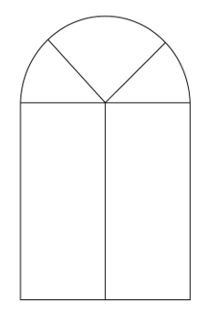

- **A**. 12平方米
- **B**. 15.75平方米
- **C**. 16.25平方米
- **D**. 18平方米

## 第 70 题　qid 4817946 · 数学运算

某疫苗共需接种2剂次方可达到最佳效果。A市的接种人数占比统计如下图所示，其中，区域“0”表示尚未接种，区域“1”表示只接种1剂次，区域“2”表示已接种2剂次。假设ABC是四分之一圆面，D、E是中点，BDFE是正方形，则该市某疫苗只接种1剂次的人数占比：

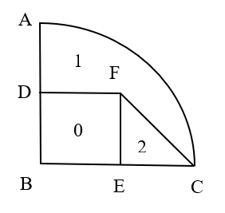

- **A**. 超过40%但不到50%
- **B**. 刚好50%
- **C**. 超过50%但不到60%
- **D**. 超过60%

## 第 71 题　qid 4817912 · 图形推理

把下面的6个图形分为两类，使每一类图形都有各自的共同规律，分类正确的是：

- **A**. ①②⑥，③④⑤
- **B**. ①②④，③⑤⑥
- **C**. ①③④，②⑤⑥
- **D**. ①③⑤，②④⑥

## 第 72 题　qid 4818255 · 图形推理

从所给的四个选项中，选择最合适的一个填入问号处，使之呈现一定的规律性：

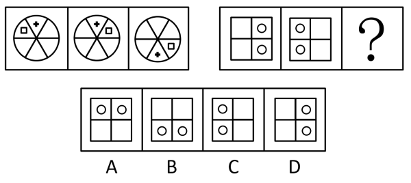

- **A**. A
- **B**. B
- **C**. C
- **D**. D

## 第 73 题　qid 4818247 · 图形推理

从所给的四个选项中，选择最合适的一个填入问号处，使之呈现一定的规律性：

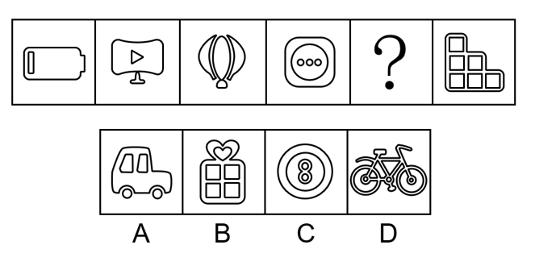

- **A**. A
- **B**. B
- **C**. C
- **D**. D

## 第 74 题　qid 4818229 · 图形推理

从所给的四个选项中，选择最合适的一个填入问号处，使之呈现一定的规律性：

- **A**. A
- **B**. B
- **C**. C
- **D**. D

## 第 75 题　qid 4818065 · 图形推理

左边给定的是纸盒外表面的展开图，右边哪一项能由它折叠而成？ 

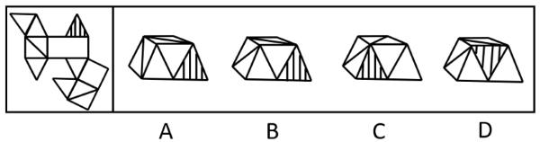

- **A**. A
- **B**. B
- **C**. C
- **D**. D

## 第 76 题　qid 4817969 · 定义判断

机械团结是在社会组织中由于成员之间按彼此相似或相同的劳动形成的团结，个体保持着强烈的认同感和归属感。
根据上述定义，下列哪项是机械团结？

- **A**. 家庭里，各个成员有着共同的道德伦理观念，相亲相爱、互帮互助，营造活泼有爱的氛围
- **B**. 乡村中，村民们在生产时从事相类似的工作，共同的经验和共享的信念使他们团结在一起
- **C**. 企业里，所有员工都认可共同的企业文化，每个人都各司其职，在各自的岗位上积极奋进
- **D**. 社团中，大多数年轻人都乐于尝试新鲜事物，基于个人的特色，协同完成共同的任务

## 第 77 题　qid 4817991 · 定义判断

知识流程外包是指把所获得的信息经过即时、综合的分析研究，最终把研究报告呈现给客户，作为决策的借鉴，其核心是通过提供业务专业知识而不是流程专业知识来为客户创造价值。
根据上述定义，下列哪项是知识流程外包？

- **A**. 某置业公司业务员受雇于某纺织公司，为后者新购买的土地及厂房等办理抵押贷款事项
- **B**. 某知名动漫画家受雇于某软件公司，为后者新开发的游戏软件打造多个性格迥异的角色形象
- **C**. 某知识产权专家受雇于某科技公司，跟踪比对全球数据库信息，为该公司起草专利申请的内容
- **D**. 某优秀大学毕业生受雇于某测绘公司，负责整理公司多年的测绘数据分析，分类做好档案管理工作

## 第 78 题　qid 4818049 · 定义判断

道德推脱是指个体对不道德行为产生的一种特定的认知倾向，以重新界定自己的行为和认知，最大程度地减少在不道德行为中的责任，降低对受害者痛苦感受的认同。道德推脱包括道德辩护、委婉标签、有利比较、责任转移、责任分散、忽视或扭曲结果、非人性化、责备归因等，这八个相互关联和相互作用的心理要素构成了心理联结机制，使道德自我调节功能减弱甚至失效。高水平道德推脱的个体在摆脱了内疚和自责后，更可能做出不道德的行为。
根据上述定义，下列不属于道德推脱的是：

- **A**. 老王看到每个领导都在为患病的小赵捐款，自己不敢不捐款
- **B**. 小孟看到众多同行都往辣条里掺苏丹红，自己不再感到不安
- **C**. 小明发现主管将公司打印纸带回家，认为自己也可以这么做
- **D**. 小陈觉得做假账是老板强制要求的，自己身为会计无需自责

## 第 79 题　qid 4818000 · 定义判断

吸引力梯度是指目标达成的差异会让目标吸引力发生变化的现象。当一个人面临两个同等吸引力的目标，并在一些因素的影响下开始向其中的一个目标移动时，这时较近的那个目标就开始增强它的吸引力，而远离的那个目标的吸引力就开始下降，这就出现了心理学上的目标梯度效应。即当目标越来越接近时，该目标的激励作用和吸引力也会越来越强。
根据上述定义，下列选项体现吸引力梯度现象的是：

- **A**. 小丁不喜欢吃药，但与其打针，他还是选择吃药
- **B**. 小明和小丽谈婚论嫁后，越来越觉得小丽比小芳好
- **C**. 小李坚信吸烟有害，但因戒烟失败，反而更爱吸烟
- **D**. 小华离家已多年，近乡情怯，离家越近越忐忑不安

## 第 80 题　qid 4818001 · 定义判断

社会固有脆弱性是指风险发生前系统已经存在的脆弱性，由社会系统内在特征及与系统潜在风险密切相关的自然环境要素决定。
根据上述定义，下列属于社会固有脆弱性的是：

- **A**. 东南沿海地区是我国泥石流灾害多发区
- **B**. 长期围湖造田使湖泊生态环境日趋恶化
- **C**. 突如其来的疫情使部分群众陷入贫困状态
- **D**. 人类的捕猎活动导致玉带海雕成为濒危物种

## 第 81 题　qid 4818006 · 定义判断

食育行动是指通过科学的营养知识普及活动，以适合一国国情的方式，让居民渐渐养成良好的饮食生活习惯，其意义在于提升公民的营养知识，继承传统饮食文化，培养良好饮食习惯，倡导低碳消费，并最终实现人与自然的和谐相处。
根据上述定义，下列属于食育行动的是：

- **A**. 烹饪学校要求学生安全地使用工具处理食材
- **B**. 社区开展帮助居民改善健康状况的体育锻炼活动
- **C**. 有关部门颁布了《国民营养计划（2017-2030年）》
- **D**. 某食品学院培养学生能够分辨天然食材与加工食材

## 第 82 题　qid 4818040 · 定义判断

顺行性遗忘和逆行性遗忘是遗忘的两种形式，可能与外伤、脑震荡、脑血管疾病等有关，应该针对病因进行治疗，顺行性遗忘指的是回忆不起疾病发生以后某一段时间内所经历的事件，逆行性遗忘指的是回忆不起疾病发生之前某一时间段的事件。
根据上述定义，下列属于逆行性遗忘的是：

- **A**. 某患者摔伤之后，记得自己的生活习惯、节气习俗等，但出门经常不记得带手机
- **B**. 某患者摔伤之后，记得自己的乳名、家乡，但对各种生活习惯、节气习俗等的记忆越来越模糊
- **C**. 某患者摔伤之后，记得自己是哪里人，父母叫什么名字，但不记得受伤前他在哪里、在做什么事情
- **D**. 某患者摔伤之后，记得自己的职业、自己的单位，但不记得自己如何来到医院，到医院后经历过哪些事情

## 第 83 题　qid 4818042 · 定义判断

医共体是指一个区域内的医院与其他医疗服务机构或组织联系在一起，重新组合构建的一个整体性的全新医疗组织架构，它运用的是核心医院的家族式管理方式。以大家长身份来整合与统筹集团内的医疗资源、同时重建集团内部的管理架构、组织系统和医疗服务的体系以及相互之间的组织构成等。
根据上述定义，下列选项属于医共体的是：

- **A**. 若干市属医院与社区卫生服务中心联合起来为居民提供健康服务，解决百姓看病难的问题
- **B**. 全国著名的皮肤病院和研究所的知名专家们利用周末联合开展义诊，为百姓提供咨询服务
- **C**. 某医药公司配合“基层呼吸疾病防治联盟”，以县为单位建立“县城肺炎防控能力指导中心”
- **D**. 以区级医院为龙头成立医疗管理委员会，建立卫生服务体系，实现区乡两级医疗卫生资源共享

## 第 84 题　qid 4818259 · 定义判断

城市生产空间优化是指通过城市产业发展空间规模与布局的调整促进生产优化的过程；城市生活空间优化是指通过调整城市不同类型生活空间的分布及相对距离，在提高城市居民就业、服务、公园绿地等各类活动空间可达性的基础上提高居民生活便捷度，改善居民生活环境，提高居民生活质量。
根据上述定义，下列不属于城市生活空间优化的是：

- **A**. 某市今年结合新一轮城市品质提升工程，统筹实施拆墙透绿，继续建成一批精品项目。共完成拆墙透绿点位978个，拆除围墙总长度83510米
- **B**. 某省会城市将原有的客车厂、玻璃厂、轧钢厂等工厂搬迁到同一个工业园区，不仅节约了企业的物流成本，而且形成了完整的产业链
- **C**. 某市计划在其老城区及新开发片区建设完善公共停车设施，弥补停车短板，共计划新增停车场13座，泊位3327个
- **D**. 长期以来，某市内河两岸集聚了很多脏乱差的小作坊，在河运整治的过程中，该市将这些小作坊拆除

## 第 85 题　qid 4818051 · 定义判断

危机学习是指政府受危机触发，有目标地不断调整、改变与创新理念和行为来解决问题，从而适应新时代社会治理需要的学习全过程。它可以分为单环危机学习和双环危机学习。前者是指在不改变组织目标和价值观的前提下，将组织的行为策略与结果联系起来并对其修正。使组织功效保持在组织规范与目标规定的范围内；后者是指重新评价组织的本质、价值观和基本目标继而改变行动。因此也被称作是变革型学习。
根据上述定义，下列属于双环危机学习的是：

- **A**. 某县政府在转变治理理念后实施山水田林生态综合整治
- **B**. 某地环保站能源项目因建设资金补偿争议而被政府叫停
- **C**. 某教育类慈善基金会响应政府号召主动停止超范围募捐
- **D**. 某社区应上级要求开展“垃圾分类屋”建设协调工作会

## 第 86 题　qid 4818054 · 类比推理

连理枝：玫瑰

- **A**. 梧桐雨：明月
- **B**. 丁香结：鸿雁
- **C**. 昆山玉：松柏
- **D**. 杨柳枝：长亭

## 第 87 题　qid 4818044 · 类比推理

化险为夷：转危为安

- **A**. 异曲同工：深入浅出
- **B**. 承前启后：继往开来
- **C**. 除旧布新：空前绝后
- **D**. 畏首畏尾：瞻前顾后

## 第 88 题　qid 4817887 · 类比推理

开水瓶：保温

- **A**. 密码锁：加密
- **B**. 体温计：测温
- **C**. 热水器：洗澡
- **D**. 保险箱：安全

## 第 89 题　qid 4817947 · 逻辑判断

鹬蚌相争，渔翁得利

- **A**. 兼听则明，偏信则暗
- **B**. 塞翁失马，焉知非福
- **C**. 户枢不蠹，流水不腐
- **D**. 城门失火，殃及池鱼

## 第 90 题　qid 4818276 · 类比推理

刷脸支付：人脸识别：人工智能

- **A**. 自动驾驶：环保汽车：清洁能源
- **B**. 语音助手：翻译软件：5G网络
- **C**. 山地车：自行车：滑板车
- **D**. 网络家电：智能家居：物联技术

## 第 91 题　qid 4818059 · 类比推理

屈驾：赐教：斧正

- **A**. 芳龄：寒舍：令堂
- **B**. 敬候：光临：笑纳
- **C**. 久仰：留步：拙见
- **D**. 敢问：俯就：包涵

## 第 92 题　qid 4818464 · 类比推理

酉时：戌时：亥时

- **A**. 立春：立秋：立冬
- **B**. 颔联：颈联：尾联
- **C**. 口琴：古琴：胡琴
- **D**. 吴语：粤语：软语

## 第 93 题　qid 4818020 · 类比推理

五音：商：徵

- **A**. 五经：易：乐
- **B**. 五谷：麦：稷
- **C**. 五金：金：铝
- **D**. 五行：火：雷

## 第 94 题　qid 4818113 · 类比推理

银杏 对于 （    ） 相当于 （    ） 对于 黑管

- **A**. 大乔木；克拉管
- **B**. 五角枫；管乐器
- **C**. 公孙木；单簧管
- **D**. 中草药；双簧管

## 第 95 题　qid 4818128 · 类比推理

安居乐业 对于 （    ） 相当于 （    ） 对于 抱残守缺

- **A**. 安土重迁；墨守成规
- **B**. 颠沛流离；革故鼎新
- **C**. 丰衣足食；独辟蹊径
- **D**. 背井离乡；推陈出新

## 第 96 题　qid 4818454 · 逻辑判断

一项最新研究指出，可以根据大脑血清素系统的变化提前20年发现帕金森病的早期发病征兆。在该跟踪研究中，研究人员招募了14名携带一种极为罕见的突变基因的志愿者。这些志愿者的这种突变基因几乎肯定会在他们一生中的某个阶段诱发帕金森病。研究人员表示，血清素系统功能是判断帕金森病前兆的一个很好指标，因为在尚未确诊的参与者体内发现了血清素系统的可检测变化。
以下各项如果为真，最能支持上述研究的是：

- **A**. 全球已知只有约100人携带这种突变基因
- **B**. 医生可以在最常见的症状出现之前诊断出帕金森病
- **C**. 研究人员指出，血清素系统变化是迄今发现的帕金森病最早信号
- **D**. 因志愿者都携带有极罕见的突变基因，该研究结论无法覆盖其他患者

## 第 97 题　qid 4818236 · 逻辑判断

研究发现，每天保持三顿正餐的时间表大致稳定，对于保持良好的身体状况非常重要，这是因为保持规律的用餐时间能够改善新陈代谢和身心状态，更具体地说，遵循并保持固定的饮食时间表与肥胖、代谢综合征、心血管疾病和情绪改善的风险降低有关，这种习惯也有利于我们自身生物钟的良好运行，从而使我们以良好的身心状态应对日常工作和生活。
以下各项如果为真，最能支持上述研究的是：

- **A**. 一些著名的医学家呼吁公众不仅要考虑每天的饮食健康和保持适当体育锻炼，还要注意饮食规律
- **B**. 某生物医药研究中心去年发布的一项研究结果表明，周末不规律的饮食可能与体重指数的增加有关
- **C**. 如果我们不经常参加体育运动，那么罹患II型糖尿病等代谢性疾病以及心血管疾病的风险就会有所增加
- **D**. 当我们的用餐时间与正常时间相差三小时以上时，对体重指数的影响最大，而代谢性疾病与肥胖密不可分

## 第 98 题　qid 4818463 · 逻辑判断

某研究机构通过的一项实验证明喜欢阅读文学名著的人理解他人的能力更强。该实验让参与者阅读古典名著、通俗小说和纪实文学。然后进行一项“从眼睛中读懂别人心思"的测试。结果发现，读名著的参与者更容易读懂别人的感情。研究者认为，文学名著更注重人物角色的刻画而不是情节的描述，从而要求读者对人物角色进行细致思考和推理，因此文学名著有助于人们更好地感知他人。
以下各项如果为真，最能削弱上述结论的是：

- **A**. “从眼睛中读懂别人心思”测试本身的设计缺乏科学性
- **B**. 相较于人物角色的刻画，许多文学名著更注重情节描述
- **C**. 许多善解人意的人具有理工科背景，很少阅读文学名著
- **D**. 另有研究证明，理解他人能力强的人更喜欢读科技著作

## 第 99 题　qid 4818186 · 逻辑判断

有学者指出：在经济新常态背景下，我国“特殊逆城镇化”现象正大量发生，即在城镇化总体上尚未完成人口由乡村向城市集中的阶段和郊区化阶段的时候，“逆城镇化”现象已经开始涌现，在特有制度约束下形成“走入乡村”“走向小城”的人口活动趋势，并且，这一趋势预示着未来的发展潮流。
以下各项如果为真，不能支持上述学者观点的是：

- **A**. 近年来，异地养老是许多老年人改善生活品质的自发选择，城市老年人结伙搭伴到农村养老，成为一种潮流
- **B**. 进城农民工、大中专毕业生、退役士兵和科技人员等返乡下乡创业和就业，推动了农村一二三产业融合发展
- **C**. 城市居民到城镇、乡村长期居住，带动当地重新繁荣，在部分乡村出现一些来自全国各地不同人们的聚居点
- **D**. 据某研究机构不完全统计，城市居民平均每人每年深入农村体验生活3次，大大促进了农村的经济社会发展

## 第 100 题　qid 4818205 · 逻辑判断

俗话说：吃饭不吃蒜，香味少一半；吃肉不吃蒜，营养减一半。然而，某养生专家却说：“大蒜炝锅致癌”。因为大蒜在炝锅时，其所含氨基酸和糖类在高温烹调过程中会发生“美拉德反应”，从而产生丙烯酰胺。如果大蒜切的越薄、受热温度越高、受热时间越长，烹调时的“美拉德反应”就会越剧烈，产生的丙烯酰胺也就越多。丙烯酰胺属于2A级致癌物。
以下各项如果为真，最能削弱上述结论的是：

- **A**. 对健康饮食的重视使大部分人很少采用炝锅的方式烹饪
- **B**. 高温的煎炸和漂烫会对大蒜素产生破坏损失大蒜的营养
- **C**. 所谓的2A级致癌物是指对人类致癌性证据有限的物质
- **D**. 丙烯酰胺致癌临界点为短时间内使用炝锅蒜32.7公斤

## 第 101 题　qid 4818462 · 逻辑判断

研究表明，我们口腔中大约有700种细菌驻扎，其中12种被认为是“坏细菌”，也就是致病细菌。在已知引起和发展牙周炎的所有细菌种类中，有一种叫牙龈卟啉单胞菌的细菌，它是一种主要的牙周病原体，也是臭名昭著的“免疫逃避大王”，极具侵略性。某研究发现，感染牙龈卟啉单胞菌的动物模型显示出海马体损伤。海马体是与记忆最相关的大脑区域。
由此可以推出：

- **A**. 加强口腔健康就能改善大脑记忆功能
- **B**. 从口腔到大脑的病程过渡始于牙周炎的发展
- **C**. 没有口腔问题的人都不太可能出现思维问题或痴呆
- **D**. 患严重牙周炎的人患认知障碍或痴呆症的风险较大

## 第 102 题　qid 4818027 · 定义判断

人们在唱歌时身体会发生一系列变化，如压力荷尔蒙水平下降以及内啡肽水平变化等，而内啡肽荷尔蒙会直接影响个人情绪的变化。科学研究还发现，脑部血流量增加会显著提升老年痴呆症患者的记忆能力。生活中许多人喜欢音乐和唱歌，不要小看这一爱好，因为越来越多的研究发现，唱歌可以帮助患有老年痴呆症的人更好地克服记忆障碍。
以下各项如果为真，属于上述结论必要前提的是：

- **A**. 唱歌会显著改善患有肺部疾病的患者的呼吸
- **B**. 患有老年痴呆症的人比其他老年人更加喜爱唱歌
- **C**. 参加集体合唱可以帮助人们提升自我价值和自信心
- **D**. 老年痴呆症病人在唱歌时大脑皮质区的血流量会显著增加

## 第 103 题　qid 4818029 · 逻辑判断

在面向我国科技强国和现代化强国建设目标的背景下，要满足经济社会发展科技的要求，就要不断强化科技创新对经济社会发展的战略支撑。只有大力促进科技治理体系和治理能力现代化，才能充分发挥科技创新对经济社会发展的促进作用。
由此可以推出：

- **A**. 只要不断强化科技创新对经济社会发展的战略支撑，就能满足经济社会发展科技的要求
- **B**. 如果不能满足经济社会发展科技的要求，就不能强化科技创新对经济社会发展的战略支撑
- **C**. 如果不大力促进科技治理体系与治理能力现代化，就不能充分发挥科技创新对经济社会发展的促进作用
- **D**. 除非充分发挥科技创新对经济社会发展的促进作用，否则不能大力促进科技治理体系与治理能力的现代化

## 第 104 题　qid 4818028 · 类比推理

球赛即将进入决赛阶段，五个球迷对决赛队伍做了预测。
甲：如果法国无法进入决赛，那么意大利也不会进入决赛；
乙：法国没戏，意大利会进决赛；
丙：或者法国进入决赛，或者葡萄牙进入决赛；
丁：法国和葡萄牙都不可能进入决赛；
戊：意大利和葡萄牙进入了决赛。
结果只有两个球迷预测错误，那么预测错误的球迷是：

- **A**. 甲和丁
- **B**. 甲和丙
- **C**. 丙和戊
- **D**. 丁和戊

## 第 105 题　qid 4818036 · 逻辑判断

某超市对甲和乙两种饮料进行特价促销，促销时间为周三到周六共4天。活动结束后发现，每天饮料销售数量均为整箱，甲饮料每天的销售量为1到4箱不等，乙饮料每天的销售量为1至5箱不等，且销售量还符合以下规律：
①甲饮料每天销售的量并不相同，乙也如此
②甲、乙销售数量总和随着日期推移每天增加1箱
③星期三销售了3箱甲饮料，星期四销售了1箱甲饮料，星期六销售了5箱乙饮料
由此可以推出：

- **A**. 星期三甲、乙共销售了4箱
- **B**. 星期四甲、乙共销售了6箱
- **C**. 星期五甲、乙共销售了8箱
- **D**. 星期六甲、乙共销售了10箱

## 材料 1

### 第 106 题　qid 4817973 · 平均数

2020年全国城乡居民人均可支配收入差额约为：

- **A**. 19251元
- **B**. 26725元
- **C**. 39273元
- **D**. 43856元

### 第 107 题　qid 2578842 · 增长

2020年全国城镇居民人均可支配收入增长率为：

- **A**. 3.69%
- **B**. 6.93%
- **C**. 8.62%
- **D**. 10.74%

### 第 108 题　qid 2578841 · 平均数

2017-2020年全国农村人均可支配收入增长最慢的年份是：

- **A**. 2017
- **B**. 2018
- **C**. 2019
- **D**. 2020

### 第 109 题　qid 2578840 · 综合

与2019年相比，2020年城镇居民与农村居民的可支配收入差额：

- **A**. 上升了450.9元
- **B**. 下降了450.9元
- **C**. 上升了610.1元
- **D**. 下降了610.1元

### 第 110 题　qid 2578839 · 综合

根据以上材料可以推出的是：

- **A**. 2020年全国居民人均可支配收入约为30493.9元
- **B**. 2015-2020年农村居民人均可支配收入增速持续上升
- **C**. 2014-2020年工资性收入占农村居民可支配收入的比重始终最高
- **D**. 2014年农民经营性收入小于同时期城镇居民可支配收入的20%

## 材料 2

        2020年全国人口共141178万人，比2010年增长了约5.38%。从地区分布上看，2020年东部地区人口占39.93%，中部地区占25.83%，西部地区占27.12%，东北地区占6.98%。与2010年相比，东部地区人口所占比重上升2.15个百分点，中部地区下降0.79个百分点，西部地区上升0.22个百分点，东北地区下降1.20个百分点。

        从性别构成上看，2020年男性人口为72334万人，女性人口为68844万人。从年龄构成上看，2020年0-14岁人口为25338万人，15-59岁人口为89438万人，60岁及以上人口为26402万人（其中，65岁及以上人口为19064万人）。从城乡分布上看，2020年居住在城镇的人口为90199万人，居住在乡村的人口为50979万人，与2010年相比，城镇人口增加23642万人，乡村人口减少16436万人。从民族构成上看，2020年汉族人口为128631万人，各少数民族人口为12547万人，与2010年相比，汉族人口增长4.93%，各少数民族人口增长10.26%，少数民族人口比重上升0.40个百分点。

### 第 111 题　qid 4818011 · 增长

2020年全国人口比2010年全国人口增加的数量位于以下哪个区间：

- **A**. 5000万人-6000万人
- **B**. 6000万人-7000万人
- **C**. 7000万人-8000万人
- **D**. 8000万人-9000万人

### 第 112 题　qid 4818013 · 综合

2020年，中部地区人口比西部地区人口少：

- **A**. 约1721万人
- **B**. 约1821万人
- **C**. 约1921万人
- **D**. 约2021万人

### 第 113 题　qid 4818014 · 综合

2010年，东部地区人口是东北地区人口的：

- **A**. 约4.6倍
- **B**. 约5.7倍
- **C**. 约6.5倍
- **D**. 约7.3倍

### 第 114 题　qid 4818016 · 比重

2020年，65岁及以上人口占比与60-64岁人口占比相差：

- **A**. 约6.3%
- **B**. 约7.3%
- **C**. 约8.3%
- **D**. 约9.3%

### 第 115 题　qid 4818017 · 综合

能够从上述资料推出的是：

- **A**. 2010年，全国人口超过13.5亿人
- **B**. 2010年，我国西部地区各少数民族人口不超过5000万人
- **C**. 2020年，我国80%以上人口都在60岁以下（不含60岁）
- **D**. 2020年，男性人口占比超过女性人口占比3个百分点以上

## 答案与解析

第 1 题

**答案**：B

**来源参考解析（非官方标准答案）**

本题考查政治常识。
①错误，《决议》中的“序言”部分指出：“一九四五年党的六届七中全会通过的《关于若干历史问题的决议》、一九八一年党的十一届六中全会通过的《关于建国以来党的若干历史问题的决议》，实事求是总结党的重大历史事件和重要经验教训，在重大历史关头统一了全党思想和行动，对推进党和人民事业发挥了重要引领作用，其基本论述和结论至今仍然适用。”故本次通过的决议为党的历史上的第三个决议。
②错误，《决议》中的“说明”部分指出：“突出中国特色社会主义新时代这个重点。这次全会决议重点总结新时代党和国家事业取得的历史性成就、发生的历史性变革和积累的新鲜经验，主要考虑是，对党在新民主主义革命时期、社会主义革命和建设时期、党的十一届三中全会到党的十一届六中全会期间的历史，前两个历史决议已经作过系统总结；对改革开放和社会主义现代化建设新时期的成就和经验，党的十一届三中全会召开二十周年、三十周年时党中央都进行了认真总结，我在庆祝改革开放四十周年大会上发表讲话，也作了系统总结。”
③正确，《决议》在“四、开创中国特色社会主义新时代”部分的“（三）在经济建设上”中指出：“党中央提出，我国经济发展进入新常态，已由高速增长阶段转向高质量发展阶段，面临增长速度换挡期、结构调整阵痛期、前期刺激政策消化期‘三期叠加’的复杂局面，传统发展模式难以为继。”
④正确，《决议》在“四、开创中国特色社会主义新时代”部分的“（九）在生态文明建设上”中指出：“我国积极参与全球环境与气候治理，作出力争二〇三〇年前实现碳达峰、二〇六〇年前实现碳中和的庄严承诺，体现了负责任大国的担当。”
⑤正确，《决议》在“四、开创中国特色社会主义新时代”部分的“（八）在社会建设上”中指出：“我国建成世界上规模最大的社会保障体系，十亿二千万人拥有基本养老保险，十三亿六千万人拥有基本医疗保险。全面推进健康中国建设，坚持预防为主的方针，深化医药卫生体制改革，引导医疗卫生工作重心下移、资源下沉，及时推动完善重大疫情防控体制机制、健全国家公共卫生应急管理体系，促进中医药传承创新发展，健全遍及城乡的公共卫生服务体系。”
故③④⑤正确。
故正确答案为B。

---

第 2 题

**答案**：B

**来源参考解析（非官方标准答案）**

本题考查政治常识。
①②③⑤正确，④错误。习近平在庆祝中国共产党成立100周年大会上的讲话指出：“为了实现中华民族伟大复兴，中国共产党团结带领中国人民，浴血奋战、百折不挠，创造了新民主主义革命的伟大成就······为了实现中华民族伟大复兴，中国共产党团结带领中国人民，自力更生、发愤图强，创造了社会主义革命和建设的伟大成就······为了实现中华民族伟大复兴，中国共产党团结带领中国人民，解放思想、锐意进取，创造了改革开放和社会主义现代化建设的伟大成就······为了实现中华民族伟大复兴，中国共产党团结带领中国人民，自信自强、守正创新，统揽伟大斗争、伟大工程、伟大事业、伟大梦想，创造了新时代中国特色社会主义的伟大成就。”
故正确答案为B。

---

第 3 题

**答案**：B

**来源参考解析（非官方标准答案）**

本题考查政治常识。
2021年12月8日至10日，中央经济工作会议在北京举行。
①错误，会议要求，明年经济工作要稳字当头、稳中求进，各地区各部门要担负起稳定宏观经济的责任，各方面要积极推出有利于经济稳定的政策，政策发力适当靠前。
②正确，会议认为，要正确认识和把握资本的特性和行为规律。社会主义市场经济是一个伟大创造，社会主义市场经济中必然会有各种形态的资本，要发挥资本作为生产要素的积极作用，同时有效控制其消极作用。要为资本设置“红绿灯”，依法加强对资本的有效监管，防止资本野蛮生长。
③正确，会议指出，在充分肯定成绩的同时，必须看到我国经济发展面临需求收缩、供给冲击、预期转弱三重压力。世纪疫情冲击下，百年变局加速演进，外部环境更趋复杂严峻和不确定。
④错误，会议认为，要正确认识和把握碳达峰碳中和。实现碳达峰碳中和是推动高质量发展的内在要求，要坚定不移推进，但不可能毕其功于一役。
⑤错误，会议认为，实现共同富裕目标，首先要通过全国人民共同奋斗把“蛋糕”做大做好，然后通过合理的制度安排把“蛋糕”切好分好。
故②③正确。
故正确答案为B。

---

第 4 题

**答案**：C

**来源参考解析（非官方标准答案）**

本题考查政治常识。
中央人才工作会议于2021年9月27日至28日在北京召开。中共中央总书记、国家主席、中央军委主席习近平出席会议并发表重要讲话。
①正确，习近平总书记在会议上强调，要坚持党管人才，坚持面向世界科技前沿、面向经济主战场、面向国家重大需求、面向人民生命健康，深入实施新时代人才强国战略，全方位培养、引进、用好人才，加快建设世界重要人才中心和创新高地，为2035年基本实现社会主义现代化提供人才支撑，为2050年全面建成社会主义现代化强国打好人才基础。
②错误，习近平总书记在中央军委人才工作会议上指出，政治标准是我军人才第一位的标准，政治要求是对我军人才最根本的要求。
③正确，习近平总书记在会议上指出，要用好用活各类人才，对待急需紧缺的特殊人才，要有特殊政策，不要求全责备，不要论资排辈，不要都用一把尺子衡量，让有真才实学的人才英雄有用武之地。
④正确，习近平总书记在会议上强调，要造就规模宏大的青年科技人才队伍，把培育国家战略人才力量的政策重心放在青年科技人才上，支持青年人才挑大梁、当主角。
故①③④正确。
故正确答案为C。

---

第 5 题

**答案**：A

**来源参考解析（非官方标准答案）**

本题考查政治常识。
①错误，塞罕坝精神的内涵是：“牢记使命、艰苦创业、绿色发展。”
②正确，特区精神的内涵是：“敢闯敢试、敢为人先、埋头苦干。”2018年4月13日，习近平总书记在庆祝海南建省办经济特区30周年大会上的讲话中指出：“经济特区要勇于扛起历史责任，适应国内外形势新变化，按照国家发展新要求，顺应人民新期待，发扬敢闯敢试、敢为人先、埋头苦干的特区精神，始终站在改革开放最前沿，在各方面体制机制改革方面先行先试、大胆探索，为全国提供更多可复制可推广的经验。”
③错误，张思德精神的内涵是：“全心全意为人民服务。”2017年8月13日，习近平总书记以普通党员身份参加所在党支部专题组织生活会时强调：“希望大家做一个脱离低级趣味的人、高尚的人。同志们现在从事的是一项崇高的事业，在这里工作，升官发财请走别路，贪生怕死莫入此门。榜样是谁呢？张思德、白求恩、焦裕禄、麦贤得，有历史的楷模，也有时代的楷模。这些人都是在普通的岗位上，但他们有一颗金子般发光的心，我希望同志们的参照系就是这些楷模。”“亲民爱民、艰苦奋斗、科学求实、迎难而上、无私奉献”为焦裕禄精神的内涵。
④错误，红船精神的内涵是：“开天辟地、敢为人先的首创精神，坚定理想、百折不挠的奋斗精神，立党为公、忠诚为民的奉献精神。”2005年6月，习近平总书记在文章《弘扬“红船精神” 走在时代前列》中首次提出并阐释了“红船精神”。但是目前公布的中国共产党精神谱系中，并不包含红船精神。
故②正确，其余错误。
故正确答案为A。

---

第 6 题

**答案**：D

**来源参考解析（非官方标准答案）**

本题考查政治常识。
A项正确，南水北调工程是迄今为止世界上规模最大的调水工程，工程横穿长江、淮河、黄河、海河四大流域，涉及十余个省（自治区、直辖市），输水线路长，穿越河流多，工程涉及面广，效益巨大，包含水库、湖泊、运河、河道、大坝等水利工程项目，是一个十分复杂的巨型水利工程，其规模及难度国内外均无先例。仅东、中线一期工程土石方开挖量17.8亿立方米，土石方填筑量6.2亿立方米，混凝土量6300万立方米。
B项正确，2021年5月15日7时18分，天问一号探测器成功着陆于火星乌托邦平原南部预选着陆区，“祝融号”火星车最终成功着陆火星，完成了天问一号“绕、着、巡”的第二步。这是我国首次实现地外行星着陆，使我国成为第二个成功着陆火星的国家。
C项正确，习近平主席在二〇二二年新年贺词中指出，截至目前，中国累计向120多个国家和国际组织提供20亿剂新冠疫苗。世界各国风雨同舟、团结合作，才能书写构建人类命运共同体的新篇章。据统计我国成为对外提供疫苗最多的国家。
D项错误，2021年10月16日0时23分，搭载神舟十三号载人飞船的长征二号F遥十三运载火箭，在酒泉卫星发射中心按照预定时间精准点火发射，约582秒后，神舟十三号载人飞船与火箭成功分离，进入预定轨道，顺利将翟志刚、王亚平、叶光富3名航天员送入太空，飞行乘组状态良好，发射取得圆满成功，王亚平成为中国首位出舱活动的女航天员。
本题为选非题，故正确答案为D。

---

第 7 题

**答案**：B

**来源参考解析（非官方标准答案）**

本题考查法律常识。
①正确，根据《中国共产党党徽党旗条例》第二条第一款规定：“中国共产党党徽为镰刀和锤头组成的图案。中国共产党党旗为旗面缀有金黄色党徽图案的红旗。”
②正确，根据《中国共产党党徽党旗条例》第二条第二款规定：“党徽党旗表明中国共产党是中国工人阶级的先锋队，同时是中国人民和中华民族的先锋队，是为中国人民谋幸福、为中华民族谋复兴，为坚持和发展中国特色社会主义、为实现共产主义远大理想而不懈奋斗的马克思主义政党。”
③错误，根据《中国共产党党徽党旗条例》第十三条规定：“党徽党旗及其图案不得用于：······商标、授予专利权的外观设计和商业广告······”
④错误，根据《中国共产党党徽党旗条例》第九条规定：“下列情形应当使用党旗：······举行新党员入党宣誓仪式，组织党员重温入党誓词······”
故①②正确，有2项。
故正确答案为B。

---

第 8 题

**答案**：D

**来源参考解析（非官方标准答案）**

本题考查人文常识。
A项正确，电影《长津湖》以抗美援朝战争中长津湖战役为背景，以英雄团队“穿插连”战斗行动为主线，选取战争中的重大事件、典型场景、主要行动和代表性人物，将抗美援朝精神生动形象地呈现在观众面前，深刻诠释了爱国主义精神、革命英雄主义精神、革命乐观主义精神、革命忠诚精神和国际主义精神。
B项正确，电视剧《山海情》讲述了20世纪90年代以来，宁夏西海固人民在党和国家扶贫政策的引导下，在福建的对口帮扶下，不断探索脱贫致富路径，通过奋斗获得美好生活的故事。
C项正确，歌曲《灯火里的中国》作为一首紧扣时代、贴近“百姓”的歌曲，它的歌词以大湾区的都市街巷、社区广场、远山村落、海湾港口为背景，从“百姓”视角里眺望“万家灯火”，展现了“灯火里”的繁华似锦和安详宁静、“灯火里”的奋发图强和生生不息。
D项错误，电视剧《觉醒年代》以1915年《青年杂志》问世到1921年《新青年》成为中国共产党机关刊物为贯穿，展现了从新文化运动、五四运动到中国共产党建立这段波澜壮阔的历史画卷。不包括全面抗战这段历史。
本题为选非题，故正确答案为D。

---

第 9 题

**答案**：B

**来源参考解析（非官方标准答案）**

本题考查法律常识。
A项正确，根据《机动车交通事故责任强制保险条例》第二十三条第一款规定：“机动车交通事故责任强制保险在全国范围内实行统一的责任限额。责任限额分为死亡伤残赔偿限额、医疗费用赔偿限额、财产损失赔偿限额以及被保险人在道路交通事故中无责任的赔偿限额。”
B项错误，根据《机动车交通事故责任强制保险条例》第二十一条第一款规定：“被保险机动车发生道路交通事故造成本车人员、被保险人以外的受害人人身伤亡、财产损失的，由保险公司依法在机动车交通事故责任强制保险责任限额范围内予以赔偿。”因此，交强险赔偿事故中对方的车辆维修费，但不负责赔偿被保险人本身车辆的维修费。
C项正确，根据《机动车交通事故责任强制保险条例》第二条第一款规定：“在中华人民共和国境内道路上行驶的机动车的所有人或者管理人，应当依照《中华人民共和国道路交通安全法》的规定投保机动车交通事故责任强制保险。”
D项正确，根据《机动车交通事故责任强制保险条例》第八条规定：“被保险机动车没有发生道路交通安全违法行为和道路交通事故的，保险公司应当在下一年度降低其保险费率。在此后的年度内，被保险机动车仍然没有发生道路交通安全违法行为和道路交通事故的，保险公司应当继续降低其保险费率，直至最低标准。被保险机动车发生道路交通安全违法行为或者道路交通事故的，保险公司应当在下一年度提高其保险费率。多次发生道路交通安全违法行为、道路交通事故，或者发生重大道路交通事故的，保险公司应当加大提高其保险费率的幅度。在道路交通事故中被保险人没有过错的，不提高其保险费率。降低或者提高保险费率的标准，由国务院保险监督管理机构会同国务院公安部门制定。”
本题为选非题，故正确答案为B。

---

第 10 题

**答案**：C

**来源参考解析（非官方标准答案）**

本题考查法律常识。
A项错误，根据《中华人民共和国社会保险法》第二十三条规定：“职工应当参加职工基本医疗保险，由用人单位和职工按照国家规定共同缴纳基本医疗保险费。无雇工的个体工商户、未在用人单位参加职工基本医疗保险的非全日制从业人员以及其他灵活就业人员可以参加职工基本医疗保险，由个人按照国家规定缴纳基本医疗保险费。”李某已入职用人单位，应当参加职工基本医疗保险。
C项正确，B、D两项错误，根据《中华人民共和国社会保险法》第五十八条第一款规定：“用人单位应当自用工之日起三十日内为其职工向社会保险经办机构申请办理社会保险登记。未办理社会保险登记的，由社会保险经办机构核定其应当缴纳的社会保险费。”
故正确答案为C。

---

第 11 题

**答案**：D

**来源参考解析（非官方标准答案）**

本题考查管理常识。
A项错误，在现代管理中，机构、法和人都有能量问题，根据能量的大小可以建立一定的秩序，一定的规范或一定的标准。能级原理是指管理的组织结构与组织成员的能级结构必须相互适应和协调，这样才能提高管理效率，实现组织目标。题干表述未体现这一原理。
B项错误，动力原理是指管理者正确运用管理赖以顺利进行的各种动力因素，以保证管理按既定目标持续有效进行的理论。一般认为基本动力有：物质动力、精神动力和信息动力。综合协调地运用三种动力，可使其产生互补作用，保证管理有效进行。题干表述未体现这一原理。
C项错误，管理学中的控制性原理是指检查工作是否按既定的计划、标准和方法进行，及时发现偏差，分析原因，进行纠正，以确保组织目标的实现。题干表述未体现这一原理。
D项正确，整分合原理是指现代管理活动必须从系统原理出发，把任何管理对象、问题，视为一个复杂的社会目的组织系统。首先，从整体上把握系统的环境，分析系统的整体性质、功能，确定出总体目标；然后围绕着总目标，进行多方面的合理分解、分工，以构成系统的结构与体系；在分工之后，要对各要素、环节、部分及其活动进行系统综合，协调管理，形成合理的系统流通构成，以实现总目标。中国在生态文明建设整体布局下制定碳达峰行动计划是“整”，支持有条件的地方和重点行业、重点企业率先达峰是“分”，最后都是为了实现双碳目标。体现了整分合原理。
故正确答案为D。

---

第 12 题

**答案**：D

**来源参考解析（非官方标准答案）**

本题考查人文常识。
A项错误，秦始皇二十八年（公元前219年），秦始皇命监御史禄掌管军需供应，督率士兵、民夫在兴安境内湘江与漓江之间修建一条人工运河，运载粮饷。秦始皇三十三年（公元前214年），灵渠凿成，秦始皇迅速统一岭南。
B项错误，都江堰位于四川省成都市都江堰市城西，坐落在成都平原西部的岷江上，始建于秦昭王末年（约公元前256年～前251年），是蜀郡太守李冰父子在前人鳖灵开凿的基础上组织修建的大型水利工程，是全世界迄今为止，年代最久、唯一留存、仍在一直使用、以无坝引水为特征的宏大水利工程。
C项错误，郑国渠，于公元前246年（秦王政元年）由韩国水工郑国在秦国主持穿凿兴建，约十年后完工。是古代劳动人民修建的一项伟大工程，属于最早在关中建设的大型水利工程，位于今天的陕西省泾阳县西北25公里的泾河北岸。
D项正确，京杭大运河始建于春秋时期，是世界上里程最长、工程最大的古代运河，并且使用至今。春秋吴国为伐齐国而开凿邗沟，隋朝大幅度扩修并贯通至都城洛阳且连涿郡，元朝翻修时弃洛阳而取直至北京。解放后对运河进行了大规模整修，使其重新发挥航运、灌溉、防洪和排涝的多种作用。开凿到现在已有2500多年的历史。
故正确答案为D。

---

第 13 题

**答案**：C

**来源参考解析（非官方标准答案）**

本题考查人文常识。
A项正确，“若挥锦布绣，望芒兮无幅”出自西汉扬雄的《蜀都赋》，以“挥锦布绣”来描绘芳华辉映、华彩照人的蜀国景象，表达了作者对蜀绣技艺的高度赞扬。
B项正确，“门前艾蒲青翠，天淡纸鸢舞”出自宋代苏轼的《六幺令·天中节》，意思是门前挂着青翠的艾草、菖蒲，天高云淡风筝在随风飞舞。插艾和菖蒲是端午节的重要习俗之一。
C项错误，“三尺生绡作戏台，全凭十指逞诙谐”出自宋代释惠明的《手影戏》，意思是小小的一张皮影，简单的布幕舞台，操作者灵巧的手指，加上一点光亮，就能表现出生活中的人生百态，历史中的无数逸事。指的是皮影戏而非京剧。
D项正确，“镂金作胜传荆俗，翦彩为人起晋风”出自唐代李商隐的《人日即事》，意思是扬州的镂金工艺做得如此之好啊，它是传承自荆州的风俗；扬州的剪纸技艺是如此为人称道啊，是流传自晋代的风格。
本题为选非题，故正确答案为C。

---

第 14 题

**答案**：B

**来源参考解析（非官方标准答案）**

本题考查人文常识。
A项错误，长平之战，是公元前260年5月至10月秦国率军在赵国的长平一带同赵国军队发生的战争。战争的主要指挥官有秦国的白起、赵国的赵括。“纸上谈兵”原指赵括熟读兵书，却不能活用，后比喻空谈理论，不能解决实际问题，也比喻空谈不能成为现实。李牧是战国时期赵国名将，不是长平之战的主要统帅。
B项正确，淝水之战，发生于公元383年，是东晋十六国时期北方的统一政权前秦向南方东晋发起的侵略吞并战，于淝水交战，最终东晋仅以八万军力大胜八十余万前秦军。战争的主要指挥官有东晋的谢安、前秦的苻坚。“草木皆兵”来源于《晋书·苻坚载记》，指把山上的野草和树木都当作敌兵，形容为对方的声势所吓倒而疑神疑鬼产生错觉。
C项错误，垓下之战是汉高帝五年十二月项羽率领的楚军与刘邦率领的汉军在垓下进行的一场战略决战。战争的结果是项羽在乌江边自刎，汉军胜利。而“破釜沉舟”的典故出自秦末的巨鹿之战。
D项错误，蔡州之战是金朝与蒙古帝国、南宋进行的最后一场战役，金朝经多次挫败，元气大伤，根本无法抵抗蒙军。此战以后，金朝灭亡，蒙古疆域扩张至河南地区。战争的参战方有金朝、蒙古、南宋，主要指挥官有完颜守绪、完颜承麟、高剌哥、爱实。岳飞没有参与蔡州之战。“直捣黄龙”是指岳飞表明自己要一直打到黄龙府。现在指直取敌人巢穴，彻底消灭敌人。黄龙即黄龙府，辖地在今吉林一带，为金国政治经济中心。
故正确答案为B。

---

第 15 题

**答案**：B

**来源参考解析（非官方标准答案）**

本题考查科技常识。
A项正确，蚕豆病是葡萄糖-6-磷酸脱氢酶（G6PD）缺乏症的一个类型，表现为进食蚕豆后引起溶血性贫血，本病常发生于初夏蚕豆成熟季节。
B项错误，C项正确，蚕豆病又叫胡豆黄，是一种由于进食蚕豆、蚕豆制品、接触蚕豆花粉，或母亲食用蚕豆后哺乳婴幼儿所引起的一种急性血管内溶血性贫血。换句话说就是，当病人以各种形式接触到有关蚕豆的物品时，就可能会引起溶血病症。
D项正确，由题干“红细胞由于基因缺陷而不能抵抗氧化损伤易破裂”可知，蚕豆病发病是因为红细胞不能抵抗氧化损伤，因此蚕豆类的强氧化性食物都会导致该病发生。
本题为选非题，故正确答案为B。

---

第 16 题

**答案**：B

**来源参考解析（非官方标准答案）**

本题考查科技常识。
A项正确，虽然蛋白质对人体健康很重要，但是蛋白质不是吃得越多越好，摄入太多反而有害健康。人体是不储存蛋白质的，过多的蛋白质需要通过肾脏代谢排出体外，蛋白质摄入量的增加，会给肾脏带来更大的负担，进而损害肾脏。如果肾功能本身就受损，危害就更大了，同时也可能导致骨质疏松、血糖升高、脂肪堆积等。
B项错误，细胞鲜重中，含量最多的化合物是水，第二多的是蛋白质。细胞干重中，含量最多的化合物是蛋白质。
C项正确，蛋白质是组成人体一切细胞、组织的重要成分，机体所有重要的组成部分都需要有蛋白质的参与，是生命的物质基础和生命活动的主要承担者。在人体内蛋白质还具有调节、免疫、运输等作用。
D项正确，蛋白质是由氨基酸以“脱水缩合”的方式组成的多肽链经过盘曲折叠形成的具有一定空间结构的物质。蛋白质中一定含有碳、氢、氧、氮元素，也可能含有硫、磷等元素，各种蛋白质的含氮量很接近，平均为16%。在蛋白质元素组成中，最稳定的元素是氮。
本题为选非题，故正确答案为B。

---

第 17 题

**答案**：B

**来源参考解析（非官方标准答案）**

本题考查科技常识。
A项错误，藕是莲科植物茎，并不是根。可餐食也可药用，可生食也可煮食，是常用餐菜之一。
B项正确，仙人掌的刺可以被认为是退化的叶子。当叶片面积变小，就可以减少水分蒸发，使得仙人掌在烈日炎炎里将水分的损失降到最小。仙人掌身上密布着的刺还有保护作用，可以防止兽类啃食。
C项错误，榕树的“须”属于不定根中的气生根，是指由植物茎上发生的，生长在地面以上的、暴露在空气中的根，一般无根冠和根毛的结构，能起到吸收气体、支撑植物体向上生长、保持水分等作用。
D项错误，猪笼草的捕虫笼是猪笼草变形的叶片，当一片新的叶片生长出来时，在笼蔓的末端便已带有一个捕虫笼的雏形，卷须尾部扩大并反卷形成瓶状，可捕食昆虫。
故正确答案为B。

---

第 18 题

**答案**：C

**来源参考解析（非官方标准答案）**

本题考查科技常识。

A项正确，防腐剂是很多食品中的必要添加剂，是保存食物必不可少的成分，合格的防腐剂在安全使用范围内，对人体是无毒害的，它对人体的副作用甚至比不上钠。我国已经批准了32种可使用的食物防腐剂，像山梨酸钾，防腐性极强，毒性极小，人体中本身也含有，它们可以参与人体的正常代谢。

B项正确，糕点的制作过程通常需要经过高温烤制等，其所应用的防腐剂应对光和热稳定。例如面包、蛋糕、糕点、蛋黄派等食品中常用的防腐剂脱氢乙酸钠耐光耐热效果好，而且在食品加工过程中不会分解和随水蒸气蒸发。

C项错误，食品添加剂，是指为改善食品品质和色、香、味，以及为防腐和加工工艺的需要而加入食品中的化学合成或天然物质。其中，能抑制食品中微生物的繁殖，防止食品腐败变质，延长食品保存期的物质叫防腐剂。为了延长货架期和感官特性，在生产工艺无法确保杀灭微生物时，果汁中也要用到食品添加剂。引起果汁饮料腐败变质的微生物主要是真菌类。为了防止真菌引起的腐败变质，果汁饮料有巴氏加热杀菌的工序。若同时施用食品添加剂中的防腐剂，则可降低杀菌温度且可保证抑菌效果，但并不会影响果汁的色泽。在果汁饮料的加工和贮存的过程中，天然色素会发生转化分解而影响果汁的色泽，通常会加入食品添加剂中的着色剂。

D项正确，我国防腐剂使用有严格的规定，防腐剂应符合以下标准：合理使用对人体无害；不影响消化道菌群；在消化道内可降解为食物的正常成分；不影响药物抗菌素的使用；对食品热处理时不产生有害成分。我国到目前为止已批准了32种使用的食物防腐剂，其中最常用的有苯甲酸钠、山梨酸钾等。苯甲酸钠的毒性比山梨酸钾强，而且在相同的酸度值下抑菌效力仅为山梨酸的，因此许多国家逐渐用山梨酸钾。但因苯甲酸钠价格低廉，在我国仍普遍使用，主要用于碳酸饮料和果汁饮料。山梨酸钾抗菌力强，毒性小，可参与人体的正常代谢，转化为和水。肉类罐头中可以加入少量硝酸盐作为防腐剂，其也能参与人体的正常代谢。

本题为选非题，故正确答案为C。

---

第 19 题

**答案**：D

**来源参考解析（非官方标准答案）**

本题考查科技常识。
A项错误，洗发水中的香料成分主要是指香精，可以起到调节味道的作用。
B项错误，洗发水中的顺滑性成分可以用来减少摩擦力，增加洗发时的顺滑程度。
C项错误，洗发水中的去屑或调理等功能性成分，主要起到抗菌、去屑、止痒等功效。
D项正确，主表面活性剂包括月桂醇硫酸酯盐类、月桂醇聚醚硫酸酯盐类、磺基琥珀酸酯盐类等。20世纪40年代初期以月桂醇硫酸钠为基料制成的液体乳化型洗发水和膏状乳化型洗发水问世。相比香皂、肥皂，洗发水有几大优势：起泡和清洁能力较强，即使在水质较硬的情况下，也能产生丰富的泡沫。
故正确答案为D。

---

第 20 题

**答案**：B

**来源参考解析（非官方标准答案）**

本题考查科技常识。
A、C、D三项错误，B项正确，对于一个大小颗粒混合的系统，当受到外界扰动（如振动，摇动等）时，会发生大小颗粒的分离，一般是大颗粒运动到上层，小颗粒运动到下层，这就是所谓的“巴西果效应”。
故正确答案为B。

---

第 21 题

**答案**：B

**来源参考解析（非官方标准答案）**

根据“市场和资源两头在外的国际大循环动能明显减弱，而我国内需潜力不断释放，国内大循环活力日益强劲”可知，在国际大循环动能削减的同时国内大循环活力日益强劲，故横线处应体现两者呈现出一方弱，一方强的态势。B项“此消彼长”指这个下降，那个上升，符合文意，当选。A项“休戚与共”形容关系密切，利害相同，C项“共生共荣”意思是共同生长繁荣，D项“稳中向好”指平稳势态下，目前向好势头已经显现，均无法体现一方弱一方强的态势，与文意不符，排除。
故正确答案为B。
【文段出处】《以畅通国民经济循环为主构建新发展格局》

---

第 22 题

**答案**：A

**来源参考解析（非官方标准答案）**

根据文段可知，文段将“宇宙微波背景辐射物理”拟人化，且根据“毫无疑问地向世人展现了她的魅力”“天生丽质难自弃”可知，所填词语应能体现“宇宙微波背景辐射物理”的“美”对人们的心灵冲击极大。A项“震撼”指内心受到强烈的冲击或感动，符合文意，当选。B项“涤荡”指洗涤、清除，即祛除不好的事物，与文意不符，排除；C项“震动”指颤动，或（重大的事情、消息等）使人心不平静，程度较轻，排除；D项“激荡”指因受冲击而动荡，文段并未体现出动荡之意，与文意不符，排除。
故正确答案为A。
【文段出处】《宇宙微波背景辐射：是天使还是魔鬼？》

---

第 23 题

**答案**：B

**来源参考解析（非官方标准答案）**

由并列关联词“也”可知，横线处应与前文语义相近，“秋风有意染黄花”指的是秋风有意把菊花染上金黄色，横线处也应体现出为菊花染色的含义，B项“点染”指绘画时点缀景物和着色，符合文意，当选。A项“藻饰”指用辞藻修饰，C项“润饰”指润色、修饰文字，D项“点缀”指加以衬托或装饰，均体现不出“染色”的含义，无法与前文形成对应，排除。
故正确答案为B。
【文段出处】《秋日话菊》

---

第 24 题

**答案**：D

**来源参考解析（非官方标准答案）**

第一空，搭配“新增长点”，A项“打造”指制造、创造，B项“培育”指培养教育，使其发育成长，D项“催生”指促使诞生，均与“新增长点”搭配恰当，且可体现出从无到有创造出“新增长点”的含义，保留。C项“带动”指引导着前进，与“新增长点”搭配不当，排除。
第二空，根据文意可知，横线所在句子表明“消费新业态的成长与新模式的更迭”体现了“中国不断迸发的创新活力”，且根据后文“更有信心”可知，横线处词语有“体现”之意且程度较重，D项“凸显”指凸出显露，符合文意，当选。A项“透露”通常是指由当事者有意或无意地公开一些事情，与文意无关，排除；B项“展现”指表现出来，与“凸显”相比，程度较轻，排除。
故正确答案为D。
【文段出处】《消费时点，释放中国消费潜力》

---

第 25 题

**答案**：C

**来源参考解析（非官方标准答案）**

第一空，由“和”引导，横线处词语与“弘扬”构成并列关系，形容我国对待工匠精神的态度。A项“推崇”指十分推重，C项“尊崇”指尊敬、推崇，D项“传承”指传授和继承，均符合文意，保留。B项“崇奉”指信奉，与“工匠精神”搭配不当，排除。
第二空，横线处形容工作状态，且与前文“如切如磋，如琢如磨”对应。A项“雕琢”指雕刻；C项“琢磨”指对玉器等加工打磨或加工使精美（指文章等）；D项“打磨”指在器物的表面摩擦，使光滑精致，均与文意相符，但对应前文“如切如磋，如琢如磨”反映的······工作状态，对比择优可知，C项“琢磨”对应的更为恰当，优选C项。
故正确答案为C。
【文段出处】《各行各业都需要弘扬工匠精神》

---

第 26 题

**答案**：C

**来源参考解析（非官方标准答案）**

第一空，搭配“历史感”，且根据“高耸的城堡通过木吊桥和石通道与外相连，堡内四通八达的隧道、厚重的石门、嘎吱作响的木梯”可知，横线处所填词语强调城堡内的物品和设置让城堡的历史感更加厚重，C项“增添”指添加，加多，D项“增补”指增添补充，均符合文意，且与“历史感”搭配恰当，保留。A项“增进”指增加并促进，题干并未强调城堡内的物品和设置可以促进历史感，且与“历史感”搭配不当，排除；B项“增设”指在原有的以外再设置，比如增设选修课，增设门市部，多搭配具体事物，与“历史感”搭配不当，排除。
第二空，根据“形成鲜明对比”可知，堡内与堡顶呈现相反特征，故横线处所填词语与“开阔地”语义相反，强调堡内空间不开阔、狭窄，C项“逼仄”指（地方）狭窄，符合文意，当选。D项“险仄”指崎岖而狭窄，比喻艰难险阻，更多侧重“险”，与文意不符，排除。
故正确答案为C。
【文段出处】《历经沧桑的莫罗城堡》

---

第 27 题

**答案**：B

**来源参考解析（非官方标准答案）**

第一空，根据横线前“因而”可知，横线处与前文构成因果关系，根据“但资料仍不够丰富”可知，横线处表示学者们对人类起源尚未达成共识，A项“莫衷一是”形容意见分歧，没有一致的看法，B项“众说纷纭”指人多嘴杂，各有各的说法，议论纷纷，D项“各执己见”指每个人都坚持自己的意见，均符合文意，保留。C项“一筹莫展”形容遇事拿不出一点办法，没有任何进展，程度过重，排除。
第二空，搭配“假说”，根据横线前“科学界对人类历史的认识不断更新”可知，横线处所填词语表示假说被推翻之意，B项“取代”指替代，符合文意，当选。A项“挑战”指故意激怒敌人，使敌人出来打仗，或指鼓动对方与自己竞赛，与文意不符，排除；D项“改进”指改变旧有情况，使有所进步，多与技术、方法搭配，与“假说”搭配不当，排除。
故正确答案为B。
【文段出处】《中国现代人从何处来？》

---

第 28 题

**答案**：C

**来源参考解析（非官方标准答案）**

本题可从第二空入手，根据“利用科技手段，我们编制出了密不透风的疫情防控网络”可知，我们查找病毒途径有许多情报来源，疫情防控工作是有迹可循的。A项“有的放矢”比喻说话做事有针对性，C项“按图索骥”比喻按照线索去寻求，均符合文意，保留。B项“轻而易举”形容事情容易做，不费力气，与文意无关，排除；D项“有章可循”指有章程或法律可以依据或遵守，文段强调的是疫情防控的科技手段而非法律或章程，与文意不符，排除。
第一空，根据“高科技尤其是大数据技术被广泛采用”可知，横线处所填词语要体现出我们在确定病毒传播途径方面的技术水平得到了提高，C项“精准”指非常精确，填入此处可体现科技水平的提升，能更好地定位到病毒信息，符合文意，当选。A项“反复”指一遍又一遍，体现的是技术的不准确，与文意相悖，排除。
故正确答案为C。
【文段出处】《北京市政协委员：科技战“疫”把大海捞针变为按图索骥》

---

第 29 题

**答案**：B

**来源参考解析（非官方标准答案）**

第一空，搭配“印象”，且根据前文可知，横线处表达现实中并不存在“标配”大学生活，只是人们长期以来的一种想法或者观念，B项“刻板印象”主要是指人们对某个事物或物体形成的一种概括固定的看法，并把这种看法推而广之，认为这个事物或者整体都具有该特征，而忽视个体差异，可与前文“每个人的需求都是不同的”形成对应，C项“虚假”指跟实际不符合，也可体现出“标配”不存在，只是人们的一种看法之意，均符合文意，且与“印象”搭配恰当，保留。A项“偏执”指偏激而固执，文段并未有偏激固执之意，与文意不符，排除；D项“从众”指按多数人的意见或流行的做法行事，往往搭配“心理”“行为”，与“印象”搭配不当，排除。
第二空，根据前文“所谓的‘标配’”以及“商家为了促销”可知，文段感情色彩偏消极，B项“推波助澜”比喻促使或助长事物（多指坏的事物）的发展，使扩大影响，具有消极的感情色彩，符合文意，当选。C项“顺水推舟”比喻顺应趋势办事，为中性词语，与文段感情色彩不符，排除。
故正确答案为B。
【文段出处】《学会理性消费 大学生活没有什么“标配”》

---

第 30 题

**答案**：A

**来源参考解析（非官方标准答案）**

第一空，搭配“生产、流通和贸易”，且根据前文可知，横线处应体现新型冠状病毒肺炎疫情全球蔓延给粮食和能源等大宗商品的生产、流通和贸易带来的消极影响，A项“梗阻”指阻塞、断绝，阻挡，C项“萎缩”指衰退，D项“断裂”指折断开裂，均可以体现给粮食和能源等大宗商品的生产、流通和贸易带来的消极影响，符合文意，保留。B项“分化”指统一的事物变成分裂的事物，与“生产、流通和贸易”搭配不当，排除。
第二空，根据“与世界经济深度融合”可知，中国经济不可能在与世界经济深度融合的情况下保全自身，A项“独善其身”指只顾自己，不管别人，符合文意，当选。C项“明哲保身”指因怕连累自己而回避原则斗争的处世态度，文段并没有连累、回避之意，与文意不符，排除；D项“置身事外”指把自己放在事情之外，毫不关心，文段强调在新型冠状病毒肺炎疫情全球蔓延的背景下保全自身，而非强调把自己放在事情之外，毫不关心，与文意不符，排除。
故正确答案为A。
【文段出处】《牢牢守住粮食能源安全这道底线》

---

第 31 题

**答案**：A

**来源参考解析（非官方标准答案）**

第一空，根据“正是在回答艺术创作实践······艺术理论得到发展和完善”可知，“艺术理论”通过“艺术创作实践”提出的问题得以完善，故横线处词语需体现出“问题”在二者之间能起到“桥梁”作用，A项“中介”指媒介，D项“媒介”指介绍或导致双方发生关系的人或事物，均符合文意，保留。B项“向导”指带路，C项“根源”指使事物产生的根本原因，均不符合文意，排除。
第二空，横线处与“锐意创新”构成并列结构，需体现意志顽强勇于进取之意，A项“迎难而上”意思是就算遇到困难也不退缩，迎着困难去克服它，“难”可对应横线前“问题症结”，符合文意，当选。D项“百折不回”指意志刚强，虽受尽挫折，仍能坚持不变、奋斗到底，强调受尽挫折仍不放弃，与文段缺少对应，且“从······处百折不回”用法不当，排除。
故正确答案为A。
【文段出处】《丰富艺术创作实践 推动艺术理论发展》

---

第 32 题

**答案**：C

**来源参考解析（非官方标准答案）**

本题可从第二空入手，根据横线前的“摆脱”以及横线后的“打造更具特色的······产品”可知，横线处应体现产品缺乏特色、没有个性之意。C项“千篇一律”泛指事物只有一种形式，毫无变化，符合文意，保留。A项“墨守成规”指思想保守，守着老规矩不肯改变，侧重强调守旧，与之相对的应为“创新”，而非没有特色，B项“倒悬之急”比喻处境极端困难，二者均无法体现缺乏个性之意，排除；D项“邯郸学步”比喻一味地模仿别人，不仅没学到本事，反而把原来的本事也丢了，文段并未体现“模仿”的语义，排除。
第一空，代入验证，C项“促使”指为达到某一目的而推动对方使之行动，体现“需求更加多元”可产生积极影响之意，当选。
故正确答案为C。
【文段出处】《音乐+文旅：让耳朵不再是旅行的配角》

---

第 33 题

**答案**：B

**来源参考解析（非官方标准答案）**

第一空，结合后文可知，新能源汽车近年来占据了极重要的地位，横线处词语应体现出“以石油为燃料的汽车工业”作为“龙头和重要支柱”的时代已经过去之意。B项“曾经”表示从前经历过或有过某种行为或情况，C项“之前”指以前，均符合文意，保留。A项“一向”意思是从来、一直，D项“向来”指一贯如此，均强调过去到现在没有改变，不符合文意，排除。
第二空，指出新能源汽车起到“促进”未来世界经济增长的作用。B项“引擎”指汽车发动机，起到提供动力的作用，符合文段语境，当选。C项“源泉”比喻事物的根源，并无促进经济增长的作用，与文段语境不符，排除。
故正确答案为B。
【文段出处】《新能源汽车发展与传感器检测应用》

---

第 34 题

**答案**：C

**来源参考解析（非官方标准答案）**

第一空，根据“就像一根细细的导线”可知，文段将磁控软体机器人进行了形象表达，故横线处词语应体现出磁控软体机器人像细细的导线一样，可以在复杂的血管环境中穿过之意。A项“穿梭”指像织布的梭子来回穿行，C项“穿行”指从中间穿过，D项“通行”指通过，畅行无阻，均符合文意，保留。B项“流通”指流转通行，不停滞，如空气流通，不符合文意，排除。
第二空，根据后文“涂有一层水凝胶以降低表面摩擦力”可知，横线处词语体现的是水凝胶降低表面摩擦力带来的结果。C项“灵活”指极敏捷而不死板，表达机器人涂水凝胶工作更加迅速敏捷，可以与后文形成对应，当选。A项“灵敏”指反应迅速，如头脑灵敏，侧重反应快，不符合文意，排除；D项“灵巧”指灵活而巧妙，侧重巧妙，与后文无法形成对应，排除。
故正确答案为C。
【文段出处】《从科幻到现实：穿梭于血管中的软体机器人诞生！》

---

第 35 题

**答案**：A

**来源参考解析（非官方标准答案）**

第一空，横线处词语搭配“水沙关系”，结合后文“水沙调控工程”“水沙联合调控技术”可知，强调要对水沙进行调控。A项“调节”指从数量上或程度上调整，使适合要求，B项“调剂”指把多和少、忙和闲等加以适当的调整，C项“调整”指改变原有的情况，使适应客观环境和要求，D项“协调”指使配合得适当，均能体现调控的意思，保留。
第二空，根据后文“以黄河中下游现状水沙调控工程为主体······科学调度中游水库······维持下游中水河槽过流能力······”可知，横线处成语强调黄河调水调沙要兼顾中游和下游。A项“统筹兼顾”指统一筹划，全面照顾，C项“面面俱到”指各方面都照顾到，没有遗漏，均符合语境，保留。B项“不偏不倚”指不偏袒任何一方，与“以黄河中下游现状水沙调控工程为主体”的语境相悖，排除；D项“应有尽有”指应该有的都有，形容十分齐备，与文意无关，排除。
第三空，搭配“技术”，A项“支撑”指抵抗住压力使东西不倒塌，“以······技术为支撑”为常见搭配，当选。C项“支柱”指起支撑作用的柱子，与“技术”搭配不当，排除。
故正确答案为A。
【文段出处】《三门峡水利枢纽开闸泄洪 为小浪底调水调沙提供后续动力》

---

第 36 题

**答案**：A

**来源参考解析（非官方标准答案）**

第一空，形容“文化遗产”，根据文意可知，横线处词语应体现“文化遗产”中包含着“文明文化的记忆”，A项“载体”泛指能承载其他事物的事物，D项“宝库”指珍藏宝贵物品的地方，也比喻物产丰富的地方，均符合文意，保留。B项“承载”指承受支撑物体，作动词使用，横线处应填入名词，词性不符，排除；C项“库存”指仓库中贮存的物品，与文意无关，排除。
第二空，根据“、”“和”可知，横线处与“洗礼”“沉淀”形成并列，即三并列关系，体现文化遗产历经历史的磨练，横线处词语应与“洗礼”“沉淀”的感情色彩保持一致，且三方面语义不可重复。A项“冲刷”指水流冲击，为中性词，保留。D项“冲洗”指用水冲，去掉附着的东西，与后文“洗礼”语义重复，排除。
第三空，代入验证，A项“凝结”指凝聚、集结，与“情感和智慧”搭配恰当，体现文化遗产中包含着情感和智慧，当选。
故正确答案为A。
【文段出处】《让文化遗产“活”在寻常百姓家》

---

第 37 题

**答案**：B

**来源参考解析（非官方标准答案）**

第一空，根据“在经历了PC时代的Windows和移动互联网时代的Android和iOS之后，与新一代人工智能······的操作系统正在······原有的垄断”可知，横线处词语应体现我国在关键技术领域取得重大成就，B项“突破”意为冲破超越，C项“进步”意为在原有基础上提高、有发展，D项“进展”意为向前发展，均与文意相符，保留。A项“突进”意为集中兵力向一定的方向或地区猛进，强调前进的过程，而非最终取得的结果，与文意不符，排除。
第二空，根据文意可知，横线处词语应体现操作系统与新一代人工智能更适合之意，B项“适应”意为适合，多指符合客观环境或需要，D项“切合”意为十分符合，均能体现更适合之意，保留。C项“对应”意为与某一情况相当，无法体现更适合之意，排除。
第三空，与“垄断”搭配，B项“打破”意为突破原有的限制和约束，与“垄断”搭配恰当，当选。D项“破除”意为打破并废除，一般与“封建迷信”“思想观念”等搭配，与“垄断”搭配不当，排除。
故正确答案为B。
【文段出处】《中国人工智能如何更好发展》

---

第 38 题

**答案**：C

**来源参考解析（非官方标准答案）**

第一空，搭配“经济发展”，且由后文可知，中国经济发展在“公元1000至1600年之间”和“1820年”均处于世界前列，后期则逐渐下跌落后，故横线处所填成语意在表达中国经济发展情况起伏较大。C项“兴衰更替”指繁荣和衰落交相更替，D项“大起大落”指大幅度地起落，形容变化大，均符合文意，保留。A项“潮起潮落”比喻事情的起伏变化，多引申为人生命运起伏不定，与“经济发展”搭配不当，排除；B项“兴衰荣辱”指人事发展变化中会遇到兴盛、衰败、荣耀、耻辱等情况，文段并无“耻辱”之意，与文意不符，排除。
第二空，由“无论是经济总量占世界的比重，还是与世界平均水平相比的相对人均收入都一路下跌”可知，横线所填词语意在表达中国发展受阻，经济增长缓慢。C项“停滞”指因为受到阻碍，不能顺利地运动或发展，D项“滞缓”指进展停滞，增长缓慢，均符合文意，保留。
第三空，根据文意可知，由于中国后期经济发展不佳，所以长期处于贫穷落后的状态。C项“积贫积弱”指（国家、民族）长期贫穷、衰弱，符合文意，当选。D项“万丈深渊”形容极深的水潭，比喻十分不利的处境，置于此处程度过重，排除。
故正确答案为C。
【文段出处】《蔡昉：改革开放是中国经济由衰至盛的转折点》

---

第 39 题

**答案**：A

**来源参考解析（非官方标准答案）**

第一空，搭配“数值”，A项“调整”、C项“扩大”均可搭配“数值”，保留。B项“充实”指充足，一般搭配“内容”，D项“完善”指使完备美好，一般搭配“方案”“方法”等，均与“数值”搭配不当，排除。
第二空，搭配“神经网络中突触正确数值”，A项“识别”、C项“辨识”均可搭配，保留。
第三空，搭配“运算”，A项“执行”意为依照政策、法令、计划等去做，与“运算”搭配得当，当选。C项“实行”指用行动来实现纲领、政策、计划等，与“运算”搭配不当，排除。
故正确答案为A。
【文段出处】《模仿大脑：下一代计算机》

---

第 40 题

**答案**：A

**来源参考解析（非官方标准答案）**

文段开篇介绍了中国部分科幻电影获得成功的背景，并说明中国科幻电影的发展情况。随后介绍中国在科幻电影的亚类型创作上的开发空间，之后进行原因解释，最后通过“因此”总结上文，强调中国可以借助科幻电影促使中国文化走向世界，对应A项。
B项“对于科技与人文主义的考量”、C项“广阔空间”、D项“在国际票房收入上获得了巨大成功”，均对应结论前的内容，非重点，排除。
故正确答案为A。
【文段出处】《中国科幻电影的创世元年与中国电影学派的理论建构》中国社会科学网

---

第 41 题

**答案**：C

**来源参考解析（非官方标准答案）**

A项，“基于生物医学程序而研发的工具”文段未提及，无中生有，排除；
B项，根据“最新研制的这种超小型U型纳米线场效应晶体管探针阵列，能清晰地记录初级神经元的内部活动”可知，“细胞神经的修复活动”偷换概念，排除；
C项，根据“能清晰地记录初级神经元的内部活动，并且具有多通道记录功能”“其尺寸和曲率会影响到细胞内信号记录”可知，表述正确，当选；
D项，“大幅提升人机交互活动的能力”文段未提及，无中生有，排除。
故正确答案为C。
【文段出处】《可伸缩纳米线探针技术：让半机器人离我们越来越近》

---

第 42 题

**答案**：C

**来源参考解析（非官方标准答案）**

文段开篇引出“砗磲”这一话题，指出砗磲一辈子固定在珊瑚礁盘上，不会移动，随后提出观点，即砗磲这一固定不动的特征对于我们做古天气研究非常重要，后文对这一观点进行解释说明，进一步论证了砗磲一辈子不移动，可以不停地记录周边的气象信息，故文段重在强调砗磲对古天气研究非常重要，C项为其同义表述，当选。
A项，“极为罕见的生物特性”这一表述不明确，文段已明确指出这一特征为“一辈子都不会移动”，且文段重点强调的是这一特征对于古天气研究很重要，故选项表述非重点，排除；
B项，文段的主题词为“古天气研究”，并非“气候历史”，且文段并未提及“理论研究”，无中生有，排除；
D项，文段的主题词为“砗磲”，而非“砗磲化石”，偏离文段中心，排除。
故正确答案为C。
【文段出处】《砗磲化石里，竟藏着这么多古代天气秘密》

---

第 43 题

**答案**：A

**来源参考解析（非官方标准答案）**

A项，根据“过度关注担保覆盖面······服务农业的目的”可知，大力拓展农业借款对象的覆盖面，会影响担保机构业务的顺利开展，表述错误，当选；
B项，根据“过度担心担保风险······设立扶植‘三农’的政策性初衷”可知，建立科学有效的风险控制体系，有助于其实现农业服务的政策初衷，表述正确，排除；
C项，根据“过度关注担保覆盖面又会影响······服务农业的目的”“担保机构应通过有······的双赢”可知，“生存能力”“自身风险管理能力”“金融服务能力”对于农业信贷担保机构非常重要，表述正确，排除；
D项，根据“农业信贷担保机构在具体经营过程中需要平衡政策性与独立性”可知，表述正确，排除。
本题为选非题，故正确答案为A。
【文段出处】《政策性与独立性：农业信贷担保机构运营的动态权衡》

---

第 44 题

**答案**：C

**来源参考解析（非官方标准答案）**

A项，根据“通过解码脑信号，将其转换为可被识别的命令信号，实现人与外部设备间的交互”可知，“运作机制”有所谈及，排除；
B项，根据“脑机接口可分为侵入式和非侵入式。侵入式需通过手术将电极植入大脑内部，非侵入式则需穿戴设备以捕捉脑电信号”可知，“类型区分”有所谈及，排除；
C项，根据“脑机接口主要用于医疗康复领域，人工耳蜗便是最普遍的临床应用。在教育、智能家居、军事等领域，脑机接口也有广泛的应用”可知，文段仅提及脑机接口的当前的应用场景，并未谈及基于未来的“应用前景”，当选；
D项，根据“目前，脑机接口技术仍需破解诸多难题”和“期待越来越成熟的脑机接口技术能够改善健康，帮助人类享有更多福祉”可知，“技术局限”有所谈及，排除。
本题为选非题，故正确答案为C。
【文段出处】《脑机接口难题不少》

---

第 45 题

**答案**：C

**来源参考解析（非官方标准答案）**

A项，根据“贝多芬在前人调性的规则下创建了一个风格系统，形成了新的范例。这些范例成为后世学习并归纳传承的经典”可知，表述与原文相符，排除；
B项，根据“贝多芬在前人调性的规则下创建了一个风格系统······音乐由此可以承载哲学的思考”可知，在贝多芬创建新的范例之后，音乐由此可以承载哲学的思考，表述与原文相符，排除；
C项，根据“以他为原点，至勃拉姆斯、19世纪的瓦格纳、20世纪的勋伯格，最终迎来调性的彻底瓦解——序列十二音的诞生，音乐中时间的结构由此被打破”可知，贝多芬只是调性瓦解的原点，序列十二音并非贝多芬开创，表述与原文不符，当选；
D项，根据“序列十二音的诞生······是音乐发展史上的重大转折”可知，表述与原文相符，排除。
本题为选非题，故正确答案为C。
【文段出处】《纪念贝多芬（经典流芳）》

---

第 46 题

**答案**：D

**来源参考解析（非官方标准答案）**

A项，由“水质点并不是在做简单的上下振动，而是做圆周运动或者椭圆运动，甚至是水平往复振动”可知，水质点的运动轨迹并非只有“水平的往复振动”，还有“圆周运动或者椭圆运动”，表述错误，排除；
B项，由“对于水深很大的情况，波浪水质点做圆周运动”可知，在水深很大的情况下，水质点的运动轨迹并非椭圆，表述错误，排除；
C项，由“对于水深很大的情况，波浪水质点做圆周运动，并在水面时运动半径达到最大。在水面以下随着深度的增加，半径迅速减小”可知，在水深很大的情况下，水质点的运动轨迹一直都是圆周运动，“随水深的减少而趋圆”表述错误，排除；
D项，由“我们看到的海面上的波浪似乎只有凸起的波峰和凹下的波谷。其实，水质点并不是在做简单的上下振动”可知，表述正确，当选。
故正确答案为D。

---

第 47 题

**答案**：D

**来源参考解析（非官方标准答案）**

题目难度较高，可采取代入法，对选项进行分析。横线为尾句的分句，对应“双循环”，根据前文可知，“双循环”指国际大循环与国内大循环，由此，首先可排除B项，“在开放中创造机遇，在合作中破解难题”对应国际大循环，缺少国内大循环，排除。横线处需与前文构成转折关系，且引导出后文的结论。A项“有助于自身发展，造福各国人民”无法得出“获得发展空间和发展动力”的结论，排除；C项“将更有效实现国内外市场通联、要素资源共享”感情色彩偏积极，由此判断转折之前感情色彩应偏消极，与前文感情色彩不符，排除；D项“内外并举、内外畅通、内外融彻”可对应国际、国内“双循环”，且可对应后文结论，当选。
故正确答案为D。 
【文段出处】《光明时评：畅通“双循环”携手迎未来》

---

第 48 题

**答案**：A

**来源参考解析（非官方标准答案）**

本题为语句填空题，横线位于文段结尾，故横线处所填句子应对前文进行总结。文段开篇提出亚当·里斯测得的哈勃常数比普朗克卫星测得的数值高出9%。随后介绍了哈勃常数的概念，并提出哈勃常数与宇宙年龄的关系，即数值越大则宇宙年龄越小。尾句提出如果我们接受哈勃常数为里斯所测得的值，则由此推断出的宇宙年龄就会更年轻，对应A项。
B项，“年老”与文意相悖，与前文无法衔接，排除；
C、D两项，均未提及核心话题“年轻”，“扩大”“缩小”偷换概念，排除。
故正确答案为A。
【文段出处】《三种方法测出三个哈勃常数，到底哪个准？》

---

第 49 题

**答案**：D

**来源参考解析（非官方标准答案）**

文段开篇表明太阳能发电技术拥有良好的发展前景，紧接着指出中国进入了太阳能电站的高速发展期，并论述西部地区因其独有的地理、环境优势建造了多个太阳能电站。随后指出问题，即在本世纪中期我们将迎来巨量的报废光伏组件，并阐述其带来的危害，紧接着通过必要条件关系“······才······”提出对策，即“降低太阳能发电产业对环境生态的侵扰，使光伏组件的回收与无害化得到合理安排”，才能使太阳能真正成为绿色清洁能源，故文段结构为提出问题—解决问题，重点在解决问题的对策，对应D项。
A项，为问题表述，非重点，排除；
B项，对应文段首句背景引入部分，非重点，排除；
C项，“也产生了大量污染物”为问题表述，非重点，排除。
故正确答案为D。

---

第 50 题

**答案**：A

**来源参考解析（非官方标准答案）**

文段开篇指出地质学研究的难点在于对地球形成和演化的探索，并进行了原因解释，紧接着论述了通过澳大利亚的一块年龄最古老的锆石很难获取幼年地球更多的信息，随后指出最古老的岩石经过很多期的地质运动，接着通过“所以”得出结论，强调研究地球早期环境要靠月球，后文具体阐述了借助月球岩石的分析，得到关于地球早期环境的相关信息，故文段重点强调研究地球早期环境要借助月球，对应A项。
B项，“月球起源大撞击假说”属于后文解释说明中的内容，非重点，排除；
C项，“锆石”属于结论词“所以”之前的内容，非重点，排除；
D项，“主要类型及其成因”文段并未提及，无中生有，且文段并非是并列结构，排除。
故正确答案为A。
【文段出处】《封存多年的月球样品要“开箱”了！将会揭开多少秘密》

---

第 51 题

**答案**：A

**来源参考解析（非官方标准答案）**

文段首先指出在古法酱坊里手工拌曲的过程中需要师傅们极具敏感度的双手，每粒豆与面粉均匀地揉和离不开师傅们丰富的经验；接着又介绍在酱油工坊的曲房内，温度与湿度需要靠酿造师傅的经验判断是否适宜。故整个文段为并列结构，分别介绍了在古法酿造酱油过程中，手工拌曲和曲房温湿度是否适宜两个方面都要靠老师傅的经验进行判断，A项概括全面，当选。
B项“温度和湿度”、C项“时间把握”均非文段重点，未体现“酿造师傅经验的重要性”，排除；
D项，“手感”仅为经验的一部分，尾句“敏锐地感知曲房的温度和湿度是否适宜”并非靠手感，表述片面，排除。
故正确答案为A。

---

第 52 题

**答案**：C

**来源参考解析（非官方标准答案）**

A项，根据“个别自动售货设备管理不够及时，存在食品过期的情况”可知，“管理存在一些漏洞”文段已提及，排除；
B项，根据“存在食品过期的情况”“可能存在食品安全隐患”可知，“商品质量无法保证”文段已提及，排除；
C项，根据“对自动售货设备及其管理责任方要进行严格约束”可知，文段仅指出要对责任方严格约束，但未提及“责任方应如何监管”，当选；
D项，根据“售卖的商品种类也越来越多”“只要扫码支付就立等可取”可知，“商品丰富购买方便”文段已提及，排除。
本题为选非题，故正确答案为C。
【文段出处】《对“自动售货”应主动监管》

---

第 53 题

**答案**：A

**来源参考解析（非官方标准答案）**

文段开篇强调藏毯技艺于约三千年前便已被青海藏族先民掌握并流传至今，其中颇具代表性的是加牙藏毯。后文围绕加牙藏毯的原料、编织手法等进行介绍，尾句指出加牙藏毯被列入国家非遗项目之中。故文段为总分结构，重在强调藏毯技艺已流传千年，后文以加牙藏毯为例具体介绍，对应A项。
B项，“蜚声世界”文段未体现，无中生有，排除；
C、D两项，均缺少文段主题词“藏毯”，偏离文段核心话题，排除。
故正确答案为A。
【文段出处】《藏毯传奇 民族瑰宝》

---

第 54 题

**答案**：B

**来源参考解析（非官方标准答案）**

文段开篇引出中外学界曾经对“中国史前文化”是否起源于本土有争论的话题，随后分别介绍外国学者和中国考古学家的观点。外国学者依据彩绘纹饰之间的相似性提出“仰韶文化西来说”；而中国学者则通过考古研究证实了“中国黄河、长江和辽河流域的史前文化”确实源于本土，发展脉络清晰，中国境内彩陶自成一个发展体系。故文段重点在于介绍“中国史前文化”确实起源于本土，且这一观点具有客观的考古依据，对应B项。
A项，“仰韶文化”偏离文段核心话题，仅对应文段开头话题引入部分，非重点，排除；
C项，对应文段中转折词“但”之前的内容，文段重在阐述转折后提出的“史前文化都是本地区土生土长的”这一观点，非重点，排除；
D项，对应文段尾句，仅能作为证实“两者自成体系”的依据，非重点，排除。
故正确答案为B。
【文段出处】光明日报《筚路蓝缕 成就辉煌 履行使命 再展宏图——关于中国考古学发展的回顾与思考》

---

第 55 题

**答案**：B

**来源参考解析（非官方标准答案）**

文段开篇指出涉及到专业领域的谣言应该建立快速反应机制，接着通过“比如”举例子，然后通过“另一方面”指出谣言也需要健全完善辟谣平台的方法，强调设置热线、专线等方式与谣言“动态对决”，通过及时、联动、专业发声去解疑释惑。尾句再次强调我们应该在谣言的酝酿和成型阶段就做出专业、科学的回应和阻击，而不是等谣言成型和扩散后再去辟谣。故文段重在强调针对谣言，应该快速、及时、动态地进行回应辟谣，对应B项。
A项，“科普”对应文段举例子部分，非重点，排除；
C、D两项，均未体现出文段强调应对谣言时应该“快速、及时、动态”，偏离文段重点，排除。
故正确答案为B。
【文段出处】《面对“布洛芬致残”，辟谣更需“进行时”》

---

第 56 题

**答案**：D

**来源参考解析（非官方标准答案）**

文段开篇介绍大象是大型食草动物，对食物和水的消耗量较大，接着介绍近些年来，中国野生亚洲象数量增长了一倍，随后介绍近年来西双版纳地区年平均气温稳步上升并引发了干旱。最后通过指代词“这”引导尾句，强调2020年3月西双版纳地区出现高温干旱，植被生产力深度下降，该时间与亚洲象北迁时间重合，即高温干旱，植被生产力下降导致数量增长的亚洲象缺乏食物，被迫北迁，故文段为分总结构，强调高温干旱，植被生产力下降，是亚洲象北迁的原因，对应D项。
A项，“亚洲象离开栖息地最远的一次”文段并未提及，无中生有，排除；
B项，“长距离北迁超出了正常范围”文段并未提及，无中生有，排除；
C项，根据“中国野生亚洲象上世纪六、七十年代不到150头······2020年有近300头”可知，“过去30年里，中国的野生大象数量翻一番”表述错误，且数量增长不是文段重点，文段重点在分析其北迁的原因，排除。
故正确答案为D。
【文段出处】《亚洲象为何北迁？有了新推测》

---

第 57 题

**答案**：B

**来源参考解析（非官方标准答案）**

文段开篇引出话题，指出南极环境变化大需要监测，紧接着介绍之前已有的监测方法，进而引出可通过磷虾的生长状况来推断南极生态系统的健康状态，并通过“同时”构成并列，指出通过对磷虾的生长状态的测定来了解南大洋不同扇区的环境差异以及南大洋海洋环境的年际变化，故文段重点在于强调可以通过南极磷虾了解南大洋的环境，对应B项。
A项，对应文段开篇话题引入部分，非重点，排除；
C项，“便利”对应“同时”之前的内容，表述片面，且为意义表述，偏离文段重点，排除；
D项，“南极环境变化大影响到当地动物生存”文段未提及，无中生有，排除。
故正确答案为B。

---

第 58 题

**答案**：C

**来源参考解析（非官方标准答案）**

对比选项，确定首句。②句提出制备亚稳态氪原子存在的问题，⑤句指出用原子阱捕获氪-81第一步的做法即将原子激发到亚稳量子态上，首句不好判断，均保留。
观察文段发现，①句出现指代词“他们”，指出他们减小了光频偏移，建成了氪原子阱，①句前分别为④句、⑤句和⑥句。④句指出科研人员研制成一种高亮度共振真空紫外灯，虽然有“科研人员”，但并未提及“光频偏移”，不能捆绑，排除B、D两项；⑤句指出用原子阱捕获氪-81的方法，不能被“他们”指代，排除A项。⑥句提出研究人员提出解释真空紫外光子在氪气中传播时的“自吸收”现象，即光子在氪气中多次散射后并未损失，而是其频率发生了偏移，⑥句中“科研人员”既能与①句“他们”构成指代，又提到“光频偏移”的话题，与①句捆绑恰当，C项当选。
故正确答案为C。
【文段出处】《我科学家实现氪-81的单原子探测》

---

第 59 题

**答案**：C

**来源参考解析（非官方标准答案）**

对比选项，判断首句。②句指出速度是反映高铁综合技术水平最主要的指标，③句引出衡量高铁速度水平的四个指标中三项纪录由中国创造，对比②③两句，应先引出速度是反映高铁技术的最主要指标，再说明衡量高铁速度水平的指标，故③句应在②句后，排除D项；④句用“例如”举例，不适合放在首句，排除A项。⑤句介绍中国高铁在国际上的地位，②⑤两句不好判断，保留B、C两项。
继续观察发现，④句举例子，对比中国标准动车组和西门子高速动车组的建设时长，表明中国标准动车组的建设时长更短，对比B、C两项，④句前分别是①②两句，①句指出中国新车型的开发周期处于全球领先水平，①④两句构成捆绑，C项当选。②句提到速度是反映高铁综合技术水平最主要的指标，并未涉及高铁建设时长，话题不一致，②④两句不能构成捆绑，排除B项。
故正确答案为C。
【文段出处】《政府干预何以有效：对中国高铁技术赶超的调查研究》

---

第 60 题

**答案**：D

**来源参考解析（非官方标准答案）**

对比选项，判断首句，③句指出区块链不能修复所有互联网问题，④句介绍传统风险不断，新的威胁一直出现，结合选项可知，③①两句均捆绑在一起，③①两句介绍区块链对解决互联网问题具有的作用，由此可知，应先引出问题，再介绍办法，④句应在③句之前，排除B、C两项。
对比A、D两项发现，选项分别对“③①⑤”“②⑥”进行捆绑，区别在于二者的顺序。分析内容可知，②⑥两句指出“区块链”不论是否作为重要工具，网络和数据安全的未来都必须拥有整体安全理念，③①⑤三句指出“区块链”能够成为专家和工程师的强大工具，开发出变革性的安全应用，赋予互联网更好的未来。③①⑤三句是对②⑥两句“网络和数据安全要拥有整体安全理念”的详细展开，且具体介绍了“区块链”对“网络和数据安全”的积极意义，故②⑥两句应在③①⑤三句之前，锁定D项。
故正确答案为D。
【文段出处】《应用区块链重塑网络安全的未来》

---

第 61 题

**答案**：B

**来源参考解析（非官方标准答案）**

由题干可知，建党110周年纪念日为2031年7月1日，从2021年7月1日到2031年7月1日经过10年，其中有2024年、2028年两个闰年，则一共经过了365×8+366×2=3652天。因为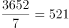周天，即过了521周往后推5天。由于2021年7月1日为星期四，则往后推5天为星期二。

故正确答案为B。

---

第 62 题

**答案**：A

**来源参考解析（非官方标准答案）**

方法一：根据等差数列求和公式：，可得前5个团体的新创节目的中位数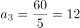，前7个团体的新创节目的中位数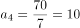，该等差数列的公差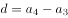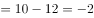。因此这9个文艺表演团体去年新创节目的总数。

方法二：根据题意可知，9个团体新创节目的数量恰好成等差数列。根据等差数列求和公式：，则，即9个文艺表演团体去年新创节目的总数为9的倍数，只有A项符合。

故正确答案为A。

---

第 63 题

**答案**：C

**来源参考解析（非官方标准答案）**

假设这6组为甲、乙、丙、丁、戊、己，根据题意，可分类讨论：

①选出的4组中有丙：丙只能从事防疫协助工作，英语翻译工作从丁、戊、己中选一组，有种情况，嘉宾引导和物资发放从剩余4组中选2组去做，有种情况，则有3×12=36种情况；

②选出的4组中无丙：英语翻译工作从丁、戊、己中选一组，有种情况，防疫协助、嘉宾引导、物资发放从剩余4组中选3组去做，有种情况，则有3×24=72种情况。

分类用加法，则共有36+72=108种派选方案。

故正确答案为C。

---

第 64 题

**答案**：C

**来源参考解析（非官方标准答案）**

设该城市共有n个城管驿站，根据题意可列方程：80n+1080=100×（n-4），解得n=74，则户外作业人员有100×（74-4）=7000名。要想满足每个城管驿站服务的人尽量少，则所有户外作业人员尽量均分，设每个城管驿站至少要服务x人，则74x=7000，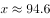，则每个城管驿站至少要服务95人。

故正确答案为C。

---

第 65 题

**答案**：B

**来源参考解析（非官方标准答案）**

设合作社销售桃子每斤x元，李子每斤y元。根据题意可列方程组：。

方法一：解得：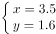，则小王获得的收入为10000x+8000y=10000×3.5+8000×1.6=47800元。

方法二：观察发现，①+2×②=10000x+8000y=小王获得的收入，即小王获得的收入为17200+2×15300=47800元。

故正确答案为B。

---

第 66 题

**答案**：B

**来源参考解析（非官方标准答案）**

该时段张师傅维修车辆类型及相应数量的情况数较少，考虑枚举法。根据题意，具体情况如下：

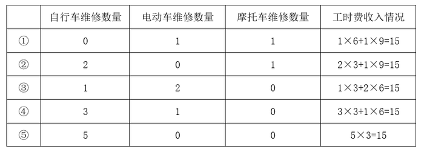

综上可知，该时段张师傅维修车辆类型及相应数量的情况有5种。

故正确答案为B。

---

第 67 题

**答案**：B

**来源参考解析（非官方标准答案）**

每个活动均需连续开展两天，则每个活动可选择的举办时间有（周一、周二）、（周二、周三）、（周三、周四）、（周四、周五）、（周五、周六），共5种情况，两个活动的举办时间共有种情况。若想两个活动时间完全不重叠，可有以下3种情况：

①其中一个活动选择（周一、周二），另一个活动可选择（周三、周四）、（周四、周五）或（周五、周六），情况数为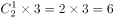种；

②其中一个活动选择（周二、周三），另一个活动可选择（周四、周五）或（周五、周六），情况数为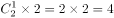种；

③其中一个活动选择（周三、周四），另一个活动可选择（周五、周六），情况数为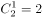种。

满足条件的情况数为6+4+2=12种，则所求概率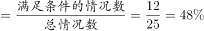。

故正确答案为B。

---

第 68 题

**答案**：D

**来源参考解析（非官方标准答案）**

总情况数为5人分到3个不同的厂区调研工作，则每个人有3种选择，共有种方式。符合条件情况数为5人分到3个不同的厂区，每个厂区至少1人，则3个厂区的人数分别为1、2、2或者1、1、3。当3个厂区的人数为1、2、2时，则有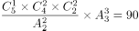种；当3个厂区的人数为1、1、3时，则有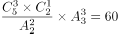种，共有90+60=150种方式。所求概率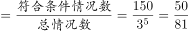。

故正确答案为D。

---

第 69 题

**答案**：D

**来源参考解析（非官方标准答案）**

如图所示，设窗户上半部分半圆半径为r米，下半部分矩形高度为a米。由题意得，材料总长度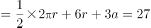米，将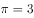代入，即3r+6r+3a=27，整理可得a=9-3r。窗户面积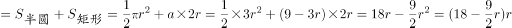平方米。根据两点式，令窗户面积为0，即分别令r=0和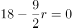，解得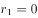，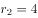。则当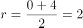时，窗户面积取得最大值。因此，该窗户的最大面积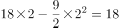平方米。

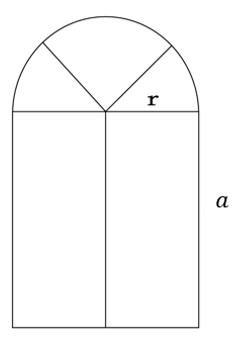

故正确答案为D。

---

第 70 题

**答案**：C

**来源参考解析（非官方标准答案）**

赋值圆的半径为2，则BD=BE=EF=EC=1，扇形ABC的面积为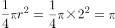，正方形BDFE的面积为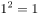，三角形EFC的面积为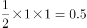，因此只接种1剂次所占面积=扇形ABC的面积-正方形BDFE的面积-三角形EFC的面积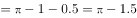，所以只接种1剂次的人数占比为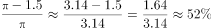，即超过50%但不到60%。

故正确答案为C。

---

第 71 题

**答案**：B

**来源参考解析（非官方标准答案）**

本题为分组分类题目。观察发现，题干每幅图形均由两个面相交而成，考虑图形间关系。图①②④中两个图形均相交于边，图③⑤⑥中两个图形均相交于点，即图①②④为一组，图③⑤⑥为一组。
故正确答案为B。

---

第 72 题

**答案**：C

**来源参考解析（非官方标准答案）**

元素组成相同，优先考虑位置规律。观察发现，第一组图形中，图1经左右翻转后得到图2，图2经上下翻转后得到图3；第二组图形也应符合相同的规律，图1经左右翻转后得到图2，图2经上下翻转后得到？处图形，只有C项符合。
故正确答案为C。

---

第 73 题

**答案**：B

**来源参考解析（非官方标准答案）**

元素组成不同，且无明显属性规律，考虑数量规律。题干出现生活化图形且空白面多，可以考虑面数量。题干图形的面数量依次为2、3、4、5、？、7，故“？”处应填入一个有6个面的图形，只有B项符合。
故正确答案为B。

---

第 74 题

**答案**：D

**来源参考解析（非官方标准答案）**

解法一：元素组成不同，且无明显属性规律和数量规律。观察发现，“？”在题干的第一幅图，选项中出现旋转后的数字，且题干的数字旋转后可得到新的数字，故将题干图形均旋转进行观察，此时从右向左看，每幅图中的数字依次为：88、89、90、91、92，故“？”处图形旋转之后为数字93，只有D项符合。

故正确答案为D。

解法二：元素组成不同，且无明显属性规律，优先考虑数量规律。观察发现，题干出现“日”字变形图，考虑笔画数。题干均为两笔画图形，故“？”处为两笔画图形，选项的笔画数分别为：3、4、2、3，只有C项符合。

故正确答案为C。

注：观察题目特征，根据A、D两项中的数字“3”互为旋转的图形，说明可能会考查旋转，另外根据“？”在题干的第一幅图，说明可能需要将题干图形从右向左看，而根据解法一将题干图形从右向左看时，数字恰好呈递增规律，故解法一相比解法二更贴近题目特征，因此粉笔更倾向于选D。

---

第 75 题

**答案**：B

**来源参考解析（非官方标准答案）**

本题为空间重构类题目，将展开图标上序号如下图，逐一进行分析。

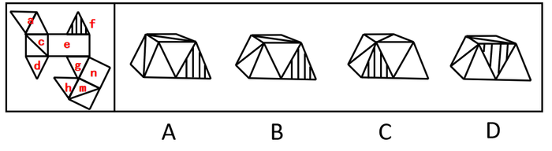

A项：题干展开图中，面a与面c公共点为点1，面a与面c中对角线相交于点1，立体图形中面a与面c中对角线没有相交于点1，与题干展开图不一致，排除；

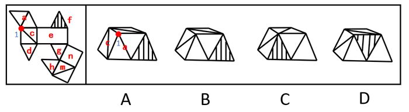

B项：该项的立体图形与题干展开图一致，当选；

C项：根据题干展开图所示，面a应在面f的左侧，立体图形中面a在面f的右侧，与题干展开图不一致，排除；

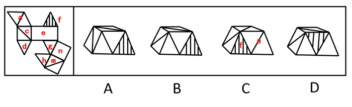

D项：根据题干展开图所示，面f与面e有公共边，立体图形中面f与面e没有公共边，与题干展开图不一致，排除。

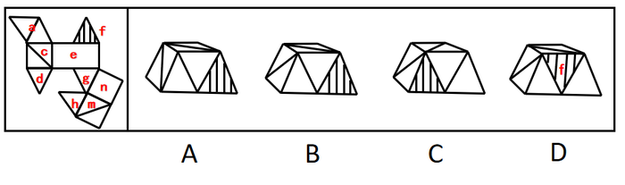

故正确答案为B。

---

第 76 题

**答案**：B

**来源参考解析（非官方标准答案）**

第一步：找出定义关键词。
“按彼此相似或相同的劳动形成的团结”、“保持着强烈的认同感和归属感”。
第二步：逐一分析选项。
A项：家庭里，各个成员从事的不一定是相似或相同的劳动，不符合“按彼此相似或相同的劳动形成的团结”，不符合定义，排除；
B项：村民从事相类似的工作，符合“按彼此相似或相同的劳动形成的团结”，共同的经验和共享的信念使村民团结，符合“保持着强烈的认同感和归属感”，符合定义，当选；
C项：员工各司其职，在各自岗位上奋进，不符合“按彼此相似或相同的劳动形成的团结”，不符合定义，排除；
D项：社团中的年轻人协同完成任务，不符合“按彼此相似或相同的劳动形成的团结”，不符合定义，并且选项并未明确这些年轻人是否保持强烈的认同感和归属感，排除。
故正确答案为B。

---

第 77 题

**答案**：C

**来源参考解析（非官方标准答案）**

第一步：找出定义关键词。
“把所获得的信息经过即时、综合的分析研究”、“把研究报告呈现给客户”、“作为决策的借鉴”、“通过提供业务专业知识而不是流程专业知识来为客户创造价值”。
第二步：逐一分析选项。
A项：某置业公司业务员为纺织公司办理抵押贷款事项，不符合“把研究报告呈现给客户”，也不符合“作为决策的借鉴”，不符合定义，排除；
B项：某知名动漫画家为软件公司打造多个性格迥异的角色形象，不符合“把研究报告呈现给客户”，也不符合“作为决策的借鉴”，不符合定义，排除；
C项：某知识产权专家为科技公司跟踪比对全球数据库信息，符合“把所获得的信息经过即时、综合的分析研究”，为该公司起草专利申请的内容，符合“把研究报告呈现给客户”、“作为决策的借鉴”，符合定义，当选；
D项：某大学毕业生为测绘公司分类做好档案管理工作，不符合“把研究报告呈现给客户”，也不符合“作为决策的借鉴”，不符合定义，排除。
故正确答案为C。

---

第 78 题

**答案**：A

**来源参考解析（非官方标准答案）**

第一步：找出定义关键词。
“最大程度地减少在不道德行为中的责任”、“降低对受害者痛苦感受的认同”、“使道德自我调节功能减弱甚至失效”。
第二步：逐一分析选项。
A项：看到领导为患病的小赵捐款，老王不敢不捐款，为他人捐款的行为不属于不道德行为，不符合“最大程度地减少在不道德行为中的责任”，不符合定义，当选；
B项：往辣条里掺苏丹红是一种不道德的行为，因为“苏丹红”是一种化学染色剂，并非食品添加剂，小孟看到同行这样做后自己也不再感到不安，符合“最大程度地减少在不道德行为中的责任”、“降低对受害者痛苦感受的认同”、“使道德自我调节功能减弱甚至失效”，符合定义，排除；
C项：将公司打印纸带回家是一种不道德的行为，小明发现主管这样做后认为自己也可以这么做，符合“最大程度地减少在不道德行为中的责任”、“降低对受害者痛苦感受的认同”、“使道德自我调节功能减弱甚至失效”，符合定义，排除；
D项：做假账是一种不道德的行为，会计小陈认为自己做假账是被老板强制要求的，无需为此自责，符合“最大程度地减少在不道德行为中的责任”、“降低对受害者痛苦感受的认同”、“使道德自我调节功能减弱甚至失效”，符合定义，排除。
本题为选非题，故正确答案为A。

---

第 79 题

**答案**：B

**来源参考解析（非官方标准答案）**

第一步：找出定义关键词。
“当一个人面临两个同等吸引力的目标”、“当目标越来越接近时”、“该目标的激励作用和吸引力也会越来越强”。
第二步：逐一分析选项。
A项：小丁比起打针，还是选择吃药，说明对于小丁来说，更不喜欢打针，所以打针和吃药对于小丁来说并不是两个有同等吸引力的目标，不符合“当一个人面临两个同等吸引力的目标”，不符合定义，排除；
B项：小明和小丽谈婚论嫁后，符合“当目标越来越接近时”，此时越来越觉得小丽更好，说明现在小丽对于小明来说吸引力更强，符合“该目标的激励作用和吸引力也会越来越强”，符合定义，当选；
C项：相比戒烟，小李更爱吸烟，说明戒烟和吸烟对于小李来说并不是两个有同等吸引力的目标，不符合“当一个人面临两个同等吸引力的目标”，不符合定义，排除；
D项：小华离家越近越忐忑不安，说明当目标越来越近时，目标的吸引力对于小华来说并没有更强，不符合“该目标的激励作用和吸引力也会越来越强”，不符合定义，排除。
故正确答案为B。

---

第 80 题

**答案**：A

**来源参考解析（非官方标准答案）**

第一步：找出定义关键词。
“风险发生前系统已经存在的脆弱性”、“由社会系统内在特征及与系统潜在风险密切相关的自然环境要素决定”。 
第二步：逐一分析选项。
A项：东南沿海地区具有泥石流多发的气候、土壤等自然因素，符合“风险发生前系统已经存在的脆弱性”、“由社会系统内在特征及与系统潜在风险密切相关的自然环境要素决定”，符合定义，当选；
B项：长期围湖造田使湖泊生态环境日趋恶化，强调的是围湖造田带来的不利影响，不符合“风险发生前系统已经存在的脆弱性”，也不符合“自然环境要素决定”，不符合定义，排除；
C项：突如其来的疫情使部分群众陷入贫困状态，强调的是疫情带来的不利影响，不符合“风险发生前系统已经存在的脆弱性”，也不符合“自然环境要素决定”，不符合定义，排除；
D项：人类的捕猎活动导致玉带海雕成为濒危物种，强调的是人类捕猎带来的不利影响，不符合“风险发生前系统已经存在的脆弱性”，也不符合“自然环境要素决定”，不符合定义，排除。
故正确答案为A。
注：发生泥石流常常会冲毁公路、铁路等交通设施甚至村镇等，造成巨大损失，对应着社会系统和社会脆弱性。

---

第 81 题

**答案**：C

**来源参考解析（非官方标准答案）**

第一步：找出定义关键词。
“科学的营养知识普及活动”、“适合一国国情”、“让居民渐渐养成良好的饮食生活习惯”。 
第二步：逐一分析选项。
A项：烹饪学校要求学生安全地使用工具处理食材，是针对特定学生的要求，不符合“科学的营养知识普及活动”、“适合一国国情”、“让居民渐渐养成良好的饮食生活习惯”，不符合定义，排除；
B项：社区开展体育锻炼活动帮助居民改善健康状况，不符合“科学的营养知识普及活动”、“适合一国国情”、“让居民渐渐养成良好的饮食生活习惯”，不符合定义，排除；
C项：有关部门颁布了《国民营养计划（2017-2030年）》，针对的是本国国民的饮食生活，符合“科学的营养知识普及活动”、“适合一国国情”、“让居民渐渐养成良好的饮食生活习惯”，符合定义，当选；
D项：某食品学院培养学生能够分辨食材，是针对特定学生的要求，不符合“科学的营养知识普及活动”、“适合一国国情”、“让居民渐渐养成良好的饮食生活习惯”，不符合定义，排除。
故正确答案为C。

---

第 82 题

**答案**：C

**来源参考解析（非官方标准答案）**

第一步：找出定义关键词。
顺行性遗忘：“回忆不起疾病发生以后某一段时间内所经历的事件”；
逆行性遗忘：“回忆不起疾病发生之前某一时间段的事件”。
第二步：逐一分析选项。
A项：某患者摔伤之后，出门经常不记得带手机，不符合“回忆不起疾病发生之前某一时间段的事件”，不符合“逆行性遗忘”定义，排除；
B项：某患者摔伤之后，对各种生活习惯、节气习俗等的记忆越来越模糊，没有体现出疾病发生之前某一段时间的记忆，不符合“回忆不起疾病发生之前某一时间段的事件”，不符合“逆行性遗忘”定义，排除；
C项：某患者摔伤之后，不记得受伤前他在哪里、在做什么事情，符合“回忆不起疾病发生之前某一时间段的事件”，符合“逆行性遗忘”定义，当选；
D项：某患者摔伤之后，不记得自己如何来到医院，到医院后经历过哪些事情，符合“回忆不起疾病发生以后某一段时间内所经历的事件”，符合“顺行性遗忘”定义，不符合“逆行性遗忘”定义，排除。
故正确答案为C。

---

第 83 题

**答案**：D

**来源参考解析（非官方标准答案）**

第一步：找出定义关键词。
“一个区域内的医院与其他医疗服务机构或组织联系在一起”、“重新组合构建的一个整体性的全新医疗组织架构”、“核心医院的家族式管理方式”。
第二步：逐一分析选项。
A项：若干市属医院与社区卫生服务中心联合起来为居民提供健康服务，没有体现核心大家长，不符合“核心医院的家族式管理方式”，不符合定义，排除；
B项：皮肤病院和研究所的专家们联合开展义诊，不符合“重新组合构建的一个整体性的全新医疗组织架构”，不符合定义，排除；
C项：某医药公司配合“基层呼吸疾病防治联盟”，医药公司不属于医院、医疗服务机构或组织，不符合“一个区域内的医院与其他医疗服务机构或组织联系在一起”，不符合定义，排除；
D项：以区级医院为龙头成立医疗管理委员会，龙头强调了区级医院的位置，符合“一个区域内的医院与其他医疗服务机构或组织联系在一起”、“核心医院的家族式管理方式”，建立卫生服务体系，实现区乡两级医疗卫生资源共享，符合“重新组合构建的一个整体性的全新医疗组织架构”，符合定义，当选。
故正确答案为D。

---

第 84 题

**答案**：B

**来源参考解析（非官方标准答案）**

第一步：找出定义关键词。
城市生产空间优化：“城市产业发展空间规模与布局的调整”、“促进生产优化”；
城市生活空间优化：“调整城市不同类型生活空间的分布及相对距离”、“提高城市居民各类活动空间可达性”、“提高居民生活质量”。
第二步：逐一分析选项。
A项：某市拆墙透绿，是从城市绿地的角度进行调整，符合“调整城市不同类型生活空间的分布及相对距离”，且该工程有效地美化了城市居民生活环境，符合“提高居民生活质量”，符合“城市生活空间优化”定义，排除；
B项：将客车厂、玻璃厂等工厂搬迁到同一个工业园区，是从产业分布空间方面进行调整，符合“城市产业发展空间规模与布局的调整”，调整后节省了企业的物流成本，符合“促进生产优化”，符合“城市生产空间优化”定义，不符合“城市生活空间优化”定义，当选；
C项：在老城区及新开发片区新增停车场、增设停车位是在居民活动空间中的基础设施方面进行优化调整，符合“调整城市不同类型生活空间的分布及相对距离”，新增车位能使居民日常生活中停车更方便，符合“提高居民生活质量”，符合“城市生活空间优化”定义，排除；
D项：拆除市区中内河两岸聚集的脏乱差小作坊，能够改善市区环境，符合“调整城市不同类型生活空间的分布及相对距离”、“提高居民生活质量”，符合“城市生活空间优化”定义，排除。
本题为选非题，故正确答案为B。

---

第 85 题

**答案**：A

**来源参考解析（非官方标准答案）**

第一步：找出定义关键词。
危机学习：“政府”、“有目标地不断调整、改变与创新理念和行为来解决问题”、“适应新时代社会治理”；
单环危机学习：“在不改变组织目标和价值观的前提下”、“将组织的行为策略与结果联系起来并对其修正”、“使组织功效保持在组织规范与目标规定的范围内”；
双环危机学习：“重新评价组织的本质、价值观和基本目标”、“改变行动”。
第二步：逐一分析选项。
A项：某县政府主动转变了治理理念，符合“政府”、“有目标地不断调整、改变与创新理念和行为来解决问题”，最后该县政府实施山水田林生态综合整治，符合“改变行动”，符合双环危机学习定义，当选； 
B项：政府因建设资金补偿争议叫停环保站能源项目，虽然叫停项目的是政府，符合“政府”，但该项中政府只是因争议而暂停项目，并没有体现出政府对该项目进行重新评估，不符合“重新评价组织的本质、价值观和基本目标”，另外该项也没有体现出政府采取新的办法解决问题，不符合“改变行动”，不符合双环危机学习定义，排除；
C项：某教育类慈善基金会响应政府号召主动停止超范围募捐，慈善基金会是一个社会组织，而非政府，不符合“政府”，不符合双环危机学习定义，排除；
D项：某社区开展建设协调工作会，社区属于群众组织，只是协助政府部门进行社会管理，不属于政府部门，不符合“政府”，不符合双环危机学习定义，排除。
故正确答案为A。

---

第 86 题

**答案**：D

**来源参考解析（非官方标准答案）**

第一步：判断题干词语间逻辑关系。
连理枝与玫瑰都可以用来象征爱情，具有相同的象征义。
第二步：判断选项词语间逻辑关系。
A项：梧桐雨象征坚贞不渝的爱情，明月象征思乡之情，与题干逻辑关系不一致，排除；
B项：丁香结象征生活中解不开的愁怨，鸿雁比喻书信和传递书信的人，与题干逻辑关系不一致，排除；
C项：昆山玉象征人才，松柏象征坚贞，与题干逻辑关系不一致，排除；
D项：杨柳枝与长亭都是象征离别，与题干逻辑关系一致，当选。
故正确答案为D。

---

第 87 题

**答案**：B

**来源参考解析（非官方标准答案）**

第一步：判断题干词语间逻辑关系。
化险为夷，指的是使危险的处境或者情况变为平安。转危为安，指的是从危险转为平安。两者是近义关系，且两者皆为褒义词。
第二步：判断选项词语间逻辑关系。
A项：异曲同工，也说同工异曲，指曲调虽然不同，却都同样美妙，后比喻不同的说法或做法都收到同样的效果。深入浅出，指讲话或文章的内容深刻，语言文字却浅显易懂。两者不是近义关系，与题干逻辑关系不一致，排除；
B项：承前启后，指承接过去的，开创未来的，继承前人事业，为后人开辟道路。继往开来，指继承前人的事业，并为将来开辟道路。两者是近义关系，且两者均含褒义词性，与题干逻辑关系一致，当选；
C项：除旧布新，指除去旧的，建立新的。空前绝后，指从前没有过，此后也不会有，多用来形容某种成就或盛况，带有夸张赞叹的意味。两者不是近义关系，与题干逻辑关系不一致，排除；
D项：畏首畏尾，指前也怕，后也怕，比喻胆小、做事顾虑重重。瞻前顾后，指看看前面再看看后面，形容做事谨慎，考虑周密，也形容顾虑太多，犹豫不决。两者是近义关系，但是畏首畏尾是贬义词，与题干逻辑关系不一致，排除。
故正确答案为B。

---

第 88 题

**答案**：B

**来源参考解析（非官方标准答案）**

第一步：判断题干词语间逻辑关系。
开水瓶的功能是保温，二者是功能对应关系。
第二步：判断选项词语间逻辑关系。
A项：密码锁的功能是防盗，具有加密的属性，二者不是功能对应关系，与题干逻辑关系不一致，排除；
B项：体温计的功能是测温，二者是功能对应关系，与题干逻辑关系一致，当选；
C项：热水器的功能是加热，不是洗澡，二者不是功能对应关系，与题干逻辑关系不一致，排除；
D项：保险箱的功能是防火防盗，具有安全性，二者不是功能对应关系，与题干逻辑关系不一致，排除。
故正确答案为B。

---

第 89 题

**答案**：D

**来源参考解析（非官方标准答案）**

第一步：判断题干词语间逻辑关系。
鹬蚌相争，渔翁得利，比喻双方争执不下，两败俱伤，让第三者占了便宜。鹬蚌相争为因，渔翁得利为果，二者为因果对应关系。
第二步：判断选项词语间逻辑关系。
A项：兼听则明，偏信则暗，指听取双方或多方面的意见就能明辨是非，只相信单方面的话，必然会犯片面性的错误。二者均单独存在因果对应关系，但二者之间为并列关系，与题干逻辑关系不一致，排除；
B项：塞翁失马，焉知非福，比喻一时虽然受到损失，反而因此能得到好处。二者间无明显逻辑关系，与题干逻辑关系不一致，排除；
C项：户枢不蠹，流水不腐，指经常转动的门轴不会被虫蛀，流动的水不会腐臭，比喻经常运动的东西不易受腐蚀，二者为并列关系，与题干逻辑关系不一致，排除；
D项：城门失火，殃及池鱼，指城门着了火，大家都用护城河的水救火，水用尽了，鱼也就干死了，比喻因牵连而受祸患或损失。城门失火为因，殃及池鱼为果，二者为因果对应关系，与题干逻辑关系一致，当选。
故正确答案为D。

---

第 90 题

**答案**：D

**来源参考解析（非官方标准答案）**

第一步：判断题干词语间逻辑关系。
刷脸支付需要用到人脸识别技术，二者为对应关系，人脸识别需要用到人工智能技术，二者为对应关系。
第二步：判断选项词语间逻辑关系。
A项：自动驾驶与环保汽车之间没有明显的逻辑关系，与题干逻辑关系不一致，排除；
B项：语音助手可能需要使用翻译软件，翻译软件可能需要使用5G网络，二者为对应关系，但均为可能性的需要，与题干逻辑关系不一致，排除；
C项：山地车是自行车的一种，二者为种属关系，与题干逻辑关系不一致，排除；
D项：网络家电需要用到智能家居，二者为对应关系，智能家居需要用到物联技术，二者为对应关系，与题干逻辑关系一致，当选。
故正确答案为D。

---

第 91 题

**答案**：B

**来源参考解析（非官方标准答案）**

第一步：判断题干词语间逻辑关系。
“屈驾”是邀请人的敬词，“赐教”是请求对方给予指教的敬词，“斧正”是请别人修改文章的敬词，三个词语均为敬词，即都是对他人表示尊敬的礼貌用语， 为并列关系。
第二步：判断选项词语间逻辑关系。
A项：“芳龄”指女子的年龄，是敬词；“寒舍”指自己的家，是谦词；“令堂”指对别人母亲的尊称，是敬词，三个词语并非都是敬词，与题干逻辑关系不一致，排除；
B项：“敬候”指恭敬地等候，是敬词；“光临”指含恭敬口吻地欢迎宾客到来，是敬词；“笑纳”指请人收下礼物，是敬词，三个词语都是敬词，为并列关系，与题干逻辑关系一致，当选；
C项：“久仰”指仰慕他人已久，是敬词；“留步”指送客时客人辞让之语，是敬词；“拙见”指自己的见解，是谦词，三个词语并非都是敬词，与题干逻辑关系不一致，排除；
D项：“敢问”指向对方提出问题，附带自谦的姿态，是谦词；“俯就”指请求别人同意担任某种职务，是敬词；“包涵”指请人原谅，是敬词，三个词语并非都是敬词，与题干逻辑关系不一致，排除。
故正确答案为B。

---

第 92 题

**答案**：B

**来源参考解析（非官方标准答案）**

第一步：判断题干词语间逻辑关系。
地支是中国传统用作表示次序的符号，其包括：子、丑、寅、卯、辰、巳、午、未、申、酉、戌、亥，被称为“十二地支”。中国古代用十二地支纪时，将一日均分为十二个时段，“酉时”“戌时”“亥时”是“十二时辰”中的最后三个，三者是并列关系，且三者在十二地支纪时中排列紧密连续。
第二步：判断选项词语间逻辑关系。
A项：立春、立秋、立冬是我国二十四节气中的三个，三者是并列关系，但没有紧密相连，与题干逻辑关系不一致，排除；
B项：律诗一共四联，一二句叫首联，三四句叫颔联，五六句叫颈联，七八句叫尾联。颔联、颈联、尾联分别是律诗的第二联、第三联、第四联，三者是并列关系，且在律诗中排列紧密连续，与题干逻辑关系一致，当选；
C项：口琴、古琴、胡琴是三种不同的乐器，三者是并列关系，但三者在乐器中不存在排列关系，与题干逻辑关系不一致，排除；
D项：吴语又称吴越语、江南话、江浙话，与粤语同为方言，二者是并列关系；软语指温和而委婉的话语，与前两者无关，与题干逻辑关系不一致，排除。
故正确答案为B。

---

第 93 题

**答案**：B

**来源参考解析（非官方标准答案）**

第一步：判断题干词语间逻辑关系。
五音指五声音阶，依次为宫、商、角、徵、羽。“商”和“徵”构成反对关系，二者分别和“五音”构成组成关系。
第二步：判断选项词语间逻辑关系。
A项：五经指《诗经》《尚书》《礼记》《周易》《春秋》，简称为“诗、书、礼、易、春秋”。“乐”指《乐经》，“五经”当中不包括“乐”，二者不构成组成关系，与题干逻辑关系不一致，排除；
B项：五谷指五种谷物，古代有多种不同说法，最主要的有两种：一种指稻、黍、稷、麦、菽；另一种指麻、黍、稷、麦、菽。“麦”和“稷”构成反对关系，二者分别和“五谷”构成组成关系，与题干逻辑关系一致，当选；
C项：五金指金、银、铜、铁、锡五种金属。“五金”当中不包括“铝”，二者不构成组成关系，与题干逻辑关系不一致，排除；
D项：五行也叫五行学说，指金、木、水、火、土。“五行”当中不包括“雷”，二者不构成组成关系，与题干逻辑关系不一致，排除。
故正确答案为B。

---

第 94 题

**答案**：C

**来源参考解析（非官方标准答案）**

逐一代入选项。
A项：银杏是一种大乔木，二者为种属关系；克拉管又称黑管、单簧管，二者为全同关系，前后逻辑关系不一致，排除；
B项：银杏和五角枫是不同的树木，二者为并列关系；黑管是管乐器的一种，二者为种属关系，前后逻辑关系不一致，排除；
C项：银杏又称白果、公孙木、鸭掌树等等，二者为全同关系；单簧管又称克拉管、黑管，二者为全同关系，前后逻辑关系一致，当选；
D项：银杏可以作为一种中草药，二者为种属关系；双簧管和黑管是两种不同的乐器，二者为并列关系，前后逻辑关系不一致，排除。
故正确答案为C。

---

第 95 题

**答案**：D

**来源参考解析（非官方标准答案）**

逐一代入选项。
A项：安居乐业指人们生活美满的样子，比喻安定地生活，愉快地工作；安土重迁指在家乡住惯了，很不愿意搬迁，二者无明显逻辑关系。抱残守缺指守着残缺的东西不放，形容思想守旧，不知变革；墨守成规比喻固执地按老一套办，不求改进，二者是近义关系，前后逻辑关系不一致，排除；
B项：安居乐业指人们生活美满的样子，比喻安定地生活，愉快地工作；颠沛流离形容生活穷困，到处流浪，二者是反义关系。抱残守缺指守着残缺的东西不放，形容思想守旧，不知变革；革故鼎新指革除旧弊，创立新制，二者是反义关系，前后逻辑关系一致，保留；
C项：安居乐业指人们生活美满的样子，比喻安定地生活，愉快地工作；丰衣足食形容生活宽裕，二者都可以用来形容人民生活的美好，二者是近义关系。抱残守缺指守着残缺的东西不放，形容思想守旧，不知变革；独辟蹊径比喻独创一种全新的与人迥异的风格、手法，二者是反义关系，前后逻辑关系不一致，排除；
D项：安居乐业指人们生活美满的样子，比喻安定地生活，愉快地工作；背井离乡常指被迫远离家乡到外地谋生，二者是反义关系。抱残守缺指守着残缺的东西不放，形容思想守旧，不知变革；推陈出新指事物的除旧更新，二者是反义关系，前后逻辑关系一致，保留。
比较B、D两项，题干中的安居和乐业，抱残和守缺都是并列结构，B项中颠沛和流离不是并列结构，排除；D项中的背井和离乡，推陈和出新都是并列结构，当选。
故正确答案为D。

---

第 96 题

**答案**：C

**来源参考解析（非官方标准答案）**

第一步：找出论点和论据。
论点：可以根据大脑血清素系统的变化提前20年发现帕金森病的早期发病征兆。
论据：研究人员招募了14名携带一种极为罕见的突变基因的志愿者。这些志愿者的这种突变基因几乎肯定会在他们一生中的某个阶段诱发帕金森病。研究人员表示，血清素系统功能是判断帕金森病前兆的一个很好指标，因为在尚未确诊的参与者体内发现了血清素系统的可检测变化。
本题的论点论据讨论的均为大脑血清素系统的变化与提前发现帕金森病早期发病征兆之间的关系，论点论据话题一致，优先考虑补充论据的形式进行加强。
第二步：逐一分析选项。
A项：该项指出全球已知只有约100人携带这种突变基因，有多少人携带这种突变基因与大脑血清素系统的变化是否可以提前发现帕金森病的早期发病征兆无关，无法加强，排除；
B项：该项表明医生可以在最常见的症状出现之前诊断出帕金森病，医生可以诊断与大脑血清素系统的变化是否可以提前发现帕金森病的早期发病征兆无关，无法加强，排除；
C项：该项指出血清素系统变化是帕金森病的最早的信号，说明血清素系统变化是最早的信号，确实能够提前发现帕金森病的早期发病征兆，补充论据，可以加强，当选；
D项：该项指出研究中的志愿者均具有极罕见的突变基因，研究结果没有办法覆盖其他患者，说明此次研究的结果无法覆盖所有人，为削弱项，无法加强，排除。
故正确答案为C。

---

第 97 题

**答案**：D

**来源参考解析（非官方标准答案）**

第一步：找出论点和论据。
论点：每天保持三顿正餐的时间表大致稳定，对于保持良好的身体状况非常重要。
论据：保持规律的用餐时间能够改善新陈代谢和身心状态，更具体地说，遵循并保持固定的饮食时间表与肥胖、代谢综合征、心血管疾病和情绪改善的风险降低有关，这种习惯也有利于我们自身生物钟的良好运行，从而使我们以良好的身心状态应对日常工作和生活。
论点论据都在讨论的是保持规律的用餐时间和身体状况的关系，论点论据话题一致，加强考虑补充论据。
第二步：逐一分析选项。
A项：该项说的是医学家呼吁要注意饮食规律，论点讨论的是三顿正餐时间稳定对于保持良好的身体状况是否重要，话题不一致，无法加强，排除；
B项：该项说的是周末不规律的饮食可能与体重指数的增加有关，说明不规律饮食和身体状况有关系，可以加强，但是属于可能性加强，力度较弱，保留；
C项：该项说的是不经常参加体育运动，罹患代谢性疾病和心血管疾病的风险会增加，论点讨论的是三顿正餐时间稳定对于保持良好的身体状况是否重要，话题不一致，无法加强，排除； 
D项：该项说的是用餐时间与正常时间相差三小时以上时，对体重指数的影响最大，补充论据说明三顿正餐的时间表稳定跟身体状况有关，保留。
对比B、D两项，B项是可能性加强，D项是补充确定的论据，可能性加强力度较弱，D项当选。
故正确答案为D。

---

第 98 题

**答案**：B

**来源参考解析（非官方标准答案）**

第一步：找出论点和论据。
论点：文学名著有助于人们更好地感知他人。
论据：文学名著更注重人物角色的刻画而不是情节的描述，从而要求读者对人物角色进行细致思考和推理。
论点和论据都提到了文学名著有助于人们更好地理解、感知他人，所以讨论的话题是一致的，削弱优先考虑否论点，其次可以考虑否论据。
第二步：逐一分析选项。
A项：提到测试本身缺少科学性，说明测试可能存在一些问题，可以削弱，保留；
B项：许多文学名著更注重情节描述而非角色刻画，举例削弱论据，可以削弱，保留；
C项：许多善解人意的人很少阅读文学名著无法说明文学名著能否帮助人们更好地感知他人，无关项，无法削弱，排除；
D项：理解他人能力强的人更喜欢读科技著作，说的是能力强后喜欢做什么，而论点讨论的是文学名著对于感知他人的作用，话题不一致，无关项，无法削弱，排除。
比较A、B两项，A项说明测试设计缺乏科学性，但未明确说明设计缺陷对实验结果的影响，而B项直接削弱题干论据，力度更强，因此择优选B项。
故正确答案为B。

---

第 99 题

**答案**：D

**来源参考解析（非官方标准答案）**

第一步：找出论点和论据。
论点：在经济新常态背景下，我国“特殊逆城镇化”现象正大量发生，并且这一趋势预示着未来的发展潮流。
论据：无。
本题只有论点，没有论据，优先考虑补充论据的方式进行加强。
第二步：逐一分析选项。
A项：该项说的是近年来城市老年人结伙搭伴到农村养老成为一种潮流，举例子说明“特殊逆城镇化”正在发生，可以加强，排除；
B项：该项说的是部分人群返乡下乡创业和就业，推动了农村产业发展，举例子说明“特殊逆城镇化”正在发生，可以加强，排除；
C项：该项说的是城市居民到城镇、乡村长期居住，使得部分乡村出现一些来自全国各地不同人们的聚居点，举例子说明“特殊逆城镇化”正在发生，可以加强，排除；
D项：该项说的是城市居民每年深入农村体验生活会促进农村的经济社会发展，但城市居民只是去农村游玩，与论点所说的“特殊逆城镇化”现象无关，为无关项，无法加强，当选。
本题为选非题，故正确答案为D。

---

第 100 题

**答案**：D

**来源参考解析（非官方标准答案）**

第一步：找出论点和论据。
论点：大蒜炝锅致癌。
论据：大蒜在炝锅时，其所含氨基酸和糖类在高温烹调过程中会发生“美拉德反应”，从而产生丙烯酰胺。如果大蒜切的越薄、受热温度越高、受热时间越长，烹调时的“美拉德反应”就会越剧烈，产生的丙烯酰胺也就越多，丙烯酰胺是致癌物。
本题论点说的是大蒜炝锅致癌，论据说的是大蒜在高温烹调时会产生致癌物丙烯酰胺，不能脱离致癌物的“数量”谈致癌的“效果”，故可以通过“数量”进行拆桥。
第二步：逐一分析选项。
A项：指出重视健康饮食使大部分人很少采用炝锅的方式烹饪，与大蒜炝锅能否致癌无关，无法削弱，排除；
B项：指出高温烹饪会对大蒜素产生破坏，而论点讨论的是大蒜炝锅能否致癌，话题不一致，无法削弱，排除；
C项：指出2A级致癌物是指对人类致癌性证据有限的物质，致癌性证据有限不代表不能致癌，因此不明确丙烯酰胺能否致癌，不明确选项，无法削弱，排除；
D项：指出丙烯酰胺致癌临界点为短时间内使用炝锅蒜32.7公斤，说明炝锅使用的大蒜要超过32.7公斤才能致癌，而日常炝锅使用的大蒜远低于这个量，即通过不现实的数量拆掉丙烯酰胺与致癌之间的关系，拆桥项，当选。
故正确答案为D。

---

第 101 题

**答案**：D

**来源参考解析（非官方标准答案）**

日常结论题，根据题干信息逐一分析选项。
A项：题干指出感染牙龈卟啉单胞菌的动物模型显示出与记忆最相关的海马体损伤，即口腔不健康会对记忆有消极影响，但并没有涉及加强口腔健康是否能改善大脑记忆功能，无中生有，排除；
B项：题干并没有涉及从口腔到大脑的病程过渡开始于哪里，无中生有，排除；
C项：题干指出感染牙龈卟啉单胞菌的动物模型显示出与记忆最相关的海马体损伤，即口腔不健康会对记忆有消极影响，但没有涉及没有口腔问题的人是否出现思维问题或痴呆，无中生有，排除；
D项：题干指出感染牙龈卟啉单胞菌的动物模型显示出与记忆最相关的海马体损伤，而牙龈卟啉单胞菌是引起和发展牙周炎的主要牙周病原体，可以推出当牙周炎严重时感染牙龈卟啉单胞菌较为严重，从而对海马体损伤较为严重，即记忆可能受损，最后患认知障碍或痴呆症的风险较大，可以推出，当选。
故正确答案为D。

---

第 102 题

**答案**：D

**来源参考解析（非官方标准答案）**

第一步：找出论点和论据。
论点：唱歌可以帮助患有老年痴呆症的人更好地克服记忆障碍。
论据：脑部血流量增加会显著提升老年痴呆症患者的记忆能力。
本题论点讨论的是唱歌与老年痴呆症患者记忆的关系，论据讨论的是脑部血流量增加与老年痴呆症患者记忆的关系，论点论据话题不一致，加强优先考虑搭桥，即建立“唱歌”和“脑部血流量增加”的联系。
第二步：逐一分析选项。
A项：该项说的是唱歌可以改善患有肺部疾病患者的呼吸，而论点讨论的是唱歌对老年痴呆症患者记忆力的影响，话题不一致，无法加强，排除；
B项：该项说的是老年痴呆症患者比其他老年人更喜欢唱歌，没有体现出唱歌对老年痴呆症患者记忆力的影响，无关选项，无法加强，排除；
C项：该项说的是参加合唱可以帮助提升自我价值和自信心，但没有说明自我价值和自信心的提升对记忆力的影响，与论点讨论的唱歌对老年痴呆症患者记忆力的影响无关，无法加强，排除；
D项：该项说的是老年痴呆症患者在唱歌时大脑皮质区的血流量会增加，在“唱歌”和“脑部血流量增加”之间建立了联系，属于搭桥项，可以加强，当选。
故正确答案为D。

---

第 103 题

**答案**：C

**来源参考解析（非官方标准答案）**

第一步：翻译题干。

①满足经济社会发展科技的要求不断强化科技创新对经济社会发展的战略支撑

②充分发挥科技创新对经济社会发展的促进作用大力促进科技治理体系和治理能力现代化

第二步：逐一分析选项。

A项：翻译为：不断强化科技创新对经济社会发展的战略支撑满足经济社会发展科技的要求，是对①的肯后，但肯后得不到确定性结论，无法推出，排除；

B项：翻译为：满足经济社会发展科技的要求强化科技创新对经济社会发展的战略支撑，是对①的否前，但否前得不到确定性结论，无法推出，排除；

C项：翻译为：大力促进科技治理体系与治理能力现代化充分发挥科技创新对经济社会发展的促进作用，是对②的否后，否后必否前，可以推出，当选；

D项：翻译为：大力促进科技治理体系与治理能力的现代化充分发挥科技创新对经济社会发展的促进作用，是对②的肯后，但肯后得不到确定性结论，无法推出，排除。

故正确答案为C。

---

第 104 题

**答案**：A

**来源参考解析（非官方标准答案）**

第一步：分析题干找关系。

甲：法国意大利；

乙：法国 且 意大利；

丙：法国 或 葡萄牙；

丁：法国 且 葡萄牙；

戊：意大利 且 葡萄牙。

分析题干条件，甲与乙、丙与丁均为矛盾关系，均必有一真一假。

第二步：看其余，根据题干推理。

根据题干条件可知，只有两个球迷预测错误，说明五句话中有三句真话，两句假话，又因甲与乙、丙与丁均必有一真一假，故戊必然说真话，排除C、D两项；既然戊说真话，那么进入决赛的两支队伍为意大利和葡萄牙，即法国没有进入决赛，故乙和丙预测正确，可知甲和丁预测错误，A项当选。

故正确答案为A。

---

第 105 题

**答案**：A

**来源参考解析（非官方标准答案）**

本题为组合排列题。题干涉及排序，可优先考虑列表。

根据条件③可知：

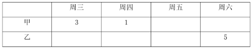

根据题干“甲饮料每天的销售量为整箱且为1到4箱不等”和条件①可知：周五、周六销售甲饮料的数量为2或4，有如下两种假设：

假设一：

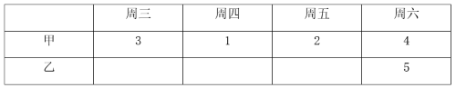

根据条件②，可知：周五甲、乙饮料销售数量总和为8，故周五乙饮料销售数量为6，与题干“乙饮料每天的销售量为1至5箱不等”矛盾，故此假设不成立；

假设二：

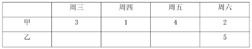

根据条件②，可知：周五甲、乙饮料销售数量总和为6，周四甲、乙饮料销售数量总和为5，周三甲、乙饮料销售数量总和为4，故此时乙饮料周三至周五的销售量如下：

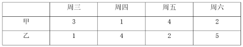

此时符合题干全部条件。

故正确答案为A。

---

第 106 题

**答案**：B

**来源参考解析（非官方标准答案）**

定位统计图可知：2020年全国城乡收入倍差为2.56；定位统计表可知：2020年全国农村居民人均可支配收入为17131.4元，根据：城乡收入倍差=城镇居民人均可支配收入÷农村居民人均可支配收入，则2020年全国城镇居民人均可支配收入=2020年城乡收入倍差×2020年农村居民人均可支配收入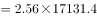元，则2020年全国城乡居民人均可支配收入差额元，与B项最接近。

故正确答案为B。

---

第 107 题

**答案**：A

**来源参考解析（非官方标准答案）**

根据题干“2020年······增长率为”，可判定本题为一般增长率问题。定位表1可得：2019年和2020年全国农村居民人均可支配收入分别为16020.8元、17131.4元；定位图1可得：2019年和2020年城乡收入倍差分别为2.64、2.56。

方法一：根据公式：城乡收入倍差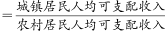，则2019年和2020年全国城镇居民人均可支配收入分别为（16020.8×2.64）元、（17131.4×2.56）元。根据公式：增长率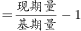，则2020年全国城镇居民人均可支配收入增长率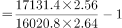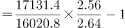，结合选项只有A项满足。 

方法二：，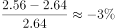。根据公式：城镇居民人均可支配收入=农村居民人均可支配收入×城乡收入倍差，增长率关系为：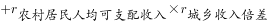，结合选项只有A项满足。

故正确答案为A。

---

第 108 题

**答案**：D

**来源参考解析（非官方标准答案）**

根据题干“2017-2020年······增长最慢的年份是”，可判定本题为一般增长率比较问题。定位表1可得：2016-2020年全国农村居民人均可支配收入分别为12363.4元、13432.4元、14617.1元、16020.8元、17131.4元。根据公式：增长率，可得2017-2020年全国农村人均可支配收入同比增速分别为：

2017年：；

2018年：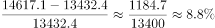；

2019年：；

2020年：。

则2017-2020年全国农村人均可支配收入增长最慢的年份是2020年。

故正确答案为D。

---

第 109 题

**答案**：A

**来源参考解析（非官方标准答案）**

根据题干“与2019年相比，2020年······”，结合选项为上升/下降+具体单位，可判定本题为增长量计算问题。定位统计图可得：2019年全国城乡收入倍差为2.64；定位统计表可得：2019年全国农村居民人均可支配收入为16020.8元。根据：城乡收入倍差，可得：城镇居民人均可支配收入=城乡收入倍差×农村居民人均可支配收入，则2019年城乡居民人均可支配收入差额=2.64×16020.8-16020.8=（2.64-1）×16020.8≈1.64×16000=26240元。根据本篇第1题可得：2020年城乡居民人均可支配收入差额为26725元。则与2019年相比，2020年城乡居民人均可支配收入差额上升了26725-26240=485元，与A项最接近。

故正确答案为A。

备注：本题题干“可支配收入”默认为“人均可支配收入”，否则无法计算。

---

第 110 题

**答案**：D

**来源参考解析（非官方标准答案）**

A项：定位统计图及统计表，可得2020年农村居民及城镇居民人均可支配收入，并未给出农村和城镇居民人数，故无法推出全国居民人均可支配收入，错误； 

B项：定位统计表，可得2014-2020年农村居民人均可支配收入分别为10488.9元、11421.7元、12363.4元、13432.4元、14617.1元、16020.8元、17131.4元。根据公式：增长率，则2015-2020年农村居民人均可支配收入增速分别为：2015年，；2016年，。可得2016年增速＜2015年增速，非持续上升，错误；

C项：定位统计表，可得2014-2020年农村居民人均可支配收入及工资性收入的数据。根据比重公式可知，因每年整体量不变，故直接比较每年部分量大小即可。由2014年工资性收入（4152.2元）＜2014年经营性收入（4237.4元），可得2014年工资性收入占农村居民人均可支配收入的比重不是最高，错误；

D项：定位统计表，可得2014年农村居民人均可支配收入为10488.9元；农民经营性收入为4237.4元。定位统计图，2014年城乡收入倍差为2.75。根据城乡收入倍差，可知2014年城镇居民人均可支配收入为元，故2014年农民经营性收入（4237.4元）＜28844.5×20%=5768.9元，正确。

故正确答案为D。

---

第 111 题

**答案**：C

**来源参考解析（非官方标准答案）**

根据题干“2020年······比2010年······增加的数量······”，可判定本题为增长量计算问题。

方法一：定位文字材料第一段可得：2020年全国人口共141178万人，比2010年增长了约5.38%。根据公式：增长量，则2020年全国人口比2010年全国人口增加的数量万人，在7000万人-8000万人区间。

方法二：定位文字第二段可知：（2020年）与2010年相比，城镇人口增加23642万人，乡村人口减少16436万人。因为全国人口数=城镇人口数+乡村人口数，则2020年全国人口比2010年全国人口增加的数量=城镇人口增加数量-乡村人口减少数量=23642-16436=7206万人，在7000万人-8000万人区间。

故正确答案为C。

---

第 112 题

**答案**：B

**来源参考解析（非官方标准答案）**

根据题干“2020年，中部地区人口比西部地区人口少”，结合材料中给出2020年中部地区和西部地区的人口占比，可判定本题为现期比重问题。定位材料第一段可得：2020年全国人口共141178万人······中部地区占25.83%，西部地区占27.12%。根据公式：部分量=整体量×比重，则2020年中部地区人口比西部地区人口少万人，与B项最接近。

故正确答案为B。

---

第 113 题

**答案**：A

**来源参考解析（非官方标准答案）**

根据题干“2010年······是······的”，选项是约多少倍，且材料时间为2020年，可判定本题为基期倍数问题。定位文字材料第一段可得：2020年东部地区人口占39.93%，东北地区占6.98%；与2010年相比，东部地区人口所占比重上升2.15个百分点，东北地区下降1.20个百分点。则2010年，东部地区人口占总人口的比重为39.93%-2.15%=37.78%，东北地区人口占总人口的比重为6.98%+1.2%=8.18%，题目所求倍数。

故正确答案为A。

---

第 114 题

**答案**：C

**来源参考解析（非官方标准答案）**

根据题干“2020年······占比与······占比相差”，结合材料时间为2020年，可判定本题为现期比重问题。定位文字材料第一段可得：2020年全国人口共141178万人。定位文字材料第二段可得：2020年60岁及以上人口为26402万人，其中，65岁及以上人口为19064万人。则2020年60-64岁人口为26402-19064=7338万人，根据公式：比重，则所求比重差，与C项最接近。

故正确答案为C。

---

第 115 题

**答案**：C

**来源参考解析（非官方标准答案）**

A项：方法一：定位文字材料第一段可得：2020年全国人口共141178万人，比2010年增长了约5.38%。根据公式：基期量，可得2010年全国人口为万人=13.4亿人&lt;13.5亿人，错误；

方法二：定位文字材料第一段可得：2020年全国人口共141178万人；定位文字材料第二段可得：从城乡分布上看······与2010年相比，城镇人口增加23642万人，乡村人口减少16436万人。根据公式：基期量=现期量-增长量，可得2010年全国人口=141178-（23642-16436）=141178-7206=133972万人亿人&lt;13.5亿人，错误；

B项：文字材料第二段只给出了2020年全国各少数民族人口的数据，未给出西部地区各少数民族人口的相关数据，因此该项无法推出，错误；

C项：定位文字材料第一段可得：2020年全国人口共141178万人；定位文字材料第二段可得：2020年60岁及以上人口为26402万人。则2020年60岁以下（不含60岁）人口为141178-26402=114776万人，占全国人口的比重，正确；

D项：定位文字材料第一段可得：2020年全国人口共141178万人；定位文字材料第二段可得：2020年男性人口为72334万人，女性人口为68844万人。则2020年，男性人口占比比女性人口多，即男性人口占比超过女性人口占比不足3个百分点，错误。

故正确答案为C。

---

