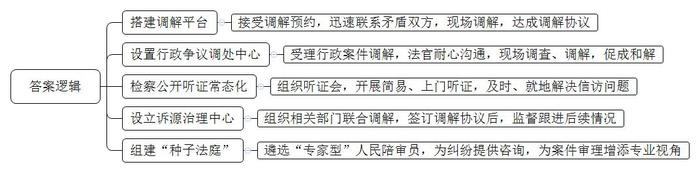
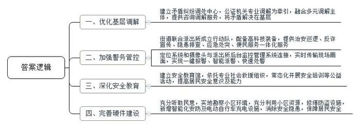
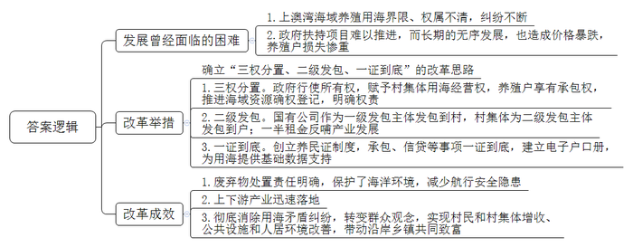
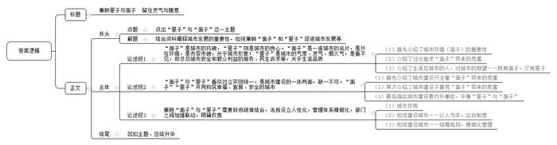

# 2023年公务员多省联考《申论》题（青海行政执法卷）

<!-- gwy:overview:start -->
> **青海 · 2023 · 申论 · 行政执法** ｜ 4 题 · 图片 4 处 · 答案随题折叠

导航：[题目](#题目)
<!-- gwy:overview:end -->

> 候选采集稿。参考答案及解析来自粉笔页面，不代表官方答案或真实高分答卷；来源使用许可与原卷对应关系仍需人工核实。

## 给定材料

### 材料 material-8f9e50a666892afd

外籍商人哈米居住在J市东江街道鸣山社区，因工作原因经常昼伏夜出，而邻居陈阿姨每天早睡早起，双方生活习惯截然不同，多次发生纠纷。于是，哈米尝试向J市外国人服务管理平台求助。接到调解预约后，平台工作人员马上联系到哈米和陈阿姨，并派人现场调解，最终双方达成调解协议。市委政法委林副书记说，J市扎实推进诉源治理，坚持“源头预防为先，非诉机制挺前”，将更多法治力量延伸到基层，对案件源头形成治理合力，有效预防和解决基层矛盾纠纷。

近日，J市N区人民法院行政争议调处中心成功调解一起行政强制案件，当事人梁某送来锦旗表达感谢。今年初，N区茶恩镇政府责令梁某限期拆除未经许可搭建的冷库。梁某认为，该冷库是经村委会同意后才建的，主要用于储存果蔬等农产品，有利于村民发展经济，遂向区法院提起行政诉讼，要求撤销镇政府责令限期拆除的决定。调处中心受理此案后，经法官的耐心沟通、多次现场调查和调解，最终促成双方和解。参与调解的张法官说：“调处中心为群众和行政机关搭建了更为高效的沟通平台，行政案件协调和解率达30%以上，对于化解群众与行政机关之间的争议、完善诉源治理新格局发挥了重要作用。”

本着“事都捋一捋、理都摆一摆、法都讲一讲，讲着讲着心结就打开”的工作思路，J市检察机关近年来常态化推进检察公开听证。2022年，全市检察机关共组织听证会600场，听证后矛盾化解率达90%。同时，J市检察机关还持续开展简易听证和上门听证，努力把信访问题在第一时间、第一地点解决到位，切实把矛盾纠纷化解在基层、解决在当地。

拉几条长凳、摆几张桌子，笔记本电脑、打印机往上一放，一场简易听证会在杨大爷家的院坝拉开了帷幕。2022年初，湛某潜入杨大爷家盗窃现金1万元。公安机关抓获湛某时，他已将所盗钱财挥霍一空，由于湛某没有固定收入来源，无力赔偿杨大爷的损失。法院依法判处湛某有期徒刑，但杨大爷却一直不认可，多次上访。为解开杨大爷的心结，J市人民检察院何检察官和听证员来到杨大爷家，面对面释法说理。“他既不赔偿，态度也不好，我心里不服！”杨大爷表明诉求。案情并不复杂，关键是如何让杨大爷理解判决，释法说理显得尤为重要。

“湛某是否有前科”“到案后表现如何”“法院量刑的依据是什么”……听证员详细询问，并在全面了解案情的基础上，进行了充分评议，形成了听证评议意见。听证会罢，杨大爷表示愿意息诉。“考虑到杨大爷家庭困难，湛某也没有赔偿能力，我们准备帮助杨大爷申请司法救助金。”何检察官说。

2022年11月17日，外来务工人员老程一行来到J市M县诉源治理中心，投诉电力公司拖欠他们13万元工资。由于涉事公司项目在青山镇，青山镇政法委员老黄得知后，立即邀请公安、司法、供电等部门对双方涉及的单位、人员进行联合调解。经调查了解，该项目存在转包现象，当时项目款确实还未到账，承包人吴某又因故无法及时返回青山镇。经调解，由电力公司先行垫付老程等人的工资13万元。双方签订调解协议，政府、法庭、司法、公安监督跟进。

“种子法庭”是J市H区人民法院2022年探索推行的服务种业工作模式。在涉种纠纷化解中，H区人民法院组建了专门的合议庭审理涉种案件，在当地大专院校、种子管理部门、制种龙头企业中，遴选了十余名“专家型”人民陪审员，为种业纠纷提供咨询，给案件审理增添专业视角。自该模式推行以来，H区人民法院办理的涉种纠纷非诉解决比例和调解成功率均超过70%，涉种案件平均办理周期比过去缩短了一半以上。

### 材料 material-efae117e1dd1d912

2022年5月，A市认定729个“五星级平安小区”，光明区海港街道有12个小区获评“五星级平安小区”，居光明区各街道首位。人们纷纷打探海港街道的“平安密码”到底是什么。

近日，海港街道居民吴先生出差回家后发现，自己楼下的“爱车”竟然被“毁容”。邻居家装修时工人使用电焊未加装防护措施，导致火星坠落破坏了车漆面。吴先生找到施工队负责人沟通后，赔偿金额不能达成一致。街道多元化矛盾纠纷调处中心知悉后主动介入，经过调解，双方达成一致，纠纷成功化解。

多元化矛盾纠纷调处中心以公证机关专业调解为牵引，融合公证调解、人民调解、治安调解、司法调解等多元调解为主体，力争将矛盾解决在基层。2020年7月运行以来，中心成功化解183起纠纷，成功率达98.4%，接受当事人咨询631人次。

2021年3月26日晚，“超级花血月”现身A市。作为最佳观测点之一，位于海港辖区内的中兴大桥观景平台，迎来了众多专业的天文学爱好者及市民。在现场，一群身着高科技装备、驾驶平衡车维持秩序的民警们格外吸睛。海港街道联合派出所成立了“闪警别动队”，集治安巡逻、反诈宣传、隐患排查、应急处突、便民服务为一体，日常巡逻搭载北斗定位系统和360度高清摄像头，与派出所后台监控管理系统相连接，实时传输巡逻现场画面，实现一键报警、智能派警、快速处警。

5月20日，海港街道安全教育馆迎来一群活泼可爱的小朋友，A市光明区蓝天救援队队员为小朋友们讲授水上安全与自救、急救包扎的知识。在现场，同学们与授课队员积极互动，场面十分活跃。

自2020年海港街道安全教育馆运作以来，依托蓝天救援队的专业力量，常态化开展应急救护、安全演练、安全宣传、安全培训、心理危机干预等公益活动，为居民提供心理支持与服务，不断提高辖区居民的安全意识和安全防范能力。开馆以来，已为学生和居民举办40多场安全培训，累计接待居民、学生、各类团体4000余人次。

“刷脸”进出楼栋，这不是在高端小区。光明南路294号三栋建于上世纪80年代的居民楼内，也实现了这一设想。8月中旬，随着崭新的人脸识别系统在单元楼上线，无物业老旧小区的居民们靠“刷脸”就能进出楼栋，在方便出行的同时，也更有安全保障。为保障居民安全，派出所还牵头修缮了一批老旧防盗门。

走进海成廊桥小区，映入眼帘的是三组电动车智能充电桩，满足居民电动车充电需求。海港街道坚持防范在前、疏堵结合，下大力气解决小区居民电动车停放、充电问题，消除“电动车进电梯”而引发的安全隐患。去年10月份开始，在了解到居民的“急难愁盼”问题之后，廊桥小区物业和业委会及时进行商量，充分听取居民的诉求，实地勘察小区环境，充分利用小区资源，在辖区内开展电动自行车充电设施建设。

海港街道切实解决群众身边的“糟心事、烦心事、揪心事”，海成廊桥小区居民李先生表示：“现在小区更安全，邻里更和谐，群众更满意，对这个小区的归属感也越来越强。”

### 材料 material-088b2c672a8d1e5c

C县上澳湾海域微波粼粼、金光闪耀，富饶的5万多亩海域是周边村民赖以生存的“海上耕地”。正值紫菜收获的季节，村民们在海上劳作，一派祥和景象。可就在2016年以前，这里曾因养殖用海权属不清而纠纷不断。

“大海谁先占有就是谁的，大家都在抢地盘。”赤水村民兰大爷记忆犹新，“那时我们脑子里只有‘祖宗海’‘门前海’的概念，谁占的海多，谁就来钱多。”兰大爷所说的“那时”指的是2010年前后。2010年，全国紫菜市场供不应求，养殖户不断增多，收益也很可观，但养殖户之间海域使用权不明的问题也埋下了矛盾冲突的隐患。

上澳湾沿岸分布着10余个乡镇，长期以海产养殖为主导产业，但不同乡镇、不同村落之间的养殖海域又互相交叉。下海镇党委袁书记说：“过去，我们与邻近的中海镇在养殖海域确权方面进展迟缓，海域界限不清、权属不明，只能是谁先占，谁先用，养殖用海矛盾纠纷时有发生。”中海镇李镇长则说道：“当时我们也没啥办法，用海基础数据我们镇上也不清楚，上头发来的数据也是模糊不清。我们两个镇搞过联合规划排查，想对养殖海域全面确权，但受各种因素影响，两个镇谈好的一些界限、权属也落不了地，只能任由村民自行其是。”

紫菜养殖用海还没确权，部分从事海洋捕捞的渔民也转向紫菜养殖，要求政府重新配置用海资源，这更增添了确权的难度。2016年，因上澳湾海域紫菜养殖长期无序发展，致使收购价格暴跌，养殖户损失惨重。同时，多发的矛盾也使得政府的扶持项目无法推进，严重影响上澳湾沿岸建设和村民增收。

C县王副县长说：“要引领养殖户走好乡村振兴路，走出养殖用海困境尤为关键。”2016年至2017年，C县先后召开20多次会议，反复征求沿海镇村干部群众意见建议，最后确立了“三权分置、二级发包、一证到底”的改革思路，并决定在上澳湾海域开展养殖用海管理体制改革试点。

“政府行使所有权，赋予村集体用海经营权，保障养殖户享有承包权，推进海域资源确权登记，以制度形式明确权责范围，彻底解决用海定界模糊等根源性问题。”王副县长介绍说，国有安海渔业发展有限公司作为一级发包主体行使所有权，将养殖用海按面积发包到村集体，村集体为二级发包主体行使经营权，经村民代表大会审议后再发包给本村养殖户，养殖户享有承包权。承包租金的50%归属村集体经济收入，30%由镇政府统筹，20%由国有公司统筹。政府和公司统筹所得全部投入产业发展、养殖保险，以反哺养殖户。

为确保“三权分置”“二级发包”落地见效，C县创立“养民证”制度。在养殖户签署协议并缴纳租金后，发放“养民证”，对养民的承包、产业发展补贴申报等事项实行“一证到底”。同时，县有关部门借助无人机航拍和卫星定位技术建立养殖用海电子“户口册”，为养殖用海依法有序地分配、流转提供准确的基础数据支撑。

兰大爷刚拿到“养民证”时，意外地发现，“养民证”还是C县农商银行的信贷凭证。他来到县农商银行营业网点了解详情，银行工作人员向他解释道：“根据县政府发来的通知，您可以用‘养民证’享受‘蓝色信贷’服务，我们可为您发放低息贷款，支持您发展海产养殖。”2019年，C县完成了覆盖全县所有沿海乡镇的养殖用海改革工作，化解了多年来的养殖用海矛盾。

上澳湾紫菜养殖每年需要更换竹竿33万根左右。以前养殖户们为降低成本，将废弃的竹竿留在养殖海域，给海洋生态环境带来了极大的破坏，也对海上渔船航行造成了严重安全隐患。“养殖用海改革后，养殖海域废弃竹竿处置责任得到进一步明确，养殖户主动配合竹竿集中更换处置工作，有的还更换为经久耐用的环保型玻璃钢插杆。”王副县长说，上澳湾紫菜育苗基地、紫菜精加工产业园也得到迅速落地，下海镇和中海镇还瞄准“共富海”，联手打造“多彩上澳”项目，大力发展特色渔村旅游。

“现在海上抢地盘的情况没有了，我们‘祖宗海’‘门前海’的老观念也没有了，紫菜养殖更赚钱了。”兰大爷逢人便说。他现在承包了42亩海域从事紫菜养殖，好的年份能赚七八十万元。近三年，兰大爷所在的赤水村集体经济收入年均增长40%，有了雄厚的资金基础，码头修缮、村道改扩建、环境绿化等项目快速推进，上澳湾的公共设施和人居环境明显改善，小渔村越来越美了。

如今，上澳湾每年的紫菜产量约占全国的六分之一，年产值超10亿元，有效带动了沿岸乡镇共同致富。

## 题目

### 第 1 题

**根据****“给定资料**1**”谈谈J市是如何推进诉源治理工作的。（20分）**

关联材料：材料 material-8f9e50a666892afd

作答要求：

要求：全面，准确，有条理，字数不超过200字。

第 1 题 · 答案与解析

**参考答案（粉笔题库参考内容）**

1.搭建调解平台。接受调解预约，迅速联系矛盾双方，现场调解，达成调解协议。

2.设置行政争议调处中心。受理行政案件调解，法官耐心沟通，现场调查、调解，促成和解。

3.检察公开听证常态化。组织听证会，开展简易、上门听证，及时、就地解决信访问题。

4.设立诉源治理中心。组织相关部门联合调解，签订调解协议后，监督跟进后续情况。

5.组建“种子法庭”。遴选“专家型”人民陪审员，为纠纷提供咨询，为案件审理增添专业视角。

**解析**

**参考答案说明**：本参考答案从“搭建调解平台”“设置行政争议调处中心”“检察公开听证常态化”“设立诉源治理中心”“组建‘种子法庭’”五个角度展开，各条答案要点之间在内容上相互并列，没有交叉。

**考点**：考点概括措施类

**来源**：来源2023年公务员多省联考《申论》题（青海行政执法卷）

粉笔申论页面对本题只提供「解析视频」入口，该入口是会员推广位，页面无视频地址与文字解析。

### 第 2 题

**根据****“给定资料**2**”谈谈海港街道是如何开展平安小区建设的。（25分）**

关联材料：材料 material-efae117e1dd1d912

作答要求：

要求：全面，准确，有条理，字数不超过300字。

第 2 题 · 答案与解析

**参考答案（粉笔题库参考内容）**

一、优化基层调解。建立矛盾纠纷调处中心，公证机关专业调解为牵引，融合多元调解主体，提供咨询调解服务，将矛盾解决在基层。

二、加强警务管控。街道联合派出所成立行动队，配备高科技装备，提供治安巡逻、反诈宣传、隐患排查、应急处突、便民服务一体化服务；定位系统和摄像头与派出所后台监控管理系统连接，实时传输现场画面，实现一键报警、智能派警、快速处警。

三、深化安全教育。建立安全教育馆，依托专业社会救援组织，常态化开展安全培训等公益活动，提高居民安全意识及能力。

四、完善硬件建设。充分听取民意，实地勘察小区环境，充分利用小区资源，修缮防盗设施，新增智能化安防及电动自行车充电设施，消除安全隐患，保障居民安全。

**解析**

**参考答案说明：**本参考答案从“优化基层调解”“加强警务管控”“深化安全教育”“完善硬件建设”这四个方面展开，各条答案要点之间在内容上相互并列，没有交叉。

**考点**：考点概括措施类

**来源**：来源2023年公务员多省联考《申论》题（青海行政执法卷）

粉笔申论页面对本题只提供「解析视频」入口，该入口是会员推广位，页面无视频地址与文字解析。

### 第 3 题

**根据****“给定资料**3**”概括上澳湾海域发展曾经面临的困难、改革举措与成效。（25分）**

关联材料：材料 material-088b2c672a8d1e5c

作答要求：

要求：全面，准确，有条理，字数不超过400字。

第 3 题 · 答案与解析

**参考答案（粉笔题库参考内容）**

发展曾经面临的困难：1.上澳湾海域养殖用海界限、权属不清，纠纷不断；2.政府扶持项目难以推进，而长期的无序发展，也造成价格暴跌，养殖户损失惨重。

改革举措：确立“三权分置、二级发包、一证到底”的改革思路。1.三权分置。政府行使所有权，赋予村集体用海经营权，养殖户享有承包权，推进海域资源确权登记，明确权责；2.二级发包。国有公司作为一级发包主体发包到村，村集体为二级发包主体发包到户；一半租金反哺产业发展；3.一证到底。创立养民证制度，承包、信贷等事项一证到底，建立电子户口册，为用海提供基础数据支持。

改革成效：1.废弃物处置责任明确，保护了海洋环境，减少航行安全隐患；2.上下游产业迅速落地；3.彻底消除用海矛盾纠纷，转变群众观念，实现村民和村集体增收、公共设施和人居环境改善，带动沿岸乡镇共同致富。

**解析**

**参考答案说明：**本参考答案围绕“上澳湾海域养殖用海改革实践”这一主题，宏观上分成了“问题”“举措”“成效”三个方面。在“问题”“举措”“成效”的内部又进行了分层撰写。各答案要点之间在内容上相互并列，没有交叉。

**考点**：考点多要素组合类

**来源**：来源2023年公务员多省联考《申论》题（青海行政执法卷）

粉笔申论页面对本题只提供「解析视频」入口，该入口是会员推广位，页面无视频地址与文字解析。

### 第 4 题

**根据****“给定资料**4**”，以“面子、里子”为话题，联系实际，自选角度，自拟题目，写一篇文章。（50分）**

关联材料：材料 material-8f9e50a666892afd

作答要求：

要求：

（1）观点明确，见解深刻。

（2）参考给定资料，但不拘泥于给定资料。

（3）思路清晰，语言流畅。

（4）字数800-1000字。

第 4 题 · 答案与解析

**参考答案（粉笔题库参考内容）**

**兼顾里子与面子 留住灵气与暖意**

一座城市的发展，承载着市民对美好生活的向往，向往的既有城市外在的美丽与繁华，也有内在的温暖与归属。只有二者兼顾，以人为本，才能留住城市的人间烟火气，让民众感受到城市的灵气与暖意。

**“****面子****”****是城市的风貌，****“****里子****”****则是城市的良心。“面子”是一座城市的名片，是外在环境，是市容市貌，关乎城市形象；“里子”是城市的气度、灵气、烟火气，是看不见，却涉及城市安全和群众利益的服务、民生诉求等，关乎生活品质。**随着生活水平的提升，民众对于城市环境的要求越来越高，优美的景色、完善的硬件、特色的建筑等，也是城市魅力与品味的象征，是市民自信心与归属感的来源。但如果过分追求“面子”，忽视“里子”则会降低市民的幸福感和获得感。因为居于其中，我们更希望一座城市有优质的服务、厚重的人文、便利的生活……

**“面子”与“里子”看似对立实则统一，是城市建设的一体两面，缺一不可。“面子”“里子”共同构筑幸福、宜居、安全的城市。**当前，一些城市重金打造城市地标、对夜市摊点“一禁了之”、忽视地下管网建设导致“城市看海”等等，不仅造成国家财力和社会资源的浪费，还损害民众的切身利益，面子有了，却丢了里子。但若在重视“里子”的同时，未做好管理工作，也会让民众心生不满，如夜市开放后，满地散乱的垃圾、难以清理的油垢同样会有损城市的“面子”。所以城市建设不可厚此薄彼，只有内外兼修，城市才是一座健康的生命有机体！

**兼顾****“面子”与“里子”需要政府疏堵结合，法规设立人性化，管理体系精细化，部门之间加强联动，明确权责。**游人如织的夜市中，人与人之间有了亲密的交流，城市不再是钢筋水泥的森林，而是成了寄托乡愁，释放压力的归处。但狂欢之时的噪音扰民，狂欢之后的卫生难题，也饱受诟病。如何平衡就要考量政府治理的智慧。一方面政府要以人为本，出台制度，立法疏导。如对于设摊经营、占道经营等行为由以往的全面禁止变为“重点区域禁止”，不再“一禁了之”。当然也不能“一放了之”，所以另一方面，管理者也要不断提升管理水平，统筹规划，建立更加精细化的管理体系，协调各部门通力合作、密切配合。这样才不会让城市的“烟火气”变成“火气”。

既把“面子”做靓，又要把“里子”做实。只有“面子”“里子”一起抓，才能真正提升城市质感，彰显城市温度，让民众在“光鲜亮丽”中感受城市的活力与美好。

**解析**

**文章分析**

**兼顾里子与面子** **留住灵气与暖意**

【**标题的优点：**首先，范文的标题突出了“‘里子’与‘面子’”这一主题。其次，形式上，文字简洁明快。】

一座城市的发展，承载着市民对美好生活的向往，向往的既有城市外在的美丽与繁华，也有内在的温暖与归属。只有二者兼顾，以人为本，才能留住城市的人间烟火气，让民众感受到城市的灵气与暖意。

【**开头的优点：**★内容方面：范文的开头是紧扣“‘里子’与‘面子’”这一主题展开的。首先指出了城市发展对市民诉求的关系；然后指出了兼顾“面子”和“里子”让城市充满灵气。★文字表达方面：长短句配合使用，使语言表达有节奏感。】

**“面子”是城市的风貌，“里子”则是城市的良心。“面子”是一座城市的名片，是外在环境，是市容市貌，关乎城市形象；“里子”是城市的气度、灵气、烟火气，是看不见，却涉及城市安全和群众利益的服务、民生诉求等，关乎生活品质。**随着生活水平的提升，（1）民众对于城市环境的要求越来越高，优美的景色、完善的硬件、特色的建筑等，也是城市魅力与品味的象征，是市民自信心与归属感的来源。（2）但如果过分追求“面子”，忽视“里子”则会降低市民的幸福感和获得感。因为居于其中，我们更希望一座城市有优质的服务、厚重的人文、便利的生活……

【**论述段****1的优点：**★观点句：范文的观点句是紧扣“‘里子’与‘面子’”这一文章主题提出的。形式上，它在段首处直接写出，位置突出，容易发现。内容上，关键词突出，内容要点明确，可以明显看出他是围绕“‘里子’与‘面子’”的含义展开。★论述内容：（1）首先介绍了城市环境（面子）的重要性；（2）介绍了过分追求“面子”带来的危害；（3）介绍了生活在城市的人，对城市的期望——既有面子，又有里子。注意：以上三个方面的内容都是紧扣“‘面子’是城市的风貌，‘里子’则是城市的良心。‘面子’是一座城市的名片，是外在环境，是市容市貌，关乎城市形象；‘里子’是城市的气度、灵气、烟火气，是看不见，却涉及城市安全和群众利益的服务、民生诉求等，关乎生活品质”这个观点句论述的，论述的针对性强，内容层次丰富。在论述方法上采用了讲道理、举例子相结合，做到了丰富多样。】

**“面子”与“里子”看似对立实则统一，是城市建设的一体两面，缺一不可。“面子”“里子”共同构筑幸福、宜居、安全的城市。**当前，（1）一些城市重金打造城市地标、对夜市摊点“一禁了之”、忽视地下管网建设导致“城市看海”等等，不仅造成国家财力和社会资源的浪费，还损害民众的切身利益，面子有了，却丢了里子。（2）但若在重视“里子”的同时，未做好管理工作，也会让民众心生不满，如夜市开放后，满地散乱的垃圾、难以清理的油垢同样会有损城市的“面子”。（3）所以城市建设不可厚此薄彼，只有内外兼修，城市才是一座健康的生命有机体！

【**论述段****2****的优点：**★观点句：范文的观点句是紧扣“‘里子’与‘面子’”这一文章主题提出的。形式上，它在段首处直接写出，位置突出，容易发现。内容上，关键词突出，内容要点明确，可以明显看出他是围绕“‘里子’与‘面子’”的关系展开。★论述内容：（1）首先介绍了城市建设只注重“面子”带来的危害；（2）其次介绍了城市建设不重视“面子”带来的危害；（3）最后指出城市建设要内外兼修，平衡“里子”与“面子”。注意：以上三个方面的内容都是紧扣“‘面子’与‘里子’看似对立实则统一，是城市建设的一体两面，缺一不可。“面子”“里子”共同构筑幸福、宜居、安全的城市”这个观点句论述的，论述的针对性强，内容层次丰富。在论述方法上采用了讲道理、举例子相结合，做到了丰富多样。】

**兼顾****“面子”与“里子”需要政府疏堵结合，法规设立人性化，管理体系精细化，部门之间加强联动，明确权责。**（1）游人如织的夜市中，人与人之间有了亲密的交流，城市不再是钢筋水泥的森林，而是成了寄托乡愁，释放压力的归处。但狂欢之时的噪音扰民，狂欢之后的卫生难题，也饱受诟病。如何平衡就要考量政府治理的智慧。（2）一方面政府要以人为本，出台制度，立法疏导。如对于设摊经营、占道经营等行为由以往的全面禁止变为“重点区域禁止”，不再“一禁了之”。（3）当然也不能“一放了之”，所以另一方面，管理者也要不断提升管理水平，统筹规划，建立更加精细化的管理体系，协调各部门通力合作、密切配合。这样才不会让城市的“烟火气”变成“火气”。

【**论述段****3****的优点：**★观点句：范文的观点句是紧扣“‘里子’与‘面子’”这一文章主题提出的。形式上，它在段首处直接写出，位置突出，容易发现。内容上，关键词突出，内容要点明确，可以明显看出他是围绕“如何兼顾‘里子’与‘面子’”展开。★论述内容：（1）城市作用；（2）如何建设城市——以人为本，出台制度；（3）如何建设城市——统筹规划，精细化管理。注意：以上三个方面的内容都是紧扣“兼顾‘面子’与‘里子’需要政府疏堵结合，法规设立人性化，管理体系精细化，部门之间加强联动，明确权责”这个观点句论述的，论述的针对性强，内容层次丰富。在论述方法上采用了讲道理、举例子相结合，做到了丰富多样。】

既把“面子”做靓，又要把“里子”做实。只有“面子”“里子”一起抓，才能真正提升城市质感，彰显城市温度，让民众在“光鲜亮丽”中感受城市的活力与美好。

【**结尾的优点：**范文的结尾回扣了“‘面子’与‘里子’”这个主题，并且进行了总结提升。】

**考点**：考点文章写作题

**来源**：来源2023年公务员多省联考《申论》题（青海行政执法卷）

粉笔申论页面对本题只提供「解析视频」入口，该入口是会员推广位，页面无视频地址与文字解析。

