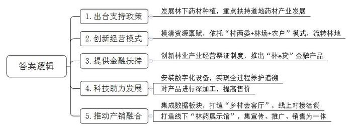
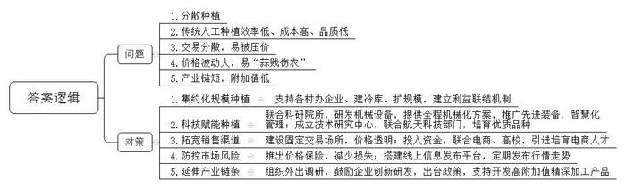
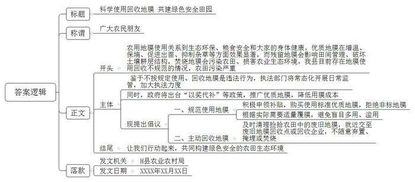

# 2025年公务员多省联考《申论》题（青海县乡卷）

> 候选采集稿。参考答案及解析来自粉笔页面，不代表官方答案或真实高分答卷；来源使用许可与原卷对应关系仍需人工核实。

## 给定材料

### 材料 material-3808206746cd07eb

山路蜿蜒，青山葱郁。在A县正绿家庭林场，漫山遍野的黄精长势喜人，犹如一片“绿色金矿”，林场负责人小康正在省农科院高级实验师、省级科技特派员张老师的指导下细心查看黄精长势。三十多年前，小康的父亲就开始在这大山中造林、育林。岁月流转，昔日播下的绿意如今蔚然成林，孕育出生机勃勃的森林宝库。如何让这大山里的森林资源转化为产业优势？2021年，在当地村两委、驻村干部和科技特派员的帮助下，通过大量的前期走访和实地调研，小康决定充分利用林下空间，在父亲亲手栽植的250多亩森林下种植仿野生黄精。

“黄精从选种、移栽、除草、除虫到采挖，都很有讲究，整个过程复杂且生长周期一般在3到5年，需要有足够的耐心，才能确保长出来的黄精果体大、根茎饱满。”谈起黄精种植，小康如数家珍。

正绿家庭林场是A县依托山地林业资源发展林药产业的一个缩影。A县素有“九山半水半分田”之称，耕地资源十分有限。如何做到不与粮争田的同时又能增加农民收入？A县念好“山字经”，将视角从田间地头转向林间树下，围绕林药产业的发展，出台了一系列的支持政策，大力发展林下药材种植，重点扶持黄精、灵芝、石斛等道地药材产业的发展。从此，林药产业开始了新起点。

林下生金，产业开花，思路一变，豁然开朗。A县充分发挥山地林业资源优势，大力扶持中药材发展，通过农村“资源体检”，摸清全县21个乡镇245个村优质特色林药产品等资源禀赋，依托“村两委+林场+农户”的引领带动模式，流转林地2000多亩，促进家庭林场集约化、规范化种植，巧把青山变“金山”、药材变药“财”，林药种植年产值超3500万元。

走进A县振芳家庭林场，山间树木星罗棋布，林下套种的30亩紫灵芝已进入成熟期，预计将带来约6万元收入。这批紫灵芝的丰收，主要得益于A县“林e贷”的发放。去年5月，A县创新林业产业经营票证制度，推出“林e贷”金融产品。振芳家庭林场通过“林e贷”获得综合授信300万元。“两年前，我们就在林下仿野生种植紫灵芝，效益不错。现在，林药产业有了资金助力，我就更有信心了，第一时间就将种植面积扩大到了30亩。”林场负责人老李自豪地说。

“还有，林药产业有了科技助力，发展就更快了，现在，我在林场全部装上了摄像头等数字化设备，实现从苗到果的全过程养护追溯。还在科技特派员的帮助下对产品进行深加工，加工后的产品售价大大超过切片、孢子粉等初始产品价格。”老李兴奋地说。

好药在深山，市民难买到，农民难卖出。为让好药材卖出好价钱，A县积极作为，集成乡村党建、资源资产、招商项目、道地药材4大数据板块，创新打造线上“乡村会客厅”，推动产销深度融合，促进林业增效、农民增收、农村发展，林药产业有了稳定客源。

“以前到A县洽谈林药产销合作，需要在几个乡镇间来回跑，还不一定都能达成合作，耗费了大量时间精力。现在有了这个‘乡村会客厅’小程序，动动手指就能直接线上对接洽谈，一次性谈成了十几个项目，真的方便多了。”刚与几个乡镇家庭林场达成合作意向的外地客商吴经理说道。

A县还积极打造线下“林药展示馆”。“林药展示馆集宣传、推广、销售为一体，有效畅通了全县药材产品推介渠道。馆内设立了黄精、灵芝、石斛等10个综合展区，介绍A县家庭林场和种植大户的优质药材，可视化展示特色产品80余种，广大客商和用户能在馆内直观感受和体验产品品质。”罗馆长介绍，林药展示馆有效促进了产销对接，推动了林药价值转化，提高了产销效率和效益，“我们诚挚地邀请大家来品鉴林下好药，感受别样的‘土特产’。”近日，A县县委组织部牵头组织的“助力乡村振兴——寻找乡村合伙人”项目推介会在林药展示馆成功举办，100余名商会代表、乡贤人才参会，26个精选产品在会上推介，现场签署意向性合作协议20份。

A县经济发展的潜力在于山，兴旺在于林。“我们秉持绿色发展理念，积极构建生态产品价值实现机制。作为省级林下经济重点县，我们以创建国家级生态文明建设示范区为新起点，在放大生态效益上下足功夫，做大做强林药种植产业，着力构建山林资源就地价值转换和增值增效的林下经济发展新格局，不断拓宽‘山绿’与‘民富’共赢发展的新路径，旧产业取得了新成就。”A县县委袁书记说。

### 材料 material-dd3915410dfa5678

芒种时节，正是一年中农事最繁忙的时候。在K县H村，随处可见采收大蒜的忙碌场景。几年前，H村种蒜致富的消息传开，周边村庄纷纷效仿。K县顺势大力推广，支持各村办企业、建冷库、扩规模，变一家一户分散种植为集约化规模种植，大蒜种植面积迅速扩大。“我们在上级的支持下，探索建立了‘企业+村集体+农户’利益联结机制，村集体和村民分别以集体土地和承包土地入股，每年可以拿到不少盈利分红，大家伙儿的热情可高了。”村主任老刘说。截至目前，H村种植大蒜5千亩，带动K县其他地区种植大蒜超过70万亩。

“以前，种蒜是个辛苦事儿，一亩地要栽2万多粒蒜瓣，得把瓣尖冲上，一瓣瓣用力按到地里，再盖上一层薄土。栽好后也不能立即浇水，得等蒜瓣长出新根再浇，蒜瓣才不容易下沉。‘连跪带爬’干一天，最多也就七分地。”老刘比划着说。2017年，K县联合科研院所，研发了适用于大蒜耕种的机械设备，为大蒜种植和收获环节提供全程机械化解决方案。“现在，我家的20多亩大蒜，无论种还是收，一台机器一天就能全部干完，比请人便宜多了！”老刘说。走进H村农业产业园，大蒜覆膜机、收获机、植保无人机和水肥一体化等先进装备已在园区大面积推广。“打开手机上安装的软件，就能第一时间掌握地里的风向、温度、土壤湿度等指标。”老刘说。

“过去，村民们常年在一块地上施肥打药，地越种越薄，大蒜品质提不上去，客户越来越少，蒜农们着急。县里了解到这种情况后，就依托H村成立了大蒜工程技术研究中心。”中心陈主任介绍，“中心与航天科技部门紧密合作，将大蒜种子或试管种苗送到太空，利用太空特殊的环境进行诱变育种，成功培育出了集高产、优质、抗病性强于一体的太空大蒜。”

H村的大蒜专业批发市场里，叫卖议价声此起彼伏。早些年，K县蒜农卖蒜得“看人脸色”。“丰收时，农民们把大蒜编成串儿，到处售卖，被客商压价是常事。为了解决这个问题，我们建设了一批大蒜批发市场，这样交易场所就固定了，价格也就更透明了。”K县农业农村局曹局长说。

线下市场人头攒动，线上小店生意同样火爆。近年来，K县每年拿出10万元专项资金，与电商平台合作，对有意向从事电商业务的大中专毕业生、复转军人、农民等开展多种形式的培训。同时与高校合作，请来大学生“电商专员”，负责网店建设、运营维护等，为村里培育了一批电商“领头羊”。小张就是其中之一，在他公司的厂房内，工人们忙着将大蒜扒皮、去秆、装袋，接货的卡车络绎不绝。“大家加快速度，这批大蒜马上就要发货了。”小张招呼着工人。

大蒜价格容易波动，有时就像坐过山车，忽上忽下。为防止“蒜贱伤农”，2020年起，K县就推出大蒜目标价格保险，让蒜农通过参保实现风险分担，减轻由自然灾害或市场波动等带来的损失。“近年来，我县还搭建了线上信息发布平台，定时发布大蒜行情走势，蒜农足不出户就能够实时掌握全国大蒜市场信息。”曹局长介绍。

H村大蒜加工Q公司的无菌车间里，操作台上的大蒜蒜瓣粘连，乌黑透亮。“原蒜直接发酵，就成了黑蒜，具有较好的抗氧化功效。”Q公司齐总经理拿起一颗黑蒜展示，“口感柔软，偏甜酸无刺激，这是卖得比较好的一款单品。”不仅如此，以大蒜素胶囊、大蒜多糖等为代表的深加工产品也越来越受到市场的欢迎。“这几年，政府还经常组织我们外出调研，鼓励我们创新研发，并在贷款融资、对接技术人才等方面出台政策，支持我们做大做强，确实不错。未来我们还将进一步开发大蒜功能食品、大蒜生物医药制品等高附加值的精深加工制品。”齐总经理说。目前，H村聚集了很多像Q公司这样的大蒜加工公司，构建起了集标准化种植、科研开发、保鲜储存、精深加工及国际市场流通等为一体的大蒜全产业链发展格局。

“这些年，通过将种植大蒜的一产、加工大蒜的二产、销售大蒜的三产充分融合，发挥全产业链优势，打响‘金蒜盘’，实现了整个产业的高质量发展。”K县梁县长说。

### 材料 material-e98a9bbf15c574d2

近日，为加快构建农业绿色发展新格局，H县农业农村局召开了一场关于农用地膜科学使用、回收的座谈会，听取各方的意见建议。以下是座谈会的主要发言记录：

县农科所专家：农用地膜使用，关系到生态环境保护，关系到粮食安全和群众的身体健康。但从我们县的情况来看，农民们对地膜使用认识有误区，盲目地多用、滥用，导致地膜污染没有得到有效治理。土壤中残留的地膜不仅给耕翻土地等田间管理带来不便，还极大地破坏了土壤的耕层结构。防治农膜污染需要切实做到减量、回收、替代。

D镇驻村干部：我们镇有一些地方，地膜被遗弃在农田边上，没有人捡拾回收。有的农民对废膜危害认识不足，清理回收积极性不高；还有的农民不了解地膜回收的方法，就只是将农田里的地膜简单焚烧了事，燃烧过程中产生的化学残留物又被农机翻整埋入田里，这其实不只会污染农田，更损害了本地的农业生态环境。其实镇里很重视农用地膜的使用与回收，但目前县里各部门分工不够清晰，管理不够到位，单靠我们镇自己的力量很难做到标本兼治。

县农业环境保护监测站工作人员：不按规定使用、回收农用地膜是违法行为。国家在大力推广应用全生物可降解地膜、加厚高强度地膜，但不少农民觉得价格太高，还在购买使用那些厚度低于0.01毫米的非标地膜。我们监测到县里农田中地膜残留量已经达到了每亩3到5公斤，而且每年都有新的地膜沉积在农田中，这种趋势仍在继续。如果这个问题没有得到有效治理，农田污染将越来越严重。

某废品收购站负责人：地膜回收是一个难题。说实话，我们不爱收地膜，现在农民们用的地膜好多都不标准，即便是标准地膜，膜里含有大量泥土、农作物残渣，处理起来不仅耗费水电，人工成本也高，根本不划算。想让农民们处理好地膜再送过来，但跟他们沟通这个也挺麻烦。如果政府能出台政策，补贴一下地膜回收，这样可能会好一点。

某地膜回收企业负责人：我们处理一吨废弃标准地膜的成本接近2000元，回收的产品能卖300到500元。从2023年开始，企业每回收一吨废弃地膜，当地政府补贴2000元。但是，我们专门做过测算，非标膜去除杂质后，每吨能用来回收的原料最终只有460公斤，平均每吨的处理成本要4500多元。而我们现在回收来的大部分都是非标膜，即便有政府补贴，我们也得赔钱。

Q镇农民：厚一点的地膜效果好，没危害，但比较贵，实在用不起。薄地膜的效果差点，质量也差，但也能用。我们也知道碎地膜留在田里有危害，但要把埋在土里的残膜刨干净只能靠人工，平均每亩地要多花80元。把地膜送去回收没有钱赚，还得费好大的功夫，不划算。

M镇某种植大户：我现在都是使用强度高、耐候期长、易回收的地膜，这种地膜使土壤的增温、保墒、出苗性更好，而且能更好地抑制膜下杂草的生长，挺好用的，但确实成本会增加一些。前阵子，我到外市去参观，他们那边政府出台了地膜科学使用补贴政策，通过“以奖代补”和政府补贴的方式，推广使用优质地膜，据说效果不错，大家积极性挺高的。

Q镇某村主任：这几年，县里很重视废弃农膜回收，也出台了政策，但我觉得政策和资金支持得还不够，县、乡、村没有设立固定的废弃农膜回收点，靠自发回收不行，要统筹做好地膜回收利用工作。

L乡农技服务站站长：我们的农技人员费尽口舌，跟农户们宣传科学使用、回收地膜的好处，奈何人家农资店的诱惑更大，除了便宜，还能返利。我看，主要是生产销售非标地膜的太猖獗了，县里有关部门要严格监管，打击与引导并重。这样，我们干起工作来，才会更加顺利。

县市场监管局执法队队长：2023年以来，我们定期开展相关执法检查，但日常监管还存在欠缺和短板。部分企业和商户对此认识不足，认为法不责众，导致违规使用非标地膜的情况屡禁不绝。接下来，我们会进一步联合有关部门，常态化开展日常监管工作，加大全流程执法力度，严禁非标地膜入市下田。

M镇副镇长：要标本兼治解决农用地膜使用、回收存在的问题，我们希望县里坚持“一盘棋”思想，统筹规划，系统推进，让各部门、企业、农户都行动起来，打通地膜生产、销售、使用、回收等各个环节，形成一个完整的链条。可以先搞试点、作示范，以点带面，逐步形成规模，推动农用地膜科学使用、回收全覆盖，构建起绿色安全的农田生态环境。

## 题目

### 第 1 题

**请根据****“给定资料**1**”，概括A县发展林药产业的主要做法。（****20****分）**

关联材料：材料 material-3808206746cd07eb

作答要求：

要求：内容全面，表达准确，条理清晰。不超过200字。

### 第 2 题

**请根据****“给定资料**2**”，梳理K县大蒜产业发展遇到了哪些问题？又是如何解决的？****（****30****分）**

关联材料：材料 material-dd3915410dfa5678

作答要求：

要求：全面，准确，有条理。不超过300字。

### 第 3 题

**假如你是****H县农业农村局工作人员，请你根据“给定资料**3**”，以H县农业农村局的名义写一份倡议书，倡导农民科学使用、回收农用地膜。（30分）**

关联材料：材料 material-e98a9bbf15c574d2

作答要求：

要求：

（1）紧扣资料，内容充实，针对性强；

（2）结构完整，语言生动；

（3）不超过450字。

### 第 4 题

**“给定资料**4**”中提到“一面逐新，一面念旧，在新与旧的交融中不断发展，迎来新生”。请结合你对这句话的理解，参考资料，联系乡村发展实际，自选角度，自拟题目，写一篇文章。（****4****0分）**

关联材料：材料 material-3808206746cd07eb

作答要求：

要求：

（1）观点明确，见解深刻；

（2）内容充实，结构完整；

（3）思路清晰，语言流畅；

（4）1000-1200字。

## 答案与解析

第 1 题

**参考答案（粉笔题库参考内容）**

1.出台支持政策。发展林下药材种植，重点扶持道地药材产业发展。

2.创新经营模式。摸清资源禀赋，依托“村两委+林场+农户”模式，流转林地。

3.提供金融扶持。创新林业产业经营票证制度，推出“林e贷”金融产品。

4.科技助力发展。安装数字化设备，实现全过程养护追溯；对产品进行深加工，提高售价。

5.推动产销融合。集成数据板块，打造“乡村会客厅”，线上对接洽谈；打造线下“林药展示馆”，集宣传、推广、销售为一体。

**解析**

**参考答案说明**：本参考答案从“出台支持政策”“创新经营模式”“提供金融扶持”“科技助力发展”“推动产销融合”五个方面展开，各条答案要点之间在内容上相互并列，没有交叉。

**考点**：考点概括措施类

**来源**：来源2025年公务员多省联考《申论》题（青海县乡卷）

粉笔申论页面对本题只提供「解析视频」入口，该入口是会员推广位，页面无视频地址与文字解析。

第 2 题

**参考答案（粉笔题库参考内容）**

问题：1.分散种植。2.传统人工种植效率低、成本高、品质低。3.交易分散，易被压价。4.价格波动大，易“蒜贱伤农”。5.产业链短，附加值低。

对策：1.集约化规模种植。支持各村办企业、建冷库、扩规模，建立利益联结机制。2.科技赋能种植。联合科研院所，研发机械设备，提供全程机械化方案，推广先进装备，智慧化管理；成立技术研究中心，联合航天科技部门，培育优质品种。3.拓宽销售渠道。建设固定交易场所，价格透明；投入资金，联合电商、高校，引进培育电商人才。4.防控市场风险。推出价格保险，减少损失；搭建线上信息发布平台，定期发布行情走势。5.延伸产业链条。组织外出调研，鼓励企业创新研发，出台政策，支持开发高附加值精深加工产品。

**解析**

**参考答案说明****：**本参考答案宏观上从“问题”和“对策”两个方面展开。在“问题”方面，围绕“分散种植”“传统种植”“销售渠道”“市场风险”“产业链条”五个方面进行分条撰写；在“对策”方面，围绕“集约化规模种植”“科技赋能种植”“拓宽销售渠道”“防控市场风险”“延伸产业链条”这五个方面展开。各条要点之间在内容上相互并列，没有交叉。

**考点**：考点多要素组合类

**来源**：来源2025年公务员多省联考《申论》题（青海县乡卷）

粉笔申论页面对本题只提供「解析视频」入口，该入口是会员推广位，页面无视频地址与文字解析。

第 3 题

**参考答案（粉笔题库参考内容）**

科学使用回收地膜 共建绿色安全田园

广大农民朋友：

农用地膜使用关系到生态环保、粮食安全和大家的身体健康。优质地膜在增温、保墒、促进出苗、抑制杂草等方面效果显著，而残留地膜会影响田间管理、破坏土壤耕层结构，焚烧地膜会污染农田、损害农业生态环境。我县目前存在地膜使用回收不规范的情况，农田污染严重。

鉴于不按规定使用、回收地膜是违法行为，执法部门将常态化开展日常监管，加大执法力度。同时，政府将出台“以奖代补”等政策，推广优质地膜，降低用膜成本。

现提出倡议：一、规范使用地膜。积极申领补贴，购买使用标准优质地膜，拒绝非标地膜；根据实际需要适量覆膜，避免盲目多用、滥用。二、主动回收地膜。及时清理捡拾农田中的废旧地膜，就近交至废旧地膜回收点或回收企业，不随意弃置、掩埋或焚烧。

让我们行动起来，共同构建绿色安全的农田生态环境！

H县农业农村局

XXXX年XX月XX日

**解析**

**参考答案说明：**（1）格式方面，本参考答案写到了“标题”“称谓”“正文”“落款”四个部分。（2）正文部分，一方面从内容来看，围绕着“农民科学使用、回收农用地膜”这一主题，本参考答案的开头先写到了“倡议农民科学使用、回收农用地膜”的背景；接着主体部分从“执法部门”“政府”两个层面提出了对策，并从“规范使用地膜”和“主动回收地膜”两方面提出了倡议。最后结尾部分进行了呼吁。另一方面，形式上，本参考答案做到了分段、分条撰写，整体上条理较为清晰。

**考点**：考点宣传类

**来源**：来源2025年公务员多省联考《申论》题（青海县乡卷）

粉笔申论页面对本题只提供「解析视频」入口，该入口是会员推广位，页面无视频地址与文字解析。

第 4 题

**参考答案（粉笔题库参考内容）**

**旧韵赋能乡村，新态引领振兴**

枯藤攀附黛瓦，老树守望阡陌，昏鸦掠过斜阳是记忆中的乡村，而现实的乡村却是传统与现代的二重奏，天上无人机飞翔过麦田、精密的光纤在青石板下蜿蜒、地上新农人架起云台在老樟树旁讲着新农村……乡村的发展在新旧交织中焕然一新、蓬勃向上。这幅新旧共生的美学图景，正在演绎乡村发展的辩证法。

**乡村发展的念旧是要保留乡村文化记忆，守住文化之根。**“念旧”并非简单的复古或守旧，而是守护记忆中的烟火气，留住植根于心底的乡愁，赓续根脉相融的文化血脉。传统村落中的建筑形制、农事节气、手工技艺等文化要素构成独特的符号系统，这些符号承载着人类与自然对话的集体记忆，是烟火气与乡愁的实质载体。新时代的乡村建设，要修旧如旧，保留乡村的原样原貌，让建筑肌理成为可触摸的文化基因图谱，也要建立非遗传承人培育机制，让传统有传承，让文化有声音，更要留住炊烟袅袅生活图景，惟其如此，方能让乡村在发展中留住本真模样，让乡愁记忆永续流淌在时代长河。

旧是新生的土壤，是发展的基石，是前行的源泉。“念旧”并非沉湎往昔，而是为“逐新”蓄力，让岁月沉淀在春风里萌发新芽，化腐朽为神奇。

**乡村发展的逐新是要创新驱动，探索乡村发展新路径。**“逐新”是突破传统发展模式，依托自身资源禀赋，用新思维发展新业态、新模式，实现乡村发展的凤凰涅槃。江西婺源篁岭村打造“晒秋”IP，“晒”出丰收之美；贵州丹寨县将苗族蜡染技艺与现代设计结合，在米兰碰撞出自信的火花；江苏兴化千垛菜花景区打造“农业观光+民宿经济+电商销售”产业链，展现产业融合的智慧……乡村文化的创新发展，让乡村走出了自己的路。新时代的乡村创新发展，需要构建“政策引导+市场运作+科技赋能+文化激活”的创新生态系统，实现乡村的“产业增值、生态增值、文化增值、人才增值”，走可持续发展之路。

**乡村发展要把握好新旧的辩证关系，坚持守正与创新相结合。**朱熹在注解儒家典籍时所阐发的“常则守经，变则行权” 的思想，诠释了守正与创新的辩证关系。乡村建设中，古村落的保护性开发、传统技艺的现代化转型，都是这种智慧的生动实践，借助新旧迭代，实现质的飞跃。浙江安吉余村保留千年竹编工艺、古民居群落等传统文化基因，引入生态旅游、数字农业等新兴产业，既守住了绿水青山，又创造出新型经济模式。但某些地区在城镇化进程中采取“破旧立新”的策略，拆除明清建筑群改建商业综合体，导致历史文脉断裂，游客量不增反降。一味破旧立新如断流之水，单纯因循守旧如无根之木，唯有守正创新，才能开辟新发展。

乡村的发展之道，当以守正为立世根基，以创新为前行罗盘，让传统智慧与现代精神在历史长河中交相辉映。

**解析**

**文章分析**

**旧韵赋能乡村，新态引领振兴**

【**标题的优点：**首先，范文的标题突出了“乡村发展”这一主题。其次，形式上，文字简洁明快，不拖沓。】

（1）枯藤攀附黛瓦，老树守望阡陌，昏鸦掠过斜阳是记忆中的乡村，而现实的乡村却是传统与现代的二重奏，天上无人机飞翔过麦田、精密的光纤在青石板下蜿蜒、地上新农人架起云台在老樟树旁讲着新农村……（2）乡村的发展在新旧交织中焕然一新、蓬勃向上。这幅新旧共生的美学图景，正在演绎乡村发展的辩证法。

【**开头的优点：**★内容方面：范文的开头是紧扣“乡村发展”这一主题展开的。首先，开头点出主题，做到了主题明确。其次，对“乡村发展”这一主题进行了分析阐述：（1）列举了记忆中和现实中乡村的具体情形；（2）指出乡村发展要新旧交织，引出文章核心观点。★文字表达方面：长短句配合使用，使语言表达有节奏感。】

**乡村发展的念旧是要保留乡村文化记忆，守住文化之根。**（1）“念旧”并非简单的复古或守旧，而是守护记忆中的烟火气，留住植根于心底的乡愁，赓续根脉相融的文化血脉。（2）传统村落中的建筑形制、农事节气、手工技艺等文化要素构成独特的符号系统，这些符号承载着人类与自然对话的集体记忆，是烟火气与乡愁的实质载体。（3）新时代的乡村建设，要修旧如旧，保留乡村的原样原貌，让建筑肌理成为可触摸的文化基因图谱，也要建立非遗传承人培育机制，让传统有传承，让文化有声音，更要留住炊烟袅袅生活图景，惟其如此，方能让乡村在发展中留住本真模样，让乡愁记忆永续流淌在时代长河。

【**论述段****1的优点：**★观点句：范文的观点句是紧扣“乡村发展”这一文章主题提出的。形式上，它在段首处直接写出，位置突出，容易发现。内容上，关键词突出，内容要点明确，可以明显看出它是从“念旧”这个角度入手，指出了乡村发展“念旧”的内涵。★论述内容：（1）首先指出“念旧”的含义；（2）其次阐述传统村落“念旧”的具体体现；（3）最后指出现代乡村建设如何“念旧”的对策及意义。注意：以上三个方面的内容都是紧扣“乡村发展的念旧是要保留乡村文化记忆，守住文化之根”这个观点句进行分析论述的，论述的针对性强，内容层次丰富。最后，在论述方法上主要采用了讲道理的方式，论述深刻有力。】

旧是新生的土壤，是发展的基石，是前行的源泉。“念旧”并非沉湎往昔，而是为“逐新”蓄力，让岁月沉淀在春风里萌发新芽，化腐朽为神奇。

【**过渡段的优点：**范文过渡段分析了“念旧”对“逐新”的意义，此外，还要注意过渡段末尾的“‘念旧’并非沉湎往昔，而是为‘逐新’蓄力，让岁月沉淀在春风里萌发新芽，化腐朽为神奇”是用来引起下文的过渡句。】

**乡村发展的逐新是要创新驱动，探索乡村发展新路径。**（1）“逐新”是突破传统发展模式，依托自身资源禀赋，用新思维发展新业态、新模式，实现乡村发展的凤凰涅槃。（2）江西婺源篁岭村打造“晒秋”IP，“晒”出丰收之美；贵州丹寨县将苗族蜡染技艺与现代设计结合，在米兰碰撞出自信的火花；江苏兴化千垛菜花景区打造“农业观光+民宿经济+电商销售”产业链，展现产业融合的智慧……乡村文化的创新发展，让乡村走出了自己的路。（3）新时代的乡村创新发展，需要构建“政策引导+市场运作+科技赋能+文化激活”的创新生态系统，实现乡村的“产业增值、生态增值、文化增值、人才增值”，走可持续发展之路。

【**论述段****2****的优点：**★观点句：范文的观点句是紧扣“乡村发展”这一文章主题提出的。形式上，它在段首处直接写出，位置突出，容易发现。内容上，关键词突出，内容要点明确，可以明显看出它是从“逐新”这个角度入手，指出了乡村发展“逐新”的内涵。★论述内容：（1）首先指出“新”的含义；（2）其次列举乡村发展“逐新”的事例；（3）最后指出乡村发展如何“逐新”的对策。注意：以上三个方面的内容都是紧扣“乡村发展的逐新是要创新驱动，探索乡村发展新路径”这个观点句进行分析论述的，论述的针对性强，内容层次丰富。最后，在论述方法上主要采用了讲道理和举例子相结合，论述丰富多样。】

**乡村发展要把握好新旧的辩证关系，坚持守正与创新相结合。**（1）朱熹在注解儒家典籍时所阐发的“常则守经，变则行权”的思想，诠释了守正与创新的辩证关系。（2）乡村建设中，古村落的保护性开发、传统技艺的现代化转型，都是这种智慧的生动实践，借助新旧迭代，实现质的飞跃。（3）浙江安吉余村保留千年竹编工艺、古民居群落等传统文化基因，引入生态旅游、数字农业等新兴产业，既守住了绿水青山，又创造出新型经济模式。但某些地区在城镇化进程中采取“破旧立新”的策略，拆除明清建筑群改建商业综合体，导致历史文脉断裂，游客量不增反降。一味破旧立新如断流之水，单纯因循守旧如无根之木，唯有守正创新，才能开辟新发展。

【**论述段****3****的优点：**★观点句：范文的观点句是紧扣“乡村发展”这一文章主题提出的。形式上，它在段首处直接写出，位置突出，容易发现。内容上，关键词突出，内容要点明确，可以明显看出它是从“关系”这个角度入手，指出了乡村发展“念旧”和“逐新”的辩证关系。★论述内容：（1）首先引用古语引出新旧的辩证关系；（2）其次指出新旧的辩证关系在乡村建设中的体现；（3）最后从正反两方面列举把握新旧辩证关系的事例。注意：以上三个方面的内容都是紧扣“乡村发展要把握好新旧的辩证关系，坚持守正与创新相结合”这个观点句进行分析论述的，论述的针对性强，内容层次丰富。最后，在论述方法上主要采用了讲道理和举例子相结合，论述丰富多样。】

【**论述段之间的关系：**★内容的内在逻辑：范文的论述段之间是依照“并列”的逻辑展开的。论述段1先写了乡村发展“念旧”的内涵，论述段2接着写了乡村发展“逐新”的内涵，论述段3最后写了乡村发展“念旧”与“逐新”的关系。三个论述段相互并列，逻辑清晰。】

乡村的发展之道，当以守正为立世根基，以创新为前行罗盘，让传统智慧与现代精神在历史长河中交相辉映。

【**结尾的优点：**范文的结尾回扣了“乡村发展”这个主题，并且进行了总结提升。】

**考点**：考点文章写作题

**来源**：来源2025年公务员多省联考《申论》题（青海县乡卷）

粉笔申论页面对本题只提供「解析视频」入口，该入口是会员推广位，页面无视频地址与文字解析。

