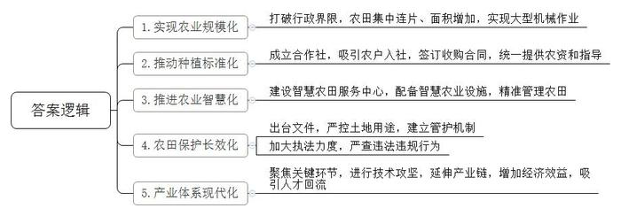
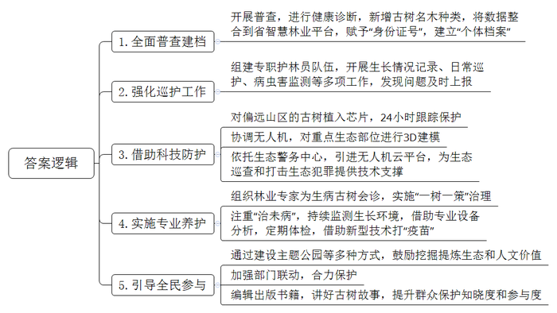
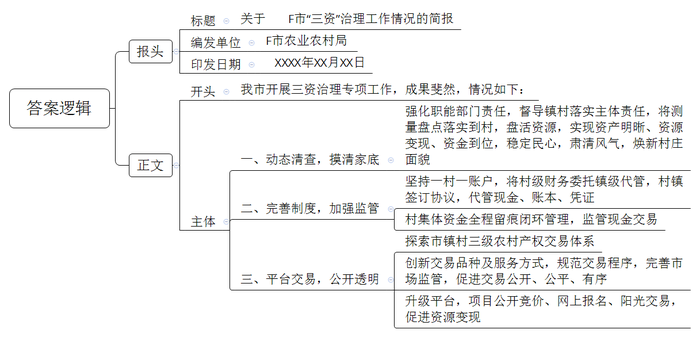
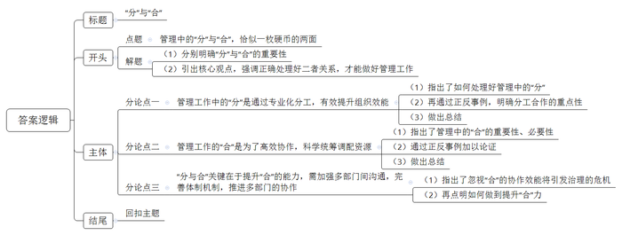

# 2025年公务员多省联考《申论》题（青海行政执法卷）

<!-- gwy:overview:start -->
> **青海 · 2025 · 申论 · 行政执法** ｜ 4 题 · 图片 4 处 · 答案随题折叠

导航：[题目](#题目) · [材料 1](#材料-1)
<!-- gwy:overview:end -->

> 候选采集稿。参考答案及解析来自粉笔页面，不代表官方答案或真实高分答卷；来源使用许可与原卷对应关系仍需人工核实。

## 给定材料

### 材料 1

“你看这梯田一圈一圈，像池塘里的涟漪，层层荡开，非常漂亮。”站在定川村的山头，A市农业农村局马局长指着已经建成的高标准农田说。举目四望，山横黛，田绕山，碧绿轻盈的马铃薯苗正在田中茁壮成长，随高标准农田配套修建的“田间生产路”起伏于山间，延展向远方。在高标准农田建设上，A市立足当地实际，组织设计单位扎实摸底勘察，打破行政界限，整山系、整流域推进实施。“高标准农田消除了界埂沟渠，不仅增加了种植面积，而且集中连片，为新的农田经营方式创造了便利。”马局长说。

马铃薯种植是当地传统的主导产业。“我们以前人工点种，一天下来一人也只能点一亩。”定川村村民老秦说，“现在田间路宽了，大型机械也能开进田了，一天能种40多亩，而且每亩可以种4200株左右。”A市市政府引导种植大户牵头成立马铃薯种植合作社，在自愿的前提下，吸引农户以土地经营权入社，合作社与农户签订收购合同，给农户提供种子和机械，指导农户按照标准进行种植。

在定川村智慧农田服务中心，几位年龄较大的村民正在学习如何用手机浇地。打开手机应用软件，简单几步操作后，通过中心墙上的大屏幕可以直观地看到伸缩式喷灌连接杆缓缓地伸出来，喷头旋转喷洒。这种喷灌设施不仅可以喷洒水，还可以喷洒调配好的肥料和药物。中心旁边有一块儿被栏杆围起的场地，分布着土壤墒情监测仪、物联网虫情信息采集设备等智慧农业设施。“这些设备收集到的信息都会汇集到软件上，农业技术员分析研判后在手机上发布灌溉、施肥、除虫等指导意见，农民只要点点手机，就能精准管理上千亩农田。”马局长说，“智慧农田服务中心让高标准农田有了‘大脑’，我们正在全市逐步推广。”

为确保高标准农田发挥长久效应，A市严格执行国家关于坚决遏制耕地“非农化”“非粮化”政策，出台了高标准农田建设项目管理办法等文件，要求任何单位和个人不得毁损、擅自占用高标准农田或改变高标准农田用途。“市里统筹‘建、用、管’一体，建立县、乡、村、组四级网格长的建后管护新机制。”市农业农村局农田建设与耕地质量保护科罗科长说。目前A市已经划定各个网格管理区域，为每个网格都聘请了管护员，逐级落实管护责任主体。同时，A市农业农村、自然资源等部门加大执法力度，随机开展抽查检查，畅通举报渠道，公开监督投诉电话，对发现的各类违法违规问题依法依规严肃查处。

近年来，A市加大科研投入力度，建成了一批集研发、教学和生产为一体的马铃薯种薯培育基地。“随着高标准农田建设的迅速推进，打造现代化的马铃薯产业发展体系成为我市迫在眉睫的任务。”马局长说，“市里围绕马铃薯种植，上溯下延，聚焦繁育、种植、储存、加工等关键环节，不断进行技术攻坚。”现在A市每年生产的五百多万吨鲜薯，一部分作为良种向外销售推广出去，其余作为原料进入当地淀粉生产厂进行深加工，一个个马铃薯正在串起金色的产业链。“我们公司年加工鲜薯9万多吨，生产薯产品1.4万吨，销售总额达1.08亿元。近年来，我们持续延伸产业链条，开发了流汁宽粉、马铃薯纤维等多种产品，进一步增加了企业的经济效益。”某淀粉加工有限公司柳经理说。

产业兴带来人气旺。以前定川村的年轻人都去外面发展，村子冷清得很。“现在我们合作社年轻人越来越多，仅去年就有十来名年轻人从城镇回来工作。这些人大部分受过高等教育，他们带回了新技术、新观念。”定川村马铃薯专业合作社杜经理说。这些年轻人经常随手拍一些定川马铃薯种植的短视频发到网上，自豪地宣传家乡的特色农业，吸引不少商家前来合作。“高标准农田建设一头连着国家的粮食安全，是实现高质量发展的重要保障，一头连着百姓的增产增收，是实现美好生活的坚实基础。”马局长说，“通过建设高标准农田，我们激活了农村的‘一池春水’。”山，还是那座山；地，依旧是那片地。从粮田到良田，如今的A市“鲜活”了起来，溢满勃勃生机。

### 材料 2

P县是林业大县，森林覆盖率高达77%，至今留存着216个古树群落、7491株古树名木。这些古树名木种类和数量多，且散落遍布山野，保护难度极大。踏遍P县的山山水水，为一棵棵古树名木“健康诊断”“建档立卡”……这是县林长办高级工程师老汪和团队成员长期坚持的工作。

P县素来有保护树木的传统。早在1996年，县政府就公布挂牌保护了16科25属28种1096株古树名木，并抢救性保护了一批濒临死亡的古树名木。2012年，该县组织开展古树名木普查，工作人员翻山越岭，探访散布在村口院落、田间地头、密林深处的珍贵古树。此次普查，新增了13科36属55种6395株古树名木。此后，工作人员将数据信息整合到省智慧林业平台，在赋予古树“身份证号”的同时，为每棵古树建立起了“个体档案”。

“位于梨岭村的水松古树群，对研究杉科植物的系统发育、古植物学等都有重要科研价值。我们在寺庙、宗祠、学堂中发现普遍栽有罗汉松，这对于了解当地历史文化也具有一定意义。”老汪说，为古树名木建立“个体档案”，对于研究其历史价值和科研价值等具有重要作用。

“黄源岭背为保留庇荫，禁止砍柴，违者罚银一两，留存众用。”P县境内有一块始立于明朝崇祯年间的石碑，与当地村民一同守护了古树群数百年。这里，南方红豆杉、银杏等117株平均树龄260年以上的古树虬枝飘逸、郁郁葱葱，成为P县珍稀树种最多、林相最完整，绿化、美化、彩化兼备的“最美古树群”。

“随着这几十年生活条件大大改善，老百姓们逐渐意识到生态环境的珍贵价值，保护古树的意识也越来越强。”老汪说，“自发巡山、护林、保护古树已经成为我们的一种习惯。”在没有路的大山里爬坡过沟，护林员老石在这片山林里走了27年。一本笔记本，一个水杯，一个背包，每天上午，老石都要背着他的这些家当到森林深处仔细观察一株株古树，记录古树的生长情况，一旦发现枝叶枯萎迹象或病虫害，就立刻上报。如今，P县像老石一样的专职护林员有349人，日常巡护、病虫害监测、森林防灭火、宣传劝导……这是他们的护林日常。护林员们行走在山水之间，就像“专职护卫”一样默默守护着青山、古树。

“今年，针对偏远山区存在被破坏风险的古树名木，我们还采取了植入芯片的方式24小时强化跟踪保护。目前，首批确定保护的有南方红豆杉、罗汉松等100余棵具有重要经济价值的古树名木。当古树名木发生移动时，系统将会自动报警，工作人员即可通过后台定位跟踪，及时处置。近期，我们也协调了县林业、供电等单位共20架无人机，对县域内国家森林公园及古树名木群落等重点生态部位进行无人机3D建模。”县公安局宁局长介绍，依托生态警务中心，引进无人机云平台，实现数据存储比对分析、资源共享等功能，为开展无人机生态巡查和打击涉生态领域违法犯罪提供技术支撑。

古树是活着的历史，但树龄越大，越容易生病，更需要“私人医生”的专业守护，“一树一策”开“药方”。“九龙桂”是P县最有代表性的丹桂树，但在几年前，它出现了生长衰退、持续落叶等问题。“当时一发现情况，县、镇两级就及时组织了林业专家进行会诊。”老汪说，“对树周、冠下环境进行治理，撤除硬化设施，换上新土。与此同时，采伐、移植周边影响‘九龙桂’生长的毛竹和小丹桂树等，创造利于古树光合作用、排水、透风透气的生长环境，并借助空中喷洒药物方式进行病虫害防治。”

如今，专家把古树养护重点放在了“治未病”上，采取多种手段促进树体健康生长。持续监测古树的生长环境，借助专业设备进行分析，提前防范化解病虫害侵蚀、土壤板结、缺水失肥等风险；定期进行体检，对古树名木做精细化“查体”，借助新型打孔注药技术，为古树打“疫苗”。“利用检测设备，经专业软件处理后，就能在电脑上对古树建模，直观地反映古树当前整体情况，这为我们精准救护古树提供了依据。”老汪说。

P县在加强和规范古树名木日常管护的同时，还鼓励挖掘和提炼古树名木的生态和人文价值。比如，建设古树主题公园，推出特色古树群游览路线，设立有声古树名木保护牌，开展形式多样的宣教、普法活动等，同时加强部门联动，合力保护，提升群众对古树名木保护的知晓度和参与度，在大家心中播撒生态文明的种子，让保护古树名木蔚然成风。

为了讲好古树的故事，近年来，P县还组织编辑出版了《P县古树名木》一书，收录了24个景观优美的古树群和132株具有代表性的古树。除了珍贵的资料，书中还有许多民间故事，图文并茂地展现了当地古树名木的风采。

“千姿百态的古树名木是自然的见证，是绿色的文物和‘活化石’。保护古树名木单靠我们是远远不够的，不仅要让大家认识、了解古树名木，还要唤醒大家的保护意识，引导全社会共同参与。”县林业局段局长说。

### 材料 3

“‘三资’（资产、资源、资金）治理不仅关系到村民富不富，也关系到村庄美不美。”F市水北镇杨庄村党支部书记说，“‘三资’治理就是要摸清家底，规范使用，盘活资源。落实到村里，主要是测量盘点，把现有资源搞‘活’。通过治理，不仅资产明晰了，资源变现了，资金到位了，而且民心稳了，风气正了，村庄面貌也随之焕然一新。”

杨庄村属于典型的城郊村，村内企业占地较多，但过去一段时间，“三资”问题一直困扰着干部和群众。“不少地块都是本村村民在承包，但由于大伙签订合同的背景不一样，价格也存在差异，群众之间又有攀比心理，所以工作一直很难推进。”杨庄村党支部书记介绍，“一旦开展‘三资’清查，就要推翻很多过去已经签好的合同，涉及到村里很多企业的资金问题，要让商户和村民都接受、配合，的确很不容易。”

近年来，借着市里乡村振兴工作计划“三资”治理专项实施为契机，杨庄村在市农业农村局指导下多次召开村两委联席会议，讨论制定了“三资”清查方案，成立了“三资”清查工作小组。

清查的第一步，就是摸清家底。为确保公正公开，杨庄村采取实地测量的方式，邀请企业方、测量方、村干部、村民代表等多方同时在场进行土地测量，测量结果需得到多方认可，在公示无异议后才能生效。“这是一项为村为民的好政策，就先从我家的大棚开始吧。”党员老纪不仅第一个接受实地测量，第一个重新签署合同、缴纳承包费，还主动加入工作小组，负责土地测量工作。像老纪一样，全村54名党员充分发挥先锋模范作用，以实际行动支持“三资”治理工作。在他们的影响下，原本心存疑虑的村民逐渐转变态度，纷纷配合入户进企实地测量，捋顺合同、明晰债权债务，开展企业租赁合同续签、改签等工作，使清查工作得到了有序推进。

自治理专项开展以来，F市进一步强化职能部门的对接、指导责任，及时督导镇村两级落实好主体责任，着力推动治理工作走深走实。截至目前，共清收各类闲置或被侵占的机动地、集体建设用地、四荒水面等10769亩，盘活15167亩，增收2832万元。摸排合同35194份，规范问题合同10344份，清收债权6418笔，金额共计6840万元。

在动态清查农村集体“三资”底数的同时，F市也在不断完善相应的监管制度。坚持“一村一账户”，将村级财务委托镇级代管，村集体与镇级业务部门签订协议，村级实行报账员制度。在各乡镇（街道）设立农村财务委托代理服务中心，在坚持村级集体资产所有权、使用权、财务审批权不变和会计核算主体不变的前提下，统一管理村级账目，实现现金、账本、凭证“三代管”，将所有村级账户纳入“银农直联”网络监管平台，依托平台对村集体资金实行全程留痕闭环管理，做到干部不经钱、会计不见钞，切实杜绝以往村集体现金交易不易被监管的现象。

最近，水北镇法柳村的夜市成了当地居民的热门打卡地。每当夜幕降临，人们汇聚在此，不仅可以品尝近百种特色美食，还能观看灯光秀和演出。然而一年前，这里还是堆满建筑废料、生活垃圾的荒地，一到下雨天便污水横流。在“三资”治理专项实施过程中，这片荒地成为镇村干部关注的重点。镇村两级多次组织召开协商议事会，广泛征集干部和群众意见。“隔壁杨庄村的夜市搞得挺红火的，我们是不是也可以搞？”“对啊，我们周边人流量大，这个优势可得好好利用！”……经充分研究论证，法柳村两委决定借助企业力量将荒地发展为夜市。水北镇第一时间将情况汇报给市农业农村局，并协助村两委将夜市招标信息发布至农村产权线上交易平台。

“几家企业竞价角逐，最终价高者得。与企业签订的合同中土地租金是一年26万元，超过了我们最初的预期。”法柳村党支部杨书记说道，“从申请报名到与企业签订土地租赁合同，前后也就半个多月时间。”

“村里的这笔交易做得好啊，我们有活干，村里有钱挣，人气也旺了。”53岁的夜市清洁员赵大姐说，她现在每月能增加3000元的收入。

十年前，F市建成省内首家农村产权线上交易平台。多年来，F市积极探索市、镇、村三级农村产权交易体系，在市级成立农村产权交易中心，在乡镇（街道）设分中心，在村庄设信息点。同时，不断创新交易品种及服务方式，规范交易程序，完善市场监管，促进交易公开、公平、有序进行。

随着数字技术的发展和农村资源要素活力的释放，去年，F市又对交易平台进行了升级。目前，所有项目均采取公开竞价、网上报名、阳光交易的模式，部分交易项目溢价超3倍，为农村集体资源变现发挥着更加便捷、积极的作用。

### 材料 4

火车站是城市交通的重要枢纽，更是城市的重要形象窗口之一。因为网约车停放不规范，Z市火车站停车乱、行车慢、打车难等各种问题凸显，“本来几分钟就可以上车，在这里竟然要等上几十分钟。”一位乘客无奈地说。

周日上午，网约车上车点的车辆不多，但地面停车场入口与外部高架桥相连接的道路上却停靠了十余辆网约车。这些司机为何不停靠在上车点内，而在道路上违停呢？“上车点在停车场内，超过15分钟就要收费。”网约车司机李师傅说，“既是上车点又是停车场，私家车跟网约车混在一起停车，车位本来就不够，这样就更挤啦。”

场地出口也存在局限。私家车主范先生说，有一次他来火车站接女儿时刚好碰到下客高峰，只好把车停到地面停车场，要出去时网约车、出租车、私家车把通道堵得水泄不通，一小段路开了20多分钟。有了这次糟糕的停车体验后，他注意到地下停车场车位充足，车流量还小。之后，他每次到车站都把车停在地下停车场，“应当让私家车在地下停车场停车、接人，网约车都在地面接客。”“我们地面的车流量要远远高于地下，但是地下停车场有192个车位，地面停车场只有170个，地面车位本来就规划不足。”物业刘经理坦言，Z市火车站总共加起来不足400车位，目前的地面停车场车位也确实有限，暂时能做的只能是多安排工作人员在现场引导。

虽然加强了现场引导，但由于车流量大，加之地面的上车点内不断有网约车进入，车位很快就几近饱和，后来的司机就只能“见缝插针”。一辆网约车因没有车位，违停在通道上，二十多分钟过去了，都没有执法人员前来处理，直到停车场安保人员发现了通道上的车队排成长队，上前疏导，才得以畅通。

不少驾车及候车的市民表示，网约车上车点应做得大些、规范些，让车辆好通行、市民好上车。部分市民认为，导致堵车的原因还在于停车场上车点的位置不清晰，应当划分出一块专门的上车区，而不是将一个微缩的上车点设在停车场中。

谈到停车场的收费标准时，网约车陆师傅表示，“经常会遇到一些乘客火车还没停稳就开始约车，乘客到网约车上的时间难以确定。有时候乘客快到了，但停车场的免费时间就要用完，我们只能开出去，再溜一圈回来，否则这一单赚的钱还不够停车费。能不能调低网约车的停车收费标准呢？”他说：“出租车有个专门的上车点，网约车是不能随意进出的。而网约车和私家车混在一起不方便，还担心超时收费，很无奈。”

“针对网约车停车点的乱象，我们已经与交通和运营部门沟通，以后会在停车场的明显位置增设指示牌，引导网约车进入车位。针对人手不够的问题，我们准备将其他区安保充实到车站管理一线。”刘经理说，“我们还将从有限的资金中提出一部分，完善监控系统，消除监控死角，希望能通过监控及时发现问题。但是如果确实存在严重违停，还需交管部门加强巡逻处理。”

“我们将采取定点执勤与流动巡逻相结合的方式，加大巡逻力度，对违停挡道、有场不进的车辆进行重点整治。”交警中队薛队长说，“同时通过高清摄像头抓拍和交警现场执法，形成严管态势，及时纠正不规范停车行为，不定期专项执法，实时督查，及时通报各类乱象。”

“火车站停车管理的分工其实是很明确的，各单位都作出了一定的努力，但‘头痛医头’‘各自为战’是不够的。<u>分工的表象在‘分’，但其实质是背后的‘合’，真正考验我们的是‘合’的能力</u>。”火车站管委会程主任说，“想要标本兼治还需多方力量协作，共同发力彻底破解火车站网约车停车乱象，更科学地利用火车站停车资源，为群众提供一个良好的停车环境。”

## 题目

### 第 1 题

**根据“给定资料1”，请你谈谈A市是如何通过建设高标准农田激活当地农村“一池春水”的。（20分）**

关联材料：材料 1

作答要求：

要求：

（1）全面准确；

（2）分条列出；

（3）不超过200字。

第 1 题 · 答案与解析

**参考答案（粉笔题库参考内容）**

1.实现农业规模化。打破行政界限，农田集中连片、面积增加，实现大型机械作业。

2.推动种植标准化。成立合作社，吸引农户入社，签订收购合同，统一提供农资和指导。

3.推进农业智慧化。建设智慧农田服务中心，配备智慧农业设施，精准管理农田。

4.农田保护长效化。出台文件，严控土地用途，建立管护机制；加大执法力度，严查违法违规行为。

5.产业体系现代化。聚焦关键环节，进行技术攻坚，延伸产业链，增加经济效益，吸引人才回流。

**解析**

**参考答案说明：**本参考答案从“实现农业规模化”“推动种植标准化”“推进农业智慧化”“农田保护长效化”“产业体系现代化”这五个方面展开，各条答案要点之间在内容上相互并列，没有交叉。

**考点**：概括措施类

**来源**：2025年公务员多省联考《申论》题（青海行政执法卷）

### 第 2 题

**根据“给定资料2”，概括P县保护古树名木的措施。（25分）**

关联材料：材料 2

作答要求：

要求：全面、准确、有条理，不超过350字。

第 2 题 · 答案与解析

**参考答案（粉笔题库参考内容）**

1.全面普查建档。开展普查，进行健康诊断，新增古树名木种类，将数据整合到省智慧林业平台，赋予“身份证号”，建立“个体档案”。

2.强化巡护工作。组建专职护林员队伍，开展生长情况记录、日常巡护、病虫害监测等多项工作，发现问题及时上报。

3.借助科技防护。对偏远山区的古树植入芯片，24小时跟踪保护；协调无人机，对重点生态部位进行3D建模；依托生态警务中心，引进无人机云平台，为生态巡查和打击生态犯罪提供技术支撑。

4.实施专业养护。组织林业专家为生病古树会诊，实施“一树一策”治理；注重“治未病”，持续监测生长环境，借助专业设备分析，定期体检，借助新型技术打“疫苗”。

5.引导全民参与。通过建设主题公园等多种方式，鼓励挖掘提炼生态和人文价值；加强部门联动，合力保护；编辑出版书籍，讲好古树故事，提升群众保护知晓度和参与度。

**解析**

**参考答案说明**：本参考答案从“全面普查建档”“强化巡护工作”“借助科技防护”“实施专业养护”“引导全民参与”这五个方面介绍了P县保护古树名木的措施。各条答案要点之间在内容上相互并列，没有交叉。

**考点**：概括措施类

**来源**：2025年公务员多省联考《申论》题（青海行政执法卷）

### 第 3 题

**假如你是某市农业农村局的工作人员，请根据“给定资料3”，就F市“三资”治理工作情况写一份情况简报，供领导参阅。（25分）**

关联材料：材料 3

作答要求：

要求：

（1）紧扣资料，内容全面；

（2）简明扼要，条理清晰；

（3）不超过350字。

第 3 题 · 答案与解析

**参考答案（粉笔题库参考内容）**

关于F市“三资”治理工作情况的简报

F市农业农村局 XXXX年XX月XX日

我市开展三资治理专项工作，成果斐然，情况如下：

一、动态清查，摸清家底。强化职能部门责任，督导镇村落实主体责任，将测量盘点落实到村，盘活资源，实现资产明晰、资源变现、资金到位，稳定民心，肃清风气，焕新村庄面貌。

二、完善制度，加强监管。坚持一村一账户，将村级财务委托镇级代管，村镇签订协议，代管现金、账本、凭证；村集体资金全程留痕闭环管理，监管现金交易。

三、平台交易，公开透明。探索市镇村三级农村产权交易体系；创新交易品种及服务方式，规范交易程序，完善市场监管，促进交易公开、公平、有序；升级平台，项目公开竞价、网上报名、阳光交易，促进资源变现。

**解析**

**参考答案说明：**（1）格式方面，本参考答案写到了“报头”和“正文”两个部分。（2）正文部分，一方面从内容上来看，围绕“F市‘三资’治理工作”这一主题，本参考答案的开头先简单介绍了F市“三资”治理工作的背景；主体部分从“动态清查，摸清家底”“完善制度，加强监管”“平台交易，公开透明”三个方面介绍了F市的“三资”治理工作。另一方面，形式上，本参考答案做到了分段、分条撰写，整体上条理较为清晰。

**考点**：总结类

**来源**：2025年公务员多省联考《申论》题（青海行政执法卷）

### 第 4 题

**“给定资料4”中提到：分工的表象在“分”，但其实质是背后的“合”，真正考验我们的是“合”的能力。请你对此进行深度思考，结合材料，以“分”与“合”为题，联系实际，自选角度，写一篇议论文章。（50分）**

关联材料：材料 1、材料 2、材料 3、材料 4

作答要求：

要求：

（1）观点明确，内容充实，结构完整，思路清晰，语言流畅；

（2）参考给定资料，但不拘泥于给定资料；

（3）1000-1200字。

第 4 题 · 答案与解析

**参考答案（粉笔题库参考内容）**

**“分”与“合”**

管理中的“分”与“合”，恰似一枚硬币的两面，看似对立却密不可分。分工如同精密的齿轮，确保每个部件各司其职；协作配合则如同润滑剂，让这些独立运转的部件形成高效的整体。唯有理解“分”是“合”的表现，“合”是“分”的归宿，才能在复杂多变的组织环境中游刃有余，做好管理工作。

**管理工作中的“分”是通过专业化分工，有效提升组织效能。**一方面，要精准划分职能，不留真空地带，避免缺位；另一方面，要专业化分工，避免交叉，明确权责，提高工作效率。哈尔滨“毒豆芽”事件中，因农业、工商、食安等部门对生产、流通、服务环节的监管职责存在交叉模糊，导致非法添加行为陷入“三不管”困境，严重损害政府公信力；反观杭州“阳光厨房”项目，通过明确市场监管、商务、卫健等部门在餐饮监管、标准化改造、风险监测等环节的专业分工，实现食品安全投诉量显著下降。因此，社会治理新挑战需要持续创新制度设计，动态优化分工体系，才能不断提升治理效能。

**管理工作的“合”是为了高效协作，科学统筹调配资源。**一方面，跨部门协作能够打破组织壁垒，形成治理合力；另一方面，系统化整合资源可以避免重复投入，提升整体效能。福特公司创始人曾说：“相聚只是一个开始，共处是一种进步，协作才是真正的成功。”揭示了现代公共治理的本质就是协作配合。杭州“城市大脑”项目，政府负责政策支持与资源协调，阿里巴巴侧重技术赋能与平台运营，通过合作实现红绿灯智能调控，降低了高峰拥堵率；天津构建多维监督网络，纪委监委筛选民生痛点提供线索，公安检查机关负责追查起诉，合力追回民生领域违规资金。“积力之所举，则无不胜也”，当多元主体如同交响乐团各司其职又默契配合，定能奏响治理现代化的和谐乐章。

**“分与合”关键在于提升“合”的能力，需加强多部门间沟通，完善体制机制，推进多部门的协作。**忽视“合”的协作效能将引发治理的危机，不仅会出现“九龙治水”管理困局，部门间推诿扯皮现象频发，还会诱发行政资源重复配置与低效消耗，造成公共财政的持续性浪费，甚至削弱政府治理效能，制约营商环境的提质升级。破解之道需构建“协同”机制，即需要顺应时代发展，搭建智能化的跨部门数据平台和常态化协商平台，实现政务数据的实时共享与业务协同，还需建立首接责任制与追溯问责制的双重保障体系，明确责任主体与处置时限，通过多维度联动打破行政壁垒，方能将机械分工升华为有机协同。

分是破茧成蝶的必经之路，合是百川归海的终极宿命。看破“分”与“合”智慧，走高质量发展之路。

**解析**

**文章分析**

**“分”与“合”**

【**标题的优点：**严格按照题目的要求，以“‘分’与‘合’”为标题。】

（1）管理中的“分”与“合”，恰似一枚硬币的两面，<u>看似对立却密不可分</u>。分工如同精密的齿轮，确保每个部件各司其职；协作配合则如同润滑剂，让这些独立运转的部件形成高效的整体。（2）<u>唯有理解“分”是“合”的表现</u>，<u>“合”是“分”的归宿</u>，<u>才能在复杂多变的组织环境中游刃有余，做好管理工作</u>。

【**开头的优点：**★内容方面。范文的开头是紧扣题目给定的“‘分’与‘合’”这一主题展开的。先分别明确“分”与“合”的重要性；后引出核心观点，强调正确处理好二者关系，才能做好管理工作。★文字表达方面。使用了“然而”“因此”等连接词，使语言表达有逻辑性。】

**管理工作中的“分”是通过专业化分工，有效提升组织效能。**（1）一方面，<u>要精准划分职能</u>，<u>不留真空地带</u>，避免缺位；另一方面，<u>要专业化分工</u>，<u>避免交叉</u>，<u>明确权责</u>，提高工作效率。（2）<u>哈尔滨“毒豆芽”事件中</u>，因农业、工商、食安等部门对生产、流通、服务环节的监管职责存在交叉模糊，导致非法添加行为陷入“三不管”困境，严重损害政府公信力；反观<u>杭州“阳光厨房”项目</u>，通过明确市场监管、商务、卫健等部门在餐饮监管、标准化改造、风险监测等环节的专业分工，实现食品安全投诉量显著下降。（3）因此，<u>社会治理新挑战需要持续创新制度设计</u>，动态优化分工体系，才能不断提升治理效能。

【**论述段1的优点：**★观点句：范文的观点句是紧扣“‘分’与‘合’”这一文章主题提出的。形式上，它在段首处直接写出，位置突出，容易发现。内容上，关键词突出，内容要点明确，可以明显看出主要论述“管理工作中的‘分’”。★论述内容：（1）先指出了如何处理好管理中的“分”；（2）再通过正反事例，明确分工合作的重点性；（3）做出总结。注意：以上几个方面的内容都是紧扣“管理工作中的‘分’是通过专业化分工，有效提升组织效能”这个观点句进行分析论述的，论述的针对性强，内容层次丰富。在论述方法上主要采用了讲道理和摆事实结合的方式，论述清晰透彻。】

**管理工作的“合”是为了高效协作，科学统筹调配资源。**（1）一方面，<u>跨部门协作能够打破组织壁垒</u>，<u>形成治理合力</u>；另一方面，<u>系统化整合资源可以避免重复投入</u>，<u>提升整体效能</u>。<u>福特公司创始人</u>曾说：“相聚只是一个开始，共处是一种进步，协作才是真正的成功。”揭示了现代公共治理的本质就是协作配合。（2）杭州<u>“城市大脑”</u>项目，政府负责政策支持与资源协调，阿里巴巴侧重技术赋能与平台运营，通过合作实现红绿灯智能调控，降低了高峰拥堵率；<u>天津构建多维监督网络</u>，纪委监委筛选民生痛点提供线索，公安检查机关负责追查起诉，合力追回民生领域违规资金。（3）“积力之所举，则无不胜也”，当多元主体如同交响乐团各司其职又默契配合，<u>定能奏响治理现代化的和谐乐章</u>。

【**论述段2的优点：**★观点句：范文的观点句是紧扣“‘分’与‘合’”这一文章主题提出的。形式上，它在段首处直接写出，位置突出，容易发现。内容上，关键词突出，内容要点明确，可以明显看出主要论述“管理工作中的‘合’”。★论述内容：（1）先指出了管理中的“合”的重要性、必要性；（2）再通过正反事例加以论证；（3）最后做出总结。注意：以上几个方面的内容都是紧扣“管理工作的“合”是为了高效协作，科学统筹调配资源”这个观点句进行分析论述的，论述的针对性强，内容层次丰富。在论述方法上主要采用了讲道理和摆事实结合的方式，论述有理有据。】

**“分与合”关键在于提升“合”的能力，需加强多部门间沟通，完善体制机制，推进多部门的协作。**（1）<u>忽视“合”的协作效能将引发治理的危机</u>，不仅会出现“九龙治水”管理困局，部门间推诿扯皮现象频发，还会诱发行政资源重复配置与低效消耗，造成公共财政的持续性浪费，甚至削弱政府治理效能，制约营商环境的提质升级。（2）<u>破解之道需构建“协同”机制</u>，即需要顺应时代发展，搭建智能化的跨部门数据平台和常态化协商平台，实现政务数据的实时共享与业务协同，还需建立首接责任制与追溯问责制的双重保障体系，明确责任主体与处置时限，通过多维度联动打破行政壁垒，方能将机械分工升华为有机协同。

【**论述段3的优点：**★观点句：范文的观点句是紧扣“‘分’与‘合’”这一文章主题提出的。形式上，它在段首处直接写出，位置突出，容易发现。内容上，关键词突出，内容要点明确，可以明显看出主要论述“‘分与合’关键在于提升‘合’的能力”。★论述内容：（1）先指出了忽视“合”的协作效能将引发治理的危机；（2）再点明如何做到提升“合”力。注意：以上几个方面的内容都是紧扣“‘分与合’关键在于提升‘合’的能力，需加强多部门间沟通，完善体制机制，推进多部门的协作”这个观点句进行分析论述的，论述的针对性强，内容层次丰富。在论述方法上主要采用了讲道理方式，论述清晰透彻。】

【**论述段之间的关系：**★内容的内在逻辑：范文的论述段之间是依照“管理工作中的‘分’”—“管理工作中的‘合’”—“‘分与合’关键在于提升‘合’的能力”的逻辑展开的。论述内容层层递进、逻辑紧密、论述清晰。】

分是破茧成蝶的必经之路，合是百川归海的终极宿命。看破“分”与“合”智慧，走高质量发展之路。

【**结尾的优点：**范文的结尾回扣了“‘分’与‘合’”这个主题，并且进行了总结提升。】

**考点**：文章写作题

**来源**：2025年公务员多省联考《申论》题（青海行政执法卷）

