# 2008年黑龙江省公务员录用考试《行测》题

<!-- gwy:overview:start -->
> **黑龙江 · 2008 · 行测 · 统考** ｜ 135 题 · 图片 122 处 · 答案随题折叠

| 题型模块 | 题量 | 题号 |
| --- | ---: | ---: |
| 数量关系 | 20 | 1–20 |
| 言语理解与表达 | 40 | 21–60 |
| 判断推理 | 40 | 61–100 |
| 常识判断 | 15 | 101–115 |
| 资料分析 | 20 | 116–135 |
| **合计** | **135** | |

导航：[题型与作答说明](#题型与作答说明) · [题目](#题目) · [材料 1](#材料-1)
<!-- gwy:overview:end -->

> 候选采集稿。参考答案及解析来自粉笔页面，不代表官方答案或真实高分答卷；来源使用许可与原卷对应关系仍需人工核实。

## 题型与作答说明

数量关系

（20题）

本部分包括数字推理与数学运算两种类型的试题。

言语理解与表达

（40题）

本部分包括阅读理解与选词填空两种类型的试题。

判断推理

（40题）

本部分包括图形推理、定义判断、类比推理与演绎推理四种类型的试题。

常识判断

（15题）

根据题目要求，在四个选项中选出一个正确答案。

资料分析

（20题）

所给出的图、表或一段文字均有5个问题要你回答。你应根据资料提供的信息进行分析、比较、计算和判断处理。

## 题目

### 第 1 题

1，10，7，10，19，（    ）

A. 16

B. 20

C. 22

D. 28

第 1 题 · 答案与解析

**参考答案（粉笔题库参考内容）**

A

**解析**

解析1：把本题当作二级循环数列。

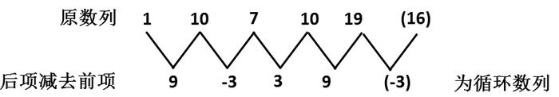

观察得到的二级数列很容易能看出它是一个以9、-3、3为周期的循环数列，由规律可推知答案为A项。

故正确答案为A。

解析2：把本题当作作和数列。相邻三项加和，可得18、27、36、（45），为等差数列，从而推知答案为A项。

故正确答案为A。

**来源**：2008年黑龙江省公务员录用考试《行测》题第1题

### 第 2 题

－7，0，1，2，（    ）

A. 3

B. 6

C. 9

D. 10

第 2 题 · 答案与解析

**参考答案（粉笔题库参考内容）**

C

**解析**

原数列：；

立方数列：；

修正项：；

因此原数列下一项为：。

故正确答案为C。

**来源**：2008年黑龙江省公务员录用考试《行测》题第2题

### 第 3 题

3，2，11，14，（    ）

A. 17

B. 19

C. 24

D. 27

第 3 题 · 答案与解析

**参考答案（粉笔题库参考内容）**

D

**解析**

观察发现各项均为幂次数附近的数字，考虑幂次修正数列。其中：，，，，其底数是公差为1的等差数列，指数均为2，修正项为+2，-2循环交替，故所求项为。

故正确答案为D。

**来源**：2008年黑龙江省公务员录用考试《行测》题第3题

### 第 4 题

1，2，2，3，4，（    ）

A. 5

B. 7

C. 8

D. 9

第 4 题 · 答案与解析

**参考答案（粉笔题库参考内容）**

A

**解析**

解析1：

把本题看作递推数列。此数列是通过隔项求和递推得来的，即第一项与第二项之和等于第四项，第二项与第三项之和等于第五项，则可推知第三项与第四项之和等于第六项，从而原数列下一项为2+3=5，对应A项。

解析2：

把本题看作分组数列。将原数列两两分组为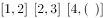通过观察可以看出每一组内，后项与前项之差为1，因此原数列下一项为4＋1＝5，对应A项。

故正确答案为A。

**来源**：2008年黑龙江省公务员录用考试《行测》题第4题

### 第 5 题

227，238，251，259，（    ）

A. 263

B. 273

C. 275

D. 299

第 5 题 · 答案与解析

**参考答案（粉笔题库参考内容）**

C

**解析**

数列无明显特征，作差作和均无规律，考虑递推数列。各项均为依次变大的三位数且很接近，观察发现238=227+2+2+7，251=238+2+3+8，259=251+2+5+1，即：后一项=前一项+前项各位数字之和，故所求项=259+2+5+9=275。

故正确答案为C。

**来源**：2008年黑龙江省公务员录用考试《行测》题第5题

### 第 6 题

女儿每月给妈妈寄钱400元。妈妈想把这些钱攒起来买一台价格1980元的全自动洗衣机。如果妈妈每次取钱时需要扣除5元手续费，则女儿连续寄钱几个月就可以让妈妈买到洗衣机？

A. 4

B. 5

C. 6

D. 7

第 6 题 · 答案与解析

**参考答案（粉笔题库参考内容）**

C

**解析**

解析1：

设女儿需连续寄x个月的钱可让妈妈买到洗衣机，根据题意可得：(400－5)x ≥1980，即求x的最小值，解得当x最小取6时，符合不等式，对应C项。

解析2：

可以采用直接代入验证得到答案。根据选项可以从5或6开始验证，这里以从5为例，5个月妈妈得到钱数：，不符合题意；6个月妈妈得到钱数：400×6－5×6＝2400－30=2370＞1980，符合题意。

故正确答案为C。

**考点**：和差倍比问题

**来源**：2008年黑龙江省公务员录用考试《行测》题第6题

### 第 7 题

某型号的变速自行车，主动轴有3个齿轮,齿数分别为48、36、24，后轴上有4个不同的齿轮，齿数分别是36、24、16、12。则这种自行车共可以获得多少种不同的变速比？

A. 8

B. 9

C. 10

D. 12

第 7 题 · 答案与解析

**参考答案（粉笔题库参考内容）**

A

**解析**

主动轴有3个齿轮，故有3种选择；

后轴有4个齿轮，故有4种选择；

因而共有方式：3×4=12种。

但是48:24，24:12的变速比都为2；

48:16，36:12的变速比都为3；

36:24，24:16的变速比都为1.5；

36:36，24:24的变速比都为1。

所以共有12-4=8种不同的变速比。

故正确答案为A。

**考点**：基础排列组合

**来源**：2008年黑龙江省公务员录用考试《行测》题第7题

### 第 8 题

桌子上有光盘15张，其中音乐光盘6张、电影光盘6张、游戏光盘3张，从中任取3张，其中恰好有音乐、电影、游戏光盘各1张的概率是：

A. 

B. 

C. 

D. 

第 8 题 · 答案与解析

**参考答案（粉笔题库参考内容）**

C

**解析**

从15张光盘中任取3张的事件总数有，恰好有音乐、电影、游戏光盘各1张的事件数有，因此符合条件事件的概率为。

故正确答案为C。

**考点**：给情况求概率

**来源**：2008年黑龙江省公务员录用考试《行测》题第8题

### 第 9 题

甲罐装有液化气15吨，乙罐装有液化气20吨。现往两罐再注入共40吨的液化气，使甲罐量为乙罐量的1.5倍，则应往乙罐注入的液化气量是：

A. 10吨

B. 12.5吨

C. 15吨

D. 17.5吨

第 9 题 · 答案与解析

**参考答案（粉笔题库参考内容）**

A

**解析**

设应往乙罐注入的液化气量为x吨，则甲罐注入的液化气量为(40-x)吨，根据题意得：15+(40-x)=1.5(20+x)，解得x=10。

故正确答案为A。

**考点**：和差倍比问题

**来源**：2008年黑龙江省公务员录用考试《行测》题第9题

### 第 10 题

有100元、10元、1元的纸币共4张，将它们都换成5角的硬币，刚好可以平分给7个人，则总币值的范围是：

A. (100～110)

B. (110～120)

C. (120～130)

D. (210～120)

第 10 题 · 答案与解析

**参考答案（粉笔题库参考内容）**

B

**解析**

100元含200个5角，10元含20个5角，1元含2个5角，三种币值各一张时总的5角个数为200+20+2=222，从而我们可以断定只有当另外一张纸币为1元即2个5角时，222+2=224才可被7整除。所以全部币值为：100+10+1+1=112。

故正确答案为B。

**考点**：和差倍比问题

**来源**：2008年黑龙江省公务员录用考试《行测》题第10题

### 第 11 题

一个三口之家，爸爸比妈妈大3岁，现在他们一家人的年龄之和是80岁，10年前全家人的年龄之和是51岁，则女儿今年多少岁？

A. 7

B. 8

C. 9

D. 10

第 11 题 · 答案与解析

**参考答案（粉笔题库参考内容）**

C

**解析**

解析1：

通过观察四个选择项，最大值为10，可以断定10年前还未有女儿，即爸爸和妈妈的年龄之和为51，设妈妈10年前x岁，则爸爸10年前(x+3)岁，根据题意得：x+(x+3)=51解得x=24，x+3=27，从而现在妈妈34岁，爸爸37岁，因此女儿今年：80-34-37=9岁。

解析2：

由“爸爸比妈妈大3岁，现在他们一家人的年龄之和是80岁”可以知道女儿的年龄必定为奇数。只有A项和C项符合，下面可以选7或9代入验证。这里以女儿7岁为例，则妈妈年龄为：(80-7-3)÷2=35，则爸爸38岁，10年前全家人年龄之和为：35-10+38-10=53>51，因此A选项错误。

故正确答案为C。

**考点**：年龄问题

**来源**：2008年黑龙江省公务员录用考试《行测》题第11题

### 第 12 题

某商场进行有奖销售，凡购物满100元者获兑奖券一张，在10000张奖券中，设特等奖1个，一等奖10个，二等奖100个。若某人购物满100元，那么他中一等奖的概率是：

A. 

B. 

C. 

D. 

第 12 题 · 答案与解析

**参考答案（粉笔题库参考内容）**

B

**解析**

抽一次奖总的事件数为10000，中一等奖的事件数为10，中一等奖的概率为。

故正确答案为B。

**考点**：给情况求概率

**来源**：2008年黑龙江省公务员录用考试《行测》题第12题

### 第 13 题

某汽车销售中心以每辆18万元售出两辆小汽车，与成本相比较，其中一辆获利20％，另一辆则亏损10％，则该中心该笔交易的盈亏额是：

A. 赚1万元

B. 亏1万元

C. 赚5.84万元

D. 0元（不赔不赚）

第 13 题 · 答案与解析

**参考答案（粉笔题库参考内容）**

A

**解析**

第一辆车成本为；

第二辆车的成本为。

所以第一辆车赚18-15=3 万元，第二辆车赔20-18=2 万元，因此该笔交易共赚3-2=1 万元。

故正确答案为A。

**考点**：经济利润问题

**来源**：2008年黑龙江省公务员录用考试《行测》题第13题

### 第 14 题

某人购房用了十万元，现出租。每月租金的25％用作管理费和维修费，年税为3800元，到了年底，此人仍能用租金收入以购房款的7％再投资，试问其月租为：

A. 800元

B. 1000元

C. 1200元

D. 1500元

第 14 题 · 答案与解析

**参考答案（粉笔题库参考内容）**

C

**解析**

设月租为y元，根据题意得。解得y=1200。

故正确答案为C。

**考点**：和差倍比问题

**来源**：2008年黑龙江省公务员录用考试《行测》题第14题

### 第 15 题

某人同时购买2年期、5年期、10年期三种国债，投资额的比为5：3：2。后又以与前次相同的投资总额全部购买5年期国债，则此人两次对5年期国债的投资额占两次总投资额的比例是：

A. 

B. 

C. 

D. 

第 15 题 · 答案与解析

**参考答案（粉笔题库参考内容）**

D

**解析**

设每次投资总额为10，则第一次投资购买2年期、5年期和10年期国债分别为5、3和2；第二次投资购买5年期国债为10，则两次投资5年期国债为3+10=13，而两次总投资额为10+10=20，因此两次对5年期国债投资额占两次投资额的比例为。

故正确答案为D。

**考点**：和差倍比问题

**来源**：2008年黑龙江省公务员录用考试《行测》题第15题

### 第 16 题

一份中学数学竞赛试卷共15题，答对一题得8分。答错一题或不作答均倒扣4分。有一个参赛学生得分为72，则这个学生答对的题目数是：

A. 9

B. 10

C. 11

D. 12

第 16 题 · 答案与解析

**参考答案（粉笔题库参考内容）**

C

**解析**

解析1：

设答对题目为x道，则答错为(15-x)道，根据题意得：8x-4(15-x)=72，解得x=11。

解析2：

当15道题全部答对得8×15=120 分，而答错一道损失8+4=12 分，所以答错题目为(120-72)÷12=4，因此答对的题目数为15-4=11。

故正确答案为C。

**考点**：和差倍比问题

**来源**：2008年黑龙江省公务员录用考试《行测》题第16题

### 第 17 题

演唱会门票300元一张，卖出若干数量后，组织方开始降价促销。观众人数增加一半，收入增加了25％。则门票的促销价是：

A. 150

B. 180

C. 220

D. 250

第 17 题 · 答案与解析

**参考答案（粉笔题库参考内容）**

D

**解析**

设促销价为x元，假设票价为300元时有2个人买，则降价后有个购买，根据题意得：300×2×(1＋25%)=3x，解得x=250。

故正确答案为D。

**考点**：经济利润问题

**来源**：2008年黑龙江省公务员录用考试《行测》题第17题

### 第 18 题

如果把一个体积为125立方厘米的正方体铁块切割成体积相等的8个小正方体，则每个小正方体铁块的表面积是：

A. 6.25平方厘米

B. 15.625平方厘米

C. 16.5平方厘米

D. 37.5平方厘米

第 18 题 · 答案与解析

**参考答案（粉笔题库参考内容）**

D

**解析**

此题目的关键在于计算得出每个小正方体铁块的边长，每个小正方体的体积为：立方厘米，则每个小正方体铁块的边长为厘米，因此每个小正方体铁块的表面积是：平方厘米。

故正确答案为D。

**考点**：几何公式类-立体图形

**来源**：2008年黑龙江省公务员录用考试《行测》题第18题

### 第 19 题

两个城市中心距离在比例尺为1：100000的地图上为16.8cm，则两地实际距离的公里数是：

A. 1.68

B. 16.8

C. 168

D. 1680

第 19 题 · 答案与解析

**参考答案（粉笔题库参考内容）**

B

**解析**

本题需要注意单位转换：1公里=100 000厘米，根据比例尺1:100 000可知，地图上1厘米正好代表实际距离1公里，当两城市图上距离为16.8厘米时，则实际距离为16.8公里。

故正确答案为B。

**考点**：和差倍比问题

**来源**：2008年黑龙江省公务员录用考试《行测》题第19题

### 第 20 题

接受采访的100个大学生中，88人有手机，76人有电脑，其中有手机没电脑的共15人，则这100个学生中有电脑但没手机的共有多少人？

A. 25

B. 15

C. 5

D. 3

第 20 题 · 答案与解析

**参考答案（粉笔题库参考内容）**

D

**解析**

根据题意可知，有手机有电脑的人数为88-15=73，则有电脑没手机的人数为76-73=3。

故正确答案为D。

**考点**：两集合

**来源**：2008年黑龙江省公务员录用考试《行测》题第20题

### 第 21 题

股票在中国的历史，可以追溯到19世纪洋务运动时期。当时中国出现了一批官办与官商合办的股份制企业。1873年成立的轮船招商局，发行了中国最早的股票。1914年，中国北洋政府颁布证券交易所法，1917年成立了北京证券交易所。到抗日战争前，上市股票已达百余种。但后来几经挫折，股市始终没有发展起来。

这段文字概括最恰当的是：

A. 股票发源于19世纪洋务运动时期

B. 股票的发源地是中国

C. 股票在中国历史的各个时期都存在

D. 股票在近代中国有一段辉煌的历史

第 21 题 · 答案与解析

**参考答案（粉笔题库参考内容）**

D

**解析**

根据提问中“概括”二字可知此题是中心理解题。

这段文字介绍了股票在中国近代的发展历史，D项正确。

选项A说法不准确，应该是“中国的股票历史”发源于19世纪洋务运动时期，而且这也不是文字的主要意思；选项B文中没有提及，属主观臆断；选项C属偷换概念，文中只提到了股票在中国近代的历史，而没有指出其在各历史阶段均存在。

故正确答案为D。

**考点**：关联词-并列

**来源**：2008年黑龙江省公务员录用考试《行测》题第21题

### 第 22 题

好几次听见电台主持人问节目参与者“你叫什么”，我很反感。如果对方是一个小孩，回答说“我叫毛毛”或者“我是珍珍”，那倒也显得有些亲切。但对方是一位有名有姓的成年人，这种问法就显得太粗鲁。我国的语汇是很丰富的，传统的“请问尊姓大名？”“台甫是？”或白话一些，“请问您的姓名”，这不是迂腐而是应有的文明礼貌。我们应把警察审问罪犯时的第一句话“你叫什么”和日常交往的语句区别开来。
根据本文，问人姓名时应该考虑对方的：

A. 性别

B. 职业

C. 年龄

D. 态度

第 22 题 · 答案与解析

**参考答案（粉笔题库参考内容）**

C

**解析**

此题为非典型的细节判断题。

文段通过有关“小孩”“成年人”问法的对比叙述，指出中国词汇是很丰富的，应使用应有的文明礼貌用语，而不让人“很反感”的用语，问人姓名的时候，必须和人的年龄相符合，故C正确。

文段中并没有支持A、B、D项观点的描述。

故正确答案为C。

**考点**：细节判断题

**来源**：2008年黑龙江省公务员录用考试《行测》题第22题

### 第 23 题

在良好的政治中，公共权力必须受到制约。制约公共权力的方式大致可以分为两类，一类是刚性制约；另一类是软制约，也就是道德对权力的制约。制约权力不仅要健全制度，使权力的制约具有刚性，还要发挥官德的作用，让良心制约权力。这段文字主要说明（    ）。

A. 道德对权力的制约是维护社会公平的基础

B. 建立健全制度是对公共权力软制约的有效手段

C. 良好的政治是由有良心官员来创造的

D. 领导干部道德修养不容忽视

第 23 题 · 答案与解析

**参考答案（粉笔题库参考内容）**

D

**解析**

文段提出制约公共权力的方式大致可以分为两类，一类是刚性制约，也就是制度制约；另一类是软制约，也就是道德对权力的制约。最后一句话用递进的句式强调了要发挥官德的作用，让良心制约权力。那么官德是什么呢？就是领导干部的思想道德建设，由此推出D选项是正确的。

A项，文段虽提到道德对权力的制约作用，但并没说是“维护社会公平的基础”，排除。

B项，概念错误，建立健全制度是对公共权力“刚性制约”的有效手段，且不是文段的主旨所在。

C项，未把握文段重点，没有谈到公共权力制约问题。

故正确答案为D。

**考点**：关联词-对策

**来源**：2008年黑龙江省公务员录用考试《行测》题第23题

### 第 24 题

就目前的情况看，强制性“一户一房”在操作上确实有难度，但也不是没有实现的可能，先在试点地区实行，如果可行再予以推广，也许能让房地产市场回到一个相对正常的状态，但这也是从房地产市场获利无数的房地产老板们和炒房者所不愿意看到的。

这段文字的中心观点是：

A. 强制性的“一户一房制”并不可取

B. 实施“一户一房”对抑制商品房的投机和炒作有积极作用

C. “一户一房”对于解决民生的住房问题而言，的确是条良策

D. 目前房地产市场处于一个相对不正常的状态

第 24 题 · 答案与解析

**参考答案（粉笔题库参考内容）**

B

**解析**

据提问知此题是中心理解题。

很明显，文段是围绕“一户一房”这个中心展开的。“一户一房”虽有难度，但还是有可能实现的，它的实行对抑制商品房的投机和炒作有积极作用，有可能让房地产市场回到一个相对正常的状态，B项正确。

A项观点错误，文中指出“一户一房”不是没有实现的可能，因此并非不可取；至于选项C，文中主要提到的是“一户一房”对于房地产市场不正常状态的抑制作用，没有从解决民生问题的角度而谈；选项D观点正确，但不是这段文字的中心观点。

故正确答案为B。

**考点**：主题词、关联词-转折

**来源**：2008年黑龙江省公务员录用考试《行测》题第24题

### 第 25 题

国家统计局发布报告说，现在，我国的经济总量在世界的位次由第六位跃居第四位，人均国民总收入步入了中等收入国家行列。这是一件可喜可贺的事情，但在我们高兴鼓舞的同时，还应保持冷静。应该看到，我们的经济虽然发展很快，但和世界先进国家比，和我们自己的远景目标比，还有很大的差距。仅就我国人均国民总收入步入世界中等国家行列而言，我们的这个“步入”有多大的含金量，就需要认真地考查一下。

与这段文字中心观点不一致的一项是：

A. 我国现在的这个“中等”，还不足以炫耀

B. 我们虽然步入了中等收入国家行列，但水平仍然较低

C. 我们自己的远景目标远高于现在的“中等”水平

D. 就步入“中等”的各项统计本身，还需要认真考查一下

第 25 题 · 答案与解析

**参考答案（粉笔题库参考内容）**

D

**解析**

据提问知此题为细节判断题。

D项属于推断错误，根据这段文字最后一句，我们需要认真考查的是这“步入”的含金量，例如与其他国家对比，而并非从各项统计本身是否存在错误入手。

从文段中“应保持冷静”“还有很大差距”等词语可以看出我国现在的这个“中等”还远低于世界先进国家的发展水平，远低于我们自己的远景目标，还不足以炫耀，A、B、C三项的内容均和中心观点一致。

本题为选非题，故正确答案为D。

**考点**：细节判断题

**来源**：2008年黑龙江省公务员录用考试《行测》题第25题

### 第 26 题

即使穿过玻璃或水这样的普通透明材料，光速也会略微降低，因为光会与组成材料的原子相互作用。但是在这种情况下，影响是微弱的，并且任何加强这种影响的试图都会导致光的吸收。因此，重要的是使光的速度降低，而且不至于被吸收。韦尔奇博士通过小室做到了这一点。这种方法把铷原子置于一种非常微妙的量子状态中，在这种状态下铷原子不能吸收光。同时，两束光的相互作用产生了另外一束波长很长的光，这束光的传播速度比原先两束光的速度要慢得多。

下列不属于韦尔奇所做实验的内容的一项是：

A. 使光的速度降低，而且不至于被吸收。

B. 使铷原子处于不会吸收光的微妙的量子状态中。

C. 制造廉价、高效的光源，来避免被吸收。

D. 使波长略微不同的两束光互相作用而产生慢光。

第 26 题 · 答案与解析

**参考答案（粉笔题库参考内容）**

C

**解析**

据提问知此题属于细节判断题。

选项C中的“制造廉价、高效的光源”文中没有提及。

A、B、D三个选项都可以从文中找到原句。

本题为选非题，故正确答案为C。

**考点**：细节判断题

**来源**：2008年黑龙江省公务员录用考试《行测》题第26题

### 第 27 题

最初的人类，为了寻找足够的食物，经常过着一种漂泊不定的生活，漂泊到一个地方，即随便找个临时夜宿处。这种时常迁徙但又随遇而安的居住方式，应当视作人类从巢居形式进入穴居形式之前所经历的一个过渡阶段。
对文中“过渡阶段”的概括最正确的一项是：

A. 人类为了寻找食物，经常过着一种漂泊不定的生活。

B. 人类寻找食物找到什么地方，就在什么地方住下来。

C. 漂泊到什么地方，即随便找个临时夜宿处。

D. 时常迁徙但又随遇而安的居住形式。

第 27 题 · 答案与解析

**参考答案（粉笔题库参考内容）**

D

**解析**

此题为词语理解类词句理解题。

从最后一句“这种时常迁徙但又随遇而安的居住方式，应当视作······一个过渡阶段”，因此“过渡阶段”指代的就是“时常迁徙但又随遇而安的居住方式”，D项正确。

A、B、C三项都是“时常迁徙但又随遇而安的居住方式”的解释性描述，不具概括性，不符合提问要求。

故正确答案为D。

**考点**：实词

**来源**：2008年黑龙江省公务员录用考试《行测》题第27题

### 第 28 题

一些太空专家指出，太空站和探测飞船很可能带回太空微生物，这些微生物在孤立的空间内可能已经变种变形，如果它们回到地球并逃过被销毁的命运，肯定会对人类构成威胁。有报道说，和平号太空站就曾充斥着形形色色的变种真菌，它们若与地球泥土中可以分解的金属、玻璃和塑胶的细菌混合，足以对人类构成致命的威胁。

对本文理解正确的一项是：

A. 地球环境正处于太空变种真菌的威胁之下。

B. 人类的太空活动可能导致太空微生物传至地球。

C. 随着人类太空活动的增多，太空垃圾已影响人类生活。

D. 太空变种真菌将是人类最致命的威胁。

第 28 题 · 答案与解析

**参考答案（粉笔题库参考内容）**

B

**解析**

据提问知此题属于细节判断题。

从文段第一句“一些太空专家指出，太空站和探测飞船很可能带回太空微生物”可知人类的太空活动可能导致太空微生物传至地球，B项正确。

A项过于绝对；C项中的“太空垃圾”文中没有涉及；D项也是过于绝对，太空变种真菌将足以对人类构成致命的威胁，而非最致命的威胁。

故正确答案为B。

**考点**：细节判断题

**来源**：2008年黑龙江省公务员录用考试《行测》题第28题

### 第 29 题

“全光通信”是一种无需进行任何光电变换的全新光波通信。在全光通信系统中，图像和话音信息直接变换为光信号，并在传输媒体中传输。在摄像光学系统、光纤系统和接收光放大系统组成的全光通信系统中，由于不要求光电变换，所以没有任何电子元件，信号失真小，能够在100℃以上的高温环境中连续工作，是理想的通信方式。
下列说法不符合这段文字内容的一项是：

A. 全光通信无需进行信息转换。

B. 全光通信系统的信息媒体是光波。

C. 全光通信系统中没有电子元件。

D. 全光通信信号失真小，因为没有光电转换。

第 29 题 · 答案与解析

**参考答案（粉笔题库参考内容）**

A

**解析**

据提问知此题属于细节判断题。

在全光通信系统中，图像和话音信息直接变换为光信号，不再需要通过光电变换装置，因此全光通信需要进行信息转换，A选项不符合文字内容。

至于B项，从文段中“在全光通信系统中，图像和话音信息直接变换为光信号，并在传输媒体中传输”可知，全光通信的信息媒体是光信号，即光波；C、D两项的内容都能从文段找到原句。

本题为选非题，故正确答案为A。

**考点**：细节判断题

**来源**：2008年黑龙江省公务员录用考试《行测》题第29题

### 第 30 题

有一种可以用来计算宇宙距离的方法叫做“视差”。视差这个词的含义并不难，你伸出一个手指放在眼前大约8厘米的地方，先只用左眼看，然后用右眼看，你就会觉得手指对于远处的景物移动了位置，因为两次去看时，角度不同了。现在你将手指放远些，譬如说伸直手臂，再按上次办法来看，这次你就会觉得手指相对于背景移动了，不过移动量没有那么大。因此，手指相对于背景移动距离的大小，就可以用来确定手指到眼睛的距离了。
根据文章，对“视差”的定义表述正确的一项是：

A. 物体与眼睛之间的距离叫视差

B. 视差是眼睛所看到的物体相对背景的位移

C. 视差是从不同角度看物体产生的视觉差异

D. 从不同角度看物体产生的视差距叫视差

第 30 题 · 答案与解析

**参考答案（粉笔题库参考内容）**

B

**解析**

据提问知此题属于词句理解题。

根据文章，视差是“一种可以用来计算宇宙距离的方法”，那么视差和距离、位移有关。

因此，结合选项应该选择B。

A项理解完全错误；C项“不同角度”“视觉差异”把“视差”定义得太抽象；D项“不同角度”太宽泛，没有指明是“眼睛所看到的”。

故正确答案为B。

**考点**：实词

**来源**：2008年黑龙江省公务员录用考试《行测》题第30题

### 第 31 题

徽州文化主要是指以徽州（古称新安郡）为地域依托，渊源于历史上人与自然及人们之间对象性关系而形成的特定生活结构体系。同任何文化一样，它也包括物质文化、制度文化、意识形态以及内隐的心态、价值系统等文化心理结构，并且在各个文化层面都创造出辉煌的富于鲜明特色的成果，影响波及全国各地。

对“徽州文化”的理解不正确的一项是：

A. 徽州文化是源于中国历史上与自然、人们之间相互关系而形成的独特的地域文化

B. 徽州文化是包括物质文化、制度文化、意识形态等多种文化心理结构的文化体系

C. 徽州文化是一种家族文化凝重、宗族认同感强烈、宗法观念盛行的封闭性的文化传统

D. 徽州文化是从不同文化层面发展，并以富于鲜明特色的成果影响全国各地

第 31 题 · 答案与解析

**参考答案（粉笔题库参考内容）**

C

**解析**

本题考查词语理解类词句理解题。

C选项中提到的“家族文化凝重、宗族认同感强烈、宗法观念盛行”等内容文中均无涉及，理解不正确。

A、B、D三个选项中的内容都可以在文中找到原句。

本题为选非题，故正确答案为C。

**考点**：实词

**来源**：2008年黑龙江省公务员录用考试《行测》题第31题

### 第 32 题

参与大火都是古代妇孺皆知的星相。夏族对参的认识有深刻的原因，每当参于黄昏后落向地平线快看不见的时候，恰是大地回春之际。“参去寒冬尽，农家备耕忙”，它成为夏族观象授时的重要依据。公元前2400年左右，大火在春天傍黑时出现于东方地平线上。其光荧荧，好似东方远处的一团火焰。它之所以引起人们的注意，不单是因为它亮，它就像是特意来点燃人们盼望播种的希望之火。

文中“观象授时”的含义是：

A. 观天象以安排时间

B. 观天象以从事农耕

C. 观天象以确定季节

D. 观天象以传授知识

第 32 题 · 答案与解析

**参考答案（粉笔题库参考内容）**

C

**解析**

“观象”指观测天象；“授时”指确定时间。根据文中“每当参于黄昏后落向地平线快看不见的时候，恰是大地回春之际”可知，古代人民观察天象来确定季节，对应C项。

A项“安排时间”无中生有，且授时是确定时间的意思，不是安排时间；B项“从事农耕”只是论证“观象授时”举的一个例子，非重点；D项“传授知识”文段并未提及，无中生有。

故正确答案为C。

**考点**：实词

**来源**：2008年黑龙江省公务员录用考试《行测》题第32题

### 第 33 题

在吴一枪的刑警生涯中，像今天这样还是头一次。如此近的距离，就形成了一种空前的赌局，是赌就有赢有输，他赢得起，当然也输得起。没了后路的吴一枪出奇地想把射击动作做得完美一些。上一次因为追求完美和动作漂亮让同事献出了生命，可是现在，他还是希望自己在歹徒面前能够完成一次真正意义上的完美绝唱······
对“没了后路的吴一枪出奇地想把射击动作做得完美一些”一句理解错误的是：

A. 是对上次“血的教训”的弥补

B. 显示了吴一枪的无所畏惧和镇定自若

C. 留下一个潇洒漂亮的英名

D. 在歹徒面前永葆中国刑警完美的光辉形象，完成一次真正意义上的完美绝唱

第 33 题 · 答案与解析

**参考答案（粉笔题库参考内容）**

C

**解析**

本题考查语句理解类词句理解题。

由文意吴一枪“赢得起，当然也输得起”可知，不存在为自己留下一个潇洒漂亮的英明的世俗想法。C项理解错误。

文中有提到“上一次因为追求完美和动作漂亮让同事献出了生命”“希望······能够完成······”说明这次不能再允许有闪失了，是对上次“血的教训”的弥补，A项理解也正确；吴一枪在“没了后路”的情况下想的却是“把射击动作做得完美一些”，显示了他的无所畏惧和镇定自若，B项理解正确；从文段最后一句“他还是希望自己在歹徒面前能够完成一次真正意义上的完美绝唱”可知，D项理解正确。

本题为选非题，故正确答案为C。

**考点**：句子

**来源**：2008年黑龙江省公务员录用考试《行测》题第33题

### 第 34 题

据世界卫生组织统计，每年有1200万人过早地被心血管、脑血管疾病夺去了生命，心血管、脑血管疾病的死亡率为各种疾病死亡率之首，而“中风”则是心血管、脑血管疾病的元凶。如果用“养神3分钟”自我治疗预防，每年可使全世界少死300万人，一年也可使我国少死60万人，因为“中风”多发生在夜间，最危险时刻是醒来的“一刹那”。但有绝招可防这“一刹那”，即在苏醒时，养神3分钟，定可逢凶化吉。

本文主要谈的是什么病：

A. 中风

B. 高血压

C. 心脏病

D. 脑血管病

第 34 题 · 答案与解析

**参考答案（粉笔题库参考内容）**

A

**解析**

第一步：分析文段，

本题属于中心理解题。文段首先介绍心血管、脑血管的严重危害，后指出“中风”是心血管、脑血管疾病的元凶，并介绍如何预防中风的发生，所以本文主要谈的是“中风”，选择A项。

第二步：分析选项，

B项“高血压”、C项“心脏病”在文中没有提及，属无中生有，故排除；

D项文段中都有提到，但主要还是为了引出文段的中心，即“中风”。

故正确答案为A。

【文段出处】《醒时易中风养神三分钟》

**考点**：主题词

**来源**：2008年黑龙江省公务员录用考试《行测》题第34题

### 第 35 题

在我们大张旗鼓地推进“无车日”的时候，殊不知，它的发祥地一一欧洲的“无车日”早已面临穷途末路。据悉，欧洲举办无车日活动的城市及其活动规模已经大打折扣。从法国全国来看，2003年有98个城市参加“无车日”，2004年减少到72个，2005年只剩下56个。德国首都柏林、意大利首都罗马2003年都退出了“无车日”活动。以至于法国环境和可持续发展部长不得不遗憾地表示，“无车日”虽是一项有意义的活动，但不符合现实情况，不足以改变民众的驾车习惯。

以下和本文观点一致的表述是：

A. 无论我们对“无车日”寄予多大的期望，它的意义终究非常有限

B. “无车日”在刚刚进入汽车时代的中国将会蓬勃发展

C. “无车日”对缓解法国交通拥堵状况有一定作用

D. “无车日”在提高欧洲各国人民的环保上意识曾发挥巨大作用

第 35 题 · 答案与解析

**参考答案（粉笔题库参考内容）**

A

**解析**

据提问可知考查细节判断题，需要对材料进行语意分析。

文中指出“无车日”虽是一项有意义的活动，但不符合现实情况，不足以改变民众的驾车习惯，因此可以得出A选项中的推论。

B、C、D项在文中没有提及，属个人主观臆断。

故正确答案为A。

**考点**：细节判断题

**来源**：2008年黑龙江省公务员录用考试《行测》题第35题

### 第 36 题

亚洲新兴国家的快速发展，特别是其工业化和城市化的发展，大量人口生活水平的提高，将使国际市场对资源和农畜产品的需求在相当长时期内保持高水平。对于正走在工业化道路上的亚洲新兴经济体而言，初级产品价格的高涨，将使之摒弃当年欧洲和美国在工业化过程中所采用的发展方式，去寻找一条低资源消耗之路。而对于拉美和非洲国家而言，亚洲的兴起和初级产品价格的上涨，同样是一次难得的发展机遇。
对这段文字概括最恰当的是：

A. 亚洲新兴经济体将以一条低资源消耗之路崛起。

B. 亚洲新兴国家的发展直接影响着拉美和非洲国家。

C. 国际市场对资源和农畜产品的需求在相当长时期内保持高水平。

D. 亚洲新兴国家的快速发展对国际市场的需求有显著影响。

第 36 题 · 答案与解析

**参考答案（粉笔题库参考内容）**

D

**解析**

据提问可知此题为中心理解题。

文中指出“亚洲新兴国家的快速发展使国际市场对资源和农畜产品的需求在相当长时期内保持高水平”，而且“对于拉美和非洲国家而言，亚洲的兴起是一次难得的发展机遇”，综合这些我们可以概括出“亚洲新兴国家的快速发展对国际市场的需求有显著影响”，D项正确。

文中指出“亚洲新兴经济体正在寻找低资源消耗之路”，而非绝对的“以一条低资源消耗之路崛起”，因此A选项错误；B、C选项概括不全面。

故正确答案为D。

**考点**：关联词-并列

**来源**：2008年黑龙江省公务员录用考试《行测》题第36题

### 第 37 题

目前我国实行的最低生活保障线的标准不一，许多欠发达地区是每人每月50元或60元，某地新闻报道中还以“低保水平提高到每月50元”为题以示政绩。各地的物价水平、生活指数当然很不相同，但是，在今日的中国，即便许多发达城市的低保线是每月300多元，低保户维持生计尚显困难，那么一个月50元的艰辛就不难想见。
这段文字主要是在强调：

A. 我国实行的最低生活保障线的标准不一。

B. 一些地方以提高低保水平为政绩指标。

C. 发达地区的最低生活保障线标准较低。

D. 欠发达地区的最低生活保障线标准较低。

第 37 题 · 答案与解析

**参考答案（粉笔题库参考内容）**

D

**解析**

据提问可知此题为中心理解题。

题干第一句属于陈述客观事实，第二句才表明了作者的观点，由“即便许多发达城市的低保线是每月300多元，低保户维持生计尚显困难，那么一个月50元的艰辛就不难想见”可以推断作者认为50元的最低生活保障线是偏低的。

因此，结合选项应该选择D。

A、B、C三项都只是背景铺垫，不是文段主旨。

故正确答案为D。

**考点**：关联词-转折

**来源**：2008年黑龙江省公务员录用考试《行测》题第37题

### 第 38 题

植物修复是利用某些可以忍耐和超富集有毒元素的植物及其共存的微生物体系清除污染的一种环境污染治理新技术。植物修复系统可以看成是以太阳能为动力的“水泵”和进行生物处理的“植物反应器”，植物可吸收转移元素和化合物，可以积累、代谢和固定污染物，是一条从根本上解决土壤污染的重要途径。

下列说法中不属于植物修复优点的是：

A. 植物修复实施简易，对土壤造成的副作用小。

B. 植物修复过程比物理化学过程快，比常规治理有更高的效率。

C. 对环境扰动少，不需要挖掘、运输和巨大的处理场所。

D. 植物修复不会破坏景观生态，能绿化环境，容易为大众所接受。

第 38 题 · 答案与解析

**参考答案（粉笔题库参考内容）**

B

**解析**

据提问可知此题属于细节判断题。

文中指出“植物修复是一条从根本上解决土壤污染的重要途径”，从生活常识可以得出，植物修复必定是一种缓慢而根本的解决方法，B项内容不合逻辑。

A、C、D项中思想内容保持统一，突出植物修复天然、无污染、易被接受的特点。

本题为选非题，故正确答案为B。

**考点**：细节判断题

**来源**：2008年黑龙江省公务员录用考试《行测》题第38题

### 第 39 题

现在的学生将高考当成了人生最重要的目标，而学校和家长也是对此趋之若鹜。因为高考不考动手能力，与高考无关的课程自然被当作副科。结果，造成许多中国学生高分低能、动手能力差的现状。这看似一个小问题，其实却与中国人才培养的结构具有重要关联，甚至在某种程度上影响着中国的未来。

这段文字主要是在强调：

A. 高考是当今学生最重要的人生目标。

B. 高考是造成中国学生高分低能的直接原因。

C. 学生高分低能与人才培养的结构具有重要关联。

D. 学生的生活除了学习知识，更要培养技能。

第 39 题 · 答案与解析

**参考答案（粉笔题库参考内容）**

C

**解析**

据提问可知此题为中心理解题。

根据结构层次可知文段是“背景铺垫—提出观点”的分—总结构。故文段强调的重点在段尾，“这看似一个小问题，其实却与中国人才培养的结构具有重要关联，甚至在某种程度上影响着中国的未来”。其中的“小问题”即指代的是前一句中的“中国学生高分低能、动手能力差的现状”，所以通过逻辑推理可以得出C项是正确的。

A、B、D项说法正确，但是没有抓住文段的重点。

故正确答案为C。

**考点**：分述句特征-引入铺垫

**来源**：2008年黑龙江省公务员录用考试《行测》题第39题

### 第 40 题

生活上的困难和心灵的孤独让我也曾为自己的选择动摇过。每每为吃饭发愁，或者想念妈妈只能打打电话时，我还真有点后悔当初自己冲动的选择。但想想这毕竟是自己的决定，也不过就半年时间，能挺就挺吧！但很快，看到这些农村孩子们的英语成绩有了起色，一个个辍学的孩子又返回了课堂，我想我找到了喜欢这里的感觉！
作者最有可能的身份是：

A. 小学教师

B. 青年志愿者

C. 记者

D. 年轻村干部

第 40 题 · 答案与解析

**参考答案（粉笔题库参考内容）**

B

**解析**

根据“也不过就半年时间”和“看到这些农村孩子们的英语成绩有了起色，一个个辍学的孩子又返回了课堂”，可以推断出作者应该是一个去农村支教的青年志愿者，B项正确。

从文段“也不过就半年的时间”，可以排除A项；从文段最后一句话可以推断作者最有可能的身份是跟教学有关的，排除C、D两项。

故正确答案为B。

**考点**：关联词-转折、特殊问法

**来源**：2008年黑龙江省公务员录用考试《行测》题第40题

### 第 41 题

土壤动物作为生态系统物质循环中的重要＿＿＿＿＿，在生态系统中起着重要的作用，一方面积极同化各种有用物质以建造其自身，另一方面又将其排泄产物归还到环境中不断改造环境。

填入画横线部分最恰当的一项是：

A. 生产者

B. 消费者

C. 分解者

D. 捕食者

第 41 题 · 答案与解析

**参考答案（粉笔题库参考内容）**

B

**解析**

本题考查实词填空。

根据句中“一方面······另一方面”，积极同化各种有用物质以建造其自身等同于消费，排泄产物归还到环境中不断改造环境等同于生产，综合这两方面来看，B项当选，A、C、D三项均排除。

故正确答案为B。

【文段出处】《土壤动物的多样性及对生态环境系统的意义》

**考点**：实词填空、对应关系-前后呼应

**来源**：2008年黑龙江省公务员录用考试《行测》题第41题

### 第 42 题

包括中国人民在内的亚洲各国人民始终反对日本领导人参拜靖国神社，认为日本领导人的这一举动严重＿＿＿＿了战争受害国人民的感情。

填入画横线部分最恰当的一项是：

A. 伤害

B. 损害

C. 危害

D. 祸害

第 42 题 · 答案与解析

**参考答案（粉笔题库参考内容）**

A

**解析**

“伤害感情”是固定搭配，故A项当选。

B项“损害”多与利益、精神等搭配，C项“危害”多与健康、环境等搭配，D项“祸害”多与人物等搭配，均搭配不当，排除。

故正确答案为A。

**考点**：实词填空、词的辨析-搭配对象

**来源**：2008年黑龙江省公务员录用考试《行测》题第42题

### 第 43 题

美国国家情报局局长上周在一次公共会议上＿＿＿＿，美国年度情报总预算为440多亿美元。多年来，美国政府对这个数字一直采取守口如瓶的态度，外人对此不得而知。

填入画横线部分最恰当的一项是：

A. 揭露

B. 披露

C. 指出

D. 表示

第 43 题 · 答案与解析

**参考答案（粉笔题库参考内容）**

B

**解析**

根据句意可知美国政府一直没有公布过情报预算的具体数字，所以横线处应该选择有“透露”含义的词语，故排除C、D两项；“披露”意为发表、公布，适用于这个语境，B项当选；A项“揭露”意为暴露，有贬义色彩，排除。

故正确答案为B。

**考点**：实词填空、对应关系-前后呼应、词的辨析-感情色彩

**来源**：2008年黑龙江省公务员录用考试《行测》题第43题

### 第 44 题

地下短信群发公司是目前垃圾短信泛滥的主要＿＿＿＿，而目前的监管措施还不能有效地约束他们的行为。

填入画横线部分最恰当的一项是：

A. 来源

B. 源泉

C. 祸根

D. 根源

第 44 题 · 答案与解析

**参考答案（粉笔题库参考内容）**

D

**解析**

A、B、C、D四项都有来源、根源的意思。“地下”二字表达一种“藏在幕后”的语境，体现“挖根溯源”的意思，所以D项“根源”更为合适，当选。

A项表义较轻，B项一般用于褒义，C项语义过重，均排除。

故正确答案为D。

**考点**：实词填空、词的辨析-感情色彩、词的辨析-程度轻重

**来源**：2008年黑龙江省公务员录用考试《行测》题第44题

### 第 45 题

我国入世后，与世贸组织规则不一致的相关法律法规制度需要＿＿＿＿、修改，同时还要制定一批新的法律法规。

填入画横线部分最恰当的一项是：

A. 废止

B. 废除

C. 作废

D. 终止

第 45 题 · 答案与解析

**参考答案（粉笔题库参考内容）**

A

**解析**

A项“废止”意为舍弃、取消，“废止相关法律法规”是常用搭配，当选。

B项“废除”指废弃，去除，要是法规“废除”了就不存在“修改”了，不符合文意，排除；C、D两项不是“法律法规制度”的固定搭配，均排除。

故正确答案为A。

**考点**：实词填空、词的辨析-搭配对象、词的辨析-词义侧重

**来源**：2008年黑龙江省公务员录用考试《行测》题第45题

### 第 46 题

这些私自印制已注册商标以及＿＿＿＿、＿＿＿＿、＿＿＿＿假冒商品的行为均已构成犯罪。

填入画横线部分最恰当的一项是：

A. 运输 销售 制作

B. 销售 运输 制作

C. 制作 运输 销售

D. 制作 销售 运输

第 46 题 · 答案与解析

**参考答案（粉笔题库参考内容）**

C

**解析**

此题考查实词填空。

此题应该根据词语之间的逻辑顺序选择，“商品”当然是先“制作”，再“运输”，然后“销售”。

故正确答案为C。

**考点**：关联关系-并列关系、实词填空

**来源**：2008年黑龙江省公务员录用考试《行测》题第46题

### 第 47 题

个体户目前正面临日益＿＿＿＿的竞争和税费两大压力，个体户的急剧减少导致大量小资金无法进行常规创业，从而转向投机，进而使社会的不稳定程度＿＿＿＿。

依次填入画横线部分最恰当的一项是：

A. 残酷 加剧

B. 残酷 加大

C. 激烈 加剧

D. 激烈 加大

第 47 题 · 答案与解析

**参考答案（粉笔题库参考内容）**

C

**解析**

考查近义实词语境辨析与填空。

第一空中，“残酷”意为凶狠冷酷，用在此处程度过重；“激烈”意为激越，猛烈。个体户之间的竞争用“激烈”形容比较贴切。

第二空中，“加大”意为变大；“加剧”意思是使程度变得更严重。因此题干中“社会的不稳定程度”用“加剧”合适，且“程度加剧”是固定搭配。

故正确答案为C。

**考点**：实词填空、词的辨析-搭配对象、词的辨析-程度轻重

**来源**：2008年黑龙江省公务员录用考试《行测》题第47题

### 第 48 题

这个已保存了数千年，早已闻名海内外的古城如今陷入了保护＿＿＿＿，城里人满为患，农家的生产生活已经严重影响到古城墙的＿＿＿＿。

依次填入画横线部分最恰当的一项是：

A. 绝境 安全

B. 困境 安全

C. 绝境 安危

D. 困境 安危

第 48 题 · 答案与解析

**参考答案（粉笔题库参考内容）**

D

**解析**

此题考查近义实词的辨析和语境填空。

第一空中，“困境”意为困难的处境；“绝境”意为没有明显出路的困境，用在此处，程度过重。

第二空中，“安全”即没有危险，不受威胁；而“安危”多偏指危险的一面。题干中的“古城墙”显然有危险，故用“安危”更贴切。

故正确答案为D。

**考点**：实词填空、词的辨析-程度轻重、词的辨析-词义侧重

**来源**：2008年黑龙江省公务员录用考试《行测》题第48题

### 第 49 题

改革开放以来，中国农学会＿＿＿＿“献身、创新、求实、协作”的宗旨，始终不渝地坚持以推动农业科技进步、促进农村发展为己任，大力开展学术交流和科技普及，积极＿＿＿＿＿＿和举荐人才，为提高广大农民科技素质、加快农业科技进步做出了重要贡献。

依次填入画横线部分最恰当的一项是：

A. 继承 出谋划策

B. 继承 建言献策

C. 秉承 建言献策

D. 秉承 出谋划策

第 49 题 · 答案与解析

**参考答案（粉笔题库参考内容）**

C

**解析**

此题考查实词和成语的近义辨析和语境搭配。实词强调搭配的不同，成语强调的是庄重场合和一般场合的态度色彩。

秉承：也作禀承，接受、承接的意思，一般用于抽象的事物，如秉承宗旨、秉承遗愿、秉承旨意等。

继承：指依法承接死者的遗产或权利或者后人继续做前人遗留下来的事业，一般用于具体的事物。

出谋划策：指制定计谋策略，为他人出主意。

建言献策：一般用于在大的场合和大事情上献谋献策。

秉承一般用于抽象的事物，如秉承宗旨、秉承遗愿、秉承旨意等。继承一般用于具体的事物。该题搭配的是宗旨，所以用秉承更为准确。而建言献策一般用于在大的场合和大事情上献谋献策，要比出谋划策正式和庄重。

所以该题应该是秉承“宗旨”，积极地“建言献策”。

故正确答案为C。

**考点**：对应关系-前后呼应、混搭填空、词的辨析-搭配对象、词的辨析-词义侧重

**来源**：2008年黑龙江省公务员录用考试《行测》题第49题

### 第 50 题

为＿＿＿＿国庆黄金周旺季消费，这家超市本周起在全国提前启动“八天八夜，同十一共精彩”夜市、团购＿＿＿＿。

依次填入画横线部分最恰当的一项是：

A. 增加 策略

B. 增加 攻略

C. 刺激 策略

D. 刺激 攻略

第 50 题 · 答案与解析

**参考答案（粉笔题库参考内容）**

D

**解析**

第一空的备选项中，“刺激消费”是常用搭配，排除A、B选项。

第二空中，“攻略”、“策略”均有手段、谋略之意，但“攻略”侧重攻取、取得，而“策略”侧重策划、计划。此处是为了达到“刺激消费”这个目的，有攻取的意思，用“攻略”更合适。

故正确答案为D。

**考点**：实词填空、词的辨析-搭配对象、词的辨析-词义侧重

**来源**：2008年黑龙江省公务员录用考试《行测》题第50题

### 第 51 题

非公有制企业是最活跃的经济＿＿＿＿，加强非公有制企业党建工作，有利于进一步解放和发展社会生产力，有利于促进社会＿＿＿＿，有利于更好地坚持社会主义基本经济制度，有利于更好地坚持党的领导。

依次填入画横线部分最恰当的一项是：

A. 细胞 和谐

B. 细胞 和睦

C. 元素  和谐

D. 元素 和睦

第 51 题 · 答案与解析

**参考答案（粉笔题库参考内容）**

A

**解析**

本题考查近义实词的辨析与填空。

第二空的备选项中，“和睦”多指人与人之间的关系，也可指家庭关系；形容“社会”多用“和谐”，故排除B、D选项。

第一空的备选项中，“细胞”与“元素”都可以喻指整体的一部分，但“细胞”形容“物理”单元的组成，“元素”形容“化学”成分的合成，结合语境，“细胞”比“元素”更合适，且与句中形容词“活跃”呼应。

故正确答案为A。

**考点**：实词填空、词的辨析-搭配对象、词的辨析-词义侧重

**来源**：2008年黑龙江省公务员录用考试《行测》题第51题

### 第 52 题

这些机构认为这是一个非常有＿＿＿＿的活动，希望借此能加强对科学研究的＿＿＿＿作用，激励我国科技人员勇于献身科学，攻克科学难题，普及科学知识，激发青少年热爱科学的兴趣，培养探索未知世界的好奇心。

依次填入画横线部分最恰当的一项是：

A. 意义 指导

B. 意义 导向

C. 价值 指导

D. 价值 导向

第 52 题 · 答案与解析

**参考答案（粉笔题库参考内容）**

B

**解析**

此题考查近义实词的辨析和语境填空。

第二空的备选项中，“导向”意为引导的方向，是事情往某个方向发展，包括好的影响和坏的影响，而“指导”意为指点引导，多是好的影响。对于“科学研究”，用“导向”更贴切。

第一空的备选项中“意义”和“价值”的含义非常接近，但“价值”侧重客观或公认的评价，“意义”则相对是主观的评价，题干中“这些机构认为······”是相对主观的，用“意义”更恰当。

故正确答案为B。

**考点**：实词填空、词的辨析-感情色彩、词的辨析-词义侧重

**来源**：2008年黑龙江省公务员录用考试《行测》题第52题

### 第 53 题

让奥运圣火到达世界最高峰珠穆朗玛峰，是北京奥运会火炬传递的一大＿＿＿＿。奥运火炬登顶珠峰主要面临三个关键的＿＿＿＿，一是登山技术，二是火炬能不能在如此高的海拔正常燃烧，还有一个是能否顺利实现电视直播。

依次填入画横线部分最恰当的一项是：

A. 亮点 难点

B. 亮点 挑战

C. 特点 挑战

D. 特点 难点

第 53 题 · 答案与解析

**参考答案（粉笔题库参考内容）**

B

**解析**

此题考查近义实词的辨析与填空。

“亮点”比喻有吸引力的人或事物，“让奥运圣火到达世界最高峰珠穆朗玛峰”是吸引人眼球的；而“特点”是指人或事物所具有的独特的地方，相较之下，“亮点”更符合语境。

“挑战”和“难点”都可以指代问题难以解决之处，但是题干中谓语动词是“面临”，“面临挑战”是固定搭配。

故正确答案为B。

**考点**：实词填空、词的辨析-搭配对象、词的辨析-词义侧重

**来源**：2008年黑龙江省公务员录用考试《行测》题第53题

### 第 54 题

我们在大脑疲倦的时候，往往随意地将课本以外的书籍取来阅读，＿＿＿＿这书籍就成了常和我们亲近的一种消遣品。＿＿＿＿我们既然以它当作消遣品，没有什么关系，也就没有严格地选择。

依次填入画横线部分最恰当的一项是：

A. 因此 因而

B. 那么  因而

C. 那么  因为

D. 因此  因为

第 54 题 · 答案与解析

**参考答案（粉笔题库参考内容）**

A

**解析**

根据句意“成为消遣品”是“随意取来阅读”的“果”，而“没有什么关系，也没有严格的选择”是“成为消遣品”的“果”，所以两个空白处都应该选择包含因果关系的表示“果”的虚词，A正确。

“那么”是假设关联词，“因为”是因果关系里的“因”。

故正确答案为A。

**来源**：2008年黑龙江省公务员录用考试《行测》题第54题

### 第 55 题

就图书馆的发展而言，纸质的图书阅览之后又＿＿＿＿了计算机的阅览。这个工程使很多公民可以不到图书馆就可以＿＿＿＿图书馆的资源，除了看书之外，图书馆将来还会提供一些参考咨询等专项的课题服务，开展双向的服务。

依次填入画横线部分最恰当的一项是：

A. 拓展 享用

B. 拓展 享受

C. 扩充 享用

D. 扩充 享受

第 55 题 · 答案与解析

**参考答案（粉笔题库参考内容）**

A

**解析**

此题考查近义实词的辨析和填空。

第二空的备选中，“享用”侧重“用”，后面一般跟比较实质性的物质；“享受”多与生活、人生等比较抽象虚化的词语搭配。因此句中的“资源”用“享用”更恰当，排除B、D选项。

“扩充”意为使增多、使充实，通常表示“量变”；“拓展”不仅包含扩充之意，还有扩展之意，通常有“质变”的意思。很显然，“计算机的阅览”不是在“纸质的图书阅览”基础上的简单增多，而是一种质变。

故正确答案为A。

**考点**：实词填空、词的辨析-搭配对象、词的辨析-词义侧重

**来源**：2008年黑龙江省公务员录用考试《行测》题第55题

### 第 56 题

依次填入下列各句横线处的词语，恰当的一组是：
①人们说到李书记，总是称赞他大公无私、＿＿＿＿＿＿、不计较个人恩怨。
②教练总是指责球员不敬业，是否也应该＿＿＿＿＿＿，从自己的责任心入手检讨一番呢?

A. 光明磊落 反躬自省

B. 正大光明  反躬自责

C. 光明磊落 反躬自责

D. 正大光明 反躬自省

第 56 题 · 答案与解析

**参考答案（粉笔题库参考内容）**

A

**解析**

此题考查成语的辨析和语境使用。

第二空的备选中，“反躬自责”侧重“责”，责备；“反躬自省”侧重“省”，反省。根据句意可知，教练也应自我检讨、自我反省，所以选择“反躬自省”，排除B、D项。

“光明磊落”指胸怀坦白，多指人格，品质；“正大光明”指做的事情是光明的、正派的，题干中是形容人，用“光明磊落”更恰当。

故正确答案为A。

**考点**：对应关系-前后呼应、成语填空、词的辨析-词义侧重

**来源**：2008年黑龙江省公务员录用考试《行测》题第56题

### 第 57 题

依次填入下列各句横线处的词语，最恰当的一组是：
①西湖南线开放，作为原居住于此的居民旧地重游＿＿＿＿想起往事。
②在法律面前人人平等，这个“人人”，＿＿＿＿包括所有的人，任何人也不得例外。

A. 难免 诚然

B. 难免 当然

C. 不免 当然

D. 不免 诚然

第 57 题 · 答案与解析

**参考答案（粉笔题库参考内容）**

B

**解析**

“不免”指不能避免，免不了；“难免”指难以避免，有一种解释或宽慰的语气，符合语境，排除C、D选项。

“诚然”表示理所当然，确实这样，但同时也有固然、虽然的意思，没有“当然”语气肯定。句中末尾“任何人也不例外”加强肯定的语气，因此用“当然”更恰当。

故正确答案为B。

**考点**：实词填空、词的辨析-词义侧重

**来源**：2008年黑龙江省公务员录用考试《行测》题第57题

### 第 58 题

依次填入下列各句横线处的词语，最恰当的一组是：
①虽然他尽了最大的努力，还是没能＿＿＿＿住对方凌厉的攻势，痛失奖杯。
②那些见利忘义、损人利己的人，不仅为正人君子所＿＿＿＿，还可能滑向犯罪的深渊。

A. 遏制 不耻

B. 遏止 不耻

C. 遏止 不齿

D. 遏制  不齿

第 58 题 · 答案与解析

**参考答案（粉笔题库参考内容）**

D

**解析**

第一空中，“遏制”是指尽量控制事件发生，但结果是有可能事件还是发生，只是在某种程度上减缓或减轻；“遏止”是尽量阻止事件发生，结果要么事件被阻止，要么继续发生。因此“攻势”用“遏制”更恰当。

第二空中，“不齿”是难以开口；“不耻”是不感到可耻。“那些见利忘义、损人利己的人”当然是为正人君子所不齿。

故正确答案为D。

**考点**：实词填空、词的辨析-词义侧重

**来源**：2008年黑龙江省公务员录用考试《行测》题第58题

### 第 59 题

依次填入下列各句横线处的词语，最恰当的一组是：

①这是我们白家祖辈＿＿＿＿下来的秘方，就是掉脑袋，也不能让日本人拿去！
②几家上市公司的倒闭，引发了股市的大幅＿＿＿＿证监会对此予以高度关注。

A. 流传 振荡

B. 流传 震荡

C. 留传 震荡

D. 留传 振荡

第 59 题 · 答案与解析

**参考答案（粉笔题库参考内容）**

C

**解析**

第二空备选中，“震荡”指震动、回荡，在股市中指股价在某个区间内进行反复整理、上下波动；“振荡”主要是物理学用语，指物体运动的一种形式或电流的周期性变化，故排除A、D选项。

“流传”是地域上的横向传播，多指范围广；“留传”是时间上的纵向传播，多指历史长，故排除B项。

故正确答案为C。

**考点**：实词填空、词的辨析-词义侧重

**来源**：2008年黑龙江省公务员录用考试《行测》题第59题

### 第 60 题

在下列各句中的横线处依次填入词语，最恰当的一组是：
①这里曾一度＿＿＿＿泥石流，致使公路堵塞，桥梁冲垮，交通瘫痪。
②车尔尼雪夫斯基对托尔斯泰＿＿＿＿表现人物心理变化的艺术特色极为称道。

A. 暴发 擅长

B. 爆发 擅长

C. 暴发 善于

D. 爆发 善于

第 60 题 · 答案与解析

**参考答案（粉笔题库参考内容）**

C

**解析**

“暴发”意为大水、声音等一下子猛烈发生，多用于山洪、大水或疾病；“爆发”指因爆炸或像爆炸一样突然而猛烈地迸发或发生，如火山爆发，爆发了一场革命。

句中“泥石流”是自然灾害，用“暴发”。

“擅长”和“善于”都是指在某方面具有特长，但“善于”后多接动词，而“擅长”后多接名词。

故正确答案为C。

**考点**：实词填空、词的辨析-搭配对象、词的辨析-词义侧重

**来源**：2008年黑龙江省公务员录用考试《行测》题第60题

### 第 61 题

从所给四个选项中，选择最合适的一个填入问号处，使之呈现一定的规律性：

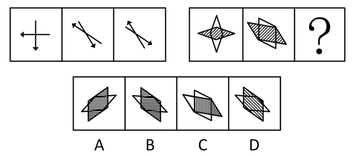

A. A

B. B

C. C

D. D

第 61 题 · 答案与解析

**参考答案（粉笔题库参考内容）**

B

**解析**

元素组成相同，考查位置规律。第二个图是由第一个图两个箭头顺时针和逆时针旋转得到的，第二个和第三个图形的关系是沿纵轴翻转。

故正确答案为B。

**考点**：位置规律-综合

**来源**：2008年黑龙江省公务员录用考试《行测》题第61题

### 第 62 题

从所给四个选项中，选择最合适的一个填入问号处，使之呈现一定的规律性：

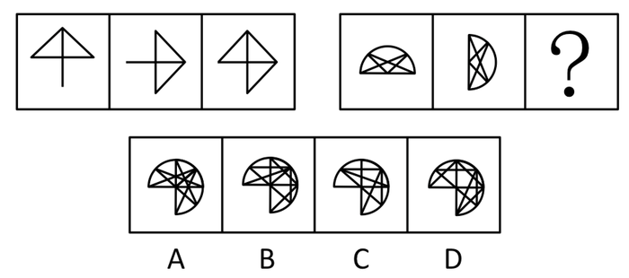

A. A

B. B

C. C

D. D

第 62 题 · 答案与解析

**参考答案（粉笔题库参考内容）**

A

**解析**

前两图简单叠加后形成第三个图形。

故正确答案为A。

**考点**：样式规律-加减同异

**来源**：2008年黑龙江省公务员录用考试《行测》题第62题

### 第 63 题

从所给四个选项中，选择最合适的一个填入问号处，使之呈现一定的规律性：

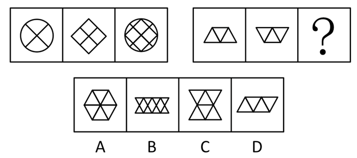

A. A

B. B

C. C

D. D

第 63 题 · 答案与解析

**参考答案（粉笔题库参考内容）**

B

**解析**

前两图简单叠加后形成第三个图形。

故正确答案为B。

**考点**：样式规律-加减同异

**来源**：2008年黑龙江省公务员录用考试《行测》题第63题

### 第 64 题

从所给四个选项中，选择最合适的一个填入问号处，使之呈现一定的规律性：

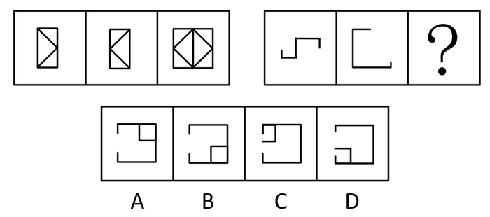

A. A

B. B

C. C

D. D

第 64 题 · 答案与解析

**参考答案（粉笔题库参考内容）**

A

**解析**

元素组成相似，优先考虑样式规律。

观察发现，前两个图先分别左右进行翻转，再进行简单叠加形成第三个图形。右边这组图应用规律，前两个图先分别进行左右翻转，再简单叠加，只有A项符合。

故正确答案为A。

**考点**：样式规律-加减同异

**来源**：2008年黑龙江省公务员录用考试《行测》题第64题

### 第 65 题

从所给四个选项中，选择最合适的一个填入问号处，使之呈现一定的规律性：

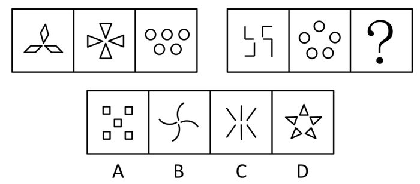

A. A

B. B

C. C

D. D

第 65 题 · 答案与解析

**参考答案（粉笔题库参考内容）**

C

**解析**

数元素数量，前一串每组图形包含的相同图形的数目分别为3、4、5个，呈等差数列，后一串每组图形也满足这一规律，则下一个图形包含的相同图形的数目应该为6个。

故正确答案为C。

**考点**：数量规律-素

**来源**：2008年黑龙江省公务员录用考试《行测》题第65题

### 第 66 题

从所给四个选项中，选择最合适的一个填入问号处，使之呈现一定的规律性：

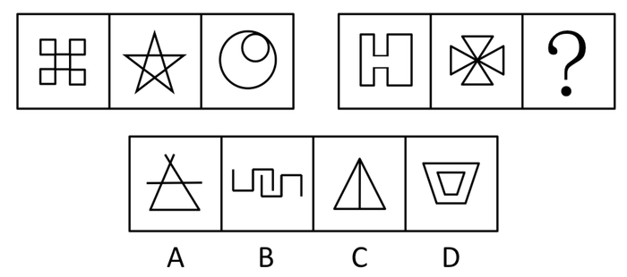

A. A

B. B

C. C

D. D

第 66 题 · 答案与解析

**参考答案（粉笔题库参考内容）**

C

**解析**

元素组成凌乱，考数数。数笔画，本题每幅图形都是由一笔画成，A项至少2笔，BD都不是连通图形，也需要2笔。

故正确答案为C。

**考点**：数量规律-线

**来源**：2008年黑龙江省公务员录用考试《行测》题第66题

### 第 67 题

从所给四个选项中，选择最合适的一个填入问号处，使之呈现一定的规律性：

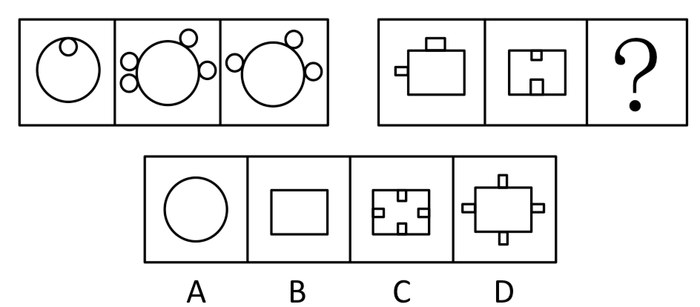

A. A

B. B

C. C

D. D

第 67 题 · 答案与解析

**参考答案（粉笔题库参考内容）**

B

**解析**

解析1：

第一组图中的三个图小圆的个数为1、4、3，第一个图形中的小圆的数目加上第三个图形中的小圆数目等于第二个图形。依此规律，第二组图中的小长方形个数应为2、2、0。

故正确答案为B。

解析2：

第一组前两个图形中的小圆，根据大圆内外的关系比照“正负”关系抵消（里面和外面的小圆相抵消）得出最后一个图形。

故正确答案为B。

**考点**：数量规律-素

**来源**：2008年黑龙江省公务员录用考试《行测》题第67题

### 第 68 题

从所给四个选项中，选择最合适的一个填入问号处，使之呈现一定的规律性：

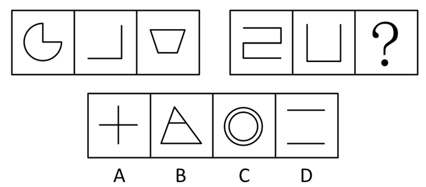

A. A

B. B

C. C

D. D

第 68 题 · 答案与解析

**参考答案（粉笔题库参考内容）**

B

**解析**

元素组成凌乱，考数数。数笔画，本题每幅图形都是由一笔画成，ACD都是2笔画。

故正确答案为B。

**考点**：数量规律-线

**来源**：2008年黑龙江省公务员录用考试《行测》题第68题

### 第 69 题

从所给四个选项中，选择最合适的一个填入问号处，使之呈现一定的规律性：

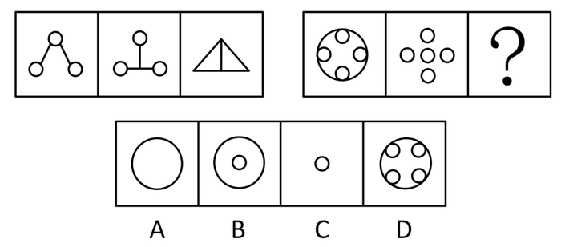

A. A

B. B

C. C

D. D

第 69 题 · 答案与解析

**参考答案（粉笔题库参考内容）**

B

**解析**

元素组成相似，元素叠加。前两图叠加后去同存异形成第三个图形。

故正确答案为B。

**考点**：样式规律-加减同异

**来源**：2008年黑龙江省公务员录用考试《行测》题第69题

### 第 70 题

从所给四个选项中，选择最合适的一个填入问号处，使之呈现一定的规律性：

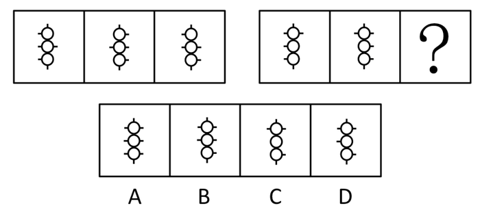

A. A

B. B

C. C

D. D

第 70 题 · 答案与解析

**参考答案（粉笔题库参考内容）**

D

**解析**

观察第一组图形，发现三幅图的短直线的数目都是6；观察第二组图形，发现前两幅图的短直线的数目也都是6，所以应选择一个短直线的数目是6的图形填入。

故正确答案为D。

**考点**：数量规律-线

**来源**：2008年黑龙江省公务员录用考试《行测》题第70题

### 第 71 题

行政复议是指公民、法人或者其他组织认为行政机关的具体行政行为或者行政不作为侵犯其合法权益的，对该行为或不作为提起行政复议。
下列不属于行政复议行为的是：

A. 蔬菜市场摊主王某因不服区工商局的罚款处罚，向市工商局提出复议申请

B. 刘某因打架斗殴被刑事拘留15天，释放后由于不服而向上级机关提出复议申请

C. 某食品厂因违规操作而被吊销生产许可证，该厂向人民政府提出复议申请

D. 张某因不服超速驾驶被处以200元罚款的处罚，向上级公安交警部门提出复议申请

第 71 题 · 答案与解析

**参考答案（粉笔题库参考内容）**

B

**解析**

第一步：抓住定义中的关键词。

关键词强调“具体行政行为或行政不作为”。

第二步：逐一判断选项。

B项“刑事拘留”不是行政处罚，不属此类。

本题为选非题，故正确答案为B。

**考点**：拆词

**来源**：2008年黑龙江省公务员录用考试《行测》题第71题

### 第 72 题

商标是商品的生产者、经营者在其生产、制造、加工、拣选或者经销的商品上或者服务的提供者在其提供的服务上采用的，区别商品或者服务来源的，由文字、图形或者其组合构成的，具有显著特征的标志。

根据此定义，下列不能作为商标的是：

A. 文字

B. 图形

C. 三维标志

D. 声音

第 72 题 · 答案与解析

**参考答案（粉笔题库参考内容）**

D

**解析**

第一步：抓住定义中的关键词。

关键词强调“由文字、图形或者其组合构成的，具有显著特征”的标志。

第二步：逐一判断选项。

D项中声音不能作为商标。

本题为选非题，故正确答案为D。

**考点**：单定义-其他句式

**来源**：2008年黑龙江省公务员录用考试《行测》题第72题

### 第 73 题

知识营销是指通过有效的知识传播方法和途径，将企业所拥有的对用户有价值的知识（包括产品知识、专业研究成果、经营理念、管理思想及优秀的企业文化）传递给潜在用户，并逐渐形成对企业品牌和产品的认知，为将潜在用户最终转化为用户的过程和各种营销行为。

下列行为属于知识营销的是：

A. 某公立医院派出10名资深医生参加社区义诊志愿活动。

B. 某证券公司组织离退休老人学习班，免费讲解股票市场知识。

C. 某名牌企业匿名为希望工程捐款1000万元。

D. 在药厂工作的小刘经常和朋友们一起探讨有关饮食健康的问题。

第 73 题 · 答案与解析

**参考答案（粉笔题库参考内容）**

B

**解析**

第一步：抓住定义中的关键词。

关键词强调“企业”、“传递给潜在用户”、“形成认知”。

第二步：逐一判断选项。

A中的公立医院不属于企业，C选项中匿名捐款达不到形成认知的效果，D选项中小刘并没有宣传本企业。

故正确答案为B。

**考点**：方式目的

**来源**：2008年黑龙江省公务员录用考试《行测》题第73题

### 第 74 题

白亮污染是一类光污染，指过度光亮给人的视觉造成的不良影响，如光洁的金属表面、城市里建筑物的玻璃幕墙、釉面砖墙、磨光大理石以及各种涂料等装饰反射光线，明晃白亮、眩眼夺目，使人产生头昏眼花、心烦意乱、食欲下降、情绪低落等身体不适。
下列表述不属于白亮污染的一项是：

A. 夏天，玻璃幕墙强烈的反光进入附近居民楼房内，增加了室内温度，影响正常的生活。

B. 烈日下驾车行驶的司机会出其不意地遭到玻璃幕墙反射光的突然袭击，眼睛受到强烈刺激，很容易诱发车祸。

C. 夜幕降临后，商场、酒店上的广告灯、霓虹灯闪烁夺目，令人眼花缭乱。

D. 在一些旅游景点，许多人拍照留影，不停闪烁的闪光灯让其他游客心烦意乱。

第 74 题 · 答案与解析

**参考答案（粉笔题库参考内容）**

C

**解析**

第一步：抓住定义中的关键词。

关键词强调“光污染”、“过度光亮”、“使人身体不适”。

第二步：逐一判断选项。

A、B、D选项中涉及的内容均属于此范畴，C中并没有过度光亮，霓虹灯也没有造成身体不适，不属此类。

本题为选非题，故正确答案为C。

**考点**：原因结果

**来源**：2008年黑龙江省公务员录用考试《行测》题第74题

### 第 75 题

城市热岛是指随着城市规模的迅速扩大，城市气温明显高于外围郊区的现象。在气象学近地面大气等温线图上，郊外的广阔地区气温变化很小，如同一个平静的海面；而城区则是一个明显的高温区，如同突出海面的岛屿。由于这种岛屿代表着高温的城市区域，所以就被形象地称为“城市热岛”。

根据上述定义，下列表述不正确的一项是：

A. 热岛效应不仅使城市的气候发生了变化，还带来严重的污染，成为影响城市环境质量的重要因素
。

B. 一般情况下，城市规模越大，人口越密集，热岛效应也愈发明显。

C. 城市热岛效应与机动车辆、工业生产及人群活动等产生的“温室效应”有关。

D. 在城市中，增加道路、广场、体育馆等公用设施，对缓解热岛效应有帮助。

第 75 题 · 答案与解析

**参考答案（粉笔题库参考内容）**

D

**解析**

第一步：抓住定义中的关键词。

关键词强调“城市规模的迅速扩大”、“气温明显高于外围郊区”。

第二步：逐一判断选项。

A、B、C均符合城市热岛的定义，而定义中没有提及增加道路、广场、体育馆等会缓解热岛效应，D属主观臆断，所以是错误的。

本题为选非题，故正确答案为D。

**考点**：单定义-其他句式

**来源**：2008年黑龙江省公务员录用考试《行测》题第75题

### 第 76 题

线性指量与量之间按比例、成直线的关系，在空间和时间上代表规则和光滑的运动。
根据上述定义，以下属于线性关系的是：

A. 王老师的健康状况随年龄的增大每况愈下。

B. 商品的价格围绕其价值上下波动。

C. 做匀加速直线运动的火箭升空的高度随所用时间的推移逐步增加。

D. 小刘参加考试的时候，心跳速度在考试开始前后先快后慢。

第 76 题 · 答案与解析

**参考答案（粉笔题库参考内容）**

C

**解析**

第一步：抓住定义中的关键词。

关键词强调“规则和光滑的运动”。

第二步：逐一判断选项。

A项中王老师的健康状况、B中的商品价格、D项中小刘参加考试时的心跳速度均是视具体情况而定的，是非规律、不光滑的。

故正确答案为C。

**考点**：单定义-其他句式

**来源**：2008年黑龙江省公务员录用考试《行测》题第76题

### 第 77 题

不当得利是指没有法律上或合同上的根据，使他人受损而自己取得的利益。其中得利人为债务人，负有返还不当得利的义务；受损人为债权人，享有请求得利人返还不当得利的权利。

据此定义，下列属于不当得利的是：

A. 银行在办理跨行存取款业务时收取的手续费。

B. 刘经理乘飞机时由于行李超重而缴纳的罚款。

C. 小张春节在家和亲戚打麻将赢的200元钱。

D. 商场收款员小梅误将100元当作10元找给顾客。

第 77 题 · 答案与解析

**参考答案（粉笔题库参考内容）**

D

**解析**

第一步：抓住定义中的关键词。

关键词强调“没有法律上或合同上的根据”、“使他人受损”自己得到的利益。

第二步：逐一判断选项。

A、B项均合乎法规规定，C项属于家人在节日时自娱自乐，没有损害他人利益，故以上三项均不属于不当得利，而D项中由于失误给小梅造成了利益上的损失，属于不当得利。

故正确答案为D。

**考点**：原因结果

**来源**：2008年黑龙江省公务员录用考试《行测》题第77题

### 第 78 题

企业法人是指具有符合国家法律规定的资金数额、企业名称、组织章程、组织机构、住所等法定条件，能够独立承担民事责任，经主管机关核准登记取得法人资格的社会经济组织。
据此定义，下列属于企业法人的是：

A. 村民赵某个人独资在村里建起的养鸡厂。

B. 宋先生和自己的妻子在商场承包的服装销售摊位。

C. 某濒临破产的国有拖拉机制造厂。

D. 某跨国公司派驻中国的业务联络办事处。

第 78 题 · 答案与解析

**参考答案（粉笔题库参考内容）**

C

**解析**

第一步：抓住定义中的关键词。

关键词强调“符合国家法律规定”、“能够独立承担民事责任”、“经主管机关核准登记”的社会经济组织。

第二步：逐一判断选项。

A、B项中均为个体经营，D项不属于经济组织，C项中国有拖拉机制造厂虽濒临破产，但还是符合企业法人的定义。

故正确答案为C。

**考点**：单定义-其他句式

**来源**：2008年黑龙江省公务员录用考试《行测》题第78题

### 第 79 题

政协提案是政协委员以个人、联名或本党派、团体的名义向人民政协组织提交，并通过政协组织向人民代表大会或人民政府就有关国家或地方大政方针、社会生产等重大问题提出意见和建议的形式。
据此定义，下列属于政协提案的是：

A. 某政协委员就某社区公用路面损毁严重，长期得不到维修的情况致信市城建部门。

B. 一位交通科学领域的教授对所在城市多处交通指挥灯设置的科学性表示质疑，并向当地政协机关提出了相应的整改方案。

C. 在今年全省人民代表大会上，有代表就进一步保障进城务工农民的合法权益提出了建议和意见。

D. 某市工商联代表在该市政协五届一次会议上提出建立中小企业服务中心的建议。

第 79 题 · 答案与解析

**参考答案（粉笔题库参考内容）**

D

**解析**

第一步：抓住定义中的关键词。

关键词强调“政协组织”、“人民代表大会”、“有关国家或地方大政方针、社会生产等重大问题”。

第二步：逐一判断选项。

A、B项中的社区路面损毁、交通灯设置等问题不属于国家或地方大政方针、社会生产等重大问题；政协提案应由政协组织向人民代表大会提交，因此C项错误。

故正确答案为D。

**考点**：方式目的

**来源**：2008年黑龙江省公务员录用考试《行测》题第79题

### 第 80 题

劳动纠纷是指劳动者与用人单位之间因执行劳动法律、法规或履行劳动合同、集体合同发生的争执。
根据上述定义，下列行为属于劳动纠纷的是：

A. 因为不满装修质量，房主与装修工人发生纠纷。

B. 两家生产同种产品的企业因为工资存在差别而发生纠纷。

C. 工人因反对不发放加班工资而与用人单位发生的争执。

D. 工人因不满经理的领导方式而与之发生争执。

第 80 题 · 答案与解析

**参考答案（粉笔题库参考内容）**

C

**解析**

第一步：抓住定义中的关键词。

关键词强调“劳动者与用人单位之间”、“因执行劳动法律、法规或履行劳动合同、集体合同”发生的争执。

第二步：逐一判断选项。

A、B情形不是发生在劳动者与用人单位之间，D项不属于履行劳动合同、集体合同时发生的争执。

故正确答案为C。

**考点**：原因结果

**来源**：2008年黑龙江省公务员录用考试《行测》题第80题

### 第 81 题

食物：饥饿

A. 衣服：寒冷

B. 问题：回答

C. 开水：喝

D. 门：锁

第 81 题 · 答案与解析

**参考答案（粉笔题库参考内容）**

A

**解析**

第一步：判断题干词语间逻辑关系。

题干两词是对应关系，且题干中前者是后者所表达状态时需要的事物：饥饿时需要食物。

第二步：判断选项词语间逻辑关系。

与题干逻辑关系相同的即为A项：寒冷时需要衣服；B、C、D三项前后两词组成动宾短语。

故正确答案为A。

**考点**：逻辑关系-对应关系

**来源**：2008年黑龙江省公务员录用考试《行测》题第81题

### 第 82 题

食物中毒：蘑菇

A. 矿难：煤炭

B. 海啸：地震

C. 骚乱：警察

D. 高血压：血压计

第 82 题 · 答案与解析

**参考答案（粉笔题库参考内容）**

A

**解析**

第一步：判断题干词语间逻辑关系。

“吃”蘑菇可能会导致食物中毒，二者为或然因果关系。

第二步：判断选项词语间逻辑关系。

A项：“挖”煤炭可能会导致矿难，二者为或然因果关系，与题干逻辑关系一致，当选；

B项：海啸和地震是两种地质灾害，二者可以理解为并列关系，但同时地震可能引发海啸，也可以理解为或然因果关系，但引发的过程无需人为动作，与题干逻辑关系不一致，排除；

C项：警察制止骚乱，二者并非因果关系，与题干逻辑关系不一致，排除；

D项：高血压可以用血压计来测量，二者为工具对应关系，与题干逻辑关系不一致，排除。

故正确答案为A。

**考点**：逻辑关系-对应关系

**来源**：2008年黑龙江省公务员录用考试《行测》题第82题

### 第 83 题

白天：黑夜

A. 男人：女人

B. 喜欢：憎恨

C. 老人：小孩

D. 黑色：白色

第 83 题 · 答案与解析

**参考答案（粉笔题库参考内容）**

A

**解析**

第一步：判断题干词语间逻辑关系。

除了白天就只有黑夜，二者为并列关系中的矛盾关系。

第二步：判断选项词语间逻辑关系。

A项：男人和女人是并列关系中矛盾关系，与题干逻辑关系一致，当选；

B项：喜欢和憎恶是并列关系中反对关系，与题干逻辑关系不一致，排除；

C项：老人和小孩是并列关系中反对关系，与题干逻辑关系不一致，排除；

D项：黑色和白色是并列关系中反对关系，与题干逻辑关系不一致，排除。

故正确答案为A。

**考点**：逻辑关系-并列关系

**来源**：2008年黑龙江省公务员录用考试《行测》题第83题

### 第 84 题

曹操：刘备

A. 汽车：货车

B. 蔬菜：食物

C. 南京：北京

D. 珠峰：喜马拉雅山

第 84 题 · 答案与解析

**参考答案（粉笔题库参考内容）**

C

**解析**

第一步：判断题干词语间逻辑关系。

题干两词是并列关系，曹操和刘备均为历史著名人物。

第二步：判断选项词语间逻辑关系。

与题干逻辑关系相同的为C项，南京和北京同为中国主要城市，A、B、D项均为包容关系。

故正确答案为C。

**考点**：逻辑关系-并列关系

**来源**：2008年黑龙江省公务员录用考试《行测》题第84题

### 第 85 题

爷爷：外公

A. 叔叔：哥哥

B. 家庭：亲人

C. 父亲：岳父

D. 兄长：哥哥

第 85 题 · 答案与解析

**参考答案（粉笔题库参考内容）**

C

**解析**

第一步：判断题干词语间逻辑关系。

题干两词是并列关系，都是同一个辈分。

第二步：判断选项词语间逻辑关系。

与题干逻辑关系相同的即为C项。

故正确答案为C。

**考点**：逻辑关系-并列关系

**来源**：2008年黑龙江省公务员录用考试《行测》题第85题

### 第 86 题

湖北：湖南

A. 广州；广东

B. 北京：上海

C. 山东：广东

D. 新疆：西藏

第 86 题 · 答案与解析

**参考答案（粉笔题库参考内容）**

D

**解析**

第一步：判断题干词语间逻辑关系。

题干两词是并列关系，且题干中湖北和湖南同为中国的省份，而且是相邻的关系。

第二步：判断选项词语间逻辑关系。

与题干逻辑关系相同的即为D项，新疆和西藏相邻。

故正确答案为D。

**考点**：逻辑关系-并列关系

**来源**：2008年黑龙江省公务员录用考试《行测》题第86题

### 第 87 题

书：纸

A. 笔：纸

B. 文具：文具盒

C. 菜肴：萝卜

D. 飞机：大炮

第 87 题 · 答案与解析

**参考答案（粉笔题库参考内容）**

C

**解析**

第一步：判断题干词语间逻辑关系。

题干两词是包容关系，且是包容中的或然组成关系。

第二步：判断选项词语间逻辑关系。

与题干逻辑关系相同的即为C项；A项是并列关系；B项是或然组成关系，但是位置颠倒；D项无明显逻辑关系。

故正确答案为C。

**考点**：逻辑关系-包容关系

**来源**：2008年黑龙江省公务员录用考试《行测》题第87题

### 第 88 题

二人转：东北

A. 晋剧：安徽

B. 梆子：山东

C. 豫剧：河南

D. 秦腔：湖北

第 88 题 · 答案与解析

**参考答案（粉笔题库参考内容）**

C

**解析**

第一步：判断题干词语间逻辑关系。

题干两词是对应关系，且是戏曲和起源地的一一对应关系。

第二步：判断选项词语间逻辑关系。

与题干逻辑关系相同的即为C项；A项：晋剧源于山西；B项：梆子源于河北；D项：秦腔源于陕西。

故正确答案为C。

**考点**：逻辑关系-对应关系

**来源**：2008年黑龙江省公务员录用考试《行测》题第88题

### 第 89 题

鸳鸯：固定

A. 蜘蛛：蜻蜓

B. 垃圾：根本

C. 照顾：葡萄

D. 颤抖：枇杷

第 89 题 · 答案与解析

**参考答案（粉笔题库参考内容）**

B

**解析**

第一步：判断题干词语间逻辑关系。

题干两词是对应关系，且是连绵词和同义复合词间的对应关系，题干中前一个词是连绵词，后一个是同义复合词。

第二步：判断选项词语间逻辑关系。

与题干相同逻辑关系的即为B项，A项两个都是连绵词，C项前一个是同义复合词，后一个是连绵词，D项两个都是同义复合词。

故正确答案为B。

**本题相关知识点：**

连绵词有以下三种类型：

①双声词。双声词指两个音节的声母相同的连绵词。如“伶俐”“蹊跷”。②叠韵词。叠韵词指两个音节的韵母相同的连绵词。如“骆驼”“徘徊”。③非双声叠韵词。非双声叠韵词指既非双声又非叠韵的连绵词。

同义复合词：

就是有两个或两个以上的意义相同或基本相同的词组成的词。

**考点**：逻辑关系-对应关系

**来源**：2008年黑龙江省公务员录用考试《行测》题第89题

### 第 90 题

卧薪尝胆：勾践

A. 凿壁借光：匡衡

B. 开诚布公：曹操

C. 完璧归赵：廉颇

D. 江郎才尽：周瑜

第 90 题 · 答案与解析

**参考答案（粉笔题库参考内容）**

A

**解析**

第一步：判断题干词语间逻辑关系。

题干两词是对应关系，且是成语的来源与后面的人物之间的一一对应关系。

第二步：判断选项词语间逻辑关系。

与题干逻辑关系相同的即为A项，开诚布公对应的是诸葛亮，完璧归赵对应的是蔺相如，江郎才尽对应的是江淹。

故正确答案为A。

**考点**：逻辑关系-对应关系

**来源**：2008年黑龙江省公务员录用考试《行测》题第90题

### 第 91 题

为引进外资发展经济，我国许多地方都提供了非常优惠的条件。不过，外资企业在并购中国企业时要求绝对控股，拒绝接受不良资产，要求拥有并限制原有中国品牌。例如，我国最大的工程机械制造企业被美国某投资集团收购了85％的股权；德国公司收购了我国一家油嘴油泵的龙头企业；我国首家上市的某轴承股份有限公司在与德国一家公司合资两年后，成了德方的独家公司。
以下哪项可以最合乎逻辑地完成上面的论述：

A. 以优惠条件引进外资有可能危害中国的产业。

B. 以优惠条件引进外资是为了引进先进的技术和管理。

C. 在市场经济条件下资本和股权是流动的。

D. 以优惠条件引进外资是由于我国现在缺少资金。

第 91 题 · 答案与解析

**参考答案（粉笔题库参考内容）**

A

**解析**

第一步：抓住每句话中的对象及其关系。

第一句强调为了引进外资发展经济，我国许多地方都提供了非常优惠的条件。第二句说明了给外资企业提供的优惠条件。第三句举例说明。三句间是递进关系。

第二步：判断整体关系。

从文中的第二句和最后一句中所列举的实例都可以看出，优惠条件给中国企业造成的影响。

第三步：逐一判断选项的作用。

A符合题意，B说的是优惠条件带来的好处，C、D文中并没有提及。

故正确答案为A。

**考点**：日常结论

**来源**：2008年黑龙江省公务员录用考试《行测》题第91题

### 第 92 题

甲：我们仍然不知道机器是否能思考，计算机能够执行非常复杂的任务，但是缺少人类智力的灵活。

乙：我们不需要更复杂的计算机来知道机器是否能够思考，我们人类是机器，我们思考。

乙对甲的反应是基于对哪一个词语的重新理解：

A. 计算机

B. 知道

C. 机器

D. 复杂

第 92 题 · 答案与解析

**参考答案（粉笔题库参考内容）**

C

**解析**

第一步：抓住题干主要信息。

本题题干中甲的意思是，我们不清楚机器能否进行思考，意在说明计算机和人类是有所区别的。而乙对此话的理解是，甲欲通过相关途径确认机器是否能够思考。

第二步：分析题干信息，并结合选项得出答案。

甲、乙产生误解的原因在于对“机器”一词的理解，乙认为人类就是更为高级的机器，无需寻找其它机器。

故正确答案为C。

**考点**：日常结论

**来源**：2008年黑龙江省公务员录用考试《行测》题第92题

### 第 93 题

学校开设体育课的主要目的是使学生的身体变得健康。体育课应该集中于增氧锻炼，增氧锻炼比集体运动更能促进参与者的健康，并且实际上只有一小部分学生参加集体运动。
以上观点如果正确，作者将最有效地反对下面哪一项：

A. 学校里使用身体训练计划来鼓励学生培养终身的健康习惯。

B. 年轻的学生应该参加社区运动队。

C. 学校过分依赖于增氧练习计划来帮助所有的孩子变得身体健康。

D. 学校大部分体育课用来进行集体运动。

第 93 题 · 答案与解析

**参考答案（粉笔题库参考内容）**

D

**解析**

第一步：找出题干所给的关键点。

增氧锻炼比集体运动更能促进参与者的健康。

第二步：逐一判断选项的正确性。

AB中都没有和增氧锻炼、集体运动相关的观点，属于无关选项，C说明学校认为增氧锻炼比集体运动更能促进参与者的健康，是支持题干的选项，D说学校大部分体育课用来进行集体运动，说明集体运动比增氧锻炼更能促进参与者的健康。题干观点有效地反对了D的观点。

故正确答案为D。

**考点**：日常结论

**来源**：2008年黑龙江省公务员录用考试《行测》题第93题

### 第 94 题

某花店的进货价只有低于正常价格时，才能以低于市场的价格卖花而获利；除非该花店的销售量很大，否则，不能从花农那里购得低于正常价格的花；要想有大的销售量，该花店就要满足消费者个人兴趣或者拥有特定品种的独家销售权。
如果上述断定为真，则以下哪项必定为真：

A. 如果该花店从花农那里购得低于正常价格的花，那么就会以低于市场的价格卖花获利。

B. 如果该花店没有以低于市场的价格卖花而获利，则一定没有从花农那里购得低于正常价格的花。

C. 该花店不仅满足了消费者的个人兴趣，而且拥有特定品种独家销售权，但仍然不能以低于市场价格卖花而获利。

D. 如果该花店以低于市场价格卖花而获利，那么进货价一定低于正常价格。

第 94 题 · 答案与解析

**参考答案（粉笔题库参考内容）**

D

**解析**

第一步：翻译题干，利用充分必要条件。

第一句：低于市场的价格卖花⇒进货价低于正常价格，第二句：进货价低于正常价格⇒销售量很大，第三句：销售量很大⇒满足消费者个人兴趣或者拥有特定品种的独家销售权。

将以上三个推导关系连起来即为：低于市场的价格卖花⇒进货价低于正常价格⇒销售量很大⇒满足消费者个人兴趣或者拥有特定品种的独家销售权。

第二步：逐一翻译选项并判断选项的正确，利用逆否规则。

A进货价低于正常价格⇒低于市场的价格卖花，“进货价低于正常价格”属肯后件，无法推出绝对表达的结论，A错；B没有以低于市场的价格卖花⇒没有进货价低于正常价格，“没有以低于市场的价格卖花”属否前件，无法推出绝对表达的结论，B错；C满足了消费者的个人兴趣，且拥有特定品种独家销售权，且没有以低于市场的价格卖花，“满足了消费者的个人兴趣，而且拥有特定品种独家销售权”属肯后件，无法推出绝对表达的结论，不一定能与“没有以低于市场的价格卖花”共存，C错；D低于市场的价格卖花⇒进货价低于正常价格，满足题意。

故正确答案为D。

**考点**：常规翻译

**来源**：2008年黑龙江省公务员录用考试《行测》题第94题

### 第 95 题

目前，在图书市场上有许多诸如《成功十大要决》之类的书。出版商在推销时声称，这些书将能切实地帮助读者获得卓越的成功。事实上，几乎人人都知道，卓越的成功注定只属于少数人，人们不可能通过书本都成为这少数人群中的一个。基于这一点，出版商故意所做的上述夸张乃至虚假的宣传不能认为是不道德的。退一步说，即使有人相信了出版商的虚假宣传，但只要读此类书对他在争取成功中确实利大于弊，做此类宣传也不能认为是不道德的。
以下哪项断定最符合以上的议论：

A. 只有虚假宣传完全没有“歪打正着”的正面效应时，故意做此虚假宣传才是不道德的。

B. 只有当人们受了欺骗并深受其害时，故意做这种宣传才是不道德的。

C. 如果故意做虚假宣传者是通过损害受骗者获利，那么，故意做此虚假宣传是不道德的。

D. 只有当虚假宣传的受骗者的数量超出了未受骗者时，故意做此虚假宣传才是不道德的。

第 95 题 · 答案与解析

**参考答案（粉笔题库参考内容）**

B

**解析**

第一步：抓住每句话中的对象及其关系。

该文段的最后两句作者对出版商的宣传是否“道德”作出了两种评价：①“出版商故意所作出的上述夸张乃至虚假的宣传不能认为是不道德的”，因为“卓越的成功只属于少数人”。②“即使出版商虚假宣传，但只要此类书对他在争取成功中确实利大干弊，也不能认为是不道德的”。

第二步：判断整体关系。

由第②类评价可知要判断出版此类书籍的出版商“不道德”需要满足两个条件，即“出版商虚假宣传”和“此类书对他在争取成功中弊大于利”。只满足条件“出版商虚假宣传”属于第①种评价，满足条件“出版商虚假宣传”而不满足条件“此类书对他在争取成功中弊大于利”属于第②种评价。

第三步：逐一判断选项的作用。

A中只满足“出版商虚假宣传”，不能说明出版商“不道德”，A错；B中满足了“出版商虚假宣传”和“此类书对他在争取成功中弊大于利”两个条件，说明了出版商“不道德”，B正确；C的情况说明除了满足以上两点可以说明出版商“不道德”，还可能有别的情况，C错；D关于数量文中并没有提及。

故正确答案为B。

**考点**：日常结论

**来源**：2008年黑龙江省公务员录用考试《行测》题第95题

### 第 96 题

“衣、食、住、行”是老百姓关注的头等大事。然而，这些年“衣”已经被医院的“医”所取代。看病贵、看病难已经成为社会关注的热点问题之一。因此，必须迅速推进医疗体制改革。
与上述论证最为相关一个问题是：

A. 药品推销商的贿赂行为以及医生收红包在看病贵中起多大作用。

B. 造成看病贵、看病难的最根本的原因究竟是什么。

C. 政府拨款不足在导致医疗价格上涨中起多大作用。

D. 平价医院在抑制医疗价格方面起多大作用。

第 96 题 · 答案与解析

**参考答案（粉笔题库参考内容）**

B

**解析**

第一步：找到论点和论据。

本题论点是必须迅速推进医疗体制改革，论据是看病贵、看病难已经成为社会关注的热点问题之一。

第二步：判断加强方式。

本题论点与论据间存在因果关系，所以需加强论点。

第三步：逐一判断选项的作用。

选项A中的“贿赂行为”、选项C中的“拨款不足”和选项D中的“平价医院”都可能是探讨看病贵、看病难的原因，但是它们独立存在的时候显然是不全面的而且带有主观臆测的性质，只有选项B是比较全面的。

故正确答案为B。

**来源**：2008年黑龙江省公务员录用考试《行测》题第96题

### 第 97 题

由于按揭贷款的利率在降低，消费者在观望利率会低到什么程度，所以一月份出售的新房子数量大幅下降了，销售大幅下降的同时，所售新房子平均价格激增。
下面哪项如果正确，能最好地解释新房子平均价格的激增：

A. 价格较高房子的销售没有受销量下降的影响，因为它们的买主较少受支付总额的限制。

B. 建筑商和建筑工会的劳动协议到明年一月才到期。

C. 过去三年中，新房子的价格一直在缓慢上涨，因为住房不足的严重程度增加了。

D. 一月份比先前的三个月中有更多的房屋所有者再次出售他们的中等价位的房子。

第 97 题 · 答案与解析

**参考答案（粉笔题库参考内容）**

A

**解析**

第一步：找出题干矛盾。

因消费者在观望利率会低到什么程度，新房子销量下降，但平均价格激增。

第二步：逐一分析选项。

A项：价格较高房子的销售未受影响，因此虽然新房整体销量下降，但高价房屋的销量没有下降，说明了为什么新房平均价格激增，可以解释题干矛盾，当选；

B项：建筑商和建筑工会的劳动协议到期时间与新房价格无明显关系，无法说明为什么新房平均价格激增，不能解释题干矛盾，排除；

C项：因住房不足，过去三年新房价格一直缓慢上涨，但这是长时间内的稳定变化，无法说明为什么新房平均价格激增，不能解释题干矛盾，排除；

D项：一月，更多房屋所有者再次出售其中等价位的房子，即使这些中等价位房子均成功售出，新房平均价格也只会呈现一定程度的增长，而非激增，不能解释题干矛盾，排除。

故正确答案为A。

**考点**：原因解释

**来源**：2008年黑龙江省公务员录用考试《行测》题第97题

### 第 98 题

某市举办学生足球比赛。在进行第一轮淘汰赛后，进入第二轮的6支队伍实力相当，不过，总是可以分出高下。在已经进行的比赛中，甲队战胜了乙队，乙队击败了丙队。甲队和丙队将进行比赛。
请根据题干，从逻辑上预测比赛结果：

A. 甲队肯定会赢。

B. 丙队肯定会赢
。

C. 两队将战成平局。

D. 甲队很可能赢，但也有可能输。

第 98 题 · 答案与解析

**参考答案（粉笔题库参考内容）**

D

**解析**

第一步：抓住题干主要信息。

各队水平相当是必然条件，即甲队、乙队、丙队水平相当，而甲队战胜了乙队，乙队战胜了丙队，排除比赛中的偶然因素，甲队的实力要能高于乙队，乙队的实力高于丙队，由此可知道，甲队的实力强于丙队。

第二步：分析题干信息。

竞技类比赛都存在偶然因素，因此在水平相当的前提下，甲队和丙队比赛，有可能赢，也有可能输，排除偶然因素的存在，甲队赢的可能性更大。

故正确答案为D。

**考点**：日常结论

**来源**：2008年黑龙江省公务员录用考试《行测》题第98题

### 第 99 题

某城市有5个公园。甲、乙、丙、丁、戊，它们由南至北基本在一条直线上，同时：

（1）乙与丁相邻并且在丁的北边

（2）戊和甲相邻

（3）丙在乙的北边

根据以上线索，可以推断五个公园由北至南的顺序可以是：

A. 甲、丙、戊、乙、丁

B. 乙、丁、戊、甲、丙

C. 丙、甲、戊、乙、丁

D. 丙、丁、乙、甲、戊

第 99 题 · 答案与解析

**参考答案（粉笔题库参考内容）**

C

**解析**

本题每个选项都是完整排列组合，可用排除法。

第一步：找突破口。

本题突破口是信息量最大的对象，即乙。由（1）乙与丁相邻并且在丁的北边和（3）丙在乙的北边可知，乙、丙、丁三个公园由北至南的顺序为丙、乙、丁。

第二步：结合选项进行排除。

由第一步可排除B、D两项，由戊和甲相邻排除A项。

故正确答案为C。

**考点**：从最大信息开始推

**来源**：2008年黑龙江省公务员录用考试《行测》题第99题

### 第 100 题

调查显示，我国图书阅读率连续6年下降，2005年的国民图书阅读率首次低于50%，与此同时我国社会大众的学习热情却持续高涨。
下列表述正确的一项是：

A. “没有时间读书”是图书阅读率下降的主要原因。

B. 我国国民网上阅读率从1999年的3.7%增长到2005年的27.8%。

C. 近年来我国图书出版中存在着书价过高、内容乏味、过度炒作等问题。

D. 通过听讲座也能学到许多知识。

第 100 题 · 答案与解析

**参考答案（粉笔题库参考内容）**

B

**解析**

第一步：抓住语句中的对象及其关系。

语句强调“我国图书阅读率连续6年下降，社会大众的学习热情却持续高涨”。

第二步：判断整体关系。

语句展现了“我国图书阅读率连续6年下降”和“我国社会大众的学习热情持续高涨”之间的矛盾，说明必然有其他的学习途径来平抑图书阅读率的下降趋势。

第三步：逐一判断选项的作用。

A项只是解释“图书阅读率下降”的原因，与学习热情持续高涨无关；C项提出的问题是“图书阅读率下降”的原因之一；D项只是个理论，实际上大众听过讲座没有，根本不知道。

故正确答案为B。

**考点**：日常结论

**来源**：2008年黑龙江省公务员录用考试《行测》题第100题

### 第 101 题

掌握“适度”原则的哲学依据是：

A. 质和量的统一

B. 肯定和否定的相互渗透

C. 矛盾同一性和斗争性的相互联结

D. 内容和形式的相互转化

第 101 题 · 答案与解析

**参考答案（粉笔题库参考内容）**

A

**解析**

本题考查政治常识。

A项正确，B、C、D三项错误。原理（哲学依据）：量变是质变的必要前提，质变是量变的必然结果。

方法论：要求从一点一滴的小事做起，为事物的质变做好准备，又要注意适度原则，在量变达到一定程度时抓住时机促成事物的质变。

延伸：是一定事物保持自己质的数量界限，是事物的质所能容纳的量的活动范围。度是规定事物质的数量界限。

故正确答案为A。

**考点**：唯物辩证法

**来源**：2008年黑龙江省公务员录用考试《行测》题第101题

### 第 102 题

社会主义民主政治的本质和核心是：

A. 人民当家作主

B. 无产阶级专政

C. 全体人民享有管理政治的权力

D. 生产资料公有制

第 102 题 · 答案与解析

**参考答案（粉笔题库参考内容）**

A

**解析**

本题考查政治常识。

A项正确，B、C、D三项错误。社会主义民主政治是无产阶级掌握国家政权，管理国家的政治制度。

其本质和核心是人民当家作主，国家的一切权力属于人民。

人民有权管理国家和社会各项事务，监督国家机关及其工作人员，依法享有人身、言论、出版、集会、结社、游行、示威等自由权利，在法律面前人人平等。

经济基础是社会主义生产资料公有制。

故正确答案为A。

**来源**：2008年黑龙江省公务员录用考试《行测》题第102题

### 第 103 题

下列哪一项不属于外部监督体系：

A. 政党监督

B. 司法监督

C. 专门监督

D. 舆论监督

第 103 题 · 答案与解析

**参考答案（粉笔题库参考内容）**

C

**解析**

本题考查管理常识。

C项错误，A、B、D三项正确。国家行政机关外部监督体系，主要由政党监督、国家权力机关监督、国家司法机关监督、社会团体监督、公民监督和新闻媒体监督等六个方面构成。

本题为选非题，故正确答案为C。

相关知识点：

我国行政系统外部监督的形式主要包括国家权力机关的监督、人民法院和人民检察院的监督、政党监督、社会舆论监督。

国家权力机关的监督是指各级人大及常委会对国家行政机关及其公务员的监督，其监督的主要方式有听取和审议工作报告，审查和批准国民经济计划和财政预算、决算，审查政府的法规、决定和命令，质询和询问，代表视察和执法检查，罢免政府组成人员六种。

政党监督是指对国家行政机关及其公务员行为实行的监督，其监督方式主要有中央和地方各级党委监督、党的基层组织的监督、党的各级纪检监督三种。

社会舆论监督是指包括群众团体、社会中介组织、企事业单位、公民等在内的社会各界以及各种媒体对国家行政机关及其公务员实施监督。其具体方式有：新闻媒体监督、一般社会舆论监督。

**来源**：2008年黑龙江省公务员录用考试《行测》题第103题

### 第 104 题

根据公务员法，以下人员哪些不具有公务员身份：

A. 某街道派出所干警

B. 市法院院长

C. 省总工会机关办公室科员

D. 省教育学院院长

第 104 题 · 答案与解析

**参考答案（粉笔题库参考内容）**

D

**解析**

本题考查法律常识。

A、B、C三项正确，D项错误。《中华人民共和国公务员法》第二条规定：“本法所称公务员，是指依法履行公职、纳入国家行政编制、由国家财政负担工资福利的工作人员”。

本题为选非题，故正确答案为D。

本题相关知识点：中国国家公务员指在中华人民共和国政府中行使国家行政权利、执行国家公务的人员。国家公务员分为政务和业务两类。

政务类公务员，必须严格依照宪法和组织法进行管理，实行任期制，并接受社会的公开监督。

业务类公务员按照国公务员法进行管理，实行常任制。国家公务员执行宪法、组织法和国家公务员法以及国家公务员条例规定的职责。

**考点**：行政法

**来源**：2008年黑龙江省公务员录用考试《行测》题第104题

### 第 105 题

“三个代表”重要思想创造性地回答了：

A. 什么是社会主义、怎样建设社会主义的问题

B. 建设什么样的党、怎样建设党的问题

C. 怎样建设中国特色社会主义的问题

D. 怎样发展马克思主义的问题

第 105 题 · 答案与解析

**参考答案（粉笔题库参考内容）**

B

**解析**

本题考查政治常识。

B项正确，A、C、D三项错误。胡锦涛同志在学习《江泽民文选》报告会上指出：“三个代表”重要思想最鲜明的特点和最突出的贡献，在于用一系列紧密联系、相互贯通的新思想、新观点、新论断，进一步回答了什么是社会主义、怎样建设社会主义的问题，创造性地回答了在长期执政的历史条件下建设什么样的党、怎样建设党的问题，深化了我们对新的时代条件下推进中国特色社会主义事业和加强党的建设的规律的认识。

故正确答案为B。

**来源**：2008年黑龙江省公务员录用考试《行测》题第105题

### 第 106 题

科学发展观的核心是：

A. 科学发展

B. 全面发展

C. 可持续发展

D. 以人为本

第 106 题 · 答案与解析

**参考答案（粉笔题库参考内容）**

D

**解析**

本题考查政治常识。

D项正确，A、B、C三项错误。党的十七大报告提出：科学发展观核心是以人为本。以人为本是党的十六大以来党中央突出强调的一个重要思想和基本要求。

故正确答案为D。

**来源**：2008年黑龙江省公务员录用考试《行测》题第106题

### 第 107 题

我国内河货运量仅次于长江、位居第二的航道是：

A. 珠江

B. 京杭运河

C. 黄河

D. 松花江

第 107 题 · 答案与解析

**参考答案（粉笔题库参考内容）**

B

**解析**

本题考查地理国情。

B项正确，A、C、D三项错误。京杭运河在历史上是我国最重要的运输航道，以运粮北上为主。现在，黄河以北的运河绝大部分河段已不通航；黄河以南从山东济宁至江南的航运承担向南运煤炭，向北运工业品的运输任务，其货运量仅次于长江，居内河运输的第二位。

故正确答案为B。

本题相关知识点：2007年，在内河货物运输中，长江水系完成货运量5.34亿吨、货物周转量2022.15亿吨公里，分别占全国内河货运量和货物周转量的41.1%和56.9%；其次为京杭运河、珠江水系、黑龙江水系。

注：题目的答案是考试当年根据2007年的数据确定的。实际情况是近年珠江水系发展迅猛，已经超过京杭运河跃为仅次于长江、位居第二的航道。这点希望学员注意。

**考点**：中国地理

**来源**：2008年黑龙江省公务员录用考试《行测》题第107题

### 第 108 题

改革开放以前，我国大多数企业采用的组织形式是：

A. 直线制

B. 职能制

C. 直线职能制

D. 事业部制

第 108 题 · 答案与解析

**参考答案（粉笔题库参考内容）**

A

**解析**

本题考查管理常识。

A项正确，B、C、D三项错误。直线制组织结构是最早使用也是最为简单的一种结构，是一种集权式的组织结构形式，又称军队式结构。其特点是：组织中各种职位是按垂直系统直线排列的，各级行政领导人执行统一指挥和管理职能，不设专门的职能机构。我国改革开放以前，一直采用此种形式。

故正确答案为A。

本题相关知识点：

职能制组织结构，是各级行政单位除主管负责人外，还相应地设立一些职能机构。优点是能适应现代化工业企业生产技术比较复杂，管理工作比较精细的特点；能充分发挥职能机构的专业管理作用，减轻直线领导人员的工作负担。缺点是妨碍了必要的集中领导和统一指挥，形成了多头领导。

直线职能制，也叫生产区域制。这种组织结构形式是把企业管理机构和人员分为两类，一类是直线领导机构和人员，按命令统一原则对各级组织行使指挥权；另一类是职能机构和人员，按专业化原则，从事组织的各项职能管理工作。优点是既保证了企业管理体系的集中统一，又可以在各级行政负责人的领导下，充分发挥各专业管理机构的作用。其缺点是职能部门之间的协作和配合性较差。

事业部制最早是由美国通用汽车公司总裁斯隆于1924年提出的，故有“斯隆模型”之称。它适用于规模庞大，品种繁多，技术复杂的大型企业。事业部制是分级管理、分级核算、自负盈亏的一种形式，即一个公司按地区或按产品类别分成若干个事业部，实行单独核算，独立经营，公司总部只保留人事决策，预算控制和监督大权，并通过利润等指标对事业部进行控制。

**来源**：2008年黑龙江省公务员录用考试《行测》题第108题

### 第 109 题

李某属国有企业的财务人员，私自动用了一笔数额较大的公款去炒股，一个月后被领导发现，其行为属于：

A. 贪污

B. 挪用公款

C. 滥用职权

D. 职务侵占罪

第 109 题 · 答案与解析

**参考答案（粉笔题库参考内容）**

B

**解析**

本题考查法律常识。

B项正确，A、C、D三项错误。

挪用公款罪是指国家工作人员利用职务上的便利，挪用公款归个人使用，进行非法活动，或者挪用公款数额较大，进行盈利活动，或者挪用公款数额较大，超过三个月未还的行为。根据《中华人民共和国刑法》第九十三条规定：“本法所称国家工作人员，是指国家机关中从事公务的人员。国有公司、企业、事业单位、人民团体中从事公务的人员和国家机关、国有公司、企业、事业单位委派到非国有公司、企业、事业单位、社会团体从事公务的人员，以及其他依照法律从事公务的人员，以国家工作人员论。”根据该条规定，李某（国企财务）是国家工作人员，所以属于挪用公款罪。

故正确答案为B。

**考点**：刑法

**来源**：2008年黑龙江省公务员录用考试《行测》题第109题

### 第 110 题

对重要事项或重大行动做出安排，应使用的文种是：

A. 命令

B. 决定

C. 意见

D. 公告

第 110 题 · 答案与解析

**参考答案（粉笔题库参考内容）**

B

**解析**

本题考查公文写作与处理。

B项正确，A、C、D三项错误。决定，是对重要事项或重大行动作出决策或安排，并要求机关各部门和下级机关或有关单位贯彻执行的指令性公文。适用于对重要事项或者重大行动作出安排，奖惩有关单位和人员，变更或者撤销下级机关不适当的决定。

故正确答案为B。

本题相关知识点：

命令（令）是国家行政机关及其领导人发布的指挥性和强制性的公文。它适用于依照有关法律公布行政法规和规章；宣布施行重大强制性行政措施；嘉奖有关单位及人员，撤销下级机关不适当的决定。发布主体有严格限定，一般人民代表大会常务委员会委员长、中华人民共和国主席、国务院总理、各部部长、各委员会主任可以发布命令。

公告适用于向国内外宣布重要事项或者法定事项。一是向国内外宣布重要事项，公布依据政策、法令采取的重大行动等；二是向国内外宣布法定事项，公布依据法律规定告知国内外的有关重要规定和重大行动等。

意见适用于对重要问题提出见解和处理办法，可以用于上行文（请示）、下行文（指导和指示）、平行文（供对方参考）。

**来源**：2008年黑龙江省公务员录用考试《行测》题第110题

### 第 111 题

假如重力突然消失，下列情况仍然存在的是：

A. 万马奔腾

B. 川流不息

C. 五光十色

D. 短斤少两

第 111 题 · 答案与解析

**参考答案（粉笔题库参考内容）**

C

**解析**

本题考查科技常识。

C项正确，A、B、D三项错误。

地球重力是万有引力的一种表现，任何两个原子相互之间都存在着吸引力。万马奔腾、川流不息、短斤少两都是和重力有关的现象。当所有物体都失去了重力时，马和水会飘起来，同样也就没有斤两可言了，而重力对光没有影响。

故正确答案为C。

**考点**：物理常识

**来源**：2008年黑龙江省公务员录用考试《行测》题第111题

### 第 112 题

医生在诊病时常使用听诊器，听诊器的工作原理是：

A. 使心脏振动的振幅增加，响度增大

B. 改变心跳的频率，使音调变调

C. 改变心跳的音色，使声音好听些

D. 减少声音传播过程中的能量损耗

第 112 题 · 答案与解析

**参考答案（粉笔题库参考内容）**

D

**解析**

本题考查科技常识。

A、B、C项错误，心脏振动的频率、振幅、音色是由心脏本身和个人身体素质决定的，听诊器无法改变心跳的振幅、频率和音色。

D项正确，声音的响度与振幅有关，而声波的振幅越大能量越大。声音在传播过程中会有一部分能量损失，声波能量损失的多少与介质、分散程度等因素有关，使用听诊器可以减少声音在传播过程中的能量损耗，减少声音分散，从而提高声音的响度。

故正确答案为D。

**考点**：物理常识

**来源**：2008年黑龙江省公务员录用考试《行测》题第112题

### 第 113 题

在下列设备中，利用超声波工作的是：

A. 验钞机

B. 微波炉

C. 电视遥控器

D. 潜艇上的声纳系统

第 113 题 · 答案与解析

**参考答案（粉笔题库参考内容）**

D

**解析**

本题考查科技常识。

D项正确，A、B、C三项错误。科学家将声波每秒钟振动的次数称为声音的频率，它的单位是赫兹。我们人类耳朵能听到的声波频率为20～20000赫兹。当声波的振动频率大于20000赫兹或小于20赫兹时，我们便听不见。因此，把频率高于20000赫兹的声波称为“超声波”。超声波具有方向性好、穿透能力强、易于获得较集中的声能、水中传播距离远等特点。可用于测距、测速、清洗、焊接、碎石等。我们人类直到第一次世界大战才学会利用超声波，这就是利用“声纳”的原理来探测水中目标及其状态，如潜艇的位置等。

故正确答案为D。

本题相关知识点：

验钞机主要是利用荧光检测的原理来检测纸币的纸质，以辨别纸币真伪。

微波是一种电磁波，其能量不仅比通常的无线电波大得多，一碰到金属就发生反射，可以穿过玻璃、陶瓷、塑料等绝缘材料，但不会消耗能量；而含有水分的食物，微波不但不能透过，其能量反而会被吸收。

电视机遥控器是一种用来远控机械的装置，主要由集成电路电板和用来产生不同讯息的按钮所组成。

**考点**：物理常识

**来源**：2008年黑龙江省公务员录用考试《行测》题第113题

### 第 114 题

我们日常生活中的手机、车载导航系统等经常用到GPS，请问GPS的全称是：

A. 全球通讯系统

B. 全球定位系统

C. 卫星定位系统

D. 移动通信系统

第 114 题 · 答案与解析

**参考答案（粉笔题库参考内容）**

B

**解析**

本题考查科技常识。

B项正确，A、C、D三项错误。GPS即全球定位系统（Global Positioning System）。这是一个由覆盖全球的24颗卫星组成的卫星系统。这个系统可以保证在任意时刻，地球上任意一点都可以同时观测到4颗卫星，以保证卫星可以采集到该观测点的经纬度和高度，以便实现导航、定位、授时等功能。这项技术可以用来引导飞机、船舶、车辆以及个人，安全、准确地沿着选定的路线，准时到达目的地。

故正确答案为B。

**考点**：科技理论与成就

**来源**：2008年黑龙江省公务员录用考试《行测》题第114题

### 第 115 题

下列关于北半球二十四节气中“夏至”的说法，错误的是：

A. 每年的6月21日或22日，太阳到达黄经90是“夏至”节气。

B. 夏至这天是北半球一年中白昼最长的一天。

C. 夏至指夏天即将到来。

D. 夏至时南半球正值隆冬。

第 115 题 · 答案与解析

**参考答案（粉笔题库参考内容）**

C

**解析**

本题考查地理国情。

夏至是二十四节气中的第十个节气。至，是极的意思，是日形长到终极的最短，天气开始炎热。

每年的6月21日或22日，太阳到达黄经，是“夏至”节气。夏至这天，太阳直射地面的位置到达一年的最北端，几乎直射北回归线（北纬23°26’），北半球的白昼达最长，且越往北昼越长。夏至以后，太阳直射地面的位置逐渐南移，北半球的白昼日渐缩短，而此时南半球正值隆冬，故C项错误，A、B、D三项均正确。

本题为选非题，故正确答案为C。

**考点**：自然地理

**来源**：2008年黑龙江省公务员录用考试《行测》题第115题

## 材料 1

据统计，2007年1～8月份黑龙江省对俄贸易进出口实现69.8亿美元，增长72.3％。高于全国对俄进出口增幅31.1个百分点，占黑龙江省对外贸易进出口总值的63.1％，占全国对俄贸易进出口总值的23.2％。其中对俄出口52.5亿美元，增长95.1％，高于全国对俄出口增速13.9个百分点，占黑龙江省对外贸易出口总值的69％，占全国对俄贸易出口总值的30.9％；对俄进口17.3亿美元，增长27.1％，高于全国对俄进口增速17.4个百分点，占黑龙江省对外贸易进口总值的50％，占全国对俄贸易进口总值的13.3％。黑龙江省对俄出口主要商品中，出口服装及衣着附件27.3亿美元，增长了1.1倍；出口鞋类6.7亿美元，增长31.6％，上述两种商品分别占对俄出口的52％和12.8％。出口机电产品9.6亿美元，增长2.2倍，占对俄出口的18.3％。黑龙江省自俄进口主要商品中，进口原木669.7万立方米，7亿美元，增长20.5％；进口肥料2.5亿美元，增长14.7％，占自俄进口的14.5％。

### 第 116 题

根据统计资料，2006年1～8月份黑龙江对俄出口总值是：

A. 13.6亿美元

B. 26.9亿美元

C. 40.5亿美元

D. 52.5亿美元

第 116 题 · 答案与解析

**参考答案（粉笔题库参考内容）**

B

**解析**

本题需要注意年份限制，资料中给出的是2007年的情况，而题干中问的是2006年的情况，需要通过2007年数据计算得出2006年数据。根据题意得到：，最接近B项。

故正确答案为B。

**考点**：基期计算、文字资料

**来源**：2008年黑龙江省公务员录用考试《行测》题第116题

### 第 117 题

根据统计资料，2007年1～8月份全国对俄贸易进出口总值是：

A. 69.8亿美元

B. 110.6亿美元

C. 169.9亿美元

D. 300.9亿美元

第 117 题 · 答案与解析

**参考答案（粉笔题库参考内容）**

D

**解析**

解析1：

根据题意可得：，最接近D项。

解析2：

通过观察选项，选项首位有6、1、3三种情况，可以使用直除法，由可得到其结果的首数为3，从而可以快速判断为D项。

故正确答案为D。

**考点**：文字资料、现期比重

**来源**：2008年黑龙江省公务员录用考试《行测》题第117题

### 第 118 题

黑龙江省对俄进、出口主要商品中：

A. 原木进口与服装出口同比增长幅度相当

B. 原木进口总值是肥料进口总值的3倍

C. 原木的进口比重比肥料进口比重高出26个百分点

D. 机电产品出口占出口总值的比重最大

第 118 题 · 答案与解析

**参考答案（粉笔题库参考内容）**

C

**解析**

A项，原木进口比重为，服装出口比重为，错误；

B项，原木进口总值7亿美元，肥料进口总值2.5亿美元，则，错误；

C项，原木的进口比重比肥料进口比重高出，接近26%，正确；

D项，由资料可知，服装出口占出口总值的比重最大，错误。

故正确答案为C。

**考点**：文字资料、综合分析

**来源**：2008年黑龙江省公务员录用考试《行测》题第118题

### 第 119 题

根据统计资料估算，自俄罗斯进口原木的单价大约是：

A. 10.4美元／立方米

B. 95.7美元／立方米

C. 105美元／立方米

D. 104.5美元／立方米

第 119 题 · 答案与解析

**参考答案（粉笔题库参考内容）**

D

**解析**

由于C、D选项差异过小，为了避免出现错误，此处不能使用估算法。自俄罗斯进口原木的单价大约为：美元/立方米，对应D项。

故正确答案为D。

备注：注意单位的换算。

**考点**：文字资料、现期平均数

**来源**：2008年黑龙江省公务员录用考试《行测》题第119题

### 第 120 题

根据所给资料推断，下列说法肯定正确的是：

A. 黑龙江省对俄进口总值占全省对外贸易进口总值的比重最大

B. 黑龙江省对俄进口总值占全国对外贸易进口总值的比重最大

C. 黑龙江省对俄出口总值占全国对外贸易出口总值的比重最大

D. 黑龙江省对俄贸易进出口总值占全国对俄贸易进出口总值的比重最大

第 120 题 · 答案与解析

**参考答案（粉笔题库参考内容）**

A

**解析**

通过材料可以分别找到：

黑龙江省对俄进口总值占全省对外贸易进口总值的比重为50%；

黑龙江省对俄进口总值占全国对外贸易进口总值的比重为13.3%；

黑龙江省对俄出口总值占全国对外贸易出口总值的比重为30.9%；

黑龙江省对俄贸易进出口总值占全国对俄贸易进出口总值的比重为23.2%。

故A项中比重最大，正确。B、C、D三项均错误。

故正确答案为A。

**考点**：文字资料、综合分析

**来源**：2008年黑龙江省公务员录用考试《行测》题第120题

## 材料 2

2006年黑龙江省六大基地工业产值统计表

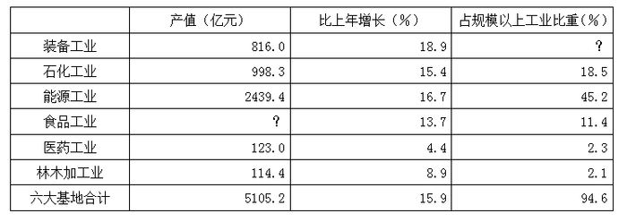

### 第 121 题

根据所给资料，可以得出2006年食品工业总产值是：

A. 582.0亿元

B. 614.1亿元

C. 699.4亿元

D. 705.3亿元

第 121 题 · 答案与解析

**参考答案（粉笔题库参考内容）**

B

**解析**

解析1：

根据图表第一列数值可计算出2006年食品工业总产值为：(5110-110-1000)-(120+2440+820)=4000-3380=620，最接近B项。

解析2：

通过观察到四个选项的尾数各不相同，故此题我们可以采用尾数法解决，故尾数：2-4-0-4-3-0=-9，-9和1为同尾数，对应B项。

故正确答案为B。

**考点**：简单加减计算、统计表

**来源**：2008年黑龙江省公务员录用考试《行测》题第121题

### 第 122 题

根据所给资料，可以得出2006年装备工业总产值占规模以上工业产值的比重是：

A. 15.1%

B. 16.0%

C. 18.9%

D. 20.5%

第 122 题 · 答案与解析

**参考答案（粉笔题库参考内容）**

A

**解析**

解析1：

根据图表第三列数据可得出2006年装备工业总产值占规模以上工业产值的比重为：94.6-2.1-2.3-11.4-45.2-18.5=94.6-(2.1+11.4)-(2.3+45.2+18.5)=94.6-13.5-66=15.1，对应A项。

解析2：

通过观察到四个选项尾数各不相同，故此题可用尾数法解决，尾数为：6-1-3-4-2-5=-9，-9与1尾数相同，对应A项。

故正确答案为A。

**考点**：简单加减计算、统计表

**来源**：2008年黑龙江省公务员录用考试《行测》题第122题

### 第 123 题

根据所给资料，下列表述正确的一项是：

A. 装备工业增加值大于石化工业增加值

B. 医药工业增加值大于林木加工业增加值

C. 能源工业增加值大约是六大基地合计增加值的50%

D. 食品工业增加值大约是六大基地合计增加值的20%

第 123 题 · 答案与解析

**参考答案（粉笔题库参考内容）**

C

**解析**

A项，根据图表中前两列数据可得，装备工业增加值为：，。（备注：因这两个数经实际计算比较接近，因此此处无法使用比较简便的估算方法），错误；

B项，医药工业增加值为：，林木加工业增加值为：，通过观察这两个分数的分母变化幅度影响较小，直接看分子部分，显然123×4.4%＜114.4×8.9%，错误；

C项，能源工业增加值为：，六大基地合计增加值为：，因此能源工业增加值大约是六大基地合计增加值的：，正确；

D项，食品工业增加值为：，食品工业增加值大约是六大基地合计增加值的，错误。

故正确答案为C。

**考点**：统计表、综合分析

**来源**：2008年黑龙江省公务员录用考试《行测》题第123题

### 第 124 题

根据统计资料估算，石化、能源工业总产值占六大基地工业总产值的：

A. 63.7%

B. 64.5%

C. 67.3%

D. 72.5%

第 124 题 · 答案与解析

**参考答案（粉笔题库参考内容）**

C

**解析**

根据表中第一列相关数据可得石化、能源工业总产值占六大基地工业总产值比重为：，最接近C项。

故正确答案为C。

**考点**：统计表

**来源**：2008年黑龙江省公务员录用考试《行测》题第124题

### 第 125 题

根据所给资料推断，下列说法不正确的是：

A. 能源工业总产值占六大基地工业总产值比重最大

B. 能源工业总产值占全省规模以上工业总产值比重最大

C. 装备工业同比增长幅度位于六大基地首位

D. 林木加工业同比增长幅度位于各行业末位

第 125 题 · 答案与解析

**参考答案（粉笔题库参考内容）**

D

**解析**

A选项正确，比较各工业总产值占六大基地工业总产值比重即比较六大工业的产值，通过表中第一列数据可以看到能源工业总产值最大；

B选项正确，通过比较表中第三列数据可得出能源工业总产值占全省规模以上工业总产值比重最大；

C选项正确，D选项错误，通过比较表中第二列数据可得出装备工业同比增长幅度位于六大基地首位，医药工业同比增长幅度位于各行业末位。

本题为选非题，故正确答案为D。

**考点**：统计表、综合分析

**来源**：2008年黑龙江省公务员录用考试《行测》题第125题

## 材料 3

根据下列图表，完成各题。

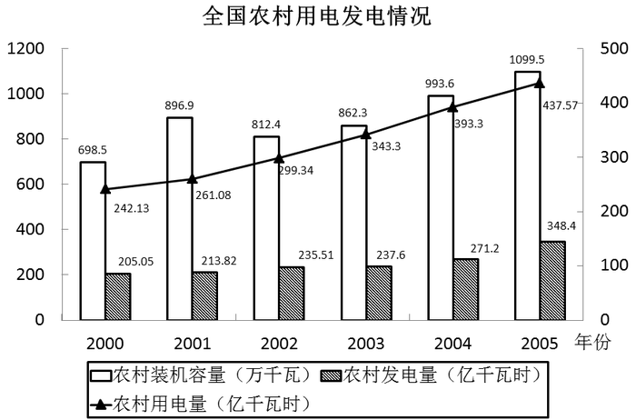

### 第 126 题

2000年至2005年，我国农村发电量占用电量比重最大的年份是：

A. 2000年

B. 2001年

C. 2003年

D. 2005年

第 126 题 · 答案与解析

**参考答案（粉笔题库参考内容）**

A

**解析**

根据题干“2000年至2005年······比重最大的年份”，可判定本题为现期比重问题。定位图表材料可得：2000年至2005年，我国农村发电量和用电量的具体数值。代入公式：比重，可得：2000年比重、2001年比重、2003年比重、2005年比重，2000年比重最大，对应A项。

故正确答案为A。

**考点**：现期比重、统计图

**来源**：2008年黑龙江省公务员录用考试《行测》题第126题

### 第 127 题

与2000年相比，2005年农村装机容量提高了多少：

A. 401万千瓦时

B. 36.5%

C. 57.4%

D. 1.4倍

第 127 题 · 答案与解析

**参考答案（粉笔题库参考内容）**

C

**解析**

根据题干“与2000年相比，2005年······提高了”，结合选项中有三项为百分数或倍数，判定本题为一般增长率问题。定位图表材料可得，2000年农村装机容量为698.5万千瓦，2005年为1099.5万千瓦。代入公式增长量=现期量-基期量，可得：2005年比2000年增加了1099.5-698.5=401万千瓦≠401万千瓦时，单位不一致，排除A项。代入公式：增长率，则2005年比2000年增加了，与C项最接近。

故正确答案为C。

**考点**：一般增长率、统计图

**来源**：2008年黑龙江省公务员录用考试《行测》题第127题

### 第 128 题

在2000至2005年间，下列统计指标增速最快的是：

A. 装机容量

B. 发电量

C. 用电量

D. 发电量占用电量的比重

第 128 题 · 答案与解析

**参考答案（粉笔题库参考内容）**

C

**解析**

根据题干“增速最快”，可判定本题为一般增长率问题。根据本篇材料第1题的计算结果可知，2005年发电量占用电量的比重（79.6%）低于2000年（85.1%），则增长率&lt;0%，排除D项；根据本篇材料第2题可知，2005年农村装机容量比2000年增长57.4%。定位图表材料可得2000年和2005年农村发电量、用电量的具体数值。代入公式：增长率，则发电量增长率、用电量增长率，故用电量增长率最大，对应C项。

故正确答案为C。

**考点**：一般增长率、统计图

**来源**：2008年黑龙江省公务员录用考试《行测》题第128题

### 第 129 题

根据上图，下列关于我国农村用电发电情况的表述，正确的一项是：

A. 2000至2005年间，我国农村装机容量逐年增加

B. 2000至2005年间，我国农村用电量增长了195.44亿千瓦时

C. 2000到2005年间，我国农村发电量越来越能够满足用电量的需求

D. 2000至2005年间，我国农村用电量增速逐年减慢

第 129 题 · 答案与解析

**参考答案（粉笔题库参考内容）**

B

**解析**

A项：定位图表材料，2002年农村装机容量（812.4万千瓦）低于2001年（896.9万千瓦），并非逐年增加，错误；

B项：定位图表材料，2000年我国农村用电量为242.13亿千瓦时，2005年我国农村用电量为437.57亿千瓦时，则2000至2005年间，我国农村用电量增长了437.57-242.13=195.44亿千瓦时，正确；

C项：根据本篇资料第1题可知，2000至2005年间，我国农村发电量占用电量的比重总体呈下降趋势，即不是越来越能满足用电量的需求，错误；

D项：定位图表材料，2000至2005年间每年我国农村用电量，代入公式：增长率，可得2001年增长率、2002年增长率，2001年用电量增速低于2002年，并非逐年减慢，错误。

故正确答案为B。

**考点**：统计图、综合分析

**来源**：2008年黑龙江省公务员录用考试《行测》题第129题

### 第 130 题

根据上图，下列关于我国农村用电发电情况的表述，错误的一项是：

A. 与2004年相比，2005年农村用电量提高了11.26%

B. 我国农村发电量增长速度最慢的年份是2003年

C. 与2001年相比，2002年装机容量下降了10.4%

D. 2005年农村发电量占农村用电量的比重是79.6%

第 130 题 · 答案与解析

**参考答案（粉笔题库参考内容）**

C

**解析**

A项：定位图表材料，可得2004年我国农村用电量为393.3亿千瓦时，2005年我国农村用电量为437.57亿千瓦时，代入公式：增长率，可得2005年比2004年提高了，正确；

B项：定位图表材料，可得2000至2005年间每年我国农村发电量，代入公式：增长率，可得2001年增长率、2002年增长率，2003年增长率，2004年增长率、2005年增长率，2003年的增长速度最慢，正确；

C项：定位图表材料，可得2001年我国农村装机容量为896.9万千瓦，2002年我国农村装机容量为812.4万千瓦，代入公式：增长率，可得2002年比2001年增长率，错误；

D项：根据本篇材料第1题的计算结果可知，2005年农村发电量占用电量比重约为79.6%，正确。

本题为选非题，故正确答案为C。

**考点**：统计图、综合分析

**来源**：2008年黑龙江省公务员录用考试《行测》题第130题

## 材料 4

今年（2008）8月，开始于2003年的农村信用社改革第一阶段工作任务基本完成。截至今年6月末，全国农村合作金融机构(含农村信用社、农村合作银行和农村商业银行)各项贷款余额30841亿元，比改革前的2002年末增长121％；各项存款余额43394亿元，比改革前增长118％。今年上半年实现利润219亿元。全国农村合作金融机构四级分类口径的不良贷款2972亿元，不良率9.6％，分别比改革前降低了2175亿元和27.33个百分点。农信社口径的资本充足率12.24％，比改革前提高了20.69个百分点；历年亏损挂账586亿元，比改革前减少了722亿元，降幅55.6％；农业贷款余额13982亿元，比2002年末增加8403亿元，增长151％，增幅明显高于同期各项贷款增速，农业贷款占各项贷款的比例由2002年末的40％提高到目前的45％。农村商业银行、农村合作银行的资本充足率也已分别达到8.6％和14.6％。我国农村信用社改革取得重要进展和阶段性成果，新的管理体制框架基本确立，历史包袱初步化解，风险状况有所缓解，支农主力军的作用不断得到强化。

### 第 131 题

全国农村合作金融机构农信社口径的资本充足率在2002年末是：

A. －8.45％

B. 12.24％

C. 20.69％

D. 32.93％

第 131 题 · 答案与解析

**参考答案（粉笔题库参考内容）**

A

**解析**

由“农信社口径的资本充足率12.24％，比改革前提高了20.69个百分点”可得全国农村合作金融机构农信社口径的资本充足率在2002年末为：12.24%-20.69%=-8.45%，对应A项。

故正确答案为A。

**考点**：文字资料、简单加减计算

**来源**：2008年黑龙江省公务员录用考试《行测》题第131题

### 第 132 题

2002年末全国农村合作金融机构各项存款余额是：

A. 5579.0亿元

B. 43394.0亿元

C. 12397.8亿元

D. 19905.5亿元

第 132 题 · 答案与解析

**参考答案（粉笔题库参考内容）**

D

**解析**

2002年末全国农村合作金融机构各项存款余额为：，采用直除法可知，首位商1但十分接近于2，对应D项。

故正确答案为D。

**考点**：基期计算、文字资料

**来源**：2008年黑龙江省公务员录用考试《行测》题第132题

### 第 133 题

截至今年6月末，农信社农业贷款余额占全国农村合作金融机构各项贷款余额的：

A. 14.6％

B. 32.2％

C. 45.3％

D. 47.4％

第 133 题 · 答案与解析

**参考答案（粉笔题库参考内容）**

C

**解析**

截至今年6月末，农信社农业贷款余额占全国农村合作金融机构各项贷款余额的比重为：，最接近C项。

故正确答案为C。

**考点**：文字资料、现期比重

**来源**：2008年黑龙江省公务员录用考试《行测》题第133题

### 第 134 题

2002年末全国农村合作金融机构各项存款余额与贷款余额相比较：

A. 多12553亿元

B. 少12553亿元

C. 多5950.3亿元

D. 少5950.3亿元

第 134 题 · 答案与解析

**参考答案（粉笔题库参考内容）**

C

**解析**

2002年末全国农村合作金融机构各项存款余额为；贷款余额为，21500-15000=6500 亿元，最接近C项。

故正确答案为C。

**考点**：基期和差、文字资料

**来源**：2008年黑龙江省公务员录用考试《行测》题第134题

### 第 135 题

根据所给资料推断，下列说法正确的是：

A. 农村信用社改革第一阶段任务基本完成意味着农村合作金融机构已开始赢利。

B. 截至今年6月，全国农村合作金融机构基本消灭了亏损挂账。

C. 全国农村合作金融机构直到今年6月末才实现扭亏为盈。

D. 随着农村信用社改革工作的推进，其服务“三农”的力度也不断增强。

第 135 题 · 答案与解析

**参考答案（粉笔题库参考内容）**

D

**解析**

资料提到，农村信用社农业贷款余额增幅明显高于同期各项贷款增速，农业贷款占各项贷款比例也由40%增加到45%，可见改革后农村信用社对农业的支持力度有所增强，因此推断随着农村信用社改革工作的推进，其服务“三农”的力度也将不断增强，因此推断D选项最合理，正确。而A、B、C三个选项的内容没有足够理由证明，均错误。同时运用常识，根据我国近些年来的政策方针也可以基本推断出D选项是合理的。

故正确答案为D。

**考点**：文字资料、综合分析

**来源**：2008年黑龙江省公务员录用考试《行测》题第135题

