# 2009年黑龙江省公务员录用考试《行测》题（A、B类）

<!-- gwy:overview:start -->
> **黑龙江 · 2009 · 行测 · B类** ｜ 140 题 · 图片 110 处 · 答案随题折叠

| 题型模块 | 题量 | 题号 |
| --- | ---: | ---: |
| 数量关系 | 20 | 1–20 |
| 言语理解与表达 | 40 | 21–60 |
| 判断推理 | 40 | 61–100 |
| 常识判断 | 20 | 101–120 |
| 资料分析 | 20 | 121–140 |
| **合计** | **140** | |

导航：[题型与作答说明](#题型与作答说明) · [题目](#题目) · [材料 1](#材料-1)
<!-- gwy:overview:end -->

> 候选采集稿。参考答案及解析来自粉笔页面，不代表官方答案或真实高分答卷；来源使用许可与原卷对应关系仍需人工核实。

## 题型与作答说明

数量关系

（20题）

本部分包括数字推理与数学运算两种类型的试题。

言语理解与表达

（40题）

本部分包括阅读理解与逻辑填空两种类型的试题。

判断推理

（40题）

本部分包括类比推理、图形推理、定义判断与逻辑判断四种类型的试题。

常识判断

（20题）

根据题目要求，在四个选项中选出一个正确答案。

资料分析

（20题）

所给出的图、表或一段文字均有5个问题要你回答。你应根据资料提供的信息进行分析、比较、计算和判断处理，从四个备选答案中选出符合题意的答案。

## 题目

### 第 1 题

1/2，3/5，8/13，（  ）

A. 13/16

B. 16/21

C. 20/31

D. 21/34

第 1 题 · 答案与解析

**参考答案（粉笔题库参考内容）**

D

**解析**

题干与选项均为分数，考虑分数数列。数列项数较少，分子、分母分开看无规律，考虑一起看。观察分数特征，每一项分数的分子为前一项分数的分子与分母之和，分母为前一项分数的分母与本身的分子之和。则所求项分子为8+13=21，分母为13+21=34，故所求项为21/34。

故正确答案为D。

**来源**：2009年黑龙江省公务员录用考试《行测》题（A、B类）第1题

### 第 2 题

14，24，12，0，（  ）

A. －2

B. －3

C. －5

D. 2

第 2 题 · 答案与解析

**参考答案（粉笔题库参考内容）**

C

**解析**

观察数列，每项周围均有幂次数，考虑幂次修正数列。其中：，，，，其底数为2，3，4，5，是公差为1的等差数列；指数为4，3，2，1，是公差为-1的等差数列；修正项为减去底数本身。故所求项为。

故正确答案为C。

**来源**：2009年黑龙江省公务员录用考试《行测》题（A、B类）第2题

### 第 3 题

274，113，48，17，（  ）

A. 9

B. 11

C. 14

D. 15

第 3 题 · 答案与解析

**参考答案（粉笔题库参考内容）**

C

**解析**

数列变化较快，考虑递推数列。圈三数，找规律。观察前三项发现：，推测数列规律为：，验证其他连续三个数可得：，符合此规律。故所求项为。

故正确答案为C。

**来源**：2009年黑龙江省公务员录用考试《行测》题（A、B类）第3题

### 第 4 题

1/36，1/5，1，3，4，（  ）

A. 8

B. 6

C. 5

D. 1

第 4 题 · 答案与解析

**参考答案（粉笔题库参考内容）**

D

**解析**

数列出现幂次数，考虑幂次数列。观察发现，题干数字分别为：，1/5=5^-1，1=4^0，3=3^1，4=2^2，其底数为6，5，4，3，2，是公差为-1的等差数列；指数为-2，-1，0，1，2，是公差为1的等差数列。故所求项为1^3=1。

故正确答案为D。

**来源**：2009年黑龙江省公务员录用考试《行测》题（A、B类）第4题

### 第 5 题

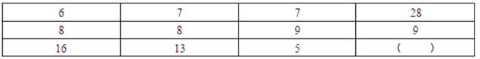

A. 5

B. 17

C. 19

D. 47

第 5 题 · 答案与解析

**参考答案（粉笔题库参考内容）**

C

**解析**

图形数阵，优先考虑横向和竖向规律。观察发现，横向无规律，竖向有：，，，即规律为：每一列的所得到的数字是公差为-1的等差数列，则最后一列满足，故所求项。

故正确答案为C。

**来源**：2009年黑龙江省公务员录用考试《行测》题（A、B类）第5题

### 第 6 题

(100＋99)(100－99)＋(99＋98)(99－98)＋(98＋97)(98－97)＋……＋(2＋1)(2－1)的值是多少：

A. 10100

B. 9999

C. 10000

D. 5050

第 6 题 · 答案与解析

**参考答案（粉笔题库参考内容）**

B

**解析**

根据平方差公式：，可得原式······。

故正确答案为B。

**来源**：2009年黑龙江省公务员录用考试《行测》题（A、B类）第6题

### 第 7 题

甲、乙、丙三辆车的时速分别为60公里、50公里和40公里，甲从A地，乙和丙从B地同时出发相向而行，途中甲遇到乙后15分钟又遇到丙，问A、B两地相距多少公里：

A. 150公里

B. 250公里

C. 275公里

D. 325公里

第 7 题 · 答案与解析

**参考答案（粉笔题库参考内容）**

C

**解析**

设A、B两地相距x公里。根据题意可知甲乙相遇时间+15分钟=甲丙相遇时间，结合公式： ，可列式为，解得x=275，故A、B两地相距275公里。

故正确答案为C。

**考点**：相遇追及

**来源**：2009年黑龙江省公务员录用考试《行测》题（A、B类）第7题

### 第 8 题

有甲、乙两只装满水的圆柱形玻璃杯，杯的内半径分别是5厘米、8厘米，甲杯中此前放一铁块，当取出此铁块时，甲杯中的水位下降了3厘米，然后将此铁块放入乙杯中。

这时乙杯中的水位上升了多少厘米：

A. 4厘米

B. 1厘米

C. 0.5厘米

D. 0厘米

第 8 题 · 答案与解析

**参考答案（粉笔题库参考内容）**

D

**解析**

因为乙杯已经装满水，所以无论加入什么，乙杯的水位都不会发生变化。

故正确答案为D。

**考点**：几何其他题型

**来源**：2009年黑龙江省公务员录用考试《行测》题（A、B类）第8题

### 第 9 题

甲、乙两人从两地出发相向而行，他们在相遇后继续前行。当甲走完全程的70%时，乙正好走完全程的2/3，此时两人相距220米，问两地相距多少米：

A. 330米

B. 600米

C. 800米

D. 1200米

第 9 题 · 答案与解析

**参考答案（粉笔题库参考内容）**

B

**解析**

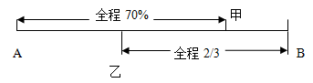

如图所示，设两地相距x米，根据题意可列式：，解得x=600，故两地相距600米。

故正确答案为B。

**考点**：普通行程

**来源**：2009年黑龙江省公务员录用考试《行测》题（A、B类）第9题

### 第 10 题

有40辆汽车，其中30%是货车，其余是轿车。如果有 1/4的轿车是出租车，问不是出租车的轿车有几辆：

A. 7

B. 12

C. 18

D. 21

第 10 题 · 答案与解析

**参考答案（粉笔题库参考内容）**

D

**解析**

由题意得：轿车的数量为，则不是出租车的轿车数目为。

故正确答案为D。

**考点**：和差倍比问题

**来源**：2009年黑龙江省公务员录用考试《行测》题（A、B类）第10题

### 第 11 题

2^2007 + 3^2008 + 4^2009的个位数是：

A. 1

B. 3

C. 7

D. 9

第 11 题 · 答案与解析

**参考答案（粉笔题库参考内容）**

B

**解析**

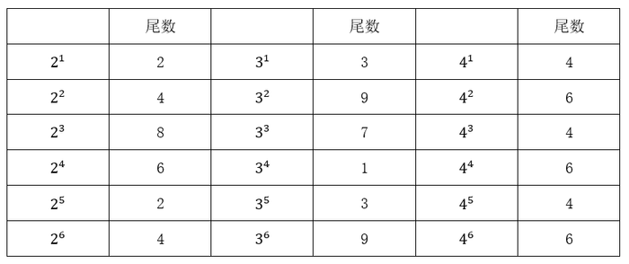

根据表格显示：

2^n尾数的循环周期是4个，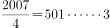，则2^2007的尾数=2^3的尾数，则尾数为8。

3^11尾数的循环周期是4个，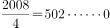，则3^2008的尾数=3^4的尾数，则尾数为1。

4^n尾数的循环周期是2个，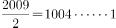，则4^2009的尾数=4^1的尾数，则尾数为4。

则的尾数为8＋1＋4＝13，则尾数为3。

故正确答案为B。

**考点**：周期余数问题

**来源**：2009年黑龙江省公务员录用考试《行测》题（A、B类）第11题

### 第 12 题

一桶农药，加入一定量的水稀释后，浓度为15%；再加入同样多的水稀释，农药的浓度变为12%，若第三次再加入同样多的水，农药的浓度将变为多少：

A. 8%

B. 10%

C. 11%

D. 13%

第 12 题 · 答案与解析

**参考答案（粉笔题库参考内容）**

B

**解析**

由题意知溶质不变，给出浓度，且没有具体量，采用赋值的方法。

赋值浓度15%的溶液的量为100，设每次加水量为X，列表如下：

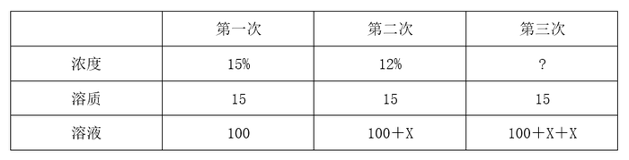

根据公式：浓度=溶质/溶液，则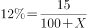，解得X＝25。则第三次加入同样的水，浓度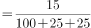=10%。

故正确答案为B。

**来源**：2009年黑龙江省公务员录用考试《行测》题（A、B类）第12题

### 第 13 题

将三盆同样的红花和四盆同样的黄花摆放成一排，要求三盆红花互不相邻，共有多少种不同的方法：

A. 8

B. 10

C. 15

D. 20

第 13 题 · 答案与解析

**参考答案（粉笔题库参考内容）**

B

**解析**

由题干“三盆红花互不相邻”，采用插空法。先将4盆同样的黄花排好，情况数为C_4^4=1种，4盆花产生了5个空，放3盆红花，情况数为C_5^3=10种。则总的情况是1×10＝10种。

故正确答案为B。

**考点**：不相邻问题

**来源**：2009年黑龙江省公务员录用考试《行测》题（A、B类）第13题

### 第 14 题

有人用60元买了一只羊，又以70元的价格卖出去，然后他又用80元的价格买回来，又以90元的价格卖出去，在这只羊的交易中，他盈亏情况是：

A. 赔了10元

B. 收支平衡

C. 赚了10元

D. 赚了20元

第 14 题 · 答案与解析

**参考答案（粉笔题库参考内容）**

D

**解析**

在第一次的买卖中，羊的进价是60元，售价是70元，根据公式：利润＝售价-进价，则第一次羊的利润＝70-60＝10元；同理第二次羊的利润＝90-80＝10元，则两次一共的利润为10＋10＝20元。

故正确答案为D。

**考点**：经济利润问题

**来源**：2009年黑龙江省公务员录用考试《行测》题（A、B类）第14题

### 第 15 题

甲买了3支签字笔，7支圆珠笔和1支铅笔共花了32元，乙买了4支同样的签字笔，10支圆珠笔和1支铅笔共花了43元，如果同样的签字笔、圆珠笔、铅笔各买一支，共用多少钱：

A. 10元

B. 11元

C. 17元

D. 21元

第 15 题 · 答案与解析

**参考答案（粉笔题库参考内容）**

A

**解析**

方法一：设每支签字笔a元，每支圆珠笔b元，每支铅笔c元，根据题意可得：3a＋7b＋c＝32······①，4a＋10b＋c＝43······②。本题为不定方程组，可以选择配系数的方法，则①×3-②×2，整理得到：a＋b＋c＝10元。

方法二：设每支签字笔a元，每支圆珠笔b元，每支铅笔c元，根据题意可得：3a＋7b＋c＝32·····①，4a＋10b＋c＝43·····②。本题为不定方程组且钱数不一定为整数，则用赋零法，令b＝0，代入原式①和②中得到：3a＋c＝32，4a＋c＝43，联立解得a＝11，c＝-1。则签字笔、圆珠笔、铅笔各买一支，共用11＋0-1＝10元。

故正确答案为A。

**来源**：2009年黑龙江省公务员录用考试《行测》题（A、B类）第15题

### 第 16 题

某手机商从刚刚卖出去的一部手机中赚到了10%的利润，但如果他用比原来进价低10%的价钱买进，而以赚20%利润的价格卖出，那么售价减少25元。请问这部手机卖了多少钱：

A. 1250元

B. 1375元

C. 1550元

D. 1665元

第 16 题 · 答案与解析

**参考答案（粉笔题库参考内容）**

B

**解析**

设手机原来进价为a元，由进价、利润率和售价的关系，列表如下：

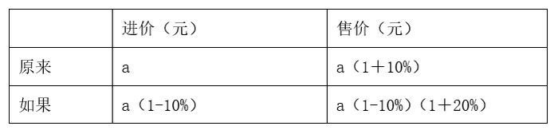

根据“售价减少25元”，列方程：a(1＋10%)-a(1-10%)(1＋20%)＝25，解得a＝1250，则这部手机卖了元。

故正确答案为B。

**考点**：经济利润问题

**来源**：2009年黑龙江省公务员录用考试《行测》题（A、B类）第16题

### 第 17 题

某项工作，甲单独做要18小时完成，乙要24小时完成，丙需要30小时才能完成。现按甲、乙、丙的顺序轮班做，每人工作一小时后换班。问当该项工作完成时，乙共做了多长时间？

A. 7小时44分

B. 7小时58分

C. 8小时

D. 9小时10分

第 17 题 · 答案与解析

**参考答案（粉笔题库参考内容）**

A

**解析**

设工作总量为360，已知甲单独做要18小时完成，乙要24小时完成，丙需要30小时才能完成，则甲、乙、丙的工作效率分别为、、，由此甲、乙、丙循环一轮共完成工作量为20+15+12=47。而，也即完成该工程，轮换工作7轮后，还剩余31。接下来轮到甲工作，完成20，还剩11，乙完成此11份工作量不足一小时，分钟，则乙在之前三人轮换中完整参与7轮共7小时，最后又参与了44分钟，因此乙共做了7小时44分。

故正确答案为A。

**考点**：周期余数问题、给完工时间型

**来源**：2009年黑龙江省公务员录用考试《行测》题（A、B类）第17题

### 第 18 题

小强前三次的数学测验平均分是88分，要想平均分达到90分以上，他第四次测验至少要得多少分：

A. 98分

B. 92分

C. 93分

D. 96分

第 18 题 · 答案与解析

**参考答案（粉笔题库参考内容）**

D

**解析**

前三次的数学测验平均分是88分，前三次的总分为分。要想四次测验的平均分达到90分以上，则需要总分分以上，由此得到第四次测验至少要360-264＝96分。

故正确答案为D。

**考点**：非典型最值问题

**来源**：2009年黑龙江省公务员录用考试《行测》题（A、B类）第18题

### 第 19 题

一座楼房有8层，分为4个单元，每个单元第一层和第八层各住2户，第二层到第七层各住3户，这座楼房一共可以住多少户：

A. 88

B. 90

C. 94

D. 96

第 19 题 · 答案与解析

**参考答案（粉笔题库参考内容）**

A

**解析**

一个单元可住的人数为：2×2＋3×6＝22户，则这座楼房4个单元的总户数为：22×4＝88户。

故正确答案为A。

**考点**：和差倍比问题

**来源**：2009年黑龙江省公务员录用考试《行测》题（A、B类）第19题

### 第 20 题

已知每公斤色拉油8元，一桶色拉油连桶共重5.5千克，油用去一半后，连桶还重3千克，问这桶油价值多少元：

A. 20元

B. 30元

C. 40元

D. 44元

第 20 题 · 答案与解析

**参考答案（粉笔题库参考内容）**

C

**解析**

由题意，油的一半重量为：5.5-3＝2.5千克，则一桶油的重量为2.5×2＝5千克，又因每公斤油8元，则这桶油价值为5×8＝40元。

故正确答案为C。

**考点**：和差倍比问题

**来源**：2009年黑龙江省公务员录用考试《行测》题（A、B类）第20题

### 第 21 题

美联储为了解决美国储蓄量不足的问题，维持美国经济运转，利用美元作为国际储备货币的特殊地位大量发行美元。美国用这种方法来投资，维持很高的生活水平，但造成了世界范围内的流动性泛滥。美元发行过度导致美元贬值，贬值的损失由所有持有美元的国家来承担，然后再来做强美元，损失就实现了转嫁。美国的有识之士认为，美国的这种做法不仅会害了自己还会害了世界。

对这段文字概括最恰当的一项是：

A. 美联储为了维持美国经济运转而大量发行美元

B. 美联储大量发行美元的措施将会导致美元贬值

C. 美元的过量发行会造成流动性泛滥影响世界经济

D. 美国加大发行量来维护美元国际储备货币的特殊地位

第 21 题 · 答案与解析

**参考答案（粉笔题库参考内容）**

C

**解析**

根据提问标志词“概括”可知本题为中心理解题。

材料首先指出美国依靠大量发行美元来解决本国储蓄量不足的问题，然后又提出这种做法所造成的影响，即美元发行过度对美国、对世界都有害。由转折关系词“但”可知，整个材料的语意重点是其后的内容，即美元的过量发行造成流动性泛滥，对世界经济产生负面影响。

因此，结合选项应该选择C，因为C项表述最为全面准确。

其他三项表述都过于片面，没有抓住材料的语意重点。

故正确答案为C。

**考点**：关联词-转折

**来源**：2009年黑龙江省公务员录用考试《行测》题（A、B类）第21题

### 第 22 题

我国的传统文化强调集体，拒绝正式承认个人的主体性。传统社会的礼治秩序，本质上是主张取消个性、主体性、否认个人独立利益的，个人只能按照一定的“名分”来履行责任义务。这一秩序塑造的是处于服从地位的“臣民”，而非法律意义上享有权利的“公民”。上世纪80年代以来进行的劳动人事制度改革，是要实现人由“单位人”向“社会人”过渡的目标。这一“人的社会化”过程，既是我国经济改革的重要成果，也是我国社会发展进步的一个重要标志。它意味着个人自由的增加和社会结构的优化。

对这段文字概括最恰当的一项是：

A. 强调集体、拒绝个人的主体性是我国传统文化的重要标志

B. 劳动人事制度改革是我国经济改革和社会进步的一个重要标志

C. “人的社会化”过程是个人自由增加和社会结构优化的重要标志

D. 由“臣民”到“公民”的转变是我国劳动人事改革的重要标志

第 22 题 · 答案与解析

**参考答案（粉笔题库参考内容）**

C

**解析**

文段开篇交代背景，即我国传统文化强调集体、否认个人的主体性，接着论述了传统礼治秩序塑造的是“臣民”而非法律意义上享有权利的“公民”，之后指出上世纪80年代以来的劳动人事制度改革旨在实现人由“单位人”向“社会人”的过渡，并通过“这”强调“人的社会化”过程是我国经济改革的重要成果，也是社会发展进步的重要标志，最后通过“它”总结前文，强调“人的社会化”过程的重要价值，即个人自由的增加和社会结构的优化，对应C项。

A项，“强调集体，拒绝个人的主体性”为文段开篇背景引入部分内容，非重点，排除；

B项，文段主题词为“人的社会化”，缺少文段核心话题，且文中介绍“劳动人事制度改革”是“经济改革”的“成果”而非“标志”，排除；

D项，文段并未论述“臣民”到“公民”的转变是我国劳动人事改革的重要标志，无中生有，且偏离文段中心，排除。

故正确答案为C。

【文段出处】解放日报《中国改革开放30年法治建设：“私人空间”概念形成》

**考点**：主题词、关联词-因果、分述句特征-引入铺垫

**来源**：2009年黑龙江省公务员录用考试《行测》题（A、B类）第22题

### 第 23 题

尽管从国民经济总量的比重上看，农业所占的比重低于第二、第三产业，但对于一个农业人口占全国人口80%的发展中大国来说，无粮不稳。没有广大农民的普遍小康，没有农村经济的繁荣发展，整个国家发展进步的基础就会不稳，实现全面小康和高水平小康的战略目标就会成为无源之水、无本之木。农业和农村经济的发展，事关改革开放大局，在这个根本问题上不能只算GDP贡献率一本账，更要算改革发展稳定全局这本大账。

这段文字着重强调的内容是：

A. 农业的基础地位

B. 农村的经济发展

C. 农民的生活质量

D. 农村的社会稳定

第 23 题 · 答案与解析

**参考答案（粉笔题库参考内容）**

A

**解析**

根据提问方式可以判断出本题为中心理解题。

由转折关系词“但”可知，整个材料的语意重点是其后的内容。前面先说产业上的数据，转折后说明数据并不能代表一切，从农业人口、农村经济等方面说明农业在社会上的地位，整个文字既涉及农村经济又提到稳定，整段话是对农业基础地位的说明。

因此，结合选项应该选择A。

B、D两项错误，题干中只是部分涉及，非重点，C项题干中并未涉及，均排除。

故正确答案为A。

**考点**：关联词-转折

**来源**：2009年黑龙江省公务员录用考试《行测》题（A、B类）第23题

### 第 24 题

新闻不仅是报道中每一个要素都符合客观实际，更重要的是新闻报道能给读者构建一个能正确认识该新闻事件本来面目的框架。无论是以镜头为信息载体的电视新闻，还是以文字为传播手段的报纸新闻都是结构事件的元素，通过一个个镜头或者一个个文字、词语按照特定顺序的组合形成对事件整体描述的框架。但是，叙事结构告诉我们，不同的组合能产生不同的意义。犹如田忌赛马一样，调整顺序也能产生质的飞跃，这也是马克思主义哲学中量变到质变的第二种形式。

这段文字意在说明：

A. 新闻真实的实现有赖于受阅者的认识、理解

B. 新闻的真实有赖于新闻主宰者——记者的把握

C. 新闻内部要素的完全真实并不能代表这条新闻的完全真实

D. 新闻报道的叙事结构同样影响着新闻事件的真实性

第 24 题 · 答案与解析

**参考答案（粉笔题库参考内容）**

D

**解析**

由提问标志词“意在”可知本题为中心理解题。

通过转折关系词“但是”可以判断出整则材料的语意重点是其后的内容，即镜头、文字、词语等结构元素的不同组合会产生不同的意义，由此影响到新闻事件的真实性。

因此，结合选项应该选择D。

A项强调受阅者的重要性，不是文段重点；B项没有提及；C项为干扰项，文段没有讨论新闻内部要素真实性的问题，而是说叙事结构的改变会带来质的飞跃，影响新闻的真实性。

故正确答案为D。

**考点**：关联词-转折

**来源**：2009年黑龙江省公务员录用考试《行测》题（A、B类）第24题

### 第 25 题

不少学生的家长都让自己的孩子参加过各种形式的学校举办的假期补习班，明明是正常教学时间里上的课，却偏偏要挪到假期时间来补习，而且收取的费用相当可观，学生们不去还不行。这种行为虽然与“有偿家教”无涉，但却是典型的“利用职务之便谋取私利”的行为。对这样恶劣的乱收费行为，地方教育部门本身就睁一只眼闭一只眼。试问，教育部门出台的新“师德规范”能规范得了吗？

这段文字表达的主要内容是：

A. 各种形式假期补习班大大增加了学生的学业负担

B. 新“师德规范”无法完全杜绝五花八门的“有偿家教”

C. 地方教育部门对乱办补习班、乱收费行为的无视

D. 当代教育方式仍然以应试为导向，而非素质教育

第 25 题 · 答案与解析

**参考答案（粉笔题库参考内容）**

B

**解析**

根据提问知本题为中心理解题。

材料属于分－总结构，材料首先描述了“补习班”的现状，由此引出地方教育部门的纵容，进而质问教育部门的新“师德规范”。材料由“补习班”层层推进，最终落脚点指向教育部门的新“师德规范”，最后一句反问进行总结。

因此，结合选项应该选择B。

A项只是描述现象；C项不是材料的观点，且“补习班”现象不仅是应试教育的折射；D项没有抓住根本，材料的最终指向是教育部门的新“师德规范”，而非素质教育。

故正确答案为B。

**考点**：分述句特征-引入铺垫

**来源**：2009年黑龙江省公务员录用考试《行测》题（A、B类）第25题

### 第 26 题

汶川地震一开始测定是7.8级，过了两三天之后，修订为8.0级，这是因为地震以后我们获取的地震记录资料不断增多，不仅是国内的，国际上的各方面地震资料也不断增多。至于各个国家测定的震级有差别，其中一个原因是由于各个国家所用的地震台网观测资料存在差别；另一个原因是地震震级还有很多不同的类型，我们现在测的里氏8.0级是面波震级，还有利用破裂的错动量和破裂长度等来测定的。类型不同，给出的数字也有一些差别。这也是不同的国家对同一个地震给出的震级有差别的原因。

根据以上文字，汶川地震修订为8.0级的主要原因是：

A. 各个国家所用的地震台网观测资料的差别

B. 利用破裂的错动量和破裂长度等来测定的

C. 我国地震测量技术逐步与国际先进水平相接轨

D. 我们获取的地震记录资料的增多使得测定更准确

第 26 题 · 答案与解析

**参考答案（粉笔题库参考内容）**

D

**解析**

根据提问知本题为细节判断题。

定位材料，从“这是因为······”可以总结出修订原因：地震后获取的地震记录资料不断增多。材料其余部分则是在分析不同国家对同一地震给出的震级有差别的原因。

因此，结合选项应该选择D。

题干中只是提到“各国所用地震台网观测资料存在差别”，并未说明具体差别是什么，所以A错误；B只是文段中提到的一个点而已，并非主要原因；C项并未涉及。

故正确答案为D。

**考点**：细节判断题

**来源**：2009年黑龙江省公务员录用考试《行测》题（A、B类）第26题

### 第 27 题

空中的微粒能分散照射进来的阳光，这就是为何晴朗的天空是蓝色的原因。日落表现为微红色，这是因为太阳光线穿越了长距离的大气路程，因而只有波长更长的红光可以到达我们的跟前。这些细微的火山灰被火山喷射到了大气的同温层，之后随风向全球各地扩散。由火山喷射出来的二氧化硫能在大气中发生反应，形成硫酸盐浮质。这种独特的硫酸盐浮质可以通过对阳光设置更多的穿透障碍来增强这种效果，从而使日落显得格外的红。

以上文字主要说明的问题是：

A. 空中的微粒能分散照射进来的阳光，使得晴朗的天空呈现蓝色

B. 火山喷射出来的二氧化硫能在大气中发生反应，形成硫酸盐浮质

C. 只有太阳光线中波长更长的红光可以穿越长距离到达我们的跟前

D. 由于火山爆发喷射物形成的独特硫酸盐浮质致使日落显得格外的红

第 27 题 · 答案与解析

**参考答案（粉笔题库参考内容）**

D

**解析**

根据提问标志词“主要说明”可知本题为中心理解题。

开头引入话题“日落”之红色，进而解释原因，最后“从而”一词点出重点所在“硫酸盐浮质增强红色效果”。

因此，结合选项应该选择D。

A、B、C三项表述都过于片面，没有抓住材料的语意重点，均排除。

故正确答案为D。

**考点**：关联词-因果

**来源**：2009年黑龙江省公务员录用考试《行测》题（A、B类）第27题

### 第 28 题

著名物理学家霍金是“太空移民”理论的倡导者，他认为：“地球生命被某一灾难消灭的危险正以前所未有的速度与日俱增，如突如其来的全球变暖、核战争、基因病毒或其他危险。”霍金的观点并不新颖，但我们必须承认他的观察是正确的。与其他体积一样大小的星球相比，地球所拥有的适合居住的表面区域较小，可供我们居住的面积少得可怜。

作者的主要观点是：

A. 地球所拥有的适合居住的表面区域太小，抵御毁灭性灾难的能力差

B. 如突如其来的全球变暖、核战争、基因病毒或其他危险威胁人类

C. 如果人类不能及时移民至其他星球，难免会被某一灾难消灭

D. 地球生命被某一灾难消灭的危险正以前所未有的速度与日俱增

第 28 题 · 答案与解析

**参考答案（粉笔题库参考内容）**

A

**解析**

据提问知此题属于中心理解题。

本文段引用霍金话语，提出地球正面临灾难的迫近，作者对此表示赞同，同时又补充了人类居住区域的问题。综合而言，即人类狭小的居住区域太小，不能抵御毁灭性灾难。重点在于文段的后半部分，“霍金观点并不新颖，但观察正确”之后的评价部分。

因此，结合选项应该选择A，因为A项是主旨的同意转换。

B、D表述的只是霍金的观点，没有体现出作者的观点，予以排除；C项错误，在材料中没有体现。

故正确答案为A。

**考点**：关联词-转折

**来源**：2009年黑龙江省公务员录用考试《行测》题（A、B类）第28题

### 第 29 题

中秋节前一天是周六，我们都休息就把她接回自己家。她那天有点闹，不吃也不睡，可能被什么吓到了。她胆子特小，怎么哄都哄不好。丈夫其实在要孩子之前是不喜欢小孩的，所以有点烦。在给她洗澡的时候，我忘了关窗了，于是他就大声的对我吼：“连窗户也不关，想冻死她啊？”

文中的“她”与作者最可能的关系是：

A. 母女

B. 父女

C. 师生

D. 夫妻

第 29 题 · 答案与解析

**参考答案（粉笔题库参考内容）**

A

**解析**

由文中的“丈夫”说明作者是“妻子”，再根据文中表述说“要小孩之前”，说明“她”是一个女孩，是作者的女儿，即作者与她之间是母女关系。

因此，结合选项应该选择A。

材料中提到丈夫了，所以就不可能再是父女的关系；C项师生关系，没有任何依据；D项夫妻关系的判断也有误。

故正确答案为A。

**考点**：主题词

**来源**：2009年黑龙江省公务员录用考试《行测》题（A、B类）第29题

### 第 30 题

半坡遗址是新石器时代仰韶文化的典型，以红质黑纹的彩陶为其特征。其后的龙山文化，则以薄质紧硬的黑陶为其特征。半坡彩陶上每每有一些类似文字的简单刻画和器物上的花纹判然不同。黑陶上也有这种刻画，但为数不多。我国后来的器物上，无论是陶器、铜器或者其他成品，有“物勒工名”的传统，特别是殷代的青铜上有一些表示族徽的刻画文字和这些符号极相类似。由后以例前，也就如由黄河下游以溯源于星宿海，彩陶上的那些刻画记号，可以肯定地说就是中国文字的起源，或者中国原始文字的孑遗。

在本文中“由后以例前”中的“后”是指：

A. 龙山文化中的黑陶花纹

B. 殷代青铜上的表示族徽的刻画文字

C. 半坡遗址中彩陶上类似文字的简单刻画

D. 仰韶文化彩陶上的花纹

第 30 题 · 答案与解析

**参考答案（粉笔题库参考内容）**

B

**解析**

要确定“后”所指代的内容，要由近及远寻找，在“后”字前后找相关的内容。根据文中的“我国后来的器物上······特别是殷代的青铜上······”及“由后以例前”中的“例前”和后面列举的例子可以判断，“后”指代的是殷代青铜上一些表示族徽的刻画文字。

故正确答案为B。

**考点**：代词

**来源**：2009年黑龙江省公务员录用考试《行测》题（A、B类）第30题

### 第 31 题

今年80岁的赵振华一出场，就迎来了满堂喝彩，她打扮时尚，戴着新潮的太阳镜，满头的白发烫成一个个大花卷，脸上轻施脂粉，还抹了红红的口红，简直就是一个时尚丽人。为保持一个好的体形，赵奶奶也减过肥，只不过不是节食，而是通过锻炼，每天要穿着高跟鞋快步走上一两个小时，晚上还要躺在床上练瘦身操。“你看看我的鞋吧。”赵奶奶得意地抖抖自己的脚，我们惊讶地看到，穿在她脚上的是一双白色的高跟鞋，后跟高达10厘米。现在，赵奶奶的“猫步”已经很专业了，是名副其实的“台柱子”。

下列表述最符合上述文字主题的一项是：

A. 赵奶奶虽年事已高，但身体健康，且对模特表演乐此不疲

B. 时下，参加老年模特队是中老年人较为偏爱的一种运动形式

C. 穿高跟鞋、上T台、当模特已经不再是年轻人的专利

D. 对于中老年人，每天进行适当的运动是保持健康的良方

第 31 题 · 答案与解析

**参考答案（粉笔题库参考内容）**

A

**解析**

A项正确，文章中只围绕着赵奶奶一人进行叙述，打扮、装束、包括走台步等都是对其个人的论述，所以答案主语也应该是赵奶奶。

B项属于文段的推论，但不是文段的主题；C项由一人扩展到所有人，典型的以偏概全，错误；D项过度引申，予以排除。

故正确答案为A。

**考点**：细节判断题

**来源**：2009年黑龙江省公务员录用考试《行测》题（A、B类）第31题

### 第 32 题

今年国庆假期，虽然北京郊区不少项目的价格调整幅度已经很大，但多数购房者认为，降价房源的品质普遍较差，区域位置也不理想。持币待购者普遍认为，五环内房价下跌才刚刚开始，本来的房价还将回调，与其现在购买格局不太理想、位置较偏的房产，倒不如再等一段时间，等房价回调到位，再以可以接受的价格选择自己满意的商品房。

对上述文字理解最正确的一项是：

A. 北京市五环以外的商品房品质普遍较差，位置较偏远

B. 黄金周期间，北京并没有出现地产商期待的成交回暖

C. 购房者对于北京的房价继续走低抱有较为坚定的信心

D. 北京郊区的房价将在未来的很长一段时间内持续低迷

第 32 题 · 答案与解析

**参考答案（粉笔题库参考内容）**

C

**解析**

根据提问知本题为细节判断题。

C项正确，持币待购者普遍认为房价才开始下跌，说明他们对于房价继续走低持乐观态度。

A项错误，过于绝对化，题干中提到的房价下降是购房者的猜测，不能由此得出“五环以外的商品房品质普遍较差，位置较偏远”如此肯定的结论；

B项错误，成交量是否回暖的判断，需要成交量数据，而题干并没有提及；

D项错误，它是文中不相干观点的不当组合。

故正确答案为C。

**考点**：细节判断题

**来源**：2009年黑龙江省公务员录用考试《行测》题（A、B类）第32题

### 第 33 题

欧洲粒子物理研究所近日在地下通道启动了大型强子对撞机，由此拉开高速粒子对撞系列实验、探索宇宙起源之谜的序幕。然而，从实验一开始，外界便遍布各种危言耸听的“世界末日论”，有的说实验可能产生黑洞，片刻间吞噬地球，还有的说实验将诱发奇异粒子，引发一连串的灾难性反应。实际上，在其他几个粒子物理学实验启动，甚至是第一次核武器实验之前，世界上也充斥着类似的末日预言。而人类早在数千年前就预测世界末日会到来，可是，这些预言一个接一个地被证实是谎言。

对这段文字概括最恰当的一项是：

A. 粒子物理学实验的启动，以及每一次核武器实验都具有毁灭世界的风险

B. 欧洲粒子物理研究所的大型强子对撞实验拉开了探索宇宙起源之谜的序幕

C. 事实证明，每一次粒子物理学实验启动之前的世界末日预言都是不成立的

D. 在每一次物理学实验启动之前，世界上总是充斥着各种各样的世界末日预言

第 33 题 · 答案与解析

**参考答案（粉笔题库参考内容）**

C

**解析**

根据提问标志词“概括”可知本题为中心理解题。

这一文段通过归纳推理得出结论，由大型强子对撞机实验打破了实验开始之前的“世界末日论”的谎言，得出其他类似的情况。本文段中，“然而”、“实际上”、“而”、“可是”这些转折词语无一不在证实末日预言的荒谬。

因此，结合选项应该选择C。

A项属于主观推测，不合文意；B项不是文段所讲的中心内容；D项只是说每一次粒子实验启动之前，世界上会充斥各种世界末日的预言，但并没有指出这些预言最终被证实是谎言，表述片面，予以排除。

故正确答案为C。

**考点**：关联词-转折

**来源**：2009年黑龙江省公务员录用考试《行测》题（A、B类）第33题

### 第 34 题

天气预报一般要考虑气温、气压、温度、风力等因素，这些都是大气层本身变化的结果，只要掌握这些因素，通过计算机的计算就能准确地预报天气变化的趋势。沙尘暴作为一种特殊的天气现象，同样要考虑上述气象因素。据气象学家分析，强冷空气带来的大风天气、前期干旱少雨、气温回升是形成沙尘暴的必要天气条件。但是，除此之外，“沙尘”恶魔的现身还需要一些其他特殊条件。悬浮在空气中的沙尘来自地表，地表的情况直接影响沙尘暴的发生。

这段文字主要说明的内容是：

A. 天气预报要考虑的各种因素

B. 沙尘暴的形成原因复杂且特殊

C. 沙尘暴形成的必要天气条件

D. 沙尘暴是一种特殊的天气现象

第 34 题 · 答案与解析

**参考答案（粉笔题库参考内容）**

B

**解析**

根据提问标志词“主要说明”可知本题为中心理解题。

题干通过比较沙尘暴预报与普通天气预报考虑的不同因素，说明沙尘暴要考虑的因素比较多且复杂，因而预报的难度也高。

因此，结合选项应该选择B。

题干中的重点主语是沙尘暴，所以并不是天气预报要考虑的各种因素，A不正确；C、D项表述片面，没有抓住材料语意重点，因此排除。

故正确答案为B。

**考点**：主题词、关联词-转折

**来源**：2009年黑龙江省公务员录用考试《行测》题（A、B类）第34题

### 第 35 题

近两年来，随着国际市场能源资源性产品价格的持续大幅上涨，制造业的生产成本不断抬高，使得国际市场竞争激烈的各类制成品价格也开始逐步上升，价格上涨开始从上游向下游传递。与此同时，国际商品市场价格上涨也开始向各国传递，特别是能源和农产品价格大幅上涨对各国消费价格指数逐步产生明显的上升推动作用。

这段文字强调的是：

A. 国际商品市场价格上涨开始向各国国内传递

B. 价格上涨开始从制造业上游向下游传递

C. 制造业的生产成本对各国消费价格指数的影响

D. 国际市场能源资源性产品价格对国内消费价格的影响

第 35 题 · 答案与解析

**参考答案（粉笔题库参考内容）**

D

**解析**

根据提问可知本题为中心理解题。

材料的主要结构为：国际市场能源资源性产品价格的持续大幅上涨······使得······与此同时······特别是······“与此同时”虽表明并列关系，但之后的“特别是”属于程度词，说明主旨应该为程度词“特别是”后面的内容，结合选项，D项能与之对应。

A、B、C项都是程度词之前的内容，非重点，排除。

故正确答案为D。

**来源**：2009年黑龙江省公务员录用考试《行测》题（A、B类）第35题

### 第 36 题

正统的解释认为缠脚是一种控制妇女的方法，是封建统治者所愿意看到的。从理论上说是没错，但是，缠脚从它最初发生到缠脚小到三寸，有个很长的过程，像宋朝那样只是把脚稍缠得瘦点，不可能对妇女有什么限制。缠脚使妇女便于被控制，有利于黑暗制度的稳定之类的言论，应该是这种极端的病态式缠脚普及之后才产生的。

这段文字的主要观点是：

A. 缠脚从最初出现到缠脚小到三寸，经历了一段很长的历史时期

B. 缠脚是封建统治者创造出来用于控制妇女、加强皇权的残酷政令

C. 缠脚现象的出现和发展，或许是古代妇女某种习俗的病态演变

D. 缠脚最初出现的真正原因可能不是作为封建统治者控制妇女的一种方法

第 36 题 · 答案与解析

**参考答案（粉笔题库参考内容）**

D

**解析**

根据提问标志词“主要观点”可知本题为中心理解题。

由转折关系词“但是”可以推断出，整个材料的语意重点是其后的内容，即最初的缠脚只是要把脚稍缠得瘦点，并不会对妇女有什么限制，缠脚便于控制妇女这种言论是在之后出现的。

因此，结合选项应该选择D。

A项表示只是材料的细节，而非主旨；B项是作者一开始就反对的观点，与文意相违背；C项在材料中没有体现。

故正确答案为D。

**考点**：关联词-转折

**来源**：2009年黑龙江省公务员录用考试《行测》题（A、B类）第36题

### 第 37 题

生态文明是在生态危机日益严重的背景下，在对人的活动意义进行深刻反思之后提出的文化变革目标。早在19世纪，恩格斯在《自然辩证法》一书中就作出了警惕自然界报复的预言，并且说：“只有一个在其中有计划地进行生产和分配的自觉的社会生产组织，才能在社会关系方面把人从其余的动物中提升出来，正像一般生产曾经在物种关系方面把人从其余的动物中提升出来一样。”根据历史唯物主义的理论及生态问题生产的实际领域，生态文明应当是物质文化的进步状态，与农业文明和工业文明构成一个逻辑序列。

这段文字的主要内容是：

A. 生态问题其实就是人与自然的关系问题，生态问题与社会问题紧密相关

B. 生态破坏的社会根源是社会生产组织并未自觉、有计划地进行生产和分配

C. 生态文明的建设，其实就是加强环境保护，促进人与自然和谐

D. 要解决生态文明的建构问题，还得回到《自然辩证法》的基本立场上去

第 37 题 · 答案与解析

**参考答案（粉笔题库参考内容）**

A

**解析**

根据提问知本题为中心理解题。

“早在······就······”这句说的是前一句的内容恩格斯已经提及，后文用递进词“并且”引出其观点，重点就在引言中：“把人从其余的动物中提升出来”说明人与自然的关系，“有计划地进行生产和分配的自觉的社会组织”说明的是社会问题。综合而言，生态问题就是人和自然的关系，且与社会问题紧密相关。

因此，结合选项应该选择A。

B项错误，“只有······才······”说的是处理好社会生产组织是必要条件，不等于是根源；C项不是材料观点；D项过度推论，不是材料观点。

故正确答案为A。

**考点**：主题词

**来源**：2009年黑龙江省公务员录用考试《行测》题（A、B类）第37题

### 第 38 题

美国科学家在一海底河床表面发现了一些古生物的足迹化石，经考证，留下这些足迹的生物距今5.7亿年，这把世界上最早的有腿生物生活的年代向前推进了3000万年。科学家们曾经以为，在寒武纪之前地球上主要存在的可能仅仅是一些微生物以及一些简单的单细胞动物。地球科学教授Loren Baboc 表示：“我们一直都在研究在埃迪卡拉纪时期出现复杂生物如软珊瑚、节肢动物以及扁虫的可能性，但所得到的研究证据都不具有足够的说服力。但当我们发现了像这种利用腿走路的动物化石足迹后，该项推测的可能性就大大被提高了。”

根据这段文字，下列推断正确的一项是：

A. 科学家们认为，在寒武纪之前地球上不可能存在生物

B. 可以肯定，5.7亿年前的有腿生物生活在海底水世界

C. 埃迪卡拉纪时期比寒武纪时期距离今天的时间更久远

D. 在此之前，对有腿生物的研究仅限于微生物及单细胞动物

第 38 题 · 答案与解析

**参考答案（粉笔题库参考内容）**

C

**解析**

C选项正确，材料中说科学家曾认为在寒武纪之前地球上可能只有一些微生物和简单的单细胞动物，他们一直在研究埃迪卡拉纪时期出现复杂生物的可能性，由此可知埃迪卡拉纪时期出现在寒武纪之前。

A项错误，文段中是说“科学家们曾经以为，在寒武纪之前主要存在的可能仅仅是一些微生物以及一些简单的单细胞动物”，而不是“不可能存在生物”；B项“一海底河床”是指现在的海底河床，根据地质变化的规律，现在的河床可能是以前的高山，故B项错误；D项错误，文中并没有提及在此之前有关有腿生物的研究的内容。

故正确答案为C。

**考点**：细节判断题

**来源**：2009年黑龙江省公务员录用考试《行测》题（A、B类）第38题

### 第 39 题

摩根士丹利预计，今年全球汽车销量将下滑0.3%至5810万辆，年初的预计为同比上升3.5%。这也将是全球汽车市场总销量自2001年以来的首度下降。摩根士丹利还指出，中国今年仍将是全球汽车销量增长的主要贡献者，但是该市场竞争将开始加剧，且增长已经开始小幅度放缓。不久前，马自达公司把在中国合资企业的小型车销售目标缩减了一半，承认最初目标设定太高。而丰田汽车在中国的目标今年也很难实现。中国本土汽车企业最多减少的销售目标也达到30%以上。

根据这段文字，下列表述错误的一项是：

A. 摩根士丹利对今年全球汽车销量的走势预测由年初的上升调整为下滑

B. 今年将是全球汽车市场总销量自2001年以来首次出现下降的一年

C. 中国今年仍将是全球汽车消费的主要贡献者，但是会出现销量负增长

D. 中国本土汽车企业和部分合资汽车企业一样，都开始减少销售目标

第 39 题 · 答案与解析

**参考答案（粉笔题库参考内容）**

C

**解析**

A项，根据“摩根士丹利预计，今年全球汽车销量将下滑0.3%至5810万辆，年初的预计为同比上升3.5%”可知，表述正确，排除；

B项，根据“这也将是全球汽车市场总销量自2001年以来的首度下降”可知，表述正确，排除；

C项，根据“中国今年仍将是全球汽车销量增长的主要贡献者，但是······增长已经开始小幅度放缓”，“增长放缓”并不等同于“负增长”，偷换概念，当选；

D项，根据“马自达公司把在中国合资企业的小型车销售目标缩减了一半，承认最初目标设定太高。而丰田汽车在中国的目标今年也很难实现。中国本土汽车企业最多减少的销售目标也达到30%以上”可知，表述正确，排除。

本题为选非题，故正确答案为C。

**考点**：细节判断题

**来源**：2009年黑龙江省公务员录用考试《行测》题（A、B类）第39题

### 第 40 题

美貌的人并不都有其他方面的才能。因为造物主是吝啬的，他给了此就不再予彼。所以许多容颜俊秀的人却无所作为，他们过于追求外形美而放弃了内在美。但这话也不全对，因为奥古斯都、菲斯帕斯、腓力普王、爱德华四世、阿尔西巴底斯等，都既是大丈夫，又是美男子。仔细考究起来，形体之美要胜于颜色之美，而优雅行为之美又胜于形体之美。最高的美是画家所无法表现的，因为它是难于直观的。这是一种奇妙的美。

“他给了此就不再予彼”中“此”是指：

A. 美貌的人

B. 美貌

C. 其他才能

D. 内在的美

第 40 题 · 答案与解析

**参考答案（粉笔题库参考内容）**

B

**解析**

根据提问知本题为词语指代类题。

定位材料，理解“他给了此就不再予彼”句需看“因为”的前一句“美貌的人并不都有其他方面的才能”。造物主已经给的是“美貌”，而没有给“其他方面的才能”，对应的分别是“此”和“彼”。

故正确答案为B。

**考点**：代词

**来源**：2009年黑龙江省公务员录用考试《行测》题（A、B类）第40题

### 第 41 题

党和政府与人民群众的关系问题，直接＿＿＿党风、政风，党员干部为谁代言、站在哪一边，直接决定人心向背，也决定着人民的事业能否长盛不衰。

A. 关系

B. 决定

C. 体现

D. 联系

第 41 题 · 答案与解析

**参考答案（粉笔题库参考内容）**

C

**解析**

本题考查选择实词填空的能力。

结合语境，“党和政府与人民群众的关系问题”与“党风、政风”是“体现”与“被体现”关系。

故正确答案为C。

**考点**：实词填空、对应关系-前后呼应

**来源**：2009年黑龙江省公务员录用考试《行测》题（A、B类）第41题

### 第 42 题

秋天是九寨沟最灿烂的季节，五彩斑斓的红叶、彩林倒映在＿＿＿的湖水中，悠远的晴空湛蓝而碧净，自然中最美丽的景致尽收眼底。

A. 寂静

B. 明净

C. 干净

D. 恬静

第 42 题 · 答案与解析

**参考答案（粉笔题库参考内容）**

B

**解析**

本题考查近义实词语境最佳选择。

根据句义可知，空格处的词语是要形容湖水。选项中，只有“干净”和“明净”可以和湖水搭配。

A项“寂静”是形容声音的词汇，D项“恬静”一般形容人物，在此处都搭配不当，因此排除A、D项；C项为干扰项，“干净”一般形容卫生程度，“明净”指看起来明亮和清楚或明朗和洁净，比“干净”多了明亮、明朗的意思，更能突出湖水之美。

故正确答案为B。

**考点**：实词填空、词的辨析-搭配对象、词的辨析-词义侧重

**来源**：2009年黑龙江省公务员录用考试《行测》题（A、B类）第42题

### 第 43 题

我们可以将在北京奥运建设中广泛采用的太阳能等绿色能源技术，通过政府＿＿＿、企业参与的方式，推广到西部地区，解决农牧民生活用能问题，保护西部生态环境。

A. 引导

B. 指导

C. 领导

D. 管理

第 43 题 · 答案与解析

**参考答案（粉笔题库参考内容）**

A

**解析**

本题考查实词词义侧重的辨析与填空。

这句话是讲要将太阳能等绿色能源技术在西部地区推广应用，“管理”和“领导”用在此处显然不合适。“引导”有指引、带领之意；“指导”意味着指教、领导，横线处动词的主语为政府，用引导最为恰当。

故正确答案为A。

**考点**：实词填空、词的辨析-词义侧重

**来源**：2009年黑龙江省公务员录用考试《行测》题（A、B类）第43题

### 第 44 题

随着科学技术在农村的迅速普及，近年来，一大批优秀乡土人才在农村＿＿＿＿。他们既有勤奋学习、刻苦研究的精神，又有丰富的实践经验，成为科学致富的一代新型农民。

填入划横线部分最恰当的一项是（    ）。

A. 脱颖而出

B. 崭露头角

C. 闻名遐迩

D. 扬名天下

第 44 题 · 答案与解析

**参考答案（粉笔题库参考内容）**

A

**解析**

此题考查选择成语填空的能力。

A项“脱颖而出”比喻才能完全显露出来；B项“崭露头角”比喻突出地显示出才能和本领；C项“闻名遐迩”形容名声很大，远近都知道；D项“扬名天下”形容名气传播得非常广。

句中是说一大批优秀人才在农村显露出来，而不是说这些人才的名声大或传播得广，据词义可排除C、D两项；“脱颖而出”与“崭露头角”的区别在于前者强调人才，后者则强调才能。由后句“既有······又有······成为”可知这些优秀人才的才能全面，“脱颖而出”最为恰当。

故正确答案为A。

**考点**：对应关系-前后呼应、成语填空

**来源**：2019年福建省选调生考试《行政职业能力测验》第37题

### 第 45 题

准备离开时，温总理忽然转过身，挥起右手和这座成为废墟的县城告别。随后，他默默地环视县城，神情＿＿＿。

A. 庄重

B. 沉重

C. 稳重

D. 凝重

第 45 题 · 答案与解析

**参考答案（粉笔题库参考内容）**

D

**解析**

本题考查近义实词词义侧重的辨析与填空。

由题干可知，填入横线处的词语是形容温总理的神情。形容神情、神态用“凝重”更为恰当。

A项“庄重”形容言语、举止端庄稳重，不随便，不轻浮；B项“沉重”形容分量大、程度深，比如担子沉重、脚步沉重等；C项“稳重”形容言语举止沉着而有分寸。因此，其他三个选项都不能和神情搭配。

故正确答案为D。

**考点**：实词填空、词的辨析-搭配对象

**来源**：2009年黑龙江省公务员录用考试《行测》题（A、B类）第45题

### 第 46 题

这个家伙不仅心思＿＿＿而且胆量过人，刚才这件事客气地说是对事物观察得仔细，不客气地说，那可是欺上瞒下的行为。

A. 严密

B. 缜密

C. 周密

D. 细密

第 46 题 · 答案与解析

**参考答案（粉笔题库参考内容）**

B

**解析**

本题考查实词词义侧重的辨析与填空。

“细密”意为细小而密集，不用来形容心思。“严密”、“缜密”和“周密”都有周到之意，但“严密”侧重于没有疏漏；“缜密”侧重于谨慎、认真、细心。根据后文的“对事物观察得仔细”，用“缜密”最为恰当，且“心思缜密”是一个习惯搭配。

故正确答案为B。

**考点**：实词填空、词的辨析-词义侧重

**来源**：2009年黑龙江省公务员录用考试《行测》题（A、B类）第46题

### 第 47 题

“三个有利于”标准，是不可分割的统一的整体，是从生产力、生产关系、经济基础、上层建筑的综合高度，言简意赅地指出了社会主义＿＿＿的特征。

A. 基本

B. 唯一

C. 本质

D. 突出

第 47 题 · 答案与解析

**参考答案（粉笔题库参考内容）**

C

**解析**

本题考查实词语境最佳选择。

首先排除“唯一”，“三个有利于”标准并不是社会主义的唯一特征。“突出”有明显的意思，“基本”是指最基础的、最根本的。“本质”是指事物本身所固有的，决定事物性质、面貌和发展的根本属性，是事物之间相互区别的基本特质。结合句中的“综合高度”，选“本质”最为恰当。

故正确答案为C。

**考点**：实词填空、对应关系-前后呼应、词的辨析-词义侧重

**来源**：2009年黑龙江省公务员录用考试《行测》题（A、B类）第47题

### 第 48 题

老虎是非常＿＿＿的动物，自我保护意识很强，尤其是野生虎。50米范围内，它一定会有所动作，最起码会站起来，不可能让人一步步接近到20多米的距离。

A. 机警

B. 警惕

C. 敏感

D. 警觉

第 48 题 · 答案与解析

**参考答案（粉笔题库参考内容）**

D

**解析**

本题考查实词语境最佳选择。

首先排除C项“敏感”，“敏感”用在此处，比较片面。“敏感”是讲感觉敏锐，对外界事物反应很快。文句是讲老虎的自我保护意识很强，且反应快，也就是说老虎对可能存在的危险感觉很敏锐，所以排除C项；A项“机警”强调机智、警觉，多用来形容人，所以排除A项；B项为干扰项，本段文字介绍的是老虎的特点，横线处是选形容词作定语，而“警惕”是动词，所以排除B项。

D项“警觉”是说对可能发生的事变或危险所具有的敏锐感觉。老虎自我保护意识强，说明老虎防范危险的意识强，所以“警觉”最恰当。

故正确答案为D。

**考点**：实词填空、对应关系-前后呼应、词的辨析-搭配对象、词的辨析-词义侧重

**来源**：2009年黑龙江省公务员录用考试《行测》题（A、B类）第48题

### 第 49 题

这些瀑布不为人所共知，这＿＿＿因为人们对它们不感兴趣或者它们不够迷人，＿＿＿由于它们处于边远险要之地，游客要想一睹它们的风采就显得困难重重了。

A. 不是 而是

B. 不但 而且

C. 不是 就是

D. 不仅 而且

第 49 题 · 答案与解析

**参考答案（粉笔题库参考内容）**

A

**解析**

本题考查关联词的填空。

句中是选择性并列关系，应填入“不是······而是······”，前后并列，但后者为重点，本句中前后成分并列，但显然后面部分为重点。

因此，结合选项应该选择A。

若理解为递进关系，则“人们对它们不感兴趣”和下文的“游客想要一睹它们的风采”相矛盾；若理解为选择关系选“不是······就是······”，则不合逻辑和语意。

故正确答案为A。

**考点**：关联关系-并列关系

**来源**：2009年黑龙江省公务员录用考试《行测》题（A、B类）第49题

### 第 50 题

在法治社会，有利益的冲突并不要紧，关键是要有公平、公正的利益＿＿＿渠道来解决这一问题，其核心点就在程序正义。

A. 分配

B. 均衡

C. 沟通

D. 博弈

第 50 题 · 答案与解析

**参考答案（粉笔题库参考内容）**

D

**解析**

本题考查实词语境最佳选择。

由题干可知，横线处的词语应该与“利益的冲突”相对应。

D项“博弈”比喻为谋取利益而竞争，最符合语境。

A、B项错误，“分配”是指按一定的标准或规定分（东西），“均衡”意为平衡、平均，与前文“利益的冲突并不要紧”相矛盾；C项错误，“沟通”是为了一个设定的目标，把信息、思想和情感在个人或群体间传递，并达成共同协议的过程，与“利益”搭配不当。

故正确答案为D。

**考点**：实词填空、对应关系-前后呼应、词的辨析-搭配对象、词的辨析-词义侧重

**来源**：2009年黑龙江省公务员录用考试《行测》题（A、B类）第50题

### 第 51 题

如果美国金融市场这头“大象”就此倒下，后果无疑是灾难性的。在经济全球化日益发展的今天，中国经济不大可能＿＿＿，有必要采取应对措施以保证经济继续稳定发展。

A. 自得其乐

B. 独善其身

C. 逍遥自在

D. 自我作古

第 51 题 · 答案与解析

**参考答案（粉笔题库参考内容）**

B

**解析**

本题为成语填空题。

首先排除“自得其乐”和“逍遥自在”。这两个词表示一种愉快的心情，根据“后果无疑是灾难性的”可以确定，这两个词用在此处不合适，故排除A项和C项。

B项“独善其身”指修身养性保全己身，不管世事。现也指只顾自己，不管集体；D项“自我作古”是由自己创造的意思，指不沿袭别人。

题干说的是美国金融市场是会影响别国的，并且有“灾难性”做了铺垫。在经济全球化的今天，各国之间是相互联系、相互影响的，因此中国不能只顾自己的发展，因此“独善其身”最符合语境。

故正确答案为B。

**考点**：对应关系-前后呼应、成语填空

**来源**：2009年黑龙江省公务员录用考试《行测》题（A、B类）第51题

### 第 52 题

正如党的十七大报告所总结的：“改革开放不是一蹴而就的”，改革开放不是一次轻松浪漫的旅行，而是一次决定中华民族历史命运的伟大远航，它有＿＿＿的时刻，也时常充满惊涛骇浪。

A. 细雨和风

B. 风起云涌

C. 风平浪静

D. 大风大浪

第 52 题 · 答案与解析

**参考答案（粉笔题库参考内容）**

C

**解析**

本题考查选择成语填空的能力。

由题干可知，横线处的成语与后面的“惊涛骇浪”相对应，形容远航时两种不同的情形。

因此，结合选项应该选择C，因为只有“风平浪静”满足要求。“风平浪静”形容没有风浪，平静无事，符合语境。

A、B项明显错误，“细雨和风”主要形容天气，也比喻方式方法温和不粗暴，“风起云涌”是说狂风刮起，云层涌来，形容雄浑磅礴之势，两个成语都不能用来形容远航，予以排除；D项“大风大浪”与“惊涛骇浪”意思相近，与语境不合。

故正确答案为C。

**考点**：关联关系-并列关系、成语填空

**来源**：2009年黑龙江省公务员录用考试《行测》题（A、B类）第52题

### 第 53 题

“进去，只留下脚印；出来，只带走照片”，这句话看似简单，但却包含了一个重要的道理，它直观地提示我们，依托生态发展旅游，必须＿＿＿自然规律，＿＿＿保护生态环境。

A. 遵循 注重

B. 遵照 强调

C. 遵守 注意

D. 尊重 重点

第 53 题 · 答案与解析

**参考答案（粉笔题库参考内容）**

A

**解析**

本题考查实词词义侧重的辨析与填空。

本题的突破点在第一空，“遵守”是指按照规定行动，遵守规定或制度，侧重点在“守”；“遵循”表示遵照，依规律行事，多指对规律性东西；“尊重”通常只是停留在思想意识上并没有付诸行动。由后文的“自然规律”可知，括号内填“遵循”最恰当。

第二空“注意”指把意志或者关注点放在某个方面；“注重”指的是重视，语义色彩比“注意”更浓。从文意看出，是要重视保护生态环境，而不单是关注保护生态环境。

故正确答案为A。

**考点**：实词填空、词的辨析-感情色彩、词的辨析-搭配对象、词的辨析-词义侧重

**来源**：2009年黑龙江省公务员录用考试《行测》题（A、B类）第53题

### 第 54 题

①对于未能及时补充资本的开发商而言，行业冬天的最＿＿＿的阶段可能仍未到来。

②我们常听到有人抱怨社会不公、＿＿＿艰难。其实，与其怨天尤人，不如反躬自省。

A. 严酷 处世

B. 严酷 处事

C. 严峻 处世

D. 严峻 处事

第 54 题 · 答案与解析

**参考答案（粉笔题库参考内容）**

A

**解析**

本题考查近义实词辨析和语境搭配。

“严酷”与“严峻”都表示严厉，但“严酷”的语义较“严峻”重。根据文中的“最”，选“严酷”更恰当，因此排除C、D两项。

“处事”指处理事务；“处世”指在社会上活动，跟人往来交往。根据语意“处世”更为恰当。

故正确答案为A。

**考点**：实词填空、词的辨析-程度轻重、词的辨析-词义侧重

**来源**：2009年黑龙江省公务员录用考试《行测》题（A、B类）第54题

### 第 55 题

①北京的两位地理学教授都在回信中＿＿＿他执著追求，并向他介绍了一些考研书目和学习方法。

②这位母亲同时告诉了我们那个时代的人情物意，在现今物欲横流的功利化时代，一股久违的感觉＿＿＿：这正是我们今天所千呼万唤的世间真情！

A. 勉力 情不自禁

B. 勉力 戛然而止

C. 勉励 自然而然

D. 勉励 油然而生

第 55 题 · 答案与解析

**参考答案（粉笔题库参考内容）**

D

**解析**

本题考查实词和成语的混搭填空。

“勉励”指劝人努力，鼓励别人，是动词；“勉力”是努力、尽力之意，常用来修饰动词。空缺处应是一个动词，故第一空填“勉励”。A、B项排除。

“自然而然”指出于自然之势，不经人力干预而收到预期的成效；“油然而生”指自然地产生，多指某种思想感情。由句中“感觉”可知，“油然而生”更符合语意。

故正确答案为D。

**考点**：混搭填空、词的辨析-搭配对象

**来源**：2009年黑龙江省公务员录用考试《行测》题（A、B类）第55题

### 第 56 题

当巴塞罗那俱乐部和阿根廷足协因为梅西参加奥运会比赛发生争执时，马拉多纳就批评保持沉默的梅西缺乏为国家队效力的＿＿＿，在球场上也无法激发队友的＿＿＿，缺乏成为领军人物的＿＿＿。

A. 愿望 志气 潜质

B. 激情 斗志 气质

C. 意识 士气 素质

D. 品格 激情 能力

第 56 题 · 答案与解析

**参考答案（粉笔题库参考内容）**

B

**解析**

本题考查近义实词的语境搭配。

从第二空入手，与“激发”的常见搭配是“斗志”，且符合语境，故答案锁定B项。再将B项中的“激情”和“气质”代入句中，符合语意。

因此，结合选项应该选择B。

A项中，“愿望”是指希望将来能达到某种目的想法；“志气”是指做成某件事情的气概，或者决心和勇气；“潜质”指潜在的素质；

C项中，“意识”有两重意思，一指察觉到；二指头脑对于外界的反映；“士气”指军队或者群众的战斗意识或斗争精神；“素质”指事物本来的性质、素养；

D项中，“品格”指品行和品性；“激情”指强烈的情感；“能力”指能够胜任某工作或事务的主观条件。

故正确答案为B。

**考点**：实词填空、词的辨析-词义侧重

**来源**：2009年黑龙江省公务员录用考试《行测》题（A、B类）第56题

### 第 57 题

依次填入下列横线处最恰当的一项是：

①针对美国准备击落一颗故障间谍卫星的计划，中国已经警告说，该项计划对外太空的安全构成了威胁，但中国并没有提及本国在去年成功进行的反卫星导弹＿＿＿。

②他接着用＿＿＿的语言说：“你尽可以给猪‘抹口红’，可你还是猪。你也可以给一条腐鱼裹上包装然后说这就是改变。”

A. 试验 尖锐

B. 试验 尖刻

C. 实验 尖刻

D. 实验 尖锐

第 57 题 · 答案与解析

**参考答案（粉笔题库参考内容）**

B

**解析**

本题考查近义实词的程度辨析和语境搭配。

本题中第二个词语更容易选出来，“尖刻”指尖酸刻薄，多形容语言；“尖锐”指认识客观事物灵敏而深刻或言论激烈。根据语境可知“尖刻”更符合题意。排除A、D项。

第一空“试验”和“实验”区分在于是否与科学理论有关。“实验”是为了检验某种科学理论或假设而进行某种操作或从事某种活动，而“试验”，则是为了察看某事的结果或某物的性能而从事某种活动。题干中不涉及科学理论，所以应该是试验。

故正确答案为B。

**考点**：实词填空、词的辨析-词义侧重

**来源**：2009年黑龙江省公务员录用考试《行测》题（A、B类）第57题

### 第 58 题

我国的残疾人事业总体呈现出梯次发展的格局，随着新中国的成立基础日渐牢固，随着改革开放的逐步深入而不断发展，其既有传统的＿＿＿，也有政策的＿＿＿，还有时代的＿＿＿。

A. 延续 继承 跟进

B. 延续 传承 烙印

C. 延绵 继承 烙印

D. 延绵 传承 跟进

第 58 题 · 答案与解析

**参考答案（粉笔题库参考内容）**

D

**解析**

本题考查近义实词的程度辨析和语境搭配。

第一空，“延绵”指形态上的连贯、延续不断；“延续”指事件或动作上的持续、继续。与第一空搭配的是“传统”，因此“延绵”更为恰当。

由“深入而不断发展”可知，后面的表达有积极发展之意，故第三空“跟进”比“烙印”更恰当。

故正确答案为D。

**考点**：实词填空、词的辨析-词义侧重

**来源**：2009年黑龙江省公务员录用考试《行测》题（A、B类）第58题

### 第 59 题

①各类投资顾问公司水平参差不齐，在为国有资产形态转换服务过程中，很难实现国有资产形态转换方向正确、转换目的有效、转换过程＿＿＿之目标。

②面对对手的顽强防守，马竞队的进攻完全找不到目标，进攻＿＿＿的情况下，队员们越来越着急，这也导致了防守方面险些再出漏洞。

A. 增值 不利

B. 增值 不力

C. 增殖 不力

D. 增殖 不利

第 59 题 · 答案与解析

**参考答案（粉笔题库参考内容）**

B

**解析**

本题考查近义实词的侧重点不同的辨析和语境搭配。

“增值”指资产价值的增加，多表示收入、效益等；“增殖”指增生、繁殖，多表示生命体数量的增长。从句中的“国有资产形态”可以确定第一空应选“增值”。

“不利”指不顺利，有失败之意；“不力”指不得力、能力或方法有问题。结合语意，马竞队的进攻出现了问题，而不是失败，因此第二空应选“不力”。

故正确答案为B。

**考点**：实词填空、对应关系-前后呼应、词的辨析-词义侧重

**来源**：2009年黑龙江省公务员录用考试《行测》题（A、B类）第59题

### 第 60 题

①近日，股市遭遇连续暴跌的“雪灾”“杀得”股民、基民＿＿＿。转眼就到春节，正值用钱消费之际，许多投资者非但没能赚上一把，反倒亏了不少。

②本次欧盟峰会清楚地表明，各成员国对目前的危机＿＿＿，只好推迟做出决定，这种状况无助于提高欧盟国家公民，尤其是爱尔兰民众，对欧盟政治领导层的信任。

A. 措手不及 束手无策

B. 猝不及防 不知所措

C. 束手无措 手足无措

D. 手足无措 惊慌失措

第 60 题 · 答案与解析

**参考答案（粉笔题库参考内容）**

A

**解析**

本题考查成语的语境搭配。

第一空，股市暴跌无法预料，可以判断应填入一个有“突然”含义的词，因此答案锁定A、B项。“措手不及”指事出意外，一时无法应付；“猝不及防”指事情来得突然，来不及防备。前者在于应付，而后者在于防备，根据语意，暴跌已然发生，股民要面对的是应付，故“措手不及”更恰当。

再看第二空，“不知所措”指不知道怎么办才好，形容处境为难或心神慌乱；“束手无策”指遇到困难，就像手被捆住一样，一点办法也没有。后者更突出了遇到困难，由“各成员面对危机”可知“束手无策”更符合语意。

故正确答案为A。

**考点**：对应关系-前后呼应、成语填空

**来源**：2009年黑龙江省公务员录用考试《行测》题（A、B类）第60题

### 第 61 题

发酵粉：馒头

A. 粮食：饲料

B. 发泡剂：海绵

C. 酒精：白酒

D. 钢铁：汽车

第 61 题 · 答案与解析

**参考答案（粉笔题库参考内容）**

B

**解析**

第一步：判断题干词语间逻辑关系。

发酵粉是制作馒头的辅助材料，而不是主要原料，二者是对应关系。

第二步：判断选项词语间逻辑关系。

A项：粮食是制作饲料的主要原料，与题干关系不符。

B项：发泡剂是制作海绵的辅助材料，而不是主要原料，二者关系与题干相符。

C项：酒精是白酒的组成成分，与题干关系不符。

D项：钢铁是制造汽车的主要原料，与题干关系不符。

故正确答案为B。

**考点**：逻辑关系-对应关系

**来源**：2009年黑龙江省公务员录用考试《行测》题（A、B类）第61题

### 第 62 题

男人：胡子

A. 物体：质量

B. 汽车：车灯

C. 母亲：慈祥

D. 乌云：雷雨

第 62 题 · 答案与解析

**参考答案（粉笔题库参考内容）**

B

**解析**

第一步：判断题干词语间逻辑关系。

“胡子”是“男人”的组成部分，二者是包容关系中的组成关系。

第二步：判断选项词语间逻辑关系。

A项：“质量”是“物体”的物理属性，二者是属性对应关系，与题干逻辑关系不一致，排除；

B项：“车灯”是“汽车”的组成部分，二者是包容关系中的组成关系，与题干逻辑关系一致，当选；

C项：“母亲”是“慈祥”的，二者是属性对应关系，与题干逻辑关系不一致，排除；

D项：“乌云”与“雷雨”都是自然现象，二者是并列关系，与题干逻辑关系不一致，排除。

故正确答案为B。

**考点**：逻辑关系-包容关系

**来源**：2009年黑龙江省公务员录用考试《行测》题（A、B类）第62题

### 第 63 题

生病：医药

A. 空虚：信仰

B. 糊涂：明白

C. 雷雨：大风

D. 难过：高兴

第 63 题 · 答案与解析

**参考答案（粉笔题库参考内容）**

A

**解析**

第一步：判断题干词语间逻辑关系。

题干两词是对应关系，因生病而寻求医药。

第二步：判断选项词语间逻辑关系。

与题干相同逻辑关系的即为A；

因空虚而寻求信仰，BD均是反义词；

C是并列关系。

故正确答案为A。

**考点**：逻辑关系-对应关系

**来源**：2009年黑龙江省公务员录用考试《行测》题（A、B类）第63题

### 第 64 题

治疗：死亡

A. 运动：饥饿

B. 打击：疼痛

C. 安慰：难过

D. 拼搏：失败

第 64 题 · 答案与解析

**参考答案（粉笔题库参考内容）**

C

**解析**

第一步：判断题干词语间第一重逻辑关系，并在选项中进行选择。

题干两词是对应关系，不治疗可能死亡，与之相同逻辑关系的是C和D。

第二步：答案不唯一时，再判断题干词语间第二重逻辑关系，并在选项中进行选择。

由于治疗的主体是别人，我们被别人治疗，则C选项较为符合，安慰的主体也是别人，我们被别人安慰，拼搏的主体是自己，不符合逻辑关系。

故正确答案为C。

**考点**：逻辑关系-对应关系

**来源**：2009年黑龙江省公务员录用考试《行测》题（A、B类）第64题

### 第 65 题

父亲：女儿

A. 叔叔：阿姨

B. 儿子：女婿

C. 姨夫：姨妈

D. 外祖父：母亲

第 65 题 · 答案与解析

**参考答案（粉笔题库参考内容）**

D

**解析**

第一步：判断题干词语间逻辑关系。

题干两词是对应关系，且是上一辈跟下一辈的对应关系。

第二步：判断选项词语间逻辑关系。

与题干相同逻辑关系的即为D。

A、B和C中均是同一辈分的对应关系。

故正确答案为D。

**考点**：逻辑关系-对应关系

**来源**：2010年黑龙江省公务员录用考试《行测》题第81题

### 第 66 题

中医：号脉

A. 西医：手术

B. 电脑：打字

C. 画家：染料

D. 调查：取样

第 66 题 · 答案与解析

**参考答案（粉笔题库参考内容）**

D

**解析**

第一步：判断题干词语间逻辑关系。

中医通过号脉了解病人情况。

第二步：判断选项词语间逻辑关系。

A项：西医通过手术治疗，而非了解病人情况，与题干逻辑关系不一致，排除；

B项：人们可以用电脑打字，与题干逻辑关系不一致，排除；

C项：染料是画家使用的工具，与题干逻辑关系不一致，排除；

D项：调查通过取样了解情况，与题干逻辑关系一致，当选。

故正确答案为D。

**考点**：逻辑关系-对应关系

**来源**：2009年黑龙江省公务员录用考试《行测》题（A、B类）第66题

### 第 67 题

生命：童年

A. 蛾：蛹

B. 太阳：日出

C. 足球赛：决赛

D. 故事：情节

第 67 题 · 答案与解析

**参考答案（粉笔题库参考内容）**

C

**解析**

第一步：判断题干词语间逻辑关系。

生命和童年是组成关系。生命由少年、童年、青年、中年、老年等阶段组成，而且要注意到，童年并不是生命必须包含的，因为很不幸有一些婴儿过早夭折。

第二步：判断选项词语间逻辑关系。

A项：蛾和蛹是对应关系，二者指的是同一个生物的先后生命形式，蛾是成虫阶段，蛹是幼虫向成虫过渡阶段，与题干逻辑关系不一致，排除；

B项：太阳和日出是对应关系，只有太阳从地平面升起的过程，才能称之为日出，与题干逻辑关系不一致，排除；

C项：足球赛和决赛是组成关系，足球赛由预选赛、小组赛、半决赛、决赛等阶段组成，而且决赛也不是足球赛所必须包含的，因为最终参加决赛的只能是两个球队，而且还有友谊赛、联赛这样的没有决赛的赛事类型，与题干逻辑关系一致，保留；

D项：故事和情节是组成关系，情节是故事的组成部分。但是C与题干都是不同阶段的组成关系，显然比D好。

故正确答案为C。

**考点**：逻辑关系-包容关系

**来源**：2009年黑龙江省公务员录用考试《行测》题（A、B类）第67题

### 第 68 题

暖和：炎热

A. 微笑：大笑

B. 不规则：规则

C. 简单：平凡

D. 僻静：偏僻

第 68 题 · 答案与解析

**参考答案（粉笔题库参考内容）**

A

**解析**

第一步：判断题干词语间逻辑关系。

暖和与炎热意思相近，二者为近义关系，并且后者的程度比前者深。

第二步：判断选项词语间逻辑关系。

A项：微笑与大笑意思相近，二者为近义关系，并且后者的程度比前者深，与题干逻辑关系一致，当选；

B项：不规则与规则意思相反，二者为反义关系，与题干逻辑关系不一致，排除；

C项：简单与平凡意思相近，二者为近义关系，但二者无明显程度差别，与题干逻辑关系不一致，排除；

D项：僻静与偏僻意思相近，二者为近义关系，但二者无明显程度差别，与题干逻辑关系不一致，排除。

故正确答案为A。

**考点**：语义-其他

**来源**：2009年黑龙江省公务员录用考试《行测》题（A、B类）第68题

### 第 69 题

空气：风车

A. 海水：轮船

B. 河水：发电机

C. 煤炭：燃烧

D. 油田：钻井

第 69 题 · 答案与解析

**参考答案（粉笔题库参考内容）**

B

**解析**

第一步：判断题干词语间逻辑关系。

题干两词是对应关系，且是动力与机器之间的一一对应：空气促使风车运转。

第二步：判断选项词语间逻辑关系。

与题干相同逻辑关系的即为B，河水促使发电机运转；

A海水不是轮船的动力；

C没有机器；

D没有动力。

故正确答案为B。

**考点**：逻辑关系-对应关系

**来源**：2009年黑龙江省公务员录用考试《行测》题（A、B类）第69题

### 第 70 题

鱼缸：金鱼

A. 笼子：狮子

B. 天空：雄鹰

C. 森林：老虎

D. 动物园：猴子

第 70 题 · 答案与解析

**参考答案（粉笔题库参考内容）**

A

**解析**

第一步：判断题干词语间逻辑关系。

题干两词是对应关系，且是生存环境和动物的一一对应关系，这里的生存环境是指空间狭小，有禁锢性的。

第二步：判断选项词语间逻辑关系。

与题干相同逻辑关系的即为A；

B、C项不存在禁锢性；

D项动物园虽然禁锢了猴子，但活动范围较大。

故正确答案为A。

**考点**：逻辑关系-对应关系

**来源**：2009年黑龙江省公务员录用考试《行测》题（A、B类）第70题

### 第 71 题

从所给四个选项中，选择最合适的一个填入问号处，使之呈现一定的规律性：

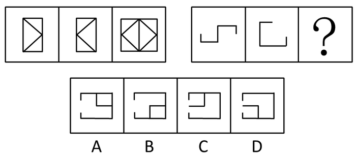

A. A

B. B

C. C

D. D

第 71 题 · 答案与解析

**参考答案（粉笔题库参考内容）**

A

**解析**

元素组成相似，元素叠加。

注意组合的位置，前两个图先沿纵轴进行翻转，再进行简单叠加形成第三个图形。

故正确答案为A。

**考点**：样式规律-加减同异

**来源**：2009年黑龙江省公务员录用考试《行测》题（A、B类）第71题

### 第 72 题

从所给四个选项中，选择最合适的一个填入问号处，使之呈现一定的规律性：

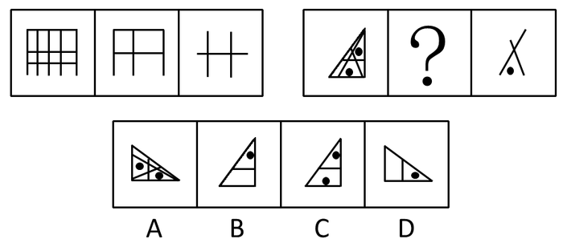

A. A

B. B

C. C

D. D

第 72 题 · 答案与解析

**参考答案（粉笔题库参考内容）**

B

**解析**

元素组成相似，元素叠加运算。

后两图进行简单叠加后形成第一个图形。

故正确答案为B。

**考点**：样式规律-加减同异

**来源**：2009年黑龙江省公务员录用考试《行测》题（A、B类）第72题

### 第 73 题

从所给四个选项中，选择最合适的一个填入问号处，使之呈现一定的规律性：

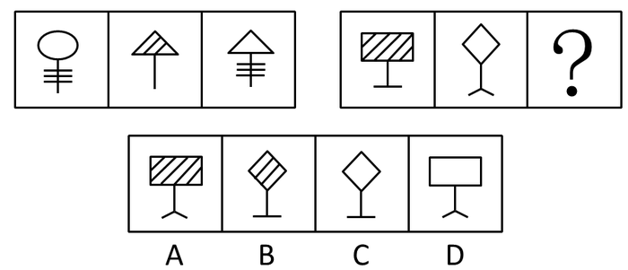

A. A

B. B

C. C

D. D

第 73 题 · 答案与解析

**参考答案（粉笔题库参考内容）**

B

**解析**

元素组成相似，元素叠加。

第三个图形是由第一个图形的下半部分和第二个图形的上半部分组成，并且相邻图形阴影部分相异（无、有、无），依此规律，问号处的图形下部分是第一个图形的下半部分，上部分是第二个图形的上半部分，并且有阴影。

故正确答案为B。

**考点**：样式规律-加减同异

**来源**：2009年黑龙江省公务员录用考试《行测》题（A、B类）第73题

### 第 74 题

从所给四个选项中，选择最合适的一个填入问号处，使之呈现一定的规律性：

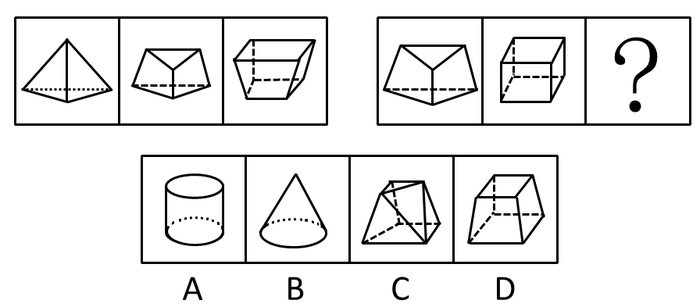

A. A

B. B

C. C

D. D

第 74 题 · 答案与解析

**参考答案（粉笔题库参考内容）**

C

**解析**

看成立体图形，数面（封闭空间）。

第一串图形中含有的封闭空间数分别为4、5、6，呈等差数列，依此规律，第二串图形中含有的封闭空间数分别为5、6、（7），注意题目中的图形都看做立体图形。

故正确答案为C。

**考点**：数量规律-面

**来源**：2009年黑龙江省公务员录用考试《行测》题（A、B类）第74题

### 第 75 题

从所给四个选项中，选择最合适的一个填入问号处，使之呈现一定的规律性：

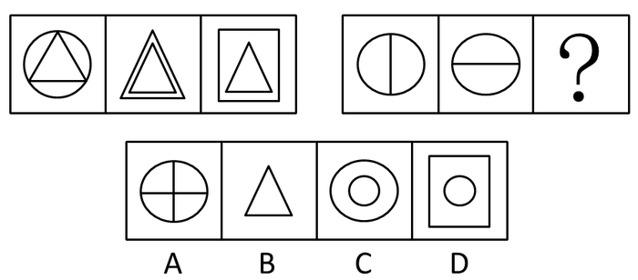

A. A

B. B

C. C

D. D

第 75 题 · 答案与解析

**参考答案（粉笔题库参考内容）**

A

**解析**

解析1：

第一串图形中三幅图中间的图形都是三角形，依此规律，第二串图形中每幅图中间的图形都是线段。

故正确答案为A。

解析2：

前两幅图的内部元素进行叠加形成第三幅图的内部元素。

故正确答案为A。

**考点**：数量规律-素、样式规律-遍历

**来源**：2009年黑龙江省公务员录用考试《行测》题（A、B类）第75题

### 第 76 题

从所给四个选项中，选择最合适的一个填入问号处，使之呈现一定的规律性：

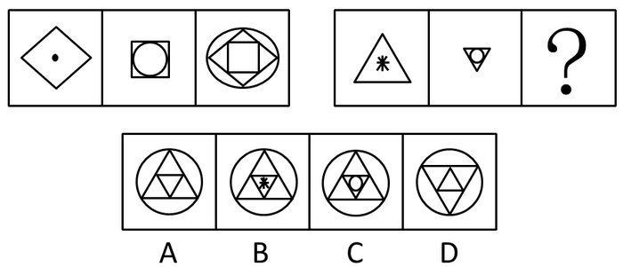

A. A

B. B

C. C

D. D

第 76 题 · 答案与解析

**参考答案（粉笔题库参考内容）**

A

**解析**

元素组成相似，元素运算。

观察图形可以发现第一串图形中的第三个图形的最外层图形是第二个图形的最内层图形，最内层图形是第二个图形的最外层图形，中间层的图形是第一个图形的最外层图形，依此规律，第二串中的第三个图形的最外层是圆形，最内层是一个角在下方的三角形，中间层是两个角在下方的三角形。

故正确答案为A。

**考点**：样式规律-加减同异

**来源**：2009年黑龙江省公务员录用考试《行测》题（A、B类）第76题

### 第 77 题

从所给四个选项中，选择最合适的一个填入问号处，使之呈现一定的规律性：

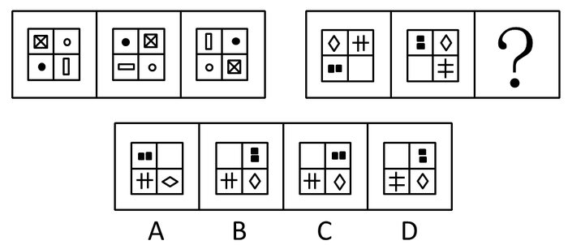

A. A

B. B

C. C

D. D

第 77 题 · 答案与解析

**参考答案（粉笔题库参考内容）**

C

**解析**

元素组成相同，考查位置规律。

第一串图形中，第一个图形中每个小方格中的元素顺时针转动一格形成第二个图形，第二个图形中每个小方格中的元素顺时针转动一格形成第三个图形，依此规律，问号处的图形，从左上角开始的小图形顺时针依次是空白、两个黑色矩形、菱形和三条直线图形。

故正确答案为C。

**考点**：位置规律-综合

**来源**：2009年黑龙江省公务员录用考试《行测》题（A、B类）第77题

### 第 78 题

从所给四个选项中，选择最合适的一个填入问号处，使之呈现一定的规律性：

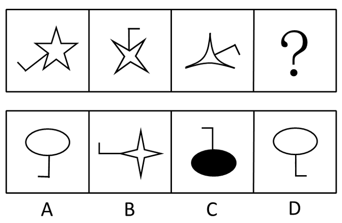

A. A

B. B

C. C

D. D

第 78 题 · 答案与解析

**参考答案（粉笔题库参考内容）**

A

**解析**

元素组成相似，综合考查位置和数量规律。

首先图形是顺时针旋转的，在旋转的过程中每次减少一个角，下一次应该是个两个角的图形，但是没有两个角的图形，所以下一个图形是椭圆形。

故正确答案为A。

**考点**：位置规律-旋转

**来源**：2009年黑龙江省公务员录用考试《行测》题（A、B类）第78题

### 第 79 题

从所给四个选项中，选择最合适的一个填入问号处，使之呈现一定的规律性：

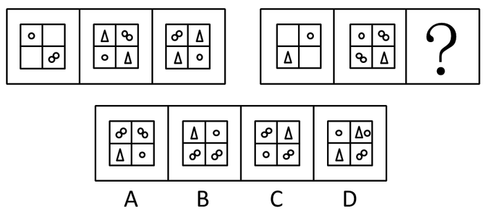

A. A

B. B

C. C

D. D

第 79 题 · 答案与解析

**参考答案（粉笔题库参考内容）**

C

**解析**

元素组成基本相同，优先考虑位置规律。第一组图中，图1的一个圆圈的图形和两个圆圈的图形依次逆时针旋转1格，图2两个相同的三角形顺时针/逆时针旋转1格到图3；第二组图应用此规律，图1的圆和三角形依次逆时针旋转1格，图2两个相同的两个圆圈图形顺时针/逆时针旋转1格到？处，故只有C符合。故正确答案为C。

**考点**：位置规律-平移

**来源**：2009年黑龙江省公务员录用考试《行测》题（A、B类）第79题

### 第 80 题

左边给定的是纸盒外表面的展开图，右边哪一项能由它折叠而成？请把它找出来。

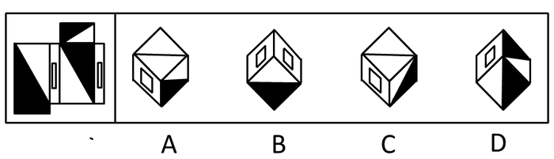

A. A

B. B

C. C

D. D

第 80 题 · 答案与解析

**参考答案（粉笔题库参考内容）**

D

**解析**

六面体，本题用排除法。

AC中顶面的图形在纸盒的六个面中不存在，所以不可能出现，AC排除；B中矩形中间有一个矩形的这种面在纸盒的六个面中一共有两个，但是这两个面是不会相邻的，排除B。

故正确答案为D。

**考点**：空间类-空间重构-六面体

**来源**：2009年黑龙江省公务员录用考试《行测》题（A、B类）第80题

### 第 81 题

一般授权是指上级行政主体在下达任务时，只发布一般工作指示，而非指派特定的事务，允许下属自己决定行动方案，并能够进行创造。

根据上述定义，下列不属于一般授权的是：

A. 柔性授权，即领导者对工作的具体安排，仅指示出一个大纲或轮廓，下属可随机应变，因地制宜地处理工作，有比较大的自由

B. 刚性授权，上级对下级的工作范围、内容、应达到的绩效目标都有详细规定

C. 惰性授权，即领导者把自己不愿做的纷乱繁琐事务交托给下属

D. 模糊授权，即授权者一般不明确地说清工作的事项与范围，只指示所要达到的任务和目标，被授权者自由去选择完成的具体途径

第 81 题 · 答案与解析

**参考答案（粉笔题库参考内容）**

B

**解析**

第一步：抓住定义中的关键词。

关键词强调“一般工作指示”、“下属自己决定行动方案”。

第二步：逐一判断选项。

A中的柔性授权，C中的惰性授权，D中的模糊授权均是一般授权，B中的刚性授权对下级的工作内容、范围、目标均作出了详细规定，从而使下级工作缺乏弹性、创造性，因而不符合定义，不是一般授权。

本题为选非题，故正确答案为B。

**考点**：主客体

**来源**：2009年黑龙江省公务员录用考试《行测》题（A、B类）第81题

### 第 82 题

非营利组织是指公民自愿组成，不以营利为宗旨和目的，资源提供者向该组织投入资源不取得经济回报，不享有该组织所有权，按照其章程开展活动的非营利性社会组织。

根据上述定义，下列不属于非营利组织的是：

A. 中国宋庆龄基金会

B. 上海“希望工程”办公室

C. 救助贫困失学女童的“春蕾计划”

D. 黑龙江大学青年志愿者协会

第 82 题 · 答案与解析

**参考答案（粉笔题库参考内容）**

C

**解析**

第一步：抓住定义中的关键词。

关键词强调“资源提供者不取得经济回报”、“不享有该组织所有权”、“非营利性社会组织”。

第二步：逐一判断选项。

A中的“中国宋庆龄基金会”，B中的“上海‘希望工程’办公室”，D中的“黑龙江大学青年志愿者协会”均是非营利性组织；

而C中的“春蕾计划”不是一个社会组织。

本题为选非题，故正确答案为C。

**考点**：方式目的

**来源**：2009年黑龙江省公务员录用考试《行测》题（A、B类）第82题

### 第 83 题

工伤保险也称职业伤害保险，是指劳动者在生产劳动和其他工作过程中遭受意外伤害或因长期接触有毒有害因素引起职业病伤害后，由国家或社会为负伤、致残者和死亡者生前供养的亲属提供必要的物质保障制度。

根据上述定义，下列情形不属于“工伤”范畴的是：

A. 某采矿厂劳保措施不全，作业现场粉尘较大，经医学鉴定发现，多名工人身患“尘肺病”

B. 张某就职于某外资企业，某天乘坐公司通勤车上班时发生车祸，导致右腿粉碎性骨折

C. 在省直机关工作的小刘在下乡考察途中，由于突发泥石流造成重大交通事故，人车失踪

D. “六一”儿童节，张警官带女儿到儿童乐园游玩时，为抢救一名落水儿童不幸溺水身亡

第 83 题 · 答案与解析

**参考答案（粉笔题库参考内容）**

D

**解析**

第一步：抓住定义中的关键词。

关键词强调“生产劳动和其他工作过程”、“遭受意外伤害”、“长期接触有毒有害因素引起职业病伤害”。

第二步：逐一判断选项。

A中采矿厂的工人由于长期接触有毒有害因素引起职业病伤害，属于“工伤”范畴；

B中的张某是在工作过程中发生了意外，属于“工伤”范畴；

C中的小刘在工作过程中发生了意外伤害，属于“工伤”范畴；

D中的张警官不是在工作过程中受伤的，不属于“工伤”范畴。

本题为选非题，故正确答案为D。

**考点**：大前提

**来源**：2009年黑龙江省公务员录用考试《行测》题（A、B类）第83题

### 第 84 题

行政沟通是指在行政管理活动中，行政机构之间或行政机构与有关方面之间的信息上的传递交流与联系。

根据上述定义，下列不属于行政沟通的是：

A. 在县公安局打字的小张写信向县委机关打字员求爱

B. 省编制办下达了本年度的人员、财政编制给各地市

C. 政府机构的彼此公文往来

D. 县政府召集各部门领导开会，安排下半年的党风廉政建设

第 84 题 · 答案与解析

**参考答案（粉笔题库参考内容）**

A

**解析**

第一步：抓住定义中的关键词。

关键词强调“行政管理活动”、“行政机构之间或行政机构与有关方面之间”、“信息上的传递交流与联系”。

第二步：逐一判断选项。

B、C、D三项均符合定义；

A中小张的求爱行为不属于行政管理活动，不符合定义。

本题为选非题，故正确答案为A。

**考点**：大前提

**来源**：2009年黑龙江省公务员录用考试《行测》题（A、B类）第84题

### 第 85 题

可再生能源是指从自然界获取的、可以再生的非化石能源，是可循环利用、取之不尽、用之不竭的资源，它对环境无害或危害极小，而且资源分布广泛，适宜就地开发利用。

根据上述定义，下列属于可再生能源开发利用的是：

A. 我国部分产煤大省把煤变成电，从卖原料到输出电力，增加了附加值，促进了节能降耗

B. 2000年以来，国家把农户用沼气列入农村基础设施建设的“六小工程”之一，每年投入10亿多元用于农村沼气建设

C. 目前市场上出现多款使用汽油驱动和电力驱动方式的混合动力汽车，动力性好，排放量很低，受到不少环保人士青睐

D. 北京奥运会期间，50 辆电动公交车在奥运村进行24小时不间断服务。这些没有排气管的零排放公交车为确保绿色奥运理念的实现做出了贡献

第 85 题 · 答案与解析

**参考答案（粉笔题库参考内容）**

B

**解析**

第一步：抓住定义中的关键词。

关键词强调“自然界获取”、“可再生的”、“非化石能源”、“可循环利用”、“对环境无害”、“资源分布广泛”。

第二步：逐一判断选项。

A中的煤属于化石能源，不符合定义；

C、D中的汽车均不属于能源。

故正确答案为B。

**考点**：拆词

**来源**：2009年黑龙江省公务员录用考试《行测》题（A、B类）第85题

### 第 86 题

电子政务是政府机构应用现代信息和通信技术，将管理和服务通过网络技术进行集成，在互联网上实现政府组织结构和工作流程的优化重组，超越时间和空间及部门之间的分隔限制，向社会提供优质和全方位的、规范而透明的、符合国际水准的管理和服务。

根据上述定义，下列情况不属于电子政务内容的是：

A. 企业通过税务网络系统，在办公室就能完成税务登记、税务申报、税款划拨、查询等业务，该系统既方便了企业，也减少了开支

B. 某城市所有高校图书馆通过网络形成互联平台，学生可跨校借阅图书，不仅共享了图书资源，还减少了相关建设成本

C. 人事部门开设网上人才市场或劳动市场，提供与就业有关的工作职位缺口数据库和求职数据库信息

D. 政府通过网站提供医疗保险信息，供居民查询自己的医疗保险个人账户余额和当地公共医疗账户的情况

第 86 题 · 答案与解析

**参考答案（粉笔题库参考内容）**

B

**解析**

第一步：抓住定义中的关键词。

关键词强调“政府机构”。

第二步：逐一判断选项。

A项虽然以企业为主要表述对象，但其使用的网络系统实际是税务机关提供的，因而也是电子政务；

B项不是电子政务，因为不存在政府机构这一角色；

C、D项显然均属于电子政务。

本题为选非题，故正确答案为B。

**考点**：方式目的

**来源**：2009年黑龙江省公务员录用考试《行测》题（A、B类）第86题

### 第 87 题

系统误差是指由于测量系统或测量仪器的不完善、测量技术受限、实验方法不够完善或没有保证正确的实验条件等原因产生的测量值与真实值之间的差别。

根据上述定义，下列情况属于系统误差的是：

A. 百米运动员两次参加比赛的成绩相差0.1秒

B. 分别在松花江上游和下游采集的水样密度不同

C. 伏安法测电阻时没有考虑电表内阻对实验结果的影响

D. 晚餐饮酒过量对第二天体检血液相关指标检查结果的影响

第 87 题 · 答案与解析

**参考答案（粉笔题库参考内容）**

C

**解析**

第一步：抓住定义中的关键词。

关键词强调“测量系统或测量仪器的不完善”、“测量值与真实值之间的差别”。

第二步：逐一判断选项。

A中运动员的成绩不是由测量仪器造成的；

B中松花江上下游的水样密度不同是由于测试地点不同造成的，与测量系统无关；

D中血液相关指标检查结果受影响是由于饮酒过量造成的，也与测试系统无关。

A、B、D均不符合定义。

故正确答案为C。

**考点**：原因结果

**来源**：2009年黑龙江省公务员录用考试《行测》题（A、B类）第87题

### 第 88 题

商标侵权是指他人出于商业目的，未经商标所有人的许可而擅自使用其已注册的商标，或把他人注册商标的主要部分用作自己的商标，并使用在相同或类似的商品上，从而产生商标混同，以欺骗消费者。

根据上述定义，下列不属于商标侵权的是：

A. 甲企业未经商标所有人乙企业的许可，在与乙企业类似的商品上使用与其注册商标近似的商标

B. 国内某商场的名称使用了某房地产企业已获准注册的房地产类“亚细亚”商标名称

C. 国内某企业并没有把“IBM”商标直接用在其商品上，而用在广告和其他宣传活动中

D. 某毛巾厂注册“418”牌商标，在市场销路打开以后，有的企业在“418”前加注某某牌，使“418”商标转化为商品名称

第 88 题 · 答案与解析

**参考答案（粉笔题库参考内容）**

B

**解析**

第一步：抓住定义中的关键词。

关键词强调“出于商业目的”、“未经许可擅自使用已注册的商标”、“把他人注册商标的主要部分用作自己的商标并使用在相同或类似的商品上以欺骗消费者”。

第二步：逐一判断选项。

A中的甲企业在类似产品上擅用乙企业的商标，符合定义；

B中某商场使用房地产企业的“亚细亚”商标，不是用在相同或相似的商品上，不符合定义；

C中的某企业擅自使用“IBM”的商标，欺骗消费者，符合定义；

D中有的企业利用他人注册商标的主要部分用作自己的商标以欺骗消费者，符合定义。

本题为选非题，故正确答案为B。

**考点**：方式目的

**来源**：2009年黑龙江省公务员录用考试《行测》题（A、B类）第88题

### 第 89 题

攀比效应是指社会经济活动中某些相关的经济变量之间或经济利益主体在利益分配方面存在的相互影响，轮番推进的现象。

根据上述定义，下列属于攀比效应的是：

A. 甲和乙在比谁的妻子漂亮，并约定输者请对方喝酒

B. 省公安厅比较两县公安局抓获小偷数量后，认为甲县治安良好

C. 甲公司技术人员到乙公司车间参观，暗下决心要向乙公司学习

D. 企业职工在工资收入方面互相对比，并要求本单位上调工资，增加收入

第 89 题 · 答案与解析

**参考答案（粉笔题库参考内容）**

D

**解析**

第一步：抓住定义中的关键词。

关键词强调“经济变量之间或经济利益主体”、“利益分配方面”。

第二步：逐一判断选项。

A、B项不存在经济变量和经济利益主体，也不存在利益分配问题；

C项不存在利益分配问题，不符合定义；

D项表述符合定义关键词。

故正确答案为D。

**考点**：单定义-其他句式

**来源**：2009年黑龙江省公务员录用考试《行测》题（A、B类）第89题

### 第 90 题

强迫障碍是指以反复出现强迫观念为基本特征的一类神经症性障碍。强迫观念是以刻板形式反复进入患者意识领域的思想、表象或意向。这些思想、表象或意向对患者来说，是没有现实意义的、不必要的或多余的；患者意识到这些都是他自己的思想，很想摆脱，但又无能为力，因而感到十分苦恼。

根据上述定义，下列可能属于“强迫障碍”的是：

A. 张奶奶老是一个劲的叨念着：我儿子就要回来了

B. 明明已经确定带了那本书，小黄在路上还是忍不住检查好几回

C. 虽然已经打了三次电话，赵某还是不放心，于是再一次拨通电话

D. 老李锁上门后又打开进去检查一遍再锁门······如此循环三次才放心离开

第 90 题 · 答案与解析

**参考答案（粉笔题库参考内容）**

B

**解析**

第一步：抓住定义中的关键词。

关键词强调“以刻板形式反复进入患者意识领域的思想、表象或意向”、“这些思想没有现实意义、不必要”、“患者很想摆脱，但又无能为力”。

第二步：逐一判断选项。

A中的张奶奶念叨的想法不是她想摆脱的，不符合定义；

C、D中的赵某和老李的不放心的想法不是没有现实意义的，也不是自己想要摆脱的，不符合定义。

故正确答案为B。

**考点**：常规问法

**来源**：2009年黑龙江省公务员录用考试《行测》题（A、B类）第90题

### 第 91 题

最受欢迎的电视广告中有一部分是滑稽广告，但作为广告技巧来说，滑稽正是不利之处。研究表明，虽然很多滑稽广告的观众都能生动地回忆起这些广告，但很少有人记得被推销的商品名称，因此，不管滑稽广告多么有趣，多么赏心悦目，其增加商品销量的能力值得怀疑。

这段文字最合适的假设条件是哪一个：

A. 在观众眼里，滑稽广告降低了商品的信誉

B. 不能提高商品知名度的广告是不能促进销售量增加的

C. 滑稽广告虽然可看性强，但常常不如严肃的广告那样容易被人记住

D. 广告的最终目的是提高促销商品的知名度

第 91 题 · 答案与解析

**参考答案（粉笔题库参考内容）**

B

**解析**

第一步：找到论点和论据。

本题论点是滑稽广告增加商品销量的能力值得怀疑，论据是滑稽广告不能让观众记得推销的商品名称。

第二步：判断加强方式。

论点强调销量，论据强调知名度，所以论点与论据间不存在明显因果关系，需加强论证。

第三步：逐一判断选项的作用。

B即在销量和知名度间搭桥，可以加强，当选；

A、C、D均与销量无直接关系，为无关项，排除。

故正确答案为B。

**考点**：搭桥

**来源**：2009年黑龙江省公务员录用考试《行测》题（A、B类）第91题

### 第 92 题

某村有甲、乙、丙、丁四个玉米种植专业户，已知甲、乙两户种植玉米的总亩数与丙、丁两户种植的总亩数相等，甲、丁两户的种植总数比乙、丙两户的种植总数多，而乙种植的玉米比甲、丙两户的总和还要多。

由此可知，甲、乙、丙、丁四个玉米种植专业户种植总亩数由多到少的顺序是：

A. 甲、乙、丙、丁

B. 丙、乙、甲、丁

C. 丁、乙、甲、丙

D. 乙、丁、甲、丙

第 92 题 · 答案与解析

**参考答案（粉笔题库参考内容）**

C

**解析**

第一步：直接翻译题干等式和不等式关系。

甲的亩数＋乙的亩数＝丙的亩数＋丁的亩数······①，甲的亩数＋丁的亩数＞丙的亩数＋乙的亩数······②，乙的亩数＞甲的亩数＋丙的亩数······③。

第二步：通过式子间的加减运算求解。

①＋②得：2甲的亩数＋乙的亩数＋丁的亩数＞2丙的亩数＋乙的亩数＋丁的亩数，则甲的亩数＞丙的亩数；

①－②得：丁的亩数－乙的亩数＞乙的亩数－丁的亩数，则丁的亩数＞乙的亩数（上两步可以代入选项验证，符合的只有C）；

由③可得：乙的亩数＞甲的亩数。

甲、乙、丙、丁四个玉米种植专业户种植总亩数由多到少的顺序为丁、乙、甲、丙。

故正确答案为C。

**考点**：排除法

**来源**：2009年黑龙江省公务员录用考试《行测》题（A、B类）第92题

### 第 93 题

1999年，某学院首次举行举重比赛。在这之后，每年举行一次，直至2005年比赛终止。在这短短的几年中，有四个系得过冠军：中文系、历史系、化学系和数学系。比赛结果如下：

1.在同一年内没有并列冠军队

2.数学系是唯一连续几年获胜的运动队

3.中文系既没有在1999年获胜，也没有在2005年获胜；化学系也是同样情况

4.历史系在逢偶数的年份中都没有获胜过

如果数学系在1999年的比赛中获胜，在2005年的比赛中也获胜。那么下列哪个判断肯定正确：

A. 如果化学系在2000年的比赛中获胜，那么中文系在2003年的比赛中获胜

B. 如果历史系获胜两次，那么数学系在2000年的比赛中获胜

C. 如果数学系连续获胜三次，那么历史系在2003年的比赛中获胜

D. 如果中文系和化学系相继获胜，那么历史系只能获胜一次

第 93 题 · 答案与解析

**参考答案（粉笔题库参考内容）**

D

**解析**

第一步：整理题干信息。

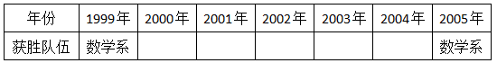

历史系不能在2000年、2002年、2004年获胜，只能在2001年或者2003年获胜。从题干中不能得出所有的信息，不能对获胜情况做出判断，所以采用代入法。

第二步：逐一判断选项。

A选项错误：

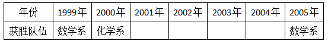

历史系不能在2000年、2002年、2004年获胜，只能在2001年或者2003年获胜，此时不能判断中文系获胜的情况，则A错误；

B选项错误：

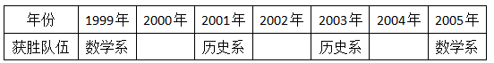

历史系不能在2000年、2002年、2004年获胜，只能在2001年或者2003年获胜，则历史系获胜的两次是2001年和2003年。剩下的队伍获胜的情况不能得知，数学系获胜的年份在2000年、2002年或者2004年，则B错误；

C选项错误：

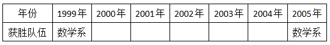

如果数学系连续获胜的三年分别是1999年、2000年、2001年，则历史系在2003年获胜；如果数学系连续获胜的三年是2003年、2004年、2005年，则历史系在2001年获胜。则C错误；

D选项正确：

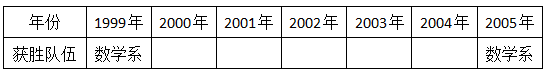

如果中文系或化学系相继获胜，不管怎样都要有一对在奇数年获胜，即在2001年或者2003年获胜，则历史系只能在剩下的一个奇数年获胜。

故正确答案为D。

**考点**：代入法

**来源**：2009年黑龙江省公务员录用考试《行测》题（A、B类）第93题

### 第 94 题

甲、乙、丙、丁四个人同时竞争一个就业职位，他们四人中只能有一个人获得该职位。在面试结束时，他们四个人对该次面试的结果进行了预测：甲说：“我这次肯定得不到这个职位；”乙说：“我估计这个职位应该是丁获得；”丙说：“乙的口才最好，乙肯定能得到这个职位；”丁说：“乙的说法没有任何根据。”

假定四人中只有一个说对了，那么到底谁能获得这个职位：

A. 甲

B. 乙

C. 丙

D. 丁

第 94 题 · 答案与解析

**参考答案（粉笔题库参考内容）**

A

**解析**

第一步：找突破口。

本题突破口为乙和丁之间的矛盾关系，两人的话必有一真和一假。

第二步：看其他的话。

本题只有一句为真，故甲和丙的话均为假话，由甲和丙所说的话可知，获得这个职位的是甲，乙没有获得这个职位。

第三步：判断突破口中两句话的真假。

由于获得这个职位的是甲，则乙说的是假话，丁说的是真话。

故正确答案为A。

**考点**：只有一真/一假

**来源**：2009年黑龙江省公务员录用考试《行测》题（A、B类）第94题

### 第 95 题

汶川地震发生后，某服装公司对该地区的专卖店布局进行调整。计划裁员3%，并撤销三个位于地震中心区的专卖店，这三个专卖店的人数正好占该公司在该地区工作总人数的3%。计划实施后，撤销了上述三个专卖店，该服装公司在该地区实际减员1.5%。此过程中，各专卖店内部人员有所调整，但整个公司只有减员，没有增员。

如果上述判定为真，以下哪项一定为真：

Ⅰ：上述计划实施后，有的专卖店调入新成员；

Ⅱ：上述计划实施后，没有一个专卖店调入的新成员的总数超出公司原来总人数的1.5%；

Ⅲ：上述计划实施后，被撤销的专卖店的留任人员不超过该公司原来总人数的1.5%。

A. 只有Ⅰ

B. 只有Ⅰ和Ⅱ

C. 只有Ⅱ和Ⅲ

D. Ⅰ、Ⅱ和Ⅲ

第 95 题 · 答案与解析

**参考答案（粉笔题库参考内容）**

A

**解析**

根据题干信息逐一分析选项。

由于整个服装公司只减不增，且减去1.5%的人，同时必须撤销三个专卖店，而这三个专卖店人数占到3%，所以必然要对这些人进行分流，从而导致有的专卖店调入新成员，Ⅰ正确；

假设服装公司减的1.5%的人出自其他专卖店，而被撤销的三个专卖店的人全部都分到了一个专卖店，那么这个专卖店新成员总数达到了该服装公司原来总人数的3%，明显超过1.5%，Ⅱ错误；

同理，被撤销专卖店的人员可能完全留任，Ⅲ错误。

故正确答案为A。

**考点**：日常结论

**来源**：2009年黑龙江省公务员录用考试《行测》题（A、B类）第95题

### 第 96 题

某医院为降低对患者的误诊率，花巨资买了一批操作简单、精确度高的先进的辅助诊断设备，使用一年后，统计发现对患者的误诊率不但没有下降，反而有上升的趋势。

以下哪项最能解释上述看来矛盾的断定：

A. 该医院购买的辅助诊断设备存在严重的质量问题

B. 医护人员对该设备操作不熟

C. 引进新设备后，医院门诊效率大大提高，前来就诊的患者增多

D. 医生过分依赖辅助设备检测出的结果，缺少一些必要的经验判断和会诊

第 96 题 · 答案与解析

**参考答案（粉笔题库参考内容）**

D

**解析**

第一步：找出题干矛盾。

购买了辅助诊断设备后，误诊率反而上升。

第二步：逐一分析选项。

A的质量，B的操作，都是在说辅助诊断设备的问题，但是诊断设备只是辅助作用，真正进行诊断的还是医生，不能因为辅助设备有问题，就说明对患者的误诊率不但没有下降，反而有上升的趋势，不能解释上面的矛盾；

C前来就诊的患者变多，不能说明误诊率会增多；

D可加强论点，要想说明误诊率上升，只要说明设备没有起到应有的作用即可，选项D说明，辅助设备变成了主要诊断工具，喧宾夺主，因而误诊率不降反升，最能解释问题。

故正确答案为D。

**考点**：原因解释

**来源**：2009年黑龙江省公务员录用考试《行测》题（A、B类）第96题

### 第 97 题

中医对唾液尤为重视，认为唾液充盈者必然体质较强，并根据唾液盛衰状况来判断疾病状况。今年52岁的奚先生多年来十分重视唾液养生，他每天清晨六点钟醒来后，有时起身端坐，有时卧着或站着，先凝神息虑片刻，轻轻吐气三口，再闭口咬牙，口内如含食物，用两腮和舌做漱口动作，漱30余次，漱口时口内将产生唾液，待唾液满口时，用意念分三次将唾液送入丹田。奚先生每天早晚各练一次，收到很好的养生效果，他的面部一直润泽，精力充沛，体格强壮。

下列哪项如果为真，最能有力削弱上述观点：

A. 奚先生有规律的生活方式和养生方式比唾液更重要

B. 由于注意饮食与运动，奚先生看上去只有40岁左右

C. 口腔与外界环境的直接接触，使唾液中含有大量的霍乱、细菌性痢疾、脊髓灰质炎、血吸虫病、病毒性肝炎等病毒，这些病毒对人体的危害非常大

D. 一个人每天可分泌出1000-1500毫升唾液，即使不用奚先生的这种方式也能获得足量的唾液

第 97 题 · 答案与解析

**参考答案（粉笔题库参考内容）**

A

**解析**

第一步：找到论点和论据。

本题论点是唾液充盈者必然体质较强，论据是奚先生多年来十分重视唾液养生，他的面部一直润泽，精力充沛，体格强壮。

第二步：判断削弱方式。

论点与论据间存在明显因果关系，需削弱论点。

第三步：逐一判断选项的作用。

A项直接削弱论点，说明奚先生有规律的生活方式和养生方式比唾液更重要；

B项与唾液无关，属于无关选项；

C项只能说明唾液与外界接触后会有危害，不能说明唾液本身就不健康，进而不能反驳为什么奚先生能够通过唾液养生保持健康；

D项有所削弱，但还是认可唾液充盈是奚先生身体强壮的重要原因。

故正确答案为A。

**考点**：削弱论据

**来源**：2009年黑龙江省公务员录用考试《行测》题（A、B类）第97题

### 第 98 题

近几十年来，人们发明了各种各样的药物来毒杀老鼠。可是人们发现，在一些老鼠经常出入的地方放置老鼠药的方法越来越没有效果，无论人们将药物添加到对于老鼠来说多么美味的食物之中，老鼠都会对这些送来的“美味”置之不理。根据这一现象，得到的可能解释是：老鼠的嗅觉异常灵敏，它们能够从任何复杂的气味中辨别出对它们有害的物质。

下列哪项如果为真，最能削弱上述解释：

A. 科学家经过一系列实验，证明有的老鼠对于一些药物已经产生了抗药性

B. 将没有添加任何药物的粮食放在先前放置过药物的地方，老鼠也不会动这些食物

C. 老鼠很少去那些曾经放置过老鼠药的地方活动

D. 老鼠在进食前对任何食物进行取样并品尝其中是否含有有毒物质

第 98 题 · 答案与解析

**参考答案（粉笔题库参考内容）**

B

**解析**

第一步：找到论点和论据

本题论点是老鼠能闻出药物，论据是将含药物食物放在老鼠经常出入的地方，老鼠不会动这些食物。

第二步：逐一判断选项的作用

A、C、D项均和闻出药物无关，属无关选项；

B项为类比削弱，两组对象分别是放药物的食物和没放药物的食物，其他条件均相同，实验结果是不管是将含药物食物或者是没含药物的食物放在老鼠经常出入的地方，老鼠都不会动这些食物，说明老鼠并不能闻出食物中是否有药物，而是因为别的原因导致老鼠不去碰这些食物，从而有力地削弱了题干。

故正确答案为B。

**考点**：削弱论点

**来源**：2009年黑龙江省公务员录用考试《行测》题（A、B类）第98题

### 第 99 题

某运动队教练说：“在秋季，我们运动队有80名足球运动员和40名越野长跑运动员；在冬季，有20名摔跤运动员和40名游泳运动员；在春季，有50名田径运动员和20名长曲棍运动员。在每个季度的三个月中，每个队的运动员一个星期中有五天参加有自己项目的运动队的活动。在同一季节内，运动员不能跨队参加活动。”

上述教练的话如果为真，则以下哪一项一定为真：

A. 该运动队秋、冬、春三个季度参加不同项目的运动员共有250人

B. 在夏季，运动员可以参加一个以上的运动队

C. 越野长跑运动员和田径运动员的总数有可能只有不足60人

D. 长曲棍运动员可以参加田径运动队

第 99 题 · 答案与解析

**参考答案（粉笔题库参考内容）**

C

**解析**

根据题干信息逐一分析选项。

A项不一定为真，因为不同项目的运动员可能相互交叉参加别的项目；

B项不一定为真，因为夏季的活动没有提及，有可能根本没有活动，所以无法判断运动员是否参加了运动队；

C项一定为真，因为40名越野长跑运动员可能全部都是50名田径运动员中的人，此时二者的总人数只有50人；

D项一定为假，因为同一季度内，运动员不能跨队参加活动，而长曲棍项目和田径项目都在春季，所以二者不可能混合。

故正确答案为C。

**考点**：组合排列-单题-其他

**来源**：2009年黑龙江省公务员录用考试《行测》题（A、B类）第99题

### 第 100 题

尽管社会上呼吁禁止过度包装，但一项调查结果显示，人们在中秋节买月饼时，很多消费者对包装精良的月饼给予更多的信任，因为他们觉得包装精良的商品生产厂家具有更强的技术和资金实力，因而产品质量也更可靠。

以下哪项如果为真，最能削弱上述解释：

A. 市场发现一些包装精良的过期商品

B. 购买商品时，很多消费者并不注重商品的包装

C. 很少消费者认为包装精良的商品质量和一般包装的商品质量没有区别

D. 一些商品生产厂家将更多的精力放在包装上而不是商品本身质量上，从而吸引消费者的注意

第 100 题 · 答案与解析

**参考答案（粉笔题库参考内容）**

D

**解析**

第一步：找到论点和论据。

本题论点是消费者对包装精良的月饼给予更多的信任，论据是他们觉得包装精良的商品生产厂家具有更强的技术和资金实力，因而产品质量也更可靠。

第二步：判断削弱方式。

论点与论据间存在明显因果关系，削弱论点。

第三步：逐一判断选项的作用。

B、C都与消费者对商品的信任无关，属于无关选项；

D削弱论点，说明包装精良的商品质量不一定好，A也属于削弱论点，但是不能因为一些商品就判断出总体情况，所以A选项的削弱力度不如D选项。

故正确答案为D。

**考点**：削弱论点

**来源**：2009年黑龙江省公务员录用考试《行测》题（A、B类）第100题

### 第 101 题

党和国家2020年的奋斗目标是：

A. 基本实现现代化

B. 全面建设小康社会

C. 构建社会主义和谐社会

D. 全面实现科学发展

第 101 题 · 答案与解析

**参考答案（粉笔题库参考内容）**

B

**解析**

本题考查新思想。

全面建设小康社会，是我们党和国家到2020年的奋斗目标，是全国各族人民根本利益所在，必须坚定不移地为之奋斗。

故正确答案为B。

**本题相关知识点：**

中国在本世纪头二十年经济方面的奋斗目标，总体来说就是力争到2020年实现国内生产总值比2000年翻两番。

**考点**：新思想总论

**来源**：2010年黑龙江省公务员录用考试《行测》题第140题

### 第 102 题

人们日常谈论股票市场行情时常提及“牛市”“熊市”等字眼，其中“牛市”指的是：

A. 行情普遍看涨，延续时间较短

B. 行情普遍看涨，延续时间较长

C. 行情普遍看淡，延续时间较短

D. 行情普遍看淡，延续时间较长

第 102 题 · 答案与解析

**参考答案（粉笔题库参考内容）**

B

**解析**

“牛市”，也称多头市场，指市场行情普遍看涨，延续时间较长的大升市。

“熊市”，也称空头市场，指行情普遍看淡，延续时间相对较长的大跌市。

故正确答案为B。

**考点**：宏观经济与调控政策

**来源**：2009年黑龙江省公务员录用考试《行测》题（A、B类）第102题

### 第 103 题

神舟七号载人飞船点火升空后最先抛掉的是：

A. 整流罩

B. 助推器

C. 二级火箭

D. 逃逸塔

第 103 题 · 答案与解析

**参考答案（粉笔题库参考内容）**

BD

**解析**

神舟七号运载火箭于2008年9月25日21点10分4秒988毫秒发射升空；点火第120秒火箭抛掉助推器及逃逸塔；第159秒火箭一二级分离；第200秒整流罩分离；第500秒三级火箭关机；第583秒飞船与火箭分离；随后飞船正常进入预定轨道，神舟七号飞船成功发射。

故正确答案为BD。

**考点**：科技理论与成就

**来源**：2009年黑龙江省公务员录用考试《行测》题（A、B类）第103题

### 第 104 题

构建社会主义和谐社会的重点是：

A. 解决人民群众最关心、最直接、最现实的利益问题

B. 走共同富裕的道路

C. 推动社会建设与经济建设、政治建设、文化建设协调发展

D. 发展社会事业、促进社会公平正义、建设和谐文化

第 104 题 · 答案与解析

**参考答案（粉笔题库参考内容）**

A

**解析**

党的十六届六中全会《决定》明确提出：构建社会主义和谐社会“必须以解决人民群众最关心、最直接、最现实的利益问题为重点”。这使以人为本构建和谐社会有了十分具体的着力点。

故正确答案为A。

**来源**：2009年黑龙江省公务员录用考试《行测》题（A、B类）第104题

### 第 105 题

社会和谐的基本条件是：

A. 发展

B. 稳定

C. 社会公平正义

D. 以人为本

第 105 题 · 答案与解析

**参考答案（粉笔题库参考内容）**

C

**解析**

党的十六届六中全会通过的《中共中央关于构建社会主义和谐社会若干重大问题的决定》，把社会公平正义放到了重要的位置，指出“社会公平正义是社会和谐的基本条件，制度是公平正义的根本保证”。

故正确答案为C。

**来源**：2009年黑龙江省公务员录用考试《行测》题（A、B类）第105题

### 第 106 题

下列不属于哺乳类的动物是：

A. 蝙蝠

B. 鲸

C. 蜂鸟

D. 海豹

第 106 题 · 答案与解析

**参考答案（粉笔题库参考内容）**

C

**解析**

蜂鸟是雨燕目蜂鸟科动物约600种的统称，是世界上已知最小的鸟类，不是哺乳动物。蜂鸟身体很小，能够通过快速拍打翅膀悬停在空中，每秒约15次到80次，它的快慢取决于蜂鸟的大小。蜂鸟因拍打翅膀的嗡嗡声而得名。蜂鸟是唯一可以向后飞行的鸟。蜂鸟也可以在空中悬停以及向左和向右飞。

本题为选非题，故正确答案为C。

**本题相关知识点：**

哺乳动物是动物世界中形态结构最高等、生理机能最完善的动物。与其他动物相比，哺乳动物最突出的特征在于其幼仔由母体分泌的乳汁喂养长大。哺乳动物都长有皮毛，以保持体温的恒定，适应各种复杂的生存环境；哺乳动物具有比较发达的大脑，因而能产生比其他动物更为复杂的行为，并能不断地改变自己的行为，以适应外界环境的变化。选项中的蝙蝠、鲸和海豹都是哺乳动物。

**考点**：生活常识

**来源**：2012年黑龙江省公务员录用考试《行测》题第105题

### 第 107 题

判断社会进步的最根本标准是：

A. 生产力的发展

B. 民主程度的提高

C. 自然环境的改善

D. 社会秩序的稳定

第 107 题 · 答案与解析

**参考答案（粉笔题库参考内容）**

A

**解析**

生产力的发展是衡量社会进步与否的根本标准。这是因为生产力发展是社会发展的根本内容；生产力发展是实现社会发展目标的根本条件；生产力发展是社会发展的集中体现，是社会文明发展水平的根本标志。

故正确答案为A。

**本题相关知识点：**

在我国社会主义现代化建设中，把发展生产力摆在首位，坚持以经济建设为中心，推动社会全面进步。坚持判断一切工作的是非得失，归根到底，要以是否有利于发展社会主义社会的生产力，是否有利于增强社会主义国家的综合国力，是否有利于提高人民的生活水平为标准。

**考点**：政治经济学-其他

**来源**：2009年黑龙江省公务员录用考试《行测》题（A、B类）第107题

### 第 108 题

我国当前人口和计划生育工作的重点、难点在：

A. 城市

B. 城郊结合部

C. 农村

D. 城镇

第 108 题 · 答案与解析

**参考答案（粉笔题库参考内容）**

C

**解析**

《中共中央国务院关于全面加强人口和计划生育工作统筹解决人口问题的决定》指出，我国人口和计划生育工作的重点、难点在农村。

故正确答案为C。

**本题相关知识点：**

随着社会主义市场经济体制的进一步完善，我国农村的社会形态正在发生深刻的变化。国家人口和计划生育委员会有关负责人指出，农村人口占我国总人口的大多数，而且农村经济社会发展水平还不高，农村特别是中西部农村生育水平还比较高，出生人口性别比失衡严重；同时农村剩余劳动力近2亿，外出务工经商人口规模庞大并在未来20年内有持续增加趋势，但相应的法律法规又不健全，管理与服务措施滞后，农民工的合法权益难以得到有效保护；青壮年劳动力的大量流失，使我国农村老龄化程度超过城市，2000万留守儿童的成长环境也同样令人堪忧。

**考点**：中国地理

**来源**：2009年黑龙江省公务员录用考试《行测》题（A、B类）第108题

### 第 109 题

下列属于全国人民代表大会常务委员会职权的是：

A. 修改宪法

B. 选举中华人民共和国主席、副主席

C. 解释宪法和监督宪法实施

D. 制定和修改刑事、民事、国家机构和其他基本法律

第 109 题 · 答案与解析

**参考答案（粉笔题库参考内容）**

C

**解析**

根据宪法的规定，中华人民共和国全国人民代表大会是唯一有权修改宪法的机关。中华人民共和国主席、副主席由全国人民代表大会选举。全国人民代表大会制定和修改刑事、民事、国家机构的和其他的基本法律。全国人民代表大会常务委员会行使下列职权：解释宪法，监督宪法的实施。

故正确答案为C。

**本题相关知识点：**

《宪法》第六十二条 全国人民代表大会行使下列职权：修改宪法；监督宪法的实施；制定和修改刑事、民事、国家机构的和其他的基本法律；选举中华人民共和国主席、副主席；根据中华人民共和国主席的提名，决定国务院总理的人选；根据国务院总理的提名，决定国务院副总理、国务委员、各部部长、各委员会主任、审计长、秘书长的人选；选举中央军事委员会主席；根据中央军事委员会主席的提名，决定中央军事委员会其他组成人员的人选；选举最高人民法院院长；选举最高人民检察院检察长；审查和批准国民经济和社会发展计划和计划执行情况的报告；审查和批准国家的预算和预算执行情况的报告；改变或者撤销全国人民代表大会常务委员会不适当的决定；批准省、自治区和直辖市的建置；决定特别行政区的设立及其制度；决定战争和和平的问题；应当由最高国家权力机关行使的其他职权。

**考点**：宪法

**来源**：2009年黑龙江省公务员录用考试《行测》题（A、B类）第109题

### 第 110 题

根据宪法和组织法的规定，下列有权制定地方性法规的机关是：

A. 哈尔滨市某区人民代表大会

B. 黑龙江省人民政府

C. 中共哈尔滨市委

D. 哈尔滨市人民代表大会

第 110 题 · 答案与解析

**参考答案（粉笔题库参考内容）**

D

**解析**

A项错误，哈尔滨市某区人民代表大会不是哈尔滨市人大，不属于有权制定地方性法规的范围；

B、C项错误，根据宪法和组织法的规定，省、自治区、直辖市的人大及其常委会，省、自治区人民政府所在地的市和经国务院批准的较大的市的人大及其常委会可以制定地方性法规。有权制定地方性法规的必须是人大及其常委会；

D项正确，哈尔滨市人民代表大会属于省人民政府所在地的市人大，有权制定地方性法规。

故正确答案为D。

**考点**：宪法

**来源**：2009年黑龙江省公务员录用考试《行测》题（A、B类）第110题

### 第 111 题

省政府办公厅的孙某受命组建省政府调研中心。为此他在政府内挑选了一些人员作为调研中心的工作人员，包括小王、小张和老林等。在孙某看来，小王虽能力有限，但为人踏实，容易和别的同志搞好团结，还是自己的老同学。

据此可以判断孙某的领导方式是：

A. 任务导向型

B. 关系导向型

C. 民主型

D. 专制型

第 111 题 · 答案与解析

**参考答案（粉笔题库参考内容）**

B

**解析**

领导方式是指领导者在领导过程中对被领导者采取什么样的态度，是领导活动的模式化。依据不同的标准领导方式分为不同的类型。题干中的孙某挑选小王为调研中心员工基于小王善于为人处事，加上又是自己的老同学，偏向于关系导向型领导。

故正确答案为B。

**本题相关知识点：**

1、专制型领导是领导者把决策权集于一人手中，以权力推行工作。由于决策错误或客观条件变化，贯彻执行发生困难时，不查明原因，多归罪下级。对下级奖惩缺乏客观标准，只是按领导者的好恶决定。

2、民主型领导是领导者同部属互相尊重，彼此信任。领导者通过交谈、会议等方式同部属交流思想，商讨决策，注意按职授权，培养部属主人翁思想。奖惩有客观标准，不以个人好恶行事。

3、任务导向型领导指把重点放在完成组织绩效上的领导行为，即把任务规定得很明确、组织的条理分明、任务委派的职责分明，并使用职权与奖惩去监督和促使绩效目标的实现。

**来源**：2009年黑龙江省公务员录用考试《行测》题（A、B类）第111题

### 第 112 题

最早实行农业“大包干”，即“家庭联产承包责任制”，被誉为“中国农村改革第一村”的是：

A. 河南南街村

B. 山西大寨村

C. 安徽小岗村

D. 广西和寨村

第 112 题 · 答案与解析

**参考答案（粉笔题库参考内容）**

C

**解析**

安徽小岗村是中国农村改革的发源地。它有“中国十大名村、安徽省历史文化名村、中国农村改革第一村”等美誉。1978年，十八位农民以“托孤”的方式，冒着极大的风险，立下生死状，在土地承包责任书上按下了红手印，创造了“小岗精神”，拉开了中国改革开放的序幕。

故正确答案为C。

**考点**：中国历史

**来源**：2009年黑龙江省公务员录用考试《行测》题（A、B类）第112题

### 第 113 题

村内兴办集体生产公益事业向农民筹集资金，负责管理、使用该资金的部门是：

A. 村集体经济组织或村民委员会

B. 乡、镇政府

C. 县农经管理部门

D. 乡、镇财政部门

第 113 题 · 答案与解析

**参考答案（粉笔题库参考内容）**

A

**解析**

为推进农村财务管理的规范化、制度化建设，保障农村税费改革的顺利实施，促进农村经济发展和社会稳定，根据《中共中央、国务院关于进行农村税费改革试点工作的通知》、《国务院关于进一步做好农村税费改革试点工作的通知》，应该理顺村级财务管理体制，规范管理村级收入：村民委员会和村集体经济组织要按照村民自治、村务公开、民主管理的原则，建立健全财务管理制度，切实规范村级财务管理。所有村级资金必须纳入村级财务管理，主要包括：农业税附加和农业特产税附加；“一事一议”筹资筹劳资金和以工补农资金；集体资产拍卖、租赁、发包及上交收入；集体统一经营收入；土地补偿费；救济扶贫款；上级部门拨款；各种代收、借贷资金；村组共同生产费；按规定清收的村提留历年尾欠，原合作基金会村级代办站的放款等。

故正确答案为A。

**来源**：2009年黑龙江省公务员录用考试《行测》题（A、B类）第113题

### 第 114 题

《中华人民共和国森林法》规定：滥伐森林或者其他林木，由林业主管部门责令补种滥伐株数（  ）的树木，并处滥伐林木价值二倍以上五倍以下的罚款。

A. 两倍

B. 二十倍

C. 十倍

D. 五倍

第 114 题 · 答案与解析

**参考答案（粉笔题库参考内容）**

D

**解析**

法条第三十九条原文如下：

盗伐森林或者其他林木的，依法赔偿损失；由林业主管部门责令补种盗伐株数十倍的树木，没收盗伐的林木或者变卖所得，并处盗伐林木价值三倍以上十倍以下的罚款。

滥伐森林或者其他林木，由林业主管部门责令补种滥伐株数五倍的树木，并处滥伐林木价值二倍以上五倍以下的罚款。

拒不补种树木或者补种不符合国家有关规定的，由林业主管部门代为补种，所需费用由违法者支付。

盗伐、滥伐森林或者其他林木，构成犯罪的，依法追究刑事责任。

故正确答案为D。

**考点**：劳动法和经济法

**来源**：2009年黑龙江省公务员录用考试《行测》题（A、B类）第114题

### 第 115 题

在我国，自然人的计算机软件著作权的保护期限是：

A. 25 年

B. 30 年

C. 50 年

D. 作者终生及死后 50 年

第 115 题 · 答案与解析

**参考答案（粉笔题库参考内容）**

D

**解析**

《著作权法》第二十一条规定：“公民的作品，其发表权、本法第十条第一款第（五）项至第（十七）项规定的权利的保护期为作者终生及其死亡后五十年，截止于作者死亡后第五十年的12月31日；如果是合作作品，截止于最后死亡的作者死亡后第五十年的12月31日。法人或者其他组织的作品、著作权（署名权除外）由法人或者其他组织享有的职务作品，其发表权、本法第十条第一款第（五）项至第（十七）项规定的权利的保护期为五十年，截止于作品首次发表后第五十年的12月31日，但作品自创作完成后五十年内未发表的，本法不再保护。”

故正确答案为D。

**考点**：民法典

**来源**：2009年黑龙江省公务员录用考试《行测》题（A、B类）第115题

### 第 116 题

在国际金融问题上进行协商与协作，促进国际货币合作；促进国际贸易的扩大和平衡发展；纠正国际收支的失调，而不采取危害本国或国际繁荣的措施，缩短成员国国际收支不平衡的时间，减轻不平衡的程度。

以上是下列哪个国际组织的主要职能？

A. 世界贸易组织

B. 国际货币基金组织

C. 世界银行

D. 经济合作发展组织

第 116 题 · 答案与解析

**参考答案（粉笔题库参考内容）**

B

**解析**

国际货币基金组织与世界银行同时成立，是世界两大金融机构之一，其职责是监察货币汇率和各国贸易情况、提供技术和资金协助，确保全球金融制度运作正常。国际货币基金组织通过一个常设机构来促进国际货币合作，为国际货币问题的磋商和协作提供方法；通过国际贸易的扩大和平衡发展，把促进和保持成员国的就业、生产资源的发展、实际收入的高水平，作为经济政策的首要目标；稳定国际汇率，在成员国之间保持有秩序的汇价安排，避免竞争性的汇价贬值；协助成员国建立经常性交易的多边支付制度，消除妨碍世界贸易的外汇管制；在有适当保证的条件下，基金组织向成员国临时提供普通资金，使其有信心利用此机会纠正国际收支的失调，而不采取危害本国或国际繁荣的措施；按照以上目的，缩短成员国国际收支不平衡的时间，减轻不平衡的程度等。

故正确答案为B。

**本题相关知识点：**

1、世界贸易组织的基本职能：管理和执行共同构成世贸组织的多边及诸边贸易协定；作为多边贸易谈判的讲坛；寻求解决贸易争端；监督各成员贸易政策，并与其它同制订全球经济政策有关的国际机构进行合作。

2、世界银行是世界银行集团的俗称，“世界银行”这个名称一直是用于指国际复兴开发银行和国际开发协会。这些机构联合向发展中国家提供低息贷款、无息信贷和赠款。今天它的任务是资助国家克服穷困，各机构在减轻贫困和提高生活水平的使命中发挥独特的作用。

3、经济合作组织的宗旨为：帮助各成员国家的政府实现可持续性经济增长和就业，成员国生活水准上升，同时保持金融稳定，从而为世界经济发展作出贡献。其组建公约中提出：经合组织应致力于为其成员国及其它国家在经济发展过程中的稳固经济扩展提供帮助，并在多边性和非歧视性的基础上为世界贸易增长作出贡献。

**考点**：国际经济及组织

**来源**：2012年黑龙江省公务员录用考试《行测》题第98题

### 第 117 题

义利之辩是我国古代伦理学上争论激烈的一个问题，争论的实质是把什么作为判断事物价值的标准。

下列主张以“利”作为判断事物价值标准的是：

A. 君子谋道不谋食，君子忧道不忧贫

B. 仓廪实则知礼节，衣食足则知荣辱

C. 君子喻于义，小人喻于利

D. 己欲立而立人，己欲达而达人

第 117 题 · 答案与解析

**参考答案（粉笔题库参考内容）**

B

**解析**

“仓廪实则知礼节，衣食足则知荣辱”主要是指人们粮仓充足才会懂得礼仪，丰衣足食才会看重荣誉和耻辱。粮仓充实、衣食饱暖，荣辱的观念才有条件深入人心，老百姓也才能自发、自觉、普遍地注重礼节、崇尚礼仪。

相对于A、C、D三项而言，B项倾向于主张以“利”作为判断事物价值标准。

故正确答案为B。

**本题相关知识点：**

1、“君子谋道不谋食，君子忧道不忧贫”的大意是一个真正有学问，以天下国家为己任的君子，只忧道不行，不考虑生活的问题；比如耕种田地，只问耕耘不问收获。只忧虑自己的为人，并不担心是否贫穷。主张以“道”作为判断事物价值标准。

2、“君子喻于义，小人喻于利”具体含义是指认为君子与小人价值指向不同，道德高尚者只需晓以大义，而品质低劣者只能动之以利害。君子于事必辨其是非，小人于事必计其利害。主张以“道”作为判断事物价值标准。

3、“己欲立而立人，己欲达而达人”的大意是仁德的人，自己想成功首先使别人也能成功，自己想被人理解，首先要理解别人。是实行“仁”的重要原则。如果能够“推己及人”也就做到了“仁”。主张以“道”作为判断事物价值标准。

**考点**：文学常识

**来源**：2009年黑龙江省公务员录用考试《行测》题（A、B类）第117题

### 第 118 题

消化系统是保证人体新陈代谢正常进行的一个重要系统，是由消化管和消化腺两大部分组成。

下列器官或腺体不属于消化系统的是：

A. 食管

B. 肾脏

C. 胰腺

D. 盲肠

第 118 题 · 答案与解析

**参考答案（粉笔题库参考内容）**

B

**解析**

消化系统由消化道和消化腺两大部分组成。消化道包括口腔、咽、食管、胃、小肠（十二指肠、空肠、回肠）和大肠（盲肠、结肠、直肠、肛管）等部。消化腺有小消化腺和大消化腺两种。小消化腺散在于消化管各部的管壁内，大消化腺有三对唾液腺（腮腺、下颌下腺、舌下腺）、肝和胰。

本题为选非题，故正确答案为B。

**考点**：生物常识

**来源**：2009年黑龙江省公务员录用考试《行测》题（A、B类）第118题

### 第 119 题

关于等离子电视的使用，下列说法错误的是：

A. 避免与其他家电放在一起，否则会产生电磁波，出现噪音等干扰现象

B. 不要频繁开关机，以减少显像管灯丝过热次数，延缓显像管的老化

C. 不要放在强光照射的地方，这样会导致荧光粉发生变化，缩短使用寿命

D. 连续开机时间过长后，可用冷水湿抹布擦拭电视荧屏，降低温度

第 119 题 · 答案与解析

**参考答案（粉笔题库参考内容）**

D

**解析**

在擦洗等离子屏时，不能用湿抹布擦洗，这样会对等离子电视造成伤害。潮气一旦侵入，会造成机内打火、线圈霉断、腐蚀机件等不良后果，极易酿成大祸。

本题为选非题，故正确答案为D。

**本题相关知识点：**

1、不要受磁场干扰。以冰箱和彩电为例，对彩电来说，在冰箱启动和运转时会产生强大的电磁波，如果冰箱、电视相距太近就会使彩电图像不稳，出现噪音等干扰现象。

2、不要频繁开与关。因为每开机一次，显像管灯丝就过热一次，这样会加速显像管的老化。

3、不要太亮。荧光屏如果长期处于过亮状态，就会影响荧光粉的发光效率，还会加速显像管阴极极板老化，缩短显像管的使用寿命。而且，亮度越高耗电量就越大，还会使收看者眼睛疲劳，对保护视力不利。

**考点**：化学常识

**来源**：2009年黑龙江省公务员录用考试《行测》题（A、B类）第119题

### 第 120 题

人体必需的六类营养素中有三大热能营养素，在体内经过氧化可产生能量，下列不属于热能营养素的是：

A. 碳水化物

B. 维生素

C. 脂肪

D. 蛋白质

第 120 题 · 答案与解析

**参考答案（粉笔题库参考内容）**

B

**解析**

食物中的碳水化物、脂肪和蛋白质是供给机体热能的主要营养素，所以又称生热营养素或三大营养素。

本题为选非题，故正确答案为B。

**考点**：生物常识

**来源**：2009年黑龙江省公务员录用考试《行测》题（A、B类）第120题

## 材料 1

2007年，黑龙江省大中型工业企业共481家，比上年增加27家，从业人员110.2万人，比上年增加3.1万人。完成工业总产值5143亿元，增长9.8%；增加值2546.1亿元，增长9.1%；实现主营业务收入5541亿元，增长10.1%；实现利税总额1684.5亿元，增长0.9%。科技活动经费内部支出61.2亿元，增长23.7%。2007年，全省大中型工业企业从事技术开发活动的人员6.5万人，比上年增加近0.4万人。其中科学家和工程师4.1万人，比上年增加0.2万人。从性别看，女性科技活动人员1.6万人，比上年增加0.3万人。2007年，全省大中型工业企业加大新产品开发的投入，积极研制开发新产品。全年经费投入10万元（含10万元）以上的新产品项目数1139项，与上年持平。用于新产品开发经费24.8亿元，比上年增长41.6%。平均每个新产品项目经费由上年的218.4万元上升到今年的286.4万元。投入增长带来了效益的增加。实现新产品产值429.6万元，比上年增长36.6%。新产品销售收入437亿元，比上年增长44.3%。新产品出口18.5亿元比上年增长26.8%。申请专利851件，比上年增长16.4%。

### 第 121 题

根据资料，2007年黑龙江省平均每个大中型企业约有从业人员多少人：

A. 1933人

B. 2427人

C. 2291人

D. 2359人

第 121 题 · 答案与解析

**参考答案（粉笔题库参考内容）**

C

**解析**

根据题干“2007年······平均每个大中型企业约有从业人员多少人”，结合材料时间为2007年，可判定本题为现期平均数问题。定位文字材料可得：2007年，黑龙江省大中型工业企业共481家，比上年增加27家；从业人员110.2万人，比上年增加3.1万人。根据平均每个大中型企业约有从业人员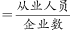，则2007年黑龙江省平均每个大中型企业约有从业人员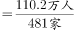≈0.2291万人＝2291人。

故正确答案为C。

**考点**：文字资料、现期平均数

**来源**：2009年黑龙江省公务员录用考试《行测》题（A、B类）第121题

### 第 122 题

2006年黑龙江省大中型工业企业完成工业增加值占工业总产值的比重是：

A. 49.51%

B. 49.82%

C. 45.4%

D. 54.4%

第 122 题 · 答案与解析

**参考答案（粉笔题库参考内容）**

B

**解析**

根据题干“2006年······占······的比重是”，结合材料时间为2007年，可判定本题为基期比重问题。定位文字材料可得：2007年，黑龙江省大中型企业完成工业总产值5143亿元，增长9.8%；增加值2546.1亿元，增长9.1%。根据公式：基期比重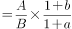，可得2006年黑龙江省大中型工业企业完成工业增加值占工业总产值的比重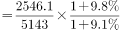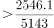（稍稍大于），满足条件的只有B项。

故正确答案为B。

**考点**：基期比重、文字资料

**来源**：2009年黑龙江省公务员录用考试《行测》题（A、B类）第122题

### 第 123 题

2007年黑龙江省大中型工业企业从事技术开发活动的人员人均新产品开发经费多少元：

A. 3.8万元

B. 4.1万元

C. 218.3万元

D. 286.4万元

第 123 题 · 答案与解析

**参考答案（粉笔题库参考内容）**

A

**解析**

根据题干“2007年······人均新产品开发经费······”，结合材料时间为2007年，可判定本题为现期平均数问题。定位文字材料可得：2007年，全省大中型工业企业从事技术开发活动的人员6.5万人，用于新产品开发经费24.8亿元。根据人均新产品开发经费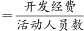，则2007年黑龙江省大中型工业企业从事技术开发活动的人员人均新产品开发经费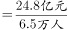≈3.8万元。

故正确答案为A。

**考点**：文字资料、现期平均数

**来源**：2009年黑龙江省公务员录用考试《行测》题（A、B类）第123题

### 第 124 题

下面说法中正确的是：

A. 与去年相比，2007年黑龙江大中型企业平均每个项目经费增长23.8%

B. 2006年，黑龙江大中型企业实现新产品产值272.3亿元

C. 2006年，黑龙江大中型企业科技活动经费内部支出61.2亿元

D. 2006年，黑龙江大中型企业实现利税总额为1669.5亿元

第 124 题 · 答案与解析

**参考答案（粉笔题库参考内容）**

D

**解析**

A项：定位文字材料，平均每个新产品项目经费由上年的218.4万元上升到今年（2007年）的286.4万元。根据公式：增长率，则2007年平均每个项目经济增长率≈68/220，错误；

B项：定位文字材料，（2007年）实现新产品产值429.6万元，比上年增长36.6%。根据公式：基期量=现期量/(1+r)，则2006年实现新产品产值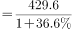万元，错误；

C项：定位文字材料，（2007年）科技活动经费内部支出61.2亿元，增长23.7%。故2006年，黑龙江大中型企业科技活动经费内部支出不是61.2亿元，错误；

D项：定位文字材料，（2007年）实现利税总额1684.5亿元，增长0.9%。根据公式：基期量，则2006年，黑龙江大中型企业实现利税总额=现期量/(1+r)=1669.3亿元，正确。

故正确答案为D。

**考点**：文字资料、综合分析

**来源**：2009年黑龙江省公务员录用考试《行测》题（A、B类）第124题

### 第 125 题

下列关于黑龙江省大中型企业2007年有关说法，正确的是：

A. 2007年黑龙江省从事科技活动人员队伍不断壮大，女性科技活动人员明显增长

B. 2007年，黑龙江省大中型企业全年经费投入10万元以上的项目比去年明显增长

C. 2007年，大中型企业科学家工程师增长率明显高于其他人员的增长率

D. 2007年，黑龙江平均每个大中型企业从业人员与去年相比略有增加

第 125 题 · 答案与解析

**参考答案（粉笔题库参考内容）**

A

**解析**

A项：定位文字材料，2007年，从事技术开发活动的人员比上年增加近0.4万人。女性科技活动人员比上年增加0.3万人。正确；

B项：定位文字材料，（2007年）全年经费投入10万元（含10万元）以上的新产品项目数1139项，与上年持平。错误；

C项：定位文字材料，（2007年）其中科学家和工程师4.1万人，比上年增加0.2万人。材料中没有给出全部数据，无法判断，错误；

D项： 定位文字材料，2007年，黑龙江省大中型工业企业共481家，比上年增加27家，从业人员110.2万人，比上年增加3.1万人。根据公式：平均每个企业从业人员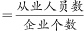，从业人数的增长率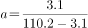3.1/107.1≈3%；企业个数的增长率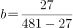=27/454≈6%,根据结论：a＜b，则2007年每个中大型企业从业数目比2006年有所减少，错误。

故正确答案为A。

**考点**：文字资料、综合分析

**来源**：2009年黑龙江省公务员录用考试《行测》题（A、B类）第125题

## 材料 2

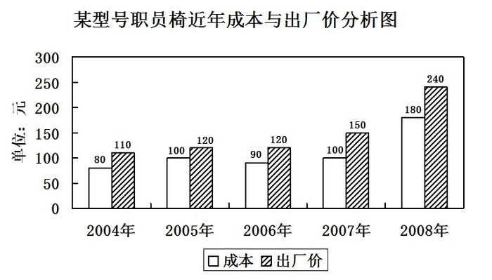

### 第 126 题

每生产一把该型号职员椅获得的利润率最高的年份是：

A. 2005年

B. 2006年

C. 2007年

D. 2008年

第 126 题 · 答案与解析

**参考答案（粉笔题库参考内容）**

C

**解析**

根据题干“······利润率最高的年份是”，可判定本题为比值比较问题。

根据公式：利润率，定位统计图可得：

2005年利润率： ；

2006年利润率：；

2007年利润率：；

2008年利润率：。综上，2007年利润率最高。

故正确答案为C。

**考点**：现期比重、统计图

**来源**：2009年黑龙江省公务员录用考试《行测》题（A、B类）第126题

### 第 127 题

2008年，生产该型号职员椅5000把，若获得同样多的利润，2006年需要生产该型号职员椅多少把：

A. 2000

B. 5000

C. 10000

D. 120000

第 127 题 · 答案与解析

**参考答案（粉笔题库参考内容）**

C

**解析**

根据题干“2008年，生产该型号职员椅5000把，若获得同样多的利润，2006年需要生产该型号职员椅多少把”，结合材料给出2006年、2008年职员椅的出厂价、成本，可判定本题为现期平均数问题。根据公式：利润总量＝单个利润×数量=（出厂价-成本）×数量，定位统计图可得：2008年职员椅的总利润。则2006年需要生产该型号职员椅=10000把。

故正确答案为C。

**考点**：现期平均数、统计图

**来源**：2009年黑龙江省公务员录用考试《行测》题（A、B类）第127题

### 第 128 题

与2005年相比，2008年增幅最大的是：

A. 成本

B. 出厂价

C. 利润

D. 利润率

第 128 题 · 答案与解析

**参考答案（粉笔题库参考内容）**

C

**解析**

根据题干“与2005年相比，2008年增幅最大的是”，可判定本题为一般增长率比较问题。根据公式：增长率，定位统计图可得：成本增幅： ；出厂价增幅：；利润增幅： 200%；利润率增幅： ≈13.3%。综上，与2005年相比，2008年增幅最大的是利润。

故正确答案为C。

**考点**：一般增长率、统计图

**来源**：2009年黑龙江省公务员录用考试《行测》题（A、B类）第128题

### 第 129 题

根据上图，原材料上涨速度最快的年份是：

A. 2005年

B. 2006年

C. 2007年

D. 2008年

第 129 题 · 答案与解析

**参考答案（粉笔题库参考内容）**

D

**解析**

根据题干“······原材料上涨速度最快的年份是”，可判定本题为增长率比较问题。

根据公式：增长率，定位统计图可得：

2005年： 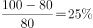；

2006年：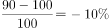；

2007年：；

2008年： 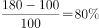。综上，原材料上涨速度最快的年份是2008年。

故正确答案为D。

**考点**：一般增长率、统计图

**来源**：2009年黑龙江省公务员录用考试《行测》题（A、B类）第129题

### 第 130 题

根据上图，下列说法正确的是：

A. 2004年以来，每生产一把该型号职员椅获得的利润呈现上升趋势

B. 2004年以来，该型号职员椅出厂价逐年上升

C. 2004年以来，该型号职员椅原材料价格逐年上升

D. 2004年以来，每生产一把该型号职员椅获得的利润呈下降趋势

第 130 题 · 答案与解析

**参考答案（粉笔题库参考内容）**

A

**解析**

A项：定位统计图，根据公式：利润＝出厂价-成本，则2004年每生产一把该型号职员椅获得的利润＝110-80＝30元；2008年利润为240-180＝60元，则2008年＞2004年，总体呈现上升趋势，正确；

B项：定位统计图，2005年和2006年出厂价一致，不是逐年上升，错误；

C项：定位统计图，2006年低于2005年的原材料价格，不是逐年上升，错误；

D项：定位统计图，根据公式：利润＝出厂价-成本，则2004年每生产一把该型号职员椅获得的利润＝110-80＝30元；2008年利润为240-180＝60元，则2008年＞2004年，总体呈现上升趋势，非下降趋势，错误。

故正确答案为A。

**考点**：统计图、综合分析

**来源**：2009年黑龙江省公务员录用考试《行测》题（A、B类）第130题

## 材料 3

根据对全国31000个农户和农业生产经营单位购买农业生产资料的价格调查，2007年我国农资市场购销两旺，农民实际购买价格上涨12.2%。具体情况如下表：

全国主要农业生产资料购买价格指数（上年同期=100）

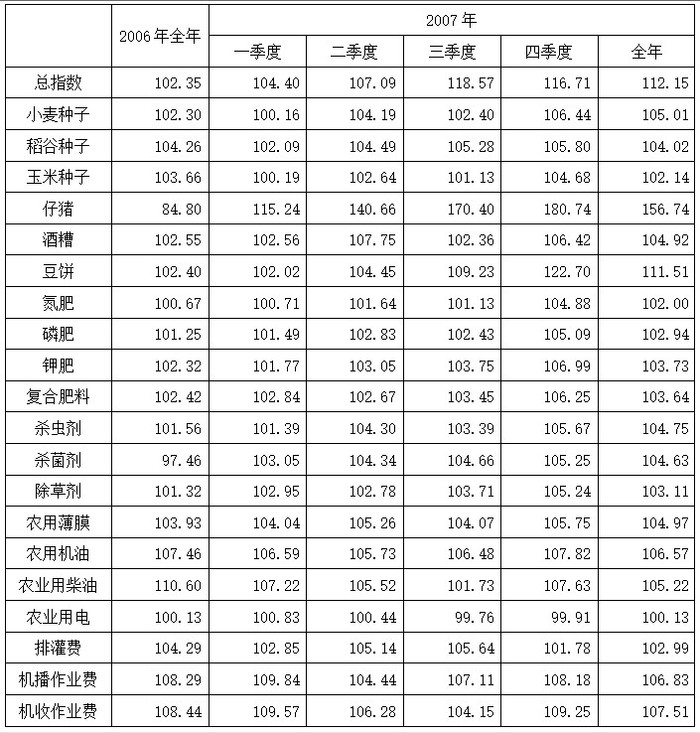

### 第 131 题

如果2006年第二季度和第四季度农用薄膜的价格都是14.00元/公斤，那么2007年相同季度的农用薄膜价格分别是：

A. 14.81元/公斤和14.87元/公斤

B. 14.74元/公斤和14.81元/公斤

C. 14.88元/公斤和14.94元/公斤

D. 14.87元/公斤和14.94元/公斤

第 131 题 · 答案与解析

**参考答案（粉笔题库参考内容）**

B

**解析**

根据题干“如果2006年······价格······，那么2007年······价格······”，可判定本题为现期计算问题。定位表格材料：2007年第二季度和第四季度农用薄膜的指数为105.26和105.75。根据公式：，则2007年第二季度农用薄膜价格为=14.7元/公斤；第二季度农用薄膜价格为≈14.8元/公斤。与B项最接近。

故正确答案为B。

**考点**：现期计算、综合资料

**来源**：2009年黑龙江省公务员录用考试《行测》题（A、B类）第131题

### 第 132 题

第三季度全国主要农业生产资料购买价格指数与上年同期相比上升：

A. 18.57%

B. 16.22%

C. 11.84%

D. 6.42%

第 132 题 · 答案与解析

**参考答案（粉笔题库参考内容）**

A

**解析**

根据题干“第三季度······价格指数与上年同期相比上升”，结合选项为百分数，可判定本题为一般增长率计算问题。定位表格材料：2007年第三季度全国主要农业生产资料购买价格指数为118.57。根据公式：，则2007年全国主要农业生产资料购买价格指数与上年同期相比上升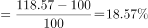。

故正确答案为A。

**考点**：一般增长率、综合资料

**来源**：2009年黑龙江省公务员录用考试《行测》题（A、B类）第132题

### 第 133 题

2007年四个季度全国主要农业生产资料购买价格指数变动特点，下面描述错误的是：

A. 农业用电有升有降，总体与去年价格相等

B. 小麦种子价格比上年上涨5.01%，稻谷种子上涨4.02%，玉米种子上涨2.14%

C. 2007年上涨幅度最大的是仔猪价格

D. 机收、机播作业费连续两年价格增幅均高于6%

第 133 题 · 答案与解析

**参考答案（粉笔题库参考内容）**

A

**解析**

A项：定位表格材料，2007年四个季度农业用电价格指数为100.13。由于上年同期=100，100.13＞100，则2007年四个季度农业用电比去年价格上涨，错误；

B项：定位表格材料，2007年四个季度小麦种子、稻谷种子、玉米种子价格指数分别为105.01、104.02、102.14。根据公式：，2007年四个季度小麦种子、稻谷种子、玉米种子价格指数分别上涨了5.01%、4.02%、2.14%。正确；

C项：定位表格材料， 2007年仔猪价格指数为156.74，且为最大，而基期都是100。 根据公式：，2007年仔猪价格上涨幅度最大，正确；

D项：定位表格材料，2006年和2007年机收、机播作业费价格指数均大于106，则机收、机播作业费连续两年价格增幅均高于6%，正确。

本题为选非题，故正确答案为A。

**考点**：综合分析、综合资料

**来源**：2009年黑龙江省公务员录用考试《行测》题（A、B类）第133题

### 第 134 题

农业生产资料购买价格指数变动的原因不可能是：

A. 化肥价格上涨是因为原材料上涨和能源价格上涨的影响

B. 农用柴油价格上涨是由于国内市场供给偏紧

C. 仔猪价格大幅上涨是因为今年猪肉出口量急剧增加

D. 柴油价格上涨带动机播作业费、农机作业费上涨

第 134 题 · 答案与解析

**参考答案（粉笔题库参考内容）**

B

**解析**

A项：化肥价格上涨是因为原材料上涨和能源价格上涨的影响，成本上涨，则可以导致化肥价格上涨，正确；

B项：农用柴油价格上涨是由于国内市场供给偏紧，2007年我国农资市场购销两旺与国内市场供给偏紧矛盾，错误；

C项：仔猪价格大幅上涨是因为今年猪肉出口量急剧增加，销售量增长，则可以导致仔猪价格大幅上涨，正确；

D项：柴油价格上涨带动机播作业费、农机作业费上涨，成本上涨，则可以导致动机播作业费、农机作业费上涨，正确。

本题为选非题，故正确答案为B。

**考点**：综合分析、综合资料

**来源**：2009年黑龙江省公务员录用考试《行测》题（A、B类）第134题

### 第 135 题

下列说法不正确的是：

A. 下半年农资价格涨幅快于上半年

B. 稻谷种子价格与去年相比下降0.2个百分点

C. 仔猪价格全年变动幅度最大

D. 工业产品类农资价格上涨速度低于农业内部的农资价格上涨幅度

第 135 题 · 答案与解析

**参考答案（粉笔题库参考内容）**

B

**解析**

A项：定位表格材料，2007年三季度和四季度农资价格指数分别为118.57和116.71，一季度和二季度农资价格指数分别为104.40和107.09。可以看出下半年的指数大于上半年的，则下半年农资价格涨幅快于上半年，正确；

B项：定位表格材料，2007年稻谷种子价格的指数为104.2，则104.2-100＝4.2个百分点，错误；

C项：定位表格材料，2006年和2007年仔猪价格指数分别为84.80和156.74，而上年同期都是100。 根据公式：增长率，则2006年仔猪价格变动幅度为=15.2%，2007年仔猪价格变动幅度为，仔猪变动幅度均最大，正确；

D项：定位表格材料，可以知道工业产品农资价格的上涨速度低于农业内部的农资价格上涨速度，正确。

本题为选非题，故正确答案为B。

**考点**：综合分析、综合资料

**来源**：2009年黑龙江省公务员录用考试《行测》题（A、B类）第135题

## 材料 4

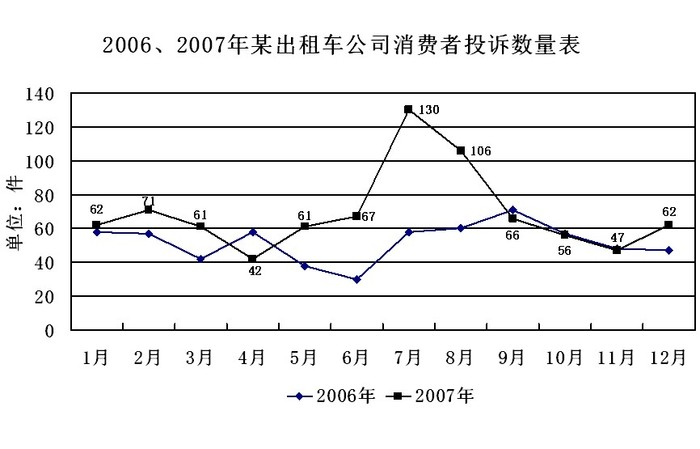

### 第 136 题

2007年的投诉数量图中，波谷数跟2006年比相差几个：

A. 0

B. 1

C. 2

D. 3

第 136 题 · 答案与解析

**参考答案（粉笔题库参考内容）**

A

**解析**

定位统计图，2007年的投诉数量图中，波谷数为2，分别为4月和11月；2006的投诉数量图中，波谷数为2，分别为3月和6月。则2007年的投诉数量图中，波谷数跟2006年比相差2-2＝0个。

故正确答案为A。

**考点**：简单加减计算、统计图

**来源**：2009年黑龙江省公务员录用考试《行测》题（A、B类）第136题

### 第 137 题

图中所显示的月投诉数量，共有几个月份是2007年高过2006年15件以上的：

A. 5

B. 4

C. 7

D. 8

第 137 题 · 答案与解析

**参考答案（粉笔题库参考内容）**

A

**解析**

借助尺子，测量出投诉数量为15的长度，再用这个长度和“同一月份，2007年和2006年的高度差”比较，容易得出，只有3月、5月、6月、7月、8月，2007年高于2006年15件以上的。

故正确答案为A。

**考点**：简单加减计算、统计图

**来源**：2009年黑龙江省公务员录用考试《行测》题（A、B类）第137题

### 第 138 题

下列哪个月份投诉数量超过100件：

A. 2006年7月

B. 2006年8月

C. 2007年7月

D. 2007年9月

第 138 题 · 答案与解析

**参考答案（粉笔题库参考内容）**

C

**解析**

定位统计图，投诉数量超过100件的只有2007年7月的130件和2007年8月的106件，满足条件的只有C项。

故正确答案为C。

**考点**：直接找数、统计图

**来源**：2009年黑龙江省公务员录用考试《行测》题（A、B类）第138题

### 第 139 题

2007年各个月份投诉变化幅度（与前一个月相比）从大到小排序为：

A. 9，4，8，11，10，3，6，2，12，5，7

B. 6，3，2，10，11，8，4，12，9，5，7

C. 7，9，8，4，5，12，3，10，2，11，6

D. 7，5，12，2，6，3，10，11，8，4，9

第 139 题 · 答案与解析

**参考答案（粉笔题库参考内容）**

D

**解析**

根据题干“2007年各个月份投诉变化幅度······”，可判定本题为增长率计算问题。定位统计图可得：2007年各个月的具体的量。根据公式：增长率。从统计图可以看出，2007年投诉变化幅度最大的月份为7月份，排除A、B两项，9月份变化幅度为；5月份变化幅度为，即5月份变化幅度大于9月份，排除C项。

故正确答案为D。

**考点**：一般增长率、统计图

**来源**：2009年黑龙江省公务员录用考试《行测》题（A、B类）第139题

### 第 140 题

关于2007年投诉数量增加的原因，不恰当的说法是：

A. 消费者投诉率与2006年持平

B. 该出租车公司运输业务量大大增加

C. 消费者可以采取的投诉方式更多、更方便

D. 消费者投诉意识提高

第 140 题 · 答案与解析

**参考答案（粉笔题库参考内容）**

A

**解析**

A项：2007年消费者投诉率与2006年持平，由于没有2007年和2006年的运输量，不能判断2007年投诉数量是否增加，则A项不恰当，当选；

B项：该出租车公司运输业务量大大增加，运输量变大，基数变大，投诉量可能增大，排除；

C项：消费者可以采取的投诉方式更多、更方便，投诉量可能增大，排除；

D项：消费者投诉意识提高，投诉量可能增大，排除。

故正确答案为A。

**考点**：统计图、综合分析

**来源**：2009年黑龙江省公务员录用考试《行测》题（A、B类）第140题

