# 2010年黑龙江省公务员录用考试《行测》题

<!-- gwy:overview:start -->
> **黑龙江 · 2010 · 行测 · 统考** ｜ 140 题 · 图片 18 处 · 答案随题折叠

| 题型模块 | 题量 | 题号 |
| --- | ---: | ---: |
| 言语理解与表达 | 35 | 1–35 |
| 数量关系 | 20 | 36–55 |
| 判断推理 | 40 | 56–95 |
| 资料分析 | 20 | 96–115 |
| 常识判断 | 25 | 116–140 |
| **合计** | **140** | |

导航：[题型与作答说明](#题型与作答说明) · [题目](#题目) · [材料 1](#材料-1)
<!-- gwy:overview:end -->

> 候选采集稿。参考答案及解析来自粉笔页面，不代表官方答案或真实高分答卷；来源使用许可与原卷对应关系仍需人工核实。

## 题型与作答说明

言语理解与表达

（35题）

根据题目要求，在四个选项中选出一个正确答案。

数量关系

（20题）

本部分包括数字推理与数学运算两种类型的试题。

判断推理

（40题）

本部分包括图形推理、定义判断、类比推理与逻辑判断四种类型的试题。

资料分析

（20题）

所给出的图、表或一段文字均有几个问题要你回答。你应根据资料提供的信息进行分析、比较、计 算和判断处理。

常识判断

（25题）

根据题目要求，在四个选项中选出一个正确答案。

## 题目

### 第 1 题

客观地说，“网络民主”较传统民主具有一定的优越性，但同时也具有有限性、破坏性。从未来发展看，“网络民主”要成为一种有效、有序、有形的民主形式还有一个相当长的过程，而且还是一个艰难的过程。因此，如何引导“网络民主”发展的方向和进程就显得尤为重要。

以下说法，不合文意的是（  ）。

A. 当前的网络民主还不成熟

B. 传统的民主也具有有限性、破坏性

C. 未来，网络民主可能将成为民主的正式形式

D. 下文可能论及引导网络民主发展的方式方法

第 1 题 · 答案与解析

**参考答案（粉笔题库参考内容）**

B

**解析**

据提问可知此题属于细节判断题。

文段总-分结构意在阐述第一句核心句，“但”后面的观点指明“网络民主具有有限性、破坏性”。B选项说“传统民主”也有有限性和破坏性，这个意思并无法从文中推断出来。“传统民主”在这里仅仅是对比对象，核心还是说“网络民主”。

由原文“网络民主具有有限性、破坏性”可以推出A项表述；原文第二句提到未来网络民主成为民主的正式形式还有一段相当长的过程，但这也说明未来这是可能实现的，故C项符合文意；文段最后一句的关键是“如何引导网络民主发展”，由此可知下文可能接着说引导网络民主发展的具体方式方法，D项符合文意。

故正确答案为B项。

**考点**：细节判断题

**来源**：2010年黑龙江省公务员录用考试《行测》题第1题

### 第 2 题

目前很多城市的新地标，要么比高度，要么比奢华，或是一味追求前卫和怪诞，与周边的历史文脉形成尖锐的反差。由于建筑特别是地标性建筑关涉百年大计，千年大计，一旦造好，就很难改变，因而近年来有不少公认的败笔，已成为城市中极不和谐的音符，为世人所诟病，并为后人留下笑柄。作者要表达的主要意思是（    ）。

A. 城市的新地标应与周边的历史文脉相协调

B. 地标性建筑关涉百年大计，千年大计，一定要造好

C. 一味追求高度、奢华、前卫或者怪诞，造就了很多城市地标败笔

D. 建设城市地标要谨慎，不要为世人所诟病，也不要为后人留下笑柄

第 2 题 · 答案与解析

**参考答案（粉笔题库参考内容）**

A

**解析**

首句提出问题：“很多城市新地标与周边历史文脉形成尖锐反差”，然而接下来的内容主要在解释反差产生的原因。综合理解可知作者对这种反差的态度是否定的，即城市新地标与周边历史文脉应该协调发展，故A项符合题意。

B、C、D三项均是原因部分的内容，且无“历史文脉”这一主题词，应排除。

故正确答案为A。

**考点**：主题词、关联词-对策

**来源**：2010年黑龙江省公务员录用考试《行测》题第2题

### 第 3 题

中国哲学认为，圣人不是不问世务的人，而且还是“内圣外王”的。内圣，是就其修养的成就说；外王，是就其在社会上的功用说。然而，圣人不一定有机会成为实际政治的领袖。就实际的政治说，他大概是没有机会的。所谓“内圣外王”，只是说，有极高的精神成就的人，按道理说可以为王，而且最宜于为王，至于实际上他有机会为王与否，那是另外一回事，亦是无关宏旨的。

以下说法，不合文意的是（  ）。

A. 虽然没有机会成为实际政治的领袖，圣人依然会积极投身于世务

B. 修养极高的人没有机会成为实际政治的领袖是因为不能够完美地处理世务

C. 修养极高的人一定适合成为实际政治的领袖

D. 中国哲学讨论内圣外王，更关注于内圣

第 3 题 · 答案与解析

**参考答案（粉笔题库参考内容）**

C

**解析**

文段首句就表达了“圣人应该是‘内圣外王’的人”的观点，即圣人不仅精神成就极高，而且积极投身世务，文段末尾又说“至于实际上他有机会为王与否，那是另外一回事”，即投身世务与是否成为实际政治的领袖是无关的，A项符合文意；

B项为强干扰项，圣人是“内圣外王”的人，即可以完美处理世务的人，而修为极高的人并不是“圣人”，仅仅为“内圣”，即并不能完美处理世务，故没有机会成为实际政治的领袖，B项说法实际是符合文意的；

C项为“偷换概念”，圣人一定适合成为实际政治的领袖，修养极高的人不等同于圣人，故不符合文意；

D项也可由尾句得到，是否为王是“无关宏旨”的，符合文意。

本题为选非题，故正确答案为C。

**考点**：细节判断题

**来源**：2010年黑龙江省公务员录用考试《行测》题第3题

### 第 4 题

随着社会适应性逐渐提高，区分外部自我和内部自我的能力逐渐增强，儿童渐渐能够比较实际地判断社会交往情境，并根据这些判断而表现出复杂的社会自我。同时，儿童自我结构的日趋稳定，使儿童能够根据自己的内部价值标准和信念体系，以及外部情境的需要调整自己的行为。

以下说法，不合文意的是（  ）。

A. 自我结构是儿童调整自己行为的依据之一

B. 儿童对社会交往情境的判断能反映出自身的社会自我

C. 社会适应性逐渐提高，区分外部自我和内部自我的能力逐渐增强，使儿童的自我结构趋向稳定

D. 儿童的自我结构和判断社会交往情境的能力几乎同时发展

第 4 题 · 答案与解析

**参考答案（粉笔题库参考内容）**

C

**解析**

A项，根据文段“儿童自我结构的日趋稳定，使儿童能够根据自己的内部价值标准和信念体系，以及外部情境的需要调整自己的行为”可知，A项表述正确；

B项，根据文段“儿童渐渐能够比较实际地判断社会交往情境，并根据这些判断而表现出复杂的社会自我”，可知，B项表述正确；

C项，文段以“同时”为标志，讲述了“社会性逐渐提高”和“自我结构逐渐稳定”两个方面，二者之间并无因果关系，所以C项表述错误；

D项，根据文段“同时”前后内容可知，D项表示正确。

本题为选非题，故正确答案为C。

**考点**：细节判断题

**来源**：2010年黑龙江省公务员录用考试《行测》题第4题

### 第 5 题

生物多样性是一定时间、一定地区所有生物物种及其遗传变异和生态系统的复杂性的总称。它是由地球上生命以其环境相互作用并经过几十亿年的演变进化而形成的，是地表自然地理环境的重要构成成分之一。生物多样性与其物理环境相结合而共同构成的人类赖以生存和发展的生命支持系统，是社会经济发展的物质基础，对于维持自然界的生态平衡、美化和稳定生活环境具有十分重要的作用。

以下说法，不合文意的是（  ）。

A. 生物多样性是生物在几十亿年的漫长过程中形成的生物群体的总称

B. 生物物种的遗传变异和生态系统的复杂性是生物多样性的重要方面

C. 生物多样性是在漫长的演变进化中，由生命与环境相互作用而形成的

D. 生物多样性有利于维持生态平衡，是人类社会经济发展不可或缺的物质基础

第 5 题 · 答案与解析

**参考答案（粉笔题库参考内容）**

A

**解析**

据提问可知此题属于细节判断题。

材料首句就说生物多样性是生物物种及其遗传变异和生态系统三者复杂性的总称。选项A以偏概全，只说是生物群体的总称，但生物群体并不能概括生物物种及其遗传变异和生态系统这一系列。

故正确答案为A。

**考点**：细节判断题

**来源**：2010年黑龙江省公务员录用考试《行测》题第5题

### 第 6 题

长期以来，中国周边各个区域对中国有不同的认识，而这可能恰恰是很多面使中国自我认识更加准确的镜子。与这些曾经与中国亲密接触、看上去有些接近的文明体比较起来，那个长期以来当作比较镜像的西方，似乎只是一面朦胧含糊的铜镜。虽然看得见整体中国文化的轮廓，却看不清具体文化中国的细节。所以，如果我们转身面向这个周边，套一句经济学界常用的术语，也许它将成为学术的一个新的增长点。因为这一研究领域的开拓，我以为引出的学术史变化，有可能是对语言工具的重新重视、对域外新数据的重新重视。

这段文字的主旨是（    ）。

A. 中国应该多研究周边地区的文化

B. 通过对周边地区的研究可以更好地了解中国

C. 中国应该重新重视语言工具和域外新资料

D. 中国需要加强自我认识

第 6 题 · 答案与解析

**参考答案（粉笔题库参考内容）**

B

**解析**

文段开篇指出中国周边区域对中国有不同认识，并指出这是使中国自我认识更准确的镜子，接着将西方与周边文明体对比，表明西方难以看清中国文化细节，随后通过“所以”得出结论，强调转身面向周边可能成为学术研究的新增长点，并解释原因。故文段重在强调研究周边地区可以更好了解中国，对应B项。

A项，“多研究周边地区的文化”偏离文段核心，文段重点强调是通过研究周边来更好地认识中国，而非仅仅研究周边文化本身，排除；

C项，“重新重视语言工具和域外新资料”对应文段原因解释部分，非重点，排除；

D项，“需要加强自我认识”表述不明确，未指出通过研究周边地区这一具体方式，排除。

故正确答案为B。

【文段出处】《葛兆光：放宽文史研究的视野》

**考点**：关联词-因果、分述句特征-其他

**来源**：2010年黑龙江省公务员录用考试《行测》题第6题

### 第 7 题

学校是传播知识的主渠道，却不是唯一的渠道。学习书本知识固然重要，但在实践中学习也很重要。没有一个科学家的知识是完全从学校学来的，也没有一个科学家的知识完全是从书本学来的。

上述材料所要说明的主旨是（  ）。

A. 学习书本知识和参加实践是获得认识的两个来源

B. 人们通过亲自实践而总结出的经验真实可靠，而书本知识是不可靠的

C. 一个人不可能事事亲身实践去获取知识，而且也没有必要那样做

D. 我们既要不断学习书本知识，又要不断地通过实践丰富自己的知识

第 7 题 · 答案与解析

**参考答案（粉笔题库参考内容）**

D

**解析**

据提问可知此题属于中心理解题。

材料中三句话都有明显的关联词帮助理解意思，第一句“却”强调学校不是传播知识的唯一渠道，第二句“但”强调在实践中学习很重要，第三句“没有……也没有”说明只靠学校和书本学知识行不通。三句话反复强调的都是要在书本中学知识，也要在实践中提高认知，据此分析D项最符合。

A项常识错误，获得认知的来源只能是实践，书本知识要通过实践才能变成认知；B项太绝对，文章没有说实践经验可靠，书本不可靠；C项与文意没有关联。

故正确答案为D。

**考点**：关联词-转折

**来源**：2010年黑龙江省公务员录用考试《行测》题第7题

### 第 8 题

用刑罚同一切犯罪行为作斗争，保卫国家安全，保卫人民民主专政的政权和社会主义制度，保护国有财产和劳动群众集体所有的财产，保护公民私人所有的财产，保护公民的人身权利、民主权利和其他权利，维护社会秩序、经济秩序，保障社会主义建设事业的顺利进行，是我国刑法的任务。

对这段话的理解正确的是（  ）。

A. 我国刑法的目的是打击违法犯罪行为

B. 我国刑法的目的是维护国家和人民的权利

C. 只有刑法才能够保障社会主义建设事业顺利进行

D. 刑法不保障犯罪分子的权利

第 8 题 · 答案与解析

**参考答案（粉笔题库参考内容）**

B

**解析**

据提问可知此题属于细节判断题。

文中多个分句阐述了什么是我国刑法的任务。

A项错误，打击违法犯罪行为是刑法的手段而非目的；C项“只有……才”过于绝对，并非只有刑法才有保障功能；D项错误，刑法保护公民的人身权利、民主权利和其他权利，这里的公民并不排除犯罪分子。

综合分析只有B项符合题意。

故正确答案为B。

**考点**：细节判断题

**来源**：2010年黑龙江省公务员录用考试《行测》题第8题

### 第 9 题

中国与西方的认识方式、思维逻辑乃至整体的文化观念，存在这样那样的差异。比如，西方式的执着，可能推衍出渐进的认识，强调主体与客体的关系，强调对象描述的精确性；中国式的洒落，则通向了圆融和体悟，描述对象时往往在清晰中又带有某种模糊。但二者并没有孰优孰劣，孰是孰非，只有因“差异”发生的对话与启迪、互补与和谐。通过“差异”而达到“中和”，这样的“和而不同”才能成全一个相生共融、丰富多彩的世界。
对这段话的理解不正确的是（  ）。

A. 西方注重对象描述的精确性，中国则倾向于清晰性和模糊性共存

B. 中西方的“差异”是对立的，不相互调和，二者都难以为继

C. 文化观念有差异，但没有优劣是非的区别

D. 成全一个相生共融、丰富多彩的世界，是启发两种文化对话的目的

第 9 题 · 答案与解析

**参考答案（粉笔题库参考内容）**

B

**解析**

据提问可知此题属于细节判断题。

文章后半句“但”这个转折词点明作者的态度——“差异没有孰优孰劣”，应当追求“和而不同”。据此分析选项B明显错误，中西方文化差异不是“对立”的，“对立”就无法“中和”了。

故正确答案为B。

**考点**：细节判断题

**来源**：2010年黑龙江省公务员录用考试《行测》题第9题

### 第 10 题

一个人真正的“精神饥饿感”应该从中小学时期开始培养。现阶段我国亟需在学校教育阶段“拯救阅读”，尤其是儿童阅读。“阅读是消灭无知、消灭贫穷、消灭绝望的武器。”一个民族精神境界的高下取决于阅读的水平；一个人的阅读史，就是他的精神发育史；一个没有阅读的学校永远不可能有真正的教育，而没有阅读的“学习”只能称作“训练”。

对这段话主旨的理解，正确的一项是（  ）。

A. 是否从儿时就养成阅读的习惯，将在很大程度上决定一个人的精神境界

B. 阅读应当成为学校教育的重要内容

C. “学习”与“训练”的最大区别在于“训练”仅仅是技能的培养

D. 阅读是培养“精神饥饿感”的最佳方法

第 10 题 · 答案与解析

**参考答案（粉笔题库参考内容）**

B

**解析**

据提问可知此题属于中心理解题。

文段一二句就点明主旨，“学校教育尤其是儿童教育阶段应当重视阅读”，后面多个分句都在论证阅读在学校教育中的重要性，与这一观点相符的是B项。

A、C、D项均属于无中生有，“决定一个人的精神境界”、“最大区别”、“最佳方法”这些内容在原文中并没有提及，属于妄加揣测。

故正确答案为B。

**考点**：分述句特征-其他、分述句特征-引入铺垫

**来源**：2010年黑龙江省公务员录用考试《行测》题第10题

### 第 11 题

商品化使民间艺术发生的变异正在全国各地普遍发生着。这种貌似“茁壮成长”的民间艺术，在文化意义上却是本质性的消亡。难道民间艺术只有这样一种出路吗？世界上还有另一种对待自己传统和文化的方式——那就是保持住民间艺术中那种对生活的虔诚与执着，把它视为一种传统精神，一种民族情感与精神的载体。人们知道，在当今这样做何其困难。所以，普查与记录原生态的民间艺术就是迫不及待要做的事了。这不只是为了记录一种文化形态，一种充满情感的美，更是为了见证与记载一种历史精神。

对这段话的理解，正确的一项是：

A. 民间艺术的商品化使民间艺术得以保存，而不至于因传统社会向现代社会的大变革而消灭

B. 民间艺术的商品化使民间艺术得以保存，普查与记录现有的民间艺术已没有实质意义

C. 要保持民间艺术作为民族情感与精神的一种载体，在商业化的现时代已变得非常困难

D. 在民间艺术商品化的情况下，民间艺术的传承者应重塑民间艺术充满情感的美，并使得民间艺术成为一种见证与记载历史的精神

第 11 题 · 答案与解析

**参考答案（粉笔题库参考内容）**

D

**解析**

据提问可知此题属于细节判断题。

由“难道······一种出路”这一反问句，可推知文段主要叙述在商品化导致的民间艺术变异的背景下，对待传统文化的另一种方式——普查与记录是迫不及待的，因为这是在见证与记载历史精神。D选项的表述与此意思接近。

A项错误，文中说这种保存是本质性的消亡，结局还是消灭的；B项错误，普查和记录是有实质意义的，能够保持住民族情感与精神的载体；对比C、D两项，C项表述正确，但对应文段因此之前，是次要信息，而D项对应文段中心。

故正确答案为D。

**考点**：细节判断题

**来源**：2010年黑龙江省公务员录用考试《行测》题第11题

### 第 12 题

中国改革之难，最难的不是发现问题并提出对策，而是改革必须考虑13亿人口的根本利益和长远利益。避免引起社会动荡，避免激化矛盾，既积极又稳妥，是中国改革开放30年始终坚持的信念，也是一路渡险滩、克难题的制胜法宝。

根据以上文字，下列表述正确的是（   ）。

A. 避免引起社会动荡，避免激化矛盾是当前改革中最关键的问题

B. 保持社会稳定、兼顾最广大群众利益是中国改革最棘手的问题

C. 中国在改革中必须要考虑人口众多这一现实问题

D. 兼顾发展与稳定的关系是中国改革开放取得成功的法宝

第 12 题 · 答案与解析

**参考答案（粉笔题库参考内容）**

D

**解析**

据提问可知此题属于细节判断题。

由“不是……而是”的转折词，可知改革必须考虑13亿人口的根本利益和长远利益。文中改革开放“制胜法宝”的主语是“既积极又稳妥”，与D选项“兼顾发展与稳定”属于同义替换，D选项表述正确。

A项错误，避免引起社会动荡，避免激化矛盾是中国改革开放以来的制胜法宝而不是改革中最关键的问题；B项偷换概念，文中并没有说“最棘手的问题”；C项本身没错，但在材料中并未涉及。

故正确答案为D。

**考点**：细节判断题

**来源**：2010年黑龙江省公务员录用考试《行测》题第12题

### 第 13 题

领导带领机关干部扫大街，从官员和机关的角度看，这当然是好事，可以拉近与民众的距离，显示出领导干部勤政为民。但是，从干部的个人权利讲，义务劳动不是不可以，但不能是行政命令的驱使；从环卫部门的角度来看，如果干部常态化扫街确有必要，反映出的可能是两个方面的问题，要么环卫工人的数量不够，人手短缺；要么是环卫工人不好好干活，工作留下了很多死角。

下列表述最能概括上述文字内容的是：

A. 领导干部带头扫街、参加义务劳动是对个人权利的侵犯

B. 领导干部带头扫街能激发环卫部门工作人员的工作积极性

C. 领导干部带头扫街可以拉近与民众的距离，促进干群关系和谐

D. 领导干部带头扫街，很可能会造成民众的误解，达不到理想效果

第 13 题 · 答案与解析

**参考答案（粉笔题库参考内容）**

D

**解析**

由提问标志词“概括”可知，本题为中心理解题。

根据转折关系词“但是”可知，作者对领导干部带头扫街持怀疑态度。材料中从干部个人权利和环卫部门的角度，分析了“领导带领机关干部扫大街”可能会产生的问题，这些问题有可能使民众产生误解，无法拉近干部与民众之间的距离。

因此，D项表述最合文意。

A项以偏概全；B、C项表述与文意相违背，予以排除。

故正确答案为D。

**考点**：关联词-并列、关联词-转折

**来源**：2010年黑龙江省公务员录用考试《行测》题第13题

### 第 14 题

如果说“家电下乡”给了家电企业开拓农村消费市场的机遇，那么，“进城”则更能为企业创造更好的销售业绩。因为在城市里，居民更容易接受新的生活和消费方式。假如“家电进城”也得到政府的相关政策支持和补贴的话，企业应当有理由在城镇市场上发掘出新的消费潜力，客观上让城市低收入和失业居民也得到家电产品消费的实惠。

下列符合作者观点的一项是（   ）。

A. “家电下乡”不可能给企业带来良好的销售业绩

B. 城市低收入和失业居民更需要政策支持和补贴

C. 政府应该支持企业的“家电进城”，大力推广新产品

D. 和农村市场比较，城镇消费市场同样具有挖掘的潜力

第 14 题 · 答案与解析

**参考答案（粉笔题库参考内容）**

D

**解析**

据提问知此题属于中心理解题。

文段总-分结构，首句“如果……那么”点明了主旨，家电进城更能为企业创造更好的销售业绩，这个说法与D项意思符合。

A项说法错误，作者并没有说“家电下乡”不能给企业带来良好的销售业绩；B项属于偷换概念，材料中说的是企业的“家电进城”应该得到政策支持和补贴；C项“大力推广新产品”属于无中生有，材料并未涉及。

故正确答案为D。

**考点**：分述句特征-其他

**来源**：2010年黑龙江省公务员录用考试《行测》题第14题

### 第 15 题

生态农业的生产以资源的永续利用和生态环境保护为重要前提，根据生物与环境相协调适应、物种优化组合、能量物质高效率运转、输入输出平衡等原理，运用系统工程方法，依靠现代科学技术和社会经济信息的输入来组织生产。通过食物链网络化、农业废弃物资源化，充分发挥资源潜力和物种多样性优势，建立良性物质循环体系，促进农业持续稳定地发展，实现经济、社会、生态效益的统一。

根据以上文字，下列说法错误的是：

A. 生态农业是一种知识密集型的现代农业体系，是农业发展的新型模式

B. 生态农业能把分散的、局部的单项农业技术综合集成起来形成集约优势

C. 生态农业是以生态经济系统原理为指导建立起来的综合性农业体系

D. 生态农业是兼顾资源、环境、效率、效益的一种现代农业生产模式

第 15 题 · 答案与解析

**参考答案（粉笔题库参考内容）**

B

**解析**

A项，根据文段“依靠现代科学技术和社会经济信息的输入来组织生产”可知，表述正确；

B项，“把分散的、局部的单项农业技术综合集成起来形成集约优势”无中生有，表述错误；

C项，根据文段“生态农业的生产以资源的永续利用和生态环境保护为重要前提”可知，表述正确；

D项，根据文段“建立良性物质循环体系，促进农业持续稳定地发展，实现经济、社会、生态效益的统一”可知，表述正确。

本题为选非题，故正确答案为B。

**考点**：细节判断题

**来源**：2010年黑龙江省公务员录用考试《行测》题第15题

### 第 16 题

干部精神状态如何，或大或小地影响到老百姓的生活和福祉。如果每个人都振作起来，就会把各方面的工作干得更好，就可能使社会多增加一些就业岗位；就可能使农民收入增加；就可能使贫困地区的中小学多增加几张课桌。

这段话的中心论点是：

A. 干部精神状态的好坏，直接决定着老百姓生活质量的高低

B. 农民生活水平的提高，与领导干部的带头模范作用分不开

C. 如果每个人都振作起来，就可能增加就业岗位

D. 干部作风和干劲是推动我们各项事业发展进程的领导力量

第 16 题 · 答案与解析

**参考答案（粉笔题库参考内容）**

D

**解析**

根据提问标志词“中心论点”可知本题为中心理解题。

第一句话“干部精神状态影响老百姓的生活和福祉”是本段文字的中心论点，之后的文字从“工作质量”，“就业岗位”，“农民收入”和“贫困地区教学物资”这几个方面论证了如果精神状态好，充满干劲，那么对各项事业都有积极作用。所以D项正确。

A项中“直接决定”太绝对，文段中只说明是“影响”；B项“领导干部的带头模范作用”不是文段讨论的内容；C项只是论证部分的一个方面。

故正确答案为D。

**考点**：分述句特征-多角度论述

**来源**：2010年黑龙江省公务员录用考试《行测》题第16题

### 第 17 题

中国银行北京分行的个人外币存款额已突破10亿美元；在该行累计发放的20亿美元外汇贷款中有相当大的比例来自居民个人存款。

这段话的主要意思是（   ）。

A. 个人拥有的外币总额已相当可观

B. 该行累计发放的外汇贷款中，有二分之一的款项来自居民个人

C. 该行20亿美元贷款，相当大的比例是贷给居民个人的

D. 该行个人外币存款额已占存款总额的二分之一

第 17 题 · 答案与解析

**参考答案（粉笔题库参考内容）**

A

**解析**

据提问知此题属于中心理解题。

结合材料可知：外汇贷款中有相当大的比例来自居民个人存款，故可以推导出个人拥有的外币总额已相当可观，A项正确。

B项错误，二分之一与题目中“很大比例”并不能等同；C项错误，贷款来自居民个人存款与贷给个人的意思不同；D项错误，“存款总额”在材料并没有体现。

故正确答案为A。

**考点**：关联词-并列

**来源**：2010年黑龙江省公务员录用考试《行测》题第17题

### 第 18 题

近几年来，政府通过各类手段，促使产业结构升级，促进经济的可持续发展。但是，经济转型政策在短期内对经济增长带来的负面影响显而易见。受限制的行业在较短时期内会因政策的压力而放慢增长。同时，受扶植政策不到位、市场培育滞后、技术开发存在瓶颈等因素影响，新的产业成长将较为缓慢，无法对冲前者带来的负面影响。

这段文字结尾处的“前者”是指（   ）。

A. 政府各种促使产业结构升级的政策

B. 政策在短期内对经济增长的负面影响

C. 受限制的行业在短时期内增长缓慢

D. 政策、市场、技术开发瓶颈等因素

第 18 题 · 答案与解析

**参考答案（粉笔题库参考内容）**

C

**解析**

文段开篇指出政府通过各类手段促进经济的可持续发展，接着通过转折词“但是”指出负面影响，然后进行具体论述：受限制行业短时间内放慢增长和新的产业成长较为缓慢，故前者指代第一方面，对应C项。

A项为转折之前的内容，是好的影响，排除；B项表述不明确，文段问的是带来负面影响的主体是谁，排除；D项表示代词所指，由材料中的“同时”一词，可知该词的前后两个部分是并列关系，即“前者”指代的一定是“同时”前面的内容，排除。

故正确答案为C。

**考点**：实词

**来源**：2010年黑龙江省公务员录用考试《行测》题第18题

### 第 19 题

就目前房地产市场成交量增加的现象，有分析认为，中国地产引擎可能重新启动。果真如此的话，这将在外需出现困境的背景下引领中国经济走出低谷。对比1986年日本的情况，如果政府引导得当，中国经济将可能因为地产业的重新启动而率先走出困局。当然，基于美国当年的经验，经济重新启动可能是一个相对漫长的过程。

根据上述文字，下列表述正确的一项是（   ）。

A. 成交量的提升给地产市场甚至中国经济带来了回暖希望

B. 随着地产业的重新启动和振兴，中国经济将率先走出低谷

C. 地产业能否重新成为国民经济的支柱，取决于政府的引导

D. 如果地产业不能重新启动，中国经济走出困境则需较长时间

第 19 题 · 答案与解析

**参考答案（粉笔题库参考内容）**

A

**解析**

据提问知此题属于细节判断题。

文段主要阐述房地产市场成交量增加可能重新启动地产引擎，进而带动中国经济走出困局。根据该逻辑关系最接近的表述是A项。

B项说法过于绝对，原文中只是说“如果政府引导得当，中国经济将可能因为地产业的重新启动而率先走出困局”，但并没有予以绝对肯定；C项无中生有，“重新成为支柱”材料中根本没有提及；D项说法错误，因为经济走出困境本身就需要较长时间，并不仅仅因为地产业的重新启动与否。

故正确答案为A。

**考点**：细节判断题

**来源**：2010年黑龙江省公务员录用考试《行测》题第19题

### 第 20 题

科学发展观是指导发展的科学理论，是应对危机的有力武器。要运用科学发展观寻找应对之策，坚持走科学发展之路，渡过难关。要进一步深化学习，加深对科学发展观精神实质和现实指导意义的理解，切实增强贯彻落实科学发展观的自觉性和坚定性。要科学分析形势，增强必胜信心，把国际金融危机带来的压力转化为推动科学发展的动力，从实际出发创造性地贯彻落实中央“保增长、扩内需、调结构”的方针政策，着力解决经济运行中的突出问题，把国际金融危机带来的损失降低到最低程度。

这段文字着重强调的是（   ）。

A. 要进一步深化学习，加深对科学发展观精神实质和现实指导意义的理解

B. 要以科学发展观为指导，应对国际金融危机给我国经济社会带来的挑战

C. 要增强信心，把国际金融危机带来的压力转化为推动科学发展的动力

D. 要从实际出发创造性地贯彻落实中央“保增长、扩内需、调结构”的方针政策

第 20 题 · 答案与解析

**参考答案（粉笔题库参考内容）**

B

**解析**

据提问知此题属于中心理解题。

文段属于总—分结构。首句就提出了“科学发展观是指导发展的科学理论，是应对危机的有力武器”，从精神意义和现实意义两个方面指出了科学发展观的重要性，接下来阐述如何运用科学发展观应对国际金融危机带来的损失，与B项表述相符。

选项A、C、D分别是围绕材料首句展开的各方面，予以排除。

故正确答案为B。

**考点**：分述句特征-多角度论述

**来源**：2010年黑龙江省公务员录用考试《行测》题第20题

### 第 21 题

根据第四次全国结核病流行病学抽样调查报告，我国结核菌感染率为44.5%，估算全国感染人口5.5亿，结核病的防治已经＿＿。

A. 不容忽视

B. 迫在眉睫

C. 任重道远

D. 时不我待

第 21 题 · 答案与解析

**参考答案（粉笔题库参考内容）**

B

**解析**

此题考查选择成语填空的能力。

句中列出了我国结核菌的感染率，并且还给出了感染结核人口的大致数字，通过这些数字的罗列可以看出我国结核病防治的形势非常严峻，防范措施一定要快，形容情势紧急只有B项“迫在眉睫”合适。

A项“不容忽视”是说很重要，没有牵涉到时间紧，先排除；C项“任重道远”是说责任重大，本题说的是形势而非责任，也排除；D项“时不我待”是说要抓紧时间，主谓式做宾语，本题主语是结核病的防治而非“我”。

故正确答案为B。

**考点**：对应关系-前后呼应、成语填空

**来源**：2010年黑龙江省公务员录用考试《行测》题第21题

### 第 22 题

“更开放、更节俭、更务实”，这些真切的感受＿＿＿＿＿着中国经济稳步前行的步伐，也让仍在金融危机中徘徊的世界看到了中国的信心与力量。

A. 证明

B. 昭示

C. 展现

D. 印证

第 22 题 · 答案与解析

**参考答案（粉笔题库参考内容）**

D

**解析**

根据句意可知，“更开放、更节俭、更务实”感受的切实存在和中国经济稳步前行的事实互相证明，D项印证指通过对照比较，证明与事实相符，符合文段感受与事实相符的语境，当选D项。

A项“证明”指根据材料来判明真实性，但是文段中是通过感受来证实事实，A项语义不符，排除；B项“昭示”指明白地表示或宣示，与“感受”搭配不当，排除；C项“展现”与“感受”搭配不当，排除。

故正确答案为D。

**考点**：实词填空、词的辨析-搭配对象、词的辨析-词义侧重

**来源**：2010年黑龙江省公务员录用考试《行测》题第22题

### 第 23 题

恪守新闻真实性，是新闻界共同的“铁律”，新闻的生命也在于此。任何细节的＿＿＿＿，都是新闻工作的＿＿＿＿，都是新闻工作者的＿＿＿＿。

依次填入画横线部分最恰当的一项是：

A. 谬误 不幸 失误

B. 失真 责任 失信

C. 失实 失误 耻辱

D. 失误 耻辱 悲哀

第 23 题 · 答案与解析

**参考答案（粉笔题库参考内容）**

C

**解析**

第一空，由前文“恪守新闻真实性，是新闻界共同的‘铁律’”可知，文段强调真实性对于新闻的重要性。B项“失真”指声音、形象或语言、内容等跟原来的有出入，C项“失实”指与事实不符，均可与“真实性”对应，保留。A项“谬误”意为错误、差错，D项“失误”由疏忽或水平不高而造成的差错，均只能体现差错，无法与前文“真实性”形成对应，排除。

第二空，与“新闻工作”搭配，C项“失误”指出现差错，体现细节缺乏真实性对整个新闻工作带来的不好的影响，符合文意且搭配恰当，当选。B项“责任”指使人担当起某种职务和职责，为中性词，根据“都是新闻工作的＿＿＿＿，都是新闻工作者的＿＿＿＿”可知，前后文通过相同句式构成并列结构，横线处所填词语感情色彩与后文对应，应为消极色彩，感情色彩不符，排除。

第三空，代入验证，“耻辱”指感到羞愧或羞辱，符合文意，当选。

故正确答案为C。

【文段出处】临汾新闻网《虚假新闻亟待刚性问责及时查处》

**考点**：实词填空、对应关系-前后呼应、词的辨析-感情色彩

**来源**：2010年黑龙江省公务员录用考试《行测》题第23题

### 第 24 题

物流的基础设施和装备的完善，涉及到整个行业的＿＿＿＿＿布局，即港口、码头、火车、汽车、集装箱转运站等点、线、面的全方位结合。

在空格处选填最恰当的是：

A. 空间

B. 规划

C. 整体

D. 区位

第 24 题 · 答案与解析

**参考答案（粉笔题库参考内容）**

A

**解析**

横线处词语修饰“布局”，且根据“即港口、码头、火车、汽车、集装箱转运站等点、线、面的全方位结合”可知，这里强调的是物流基础设施和装备在不同位置的分布以及相互之间构成的空间关系，A项“空间”，其概念包含长、宽、高所构成的立体范围，能够准确体现物流行业中各设施在空间上形成点、线、面全方位结合的布局特点，符合文意，当选。

B项，“规划”侧重于对未来行动的谋划、计划安排，而题干描述的是当下已存在的布局状况，并非强调规划的动作或过程，与文意不符，排除；

C项，“整体”指由内在关联部分构成的有机体系，侧重完整性、系统性，而文段“港口、码头、火车、汽车、集装箱转运站等”更侧重空间结构，与文意不符，排除；

D项，“区位”虽然强调事物与其他事物的空间联系，但一般用在城市、园区等地理范围更大的事物上，而非“行业”，排除。

故正确答案为A。

**考点**：实词填空、对应关系-解释说明、词的辨析-搭配对象

**来源**：2010年黑龙江省公务员录用考试《行测》题第24题

### 第 25 题

其实，当前老百姓不仅要提防假冒伪劣商品，各种有害食品也需要老百姓自己＿＿＿＿、自己学会防范。

A. 辨别

B. 甄选

C. 识别

D. 分辨

第 25 题 · 答案与解析

**参考答案（粉笔题库参考内容）**

A

**解析**

文段强调的是对各种有害食品的做法，主语是“有害食品”，B项“甄选”指在审查的基础上进行选择，选择的应该是好的食品，而非“有害食品”，搭配不当，排除；D项“分辨”侧重于区分，通常说分辨好坏、真假，和“有害食品”搭配不当，排除。对比A、C两项，A项“辨别”指辨认识别，包含C项“识别”的意思，语义更为丰富，优选A项。

故正确答案为A。

**考点**：实词填空、对应关系-前后呼应、词的辨析-搭配对象、词的辨析-词义侧重

**来源**：2010年黑龙江省公务员录用考试《行测》题第25题

### 第 26 题

清凉的天气已经＿＿＿＿了整整一周时间，气象部门提醒，由于春天是雷电和强降水多发季节，市民要及时做好＿＿＿＿，减少因强对流天气造成的损失。

A. 持续 防御

B. 继续 抵御

C. 连续 预防

D. 维持 防范

第 26 题 · 答案与解析

**参考答案（粉笔题库参考内容）**

A

**解析**

此题考查近义实词的辨析与填空。

第一空，是说清凉天气有一周时间，天气搭配只有A项“持续”能说明无间隔、连续不断，强调连续性，与句中的“整整一周时间”相符；另从句子成分来说，需要填入的应该是谓语动词，C项“连续”和B项“继续”是副词，先排除；D项“维持”是维系保持，和天气不搭配。

第二空，A项“防御”是防范和抵御的双重意思，本题要应对强对流天气的发生，发生前要防范，发生后要抵御，都需要有所行动的，且强调一定的主动意味，比B、C、D表达的意思更为完整，程度更深。

故正确答案为A。

**考点**：实词填空、对应关系-前后呼应、词的辨析-搭配对象、词的辨析-词义侧重

**来源**：2010年黑龙江省公务员录用考试《行测》题第26题

### 第 27 题

我国的人民代表大会制度，是实现人民当家作主和保障公民政治（    ）的主要形式。

A. 权力

B. 兴趣

C. 义务

D. 权利

第 27 题 · 答案与解析

**参考答案（粉笔题库参考内容）**

D

**解析**

本题考查人民代表大会制度的内容。

A项错误，政治权力是指统治阶级为了实现其阶级利益和建立一定的统治秩序而具有的一种组织性支配力，由此可知，权力的主体是统治阶级而非公民。

B项错误，兴趣基于个人的精神需要，人民代表大会制度无法保障所有公民都对政治持有兴趣。

C项错误，政治义务是宪法、法律规定的公民必须履行的对国家、社会的责任。政治义务由法律强制规定，不由人民代表大会制度保障。

D项正确，权利一般是指法律赋予人实现其利益的一种力量，公民的政治权利是其参与政治活动的一切权利和自由的总称。人民代表大会制度作为我国的根本政治制度和国家政权组织形式，保障着公民政治权利的实现。

故正确答案为D。

**考点**：宪法

**来源**：2010年黑龙江省公务员录用考试《行测》题第27题

### 第 28 题

这几项有关职工福利的方案，是全厂职工代表大会＿＿＿的，任何人无权随意改动。

A. 核定

B. 商定

C. 规定

D. 审定

第 28 题 · 答案与解析

**参考答案（粉笔题库参考内容）**

D

**解析**

考查近义实词辨析与填空。

核定：审核后定下来；商定：商量后决定；规定：事先对事物在数量、质量或方式、方法等方面定出要求；审定：审查决定。

题干括号内词语的对象是“方案”，“规定”与“方案”不搭配，排除C；“核定”重在“核实”，“审定”重在“审查、考查”，根据题意，厂职工代表大会应该是“审定”方案，有一定的权威性，而“商定”有些随意，与后一句的“任何人无权随意改动”语境不符。

故正确答案为D。

**考点**：实词填空、词的辨析-词义侧重

**来源**：2010年黑龙江省公务员录用考试《行测》题第28题

### 第 29 题

这些＿＿＿党纪国法的人已经堕落为社会的蠹虫、人民的罪人，面临的将是严肃的法律＿＿＿，怎么还会异想天开地要求保留党籍呢？

A. 违反 制裁

B. 违犯 惩罚

C. 违犯 制裁

D. 违反 惩罚

第 29 题 · 答案与解析

**参考答案（粉笔题库参考内容）**

C

**解析**

第一空，“违反”即不遵照，反着方向做，指行为或思想意识不符合制度政策、规律、纪律等的要求。“违犯”指不遵守法律法规，违背、触犯。二者的区别在于“违犯”情节较为严重，违反的是规章，违犯的是法律。本题对象是党纪国法，应该用“违犯”，排除A、D两项。

第二空，“制裁”是指用强力管束并处罚有不法行为的人，“惩罚”是指严厉地处罚。“制裁”在程度上要比“惩罚”严厉和强烈，搭配“法律”应该用“制裁”，排除B项。

故正确答案为C。

**考点**：实词填空、词的辨析-程度轻重

**来源**：2010年黑龙江省公务员录用考试《行测》题第29题

### 第 30 题

改革开放以来，中国农学会＿＿＿“献身、创新、求实、协作”的宗旨，始终不渝地坚持以推动农业科技进步、促进农村发展为己任，大力开展学术交流和科技普及，积极＿＿＿和举荐人才，为提高广大农民科技素质、加快农业科技进步作出了重要贡献。

A. 继承 出谋划策

B. 继承 建言献策

C. 秉承 建言献策

D. 秉承 出谋划策

第 30 题 · 答案与解析

**参考答案（粉笔题库参考内容）**

C

**解析**

此题考查实词和成语的混搭填空。

第一空，“秉承”也作禀承，接受、承接的意思。秉承一般用于抽象的事物，如秉承宗旨、秉承遗愿、秉承旨意等。“继承”是指依法承接死者的遗产或权利或者后人继续做前人遗留下来的事业。“继承”一般用于具体的事物。本题宾语是“宗旨”，偏抽象，应该选“秉承”，排除A、B两项。

第二空，“出谋划策”是指制定计谋策略，为人出主意。而“建言献策”一般用于在大的场合和大事情上献谋献策，要比“出谋划策”正式和庄重，结合句子用“建言献策”合适，排除D项。

故正确答案为C。

**考点**：混搭填空、词的辨析-搭配对象

**来源**：2010年黑龙江省公务员录用考试《行测》题第30题

### 第 31 题

将选项中的词语依次填入下列各句横线内，最恰当的一组是（  ）。

①人人都有心中最值得＿＿＿和喜欢的地方，或许是城市小巷，或许是山林大川，总会有个地方值得你去向往。

②他不顾刺骨的寒冷跳进河中，救上三名落水儿童，全校师生都在＿＿＿他英勇救人的事迹。

A. 留念 传诵

B. 留念 传颂

C. 留恋 传诵

D. 留恋 传颂

第 31 题 · 答案与解析

**参考答案（粉笔题库参考内容）**

D

**解析**

此题是考查近义实词的辨析。

第一空，“留恋”是指不忍舍弃或离开，“留念”指留做纪念（多用于临别馈赠），并且一般用作名词，而第一个空缺处缺少的是一个动词，故应选“留恋”，排除A、B项。

第二空，“传诵”是指辗转传播诵读、辗转传播称道。“传颂”是指传扬歌颂，与“传诵”相比赞扬的色彩更加浓厚。题目中主人公奋不顾身救人的行为事迹肯定应是被“传颂”，即第二个空应为“传颂”。

故正确答案为D。

**考点**：实词填空、对应关系-前后呼应、词的辨析-词义侧重

**来源**：2010年黑龙江省公务员录用考试《行测》题第31题

### 第 32 题

依次在横线处填上词语，最恰当的一组是（  ）。

长江流域，无疑也是中华民族文化的＿＿＿之一。考古发现＿＿＿，旧石器时代处于长江上游今云南境内的元谋人，与黄河流域今陕西境内的蓝田人＿＿＿。这个结论具有划时代的意义。

A. 发源地 表明 共存

B. 发祥地 证明 并存

C. 发源地 证明 并存

D. 发祥地 表明 共存

第 32 题 · 答案与解析

**参考答案（粉笔题库参考内容）**

B

**解析**

第一空，形容长江流域对于中华民族文化的作用，“发祥地”原指帝王祖先兴起的地方，现用来指民族、革命、文化等起源的地方，填入文段表达长江流域是中华民族文化的起源，语义恰当。“发源地”指河流开始流出的地方或者借指可考证的、物质范畴的发出、根源之处，而文段重在强调文化的起源，故与文段不符，排除A、C两项。

第二空，根据文意可知，横线处表达根据考古发现得出结论，B项“证明”指根据确实的材料判明真实性，题目中提到“考古发现”，也就是有证据支撑，故“证明”语义恰当，对应B项。D项“表明”是表示清楚地让外界知道自己的想法或态度，无法体现出考古发现的作用，排除。

第三空，代入“并存”验证，“并存”是指作为单独个体并列存在，两者之间可以不相互依靠；而“共存”是指一起作为一体存在，两者有相互依赖的意思，根据语意可知此处用“并存”合适。

故正确答案为B。

**考点**：实词填空、对应关系-前后呼应、词的辨析-搭配对象、词的辨析-词义侧重

**来源**：2010年黑龙江省公务员录用考试《行测》题第32题

### 第 33 题

依次填入下列横线处的词语，最恰当的一组是（  ）。

①全面建设小康社会，要求我们的干部一定要当好人民的“公仆”，否则就是对这一称号的＿＿＿。

②春节临近，海峡两岸人民“三通”呼声越来越高，然而台湾当局却认为，与大陆谈判的时机还不成熟。本来可以深入的新一轮谈判因此而＿＿＿了。

③著名足球评论员黄健翔认为，要想彻底解决中超联赛中执法不公的“黑哨问题”，就必须＿＿＿产生这一现象的社会土壤。

A. 污蔑 搁浅 铲除

B. 诬蔑 搁浅 根除

C. 污蔑 搁置 根除

D. 诬蔑 搁置 铲除

第 33 题 · 答案与解析

**参考答案（粉笔题库参考内容）**

A

**解析**

第一空，“诬蔑”指歪曲事实，造谣毁谤，败坏人家的名誉，“诬”强调“捏造事实”，“污蔑”强调用话语栽赃陷害，“污”强调“使变脏”，文段并没有提到捏造事实的情况，仅强调如果做的不好就会对“公仆”的称号产生不好的影响，对应“污蔑”，故排除B、D两项。

第二空，根据文段“与大陆谈判的时机还不成熟”可知，新一轮的谈判暂时停了下来，A项“搁浅”比喻事情遇到阻碍而中途停了下来，符合文意，C项“搁置”指把事情无限期地闲置一旁，不予考虑，而文段重在强调暂时停下并非无限期的停止，故与文意不符，排除。

第三空，代入“铲除”验证，“铲除”指彻底消灭，与“产生’黑哨问题‘的社会土壤”搭配得当。

故正确答案为A。

**考点**：实词填空、对应关系-前后呼应

**来源**：2010年黑龙江省公务员录用考试《行测》题第33题

### 第 34 题

各级政府主管部门和财政机关不再把企业置于直接管理之下，并不等于完全放弃对企业经营活动的＿＿＿＿＿和＿＿＿＿＿。

A. 管理　限制

B. 领导　控制

C. 引导　控制

D. 引导　制约

第 34 题 · 答案与解析

**参考答案（粉笔题库参考内容）**

D

**解析**

本题可从第二空入手，根据文段“不再把企业置于直接管理之下”可知，政策主管部门对企业的直接干预越来越少，“控制”指使处于自己的占有、管理之下，与文意不符，排除B、C两项；对比A、D两项，A项“限制”指阻碍、约束，常用于消极语境，D项“制约”指约束，为中性词，根据文意可知，政府主管部门对于企业的经营活动不会起到阻碍的消极作用，故A项“限制”与文段感情色彩不符，排除。

第一空，代入“引导”验证，“引导”指指引、诱导，填入文段表达政府主管部门没有完全放弃对于企业的引导，语义恰当。

故正确答案为D。

**考点**：实词填空、对应关系-前后呼应、词的辨析-感情色彩

**来源**：2010年黑龙江省公务员录用考试《行测》题第34题

### 第 35 题

依次填入下列各横线处的词语，最恰当的一组是：

①杭州要解决交通拥堵问题难度非常大，但各有关部门仍要\_\_\_\_\_\_为之。

②要落实西部大开发战略，就必须加强东部沿海经济发达地区和西部地区的\_\_\_\_\_\_。

③形势发展非常快，\_\_\_\_\_\_使许多人出乎意料。

A. 勉力 沟通 以至

B. 勉励 沟通 以致

C. 勉力 勾通 以致

D. 勉励 勾通 以至

第 35 题 · 答案与解析

**参考答案（粉笔题库参考内容）**

A

**解析**

此题是考查近义实词的辨析。第一空，“勉力”是“尽力而为”的意思。“勉励”是“鼓励别人去做”的意思。题中讲的是相关部门自己的责任和义务，因此用“勉力”，排除B、D两项。第二空，“沟通”有交流意见的意思；“勾通”是贬义，勾结串通的意思。题中指的是交流沟通，故用“沟通”，因此A项是正确答案。第三空，“以至”是“一直到”的意思，表示后面的结果是前面因素影响的加深；“以致”有致使、因此造成的意思，说明前面的原因造成后面的结果，并且多指不良的结果或者不希望出现的结局。题中只是强调出乎意料，并没有指出是否为坏的结果，故应选“以至”。

故正确答案为A。

**考点**：混搭填空、词的辨析-感情色彩、词的辨析-词义侧重

**来源**：2010年黑龙江省公务员录用考试《行测》题第35题

### 第 36 题

1，2，0，3，－1，4，（  ）

A. －2

B. 0

C. 5

D. 6

第 36 题 · 答案与解析

**参考答案（粉笔题库参考内容）**

A

**解析**

方法一：观察题干项数较多，优先考虑多重数列。奇数项、偶数项交叉分组。奇数项：1、0、-1、（    ），是公差为-1的等差数列，所求项为-1+(-1)=-2；偶数项：2、3、4，是公差为1等差数列。

方法二：题干数列无单调性，尝试作和。相邻两项两两相加后得新数列：3、2、3、2、3、（    ），是周期为3、2的循环数列，所求项为2-4=-2。

故正确答案为A。

**来源**：2010年黑龙江省公务员录用考试《行测》题第36题

### 第 37 题

168，183，195，210，（    ）

A. 213

B. 222

C. 223

D. 225

第 37 题 · 答案与解析

**参考答案（粉笔题库参考内容）**

A

**解析**

题干数列及选项位数较多，考虑数位间的机械划分。观察发现：168+1+6+8=183，即第一项+百位数字+十位数字+个位数字=第二项。以此规律验证其他项，183+1+8+3=195，195+1+9+5=210，符合规律。因此所求项为210+2+1+0=213。

故正确答案为A。

**来源**：2010年黑龙江省公务员录用考试《行测》题第37题

### 第 38 题

3，10，21，35，51，（  ）

A. 59

B. 66

C. 68

D. 72

第 38 题 · 答案与解析

**参考答案（粉笔题库参考内容）**

C

**解析**

题干数列单调递增，且无明显特征，优先考虑作差。后项减前项得到新数列①：7、11、14、16、（    ），依然无明显特征，再次后项减前项得到新数列②：4、3、2、（1），是公差为-1的等差数列。因此所求项为1+16+51=68。

故正确答案为C。

**来源**：2010年黑龙江省公务员录用考试《行测》题第38题

### 第 39 题

1/4，2/5，5/7，1，17/14，（  ）

A. 25/17

B. 26/17

C. 25/19

D. 26/19

第 39 题 · 答案与解析

**参考答案（粉笔题库参考内容）**

D

**解析**

题干大部分是分数，优先考虑分数数列。第四项为整数1，进行反向约分后，原数列可整理为：1/4、2/5、5/7、10/10、17/14、（    ）。分子组成的数列后项减前项得：1、3、5、7、（9），是公差为2的等差数列，所求项分子为9+17=26；分母组成的数列后项减前项得：1、2、3、4、（5），是公差为1的等差数列，所求项分母为5+14=19。因此所求项为26/19。

故正确答案为D。

**来源**：2010年黑龙江省公务员录用考试《行测》题第39题

### 第 40 题

0，3，2，5，4，7，（  ）

A. 6

B. 7

C. 8

D. 9

第 40 题 · 答案与解析

**参考答案（粉笔题库参考内容）**

A

**解析**

方法一：观察数列没有明显特征，考虑多级数列。后一项减去前一项得到新数列3、-1、3、-1、3，新数列构成3、-1循环的周期数列，下一项为-1，则（  ）=7+(-1)=6。

方法二：考虑递推数列，观察可知：5=3+2-0；4=2+5-3；7=5+4-2，相邻三项中，后两项之和减去第一项等于下一项，则所求项=4+7-5=6。

故正确答案为A。

**来源**：2010年黑龙江省公务员录用考试《行测》题第40题

### 第 41 题

一个正方体木块放在桌子上，每一面都有一个数，位于对面两个数的和都等于13，小张能看到顶面和两个侧面，看到的三个数和为18；小李能看到顶面和另外两个侧面，看到的三个数的和为24，那么贴着桌子的这一面的数是多少？

A. 4

B. 5

C. 6

D. 7

第 41 题 · 答案与解析

**参考答案（粉笔题库参考内容）**

B

**解析**

题目给出对面数字之和为13，则注意将其余条件中出现的对面合在一起。从这一点出发，可以看出若将小张与小李看到的面合在一起，则实际共看到2个顶面与4个不同的侧面。而四个不同侧面恰为两组对面，也即其数字之和为：13×2 = 26，因此顶面的数字为：(18+24−26)÷2 = 8，于是底面数字为：13-8=5。

故正确答案为B。

**考点**：几何其他题型

**来源**：2010年黑龙江省公务员录用考试《行测》题第41题

### 第 42 题

三个单位共有180人，甲、乙两个单位人数之和比丙单位多20人，甲单位比乙单位少2人，求甲单位的人数（  ）。

A. 48人

B. 49人

C. 50人

D. 51人

第 42 题 · 答案与解析

**参考答案（粉笔题库参考内容）**

B

**解析**

解析1：设甲单位的人数为x人，则乙单位的人数为(x+2)人，丙单位的人数为(x+x+2-20)即为(2x-18)人，根据题意可得：x+(x+2)+(2x-18)=180，解得x=49。

解析2：由“三个单位共有180人，甲、乙两个单位人数之和比丙单位多20人”可得甲、乙两单位人数之和为：(180+20)÷2=100，又知“甲单位比乙单位少2人”，因此甲单位人数为：(100 − 2) ÷ 2 = 49。

故正确答案为B。

**考点**：和差倍比问题

**来源**：2010年黑龙江省公务员录用考试《行测》题第42题

### 第 43 题

四年级有4个班，不算甲班其余三个班的总人数是131人；不算丁班其余三个班的总人数是134人；乙、丙两班的总人数比甲、丁两班的总人数少1人，问这四个班共有多少人？

A. 177

B. 178

C. 264

D. 265

第 43 题 · 答案与解析

**参考答案（粉笔题库参考内容）**

A

**解析**

方法一：根据“乙、丙两班的总人数比甲、丁两班的总人数少1人”可知：乙+丙=甲+丁-1，即甲+乙+丙+丁=2×(甲+丁)-1。人数为正整数，因此四个班级的总人数一定为奇数，排除B、C两项；D项265=131+134，是六个班级的人数之和，不符合题干所求，排除。

方法二：根据题意可得：

乙+丙+丁=131······①；

甲+乙+丙=134······②；

乙+丙-(甲+丁)=-1······③；

①+②得：甲+丁+2×(乙+丙)=265······④。

将③代入④可得：甲+乙=89；乙+丙=88。

因此，四个班级总人数=甲+乙+丙+丁=88+89=177人

故正确答案为A。

**考点**：和差倍比问题

**来源**：2010年黑龙江省公务员录用考试《行测》题第43题

### 第 44 题

有四个数，其中每三个数的和分别是45，46，49，52，那么这四个数中最小的一个数是多少？

A. 12

B. 18

C. 36

D. 45

第 44 题 · 答案与解析

**参考答案（粉笔题库参考内容）**

A

**解析**

设这四个数分别为a、b、c、d，根据题意可知：

a+b+c=45······①；

a+b+d=46······②；

a+c+d=49······③；

b+c+d=52······④。

四个式子相加得：3×(a+b+c+d)=192，即a+b+c+d=64。

因此，最小的数等于四个数值之和减三个数值之和的最大值。即最小数为64-52=12。

故正确答案为A。

**来源**：2010年黑龙江省公务员录用考试《行测》题第44题

### 第 45 题

一次数学考试共有20道题，规定：答对一题得2分，答错一题扣1分，未答的题不计分。考试结束后，小明共得23分，他想知道自己做错了几道题，但只记得未答的题的数目是个偶数。请你帮助小明计算一下，他答错了多少道题？

A. 3

B. 4

C. 5

D. 6

第 45 题 · 答案与解析

**参考答案（粉笔题库参考内容）**

A

**解析**

设小明答错了x道，未答y道，则答对（20-x-y）道，根据题意得：2×(20-x-y)-x=23，即3x+2y=17。根据2y为偶数，17为奇数，则3x为奇数，则x一定为奇数，可排除B、D两项；代入A、C两项验证：

A项：当x=3时，y=4，未答题数为偶数，符合题意，当选；

C项：当x=5时，y=1，未答题数为奇数，不符合题意，排除。

故正确答案为A。

**来源**：2010年黑龙江省公务员录用考试《行测》题第45题

### 第 46 题

某工厂11月份工作忙，星期日不休息，而且从第一天开始，每天都从总厂陆续派相同人数的工人到分厂工作，直到月底，总厂还剩工人240人。如果月底统计总厂工人的工作量是8070个工作日（一人工作一天为1个工作日），且无人缺勤，那么，这月由总厂派到分厂工作的工人共多少人：

A. 2

B. 60

C. 240

D. 298

第 46 题 · 答案与解析

**参考答案（粉笔题库参考内容）**

B

**解析**

解析1：

到月底总厂剩下240名工人，这240名工人一个月的工作日为：240 × 30 = 7200个，8070-7200=870个，由题意可知这870个工作日是由总厂派到分厂工作的人在总厂工作的工作日，设每天派a人到分厂工作，则这些人中留在总厂的工作日是：a人做29天，a人做28天，a人做27天，……，a人做1天，即每天的工作日构成等差数列，根据等差数列求和公式可得：(a + 29a) × 29 ÷ 2 = 870，解得a=2，因此派到分厂的工人共有：2×30=60，故选择B选项。

解析2：

因为11月份有30天， 由题意可知，总厂人数每天在减少，最后为240人，且每天人数构成等差数列，由等差数列的性质可知，第一天和最后一天人数的总和相当于：8070 ÷ 15 = 538，也就是说第一天有工人：538-240=298，每天派出(298-240) ÷ (30-1) = 2， 所以全月共派出2×30=60，故选择B选项。

故正确答案为B。

**考点**：数列问题

**来源**：2010年黑龙江省公务员录用考试《行测》题第46题

### 第 47 题

有3个单位共订300份《人民日报》，每个单位最少订99份，最多101份。问一共有多少种不同的订法？

A. 4

B. 5

C. 6

D. 7

第 47 题 · 答案与解析

**参考答案（粉笔题库参考内容）**

D

**解析**

由“每个单位最少订99份，最多101份”可知，该问题分为两类，第一类是三个单位订报纸数分别为：99、100和101，此时对三个单位进行全排列共有订法：3 × 2 × 1 = 6；第二类是三个单位订报纸数分别为：100、100和100，此时只有1种订法，因此总共有订法：6+1=7。

故正确答案为D。

**考点**：基础排列组合

**来源**：2010年黑龙江省公务员录用考试《行测》题第47题

### 第 48 题

有20人修筑一条公路，计划15天完成。动工3天后抽出5人植树，留下的人继续修路。如果每人工作效率不变，那么修完这段公路实际用多少天？

A. 16

B. 17

C. 18

D. 19

第 48 题 · 答案与解析

**参考答案（粉笔题库参考内容）**

D

**解析**

赋值每人每天的效率为1，则工程总量为20×1×15=300。设修完这段公路实际用了t天，根据题意可得：3×20×1+(20-5)×1×(t-3)=300，解得t=19。

故正确答案为D。

**考点**：给效率比例型

**来源**：2010年黑龙江省公务员录用考试《行测》题第48题

### 第 49 题

某单位选举工会主席，每人投票从甲、乙、丙三个候选人中选择一人。已知该单位共有52人，并且在计票过程中的某时刻，甲得到17票，乙得到16票，丙得到11票。如果得票比其它两人都多的候选人将成为工会主席，那么甲最少再得到多少票就能够保证当选？

A. 2

B. 3

C. 4

D. 5

第 49 题 · 答案与解析

**参考答案（粉笔题库参考内容）**

C

**解析**

52人共有52票，目前甲得17票，乙得16票，丙得11票，丙相对处于劣势，最不利的情况为丙不再得剩余选票，乙对甲当选主席威胁最大。甲和乙共得选票52-11=41张，那么甲至少得41张选票的一半多1张才能当选，即甲需要得21张，甲已经得17张，需要再得21-17=4张选票就能够保证当选主席。

故正确答案为C。

**考点**：最不利构造

**来源**：2010年黑龙江省公务员录用考试《行测》题第49题

### 第 50 题

某单位派60名运动员参加运动会开幕式，他们着装白色或黑色上衣，黑色或蓝色裤子。其中有12人穿白上衣蓝裤子，有34人穿黑裤子，29人穿黑上衣，那么穿黑上衣黑裤子的有多少人？

A. 12

B. 14

C. 15

D. 29

第 50 题 · 答案与解析

**参考答案（粉笔题库参考内容）**

C

**解析**

根据题意，列表梳理信息如下：

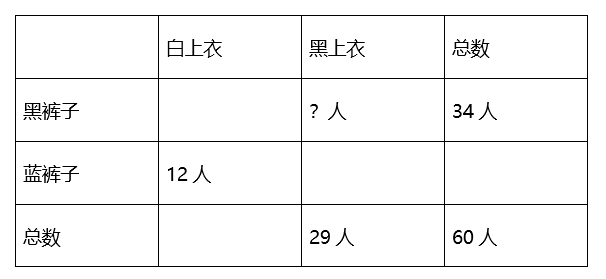

方法一：由上表可知，穿蓝裤子的人数为60-34=26人；穿黑上衣蓝裤子的人数为26-12=14人，则穿黑上衣黑裤子的人数为29-14=15人。

方法二：由上表可知，穿白上衣的人数为60-29=31人；穿白上衣黑裤子人数为31-12=19人，则穿黑上衣黑裤子的人数为34-19=15人。

故正确答案为C。

**考点**：两集合

**来源**：2010年黑龙江省公务员录用考试《行测》题第50题

### 第 51 题

某单位举办庆国庆茶话会，买来4箱同样重的苹果，从每箱取出24千克后，结果各箱所剩的苹果重量的和，恰好等于原来一箱的重量。那么原来每箱苹果重多少千克？

A. 16

B. 24

C. 32

D. 36

第 51 题 · 答案与解析

**参考答案（粉笔题库参考内容）**

C

**解析**

解析1：

设原来每箱苹果重x千克，根据题意可得：4(x-24)=x，解得x=32，故选择C项。

解析2：

原来一共4箱苹果，由“从每箱取出24千克后，结果各箱所剩的苹果重量的和，恰好等于原来一箱的重量”，可知总共取出来的苹果重量是原来3箱苹果的重量，因此原来每箱苹果的重量为：24 × 4 ÷ 3 = 32，故选择C项。

故正确答案为C。

**考点**：和差倍比问题

**来源**：2010年黑龙江省公务员录用考试《行测》题第51题

### 第 52 题

甲有桌子若干张，乙有椅子若干把。如果乙用全部椅子换回数量同样多的桌子，则需补给甲320元；如果乙不补钱，就要少换回5张桌子。已知3张桌子比5把椅子的价钱少48元，那么乙原有椅子多少把？

A. 16

B. 20

C. 48

D. 56

第 52 题 · 答案与解析

**参考答案（粉笔题库参考内容）**

B

**解析**

由“如果乙用全部椅子换回数量同样多的桌子，则需补给甲320元；如果乙不补钱，就要少换回5张桌子”，可知5张桌子的价钱为320元，则每张桌子的价钱为：320÷5=64元。又由“已知3张桌子比5把椅子的价钱少48元”，可知椅子的价钱为：(64×3+48) ÷ 5 = 48元，那么每张桌子比椅子贵：64-48=16元。根据“如果乙用全部椅子换回数量同样多的桌子，则需补给甲320元”，即原有数量的桌子和椅子总差价为320元，则乙原有的椅子数量为：320÷16=20把。

故正确答案为B。

**考点**：和差倍比问题

**来源**：2010年黑龙江省公务员录用考试《行测》题第52题

### 第 53 题

张某下午六时多外出买菜，出门时看手表，发现表的时针和分针的夹角为110°，七时前回家时又看手表，发现时针和分针的夹角仍是110°。那么张某外出买菜用时：

A. 20分钟

B. 30分钟

C. 40分钟

D. 50分钟

第 53 题 · 答案与解析

**参考答案（粉笔题库参考内容）**

C

**解析**

本题按行程问题来解决，分针整个过程比时针多走220度，已知分针速度是每分钟6°，时针速度是每分钟0.5°，因此整个过程即张某外出买菜用的时间为220÷（6－0.5）＝40分钟。

故正确答案为C。

**来源**：2010年黑龙江省公务员录用考试《行测》题第53题

### 第 54 题

某人沿电车线路匀速行走，每12分钟有一辆电车从后面追上，每4分钟有一辆电车迎面开来。假设两个起点站的发车间隔是相同的，求这个发车间隔。

A. 2分钟

B. 4分钟

C. 6分钟

D. 8分钟

第 54 题 · 答案与解析

**参考答案（粉笔题库参考内容）**

C

**解析**

赋值相邻两辆车的距离为48，每12分钟有一辆电车从后面追上，根据S差 = V差 × T追及，得：48 = (V_车 − V_人) × 12······①；每4分钟有一辆电车迎面开来，根据S_和 = V_和 × T_相遇，得：48 = (V车+V人)×4······②，联立两式解得V_车=8，V_入=4。因此发车间隔时间为48/8=6分钟。

故正确答案为C。

**考点**：行程问题-其他

**来源**：2010年黑龙江省公务员录用考试《行测》题第54题

### 第 55 题

某单位有工作人员48人，其中女性占总人数的37.5％，后来又调来女性若干人，这时女性人数恰好是总人数的40％，问调来几名女性？

A. 1人

B. 2人

C. 3人

D. 4人

第 55 题 · 答案与解析

**参考答案（粉笔题库参考内容）**

B

**解析**

由“某单位有工作人员48人，其中女性占总人数的37.5%”可知女工作人员有：48×37.5%=18，设调来x名女性，根据题意可得：(18+x)/(48+x) × 100% = 40%，即(18+x)/(48+x)=2/5，此时不必解方程，直接代入选项可知只有B项符合。

故正确答案为B。

**考点**：和差倍比问题

**来源**：2010年黑龙江省公务员录用考试《行测》题第55题

### 第 56 题

从所给四个选项中，选择最合适的一个填入问号处，使之呈现一定的规律性：

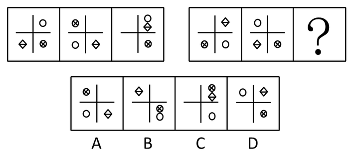

A. A

B. B

C. C

D. D

第 56 题 · 答案与解析

**参考答案（粉笔题库参考内容）**

C

**解析**

元素组成相同，考查位置规律。

通过观察发现，已知图形的组成元素是相同的，所以就直接从位置变化考虑。第一组图形的规律是：有两个元素（圆圈和带叉圆圈）沿对角线跳动，另一个元素（带对角线矩形）沿着逆时针依次按象限跳动。后一组图形也是按照这样的规律变化，即有两个元素（圆圈和带对角线矩形）沿对角线跳动，另一个元素（带叉圆圈）沿着逆时针依次按象限跳动。通过分析只有C项中图形符合。

故正确答案为C。

**考点**：位置规律-平移

**来源**：2010年黑龙江省公务员录用考试《行测》题第56题

### 第 57 题

从所给四个选项中，选择最合适的一个填入问号处，使之呈现一定的规律性：

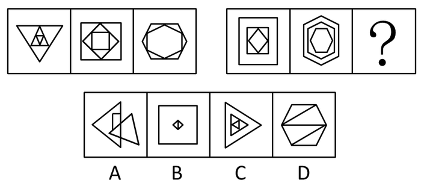

A. A

B. B

C. C

D. D

第 57 题 · 答案与解析

**参考答案（粉笔题库参考内容）**

C

**解析**

观察整体，元素种类。

由已知图形可知，每一个图形都是相同的元素按大小层层相套得到的。通过分析只有C项中的图形符合。

故正确答案为C。

**考点**：数量规律-素

**来源**：2010年黑龙江省公务员录用考试《行测》题第57题

### 第 58 题

从所给四个选项中，选择最合适的一个填入问号处，使之呈现一定的规律性：

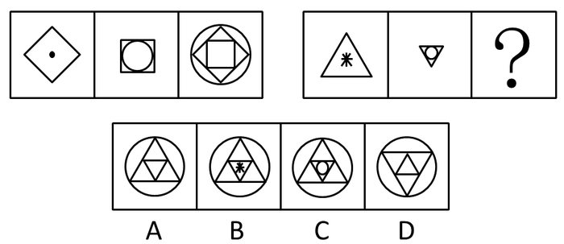

A. A

B. B

C. C

D. D

第 58 题 · 答案与解析

**参考答案（粉笔题库参考内容）**

A

**解析**

元素组成相似，元素叠加运算。

已知图形规律是第一组图形中第二个图形里面的元素成为第三个图形的最外层，第二个图形的外层嵌套在第一个图形中组成第三个图形的内部图形，且叠加时第一个图形里的元素黑点消失。第二组图形也应符合该规律，即第二组图形中第二个图形里面的元素成为第三个图形的最外层，第二个图形的外层嵌套在第一个图形中组成第三个图形的内部图形，且叠加时第一个图形里的元素星点消失。通过分析，只有A项中图形符合。

故正确答案为A。

**考点**：数量规律-素、样式规律-遍历

**来源**：2010年黑龙江省公务员录用考试《行测》题第58题

### 第 59 题

请从所给的四个选项中，选择最适合的一项填在问号处，使之呈现一定的规律性。

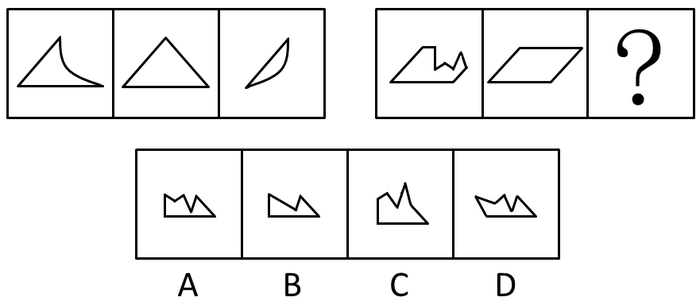

A. A

B. B

C. C

D. D

第 59 题 · 答案与解析

**参考答案（粉笔题库参考内容）**

A

**解析**

元素组成相似，考查元素叠加，已知题干所给图形中前两图叠加后去同存异后经过翻转形成第三个图形，通过观察只有A项中图形符合此规律。

故正确答案为A。

**考点**：样式规律-加减同异

**来源**：2010年黑龙江省公务员录用考试《行测》题第59题

### 第 60 题

从所给四个选项中，选择最合适的一个填入问号处，使之呈现一定的规律性：

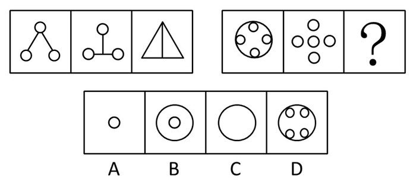

A. A

B. B

C. C

D. D

第 60 题 · 答案与解析

**参考答案（粉笔题库参考内容）**

B

**解析**

已知图形前两图叠加后去同存异形成第三个图形，通过分析只有B项中图形符合。

故正确答案为B。

**考点**：样式规律-加减同异

**来源**：2010年黑龙江省公务员录用考试《行测》题第60题

### 第 61 题

从所给四个选项中，选择最合适的一个填入问号处，使之呈现一定的规律性：

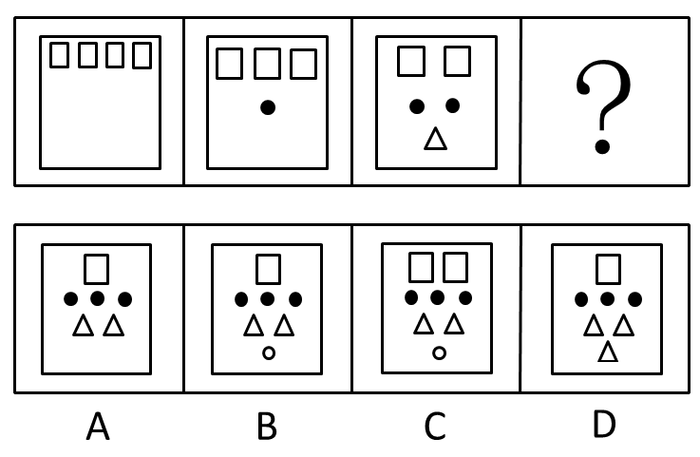

A. A

B. B

C. C

D. D

第 61 题 · 答案与解析

**参考答案（粉笔题库参考内容）**

B

**解析**

已知图形前三个图形中图形元素种类数分别为1、2、3，依次递增，可知下一个图形应有4种元素；空心小方块的数目分别为4、3、2，依次递减，因此下一个图形有1个空心方块；实心小圆圈的数目分别为0、1、2，依次递增，因此下一个图形有3个实心圆圈，有2个三角形。通过分析只有B项中图形符合。

故正确答案为B。

**考点**：数量规律-素

**来源**：2010年黑龙江省公务员录用考试《行测》题第61题

### 第 62 题

从所给四个选项中，选择最合适的一个填入问号处，使之呈现一定的规律性：

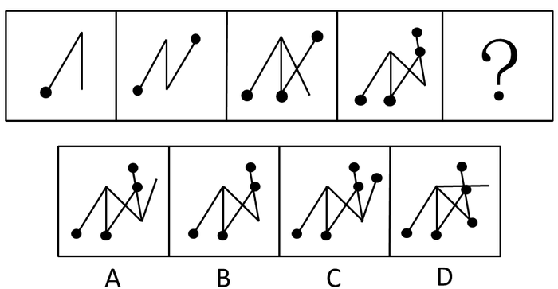

A. A

B. B

C. C

D. D

第 62 题 · 答案与解析

**参考答案（粉笔题库参考内容）**

D

**解析**

观察发现，已知图形呈现的规律是线段和圆点逐个增加，因此第五个图形中线段和圆点的个数应分别为6和5。通过分析，C项和D项中图形均符合这一规律，但进一步观察图形可以看出第一个图形和第三个图形中均有一条没有连接圆点的线段，因此第五个图形也应该有一条没有连接圆点的线段，从而判断C项错误，D项正确。

故正确答案为D。

**考点**：数量规律-素、数量规律-线

**来源**：2010年黑龙江省公务员录用考试《行测》题第62题

### 第 63 题

从所给四个选项中，选择最合适的一个填入问号处，使之呈现一定的规律性：

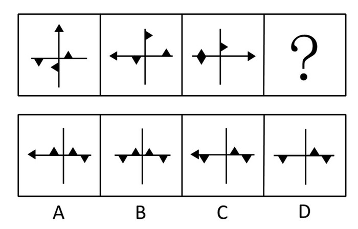

A. A

B. B

C. C

D. D

第 63 题 · 答案与解析

**参考答案（粉笔题库参考内容）**

A

**解析**

将已知图形中横线和竖线划分成20个位置（如下图所示），通过已知图形发现规律为：前一个图形中每个黑色三角形按照20个位置依次移动一格得到下一个图形，且在移动过程中黑色三角形始终有一边紧贴横线或竖线（4、9、14、19这四个端点位置除外），因此能够分析到只有A选项中图形符合。

故正确答案为A。

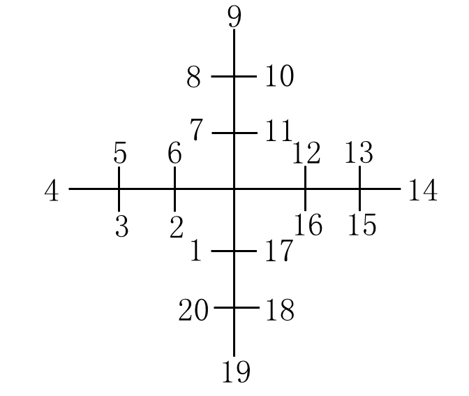

**考点**：位置规律-平移

**来源**：2010年黑龙江省公务员录用考试《行测》题第63题

### 第 64 题

从所给四个选项中，选择最合适的一个填入问号处，使之呈现一定的规律性：

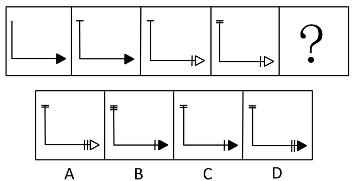

A. A

B. B

C. C

D. D

第 64 题 · 答案与解析

**参考答案（粉笔题库参考内容）**

D

**解析**

题干图形中，黑色箭头和白色箭头呈现周期变化，每两格变化一次，故下一幅图应为黑色箭头，排除A；观察线条，短横线和短竖线交替递增，故下一幅图应为两条短横线，两条短竖线，排除B、C。

故正确答案为D。

**考点**：位置规律-平移

**来源**：2010年黑龙江省公务员录用考试《行测》题第64题

### 第 65 题

从所给四个选项中，选择最合适的一个填入问号处，使之呈现一定的规律性：

A. A

B. B

C. C

D. D

第 65 题 · 答案与解析

**参考答案（粉笔题库参考内容）**

B

**解析**

已知图形均为轴对称图形，通过分析，只有B项中图形是轴对称图形，其他为中心对称图形。

故正确答案为B。

**考点**：属性规律-对称性

**来源**：2010年黑龙江省公务员录用考试《行测》题第65题

### 第 66 题

资本输出是指资本家、资本家集团或资本主义国家政府为了获得高额利润或利息对国外进行投资或贷款。

根据以上的定义，下面哪个不属于资本输出？（  ）

A. 购买国外的油田、矿井

B. 金融危机期间，很多国内私人企业纷纷到国外并购外国公司

C. 购买国外企业的有价证券及股票

D. 向海外发行本国企业的股票和债券

第 66 题 · 答案与解析

**参考答案（粉笔题库参考内容）**

D

**解析**

第一步：抓住定义中的关键词。

关键词强调“对国外进行投资或贷款”。

第二步：逐一判断选项。

A中“购买国外的油田、矿井”；

B中“到国外并购外国公司”；

C中“购买国外企业的有价证券及股票”均是对国外进行投资，因此都属于资本输出；

D中“向海外发行本国企业的股票和债券”，不是对国外进行的投资或贷款，而是吸收资金，因此不属于资本输出。

故正确答案为D。

**考点**：方式目的

**来源**：2010年黑龙江省公务员录用考试《行测》题第66题

### 第 67 题

直觉思维是指行为步骤和思维过程不明确、不清晰，对某些现象或者问题直接地迅速地作出某些猜想、假设或判断的思维。

下面哪一个是典型的直觉思维？（  ）

A. 公安刑警根据收集到的证据，对案件进行分析

B. 军事指挥员根据侦察兵的情报材料作出军事决策

C. 根据所学过的知识解答考试时的难题

D. 医生根据病人的口述材料，迅速地做出疾病的诊断

第 67 题 · 答案与解析

**参考答案（粉笔题库参考内容）**

D

**解析**

第一步：找出定义关键词。

“行为步骤和思维过程不明确、不清晰”、“直接地迅速地作出某些猜想、假设或判断”。

第二步：逐一分析选项。

A项：刑警根据证据对案件分析时的思维过程是清晰、明确的，且是根据证据分析，而非直接、快速地作出判断，不符合“行为步骤和思维过程不明确、不清晰”、“直接地迅速地作出某些猜想、假设或判断”，不符合定义，排除；

B项：军事指挥员根据侦察兵的情报材料作出军事决策，其思维过程是清晰、明确的，且是根据情报材料作出决策，不符合“行为步骤和思维过程不明确、不清晰”、“直接地迅速地作出某些猜想、假设或判断”，不符合定义，排除；

C项：根据所学过的知识解题，其思维过程是清晰、明确的，且是根据所学知识进行答题，不符合“行为步骤和思维过程不明确、不清晰”、“直接地迅速地作出某些猜想、假设或判断”，不符合定义，排除；

D项：医生只是根据病人的口述，并没有经过一系列的检查便迅速做出了判断，符合“行为步骤和思维过程不明确、不清晰”、“直接地迅速地作出某些猜想、假设或判断”，符合定义，当选。

故正确答案为D。

**考点**：单定义-其他句式

**来源**：2010年黑龙江省公务员录用考试《行测》题第67题

### 第 68 题

职务侵占罪是指公司、企业或者其他单位的人员，利用职务上的便利，将本单位财物非法占为已有，数额较大的行为。

下列行为属于职务侵占罪的是（  ）。

A. 张某是名乘警，他将乘客遗失在列车上价值5000元的物品占为已有

B. 刘某是某工地的材料工人，负责工地物品的调拨，几次私自将公司的建筑材料卖给别人，共卖了2万元

C. 刘某是单位的保管员，一天他趁其他同事不注意的时候，将一个200元的收音机拿回家给儿子用

D. 赵某是一跨国公司的会计师，私自作假账，使公司偷税高达200万余元

第 68 题 · 答案与解析

**参考答案（粉笔题库参考内容）**

B

**解析**

第一步：抓住定义中的关键词。

关键词包括“本单位财物”，“非法占为已有”，“数额较大”。

第二步：逐一判断选项。

A中不符合关键词“本单位财物”，因此不属于职务侵占罪；

B项符合关键词，因此属于职务侵占罪；

C中200元数额过小，不符合关键词“数额较大”，因此不属于职务侵占罪；

D中不符合关键词“非法占为已有”。

故正确答案为B。

**考点**：方式目的

**来源**：2010年黑龙江省公务员录用考试《行测》题第68题

### 第 69 题

感觉是指客观刺激作用于感觉器官，经过脑的信息加工活动所产生的对客观事物的基本属性的反映。感觉作为认识过程的初级阶段，为知觉和其他复杂认识过程提供最基本的原始材料。感觉的种类可依其信息的来源分为外部感觉和内部感觉两大类。外部感觉包括视觉、听觉、味觉、嗅觉和肤觉。内部感觉反映机体本身的状态，包括动觉、平衡觉和机体觉。

根据上述定义，下列说法属于感觉的是（  ）。

A. 小明放学回家后，看到餐桌上有一盘刚好做好的红烧肉

B. 小明放学回家后，听到收音机里正播放一首非常好听的歌曲

C. 小明放学回家后，感觉自己的房间刚刚被妈妈打扫干净了

D. 小放放学回家后，感觉天气非常冷

第 69 题 · 答案与解析

**参考答案（粉笔题库参考内容）**

D

**解析**

第一步：抓住定义中的关键词。

关键词包括“客观事物的基本属性”，“认识过程的初级阶段”。

第二步：逐一判断选项。

A中看到“刚好做好”的红烧肉，B中听到“非常好听”的歌曲，C中感觉自己的房间“刚刚被妈妈”打扫干净了，这三项都不是对“客观事物的基本属性”的反映，而是经过了思维过程的知觉，都不符合关键词“认识过程的初级阶段”，已经跳过了这个初级阶段，因此A、B和C均不属于感觉；

D中“冷”是肤觉的基本属性，同时符合关键词“认识过程的初级阶段”，因此属于感觉。

故正确答案为D。

**考点**：单定义-其他句式

**来源**：2010年黑龙江省公务员录用考试《行测》题第69题

### 第 70 题

表见代理是指行为人没有代理权、超越代理权或者代理权终止后以被代理人名义订立合同，相对人有理由相信行为人有代理权的，该代理行为有效。

根据上述定义，下列属表见代理的是（  ）。

A. 甲委托乙前往丙厂采购男装，乙觉得丙生产的女装会有更好的市场，便自作主张以甲的名义向丙订购。丙未问乙的代理权限，便与之订立了买卖合同

B. 甲是乙企业的销售人员，随身携带盖有乙企业公章的空白合同书，便于随时对外签约。后甲因收取回扣被乙企业除名，但空白合同书未收回。甲以此合同书与丙签订购销协议

C. 甲无意中捡到乙的存折后，向乙借用其身份证，到银行提取现金

D. 甲原是某税务机关工作人员，辞职后，他仍穿着制服到市场上收税

第 70 题 · 答案与解析

**参考答案（粉笔题库参考内容）**

B

**解析**

第一步：抓住定义中的关键词。

关键词包括“订立合同”，“相对人有理由相信”，“代理行为”。

第二步：逐一判断选项。

A中乙并未向丙厂出示表示其具有相关代理权的凭证，丙厂对乙超越代理权的行为未尽到适当注意义务，不符合关键词“相对人有理由相信”，因此不属于表见代理；

B中甲的行为符合关键词，因此属于表见代理；

C中根本不是代理行为，其行为已经构成了犯罪，因此不属于表见代理；

D中甲的行为不符合关键词“订立合同”，因此不属于表见代理。

故正确答案为B。

**考点**：单定义-其他句式

**来源**：2010年黑龙江省公务员录用考试《行测》题第70题

### 第 71 题

晕轮效应，又称“光环效应”、“成见效应”、“光晕现象”，是指在人际相互作用过程中形成的一种夸大的社会印象，正如日、月的光辉，在云雾的作用下扩大到四周，形成一种光环作用。常表现在一个人对另一个人（或事物）的最初印象决定了他的总体看法，而看不准对方的真实品质，形成一种好的或坏的“成见”。所以光环效应也可以称为“以点概面效应”，是主观推断的泛化、定势的结果。

根据上述定义，下列属于晕轮效应的是（  ）。

A. 一见钟情

B. 三岁看八十

C. 小时了了，大未必佳

D. 一朝被蛇咬，十年怕井绳

第 71 题 · 答案与解析

**参考答案（粉笔题库参考内容）**

A

**解析**

第一步：找出定义关键词。

“人际相互作用过程中”、“夸大”、“最初印象”。

第二步：逐一分析选项。

A项：“一见钟情”就是由于对象的某一方面符合自己的审美观，往往对思想、情操、性格诸方面存在的不相配处都视而不见，觉得对象是“带有光环的天仙”，样样都尽如人意，是典型的晕轮效应，符合定义，当选；

B项：“三岁看八十”意思是从三四岁的幼童身上可看到他成年以后乃至一辈子的一些状况，特别是个性方面的一些状况不符合关键词“人际相互作用过程中”，因此不属于晕轮效应，不符合定义，排除；

C项：“小时了了，大未必佳”意思是人不能因为少年时聪明而断定他日后定有作为，指不能只看到事物或人的表面现象，正是对晕轮效应的否定，因此不属于晕轮效应，不符合定义，排除；

D项：“一朝被蛇咬，十年怕井绳”说的是经历过后的心理，不符合关键词“最初印象”，因此不属于晕轮效应，不符合定义，排除。

故正确答案为A。

**考点**：故事类

**来源**：2010年黑龙江省公务员录用考试《行测》题第71题

### 第 72 题

联营企业指两个及两个以上相同或不同所有制性质的企业法人或事业单位法人，按自愿、平等、互利的原则，共同投资组成的经济组织。

下列属于联营企业的是（  ）。

A. 经协商，某外资企业与国有企业共同出资，在某山区兴建十所希望小学

B. 某知名企业与一所重点大学的学科带头人合作，成立以研发为主的高科技企业

C. 甲公司是乙公司与丙公司合资兴建的高科技企业，近日，甲公司与乙公司共同投资，组建一家外贸企业

D. 张某是某国有企业的法人代表，近日，他与某科学技术公司共同投资，建立贸易公司

第 72 题 · 答案与解析

**参考答案（粉笔题库参考内容）**

C

**解析**

第一步：找出定义关键词。

“企业法人或事业单位法人”、“经济组织”。

第二步：逐一分析选项。

A项：外资金企业与国有企业共同出资兴建的十所希望小学，不符合关键词“经济组织”，不符合定义，排除；

B项：一所重点大学的学科带头人，不符合关键词“企业法人或事业单位法人”，不符合定义，排除；

C项：甲公司与乙公司，符合“企业法人或事业单位法人”，组建的外贸企业，符合“经济组织”，符合定义，当选；

D项：张某是以个人名义而不是以单位名义与科学技术公司投资建立贸易公司的，不符合关键词“企业法人或事业单位法人”，不符合定义，排除。

故正确答案为C。

**考点**：主客体

**来源**：2010年黑龙江省公务员录用考试《行测》题第72题

### 第 73 题

某市实施“4050”工程，旨在为特殊历史时期形成的女性40岁以上、男性50岁以上的下岗后再就业困难的本市人员度身定制就业岗位，以市场化、社会化的运作机制，促进其就业。

根据上述定义，下列可以申请4050工程就业机会的是（  ）。

A. 张某是在本市打工的河南人，由于超过50岁，找不到工作，于是他去4050工程申请就业

B. 刘某在该市一直没有工作，当她听到这一就业政策后，42岁的她去4050工程申请就业

C. 1990年，30岁的刘阿姨从上海某工厂下岗后，摆了个修鞋摊，由于生意不好，去年就不做了，现在在家闲着，今年她去4050工程申请就业

D. 张先生从某中学退休后，由于身体保养的好，看上去才四十岁左右，他感到在家里没事干，就去4050申请再就业

第 73 题 · 答案与解析

**参考答案（粉笔题库参考内容）**

C

**解析**

第一步：抓住定义中的关键词。

关键词包括“女性40岁以上、男性50岁以上”，“下岗后再就业”，“本市人员”。

第二步：逐一判断选项。

A项中张某不属于本市人员，不符合关键词“本市人员”，因此张某不能申请4050工程就业机会；

B项中刘某不符合关键词“下岗后再就业”，因此刘某不能申请4050工程就业机会；

C项中刘阿姨情况符合关键词，因此刘阿姨能申请4050工程就业机会；

D项中张先生是退休，不符合“下岗再就业”的关键词，因此张先生不能申请4050工程就业机会。

故正确答案为C。

**考点**：主客体

**来源**：2010年黑龙江省公务员录用考试《行测》题第73题

### 第 74 题

缺陷补偿是指个体在充当社会角色时不可能事事成功，当自我角色目标失败时，常常可能会对相关的社会角色的重要性做重新评价，从而进行自我定义以补偿自己角色缺陷。

根据上述定义，下列属于缺陷补偿的是（  ）。

A. 小王认为评上优秀员工是晋升的关键，因此当评选失利后决定在下一次的评选中再接再厉

B. 小张有份很不错的工作，他参加公务员考试是抱着试试看的态度，所以当他得知自己没有通过考试时并未觉得太遗憾

C. 黄某大学毕业后求职不顺利，他觉得这是由于自己不是名牌大学毕业生，否则就业会容易的多

D. 袁女士离婚后全身心投入工作，取得了很大成绩，她认为事业成功比婚姻幸福更重要

第 74 题 · 答案与解析

**参考答案（粉笔题库参考内容）**

D

**解析**

第一步：找出定义关键词。

“自我角色目标失败”、“相关的社会角色”、“重新评价”。

第二步：逐一分析选项。

A项：小王评选失败后只是决定在下一次的评选中再接再厉，不符合关键词“重新评价”，不符合定义，排除；

B项：当小张得知自己没有通过考试时并未觉得太遗憾，同样不符合关键词“重新评价”，不符合定义，排除；

C项：黄某求职不顺觉得这是由于自己不是名牌大学毕业生，是对他个人的角色进行评价，并没有对大学生这个社会群体进行评价，所以不属于对“相关的社会角色”进行评价，不符合定义，排除；

D项：袁女士离婚后（自我角色目标失败），认为事业成功比婚姻幸福更为重要（对相关的社会角色的重要性做重新评价），符合关键词，符合定义，当选。

故正确答案为D。

**考点**：方式目的

**来源**：2010年黑龙江省公务员录用考试《行测》题第74题

### 第 75 题

现在统计中常用的人均可支配收入由四部分构成，分别是：工资性收入、转移性收入、经营性收入和财产性收入。财产性收入一般是指家庭拥有的动产（如银行存款、有价证券等）、不动产（如房屋、车辆、土地、收藏品等）所获得的收入。它包括出让财产使用权所获得的利息、租金、专利收入等；财产营运所获得的红利收入、财产增值收益等。

根据上述定义，下列属于财产性收入的是（  ）。

A. 王某家传的青花瓷器在展览会上被专家估价为200万元

B. 李某买了一辆载重10吨的货车跑运营，每年收入8万元以上

C. 赵某为公司做出重大贡献，公司给予10万元的奖励

D. 高某在闹市有一间房屋，某厂家在房顶安放了广告牌，并支付给他一定费用

第 75 题 · 答案与解析

**参考答案（粉笔题库参考内容）**

D

**解析**

第一步：抓住定义关键词。

“家庭拥有的动产或不动产”，“获得的收入”。

第二步：逐一分析选项。

A项：只是估价并没有获得收入，不符合关键词“获得的收入”，不符合定义，排除；

B项：收入“8万元”其中也包含了自己的劳动，不是单纯的动产或不动产获得的财产性收入，不符合定义，排除；

C项：赵某获得的“10 万元的奖励”，是因为“赵某为公司做出重大贡献”，属于赵某的劳动收入，不属于动产或不动产获得的财产性收入，不符合定义，排除；

D项：高某得到的“广告费”是因某厂家利用了其房屋，属于不动产所获得的收入，符合定义，当选。

故正确答案为D。

**考点**：单定义-其他句式

**来源**：2010年黑龙江省公务员录用考试《行测》题第75题

### 第 76 题

作家：出版商

A. 售货员：商店

B. 主持人：广告

C. 菜农：菜贩

D. 经理：秘书

第 76 题 · 答案与解析

**参考答案（粉笔题库参考内容）**

C

**解析**

第一步：判断题干词语间逻辑关系。

题干两词是对应关系，且是具有合作供应关系的对应关系。

第二步：判断选项词语间逻辑关系。

与题干相同逻辑关系的即为C。

A为职业与工作地点间的对应关系；

B无明显逻辑关系；

D为上级和下级的对应关系。

故正确答案为C。

**考点**：逻辑关系-对应关系

**来源**：2010年黑龙江省公务员录用考试《行测》题第76题

### 第 77 题

稻谷：大米

A. 核桃：桃酥

B. 棉花：棉籽

C. 西瓜：瓜子

D. 花生：花生酱

第 77 题 · 答案与解析

**参考答案（粉笔题库参考内容）**

B

**解析**

第一步：判断题干词语间逻辑关系。

稻谷去壳后是大米，大米是稻谷的一部分，二者为组成关系。

第二步：判断选项词语间逻辑关系。

A项：核桃是制作桃酥的原材料，二者为对应关系，与题干逻辑关系不一致，排除；

B项：棉籽是植物棉花的一部分，二者为组成关系，与题干逻辑关系一致，当选；

C项：西瓜子是西瓜的一部分，但显然瓜子范围太广，与题干逻辑关系不一致，排除；

D项：花生是制作花生酱的原材料，二者为原材料对应关系，与题干逻辑关系不一致，排除。

故正确答案为B。

**考点**：逻辑关系-包容关系

**来源**：2010年黑龙江省公务员录用考试《行测》题第77题

### 第 78 题

火车：地铁

A. 轿车：货车

B. 飞机：火箭

C. 索道：山路

D. 木船：汽船

第 78 题 · 答案与解析

**参考答案（粉笔题库参考内容）**

A

**解析**

第一步：判断题干词语间逻辑关系。

“火车”和“地铁”都是日常交通运输工具，是并列关系。

第二步：判断选项词语间逻辑关系。

A 项：“轿车”和“货车”都是日常交通运输工具，是并列关系，与题干逻辑关系一致，当选；

B 项：“飞机”和“火箭”是并列关系，但是“火箭”不是日常交通运输工具，排除；

C 项：“索道”和“山路”不是并列关系，“索道”又称吊车、缆车、流笼，是交通工具的一种，“山路”不是交通工具，排除；

D 项：“木船”和“汽船”是交叉关系，有的“木船”靠蒸汽发动也可以称为“汽船”，排除。

故正确答案为A。

**考点**：逻辑关系-并列关系

**来源**：2010年黑龙江省公务员录用考试《行测》题第78题

### 第 79 题

高山：陆地

A. 波浪：海洋

B. 暴雨：雷电

C. 白云：蓝天

D. 电能：电网

第 79 题 · 答案与解析

**参考答案（粉笔题库参考内容）**

A

**解析**

第一步：判断题干词语间逻辑关系。

高山是陆地上的一种地质形态，高山是陆地经过地壳运动的抬升和隆起而形成，二者为组成关系。

第二步：判断选项词语间逻辑关系。

A项：波浪是海洋的一部分，是海洋运动形成的，二者为组成关系，与题干逻辑关系一致，当选；

B项：暴雨和雷电都是自然现象，雷电是在对流旺盛的积雨云中发展而来的，紧接着伴随的就是暴雨等极端天气，暴雨和雷电是并列关系，与题干逻辑关系不一致，排除；

C项：白云在蓝天上，二者是对应关系，与题干逻辑关系不一致，排除；

D项：电网是指发电和用电的设施和设备的统称，而电能是一种能源，电能主要通过电网产生、输送和使用，二者是对应关系，与题干逻辑关系不一致，排除。

故正确答案为A。

**考点**：逻辑关系-包容关系

**来源**：2010年黑龙江省公务员录用考试《行测》题第79题

### 第 80 题

聪明：愚蠢

A. 男人：女人

B. 黑色：白色

C. 墨镜：光明

D. 财富：贫困

第 80 题 · 答案与解析

**参考答案（粉笔题库参考内容）**

B

**解析**

第一步：判断题干词语间逻辑关系。

聪明和愚蠢是并列关系中反对关系。（注：将题干看成反义关系，本题无答案）。

第二步：判断选项词语间逻辑关系。

A项：男人和女人是并列关系中矛盾关系，与题干逻辑关系不一致，排除；

B项：黑色和白色是并列关系中反对关系，与题干逻辑关系一致，当选；

C项：墨镜和光明不是并列关系中反对关系，与题干逻辑关系不一致，排除；

D项：财富和贫困不是并列关系中反对关系，与题干逻辑关系不一致，排除。

故正确答案为B。

**考点**：逻辑关系-并列关系

**来源**：2010年黑龙江省公务员录用考试《行测》题第80题

### 第 81 题

父亲：女儿

A. 叔叔：阿姨

B. 儿子：女婿

C. 姨夫：姨妈

D. 外祖父：母亲

第 81 题 · 答案与解析

**参考答案（粉笔题库参考内容）**

D

**解析**

第一步：判断题干词语间逻辑关系。

题干两词是对应关系，且是上一辈跟下一辈的对应关系。

第二步：判断选项词语间逻辑关系。

与题干相同逻辑关系的即为D。

A、B和C中均是同一辈分的对应关系。

故正确答案为D。

**考点**：逻辑关系-对应关系

**来源**：2010年黑龙江省公务员录用考试《行测》题第81题

### 第 82 题

药物：治病

A. 滑板：运动

B. 食物：饥饿

C. 扫帚：卫生

D. 新闻：采访

第 82 题 · 答案与解析

**参考答案（粉笔题库参考内容）**

A

**解析**

第一步：判断题干词语间逻辑关系。

题干两词是对应关系，且是物品与其用途间的对应关系，即“药物”是用来“治病”的。

第二步：判断选项词语间逻辑关系。

与题干相同逻辑关系的即为A，即“滑板”是用来“运动”的；

B中“食物”是用来解决“饥饿”的，不是物品与其用途间的对应关系；

C中“扫帚”对应的应该为“打扫”，而不是“卫生”；

D是因果关系。

故正确答案为A。

**考点**：逻辑关系-对应关系

**来源**：2010年黑龙江省公务员录用考试《行测》题第82题

### 第 83 题

医生：病人（    ）。

A. 园丁：花朵

B. 父母：子女

C. 青蛙：庄稼

D. 啄木鸟：害虫

第 83 题 · 答案与解析

**参考答案（粉笔题库参考内容）**

A

**解析**

第一步：判断题干词语间逻辑关系。

医生的工作对象是病人，题干两个词属于工作对象对应关系。

第二步：判断选项词语间逻辑关系。

A项：园丁的作业对象是花朵，且医生和园丁同是社会职业的一种，与题干逻辑关系一致，当选；

B项：父母与子女之间是亲属关系，不是工作对象，与题干逻辑关系不一致，排除；

C项：青蛙吃害虫可以保护庄稼，青蛙不是职业的一种，与题干逻辑关系不一致，排除；

D项：啄木鸟与害虫是天敌关系，与题干逻辑关系不一致，排除。

故正确答案为A。

**考点**：逻辑关系-对应关系

**来源**：2010年黑龙江省公务员录用考试《行测》题第83题

### 第 84 题

蜜蜂：蜂蜜

A. 蝴蝶：茧蛹

B. 母鸡：鸡蛋

C. 父亲：孩子

D. 农民：粮食

第 84 题 · 答案与解析

**参考答案（粉笔题库参考内容）**

D

**解析**

题干：蜜蜂和蜂蜜是对应关系，蜜蜂生产蜂蜜，蜂蜜不是蜜蜂体内合成生产的，而是采自花蜜后经过自身的消化再储存到蜂巢中得来。

A项，蝴蝶和茧蛹是对应关系，但蝴蝶并不生产茧蛹，蝴蝶是在茧蛹中孵化成成虫；

B项，母鸡和鸡蛋是对应关系，母鸡下鸡蛋，但要和题干关系相区别，鸡蛋是母鸡自身产出的；

C项，孩子和父亲是并列关系，二者并不是生产、产出的关系；

D项，农民和粮食是对应关系，农民生产粮食，粮食并不是农民自身产出的，而是经过耕种得来的。

故正确答案为D。

**考点**：逻辑关系-对应关系

**来源**：2010年黑龙江省公务员录用考试《行测》题第84题

### 第 85 题

枕头：卧具

A. 铅笔：工具

B. 地球：宇宙

C. 宣纸：文具

D. 车厢：火车

第 85 题 · 答案与解析

**参考答案（粉笔题库参考内容）**

C

**解析**

第一步：判断题干词语间逻辑关系。

题干两词是包容关系，且是包容关系中的种属关系，后者包含前者。

第二步：判断选项词语间逻辑关系。

与题干逻辑关系相同的即为C项。

A项中“铅笔”对应的应该为“文具”；

B项中“地球”对应的应该为“行星”；

D项中两词是包容关系中的组成关系。

故正确答案为C。

**考点**：逻辑关系-包容关系

**来源**：2010年黑龙江省公务员录用考试《行测》题第85题

### 第 86 题

群众对领导干部的不满，不仅产生于领导的作为和业绩，而且很大程度上是由于对领导的期望值与实际表现之间的差距。因此，如果竞选任何一个单位或部门的领导，竞选者在竞选过程中一味向群众许愿、夸海口是一种不明智的做法。

从以上议论可以推出以下哪项结论？（  ）

A. 只要群众对领导的期望值足够低，即使这个领导在职期间无所作为，群众也不会产生不满情绪

B. 只要领导的作为和业绩出色，群众就不会产生不满情绪

C. 由于群众的期望值高，尽管领导的工作成绩优秀，群众的不满情绪仍可能存在

D. 聪明的领导竞选者在竞选时不应向群众承诺什么

第 86 题 · 答案与解析

**参考答案（粉笔题库参考内容）**

C

**解析**

第一步：抓住每句话中的对象。

第一句强调群众对领导干部产生的不满有两方面的原因，一是领导的作为和业绩，二是对领导的期望值与实际表现之间的差距。第二句说明竞选时竞选者最好不要一味向群众许愿、夸海口。

第二步：逐一分析判断选项的正确。

第一步中得到的两方面的原因任何一方面出了问题，群众都可能产生不满情绪。

A和B中均只片面地涉及了其中的一方面，因此A和B均错；

C中正是把握到了这两个方面，因此正确；

材料只是说“领导者在竞选过程中一味向群众许愿、夸海口是一种不明智的做法”，并未说领导竞选者不应该向群众承诺什么，因此D错。

故正确答案为C。

**考点**：日常结论

**来源**：2010年黑龙江省公务员录用考试《行测》题第86题

### 第 87 题

某工厂进行结构重组，计划减员25%，撤销三个生产车间，这三个生产车间的人数正好占工厂总人数的25%。计划实施后，上述三个生产车间被撤销，整个工厂实际减员15%。此过程中，工厂内部人员有所调整，但整个工厂只有减员，没有增员。

如果上述判定为真，以下哪项一定为真？（  ）

Ⅰ上述计划实施后，有的生产车间调入新成员

Ⅱ上述计划实施后，没有一个生产车间调入的新成员的总数超出工厂原来总人数的10%

Ⅲ上述计划实施后，被撤销的生产车间中的留任人员不超过工厂原来总人数的10%

A. 只有Ⅰ

B. 只有Ⅰ和Ⅱ

C. 只有Ⅱ和Ⅲ

D. Ⅰ、Ⅱ和Ⅲ

第 87 题 · 答案与解析

**参考答案（粉笔题库参考内容）**

A

**解析**

第一步：分析题干。

第一句计划减员25%，撤销的三个生产车间人数正好占工厂总人数的25%；第二句三个生产车间被撤销，整个工厂实际减员15%；第三句整个工厂只有减员，没有增员。

第二步：逐一分析选项。

如果有的生产车间没有调入新成员，那么实际减员一定是25% 。而实际减员15%，所以有的生产车间一定加入新成员，因此Ⅰ正确；

三个生产车间的人数可以一起全部放到其他的一个车间，那么那个车间就增加25%，但其他车间又裁员15%，所以可能一个车间增加10%以上，因此Ⅱ错误；

被撤销的生产车间的人员可能全部留下来了，而从其他车间减员了，因此Ⅲ错误。

综上，只有Ⅰ正确。

故正确答案为A。

**考点**：日常结论

**来源**：2010年黑龙江省公务员录用考试《行测》题第87题

### 第 88 题

在毕业考试结束后，班长想从老师那里打听成绩。班长说：“老师，这次考试不太难，估计我们班同学的成绩都在70分以上吧。”老师说：“你的前半句话不错，后半句话不对。”

根据老师的意思，下列哪项必为事实？（  ）

A. 少数同学的成绩在70分以上，多数同学的成绩在70分以下

B. 多数同学的成绩在70分以上，少数同学的成绩在70分以下

C. 有的同学的成绩在70分以上，有的同学的成绩在70分以下

D. 如果以70分为及格，肯定有的同学的成绩不及格

第 88 题 · 答案与解析

**参考答案（粉笔题库参考内容）**

D

**解析**

第一步：分析题干。

 班长：“这次考试不太难，估计我们班同学的成绩都在70分以上”。

老师： “前半句话不错，后半句话不对”。

由此可知：这次考试的情况是难度不大，但并非所有同学的成绩都在70分以上，即有的同学成绩没有在70分以上。

第二步：逐一分析选项。

A项：根据题干“有的同学成绩没有在70分以上”，无法推出没有在70分以上的到底是多数还是少数，注意“有的”的范围是“1≤有的≤全部”， 无法推出，排除；

B项：根据题干“有的同学成绩没有在70分以上”，无法推出没有在70分以上的到底是多数还是少数，注意“有的”的范围是“1≤有的≤全部”，无法推出，排除；

C项：根据题干“有的同学成绩没有在70分以上”，无法推出“有的同学成绩在70分以上”，“有的A是B”无法推出“有的A不是B”，排除；

D项：如果“以70分为及格”，已知“有的同学成绩没有在70分以上”，可推出“有的同学成绩没有及格”，可以推出，当选。

故正确答案为D。

**考点**：真假推理-其他

**来源**：2010年黑龙江省公务员录用考试《行测》题第88题

### 第 89 题

小明忘记了今天是星期几，于是他去问O、P、Q三人。O回答：“我也忘记今天是星期几了，但你可以去问P、Q两人。”P回答：“昨天是我说谎的日子。”Q的回答和P一样。已知：

① O从来不说谎；

② P在星期一、星期二、星期三这三天说谎，其余时间都讲真话；

③ Q在星期四、星期五、星期六这三天说谎，其余时间都讲真话。

根据以上条件，今天是星期几？（  ）

A. 星期一

B. 星期二

C. 星期四

D. 星期天

第 89 题 · 答案与解析

**参考答案（粉笔题库参考内容）**

C

**解析**

第一步：找突破口。

本题突破口是P和Q都说“昨天是我说谎的日子”，但Q和P他们说谎的日子完全不同。由此可知，P和Q必定一个讲真话，一个讲假话。

第二步：通过突破口继续分析得出结论。

假设P说的是假话，只能判定为今天星期一；Q说的是真话，则今天是星期天。二者无交集，因此假设错误。

假设Q说的是假话，今天就是星期四；P说的是真话，则今天只能为星期四，二者有交集，因此假设正确。

综上，今天是星期四。

故正确答案为C。

**考点**：假设

**来源**：2010年黑龙江省公务员录用考试《行测》题第89题

### 第 90 题

五人——J、K、L、M和O聚在一起玩一种叫“三人玩”的游戏。游戏的每一圈只能三个人玩。下列是所有的规则，它将影响到每圈游戏参加者的顺序和玩的圈数：

① 没有人可以连续玩三圈；

② 没有人可以连续两圈不玩；

③ 每个人都必须玩三圈。

如果J、L和M玩第一圈，而K、M和O玩第二圈，下列哪一位一定玩第四圈？（  ）

A. J

B. K

C. L

D. M

第 90 题 · 答案与解析

**参考答案（粉笔题库参考内容）**

D

**解析**

第一步：抓住题干中的关键。

规则1：没有人可以连续玩三圈；

规则2：没有人可以连续两圈不玩；

规则3：每个人都必须玩三圈。

第二步：分析题目并选出答案。

第一圈由JLM玩，第二圈是由KMO玩，由规则1“没有人可以连续玩三圈”和M在第一圈和第二圈都玩过可知，则M在第三圈不可能玩。又因为规则2“没有人可以连续两圈不玩”和M第三圈没玩可知，M不可能再连着不玩第四圈，因此第四圈M一定玩。

故正确答案为D。

**考点**：从确定信息开始推

**来源**：2010年黑龙江省公务员录用考试《行测》题第90题

### 第 91 题

一项调查报告显示，儿童意外伤害地点排名中，客厅卧室占39.85%，排名居首，其次才是幼儿园占37.41%，再次是公共场所和娱乐场所22.74％，由此有专家认为，儿童受伤，头号凶手是“家”。

以下选项，最能削弱上述结论的是（  ）。

A. 调查显示，很多情况下儿童受伤是因为年轻父母缺乏经验造成的

B. 据调查，造成意外死亡的地点大多是在公共场所和娱乐场所

C. 统计显示，儿童在客厅卧室的时间占儿童活动时间的50%以上

D. 这份调查是针对3至6岁儿童进行的

第 91 题 · 答案与解析

**参考答案（粉笔题库参考内容）**

C

**解析**

第一步：找到论点和论据。

本题论点是儿童受伤，头号凶手是“家”，论据是儿童意外伤害地点排名中，客厅卧室占39.85%，排名居首，其次才是幼儿园占37.41%，再次是公共场所和娱乐场所22.74%。

第二步：逐一判断选项的作用。

A项：年轻父母缺乏经验造成儿童受伤与儿童受伤地点是家无直接关系，属无关选项；

B项：造成意外死亡的地点与儿童受伤地点是家无直接关系，属无关选项；

C项：削弱论点需要利用受伤数占总量的比例证明，选项中儿童在客厅卧室的时间占儿童活动时间的50%以上，而题干中儿童受伤客厅卧室只占39.85%，从而削弱了论点；

D项：把儿童这一被调查群体限制在“3至6岁儿童”这个范围里与儿童受伤地点是家无直接关系，属无关选项。

故正确答案为C。

**考点**：拆桥

**来源**：2010年黑龙江省公务员录用考试《行测》题第91题

### 第 92 题

甲、乙、丙三人，他们的职业有律师、医生和教师。已知：1、丙的收入比教师高；2、甲的收入和医生不同；3、医生的收入比乙少。

根据以上条件，下列对甲、乙、丙三人身份判断正确的是（  ）。

A. 甲是律师 乙是教师 丙是医生

B. 甲是教师 乙是医生 丙是律师

C. 甲是教师 乙是律师 丙是医生

D. 甲是律师 乙是医生 丙是教师

第 92 题 · 答案与解析

**参考答案（粉笔题库参考内容）**

C

**解析**

第一步：找突破口。

本题突破口是信息量最大对象，即医生。由“（2）甲的收入和医生不同”知，甲不是医生，由“医生的收入比乙少”知，乙不是医生，因此医生是丙。

第二步：抄信息于表中，即将题干和第一步的所有信息放在一个表中。

人：                               丙                          乙

                        ＜                         ＜

职业： 教师                 医生

第三步：填空，即填上每一个集合的空格。

人：   （甲）                丙                          乙

                        ＜                         ＜

职业： 教师                 医生                  （律师）

故正确答案为C。

**考点**：从最大信息开始推

**来源**：2010年黑龙江省公务员录用考试《行测》题第92题

### 第 93 题

经某省动物检验部门对本省生猪市场在售生猪的检验发现，有1%的生猪含有瘦肉精。但该省动物检验部门明确只有非本省生产的生猪才接受该项检验。有关专家因此推断，该省在售生猪中含有瘦肉精的比例将大大低于1%。

以下最有力地支持专家推断的一项是（  ）。

A. 该省境内在售生猪中，非本省生产的生猪比例不到1%

B. 该省境内，非本省生产的生猪含瘦肉精的比例约占外省生猪总数的0.1%

C. 与该省交界的乙省境内，至今未收到关于在售生猪含瘦肉精的报告

D. 与正常的生猪相比，含瘦肉精的生猪更多地销售到外省去

第 93 题 · 答案与解析

**参考答案（粉笔题库参考内容）**

D

**解析**

第一步：找出论点和论据。

论点：该省在售生猪中含有瘦肉精的比例将大大低于1%。

论据：该省动物检验部门明确只有非本省生产的生猪才接受该项检验。

第二步：逐一分析选项。

A项：非本省生产的生猪比例不到1%，与在售生猪中含有瘦肉精的比例无直接关系，属无关选项，排除；

B项：非本省生产的生猪含瘦肉精的比例约占外省生猪总数的0.1%，与售生猪中含有瘦肉精的比例无直接关系，属无关选项，排除；

C项：乙省是否收到在售生猪含瘦肉精的报告与该省无直接关系，属无关选项，排除；

D项：与正常的生猪相比，含瘦肉精的生猪更多地销售到外省去，说明本省生产的在本省销售的生猪基本没有瘦肉精，对论点和论据进行搭桥，加强了论证，当选。

故正确答案为D。

**考点**：搭桥

**来源**：2010年黑龙江省公务员录用考试《行测》题第93题

### 第 94 题

甲、乙、丙、丁四个队进行足球循环比赛，已知下列情况：

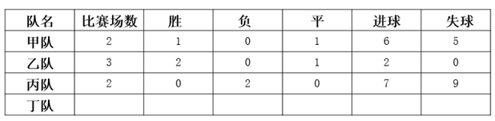

从以上条件，可得出的结论是（  ）。

A. 乙队以2：0的比分战胜丙队

B. 乙队对丁队的比分是1：0

C. 丙队以7：8的比分输给了甲队

D. 乙队和丁队有可能踢成平局

第 94 题 · 答案与解析

**参考答案（粉笔题库参考内容）**

B

**解析**

乙比赛场数最多，所以本题突破口为乙队的战绩。

由乙队共进2球，胜2场，平1场可知：乙队胜的两场都是1：0，平的一场是0：0，排除A项。

因为甲没有负场，所以乙胜的两场都是对丙和丁，即比分均为1:0，排除D项，且B项正确；

又因为甲共进了6个球，所以丙队不可能以7：8的比分输给了甲队，排除C项。

故正确答案为B。

**考点**：排除法

**来源**：2010年黑龙江省公务员录用考试《行测》题第94题

### 第 95 题

有人向某市政府提议应该在所有新建的房屋内安装一种起火时会自动激发的洒水器。但是一位房地产开发商认为，既然90%的房屋着火都是被家庭成员扑灭的，所以安装室内自动洒水器对灭火意义不大。

以下哪项如果为真，则最能削弱房地产开发商的观点？（  ）

A. 大多数人都没有经过灭火技能的正规训练

B. 在住宅内安装烟雾探测器比安装洒水器要便宜得多

C. 该市消防队奔赴火场的时间要比全国平均时间短

D. 住宅着火导致的大部分财产损失是因为起火时家人都不在场

第 95 题 · 答案与解析

**参考答案（粉笔题库参考内容）**

D

**解析**

第一步：找到论点和论据。

本题论点是安装室内自动洒水器对灭火意义不大，论据是90%的房屋着火都是被家庭成员扑灭的。

第二步：判断削弱方式。

本题论点与论据间存在因果关系，所以需削弱论点。

第三步：逐一判断选项的作用。

A项：是否经过灭火技能的正规训练与安装室内自动洒水器无直接关系，属无关选项；

B项：安装烟雾探测器比安装洒水器要便宜，但二者功能不同，一个是检测着火，一个是灭火，从而与安装室内自动洒水器无直接关系，属无关选项；

C项：消防队奔赴火场的时间短与安装室内自动洒水器无直接关系，属无关选项；

D项：住宅着火导致的大部分财产损失都是因为起火时家人都不在场，说明了即使90%的房屋着火都是被家庭成员扑灭的，也是意义甚小，因为造成的大部分损失都是家庭成员不在场所导致的。从而可以证明安装室内自动洒水器对灭火意义重大，也就最有力地削弱了房地产商的观点。

故正确答案为D。

**考点**：削弱论点

**来源**：2010年黑龙江省公务员录用考试《行测》题第95题

## 材料 1

一、根据下表完成各题。

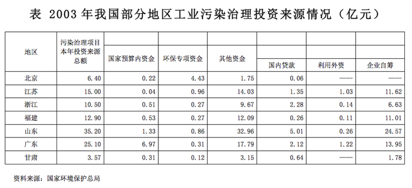

| 地区 | 污染治理项目本年投资来源总额 | 国家预算内资金 | 环保专项资金 | 其他资金 | 国内贷款 | 利用外资 | 企业自筹 |
| --- | ---: | ---: | ---: | ---: | ---: | ---: | ---: |
| 北京 | 6.40 | 0.22 | 4.43 | 1.75 | 0.06 | —— | —— |
| 江苏 | 15.00 | 0.04 | 0.96 | 14.03 | 1.35 | 1.03 | 11.62 |
| 浙江 | 10.50 | 0.51 | 0.27 | 9.67 | 2.28 | 0.14 | 6.63 |
| 福建 | 12.90 | 0.53 | 0.27 | 12.09 | 0.26 | 0.11 | 11.01 |
| 山东 | 35.20 | 1.33 | 0.86 | 32.96 | 5.01 | 0.26 | 24.57 |
| 广东 | 25.10 | 6.97 | 0.31 | 17.79 | 2.12 | 1.22 | 13.95 |
| 甘肃 | 3.57 | 0.31 | 0.12 | 3.15 | 0.64 | —— | 1.78 |

### 第 96 题

2003年甘肃全省污染治理投资总额约为同期北京环保专项资金的（  ）。

A. 55%

B. 60%

C. 75%

D. 80%

第 96 题 · 答案与解析

**参考答案（粉笔题库参考内容）**

D

**解析**

根据题干“2003年······约为······”，结合选项为“%”，可判定本题为比值计算问题。定位表格可得：2003年甘肃全省污染治理投资总额为3.57亿元，同期北京环保专项资金为4.43亿元。前者是后者的3.57/4.43 ≈ 80%。

故正确答案为D。

**考点**：比值计算、统计表

**来源**：2010年黑龙江省公务员录用考试《行测》题第96题

### 第 97 题

2003年上述七省市工业污染治理资金投资总额为（  ）亿元。

A. 108.67

B. 91.44

C. 69.56

D. 110.36

第 97 题 · 答案与解析

**参考答案（粉笔题库参考内容）**

A

**解析**

定位表格可得： 2003年我国北京、江苏、浙江、福建、山东、广东、甘肃工业污染治理资金投资额分别为6.40亿元、15.00亿元、10.50亿元、12.90亿元、35.20亿元、25.10亿元、3.57亿元。则七省市工业污染治理资金投资总额为6.40+15.00+10.50+12.90+35.20+25.10+3.57=108.67亿元。

故正确答案为A。

注：本题可用尾数法，列式尾数为7，可以快速锁定A项。

**考点**：简单加减计算、统计表

**来源**：2010年黑龙江省公务员录用考试《行测》题第97题

### 第 98 题

如果2001年广东省工业污染治理国家预算内资金为3.10亿元，则2001至2003年，该项资金年平均增长率约为（  ）。

A. 75%

B. 60%

C. 50%

D. 36%

第 98 题 · 答案与解析

**参考答案（粉笔题库参考内容）**

C

**解析**

根据题干“······2001至2003年，该项资金年平均增长率约为”，结合选项为“%”，可判定本题为年均增长率计算问题。定位表格可得：2003年广东省工业污染治理国家预算内资金为6.97亿元。根据年均增长率公式：基期量 × (1 + r年均)^n = 现期量，即(1 + r_年均)^n = 现期量/基期量，代入数据：(1 + r_年均)^2=6.97/3.10≈ 2.25 = (1 + 50%)^2，即r(年均)≈50%。

故正确答案为C。

**考点**：年均增长率、统计表

**来源**：2010年黑龙江省公务员录用考试《行测》题第98题

### 第 99 题

以下说法正确的一项是（  ）。

A. 2003年福建全省工业污染治理资金主要来源于企业自筹

B. 2003年工业污染治理任务最重的是山东省

C. 2003年浙江省工业污染治理国内贷款额比江苏省的少

D. 2003年北京无需利用外资治理工业污染

第 99 题 · 答案与解析

**参考答案（粉笔题库参考内容）**

A

**解析**

A项：定位表格可得，2003年福建全省工业污染治理项目本年投资总额为12.90亿元，企业自筹就有11.01亿元，占比11.01/12.90 ＞ 80%，正确；

B项：定位表格可得，2003年山东的污染治理投资总额为35.20亿元，为所列省市中最高，但污染治理投资金额最多，并不能推出其工业污染治理任务最重，错误；

C项：定位表格可得，2003年浙江省工业污染治理国内贷款额为2.28亿元，江苏省的国内贷款为1.35亿元。2.28亿元＞1.35亿元，错误；

D项：定位表格可得， 2003年北京治理工业污染利用外资额无数据统计。并不能推出北京无需利用外资治理工业污染，错误。

故正确答案为A。

**考点**：统计表、综合分析

**来源**：2010年黑龙江省公务员录用考试《行测》题第99题

## 材料 2

二、请根据下表完成各题。

有学者跟踪研究了某群体500名成年人的收入情况，并将1991年该人群的收入分布在1996年的变动情况绘制成表2。如1991年属于收入最低1/5组的该人群在1996年时有51人依然处于同一位置，而有4人进入了收入最高1/5组。

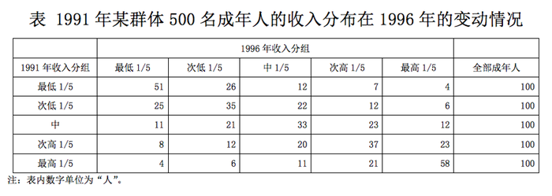

### 第 100 题

在1991年，收入属最低1/5组的该人群当中，有（  ）在1996年进入了收入次高的组别。

A. 7人

B. 12人

C. 21人

D. 23人

第 100 题 · 答案与解析

**参考答案（粉笔题库参考内容）**

A

**解析**

定位表格可得：1991年，收入属最低1/5组的该人群当中，有7人在1996年进入了收入次高的组别。

故正确答案为A。

**考点**：直接找数、综合资料

**来源**：2010年黑龙江省公务员录用考试《行测》题第100题

### 第 101 题

在1996年的该人群中，约有百分之多少的人收入情况好于1991年：

A. 54

B. 43

C. 29

D. 37

第 101 题 · 答案与解析

**参考答案（粉笔题库参考内容）**

C

**解析**

根据题干“在······中，约有百分之多少······”，可判定本题为现期比重计算问题。定位表格可得： 在1991年收入最低1/5组中，1996年收入高于最低1/5组的人数有：26+12+7+4=49人；在1991年收入次低1/5组中，1996年收入高于次低1/5组的人数有：22+12+6=40人；在1991年收入中组中，1996年收入高于中组的人数有：23+12=35人；在1991年收入次高1/5组中，1996年收入高于次高1/5的人数有：23人。因此1996年收入情况好于1991年的人数占比为(49+40+35+23)/500= 147/500 = 29.4%，与C项最接近。

故正确答案为C。

**考点**：现期比重、综合资料

**来源**：2010年黑龙江省公务员录用考试《行测》题第101题

### 第 102 题

下列图示能够反映1991年收入处于中等组的该人群在1996年收入分布情况的是：

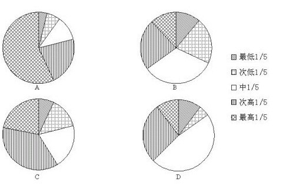

A. A

B. B

C. C

D. D

第 102 题 · 答案与解析

**参考答案（粉笔题库参考内容）**

B

**解析**

根据题干“······1996年收入分布情况······”，结合选项为饼状图，可判定本题为现期比重的计算问题。定位表格可得：1991年收入处于中等组的人群，1996年收入从最低1/5组至最高1/5组的人数依次为：11人、21人、33人、23人、12人。最大值33人对应饼形图白色部分，结合选项可排除A、C；最大值占整体的比例为33/100≈1/3，可排除D项。

故正确答案为B。

**考点**：现期比重、综合资料

**来源**：2010年黑龙江省公务员录用考试《行测》题第102题

### 第 103 题

根据上表，下列说法错误的是：

A. 收入情况属于某个分组的该人群在数年后依然留在该组的可能性比流入其他各组的可能性都大

B. 该表数据不足以反映该人群长期性的收入特征

C. 如果该人群的收入情况数年后发生了变化，则他们最可能流入与他们最邻近的分组

D. 1991—1996年六年间，共有47.2%的该人群从未进入过次高收入组和最高收入组

第 103 题 · 答案与解析

**参考答案（粉笔题库参考内容）**

D

**解析**

A项：定位表格可得：从最低1/5组至最高1/5组同时满足在1991年、1996年收入分组中的人数分别为51人、35人、33人、37人、58人，人数大于流入其他组的人数。因此，收入情况属于某个分组的该人群在数年后依然留在该组的可能性比流入其他各组的可能性都大，正确；

B项：定位表格可得：从1991年至1996年，该项研究持续时间为6年，不足以反映该人群长期性收入特征，正确；

C项：定位表格可得：如果该人群的收入情况数年后发生了变化，则他们流入最邻近组的人数大于其他分组，正确；

D项：定位表格可得：1991年、1996年未进过次高收入组和最高收入组的人数有：51+26+12+25+35+22+11+21+33=236人。这部分人群的占比为236/500 = 47.2%。但这并不能说这一比例人群从未进入过该收入分组，因为有可能出现在其中的某一年进入过次高收入组或最高收入组，但1996年的收入又下降到1991年的水平甚至更低，错误。

故正确答案为D。

**考点**：综合分析、综合资料

**来源**：2010年黑龙江省公务员录用考试《行测》题第103题

## 材料 3

根据以下资料，完成各题。

        2008年全年某省农作物总播种面积6606.46万亩，同比增长0.9%。主要品种中，粮食作物面积3749.91万亩，同比增长0.8%；其中：稻谷面积2920.35万亩，同比增长0.4%。甘蔗面积224.51万亩，油料作物面积485.81万亩，烟叶面积35.23万亩，蔬菜面积1668.94万亩，同比分别增长1.5%、4.3%、19.9%和4.5%。木薯面积128.38万亩，瓜类面积60.64万亩，青饲料面积93.09万亩，同比分别下降10.4%、9.8%和17.6%。

        2008年全年该省粮食作物产量1243.44万吨，同比下降3.2%；其中：稻谷产量1003.30万吨，同比下降4.1%。甘蔗产量1198.84万吨，油料产量81.54万吨，烟叶产量4.93万吨，蔬菜产量2431.43万吨，同比分别增长1.5%、4.9%、18.2%和3.4%。木薯产量158.89万吨，瓜类产量97.78万吨，青饲料产量125.34万吨，同比分别下降9.0%、8.2%和23.4%。

### 第 104 题

2007年，该省农作物总播种面积约多少万亩：

A. 6320

B. 6548

C. 6453

D. 6423

第 104 题 · 答案与解析

**参考答案（粉笔题库参考内容）**

B

**解析**

根据题干“2007年，该省农作物总播种面积······”，结合材料已知2008年相关数据，可判定本题为基期计算问题。定位第一段文字可得：2008年全年某省农作物总播种面积6606.46万亩，同比增长0.9%。基期量 = 现期量/(1+增长率)，2007年该省农作物总播种面积为6606.46/(1 + 0.9%) ≈ 6606.46 - 6606.46 × 1%≈ 6606.46 − 66 = 6540.46万亩，与B项最接近。

故正确答案为B。

**考点**：基期计算、文字资料

**来源**：2010年黑龙江省公务员录用考试《行测》题第104题

### 第 105 题

2007年，亩产量最高的作物是：

A. 稻谷

B. 甘蔗

C. 蔬菜

D. 木薯

第 105 题 · 答案与解析

**参考答案（粉笔题库参考内容）**

B

**解析**

根据题干“2007年，亩产量最高的······”，结合文字材料已知2008年相关数据，可判定本题为基期平均数比较问题。定位第一段与第二段文字可得：稻谷面积2920.35万亩，同比增长0.4%。甘蔗面积224.51万亩，蔬菜面积1668.94万亩，同比分别增长1.5%、4.5%。木薯面积128.38万亩，同比下降10.4%。······稻谷产量1003.30万吨，同比下降4.1%。甘蔗产量1198.84万吨，蔬菜产量2431.43万吨，同比分别增长1.5%、3.4%。木薯产量158.89万吨，同比下降9.0%。

根据亩产量 = 产量/面积，基期平均数 = A/B × (1 + b)/(1 + a)，下列农作物对应2007年的亩产量分别为：

稻谷：1003.30/2920.35 × (1 + 0.4%)/(1 − 4.1%)≈ 0.3 × 1^+吨/亩；

甘蔗：1198.84/224.51 × (1+1.5%)/(1+1.5%)≈5.3吨/亩；

蔬菜：2431.43/1668.94 × (1+4.5%)/(1+3.4%)≈1.5×1^+吨/亩；

木薯：(158.89/128.38)×((1−10.4%)/(1−9.0%))≈1.2×1^-吨/亩。

比较可知，2007年亩产量最高的是甘蔗。

故正确答案为B。

**考点**：基期平均数、文字资料

**来源**：2010年黑龙江省公务员录用考试《行测》题第105题

### 第 106 题

2007-2008年，总产量绝对值变动最大的是：

A. 稻谷

B. 蔬菜

C. 瓜类

D. 青饲料

第 106 题 · 答案与解析

**参考答案（粉笔题库参考内容）**

B

**解析**

根据题干“······总产量绝对值变动最大的······”，可判定本题为增长量大小比较的问题。定位第二段文字可得：稻谷产量1003.30万吨，同比下降4.1%。蔬菜产量2431.43万吨，同比增长3.4%。瓜类产量97.78万吨，青饲料产量125.34万吨，同比分别下降8.2%和23.4%。根据增长量 = 现期量/(1 + 增长率) × 增长率，下列农作物的增长量分别为：

稻谷：1003.30/(1-4.1%)×(-4.1%)≈ 1003.30/(1-1/25)×(-1/25)= −1003.30/24 ≈ −42万吨；

蔬菜：2431.43/(1+3.4%)×3.4%≈2431.43/(1+1/30) × 1/30= 2431.43/31 ≈ 78万吨；

瓜类：97.78/(1−8.2%) × (−8.2%)≈97.78/(1-1/12)×(-1/12)= -97.78/11 ≈ -9万吨；

青饲类：125.34/(1 − 23.4%) × (−23.4%)≈125.34/(1-1/4)×(-1/4)= -(125.34/3) ≈ -42万吨。

比较可知，2007-2008年，总产量绝对值变动最大的是蔬菜。

故正确答案为B。

**考点**：增长量比较、文字资料

**来源**：2010年黑龙江省公务员录用考试《行测》题第106题

### 第 107 题

2007年全年该省农作物总播种面积中，稻谷的种植面积约多少万亩：

A. 2932

B. 2909

C. 2920

D. 830

第 107 题 · 答案与解析

**参考答案（粉笔题库参考内容）**

B

**解析**

根据题干“2007年······稻谷的种植面积约······”，结合材料已知2008年相关数据，可判定本题为基期计算问题。定位第一段文字可得：稻谷面积2920.35万亩，同比增长0.4%。根据基期量 = 现期量/(1+增长率)，2007年稻谷的种植面积为2920.35/(1 + 0.4%) ≈2920.35-2920.35×0.4%≈ 2920.35 - 12 = 2908.35万亩，与B项最接近。

故正确答案为B。

**考点**：基期计算、文字资料

**来源**：2010年黑龙江省公务员录用考试《行测》题第107题

## 材料 4

阅读以下研究简介，完成各题。

        为了验证“人们会从与自己相似的人那里获得行动线索”的假设，心理学家做了一个实验。

        在纽约曼哈顿中心区，有超过100名的行人看到并拾起路上一个写着地址却没有贴邮票的信封。信封里有一个遗失的钱包和一封写给钱包主人的信。钱包里有两美元现金，一张签给E.M.H公司（研究项目成员名字的首字母组合）的支票，一张写着某人电话号码的纸片，一张钱包主人的身份信息卡（上面有钱包主人的姓名、电话号码和地址），以及其他一些东西。钱包主人名叫迈克尔·欧文——这个名字是研究者经过仔细挑选的，以避免含有种族或宗教的暗示。

        在所有情况下，钱包和里面的东西都是一样的，有变化的是写给钱包主人的信。在一种实验条件下，写信者是与这些路人相似的人（即一个能流利使用英语、像本地人的写信者）；而在另一种实验条件下，写信者则是一个与路人不同的人（即一个几乎完全不懂英语的外国人）。另一个实验条件是不同的写信语气。在1/3的情况下，写信者用一种非常客气的语气（正性语气）写这封信，在另外1/3的情况下用一种中性的语气写信，在剩下1/3的情况下则是用一种不太客气的语气（负性语气）写信。

        例如，一位操流利英语的人（“相似的人”）用不太客气的语气写的信是这样的：
        欧文先生：我找到了你的钱包，如今物归原主。所有的东西都在里面。照看和归还这个钱包的整个过程实在是很麻烦，我觉得相当厌烦。希望你能够对我有所感激。

而一位不相似的人用不太客气的语气写的信是这样的：

        欧文先生：我正在你们国家旅行，并不熟悉你们的行为方式。但是我发现了你的钱包，东西都在里面了。对这个钱包负责并将它物归原主很费劲。其中的过程实在是繁琐，希望你能够对我有所感激。

        行人们是否会归还钱包？对这些行人归还钱包情况的统计结果如下图所示。所谓钱包归还率就是指将钱包寄往失主地址的行人数占该种实验条件下拾起钱包者的比重。

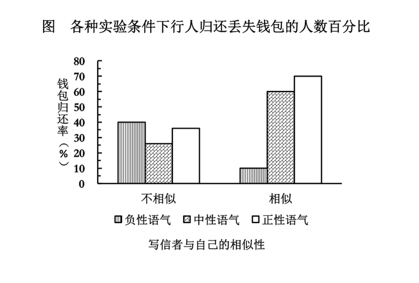

### 第 108 题

从所有参加实验者来看，当写信者与自己相似的时候，人们归还钱包的比率大约为：

A. 25%

B. 35%

C. 45%

D. 60%

第 108 题 · 答案与解析

**参考答案（粉笔题库参考内容）**

C

**解析**

根据题干“······人们归还钱包的比率······”，可判定本题为现期比重计算问题。定位柱形图可得：在相似条件下的统计图中，负性语气钱包归还率约10%，中性语气钱包归还率约60%，正性语气钱包归还率约70%。因此当写信者与自己相似的时候，人们归还钱包的比率大约为(10%+60%+70%)/3 =140%/3 ≈ 46.7%，与C项最接近。

故正确答案为C。

**考点**：现期比重、综合资料

**来源**：2010年黑龙江省公务员录用考试《行测》题第108题

### 第 109 题

从所有参加实验者来看，当写信者使用中性语气时，人们归还钱包的比率大约为：

A. 25%

B. 40%

C. 55%

D. 60%

第 109 题 · 答案与解析

**参考答案（粉笔题库参考内容）**

B

**解析**

根据题干“······的比率大约为”，可判定本题为比值计算问题。定位统计图可得：当写信者使用中性语气时，不相似的人钱包归还率约为25%，相似的人钱包归还率约为60%，故当写信者使用中性语气时，人们归还钱包的比率约为(25%×总人数+60%×总人数)/(2×总人数) = 42.5%，与B项最接近。

故正确答案为B。

**考点**：比值计算、综合资料

**来源**：2010年黑龙江省公务员录用考试《行测》题第109题

### 第 110 题

从参加实验的这100多个人所在的整个社会群体来看，当写信者与自己不相似的时候，信的正性语气与负性语气所引起的归还钱包的比率差异最可能为：

A. 0

B. 10%

C. 20%

D. 30%

第 110 题 · 答案与解析

**参考答案（粉笔题库参考内容）**

A

**解析**

定位统计图可得：当写信者与自己不相似的时候，信的正性语气所引起的归还钱包的比率约为37%，信的负性语气所引起的归还钱包的比率约为40%，二者的差值为40%-37%=3%，与A项最接近。

故正确答案为A。

**考点**：简单加减计算、综合资料

**来源**：2010年黑龙江省公务员录用考试《行测》题第110题

### 第 111 题

从参加实验的这100多个人所在的整个社会群体来看，当写信者使用正性语气时，写信者与参加实验者的相似性所引起的归还钱包的比率差异最可能为：

A. 10%

B. 20%

C. 30%

D. 40%

第 111 题 · 答案与解析

**参考答案（粉笔题库参考内容）**

C

**解析**

定位统计图可得：当写信者使用正性语气时，写信者与参加实验者的相似性所引起的归还钱包的比率分别约为70%和37%，则两者差异为70%-37%=33%，与C项最接近。

故正确答案为C。

**考点**：简单加减计算、综合资料

**来源**：2010年黑龙江省公务员录用考试《行测》题第111题

### 第 112 题

以下推断不正确的是：

A. 研究者精心挑选钱包主人的名字，是为了避免其他因素对实验结果产生干扰

B. 写信的语气以及写信者与参加实验者的相似性对钱包归还比率产生交互影响

C. 在写信者与参加实验者不相似的情况下，信件中性语气比信件不太客气语气所导致的钱包归还率低。从这一结果来看，该研究的人群抽样有很大漏洞

D. 实验的结果支持了“人们会从与自己相似的人那里获得行动线索”这一假设

第 112 题 · 答案与解析

**参考答案（粉笔题库参考内容）**

D

**解析**

A项：定位文字材料第二段可得：钱包主人名叫迈克尔·欧文——这个名字是研究者经过仔细挑选的，以避免含有种族或宗教的暗示，符合题意，正确；

B项：定位统计图可得：各情况下钱包归还比率不同，即产生交互影响，正确；

C项：通过数据分析可以判断出实验的抽样人群存在漏洞，正确；

D项：根据统计图的各项数据，不能得出D项的结论，况且通过C项可得出实验存在漏洞的结论，错误。

本题为选非题，故正确答案为D。

**考点**：综合分析、综合资料

**来源**：2010年黑龙江省公务员录用考试《行测》题第112题

## 材料 5

五、请根据以下信息，完成各题。

        为了响应“每天锻炼一小时”这一号召，某校围绕着“你最喜欢的体育活动项目是什么？”的问题，对在校学生进行了随机抽样调查，从而得到一组数据。每位被调查学生只允许选择一项体育活动。下图是根据这组数据绘制的条形统计图。请结合统计图回答下列问题：

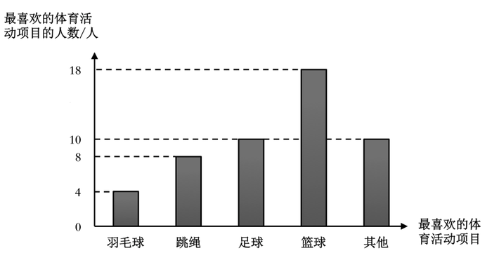

### 第 113 题

本次调查共调查了多少人：

A. 18

B. 40

C. 50

D. 不能确定

第 113 题 · 答案与解析

**参考答案（粉笔题库参考内容）**

C

**解析**

定位文字材料可得：每位被调查学生只允许选择一项体育活动，则统计图中纵轴所列的各项数字相加的结果即为调查的人数；定位统计图可得：选择5项体育运动的人数分别为4人，8人，10人，18人，10人，则本次调查共调查了4+8+10+18+10=50人。

故正确答案为C。

**考点**：简单加减计算、综合资料

**来源**：2010年黑龙江省公务员录用考试《行测》题第113题

### 第 114 题

在所调查的学生当中，最喜欢打篮球的学生约占百分之多少：

A. 18%

B. 36%

C. 45%

D. 50%

第 114 题 · 答案与解析

**参考答案（粉笔题库参考内容）**

B

**解析**

根据题干“······约占百分之多少”，可判定本题为现期比重问题。定位统计图可得：最喜欢打篮球的学生有18人，根据上题可得，调查的总人数为50人。则在所调查的学生当中，最喜欢打篮球的学生约占18/50 = 36%。

故正确答案为B。

**考点**：现期比重、综合资料

**来源**：2010年黑龙江省公务员录用考试《行测》题第114题

### 第 115 题

根据这次调查，若该校有850名学生，则可估计全校学生中最喜欢跳绳活动的学生约有多少名：

A. 68

B. 72

C. 306

D. 136

第 115 题 · 答案与解析

**参考答案（粉笔题库参考内容）**

D

**解析**

定位统计图可得：在抽样调查的学生中，最喜欢跳绳的学生有8人，最喜欢跳绳的所占的比重为8/50，则全校学生中最喜欢跳绳活动的学生约有850×8/50 = 136名。

故正确答案为D。

**考点**：现期比重、综合资料

**来源**：2010年黑龙江省公务员录用考试《行测》题第115题

### 第 116 题

宋玉在形容他的邻人东家之子时说，这个女子“增之一分则太长，减之一分则太短，著粉则太白，施朱则太赤”。东家之子的美貌反映了（  ）的辩证关系。

A. 质变与量变

B. 运动与静止

C. 时间与空间

D. 肯定与否定

第 116 题 · 答案与解析

**参考答案（粉笔题库参考内容）**

A

**解析**

本题的关键信息是“增之一分则太长，减之一分则太短”，说的是数量和质量的关系。质量互变规律是唯物辩证法的基本规律之一。当事物的量变达到一定程度时，会引起质变。当我们希望保持事物性质稳定时，这就要求我们把量变控制在一定的范围之内。

故正确答案为A。

**考点**：唯物辩证法

**来源**：2010年黑龙江省公务员录用考试《行测》题第116题

### 第 117 题

下列说法与“少小离家老大回，乡音无改鬓毛衰”所蕴涵的哲学寓意相一致的是：

A. 细雨鱼儿出，微风燕子斜

B. 坐地日行八万里，巡天遥看一千河

C. 江山易改，秉性难移

D. 此情可待成追忆，只是当时已惘然

第 117 题 · 答案与解析

**参考答案（粉笔题库参考内容）**

B

**解析**

本题考查的是事物的绝对运动和相对静止的统一，题干中“少小”、“老大”以及“鬓毛衰”所反映的都是人的变化，是绝对运动，而“乡音无改”则体现了人的不变，是相对静止。人是绝对运动和相对静止的统一。

A项错误，诗句描绘了微风细雨中鱼和燕子的动态，其意在流露作者热爱春天的喜悦心情。只体现了绝对运动，而没有相对静止。

B项正确，诗句意思是人们住在地球上，因地球自转，不知不觉中，一日已行了八万里路。“坐地”是相对静止，“日行八万里”是绝对运动，动中有静、静中有动，因此是绝对运动和相对静止的统一。

C项错误，成语的意思是江山可以改变，但是人的本性难以改变，这并没有体现同一事物绝对运动和相对静止的统一。

D项错误，诗句的意思是痛惜华年流逝、抱负成空，对过往的感伤，并没有体现绝对运动和相对静止的统一。

故正确答案为B。

**考点**：唯物辩证法

**来源**：2010年黑龙江省公务员录用考试《行测》题第117题

### 第 118 题

张载说：“有象斯有对，对必反其为。有反斯有仇，仇必和而解。”

这告诉我们：

A. 世界上一切事物都是相对运动的

B. 时间与空间是事物的存在方式

C. 矛盾是对立统一的

D. 物质和运动是不可分的

第 118 题 · 答案与解析

**参考答案（粉笔题库参考内容）**

C

**解析**

张载这句话说的是一切现象都有对立两方面，对立两方面的运动方向必然相反，相反就是相仇，相仇就是斗争，斗争的结果，必然归于调和。这体现了矛盾是对立统一的。

故正确答案为C。

**考点**：唯物辩证法

**来源**：2010年黑龙江省公务员录用考试《行测》题第118题

### 第 119 题

以下说法错误的一项是：

A. 隋唐时期，已有活字印刷的《史记》、《汉书》

B. 韩非子主张建立君主专制，而黄宗羲则抨击君主专制，在他们各自所处的历史条件下，其主张都具有进步性

C. “以伽利略的研究为基础，将其成果发挥至辉煌的顶点”的科学家是牛顿

D. 17、18世纪，欧洲思想领域出现了改造旧社会的政治构想

第 119 题 · 答案与解析

**参考答案（粉笔题库参考内容）**

A

**解析**

活字印刷术产生于北宋，发明者是毕昇，所以隋唐时期不可能有活字印刷。故A选项错误。

故正确答案为A。

**来源**：2010年黑龙江省公务员录用考试《行测》题第119题

### 第 120 题

毛泽东同志总结中国近代历次运动失败时曾说：“没有农民办不成大事，光有农民办不好大事。”

下列事件属于“光有农民办不好大事”的是：

A. 洋务运动

B. 辛亥革命

C. 戊戌变法

D. 义和团运动

第 120 题 · 答案与解析

**参考答案（粉笔题库参考内容）**

D

**解析**

洋务运动、辛亥革命和戊戌变法都没有发动群众，义和团运动是一场农民阶级领导的自下而上的运动，最后以失败告终。

故正确答案为D。

**考点**：中国历史

**来源**：2010年黑龙江省公务员录用考试《行测》题第120题

### 第 121 题

“富贵不能淫，贫贱不能移，威武不能屈。此之谓大丈夫。”

这一名言出自哪位之口：

A. 孔子

B. 孟子

C. 老子

D. 庄子

第 121 题 · 答案与解析

**参考答案（粉笔题库参考内容）**

B

**解析**

这句话出自《孟子 •滕文公下》，意思是：金钱地位不能使自己迷惑腐化，贫苦穷困不能改变自己的志向，权势武力不能让自己屈服变节。

故正确答案为B。

**考点**：文学常识

**来源**：2010年黑龙江省公务员录用考试《行测》题第121题

### 第 122 题

“为天地立心，为生民立命，为往圣继绝学，为万世开太平”是张载的座右铭，也被认为是读书人所应担负的历史使命。

以下学者，其言行与此最不相符的是：

A. 王夫之

B. 龚自珍

C. 严复

D. 周作人

第 122 题 · 答案与解析

**参考答案（粉笔题库参考内容）**

D

**解析**

本题考查文学史上的知名学者。张载是北宋著名的理学家，其座右铭依次为社会重建精神价值，为民众确立生命意义，为前圣继承已绝之学统，为万世开拓太平之基业。体现了儒家所追求的理想秩序，读书人应有的维护万世太平的爱国情怀。

A项正确，王夫之是北宋著名的陆王心学的开创者，具有崇高的爱国理想。王夫之为了事业和理想，从来不为利禄所诱，不受权势所压，就是历尽千辛万苦，也矢志不渝。

B项正确，龚自珍是清代思想家、诗人、文学家和改良主义的先驱者。主张革除弊政，抵制外国侵略，曾全力支持林则徐禁除鸦片。他的诗文主张“更法”、“改图”，揭露清统治者的腐朽，洋溢着爱国热情。

C项正确，严复是中国近代启蒙思想家、新法家、翻译家，是中国近代史上向西方国家寻找真理的“先进的中国人”之一。主张变法维新来救国，一生都保持着强烈的爱国思想。

D项错误，周作人曾是五四新文化运动有影响的代表人物之一，却在中国现代历史发展过程中，逐渐远离时代，最后堕落为汉奸文人。这与题干中的爱国情怀不符。

本题为选非题，故正确答案为D。

**考点**：文学常识

**来源**：2010年黑龙江省公务员录用考试《行测》题第122题

### 第 123 题

有学者认为美国在其崛起过程中拥有得天独厚的安全环境和国际条件。

以下选项不能说明这一观点的是：

A. 东西两岸的两洋隔绝使美国能够免于卷入欧亚大陆的战争和冲突

B. 通过两次世界大战，美国获得了对欧洲的巨大债券和战争赔偿

C. 德国和日本充当了对英国霸权的挑战者，而为美国掩盖了崛起的事实

D. 在美国上升为新霸权国家的同时，构建了新的国际体系和国际关系理念

第 123 题 · 答案与解析

**参考答案（粉笔题库参考内容）**

D

**解析**

本题的关键信息是“安全环境和国际条件”，选项D中，在美国上升为新霸权国家的同时，构建了新的国际体系和国际关系理念不能体现美国拥有得天独厚的安全环境和国际条件。

故正确答案为D。

**来源**：2010年黑龙江省公务员录用考试《行测》题第123题

### 第 124 题

在穆罕默德统一阿拉伯半岛的过程中起到了重要作用的宗教是：

A. 佛教

B. 犹太教

C. 基督教

D. 伊斯兰教

第 124 题 · 答案与解析

**参考答案（粉笔题库参考内容）**

D

**解析**

阿拉伯世界信仰伊斯兰教，由穆罕默德创建。

佛教是由释迦牟尼创建，犹太教是犹太人创建的宗教，基督教是由耶稣创建。

故正确答案为D。

**来源**：2010年黑龙江省公务员录用考试《行测》题第124题

### 第 125 题

与“欲穷千里目，更上一层楼”有异曲同工之妙的诗句是：

A. 不畏浮云遮望眼，只缘身在最高层

B. 总为浮云能蔽日，长安不见使人愁

C. 不识庐山真面目，只缘身在此山中

D. 莫愁前路无知己，天下谁人不识君

第 125 题 · 答案与解析

**参考答案（粉笔题库参考内容）**

A

**解析**

“欲穷千里目,更上一层楼”出自唐朝诗人王之涣的《登鹳雀楼》，意思是登高方能望远，“不畏浮云遮望眼，只缘身在最高层”也表达了这个意思。

故正确答案为A。

**考点**：文学常识

**来源**：2010年黑龙江省公务员录用考试《行测》题第125题

### 第 126 题

将下面《水浒传》的故事按事件的发展顺序排列，正确的是：

①景阳冈打虎

②独臂擒方腊

③浔阳楼题反诗

④宿太尉招安

A. ①②③④

B. ①②④③

C. ④②③①

D. ①③④②

第 126 题 · 答案与解析

**参考答案（粉笔题库参考内容）**

D

**解析**

本题考查《水浒传》中的经典故事。

①景阳冈武松打虎，出自《水浒传》第二十二回；

②鲁智深独臂擒方腊，出自《水浒传》第一百一十九回；

③浔阳楼宋江吟反诗，出自《水浒传》第三十九回；

④宿太尉招安，出自《水浒传》第八十九回。

根据《水浒传》情节发展顺序，先有景阳冈武松打虎，之后是宋江浔阳楼题反诗，再是宿太尉招安，最后是鲁智深单臂擒方腊。即①③④②。

故正确答案为D。

**考点**：文学常识

**来源**：2010年黑龙江省公务员录用考试《行测》题第126题

### 第 127 题

“乐道安贫音容宛在，因材施教手泽犹存。”

这幅对联适用于：

A. 吊唁道士

B. 哀挽恩师

C. 恩师八十寿辰

D. 书院大门

第 127 题 · 答案与解析

**参考答案（粉笔题库参考内容）**

B

**解析**

由“音容宛在”可知是针对死者，由“因材施教”可知说的是教师。

故正确答案为B。

**考点**：文化常识

**来源**：2010年黑龙江省公务员录用考试《行测》题第127题

### 第 128 题

以下不能反映区域自然地理环境影响人们的生产方式、生活习惯、文化传统等方面的一句话是：

A. 靠山吃山，靠海吃海

B. 一方水土养一方人

C. 早穿皮袄晚穿纱，围着火炉吃西瓜

D. 要想富先修路

第 128 题 · 答案与解析

**参考答案（粉笔题库参考内容）**

D

**解析**

要致富先修路，属于改造自然，与题目中区域自然地理环境影响人们的生产方式、生活习惯、文化传统等方面无关。

本题为选非题，故正确答案为D。

**考点**：其他

**来源**：2010年黑龙江省公务员录用考试《行测》题第128题

### 第 129 题

2008年5月26日，美国凤凰号探测器登陆火星，科学家希望能够借此分析火星上的（  ），进一步推断火星现在或者以前的环境是否适宜生命存在。

A. 水和有机物

B. 星核

C. 大气成分

D. 地质结构

第 129 题 · 答案与解析

**参考答案（粉笔题库参考内容）**

A

**解析**

水和有机物是生命的必需条件，要想探究火星上有没有生命，必须先考查这两个因素。

故正确答案为A。

**考点**：生物常识

**来源**：2010年黑龙江省公务员录用考试《行测》题第129题

### 第 130 题

水是透明、没有颜色的，但为什么海中的浪花却是白色的：

A. 因为水花中有气泡

B. 因为水中的水分子相互摩擦

C. 因为水花中含有沙石

D. 因为海水的含盐量高

第 130 题 · 答案与解析

**参考答案（粉笔题库参考内容）**

A

**解析**

本题考查浪花的组成。

A项正确，浪花主要是由泡沫和小水珠组成，泡沫的表面是水膜，小水珠就像一些小棱镜，阳光经过在泡沫和水珠表面的反射最终呈现出白色。

B项错误，水分子受到电磁波辐射后相互摩擦，会使温度升高，但不会使浪花呈现白色。

C项错误，沙石并不全是白色，沙石也不能使浪花呈现白色。

D项错误，盐，呈白色结晶粉末或块粒状，但在水中易溶解，海水中的盐无色。

故正确答案为A。

本题相关知识点：

雪花呈现出白色也是这个道理。由于构成雪片的冰的结晶体结构复杂，有许多反射面，能使光线充分地反射和折射，于是雪花就呈现洁白的颜色。

**考点**：物理常识

**来源**：2010年黑龙江省公务员录用考试《行测》题第130题

### 第 131 题

电炉丝通电后热得发红，而与电炉丝连接的铜导线却不太热，这是因为：

A. 通过电炉丝的电流强度比通过铜导线的电流强度大

B. 铜导线的电阻小，所以消耗的电能少，电炉丝的电阻大，消耗的能量多，所以热得发红

C. 铜导丝有绝缘层，所以不怎么热

D. 铜导线比电阻丝传热快，所以不怎么热

第 131 题 · 答案与解析

**参考答案（粉笔题库参考内容）**

B

**解析**

由于铜导线电阻小，电炉丝电阻大，所以会出现电炉丝通电后热得发红，而与电炉丝连接起来的铜导线却不太热的现象。

故正确答案为B。

**考点**：物理常识

**来源**：2010年黑龙江省公务员录用考试《行测》题第131题

### 第 132 题

下列现象中，其本质与其他三个现象的本质不同的现象是：

A. 在水平操场上滚动的足球，最终要停下来

B. 人走路被石头绊倒会向前倾倒

C. 锤头松了，把锤柄的一端在物体上撞击几下，锤头就能紧套在锤柄上

D. 子弹从枪膛里射出后，虽然再受到火药的推力，但是仍然向前运动

第 132 题 · 答案与解析

**参考答案（粉笔题库参考内容）**

A

**解析**

B、C、D是因为惯性，A选项是阻力在起作用。

故正确答案为A。

**考点**：物理常识

**来源**：2010年黑龙江省公务员录用考试《行测》题第132题

### 第 133 题

“西气东输”输送的气体的主要成分是：

A. 一氧化碳

B. 氢气

C. 甲烷

D. 二氧化碳

第 133 题 · 答案与解析

**参考答案（粉笔题库参考内容）**

C

**解析**

西气东输输送的气体主要是天然气，天然气的主要成分是甲烷。

故正确答案为C。

**考点**：化学常识

**来源**：2010年黑龙江省公务员录用考试《行测》题第133题

### 第 134 题

人们长时间处在较大的压力状态下，身体、心理状态都会产生一定的变化。以下人们在长时间压力状态下的反应，最为常见的是：

A. 一直保持亢奋的精神状态

B. 保持一段时间的比较投入的状态后，精神和体力状态急剧下降

C. 一直保持比较抑郁的状态

D. 比较长时间的压抑状态之后，精神和体力状态达到高峰

第 134 题 · 答案与解析

**参考答案（粉笔题库参考内容）**

B

**解析**

压力状态下身体反应分成三个阶段：

第一阶段：警觉反应。由于刺激突然出现而产生情绪紧张和注意力提高，体温与血压下降，肾上腺分泌增加，进入应激状态。

第二阶段：抗拒阶段。如果压力继续存在，身体进入抗拒阶段，企图对身体上任何受损的部分加以维护复原，因而产生大量调节身体的激素。

第三阶段：衰竭阶段。若压力存在太久，应付压力的精力耗尽，身体各功能会突然缓慢下来，适应能力丧失，常出现疲劳、头痛、胸闷等。临床心理学家发现，溃疡病的主要起因就是心理压力。癌症和心脏病的发作也与心理压力有着密切关系。可见，心理压力对人的身心健康的影响是广泛的。

通俗来说，压力状态下身体会保持一段时间的比较投入的状态后，精神和体力状态急剧下降。

故正确答案为B。

**考点**：生物常识

**来源**：2010年黑龙江省公务员录用考试《行测》题第134题

### 第 135 题

依照我国《公务员法》，下述情况，可录用为公务员的人员是：

A. 曾受过行政处分的

B. 外籍人士

C. 曾被开除公职的

D. 曾因犯罪受过刑事处罚的

第 135 题 · 答案与解析

**参考答案（粉笔题库参考内容）**

A

**解析**

根据《公务员法》第十三条规定：“公务员应当具备下列条件：（一）具有中华人民共和国国籍；（二）年满十八周岁；（三）拥护中华人民共和国宪法，拥护中国共产党领导和社会主义制度；（四）具有良好的政治素质和道德品行；（五）具有正常履行职责的身体条件和心理素质；（六）具有符合职位要求的文化程度和工作能力；（七）法律规定的其他条件。”根据《公务员法》第二十六条规定：“下列人员不得录用为公务员：（一）因犯罪受过刑事处罚的；（二）被开除中国共产党党籍的；（三）被开除公职的；（四）被依法列为失信联合惩戒对象的；（五）有法律规定不得录用为公务员的其他情形的。”

故正确答案为A。

**考点**：行政法

**来源**：2010年黑龙江省公务员录用考试《行测》题第135题

### 第 136 题

以下说法不正确的是：

A. 魏晋南北朝分裂的三百年是我国民族大融合的重要时期

B. 杜甫的诗歌记录了唐朝由盛转衰的过程

C. 吴三桂“冲冠一怒为红颜”，引清兵入关，推翻明朝

D. 孙中山先生的革命思想经历了从学习西方到联俄联共的变化

第 136 题 · 答案与解析

**参考答案（粉笔题库参考内容）**

C

**解析**

本题考查中国历史的有关知识。

A项正确，魏晋南北朝是中国历史上政权更迭最频繁的时期，是几十个朝代统称的复合词。分裂的三百年极大促进了多个民族和地区思想和民俗的相互融合，是我国民族大融合的重要时期。

B项正确，“诗圣”杜甫生活在唐朝由盛转衰的时代，他的诗，反映了那个复杂、动荡的历史时代，被后人称为“诗史”。

C项错误，明朝是被李自成推翻的，而不是吴三桂。李自成因害怕清兵入关，决定“灭吴保关”，攻讨吴三桂，吴三桂放清军入关，击溃李自成，清军攻入北京。

D项正确，孙中山先生的革命思想经历了由学习西方，主张改良到主张革命，由依靠军阀革命到反对军阀革命，由旧三民主义发展成新三民主义，联俄联共扶助农工的转变。

本题为选非题，故正确答案为C。

**考点**：中国历史

**来源**：2010年黑龙江省公务员录用考试《行测》题第136题

### 第 137 题

大众传媒最基本的功能就是获取信息和传递信息，人们借助它们，突破了时间和空间的限制，将信息迅速传递到目标地点。（  ）是信息社会一个标志性的信息传播手段。

A. 电影

B. 互联网

C. 电视

D. 报刊

第 137 题 · 答案与解析

**参考答案（粉笔题库参考内容）**

B

**解析**

本题考查文化常识，主要涉及互联网的特点和作用。

互联网让受众既是信息的接受者，又是信息的发布者，任何个人或组织都可以在网络上发布新闻或信息，受众也可以及时地向媒体反馈自己的意见或建议。根据题干要求，只有互联网能够既突破时空限制，又可以将信息迅速传递到目标地点。

故正确答案为B。

**考点**：文化常识

**来源**：2010年黑龙江省公务员录用考试《行测》题第137题

### 第 138 题

以下变化使事物性质发生改变的是：

A. 酒精挥发

B. 矿石粉碎

C. 冰雪融化

D. 白磷自燃

第 138 题 · 答案与解析

**参考答案（粉笔题库参考内容）**

D

**解析**

白磷自燃属于氧化反应，事物性质发生了变化，而A、B、C选项则只是物理变化。

故正确答案为D。

**考点**：化学常识

**来源**：2010年黑龙江省公务员录用考试《行测》题第138题

### 第 139 题

全面提高对外开放水平要坚持的基本战略是：

A. 坚持“引进来”和“走出去”相结合

B. 坚持独立自主自力更生原则

C. 鼓励有比较优势的企业到境外投资设厂

D. 积极应对倾销和反倾销

第 139 题 · 答案与解析

**参考答案（粉笔题库参考内容）**

A

**解析**

本题考查新思想。

党的十六大提出要坚持“引进来”和“走出去”相结合的基本战略，提高对外开放水平。

故正确答案为A。

**考点**：经济建设

**来源**：2010年黑龙江省公务员录用考试《行测》题第139题

### 第 140 题

党和国家2020年的奋斗目标是：

A. 基本实现现代化

B. 全面建设小康社会

C. 构建社会主义和谐社会

D. 全面实现科学发展

第 140 题 · 答案与解析

**参考答案（粉笔题库参考内容）**

B

**解析**

本题考查新思想。

全面建设小康社会，是我们党和国家到2020年的奋斗目标，是全国各族人民根本利益所在，必须坚定不移地为之奋斗。

故正确答案为B。

**本题相关知识点：**

中国在本世纪头二十年经济方面的奋斗目标，总体来说就是力争到2020年实现国内生产总值比2000年翻两番。

**考点**：新思想总论

**来源**：2010年黑龙江省公务员录用考试《行测》题第140题

