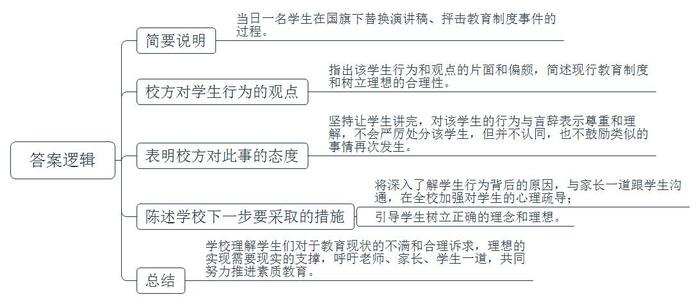
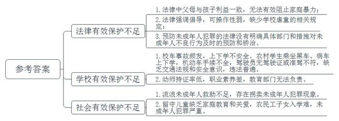
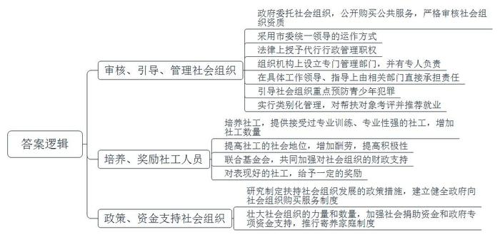
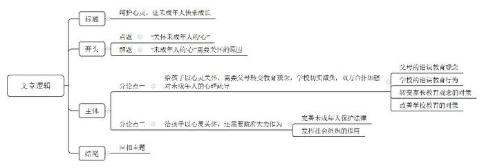

# 2014年黑龙江省公考《申论》题

<!-- gwy:overview:start -->
> **黑龙江 · 2014 · 申论 · 统考** ｜ 4 题 · 图片 4 处 · 答案随题折叠

导航：[题目](#题目) · [材料 1](#材料-1)
<!-- gwy:overview:end -->

> 候选采集稿。参考答案及解析来自粉笔页面，不代表官方答案或真实高分答卷；来源使用许可与原卷对应关系仍需人工核实。

## 给定材料

### 材料 1

《全国人民代表大会常务委员会关于修改&lt;中华人民共和国未成年人保护法>的决定》于2012年10月26日通过，自2013年1月1日起施行。

《未成年人保护法》规定：“保护未成年人，是国家机关、武装力量、政党、社会团体、企业事业组织、城乡基层群众性自治组织、未成年人的监护人和其他成年公民的共同责任。对侵犯未成年人合法权益的行为，任何组织和个人都有权予以劝阻、制止或者向有关部门提出检举或控告。国家、社会、学校和家庭应当教育和帮助未成年人保护自己的合法权益，增强自我保护意识和能力，增强社会责任感。”

2011年7月30日，国务院颁布《中国儿童发展纲要（2011—2020年）》，它规定了中国政府儿童发展事业的新目标和新举措，是今后十年中国政府全面推动儿童权益保护工作的基础性文件，标志着保护儿童工作进入新的阶段。新纲要从儿童健康、教育、福利、社会环境及法律五个方面制定了明确的目标与策略，对儿童保护事业中涉及到这五个领域的发展起了提纲挈领的指导作用。

2013年3月16日，“2013年唐山市共青团与人大代表、政府委员面对面”暨唐山市未成年人保护与自护意见征集座谈会在团市委召开。《唐山市未成年人保护规定（草案建议稿）》经过12次修改后，已提交市人大法工委，有望在今年内出台。根据最新修订的《规定（草案建议稿）》，该市将成立未成年人保护委员会并依托12355电话服务平台，接受未成年人咨询及个案求助。《规定》要求，一旦发现未成年人受到侵害，老师、家长等知情者必须在24小时内向公安机关举报。针对放学后学生无处可去的现状，《规定》建议7时至18时，学校应允许学生留校并保障其安全。

### 材料 2

2011年11月16日，G省某镇，一辆运煤货车与某幼儿园学生接送面包车相撞，造成20人死亡。发生事故的校车核载9人，实载却达到64人。

2013年8月29日，某县一幼儿园在接送孩子时，一名三岁的男童被遗忘在校车上，因闷热致死。

有专家收集了近五年部分国内媒体披露的74宗学生上学车辆安全事故数据，通过分析发现，各年事故数量基本持平。在死亡人数中，有74%是农村学生，伤残的农村学生占40%，49%的校车事故发生在义务教育阶段，50%在幼儿园。

由于“夺命校车”事故频发，2011年11月27日，温家宝总理在第五次全国妇女儿童工作会议上指出，国务院已经责成有关部门迅速制定校车安全条例。2012年3月，国务院总理温家宝主持召开国务院常务会议，审议并原则通过《校车安全管理条例（草案）》，要求校车通行优先。4月10日，《校车安全管理条例》发布，载有学生的校车享有路上“优先权”，可在公共交通专用车道以及其他禁止社会车辆通行但允许公共交通车辆通行的路段行驶。

目前，一些农村，特别是偏远山区，学生长期乘坐“黑车”“病车”上学放学。据调查，某县的乡镇中学2200多名学生中，经常搭乘三无车上学放学的达1200人。这些学生分布在该镇辖区内的26个自然村和近50个单位，最远的有30公里。全县149台用于接送学生的机动车中，只有69台手续齐全。该地区交警支队调查还发现，接送学生的中巴车驾驶员20%~30%无驾驶证或者准驾不符；驾驶机动三轮车接送学生的近60%没有驾驶证。这些驾驶员普遍缺乏交通法规意识和安全意识。多拉快跑、超载超速、乱靠乱停、逆向行驶等交通违法行为十分普遍。

### 材料 3

7岁的女童彤彤（化名）家住高档小区，富裕的家庭却没给她一个幸福的童年。三岁父母离异，跟着父亲和继母生活，长期被关在阳台，饿成皮包骨。2011年7月6日晚，不堪忍受饥饿的她沿着墙体跳下地面，跑到便利店偷饼干吃。被发现后，居委会、妇联和爱心业主将彤彤送到了救助站。而救助站只能住十天，十天之内必须决定彤彤的去向，而她的监护人是生父，很有可能被送回受虐待的家庭。令人心寒的是，她的父母竟然玩“失踪”，其父亲在电话中竟怒称“没有这个女儿”。最终在舆论的压力下，生父和继母放弃了监护权，生母将彤彤接到自己身边。

2012年12月，6岁的小豪不听话遭到了父亲用皮带抽打，口吐鲜血不治身亡。这是当年媒体报道的该市第十一起虐童事件。

法律界人士对此类家庭暴力的极端案例表示了强烈关注。某市律师协会未成年人保护委员会副主任张律师表示，应建立一个未成年人的保护和监督机制，防止类似悲剧再次发生。目前我国已制定了《未成年人保护法》，但在这部法律的立法宗旨及理念中，作为监护人的父母利益与孩子的利益是一致的。社会常理认为，父母不会对孩子不利，但实际上，在许多家庭暴力事件中，孩子是受害者，是需要重点保护的对象。大部分人认为，“虎毒不食子”，父母对孩子进行体罚是对孩子的另一种“爱”，虽表达方式不妥，但都是为孩子好。其实这种错误观念造就了对未成年人保护的欠缺，其背后反映的是现行法律及机制在保护未成年人方面的某些缺失。在我国现有的法律制度下，父母是孩子的监护人，孩子受到的保护是与父母结合在一起的。但在国外，许多国家都将孩子作为独立的个体进行保护。张律师呼吁，我国应该在立法上向这个方面努力，将孩子作为一个独立的公民进行保护。张律师提出，法律应该明确，当家庭暴力发生的时候，邻居或者其他公民可以向有关部门进行反映，并且政府需要成立一个专门保护未成年人的独立机构，对类似的家庭暴力进行监督，甚至可以暂时剥夺使用暴力的父母对孩子的监护权。

### 材料 4

2012年10月，Z省发生一起幼儿园教师虐童事件。该校教师Y因“一时好玩”在该园活动室里强行揪住一名幼童双耳向上提起，同时让另一名教师用手机拍下，之后该视频被上传到网上。事发当天，W市教育局接到被虐幼童家长举报，立即赶往该幼儿园进行调查，并采取了向公安部门通报，以及联合街道办事处发出通知，责成校方深刻检查、整改并立即辞退相关教师等举措。

此前知情人士爆料称Y从事幼师职业系无证上岗，该情况已被证实。对此，W市教育局副局长在接受中新网记者采访时称，按有关规定，无论公办或民办学校，教师必须持证上岗。不过，他随即表示因当地幼儿园存在师资紧缺情况，幼师实际持证率仅为40%。为弥补师资不足，幼儿园基本实行“先上岗、后考证”。“民办幼儿园在教师招聘中有自己的实权，其教师存在的职业素养问题，教育管理部门无法负责。”

无独有偶，几乎就是在一年之内，湖北、山东、广东等全国多个省份的幼儿园和小学相继发生了多次老师暴力体罚甚至殴打、猥亵未成年人的事件，经过媒体铺天盖地的报道，给社会造成了极其恶劣的影响。

针对这一问题，有专家认为《未成年人保护法》可操作性较弱，呼吁增加虐童的相关规定。犯罪学专家皮教授指出，《未成年人保护法》中，专门有关于学校保护的内容，在学校里发生的侵害未成年人权益的事件应由学校来负责，这其中包括幼师对于儿童的人权和精神上的伤害。但是，其中适用条款的规定，反映了《未成年人保护法》强调倡导性，可操作性却比较弱的特点。大家不能从中得知事情具体由谁来管，处理起来的程序应当是什么，哪些部门可以接受家长的申诉。法律上既无实体上的规定，又无程序上的规定，当然也没有组织上的规定。因此，这部法律到现在为止，还是处于一个倡导的层面上，可操作性是它一直没有解决的问题。

### 材料 5

2011年8月，国务院办公厅发出《关于加强和改进流浪未成年人救助保护工作的意见》，在措施中要求实行主动救助保护，加大打击拐卖未成年人犯罪力度，帮助流浪未成年人回归家庭，成立流浪未成年人救助保护中心，开展流浪未成年人教育矫治工作，强化源头预防和治理，在工作机制上建立民政部牵头的部际联席会议制度。为贯彻落实该意见的精神，2011年12月，民政部、中央综治办、教育部、公安部、财政部、人力资源和社会保障部、住房和城乡建设部、卫生部发布《关于在全国开展“接送流浪孩子回家”专项行动的通知》，决定从当时起至2012年底，在全国联合开展以“保护儿童，告别流浪”为主题的“接送流浪孩子回家”专项行动。

2012年2月，G省某小学26个平均年龄只有9岁的留守儿童，用他们的220篇日记、21幅画、12封写给爸爸妈妈的信，汇聚成书——《中国留守儿童日记》。该书出版后，引起巨大反响。据媒体公开报道，中国农村目前留守儿童的数量超过了5800万人。社会学家认为，留守儿童面对的家庭教育缺失，家庭关爱缺乏，直接对未来中国人口整体素质产生影响。

2013年3月的全国人民代表大会上，一位农民工代表带来《关于解决外来农民工子女入学问题的建议》，呼吁尽快建立公平合理的外来务工人员子女义务教育转移支付制度，这样才能调动流入地政府积极性，切实解决农民工子女入学难的问题。

S市某区人民检察院的调查显示，2009年至2011年间，该院共受理未成年人犯罪案件253件，涉罪未成年犯罪嫌疑人343人。其中，非本地户籍293人，占涉罪未成年人总数的85.4%；非本地户籍中208人系农民工子女，占涉罪未成年人总数的60.6%。

一些农民工子女无户籍，无固定居住地，“他们既无法接受良好的教育，又无法享受父母的关心和爱护，在心理发育及逐渐成熟的关键时期，教育缺失，意识观念的不成熟和社会不公平的存在，使他们易产生偏激的观念和过激行为。”该院未成年人犯罪检察科一名检察官就此分析说。

### 材料 6

《预防未成年人犯罪法》虽然规定了要立足于教育和保护，“从小抓起”，对未成年人的不良行为及时进行预防和矫治，但并没有规定明确的负责部门和有效的措施。这使得在实践中，防微杜渐的预防工作常常难以发挥应有的作用，“小错不管，养肥了再管”已成为预防未成年人犯罪工作中难以回避的尴尬。

“很多时候，民警只能把这些孩子说一顿、批评一阵就放出来，没别的办法。”北京师范大学刑事法律科学研究院何副教授接受中国青年报记者采访时举了个例子说，14岁的孩子小偷小摸，父母也不在身边，从看守所出来没人“接手”，更谈不上对他们进行教育和帮助了。专家表示，家庭监管缺位，可由政府和社会组织给未成年人“补课”，第一时间挽救濒临失足的未成年人。

S市阳光社区青少年事务中心（以下简称“阳光中心”）是一家专门承担由政府委托的社区青少年事务项目的非政府组织，由政府出资向他们购买社工服务，其服务内容包括：（1）了解和把握服务对象的动态；（2）实现对服务对象的有效控制；（3）为服务对象提供社会工作的专业服务；（4）协助服务对象解决就学、就业等实际困难和问题；（5）整合社会资源，推进社工工作。S市的运作方式是，在市委统一领导下，首先，在法律地位上，由市政府通过法律途径，授权团组织组织专门机构代行政府的社区青少年工作的行政管理职权；其二，在组织机构上，市一级设立由团市委负责的社区青少年事务办公室，区一级设立由团区委负责的社区青少年事务办公室，有专人从事社区青少年事务的行政管理工作；其三，在具体工作领导、指导上，由市、区政法委和有关部门直接承担责任。

阳光中心的一项重要使命是“预防青少年犯罪”。据阳光中心总干事F女士介绍，该中心目前共有400多名社工，2012年共服务了4万余名未成年人。“为了更有针对性地预防，我们实行了‘类别化管理’。”F女士说，“已有偏差行为”的未成年人被阳光中心归为“重点服务类”，基本上是由公安机关移交过来的。在帮扶的过程中，社工亦会对帮扶对象进行阶段性的考评。同时，阳光中心亦为帮扶对象推荐就业。

据统计，阳光中心成立后，S市未成年人违法犯罪总量下降明显。S市综治办副主任C向媒体披露，自2007年起，该市青少年违法犯罪总数持续下降；2010年25周岁以下违法犯罪青少年总数同比2006年下降了25.45%，下降速度好于全市总体违法犯罪状况。

“由政府向社会组织购买服务，这在发达国家已是普遍做法，但在我国仍处于起步阶段。”专家认为，“S市模式”值得各地借鉴。一方面，放权给社会组织，能对相关行政部门的力量形成有效补充；另一方面，提供帮扶服务的社工，大多接受过专业训练，专业性强。有了社会组织参与是第一步，影响预防“效果”的另一个问题，是社会组织中社工的数量和能力。

据F女士介绍，阳光中心的社工常年面临着“供不应求”的困境。“1位社工平均每年要帮扶100多名未成年人，确实有点顾不过来。”她说，现在社工的社会地位、劳动报酬都不高，没有多少人愿意干。可社工这份职业对个人能力要求较高，不仅要有社会学、法学等相关专业基础，也需要良好的沟通能力。F女士坦言，门槛高、人数少，是摆在面前的难题。有关注此事的人士建议，要解决这个问题，还是应该从资金抓起。“政府应联合基金会，共同加强对社会组织的财政支持，提高社工的劳动报酬。对表现好的社工，给予一定的奖励。”

2013年9月，B市民政局下发通知称，面向全市社会工作事务所购买社会组织参与未成年人社会保护试点服务项目，其中购买服务项目的对象为依法登记注册、具有独立法人资格和健全的财务管理制度、年检合格的社会工作事务所。经过审核的社会组织将承担心理治疗、监护评估等工作。此次购买的服务项目为3个，服务项目包括构建社区保护机制和强化教育保护。具体来说，在试点街乡探索建立社区未成年人保护中心，做好未成年人返校复学工作；重点探索建立受助未成年人发现、报告和响应机制，及时庇护受伤害未成年人；探索开展困境未成年人救助帮扶机制。据介绍，社会组织将需要配合救助管理机构参与街头救助以及辖区困境未成年人排查摸底工作，对困境未成年人及其家庭开展监护情况与需求评估。

### 材料 7

随着社会的发展，涌现出了诸多的社会需求，这些社会需求原先都由政府来解决，导致政府机构设置臃肿，各类经费剧增，而同时，一些政府部门向社会提供公共服务时效率不高，不能满足群众的需求，引起诸多不满。

20世纪80年代以来，以英国、美国、澳大利亚为代表的发达国家都推行了“购买公共服务”制度，并逐步发展成为政府履行公共管理职能的一种主流模式。小到社区一老一少的照护、一花一草的建设，大到教育、医疗、住房的“民生三大件”，都是政府购买公共服务的内容。当下，作为一种新型的政府公共服务方式，我国政府购买社会组织服务方面的发展也在提速。《关于2012年深化经济体制改革重点工作的意见》中明确提出，研究制定扶持社会组织发展的政策措施，建立健全政府向社会组织购买服务制度。

在香港，儿童保护工作备受重视，服务体系中包括了政府和非政府的力量。政府的力量有香港社会福利署保护家庭及儿童服务课，香港警务处虐儿案件调查组。非政府的力量有香港防止虐待儿童会、保良局、“母亲的抉择”、平等机会委员会、联合医院、明爱晓晖计划-性侵犯综合辅导服务中心等。这些非政府机构除了得到社会捐助资金外，大部分也得到政府的专项资金支持，每年向政府汇报工作和有关儿童问题的统计数据，这些资料将成为政府工作报告的依据。香港还有很多的寄养家庭，由自愿提供寄养服务的家庭填写申请表，政府对该家庭进行全面考察后登记备案。有需要家庭照顾的孩子随时有可能被送到寄养家庭，由政府每月支付一定的港币给寄养家庭，部分作为孩子的生活费，部分作为对寄养家庭的报酬。

### 材料 8

“这种变味的教育，学了有什么用呢？就是考上大学能如何？找到工作又如何……”“我们不是机器，即使是机器，学校也不该把我们当成追求升学率的工具！”这样内容犀利的言辞，不是出现在辩论赛上，而是一名中学生在3000多名师生众目睽睽之下的激情演讲。2012年4月9日上午，J省某中学举行升国旗仪式，一名高二学生在国旗下发表讲话时，将之前老师“把关”过的演讲稿，悄悄换成另外一篇抨击教育制度的文章。5分钟的演说中，这名学生“慷慨陈词”，表达自己对现行升学和教育制度的不满，抨击父母强加给自己的所谓理想，学校没有让这名学生停止演讲，坚持让他讲完，事后对其进行了批评教育。

针对这一事件社会各界议论纷纷。全国律师协会未成年人保护专业委员会将这一事件评为2011—2012年度“未成年人保护领域十大事件”之一，认为学校并未因此而恼羞成怒或严厉处分该学生是一种对未成年人的尊重与保护。而相关教育界人士则认为，该学生的言辞多多少少会对其他学生的心态产生影响，一味地放任或严厉处分都会对其本人和其他学生的身心发展产生负面效果，学校如何在尊重未成年人、保护未成年人的基础上消除影响，维持正常的教学秩序考验着学校的管理水平。

弗吉尼亚公立小学暑假前的最后一天是学校举办期末颁奖典礼的日子。尽管颁奖典礼是早上举行的，依旧有很多家长请假前来出席。首先是给全勤和高勤的孩子们颁奖。美国教育讲究责任感，提倡参与的理念，从这个奖项的设立中可见一斑。其次是由学校图书馆负责人给加速阅读达到十级的孩子们授奖牌。这个评价体系对孩子们的毅力和坚持精神的考验远远超过了对智商水平的考查，而对他们养成良好的阅读习惯、提高阅读理解能力，则是一个很好的锻炼过程。接下来的颁奖项目是颁给最出色的家长志愿者，这位家长给学校贡献了最多的义工时间。从这个奖项的设立上，你可以看到美国教育是如何提倡贡献社区和回报社会的，对在美国大学的录取中将“社区贡献”作为一个重要的因素也就不会奇怪了。美国小学里经常听到老师对孩子说的一句话是：最重要的不是你有多聪明，而是你有多努力。这种观念在“最大进步奖”的设立中表现得淋漓尽致。

### 材料 9

目前，对于孩子来说，不快乐似乎已成为一种普遍现象。曾任全国人大常委会副委员长的许嘉璐教授在谈未成年人保护法修订草案时表示，对未成年人“心”的关怀应该加强。许嘉璐认为，对未成年人的保护，无非是身、心两部分。现在，这部法偏重保护“身”，保护“心”的方面有些乏力。当前中国青少年最大的问题不是“身”的保护，孩子遭受伤亡的情况有，但是就一亿两千万学生来说这种情况很少很少，更多的是“心”的问题，许嘉璐强调，对未成年人“心”的关怀应该加强。孩子摔伤了、骨折了是能够看得见的，父母老师心疼，但这是短痛；孩子学坏了，关系的则是一个家庭、一个民族的未来。

## 题目

### 第 1 题

**“给定资料**8**”中画线部分相关教育界人士的话准确地分析了这一事件的影响和处置原则。假如你是该中学相关部门工作人员，为解决这一问题，校领导责成你就此事对全校师生做一个简短的发言，请你列出这份发言稿的要点。（20分）**

关联材料：材料 8

作答要求：

要求：逻辑清晰，观点明确，有针对性；不超过400字。

第 1 题 · 答案与解析

**参考答案（粉笔题库参考内容）**

《发言稿》内容要点

一、简要说明当日一名学生在国旗下替换演讲稿、抨击教育制度事件的过程。

二、指出该学生行为和观点的片面和偏颇，简述现行教育制度和树立理想的合理性。

三、表明校方对此事的态度：坚持让学生讲完，对该学生的行为与言辞表示尊重和理解，不会严厉处分该学生，但并不认同，也不鼓励类似的事情再次发生。

四、陈述学校下一步要采取的措施：将深入了解学生行为背后的原因，与家长一道跟学生沟通，在全校加强对学生的心理疏导；引导学生树立正确的理念和理想。

五、总结：学校理解学生们对于教育现状的不满和合理诉求，理想的实现需要现实的支撑，呼吁老师、家长、学生一道，共同努力推进素质教育。

**参考答案说明****:**（1）本题不需要考虑格式，只罗列要点即可。（2）本参考答案，一方面从内容来看，围绕着“学生在国旗下替换演讲稿、抨击教育制度”这一事件，按照事件说明、校方对学生行为的观点、校方的处置态度、校方的改进措施、总结的逻辑顺序进行了分条罗列，符合“逻辑清晰”的要求。另一方面，形式上，本参考答案做到了分段、分条撰写，各条要点之前相互独立，没有交叉。

**解析状态：unknown（来源未提供）**

### 第 2 题

**当前我国社会，对未成年人缺乏有效保护的问题体现在多个方面。根据给定资料，对这些具体表现进行概括。（15分）**

关联材料：材料 1、材料 2、材料 3、材料 4、材料 5、材料 6、材料 7、材料 8、材料 9

作答要求：

要求：准确、全面、有条理；不超过300字。

第 2 题 · 答案与解析

**参考答案（粉笔题库参考内容）**

一、法律有效保护不足：1.法律中父母与孩子利益一致，无法有效阻止家庭暴力；2.法律强调倡导，可操作性弱，缺少学校虐童的相关规定；3.预防未成年人犯罪的法律没有明确具体部门和措施对未成年人不良行为及时的预防和矫治。

二、学校有效保护不足：1.校车事故频发，上下学不安全。农村学生乘坐黑车、病车上下学，机动车手续不全，驾驶员无驾驶证或准驾不符，缺乏交通法规和安全意识，违法普遍。2.幼师持证率低，职业素养差，教育部门无法负责。

三、社会有效保护不足：1.流浪未成年人救助不足，存在拐卖未成年人犯罪现象。2.留守儿童缺乏家庭教育和关爱，农民工子女入学难，未成年人犯罪严重。

**参考答案说明：**参考答案从“法律有效保护不足”“学校有效保护不足”“社会有效保护不足”这三个不同的维度进行了分条撰写。各条要点之间是并列关系，没有交叉。并且撰写每条要点时，都提炼出了概括性强的总括词并前置。

**解析状态：unknown（来源未提供）**

### 第 3 题

**根据“给定资料**6**~**7**”，就我国政府应如何更好地发挥社会组织的作用，做好未成年人的教育工作，提出建议。（25分）**

关联材料：材料 6、材料 7

作答要求：

要求：

（1）紧扣给定资料，有针对性；

（2）条理清楚，有可行性；

（3）不超过400字。

第 3 题 · 答案与解析

**参考答案（粉笔题库参考内容）**

一、审核、引导、管理社会组织。政府委托社会组织，公开购买公共服务，严格审核社会组织资质；采用市委统一领导的运作方式；法律上授予代行行政管理职权；组织机构上设立专门管理部门，并有专人负责；在具体工作领导、指导上由相关部门直接承担责任；引导社会组织重点预防青少年犯罪；实行类别化管理，对帮扶对象考评并推荐就业。

二、培养、奖励社工人员。培养社工，提供接受过专业训练、专业性强的社工，增加社工数量；提高社工的社会地位，增加酬劳，提高积极性；联合基金会，共同加强对社会组织的财政支持；对表现好的社工，给予一定的奖励。

三、政策、资金支持社会组织。研究制定扶持社会组织发展的政策措施，建立健全政府向社会组织购买服务制度；壮大社会组织的力量和数量，加强社会捐助资金和政府专项资金支持，推行寄养家庭制度。

**参考答案说明：**答案从“审核、引导、管理社会组织”“培养、奖励社工人员”“政策、资金支持社会组织”三个不同的方面对“我国政府更好地发挥社会组织的作用，做好未成年人的教育工作”的建议进行了分条撰写。各条要点之间在内容上是并列关系，没有交叉。

**解析状态：unknown（来源未提供）**

### 第 4 题

**“给定资料9”画线部分写道：“对未成年人‘心’的关怀应该加强。孩子摔伤了、骨折了是能够看得见的，父母老师心疼，但这是短痛；孩子学坏了，关系的则是一个家庭、一个民族的未来。”请结合你对给定资料的理解，联系实际，自拟题目，写一篇文章。（40分）**

关联材料：材料 1、材料 2、材料 3、材料 4、材料 5、材料 6、材料 7、材料 8、材料 9

作答要求：

要求：

（1）观点鲜明，论述准确；

（2）逻辑严谨，语言流畅；

（3）结构完整，条理清晰；

（4）字数1000~1200字。

第 4 题 · 答案与解析

**参考答案（粉笔题库参考内容）**

**呵护心灵，让未成年人快乐成长**

“不快乐”，一个忧郁的字眼，却显眼地出现在一份《未成年人思想道德建设状况调研报告》上。让我们惊觉，本该无忧无虑的孩子们却有着如此沉重的心灵负担。他们的不快乐告诉我们，不仅需要关注对未成年人“身”的保护，更要注重对他们“心”的关怀。孩子的健康快乐成长，是家庭的希望、民族的未来，我们理应尽最大的心力，以最大的力度，给未成年人以最好的呵护。

与家长、老师关系冷漠，心理抑郁，未成年人群体犯罪频发，这些困扰未成年人心理问题的背后有着诸多因素。留守儿童无法得到父母的悉心照顾，沟通的不畅使得他们“心有千千结”，内心充满了困惑和矛盾；家庭和学校给孩子的压力，应试教育的重压让他们备受摧残；未成年人保护法律的缺失使得他们受到人身伤害进而带来心灵的创伤。身体受伤，是看得见的短痛，容易康复；“心”变坏了，关系的则是家庭和民族的未来。

**给孩子以心灵关怀，需要父母转变教育观念，学校切实减负，双方合作加强对未成年人的心理疏导。**时至今日，棍棒之下出孝子还被大量的父母信奉，对于子女的教育简单粗暴；一些父母以“我是为你好”为由，将大量的作业和辅导班堆积在儿童身上，使得很多儿童苦不堪言。还有一些学校，为了提高升学率，在国家一再强调减负的大背景下，逆流而上，不断增加作业的数量，越来越重的书包，换来的不仅仅是越来越弯的脊柱，越来越厚的眼镜片，还有越来越压抑的心情。

针对这个问题，一方面我们要通过电视媒体、网络宣传、专家讲座等多种方法改变家长固有的、传统的“唯名利论”思维模式，另一方面我们要多在“疏”上下功夫，缓解学生的学习压力，让他们多和父母进行高品质的沟通，多进行想法的交流，避免因为观念冲突导致家庭关系紧张。而学校则应该抵制应试化的培养模式，正视心理辅导、矫正机制的重要性，建立未成年人的心理咨询室，定期进行心理问卷调查，对有问题倾向的学生进行及时、有效的处理，建立源头控制、常态管理、应急处置相结合的校园心理问题解决机制。

**给孩子以心灵关怀，还需要政府大力作为。**一是完善相关的未成年人保护法律，保障未成年人免受身心伤害。法律是保护未成年人合法权益的最重要的武器，要在《未成年人保护法》中明确区分父母及孩子，合理界定虐童行为，建立保护和监督机制，提升可操作性；在《预防未成年人犯罪法》中明确负责部门和措施，加强教育和保护，预防和矫治未成年人犯罪行为。二是充分发挥社会组织的作用。政府要转变过去的管理方式，借鉴国外一些成熟的做法，通过向社会组织购买服务并授予其对社区青少年工作的行政管理职权来缓解自身工作强度；在组织结构上，设立相关对接机制，让专人负责社区青少年事务的行政管理工作；在具体工作领导、指导上明晰责任，由市、区政法委和有关部门直接承担。

当家庭、学校、社会、政府不止关爱孩子的“身”，更用心呵护孩子的“心”健康，给孩子以积极的动力，孩子才会始终保持一个健康向上的心灵，快乐成长，民族的未来也才会更美好。

**文章分析**

**呵护心灵，让未成年人快乐成长**

【**标题的优点：**首先，范文的标题“呵护心灵，让未成年人快乐成长”突出了“关怀未成年人的‘心’”这一主题。其次，形式上，文字简洁明快。】

（1）“不快乐”，一个忧郁的字眼，却显眼地出现在一份《未成年人思想道德建设状况调研报告》上。让我们惊觉，本该无忧无虑的孩子们却有着如此沉重的心灵负担。（2）他们的不快乐告诉我们，不仅需要关注对未成年人“身”的保护，更要注重对他们“心”的关怀。（3）孩子的健康快乐成长，是家庭的希望、民族的未来，我们理应尽最大的心力，以最大的力度，给未成年人以最好的呵护。

【**开头的优点：**★内容方面：范文的开头是紧扣题目给定的“对未成年人‘心’的关怀应该加强。孩子摔伤了、骨折了是能够看得见的，父母老师心疼，但这是短痛；孩子学坏了，关系的则是一个家庭、一个民族的未来”这句话展开的。首先，开头第三句话点出主题，做到了主题明确。其次，对“关怀未成年人的‘心’”这一主题进行了分析阐述，指出了（1）“未成年人的‘心’”需要关怀的原因。（2）未成年人需要身心两方面的关怀。（3）“关怀未成年人的‘心’”的重要性。注意以上三个方面的阐述在逻辑上有先后顺序：先写“原因”，再写“对策”，最后写“重要性”。★文字表达方面：长短句配合使用，使语言表达有节奏感。】

（1）与家长、老师关系冷漠，心理抑郁，未成年人群体犯罪频发，这些困扰未成年人心理问题的背后有着诸多因素。（2）留守儿童无法得到父母的悉心照顾，沟通的不畅使得他们“心有千千结”，内心充满了困惑和矛盾；家庭和学校给孩子的压力，应试教育的重压让他们备受摧残；未成年人保护法律的缺失使得他们受到人身伤害进而带来心灵的创伤。（3）身体受伤，是看得见的短痛，容易康复；“心”变坏了，关系的则是家庭和民族的未来。

【**过渡段的优点：**范文过渡段分析了（1）“未成年人出现心理问题”的表现；（2）“未成年人出现心理问题”的原因；（3）“未成年人出现心理问题”的影响等方面的内容，此外，还要注意过渡段末尾的“身体受伤，是看得见的短痛，容易康复；‘心’变坏了，关系的则是家庭和民族的未来”是用来引起下文的过渡句。】

**给孩子以心灵关怀，需要父母转变教育观念，学校切实减负，双方合作加强对未成年人的心理疏导。**（1）时至今日，棍棒之下出孝子还被大量的父母信奉，对于子女的教育简单粗暴；一些父母以“我是为你好”为由，将大量的作业和辅导班堆积在儿童身上，使得很多儿童苦不堪言。（2）还有一些学校，为了提高升学率，在国家一再强调减负的大背景下，逆流而上，不断增加作业的数量，越来越重的书包，换来的不仅仅是越来越弯的脊柱，越来越厚的眼镜片，还有越来越压抑的心情。

（3）针对这个问题，一方面我们要通过电视媒体、网络宣传、专家讲座等多种方法改变家长固有的、传统的“唯名利论”思维模式，另一方面我们要多在“疏”上下功夫，缓解学生的学习压力，让他们多和父母进行高品质的沟通，多进行想法的交流，避免因为观念冲突导致家庭关系紧张。（4）而学校则应该抵制应试化的培养模式，正视心理辅导、矫正机制的重要性，建立未成年人的心理咨询室，定期进行心理问卷调查，对有问题倾向的学生进行及时、有效的处理，建立源头控制、常态管理、应急处置相结合的校园心理问题解决机制。

【**论述段****1的优点：**★观点句：范文的观点句是紧扣“关怀未成年人的‘心’”这一文章主题提出的。形式上，它在段首处直接写出，位置突出，容易发现。内容上，关键词突出，内容要点明确，可以明显看出它是从“家庭、学校教育”入手，指出了“给孩子以心灵关怀，需要父母和学校合作”。★论述内容：（1）先介绍了“父母的错误教育观念”；（2）接着介绍了“学校的错误教育行为”；（3）然后介绍了“转变家长教育观念的对策”；（4）最后介绍了“改善学校教育的对策”。注意：以上四个方面的内容都是紧扣“给孩子以心灵关怀，需要父母转变教育观念，学校切实减负，双方合作加强对未成年人的心理疏导”这个观点句进行分析论述的，论述的针对性强，内容层次丰富。最后，在论述方法和论据的选取上做到了讲道理、举例子相结合，做到了丰富多样。】

**给孩子以心灵关怀，还需要政府大力作为。**（1）一是完善相关的未成年人保护法律，保障未成年人免受身心伤害。法律是保护未成年人合法权益的最重要的武器，要在《未成年人保护法》中明确区分父母及孩子，合理界定虐童行为，建立保护和监督机制，提升可操作性；在《预防未成年人犯罪法》中明确负责部门和措施，加强教育和保护，预防和矫治未成年人犯罪行为。（2）二是充分发挥社会组织的作用。政府要转变过去的管理方式，借鉴国外一些成熟的做法，通过向社会组织购买服务并授予其对社区青少年工作的行政管理职权来缓解自身工作强度；在组织结构上，设立相关对接机制，让专人负责社区青少年事务的行政管理工作；在具体工作领导、指导上明晰责任，由市、区政法委和有关部门直接承担。

【**论述段****2的优点：**★观点句：范文的观点句是紧扣“关怀未成年人的‘心’”这一文章主题提出的。形式上，它在段首处直接写出，位置突出，容易发现。内容上，关键词突出，内容要点明确，可以明显看出它是从“政府”这一主体入手，指出了“给孩子以心灵关怀，需要政府大力作为”。★论述内容：（1）先介绍了“完善未成年人保护法律”；（2）接着介绍了“发挥社会组织的作用”。注意：以上两个方面的内容都是紧扣“给孩子以心灵关怀，还需要政府大力作为”这个观点句进行分析论述的，论述的针对性强，内容层次丰富。最后，在论述方法和论据的选取上以说理为主，做到了分析透彻，鞭辟入里。】

【**论述段之间的关系**：★内容的内在逻辑：范文的论述段之间是依照“并列”的逻辑展开的。论述段1先写了“给孩子以心灵关怀，需要父母转变教育观念，学校切实减负，双方合作加强对未成年人的心理疏导”，论述段2再写了“给孩子以心灵关怀，还需要政府大力作为”。★段与段的外在衔接：论述段2的段首处的“给孩子以心灵关怀，还需要政府大力作为”，起到了承接论述段1，引出了论述段2的作用。】

（1）当家庭、学校、社会、政府不止关爱孩子的“身”，更用心呵护孩子的“心”健康，给孩子以积极的动力，（2）孩子才会始终保持一个健康向上的心灵，快乐成长，民族的未来也才会更美好。

【**结尾的优点**：范文的结尾回扣了“关怀未成年人的‘心’”这一主题。（1）再次提到了“关怀未成年人的‘心’”；（2）发出了展望，阐述了深远意义。】

**解析状态：unknown（来源未提供）**

