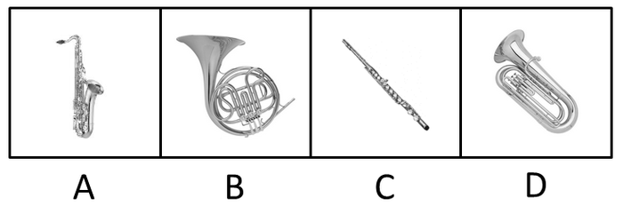
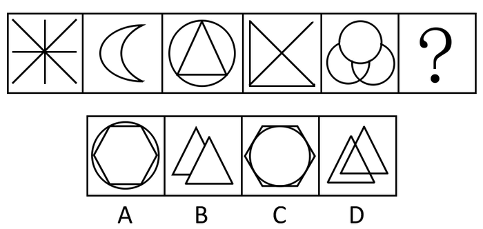
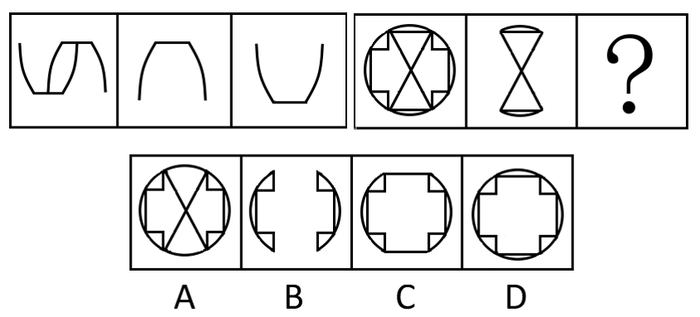
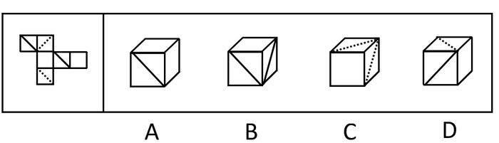
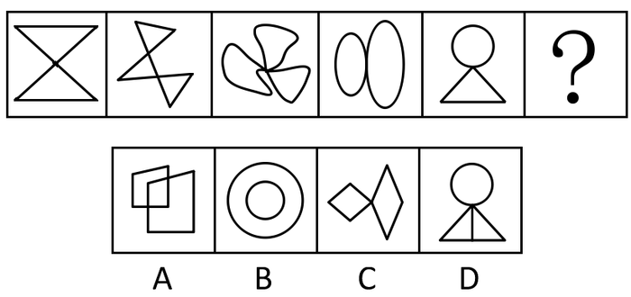
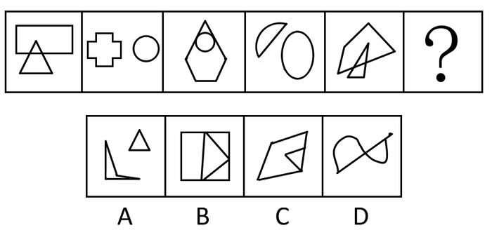
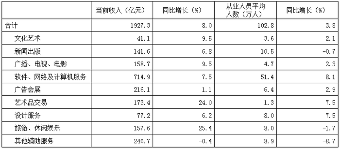
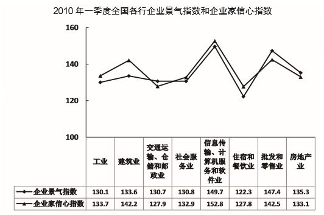
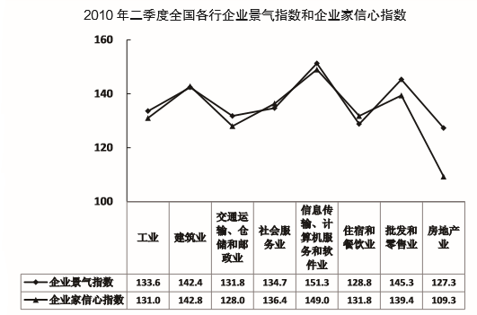
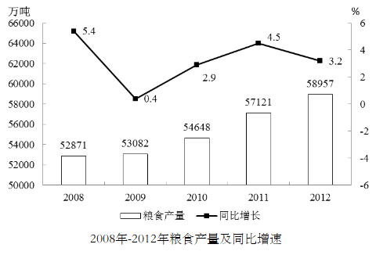

# 2014年黑龙江省公务员录用考试《行测》题

<!-- gwy:overview:start -->
> **黑龙江 · 2014 · 行测 · 统考** ｜ 120 题 · 图片 12 处 · 答案随题折叠

| 题型模块 | 题量 | 题号 |
| --- | ---: | ---: |
| 常识判断 | 20 | 1–20 |
| 言语理解与表达 | 30 | 21–50 |
| 数量关系 | 15 | 51–65 |
| 判断推理 | 35 | 66–100 |
| 资料分析 | 20 | 101–120 |
| **合计** | **120** | |

导航：[题型与作答说明](#题型与作答说明) · [题目](#题目) · [材料 1](#材料-1)
<!-- gwy:overview:end -->

> 候选采集稿。参考答案及解析来自粉笔页面，不代表官方答案或真实高分答卷；来源使用许可与原卷对应关系仍需人工核实。

## 题型与作答说明

常识判断

（20题）

根据题目要求，在四个选项中选出一个最恰当的答案。

言语理解与表达

（30题）

本部分包含表达与理解两方面的内容，请根据题目要求，在四个选项中选出一个最恰当的答案

数量关系

（15题）

在这部分试题中，每道题呈现一段表现数字关系的文字，要求你迅速、准确的计算出答案。

判断推理

（35题）

本部分包含图形推理、定义判断、类比推理和逻辑判断四个部分，根据要求选出符合要求的一项。

资料分析

（20题）

所给出的图、表、文字或综合资料均有若干个问题要你回答，请根据材料提供的信息进行分析、比较、计算和判断处理。

## 题目

### 第 1 题

耕地保护是关系我国经济和社会可持续发展的全局性战略问题。“十分珍惜和合理利用土地，切实保护耕地”是必须长期坚持的一项基本国策。下列说法不正确的是：

A. 耕地占用补偿制度是我国目前主要的耕地保护制度之一

B. 国家能源、交通、水利、军事等重点建设项目确需占用基本农田的，必须报省级政府批准

C. 补充耕地任务全面落实是“十二五”期间土地整治的主要目标之一

D. 我国耕地保护红线是18亿亩

第 1 题 · 答案与解析

**参考答案（粉笔题库参考内容）**

B

**解析**

我国人口多耕地少，耕地后备资源不足，维护国家粮食安全，保持社会稳定，始终是我国的一个重大问题。为此，国家专门制定《基本农田保护条例》，划定基本农田保护区，其根本目的就是为了对基本农田实行特殊保护，以满足我国未来人口和国民经济发展对农产品的需求，为农业生产乃至国民经济的持续、稳定、快速发展起到保障作用。其中第三章第十五条规定：“基本农田保护区经依法划定后，任何单位和个人不得改变或者占用。国家能源、交通、水利、军事设施等重点建设项目选址确实无法避开基本农田保护区，需要占用基本农田，涉及农用地转用或者征收土地的，必须经国务院批准。”B项错误，A、C、D三项正确。

本题为选非题，故正确答案为B。

**来源**：2014年黑龙江省公务员录用考试《行测》题第1题

### 第 2 题

下列画家和其代表作对应正确的是：

A. 吴道子——《洛神赋图》

B. 张择端——《游春图》

C. 徐悲鸿——《五牛图》

D. 阎立本——《步辇图》

第 2 题 · 答案与解析

**参考答案（粉笔题库参考内容）**

D

**解析**

A项错误，著名画家顾恺之依据《洛神赋》，画了流传千古的名画《洛神赋图》，其中最感人的一段描绘是曹植与洛神相逢，但是洛神无奈离去的情景，被称为“中国十大传世名画”之一；B项错误，《游春图》作者是展子虔，展子虔是北齐至隋之间（约550—600年）的一位大画家，他擅长画山水人物，这幅有宋徽宗题写的“展子虔游春图”字样的画作，是画家唯一的传世作品，也是迄今为止中国存世最古老的画卷；C项错误，《五牛图》是“中国十大传世名画”之一，出自韩滉之手，是少数几件唐代传世纸绢画作品真迹之一，也是现存最古老的纸本中国画，堪称“镇国之宝”，现存于北京故宫博物院；D项正确，《步辇图》是唐朝画家阎立本的名作之一，也是“中国十大传世名画”之一，现存于北京故宫博物院。作品设色典雅绚丽，线条流畅圆劲，构图错落富有变化，为唐代绘画的代表性作品，具有珍贵的历史和艺术价值。

故正确答案为D。

**考点**：文化常识

**来源**：2014年黑龙江省公务员录用考试《行测》题第2题

### 第 3 题

关于2013年我国各项工作的完成情况，下列表述不正确的是：

A. 城乡居民收入差距继续缩小

B. 进出口总额突破4万亿美元

C. 粮食产量较上年略有减少

D. 国内生产总值超过50万亿元

第 3 题 · 答案与解析

**参考答案（粉笔题库参考内容）**

C

**解析**

本题考查新思想。

A项正确，城镇居民人均可支配收入实际增长7%，农村居民人均纯收入实际增长9.3%，农村贫困人口减少1650万人，城乡居民收入差距继续缩小，排除；

B项正确，进出口总额突破4万亿美元，再上新台阶。居民收入和经济效益持续提高，排除；

C项错误，粮食产量超过1.2万亿斤，实现“十连增”，当选；

D项正确，经济运行稳中向好。国内生产总值达到56.9万亿元，比上年增长7.7%，排除。

本题为选非题，故正确答案为C。

**考点**：经济建设

**来源**：2014年黑龙江省公务员录用考试《行测》题第3题

### 第 4 题

下列选项中不属于全国人民代表大会职权的是：

A. 行政立法，制定行政法规

B. 选举、任命和罢免国家机关领导人员

C. 审查和批准国家的预算

D. 修改宪法，监督宪法实施

第 4 题 · 答案与解析

**参考答案（粉笔题库参考内容）**

A

**解析**

A项错误，全国人民代表大会是最高国家权力机关，根据《宪法》第六十二条的规定，全国人民代表大会的主要职权有：

(一)修改宪法;

(二)监督宪法的实施;

(三)制定和修改刑事、民事、国家机构的和其他的基本法律;

(四)选举中华人民共和国主席、副主席;

(五)根据中华人民共和国主席的提名，决定国务院总理的人选;根据国务院总理的提名，决定国务院副总理、国务委员、各部部长、各委员会主任、审计长、秘书长的人选;

(六)选举中央军事委员会主席;根据中央军事委员会主席的提名，决定中央军事委员会其他组成人员的人选;

(七)选举最高人民法院院长;

(八)选举最高人民检察院检察长;

(九)审查和批准国民经济和社会发展计划和计划执行情况的报告;

(十)审查和批准国家的预算和预算执行情况的报告;

(十一)改变或者撤销全国人民代表大会常务委员会不适当的决定;

(十二)批准省、自治区和直辖市的建置;

(十三)决定特别行政区的设立及其制度;

(十四)决定战争和和平的问题;

(十五)应当由最高国家权力机关行使的其他职权。

A项错误，根据《宪法》第八十九条规定：“国务院行使下列职权：

(一)根据宪法和法律，规定行政措施，制定行政法规，发布决定和命令”。

本题为选非题，故正确答案为A。

**考点**：宪法

**来源**：2014年黑龙江省公务员录用考试《行测》题第4题

### 第 5 题

下列哪项中“竹”的含义与其他三个不一样（    ）

A. 金石丝竹

B. 势如破竹

C. 罄竹难书

D. 梅兰竹菊

第 5 题 · 答案与解析

**参考答案（粉笔题库参考内容）**

A

**解析**

A项，金石丝竹：金，指金属制的乐器；石，指石制的磬；丝，指弦类乐器；竹，指管类乐器。泛指各种乐器，也形容各种声音。

B项，势如破竹：形势就像劈竹子，头上几节破开以后，下面各节顺着刀势就分开了。比喻作战或工作节节胜利，毫无阻碍。

C项，罄竹难书：指把竹子用完了都写不完。罄竹，用尽所有竹简；竹，指竹简。

D项，“梅兰竹菊”四君子，千百年来以其清雅淡泊的形象，一直为世人所钟爱，同时也成为一种人格品性的文化象征。因此A项中的“竹”的含义与B、C、D三项中的不一样。

本题为选非题，故正确答案为A。

**考点**：文学常识

**来源**：2014年黑龙江省公务员录用考试《行测》题第5题

### 第 6 题

张某是某服装公司的法人代表，与担任出纳职务的妹夫合谋将100万元公司资金挪用到股市炒股，并将盈利的20万元平分。张某的行为构成：

A. 挪用公款罪

B. 挪用资金罪

C. 职务侵占罪

D. 贪污罪

第 6 题 · 答案与解析

**参考答案（粉笔题库参考内容）**

B

**解析**

根据我国《刑法》和有关司法解释规定，挪用资金罪是指公司、企业或者其他单位的工作人员，利用职务上的便利，挪用本单位资金归个人使用或者借贷给他人，数额较大、超过3个月未还的，或者虽未超过3个月，但数额较大、进行营利活动的，或者进行非法活动的行为。本题中张某属于普通主体，其行为符合挪用资金罪的构成要件。

故正确答案为B。

**考点**：刑法

**来源**：2014年黑龙江省公务员录用考试《行测》题第6题

### 第 7 题

下列成语反映的历史事件，按时间先后排序正确的是：

A. 多多益善 指鹿为马 毛遂自荐

B. 精忠报国 闻鸡起舞 望梅止渴

C. 纸上谈兵 投笔从戎 乐不思蜀

D. 破釜沉舟 草木皆兵 负荆请罪

第 7 题 · 答案与解析

**参考答案（粉笔题库参考内容）**

C

**解析**

A项，“多多益善”指的是汉朝的韩信，“指鹿为马”指的是秦国的赵高，“毛遂自荐”指的是战国的毛遂；B项，“精忠报国”指的是宋朝的岳飞，“闻鸡起舞”是指东晋的祖逖，“望梅止渴”指的是东汉的曹操；C项，“纸上谈兵”指的是战国的赵括，“投笔从戎”指的是东汉的班超，“乐不思蜀”指的是三国的刘禅；D项，“破釜沉舟”指的是秦朝的项羽，“草木皆兵”是指东晋的苻坚，“负荆请罪”是指战国的廉颇，ABD三项时间排序有误，排除。

故正确答案为C。

**考点**：文化常识

**来源**：2014年黑龙江省公务员录用考试《行测》题第7题

### 第 8 题

在我国目前的国际储备中，最主要的储备资产是：

A. 普通提款权

B. 特殊提款权

C. 外汇储备

D. 黄金储备

第 8 题 · 答案与解析

**参考答案（粉笔题库参考内容）**

C

**解析**

国际储备是指各国政府为了弥补国际收支赤字，保持汇率稳定，以及应付其他紧急支付的需要而持有的国际间普遍接受的所有流动资产的总称。国际储备主要包括一国的货币用黄金储备、外汇储备、在国际货币基金组织的储备头寸和特别提款权。其中，外汇储备是我国国际储备资产最主要的形式。

故正确答案为C。

**考点**：宏观经济与调控政策

**来源**：2014年黑龙江省公务员录用考试《行测》题第8题

### 第 9 题

“二十四节气”中的“夏满芒夏暑相连”包含了多少个节气：

A. 6

B. 5

C. 4

D. 7

第 9 题 · 答案与解析

**参考答案（粉笔题库参考内容）**

A

**解析**

“夏满芒夏暑相连”是指：立夏、小满、芒种、夏至、小暑、大暑6个节气。

故正确答案为A。

**考点**：文化常识

**来源**：2014年黑龙江省公务员录用考试《行测》题第9题

### 第 10 题

关于《史记》下列说法正确的是：

A. 是我国第一本编年体史书

B. “世家”一般记载的是诸侯王

C. “本纪”中有唐太宗的事迹

D. 是司马光主持编写的

第 10 题 · 答案与解析

**参考答案（粉笔题库参考内容）**

B

**解析**

《史记》是我国著名史学家司马迁撰写的中国第一部纪传体通史，位列“二十四史”之首，记载了从传说中的黄帝开始到汉武帝太初四年约3000年间的历史。《史记》全书130篇，52万余字，包括：十二本纪（记历代帝王生平、政绩）；三十世家（记诸侯国和汉代诸侯、勋贵兴亡）；七十列传（记重要人物的言行事迹，主要叙人臣，其中最后一篇为自序）；十表（大事年表）；八书（记各种典章制度记礼、乐、音律、历法、天文、封禅、水利、财用）。

故正确答案为B。

**考点**：中国历史

**来源**：2014年黑龙江省公务员录用考试《行测》题第10题

### 第 11 题

关于夜盲症，下列说法不正确的是：

A. 夜盲症在光线昏暗的环境下视物不清

B. 多食用橘子有助于夜盲症的治疗

C. 夜盲症可能来自遗传

D. 缺乏维生素A可能引起夜盲症

第 11 题 · 答案与解析

**参考答案（粉笔题库参考内容）**

B

**解析**

A、C、D三项正确，夜盲就是在暗环境下或夜晚，视力很差或完全看不见东西。夜盲症俗称“雀蒙眼”，在夜间或光线昏暗的环境下视物不清，行动困难。夜盲症发生的原因如下：（1）暂时性夜盲：由于饮食中缺乏维生素A或因某些消化系统疾病影响维生素A的吸收，致使视网膜杆状细胞没有合成视紫红质的原料而造成夜盲。这种夜盲是暂时性的，只要多吃猪肝、胡萝卜、鱼肝油等，即可补充维生素A的不足，很快就会痊愈。（2）获得性夜盲：往往由于视网膜杆状细胞营养不良或本身的病变引起。常见于弥漫性脉络膜炎、广泛的脉络膜缺血萎缩等，这种夜盲随着有效的治疗、疾病的痊愈而逐渐改善。（3）先天性夜盲：系先天遗传性眼病，如视网膜色素变性，杆状细胞发育不良，失去了合成视紫红质的功能，所以发生夜盲。B项错误，橘子富含维生素C，夜盲症主要是缺乏维生素A。

本题为选非题，故正确答案为B。

**考点**：生物常识

**来源**：2014年黑龙江省公务员录用考试《行测》题第11题

### 第 12 题

关于中华人民共和国国务院公文印章正中的图案构成，下列说法正确的是：

A. 是五角星图案

B. 是镰刀斧头图案

C. 没有图案

D. 是中华人民共和国国徽图案

第 12 题 · 答案与解析

**参考答案（粉笔题库参考内容）**

D

**解析**

中华人民共和国国务院印章由中华人民共和国国务院全称以及正中央的中华人民共和国国徽组成。

故正确答案为D。

**来源**：2014年黑龙江省公务员录用考试《行测》题第12题

### 第 13 题

关于医学，下列说法正确的是（    ）

A. 华佗根据民间经验与自己的医疗实践，总结出“望闻问切”四诊法

B. 明朝李时珍著有《本草纲目》，被后人尊称为“医圣”

C. 《黄帝内经》《难经》《伤寒杂病论》《神农本草经》是我国传统医学的四大经典著作

D. 五脏六腑是人体内的主要器官，胆是五脏之一

第 13 题 · 答案与解析

**参考答案（粉笔题库参考内容）**

C

**解析**

A项：错误，望闻问切是中医用语。望，指观气色；闻，指听声息；问，指询问症状；切，指摸脉象，合称四诊。源自《难经》，作者秦越人（扁鹊）；

B项：错误，东汉末年著名医学家张仲景被后人尊称为“医圣”；

C项：正确，《黄帝内经》《难经》《伤寒杂病论》《神农本草经》是我国传统医学的四大经典著作；

D项：错误，“脏”是指实心有机构的器官，有心、肝、脾、肺、肾，习惯上把心包络附属于心，胰附属于脾，称五脏即概括了心包络和胰。脏者，藏也。心藏神，肺藏魄，肝藏魂，脾藏意与智，肾藏精与志，故为五脏。“腑”是指空心的器官，有胆、胃、大肠、小肠、膀胱、三焦。

故正确答案为C。

**考点**：文化常识

**来源**：2014年黑龙江省公务员录用考试《行测》题第13题

### 第 14 题

下列乐器中哪个是萨克斯：

A. A

B. B

C. C

D. D

第 14 题 · 答案与解析

**参考答案（粉笔题库参考内容）**

A

**解析**

萨克斯如下图：

故正确答案为A。

**考点**：文化常识

**来源**：2014年黑龙江省公务员录用考试《行测》题第14题

### 第 15 题

下列诗句与所描写景观对应错误的是：

A. 大漠孤烟直，长河落日圆——金沙江

B. 接天莲叶无穷碧，映日荷花别样红——西湖

C. 两岸青山相对出，孤帆一片日边来——长江

D. 岱宗何崔嵬，群山无与比——泰山

第 15 题 · 答案与解析

**参考答案（粉笔题库参考内容）**

A

**解析**

大漠孤烟直，长河落日圆。出自《使至塞上》，是唐代著名诗人王维于737年（开元二十五年）奉命赴边疆慰问将士途中所作的一首记行诗，记述出使途中所见所感，长河疑指黄河。本诗描写诗人出使塞上的旅程以及旅程中所见的塞外风光，表达了诗人由于被排挤而孤独、寂寞、悲伤、飘零的心情以及在大漠雄浑的景色中，情感得到熏陶、净化、升华后产生的慷慨悲壮之情，显露出一种豁达情怀。诗中既反映了边塞生活，同时也流露出作者对都护的赞叹，表达了诗人的抑郁、愤懑、孤独、寂寞之情和希望边疆平定的感情。

本题为选非题，故正确答案为A。

**考点**：文学常识

**来源**：2014年黑龙江省公务员录用考试《行测》题第15题

### 第 16 题

世界各国由于各自不同的经济与政治状况，形成了不同的城镇化发展模式。下列对应全部正确的是：

①欧洲——市场主导，自由发展

②韩国、日本——政府推动，短期迅速发展

③拉美国家——受殖民地经济制约

④美国——政府调控，长期逐步发展

A. ②③

B. ①④

C. ③④

D. ①②

第 16 题 · 答案与解析

**参考答案（粉笔题库参考内容）**

A

**解析**

美国是市场经济的典型代表，其一贯坚持和主张由市场主导调节经济，因此，在城镇化的建设中也坚持市场占主导地位，政府较少进行干预或调控。因此，④错误。

相比美国完全市场化的城镇化发展模式，西欧国家的城镇化虽然依然建立在市场机制的基础上，但政府的调控在城镇化发展过程中发挥了更大的作用。政府通过法律、行政和经济手段，有效地引导城镇化健康发展，在土地、住房、交通、环境等各个方面，政府都发挥着不可替代的作用。因此，①错误。

受历史上长期西方殖民统治的影响，拉美国家城镇化的特点是工业化发展严重落后于城镇化步伐，造成了城镇化的过度发展。拉美国家由于城镇化水平与西方国家接近，但是经济发展水平却远远低于西方国家，从而引发了一系列的“城市病”。因此，③正确。

以日本、韩国为代表的亚洲工业化国家的城镇化道路被称之为“东亚模式”，城市化速度较快，经济发展史上称之为“东亚奇迹”，且政府对于城镇化的引导作用比较显著。因此，②正确。

故正确答案为A。

**考点**：市场经济

**来源**：2014年黑龙江省公务员录用考试《行测》题第16题

### 第 17 题

下列有关地理知识的表述不正确的是：

A. “丹霞山世界地质公园”经联合国教科文组织批准为中国首批世界地质公园之一

B. 秦始皇为沟通湘江和漓江之间的航运，开挖了灵渠

C. “和田玉”是我国四大名玉之一，主要产自新疆

D. 我国位于北温带内，属于温带气候

第 17 题 · 答案与解析

**参考答案（粉笔题库参考内容）**

D

**解析**

丹霞山世界地质公园总面积319平方公里，2004年经联合国教科文组织批准为中国首批世界地质公园之一，故A项正确。

灵渠位于今广西桂林市兴安县境内，开凿于秦始皇三十三年（公元前214年），它的出现沟通了湘江（长江支流）与漓江（珠江支流），从而将长江和珠江这两大南方水系联系在一起，故B项正确。

中国四大名玉分别指新疆的“和田玉”、河南南阳的“独山玉”、陕西西安的“蓝田玉”及辽宁岫岩的“岫玉”，故C项正确。

我国地域辽阔，南北跨度大，具有热带、亚热带和温带等多种热量带，故D项表述片面。

本题为选非题，故正确答案为D。

**考点**：中国地理

**来源**：2014年黑龙江省公务员录用考试《行测》题第17题

### 第 18 题

在黄河入海口，下列哪一天白天最长：

A. 植树节

B. 劳动节

C. 教师节

D. 元旦

第 18 题 · 答案与解析

**参考答案（粉笔题库参考内容）**

B

**解析**

黄河入海口，位于山东省东营市垦利县黄河口镇境内。地处渤海与莱州湾的交汇处，1855年黄河决口改道而成。位于北半球，距离夏至日越近，白天越长，夏至是二十四节气之一，在每年公历6月21日或22日。A项错误，植树节为3月12日；B项正确，劳动节为5月1日，劳动节距离夏至约为53天；C项错误，教师节为9月10日，教师节距离夏至约为80天；D项错误，元旦为1月1日。

故正确答案为B。

**考点**：自然地理

**来源**：2014年黑龙江省公务员录用考试《行测》题第18题

### 第 19 题

为节约用水和减少污水排放，一些住宅小区对生活污水中的灰水和黑水进行分离处理，并采用了中水回用处理技术，以下关于中水、灰水、黑水的表述，错误的是：

A. 中水一般是指污水经过处理后的出水，水质介于上水（给水）和下水（污水）之间

B. 灰水和黑水都可以作为中水回用系统的水源

C. 从盥洗室、洗澡间和厨房等流出的洗涤废水是灰水

D. 呈黑色的废水都是黑水

第 19 题 · 答案与解析

**参考答案（粉笔题库参考内容）**

D

**解析**

粪便污水指的是居民日常生活中排泄的洗涤水。国外把粪便污水又称为黑水，与黑水相对的另一概念是灰水。国外的黑水定义有两种，一种定义为含有粪便物质的生活污水；另一种定义为厕所污水，包括冲厕水和粪便，所以D项说法错误。

本题为选非题，故正确答案为D。

**考点**：生活常识

**来源**：2014年黑龙江省公务员录用考试《行测》题第19题

### 第 20 题

在发生泥石流时，下列做法正确的是：

A. 发现泥石流后，要马上向与泥石流成垂直方向一边的山坡爬

B. 发生山体滑坡时，要马上沿着滑坡方向尽力奔跑

C. 发生泥石流时，在沟底尽力爬到大树上进行躲避，等待救援

D. 沿山谷徒步行走时，一旦遭遇大雨，发现山谷有异常的声音或听到警报时，应立即找寻较大的洞穴或巨石躲避，等大雨过后再走

第 20 题 · 答案与解析

**参考答案（粉笔题库参考内容）**

A

**解析**

本题考查科技常识。

遇到泥石流灾害，采取脱险逃生的办法有：沿山谷徒步行走时，一旦遭遇大雨，发现山谷有异常的声音或听到警报时，要立即向坚固的高地或泥石流的旁侧山坡跑去，不要在谷底停留。一定要设法从房屋里跑出来，到开阔地带，尽可能防止被埋压。发现泥石流后，要马上向与泥石流成垂直方向一边的山坡上面爬，爬得越高越好，跑得越快越好，绝对不能向泥石流的流动方向走。发生山体滑坡时，同样要向垂直于滑坡的方向逃生。要选择平整的高地作为营地，尽可能避开有滚石和大量堆积物的山坡下面，不要在山谷和河沟底部扎营。

故正确答案为A。

**考点**：生活常识

**来源**：2018年福建省选调生考试《行政职业能力测验》第27题

### 第 21 题

从指纹、掌纹、静脉、虹膜、视网膜、面孔等这些基本上刻录在人类遗传中的信息，到人们的习惯所代表的行为特征，每个人都有些＿＿＿＿＿＿的特征，都可用来验证身份。

填入画横线部分最恰当的一项是：

A. 独一无二

B. 始终如一

C. 一目了然

D. 一成不变

第 21 题 · 答案与解析

**参考答案（粉笔题库参考内容）**

A

**解析**

本题考查成语辨析。每个人的遗传基因都是独特的、不与他人重复的；每个人的行为习惯也有所不同，因此所代表的行为特征也就具有独特性。二者均可以用来验证身份。只有A项“独一无二”符合题意。

故正确答案为A。

【成语积累】

独一无二：没有相同的或没有可以相比的。强调独特性。

始终如一：自始至终一个样子。强调能坚持，不间断。

一目了然：一眼就看得很清楚。形容事物、事情原委很清晰，一看就知道是怎么回事。

一成不变：指守旧不变或固守陈法。强调一点没有变化。

**考点**：对应关系-前后呼应、成语填空

**来源**：2014年黑龙江省公务员录用考试《行测》题第21题

### 第 22 题

有智慧的人，一直以来都在享受每一秒，因为他们知道这一秒一旦过去就永不再来；愚痴的人，一直以来都在抱怨每一秒，总觉得这一秒不幸，下一秒才好！同样经历每分每秒，但＿＿＿＿＿＿，天地悬隔。

填入画横线部分最恰当的一项是：

A. 泾渭分明

B. 南辕北辙

C. 毫厘之差

D. 庸人自扰

第 22 题 · 答案与解析

**参考答案（粉笔题库参考内容）**

C

**解析**

本题考查成语理解。突破口有两个，一个是“享受每一秒”与“抱怨每一秒”在这一秒体现出来的差距是很小的；另一个是“但”之后的“天地悬隔”，应该填入一个开始差距很细微，之后很大的词语。“毫厘之差”指开始时虽然相差很微小，但结果会造成很大的差别，符合题意。“庸人自扰”指本来没事，自己找麻烦。“泾渭分明”比喻界限清楚或是非分明；“南辕北辙”比喻行动和目的正好相反。

故正确答案为C。

**考点**：对应关系-前后呼应、成语填空

**来源**：2014年黑龙江省公务员录用考试《行测》题第22题

### 第 23 题

强硬的紧缩政策和严重的失业问题，导致意大利社会不满情绪日益＿＿＿＿。就在莱塔内阁在总统府宣誓就职时，总理府外上演了一起因对政府不满而引发的枪击案。作为欧元区第三大经济体，意大利若因政治局势不稳而＿＿＿＿债务危机再度恶化，将给欧元区乃至整个欧盟带来沉重打击。

依次填入画横线部分最恰当的一项是：

A. 累积 导致

B. 增加 造成

C. 集聚 致使

D. 高涨 促进

第 23 题 · 答案与解析

**参考答案（粉笔题库参考内容）**

A

**解析**

从第二空入手，根据后文提示“债务危机再度恶化”，故横线处感情色彩为消极贬义，D项“促进”为积极褒义词语，感情色彩不符，排除；其余三项感情色彩均可，保留。

第一空，“集聚”有集中的意思，一般不与“情绪”搭配，排除C项。A项“累积”和B项“增加”对比，虽然搭配均可，但是“增加”只能体现数量上的增多，而“累积”既可以体现数量增多，也能体现出程度加重，纵观文段语境，A项“累积”更为合适，排除B项。

故正确答案为A。

**考点**：关联关系-因果关系、实词填空、词的辨析-感情色彩、词的辨析-搭配对象

**来源**：2015年重庆市选调优秀大学生到基层工作考试《行测》题第16题

### 第 24 题

只有把科学确立为社会的基本价值，才能使科学精神\_\_\_\_\_\_\_人们的精神血液中，\_\_\_\_\_\_\_到社会的制度规范中，\_\_\_\_\_\_\_在人们的日常生活中。

依次填入画横线部分最恰当的一项是：

A. 渗入 落实 呈现

B. 融入 固化 体现

C. 流入 贯彻 表现

D. 溶入 凝固 展现

第 24 题 · 答案与解析

**参考答案（粉笔题库参考内容）**

B

**解析**

第一空，根据文意可知，横线处表达科学精神与人们的精神血液融合之意，D项“溶入”指易溶解物体溶解于液体，通常主语为具体的东西，与“科学精神”这一抽象概念搭配不当，排除D项。

第二空，搭配“到社会的制度规范中”，A项“落实”和C项“贯彻”通常搭配具体实践，如“把从严要求贯彻落实到管党治党的全过程”，而文段中“制度规范”是一种理论，故搭配不当，排除A、C两项。B项“固化”指使固定，填入文段表达使科学精神固定在制度规范中，语义合适且搭配恰当。

第三空，代入B项“体现”验证，科学精神“体现”在人们的日常生活中，符合语境，当选。

故正确答案为B。

**考点**：实词填空、词的辨析-搭配对象

**来源**：2014年黑龙江省公务员录用考试《行测》题第24题

### 第 25 题

一个世界级的伟大作家当然先要有作品的＿＿＿＿，这一点，莫言毋庸置疑：近30年出版了10多部长篇小说、100多部中短篇小说，塑造出了＿＿＿＿＿＿的人物。

依次填入画横线部分最恰当的一项是：

A. 厚度 无与伦比

B. 高度 千奇百怪

C. 广度 形态各异

D. 深度 栩栩如生

第 25 题 · 答案与解析

**参考答案（粉笔题库参考内容）**

C

**解析**

第一空，根据横线后解释说明内容所述“10多部长篇小说、100多部中短篇小说”可知，横线处表达伟大作家的作品要很丰富，A项“厚度”、C项“广度”均符合文意，保留。B项“高度”、D项“深度”均强调作品分析透彻深入，与文意不符，排除。

第二空，搭配“人物”，根据“10多部长篇小说、100多部中短篇小说”可知，小说数量多，自然塑造人物相应的也会较多，故横线处表达人物多之意，C项“形态各异”指很多事物形状、姿态、形式不尽相同，各有特色，符合文意，当选。A项“无与伦比”指事物非常完美，没有能与它相比的东西，体现不出人物多之意，排除。

故正确答案为C。

**考点**：对应关系-解释说明、混搭填空

**来源**：2015年重庆市选调优秀大学生到基层工作考试《行测》题第18题

### 第 26 题

森林的大面积减少，水土流失、风沙弥漫，这可怕的景象绝不是＿＿＿＿＿＿，而是活生生的现实。不认真解决水害、沙害，土地资源流失与人口膨胀所造成的弊病，21世纪的可持续发展将成为空想。大自然的警告，足以＿＿＿＿＿＿。

依次填入画横线部分最恰当的一项是：

A. 虚张声势 当头棒喝

B. 危言耸听 醍醐灌顶

C. 空穴来风 振聋发聩

D. 耸人听闻 警钟长鸣

第 26 题 · 答案与解析

**参考答案（粉笔题库参考内容）**

D

**解析**

第一空，成语辨析。文段前面描述的是一系列可怕现状，下文“而是活生生的现实”说明前文说的可怕现状不是胡编乱造、夸大事实吓唬人的，而是真实存在的。C项“空穴来风”比喻消息和谣言的传播不是完全没有原因的，也比喻流言乘机会传开来，题中不是指流言，故排除。A项“虚张声势”指假造声势，借以吓人，与原文意思相符，保留；B项“危言耸听”指故意夸大事实，使人惊异震动，也与原文意思相符，保留；D项“耸人听闻”指夸大或捏造事实，使人听了感到惊异或震动，与原文意思相符，保留。

第二空，成语辨析，若想实现可持续发展，就要时刻警惕大自然发出的警告。A项“当头棒喝”比喻促人醒悟的打击或警告，多用于书面语，不符合文意，故排除。B项“醍醐灌顶”比喻听了高明的意见使人受到很大启发，也形容清凉舒适，明显不符合文意，故排除。D项“警钟长鸣”意思是警惕的钟声长久地响，比喻时刻保持警惕，符合文意，当选。

故正确答案为D。

**考点**：对应关系-前后呼应、成语填空

**来源**：2015年重庆市选调优秀大学生到基层工作考试《行测》题第19题

### 第 27 题

新近研究发现，人饥饿时胃黏膜中会出现一种激素，这种激素能够显著促进学习能力和记忆力。科学家解释说，这种激素在胃粘膜中\_\_\_\_后，借助血液循环进入大脑，能够引起反应，诸如激发脑垂体中许多不同的生长因子等，而这又将引起大脑其他区域内的\_\_\_\_\_反应，从而起到改善大脑功能的效果。

依次填入画横线部分最恰当的一项是：

A. 产生 聚合

B. 形成 系列

C. 合成 辐射

D. 分泌 连锁

第 27 题 · 答案与解析

**参考答案（粉笔题库参考内容）**

D

**解析**

第一空，根据文段的语境，由文段“人饥饿时胃黏膜中会出现一种激素”可知，此处应填“分泌”或“产生”较为合适。“形成”“合成”用在此处不当，故排除B、C两项。第二空，根据文段的语境，由文段“借助······引起反应”“而这又将引起”“从而”可知，文段讲的是激素引发的一系列连锁反应。“聚合”指聚集到一起，与其相比，“连锁”更为准确，排除A项，D项当选。（注：分泌激素、连锁反应都是较为固定的搭配。）

故正确答案为D。

【文段出处】《自然神经学》

**考点**：实词填空、对应关系-前后呼应

**来源**：2014年黑龙江省公务员录用考试《行测》题第27题

### 第 28 题

随着电扇、空调的＿＿＿＿，炎炎夏日中人们手摇蒲扇纳凉的情景已经很难看到了，但＿＿＿＿＿＿、瑰丽多彩的中国扇文化，却一直传承至今，成为人们记忆中绚丽无比的一道风景。

依次填入画横线部分最恰当的一项是：

A. 出现 享誉中外

B. 普及 源远流长

C. 使用 喜闻乐见

D. 发明 异彩纷呈

第 28 题 · 答案与解析

**参考答案（粉笔题库参考内容）**

B

**解析**

第一空，根据文段语境和词语的含义，由文段“人们手摇蒲扇纳凉的情景已经很难看到”可知，电扇、空调的使用应该是经过了一段时间，而A项“出现”和D项“发明”指某事物刚刚出现，时间区域上较短，两者均不合语境，排除。

第二空，根据文段语境，由文段“扇文化······传承至今”“记忆”可知，扇文化历史悠久，且流传至今，只有“源远流长”能够对应恰当，B项当选。

故正确答案为B。

【知识拓展】《溽暑话扇》和北京晚报《扇乃“户”中之“羽”》中有说道，“扇子有风，拿在手中，有人来借，等到立冬。”这是老北京在民间广为流传的一首民谣。

**考点**：对应关系-前后呼应、混搭填空

**来源**：2015年重庆市选调优秀大学生到基层工作考试《行测》题第21题

### 第 29 题

在现代社会，公民能独立地表达自己的观点，却不傲慢，对政治表示服从，却不\_\_\_\_；看到弱者知道同情，看到邪恶知道\_\_\_\_\_。

依次填入画横线部分最恰当的一项是：

A. 阿谀奉承 悲愤

B. 趋炎附势 气愤

C. 卑躬屈膝 愤怒

D. 溜须拍马 愤慨

第 29 题 · 答案与解析

**参考答案（粉笔题库参考内容）**

C

**解析**

第一空考查成语辨析。横线前出现转折词“却”，故横线前后语义相反，故空格处应填与‘服从’意思相近的词。“卑躬屈膝”与“阿谀奉承”是近义词，均强调“曲意迎合别人的心思”。“溜须拍马”强调的是讨好别人；“趋炎附势”指奉承和依附有权有势的人，不符合文意，故排除B、D两项。

第二空考查词语感情色彩。可根据句式相近确定实词。空格处应填入与“同情”相对且用来形容情绪的词语。“愤怒”指气愤不平，“悲愤”指因极度不满而情绪激动。相较而言，“悲愤”的语气过重，用来形容公民的情绪过重，故排除A项。

故正确答案为C。

【成语积累】

卑躬屈膝：形容没有骨气，低声下气地讨好奉承，谄媚讨好。

溜须拍马：用来形容对他人阿谀奉迎，对他人不切实际甚至虚妄地夸大、“赞扬”，以博取对方好感。是一个贬义词。

阿谀奉承：巴结拍马屁；说恭维人的话；向人讨好。强调“曲意迎合别人的心思”。

趋炎附势：奉承和依附有权有势的人。常与“阿谀奉承”连用。

【文段出处】柴静《看见》

**考点**：关联关系-转折关系、混搭填空、词的辨析-词义侧重

**来源**：2014年黑龙江省公务员录用考试《行测》题第29题

### 第 30 题

让山区孩子走出大山不是目的，让其具有改变大山、建设大山的志向与本领，才是山区摆脱贫困落后、填平城乡\_\_\_\_\_的最终归宿。事实上，与富裕地区相比，贫困地区不仅办学条件差，而且在发展基础、生存环境等各方面都严重\_\_\_\_。因此，“希望工程”不能只是捐资建校的代名词，而应当是开阔孩子视野、培育发展潜力、加大资源投入、强化基础建设的\_\_\_\_\_扶贫。

依次填入画横线部分最恰当的一项是：

A. 鸿沟 滞后 制度性

B. 差距 落后 系统性

C. 裂痕 停滞 整体性

D. 沟壑 缺乏 程序性

第 30 题 · 答案与解析

**参考答案（粉笔题库参考内容）**

A

**解析**

第一空，根据文段的语境和词语的含义，“差距”常与“拉开”或“缩小”搭配，与“填平”搭配不当，排除B项；“裂痕”意为裂缝，常用来比喻感情破裂，与“城乡”搭配不当，排除C项。

第三空，根据文段的语境和词语的含义，“程序性”指行事要按照先后次序，要具有工作步骤。文段中“‘希望工程’不能只是捐资建校的代名词······”并未涉及“希望工程”扶贫工作的次序、步骤等问题，排除D项。“制度性”是成体系的，符合形成“开阔孩子视野、培育发展潜力、加大资源投入、强化基础建设”之意，A项当选。

故正确答案为A。

【文段出处】《“希望工程”缘何改变不了贫困命运？》

**考点**：关联关系-因果关系、实词填空、对应关系-前后呼应、词的辨析-搭配对象

**来源**：2014年黑龙江省公务员录用考试《行测》题第30题

### 第 31 题

提起意大利，人们立即会联想到这里曾是文艺复兴的诞生地。米开朗基罗、波提切利和十五、十六世纪其他艺术家们不仅改变了欧洲，也重塑了文化与艺术的表达方式。时至今日，我们的建筑、视觉艺术、文学甚至部分生活理念，在一定程度上仍然受到意大利文艺复兴时期在古典遗产基础上所创造的美学形式和思考方式的影响。

这段文字意在说明：

A. 古典文化遗产保护的必要性

B. 意大利文艺复兴的重要影响

C. 当代美学形式的历史渊源

D. 意大利艺术家的主要成就

第 31 题 · 答案与解析

**参考答案（粉笔题库参考内容）**

B

**解析**

文段开篇引出“意大利文艺复兴”的话题，接着介绍了米开朗基罗、波提切利以及十五、十六世纪其他艺术家们在艺术领域的重要影响，最后指出至今我们多方面仍受意大利文艺复兴创造的美学形式和思考方式影响。故文段重点围绕意大利文艺复兴的影响展开论述，对应 B 项。

A 项，“古典文化遗产保护” 文段并未提及，无中生有，排除；

C 项，“美学形式”只是受意大利文艺复兴影响的众多方面之一，表述片面，排除；

D项，未提及核心话题“意大利文艺复兴”，排除。

故正确答案为B。

**考点**：主题词、分述句特征-引入铺垫

**来源**：2014年黑龙江省公务员录用考试《行测》题第31题

### 第 32 题

美感有时类似于灵感，只有在特定状况下才能产生。当公式的推导终于成功，或是忽然看懂一种繁难的理论，那一时刻的强烈感受不仅难以重现，也是不可转述的。晚唐的贾岛是有名的苦吟诗人，他和韩愈共同推敲“僧敲月下门”之句并结为忘年之交之事自古传为佳话。然而他还有两句诗更是苦吟了数年——“独行潭底影，数息树边身”，对于这两句诗他自称：“二句三年得，一吟双泪流。知音如不赏，归卧故山秋。”然而后世却有人认为此句稀松平常，“有何难吟”。这里自然也有文化底蕴的差别，但美感之难以传递也是极重要的原因，是以诗人自己也说“知音”方才能赏。

文中举贾岛的例子是为了说明：

A. 欣赏诗词要有足够的文化底蕴

B. 美感很难向他人传递

C. 写诗就是在寻找灵感、创造美感

D. 世上知音难觅

第 32 题 · 答案与解析

**参考答案（粉笔题库参考内容）**

B

**解析**

文段第二句提出了美感是不可转述的，接着以贾岛的例子予以论证，得出结论美感是难以传递的。B项“难以向他人传递”即是对文段观点的同义替换，当选；A项，文段中的意思是后世的人难以体会到贾岛诗句中饱含的深刻感情，其中一个原因是不同的人文化底蕴不同，并非意为“欣赏诗词要有足够的文化底蕴”，与文意不符，排除；C项谈论的是写诗，排除；D项过度引申，排除。

故正确答案为B。

**考点**：主题词、关联词-转折、特殊问法

**来源**：2014年黑龙江省公务员录用考试《行测》题第32题

### 第 33 题

最新研究表明，如果提高城市屋顶及道路面的反射能力，可能在成本极低的情况下降低地球大气温度。降低幅度虽然很小，但可被测量。在《环境研究报告》中有研究者表示，因为屋顶及道路占城市表面积的60%以上，使用淡色材料能把平均反射率提高到一定程度，使得全球平均气温降低多达0.07摄氏度。

根据这段文字，下列理解正确的是：

A. 新型材料能大幅降低室内温度

B. 城市路面占城市总面积的一半以上

C. 人们在探索缓解全球变暖的新途径

D. 深色材料的表面的反射能力强

第 33 题 · 答案与解析

**参考答案（粉笔题库参考内容）**

C

**解析**

A项，文段仅提及提高城市屋顶及道路面的反射能力可降低地球大气温度，未提及“新型材料”以及能“大幅降低室内温度”，无中生有，排除；

B项，根据“屋顶及道路占城市表面积的60%以上”可知，是屋顶及道路占城市表面积的比例，并非“城市路面占城市总面积”，偷换概念，排除；

C项，由“提高城市屋顶及道路面的反射能力，可能在成本极低的情况下降低地球大气温度”可知，人们正在探索缓解全球变暖的新途径，表述正确，当选；

D项，文段说的是“使用淡色材料能把平均反射率提高到一定程度”，意味着淡色材料反射能力强，而不是“深色材料”，表述与文意相悖，排除。

故正确答案为C。

**考点**：细节判断题

**来源**：2014年黑龙江省公务员录用考试《行测》题第33题

### 第 34 题

经媒体发掘而走向台前的众多“最美”事件表明：尽管当代中国社会在急剧的转型时期遭遇了道德价值层面的剧烈动荡与重构，但美德仍然流布于我们的现实生活中，流布于社会的各个角落。“最美”事件是平凡人的平凡作为，而正是这些平凡人的平凡作为，却极好地诠释了道德的实质，即人对自身生活的自主反思和自觉要求。它体现的是人的内在价值追求，而非被动地让自己的行为符合规范。这为当代中国社会的道德建设提供了有益的启示。

对这段文字的主旨概括最准确的是：

A. “最美”出自平凡

B. 崇尚美德永远不会过时

C. 道德体现了人的内在价值追求

D. “最美”事件带来的道德启示

第 34 题 · 答案与解析

**参考答案（粉笔题库参考内容）**

D

**解析**

第一步：分析文段。

本题属于中心理解题。文段首先引出“最美”事件这一论述话题，后指出“最美”事件诠释了道德的实质，体现价值追求，最后通过指示代词“这”引导出文段的主旨，强调主体是“最美事件”，即“最美”事件对道德的启示。结合选项，D项是对文段主旨的同义表达，当选。

第二步：分析选项。

A项，该表述未提及文段论述重点“道德”，故排除A项。

B、C两项，均未提及文段的关键词“最美”，故排除B、C项

第三步：再次标注答案。

故正确答案为D。

**考点**：关联词-因果

**来源**：2014年黑龙江省公务员录用考试《行测》题第34题

### 第 35 题

后视镜是重要的。坐在驾驶室里，不时瞥一下后视镜，可以看清已走过的路，可以看看后面有无危险。没有后视镜的驾驶过程让人心慌。但若只看后视镜，不看前方，更让人心慌，因为来自前面的冲撞，比来自后面的冲撞更猛烈，也更常见，何况前面的路还长。

下列各项与这段文字想要说明的意思最相近的是：

A. 前事不忘，后事之师

B. 历史是一面镜子

C. 不忘过去，放眼未来

D. 万事万物都有两面性

第 35 题 · 答案与解析

**参考答案（粉笔题库参考内容）**

C

**解析**

通读文段，前一部分说的是不要忘记过去，后一部分说的是要放眼未来，与选项对应只有C项符合。A项“前事不忘，后事之师”意思是记住从前的经验教训，为以后的工作借鉴，排除；B项“历史是一面镜子”只说到了过去的事，并未涉及将来，排除；D项“万事万物都有两面性”说的是一个事物的两面，而文段并不是只说一件事物，排除。

故正确答案为C。

**考点**：关联词-转折

**来源**：2014年黑龙江省公务员录用考试《行测》题第35题

### 第 36 题

18世纪20年代发明的摄影机，112年之后才成为工业产品；19世纪60年代发明的无线电，花了35年时间，到20世纪初才付诸使用；而20世纪发明的电视只经过12年就被应用了，原子弹从设计到应用只花了6年时间，晶体管的发明到工业生产只有3年时间，激光器发明到应用只有不到1年的时间。

这段文字意在说明科技发明：

A. 周期越来越短

B. 水平越来越高

C. 成果越来越多

D. 应用越来越快

第 36 题 · 答案与解析

**参考答案（粉笔题库参考内容）**

D

**解析**

本题考查中心理解。文段是并列结构。“而”字前面写18、19世纪的科技发明付诸使用时间长，从几个分句可以得出：科技成果从被发明到应用的时间愈来愈短。从选项可以判断答案为D项。

A项：“周期”表述不当，文段讲的是科技成果从被发明到付诸应用之间的时间段，而非发明周期，排除。

B项：文段并未对不同时期的科技发明水平进行阐述和比较，无中生有，排除。

C项：文段只是列举了18、19、20世纪的一些科技发明，并未阐述科技发明成果的数量，无中生有，排除。

故正确答案为D。

**考点**：关联词-并列

**来源**：2014年黑龙江省公务员录用考试《行测》题第36题

### 第 37 题

文化行业集密集型的人才、技术、知识与资本于一体，并具有鲜明的跨学科、跨专业、跨时空和跨文化特征，还将在未来的个人行为、社会生活和国家建构以及全球发展和人类事务中扮演着中心角色。1995年的联合国教科文组织世界文化与发展委员会报告，提出文化是人类生存整体繁荣和发展的最终目标和归宿。可以说，文化的跨界特质及其重要性，对文化人才的高质量和规模化提出了根本的要求。

这段文字意在说明：

A. 文化行业在人类的社会生活中扮演着重要的角色

B. 文化人才要具备高质量和规模化

C. 文化是人类繁荣和发展的最终目标

D. 文化行业的特殊性和重要性

第 37 题 · 答案与解析

**参考答案（粉笔题库参考内容）**

B

**解析**

文段是分—总的结构，首句背景介绍，介绍文化行业是什么样的行业，后面一句紧接着介绍教科文组织提出文化的重要性，最后可以得出文段的结论，即文化的重要性对人才提出了高质量和规模化的要求，即文段的主旨句。B项是对主旨句的同义替换，主旨句本身已经是对文段主旨的延伸，属意图主旨化。A、C、D三项都不是文段的重点或有失全面。

故正确答案为B。

【文段出处】光明日报：李春利、王国平《培养文化人才，学位、奖项不能成为唯一标准》

**考点**：关联词-因果

**来源**：2014年黑龙江省公务员录用考试《行测》题第37题

### 第 38 题

艺术精英主义是艺术一以贯之的高雅姿态和自我意识，它强调艺术是艺术家内心经验的独特写照，具有独一无二的审美意义，消费大众的需要和欲望，一般不在它的考量视域里。而大众文化更愿意强调艺术如何在消费和接受中呈现意义，如若大众的需要和欲望发生变化，那么作为生产者的艺术家，就有必要生产出作为现代艺术普遍范式的新的大众文化产品。

这段文字意在说明：

A. 自我意识是高雅艺术的灵魂

B. 艺术创造应与社会相连接

C. 艺术的发展同样受市场规律的影响

D. 艺术的本质在于其文化属性

第 38 题 · 答案与解析

**参考答案（粉笔题库参考内容）**

B

**解析**

第一步，读文段找到主旨句。文段第一句说明艺术精英主义的特点，第二句由关联词“而”引出对大众文化的论述，那么第二句是文段的重要内容。在第二句里，关联词“那么”引出的“有必要生产出作为现代艺术普遍范式的新的大众文化产品”是文段的重中之重，即为文段的主旨句。

第二步，在主旨句的基础上适当延伸得到答案。纵观选项，只有B项是在主旨句的基础上适当延伸，艺术创造应与社会相连接是对“有必要生产出作为现代艺术普遍范式的新的大众文化产品”的适当延伸；A项自我意识是高雅艺术的灵魂，偏离文段主旨更不是主旨的适当延伸，排除；C项受市场规律的影响不是文段的重点，排除；D项艺术的本质在于其文化属性，在文段中无从得知，排除。

故正确答案为B。

**来源**：2014年黑龙江省公务员录用考试《行测》题第38题

### 第 39 题

培根曾经说过：“知识就是力量。”而今在信息时代，人们可以说，信息就是力量，信息、传播信息的技术与基础设施、掌握和运用信息技术的能力，构成了全新的权力来源。遍布全球的网络基础设施、持续提升的网络传输速率、日趋完善的移动便携式互联网终端，以及高速扩张的建立在人际关系网络数字化基础上的新媒体运用，使得信息流高速、实时地实现着跨国运动。视频网站与社交网站的出现，又使得那些具有简单化、符号化、碎片化的信息流，更容易被传播、关注，也因此更容易得到响应。能够影响这种信息流动的行为体，其权力会得到增强，反之，则被削弱。

这段文字意在强调，网络信息技术与新媒体运用：

A. 改变了现代信息传播的方式

B. 扩大了人类获取知识的途径

C. 推动了权力来源要素的重构

D. 加剧了全球信息资源不均的情况

第 39 题 · 答案与解析

**参考答案（粉笔题库参考内容）**

C

**解析**

文段为总—分结构。首先通过培根的名言引出“信息就是力量”，进而引出文段主旨“信息、传播信息的技术与基础设施、掌握和运用信息技术的能力，构成了全新的权力来源”。第三、四句则是对主旨的具体阐述。C项为主旨概括选项，当选。而A、B两项属于分述的内容，非文段重点，排除。D项无中生有，排除。

故正确答案为C。

**考点**：分述句特征-其他

**来源**：2014年黑龙江省公务员录用考试《行测》题第39题

### 第 40 题

罩甲是明代戎服的一种，对襟，用纽扣固定，无袖或短袖，左右两侧及后部开裾，衣身可缀甲片，也可纯用织物制作，底边通常缀有彩色的排穗。明代戏曲舞台上青少年武将多穿罩甲，并配上金束发冠，显得英俊威武。清代之后戏曲中仍然沿用，分为排穗（须）甲与排须长马甲（坎肩）两种，与紫金冠配套。《红楼梦》里描写贾宝玉头戴束发紫金冠、身穿排穗褂子，就是将艺术造型移植了过来，体现了宝玉“将门公子”的身份。

关于罩甲，下列说法与原文相符的是：

A. 多由青少年武将穿着

B. 明代后期演变为戏曲服装

C. 清代成为达官贵人的身份标志

D. 最晚产生于明代

第 40 题 · 答案与解析

**参考答案（粉笔题库参考内容）**

D

**解析**

A项错误，属于逻辑偷换，由“青少年武将多穿罩甲”不能得到“多由青少年武将穿着”；B项错误，属于无中生有，无法从文段得出明代后期罩甲演变为戏曲服装；C项错误，属于语意偷换，文段说“就是将艺术造型移植了过来，体现了宝玉‘将门公子’的身份”，无从得知清代成为达官贵人的身份标志；D项正确，由文段“明代戏曲舞台上青少年武将多穿罩甲”可知，罩甲最晚产生于明代。

故正确答案为D。

**考点**：细节判断题

**来源**：2014年黑龙江省公务员录用考试《行测》题第40题

### 第 41 题

微笑是人类表达感情的有效途径。神奇的是，如果对方是假笑，你回应以同样的微笑，你的前额脑区底部并不会变活跃，于是就会意识到对方的微笑有些不对劲，并且很快会断定，这人是在假笑，这说明＿＿＿＿＿＿＿＿＿＿。

填入划横线部分最恰当的一句是：

A. 人的前额脑区底部能控制人们的情感

B. 人们在无意识状态下会受到对方情绪的感染

C. 人们可以依靠本能判断对方情感真假

D. 假笑很难达到理想的实际效果

第 41 题 · 答案与解析

**参考答案（粉笔题库参考内容）**

C

**解析**

本题考查语句衔接。横线处出现在结尾，故起到总结全文的作用。文段第一句引出话题“表达情感的有效途径”，第二句说明如果有人假笑是很容易被意识到的。可知文段谈论的是人们对于真笑假笑是可以做出判断的。C项是对文段的全面概括，当选；A项偷换概念，前文谈的是前额脑区底部不活跃从而判断对方假笑，无法看出它能控制人们的感情，排除；B项属于无中生有，排除；D项“实际效果”文中未提及，排除。

故正确答案为C。

**考点**：横线在结尾

**来源**：2014年黑龙江省公务员录用考试《行测》题第41题

### 第 42 题

民族文化要有根基，精神文明的传承要有载体，而城市正是其集大成者。放眼世界，历史文化名城和现代国际大都市，座座堪称文化艺术宫殿、建筑博物馆，从民主城邦雅典到人文之城威尼斯，从时尚之都巴黎到音乐之城维也纳，独特的文化精神令城市历经千年，依然灿烂。

文章接下来最可能讲：

A. 各具文化特色的世界名城

B. 要用文化精神来涵养和提升城市品位

C. 城市建设和发展要彰显特色和魅力

D. 民族文化是如何传承的

第 42 题 · 答案与解析

**参考答案（粉笔题库参考内容）**

B

**解析**

本题为接语选择题，应在通读全文的基础上，重点关注最后讨论的核心话题。文段首先指出民族文化要有根基，精神文明的传承要有载体，而城市正是其集大成者，接着列举了一些城市的例子，最后提到独特的文化精神令城市历经千年依然灿烂，故后文也将继续围绕“文化精神”和“城市”来展开，对应B项。

A项仅提到“城市”，未涉及“文化精神”；C项仅提到“城市建设”；D项仅提到“民族文化”，三项均与文段最后讨论的核心话题不一致，排除。

故正确答案为B。

【文段出处】《让文化涵养城镇品位》

**考点**：接语选择题

**来源**：2014年黑龙江省公务员录用考试《行测》题第42题

### 第 43 题

市场经济本质是法治经济，市场和法治是同一硬币的两面，缺一不可。与计划经济时代不同，市场经济对资源的配置是通过竞争机制实现的，这就必须依循一套完善的规则，以实现通过市场这只“看不见的手”对经济进行调整。

这段文字主要说的是：

A. 市场经济与计划经济的不同在于法治

B. 市场经济的发展离不开法治与市场

C. 市场竞争可以实现资源的合理配置

D. 法治是市场经济良性发展的基本保障

第 43 题 · 答案与解析

**参考答案（粉笔题库参考内容）**

D

**解析**

文段先是指出市场经济本质是法治经济，市场和法治缺一不可，接着对比计划经济，强调要通过完善的法治规则来实现市场的作用。因此，文段主要强调的是法治对市场经济的必要性和保障作用，对应D项。

A项，“市场经济与计划经济的不同”并非文段重点，且没有提及主题词“法治”，排除；

B项，“市场”非重点，文段通过对策重点强调的是法治的重要性，排除；

C项，没有提及文段主题词“市场经济”，偏离文段中心，排除。

故正确答案为D。

**考点**：关联词-对策

**来源**：2014年黑龙江省公务员录用考试《行测》题第43题

### 第 44 题

英国新经济基金会对世界178个国家的调查表明，新兴国家如中国，人们的幸福感反而要高于日、韩，更高于美国。当然，据荷兰伊拉斯谟大学和美国密歇根大学社会研究所的调查，自1995年的短暂上升后，中国人的幸福感也开始下滑。全球范围内的人们开始体认到这样一个事实，经济的增长并不等同于发展，因为后者还包含生态休闲、社会福利与公平正义等一系列指标；幸福也不仅指感官的快乐，因为它还关乎人对生命意义的积极体验和整体评价。

根据这段文字，以下说法正确的是：

A. 新兴国家对幸福感有着不同的理解

B. 幸福既包含感官的快乐又与人对生命意义的认识有关

C. 文化背景对国民幸福观的形成有重要的影响

D. 幸福感与经济增长有密切的关系

第 44 题 · 答案与解析

**参考答案（粉笔题库参考内容）**

B

**解析**

本题属于细节判断题，通读文段一一对应选项。B项是对文段最后一句话的同义概括，正确；A项“新兴国家对幸福感有着不同的理解”在原文中并未涉及，并且根据文段推断，老牌国家经济好，但是幸福感不如新兴国家，说明经济水平在其认知中并非幸福感唯一要素；加上新兴国家开始幸福感较高，后来幸福感下降，说明新兴国家的人们也意识到经济水平不是唯一影响幸福的要素。可见新兴国家和老牌国家间对幸福感的理解可能相同，排除；C项中的“文化背景”原文中并未涉及，排除；D项“幸福感”和“经济增长”密切联系属于过度推断，文中并未说关系密切，排除。

故正确答案为B。

**考点**：细节判断题

**来源**：2014年黑龙江省公务员录用考试《行测》题第44题

### 第 45 题

人类为了以后的安全或是不时之需而攒钱。但从整体来看，钱还是要花的。如果每个人都想攒钱，那么经济就无法正常运行了。\_①\_通过假设工作的人攒钱，退休的人花费积蓄，经济学解决了这一问题，利率让两者达到了很好的平衡。\_②\_然而假设与现实大相径庭。一些人攒钱的欲望要比其他人强烈得多，这种人通常会集中在一个民族或一个国家，这些钱必须从这些民族或国家流动到其他民族或国家。\_③\_否则，全球经济就无法正常运行。然而，如果资金从前者到后者的流动效率低下，那么危机就不可避免。\_④\_因为人总是本性难移，所以危机总是在所难免。

“这种模式正常运行的条件是人是理性经济人，管理其经济的制度都是相同的。”这句话在文中最合适的位置是：

A. ②

B. ③

C. ④

D. ①

第 45 题 · 答案与解析

**参考答案（粉笔题库参考内容）**

A

**解析**

本题为语句填空题，首先分析题干所给句子。该句由“这种模式”引导，随后根据后文“这种模式正常运行的条件是人是理性经济人，管理其经济的制度都是相同的”可知，该句的前文应介绍“这种模式”具体是什么，后文应介绍“人是理性经济人，管理其经济的制度都是相同的”相关话题。②处前文指出“假设工作的人攒钱、退休的人花费积蓄，通过利率达到平衡。这实际上构建了一种理想化的经济模式”，后文以“然而”转折，指出假设与现实大相径庭——不同人群攒钱欲望不同，资金需要跨国流动。因此，将题干句子放在②处，既可以承接前文对“这种模式”的描述，又能自然引出后文对现实差异的转折分析，起到承上启下的作用，对应A项。

B项，③处之后讨论的是资金流动效率低下导致危机，以及人性难移导致危机难免，与题干句子讨论的“人是理性经济人，管理其经济的制度都是相同的”话题无关，无法衔接，排除；

C项，④处之后重在分析经济危机难以避免的原因，并未涉及相关运行模式，衔接不当，排除；

D项，①处前文提出人人都攒钱会阻碍经济运转的问题，后文随即介绍经济学提出的解决模式。将题干句子放在此处，题干句子中的“这种模式”缺少指代对象，无法衔接，排除。

故正确答案为A。

【文段出处】《财新网》：谢国忠《贸易盈余伤己伤人》

**考点**：横线在中间

**来源**：2014年黑龙江省公务员录用考试《行测》题第45题

### 第 46 题

在讨论留守儿童问题时，有些学者将其归咎于个体和家庭层面的因素，强调亲子分离，但无论是历史上的走西口、闯关东之类的人口国内迁移，还是下南洋形成的人口海外迁移，都曾产生大量留守儿童。明清时期，徽州商人大量外出经商，其家乡也存在大量留守儿童。而由城市化产生的留守儿童，在近代的浙北、苏北等地也早就初具规模。为什么20世纪90年代以后，留守儿童问题成为一个公共议题呢？这不仅因为其规模日益庞大，更因为乡村社会发生嬗变，从根本上改变了乡村的育人环境。在通往现代化、城市化的路途中，乡村社会完全处于劣势和被动地位，乡村文化衰落了。

对这段文字的主旨概括最准确的是：

A. 中国乡村城市化对乡村文化的破坏是毁灭性的

B. 乡村社会的衰落是产生留守儿童问题的主要原因

C. 探讨留守儿童问题不能仅从个体和家庭层面找原因

D. 历史上有留守儿童却并未产生问题

第 46 题 · 答案与解析

**参考答案（粉笔题库参考内容）**

B

**解析**

文段首先指出有些学者将留守儿童问题产生的原因归为个体和家庭，随后介绍了人口迁移、商人外出和城市化都会产生留守儿童问题，并提出疑问——为什么留守儿童问题在20世纪90年代以后会成为公共议题。后文对原因进行分析，通过递进关联词“不仅······更······”强调乡村社会的嬗变是产生这一问题的原因，尾句对前文提到的原因进行解释说明。故文段重在强调乡村社会的衰落这一主要原因，对应B项。 A项：“对乡村文化的破坏”为解释说明的内容，非重点，排除。 C项：“不能仅从个体和家庭层面找原因”表述不明确，排除。 D项：无中生有，排除。

故正确答案为B。

**来源**：2014年黑龙江省公务员录用考试《行测》题第46题

### 第 47 题

无论是一个民族还是一个国家，它的文化永远不可能是静止的，而是每时每刻都在发生着变化。这种变化有时很慢，几乎让人感觉不到；但在我们这个时代，任何事情都在飞速发展，全世界的文化也正经历着快速而巨大的转变。在这样的时刻，我们面临的最重大问题仍然是：地区或国家的个性和特征是否能抵得住全球化、现代化的侵蚀？回答可以是两种：能或者不能。有的文化可能会被削弱甚至被同化，但是如果我们对这个问题保持警惕，就会减少文化的变化进而得以保存下来。

根据这段文字，作者认为：

A. 变化中的文化应该保持自己的个性

B. 文化应该跟随世界的脚步快速转变

C. 文化转变的趋势是不可逆转的

D. 全球化的侵蚀使文化同化越来越严重

第 47 题 · 答案与解析

**参考答案（粉笔题库参考内容）**

A

**解析**

文段第一句引出文化是变化的。由“在这样的时刻”可知后面的论述会更加重要，即文段的后半段要比前半段重要。后半段分为两部分——一个问题和针对问题提出的答案，重点内容在答案部分。而在此部分有一个强转折关联词“但是”该词引出一个条件关联词引导的句子“如果我们对这个问题保持警惕，就会减少文化的变化进而得以保存下来”，一般条件下关联词引导的句子常为主旨句，即最后一句为主旨句。A项“变化中的文化应该保持自己的个性”是在主旨句的基础上适当延伸得到的，当选；B项没有体现保存自己文化的内容，排除；C项与主旨句相矛盾，排除；D项为无关选项，排除。

故正确答案为A。

【文段出处】人民日报《恶性膨胀相互抄袭 城市雕塑创作误区令人反思》

**考点**：关联词-对策、关联词-转折

**来源**：2014年黑龙江省公务员录用考试《行测》题第47题

### 第 48 题

随着科技的发展、物质的丰富，如今的娱乐形式越来越缤纷多样，如电视剧、流行音乐、网络等。它们在给人快乐、满足人的欲望方面，更加快捷方便，也有着更大的刺激性和吸引力，比诗歌有着强得多的优势。人天生是寻求快乐的动物，既然有更好的娱乐方式，可以使人迅速消除烦恼，得到快感和精神享受，那么何必还要阅读诗歌？只有一些俗世高人，他们在空暇之日或夜阑人静时，或许会悄悄打开诗集，去聆听诗人梦幻般的自言自语，分享诗人心灵的孤独。

这段文字意在说明：

A. 快捷多元的娱乐方式导致了诗歌的衰落

B. 如今只有少数俗世高人能够理解诗人心灵的孤独

C. 诗歌应与时俱进，积极寻求走出困境的方式

D. 诗歌不再是能给人带来快感和精神享受的文学样式

第 48 题 · 答案与解析

**参考答案（粉笔题库参考内容）**

A

**解析**

文段首先指出如今的娱乐形式缤纷多样，这些多样的娱乐形式在满足人们的精神享受需求方面比诗歌占据优势；接下来用一个反问句指出，人类在更好的娱乐方式面前，忽略和忘记了诗歌；最后指出，只有少数人还在关注诗歌。因此，文段旨在说明多元的娱乐方式导致了诗歌的没落。A项为主旨的同义替换，当选；B项仅是对文段最后一句话的概括，排除；C项属无关选项，文段并未涉及诗歌以后应如何发展，排除；D项属于过度推断，诗歌只是不如新的形式好，并不是已不能给人带来快感和精神享受了，排除。

故正确答案为A。

**考点**：关联词-因果

**来源**：2014年黑龙江省公务员录用考试《行测》题第48题

### 第 49 题

①没有甘油，只要到市面上买瓶润肤乳液就行，它的主要成分就含有甘油

②那些节俭或喜欢动手享受家庭乐趣的朋友，也可以自己动手制作家庭洗手液

③但是自制洗手液由于包装和密封条件不足，最好不要使用容易变质的牛奶或蜂蜜

④其次是加入甘油。甘油不要超过2%，以免杀菌成分的最终浓度失衡，使杀菌力下降

⑤为适合个人爱好，还可适当加入一些美容成分，比如芦荟原汁、橄榄油等

⑥家庭洗手液主要成分是药用酒精，做法是将酒精与冷开水以3∶1的比例调成75%的最终浓度

将以上6个句子重新排列，语序正确的是：

A. ⑥②③⑤④①

B. ②③⑤⑥④①

C. ②⑥④①⑤③

D. ⑥⑤③④①②

第 49 题 · 答案与解析

**参考答案（粉笔题库参考内容）**

C

**解析**

对比选项确定首句，②句指出可以自制家庭洗手液，⑥句介绍家庭洗手液的主要成分，按照逻辑顺序应先指出人们可以制作家庭洗手液，再具体介绍家庭洗手液的主要成分，故②应在⑥之前，⑥不适合作为首句，排除A、D两项。对比B、C两项可知，⑤与⑥④①的顺序不同，⑥④①在介绍制作家庭洗手液的步骤，④出现“其次”，⑤出现“还”，按照逻辑顺序应④在⑤之前，对应C项。

故正确答案为C。

**考点**：确定尾句、确定顺序

**来源**：2014年黑龙江省公务员录用考试《行测》题第49题

### 第 50 题

周期性经济危机发生时，往往也是生产要素重新组合的时候，个人应该利用这一时期提高自身就业能力，参加那些适合自己的培训项目，给自己补课——补就业技能、创业能力和一般性素质。通常，在一次危机之后，会迎来一个经济繁荣时期。这个新的经济繁荣是在产业结构升级的基础上形成的，因而对劳动力素质的要求会大幅度提高。谁在劳动力市场低谷时期积攒了就业能力，谁在随后的繁荣时期就能抓住机遇。

这段文字的主旨概括最准确的是：

A. 加快提升劳动者素质是摆脱经济危机的手段

B. 劳动者不应对经济低迷时期的就业市场丧失信心

C. 产业结构升级促使劳动者提高自身素质

D. 经济危机时期也可以是个人提升能力的好时机

第 50 题 · 答案与解析

**参考答案（粉笔题库参考内容）**

D

**解析**

文段开篇介绍人们应该利用经济危机增强自身的能力。而后通过对经济危机之后对劳动力素质的要求会大幅提高的阐述，说明提高就业能力对于经济危机之后抓住机遇的重要性。文段为总分结构，重点强调经济危机时应该提高自身就业能力，对应D项。

A项，“摆脱经济危机”为无中生有，文中并未提及，排除。

B项，“丧失信心”为无中生有，文中并未提及，排除。

C项，偷换概念，生产要素重新组合不等于产业结构升级，排除。

故正确答案为D。

**考点**：关联词-对策、分述句特征-其他

**来源**：2014年黑龙江省公务员录用考试《行测》题第50题

### 第 51 题

从装有4个红球，4个白球的袋中任取4个球，则所取的4个球中包括两种不同颜色的球的概率是：

A. 33/35

B. 34/35

C. 69/70

D. 7/8

第 51 题 · 答案与解析

**参考答案（粉笔题库参考内容）**

B

**解析**

根据题意要求，所取的4个球中包括两种不同颜色的球的概率，即等于总概率–所取的4个球中只有1种颜色的概率。所取的4个球中只有1种颜色包含全红或全白两种情况，其情况数为C_4^1+C_4^1＝2，总情况数= C_8^4 = 70，故所求概率=1−2/70=68/70=34/35。

故正确答案为B。

**考点**：给情况求概率

**来源**：2014年黑龙江省公务员录用考试《行测》题第51题

### 第 52 题

某公交车停车场内停着10辆公交车，上午7点整有一辆公交车进入停车场，同时有一辆公交车离开停车场，以后每隔12分钟都有一辆公交车驶入停车场，每隔10分钟有一辆公交车离开停车场，则到当天下午什么时候停车场里的公交车全都开出：

A. 4：30

B. 4：50

C. 5：00

D. 4：10

第 52 题 · 答案与解析

**参考答案（粉笔题库参考内容）**

D

**解析**

根据题意，每隔12分钟驶入一辆，每隔10分钟离开一辆，取二者时间的最小公倍数为60分钟，即在1小时内驶入5辆，离开6辆，可得每1小时停车场减少1辆汽车。经过9小时后，停车场减少9辆汽车，还剩1辆汽车。再过10分钟，最后一辆汽车离开，故需要9小时10分钟当天下午停车场所停的汽车全部离开。开始时间为上午7点，则全部离开的时间为16点10分，即下午4：10。

故正确答案为D。

**考点**：周期相遇问题、和差倍比问题

**来源**：2014年黑龙江省公务员录用考试《行测》题第52题

### 第 53 题

甲、乙两村共有9600头牛，如果两村分别卖出自己村40%的牛，甲村再赠送120头牛给乙村，这时两村的牛数量相等，问甲村原有多少牛？

A. 5200

B. 5400

C. 5600

D. 5000

第 53 题 · 答案与解析

**参考答案（粉笔题库参考内容）**

D

**解析**

设甲村原有x头牛，则乙村原有(9600-x)头牛。根据题意可列方程：0.6x − 120 = 0.6 × (9600 − x) + 120，解得x=5000，则甲村原有5000头牛。

故正确答案为D。

**考点**：和差倍比问题

**来源**：2014年黑龙江省公务员录用考试《行测》题第53题

### 第 54 题

一艘船往返于甲乙两港口之间，已知水速为8千米/时，该船从甲到乙需6小时，从乙返回甲需9小时，问甲乙两港口的距离为多少千米：

A. 216

B. 256

C. 288

D. 196

第 54 题 · 答案与解析

**参考答案（粉笔题库参考内容）**

C

**解析**

方法一：设船在静水中的速度为v千米/时，根据题意，可列式：S＝（v＋8）×6＝（v－8）×9，解得：v＝40，S＝288千米。

方法二：从甲到乙顺流需要6小时，从乙到甲逆流需要9小时。路程一定，速度与时间成反比，则顺流与逆流的速度之比为3：2，即(V船 + V水)/(V船 − V水) = 3/2，化简可得V_船:V_水=5:1。而实际水速为8，则顺流速度为8×（5+1）=48千米/时，顺流需要6个小时，则甲乙两港口的距离为48×6＝288千米。

故正确答案为C。

**考点**：流水行船

**来源**：2014年黑龙江省公务员录用考试《行测》题第54题

### 第 55 题

某公园的道路由如下所示的5个正六边形组成，每个六边形每条边的长度都是100米，保安员从道路上某一点出发巡视完所有的道路至少要走多少米：

A. 2600

B. 2800

C. 3000

D. 2300

第 55 题 · 答案与解析

**参考答案（粉笔题库参考内容）**

A

**解析**

根据图形一笔画的基本规律，当图形中奇点个数为0或2时可以一笔画，其他情况下需要的最少画笔数＝奇点个数÷2。观察题干道路图，可以得出道路图中共有8个奇点，则最小需要4笔画完成。即保安从任意一个奇点出发，走完所有的道路需要重复3条边线。线路图总共23条边线，重复3条，共须走26条边线，每条边线100米，故至少需走26×100＝2600米。

故正确答案为A。

**考点**：几何其他题型、非典型最值问题

**来源**：2014年黑龙江省公务员录用考试《行测》题第55题

### 第 56 题

某商品每件销售毛利5元时，能售30万件，毛利15元时，能售20万件，假设两种情况的销售收入比为5：6，则每件商品的成本是多少元？

A. 8

B. 10

C. 12.5

D. 7.5

第 56 题 · 答案与解析

**参考答案（粉笔题库参考内容）**

D

**解析**

设每件商品的成本为x元，根据题意可列方程：(30 × (x + 5))/(20 × (x + 15)) = 5/6，解得x=7.5，则每件商品的成本价为7.5元。

故正确答案为D。

**考点**：经济利润问题

**来源**：2014年黑龙江省公务员录用考试《行测》题第56题

### 第 57 题

甲地有9000吨货物要运到乙地，大油轮载重700吨，小船载重量40吨，大油轮运一趟耗油1400升，小船一趟耗油95升，问运完这些货最少耗油多少升：

A. 18225

B. 18260

C. 18320

D. 18200

第 57 题 · 答案与解析

**参考答案（粉笔题库参考内容）**

D

**解析**

大油轮运输一次耗油比为1400/700=2升/吨，小船运输一次耗油比为95/40 = 2.375升/吨，故应尽可能多地用大油轮运输。9000/700 = 12余600。剩余的600吨货物用大油轮运输一次需1400升油；用小船运输需600/40 × 95 = 1425升油。故所有货物全部用大油轮运输13次耗油最少，需要1400×13=18200升。

故正确答案为D。

**考点**：统筹规划问题

**来源**：2014年黑龙江省公务员录用考试《行测》题第57题

### 第 58 题

甲乙两个水池大小形状完全相同但排水口径不同，将两个装满水的水池内的水匀速排空分别需要2小时和3小时，早晨5点半两个装满水的水池同时开始排水，到什么时候乙水池中剩余的水量正好是甲水池剩余水量的2倍：

A. 6点半

B. 7点半

C. 8点

D. 7点

第 58 题 · 答案与解析

**参考答案（粉笔题库参考内容）**

D

**解析**

赋值甲、乙两个水池的容量均为6，则甲、乙每小时的排水量分别为3、2。设经过x小时后乙水池中的水是甲水池剩余水的2倍，则可列式为：6-2x=2×(6-3x)，解得x=1.5，早晨5点半开始，经历一个半小时，此时时间应为7点。

故正确答案为D。

**考点**：给完工时间型

**来源**：2014年黑龙江省公务员录用考试《行测》题第58题

### 第 59 题

张平将150000元在银行分别办理了五年和三年期整存整取业务，三年期的存款到期后，把本金再办理两年期整存整取业务，张平一共获得利息39400元。已知五年、三年和两年整存整取的年利率分别为5.5%、5%和4.4%，问张平办理了多少元的五年期整存整取业务：

A. 60000

B. 100000

C. 120000

D. 50000

第 59 题 · 答案与解析

**参考答案（粉笔题库参考内容）**

B

**解析**

设张平办理了x元的五年期整存整取业务，则根据题意可列方程：5x × 5.5% + 3 × (150000 − x) × 5%+2 × (150000 - x) × 4.4% = 39400，解得x=100000，则张平办理了100000元的五年整存整取业务。

故正确答案为B。

**考点**：经济利润问题

**来源**：2014年黑龙江省公务员录用考试《行测》题第59题

### 第 60 题

甲和乙两个汽车销售经理上个月都超额完成了自己的月度任务，已知公司奖金计算方法是超任务销售一辆汽车奖励100元，第2、3、4…辆车奖励300、500、700…元。如两人当月合计得到1万元的销售奖金，问他们两人本月合计超任务销售了多少辆车？

A. 15

B. 16

C. 17

D. 14

第 60 题 · 答案与解析

**参考答案（粉笔题库参考内容）**

D

**解析**

设甲、乙二人分别超额完成任务x、y辆，则奖励分别为100x^2、100y^2。根据题意100x²+100y²=10000，则x²+y²=100=10²，必为整数，则此组勾股数为6、8、10。x与y分别为6、8，两人超额完成任务6+8=14辆。

故正确答案为D。

**考点**：和差倍比问题、数列问题

**来源**：2014年黑龙江省公务员录用考试《行测》题第60题

### 第 61 题

甲地在乙地正东5公里，某天早上7点30分，小赵从乙地出发，以每小时15公里的速度骑车前往甲地找小张，但在小赵出发的同时，小张也出发以每小时9公里的速度向正北方向跑步锻炼。小赵到甲地后立刻沿小张跑步的路径以每小时12公里的速度追小张，追上小张后，两人以每小时10公里的速度从相遇点沿直线距离返回乙地。问返回乙地时的时间是几点：

A. 10点08分

B. 10点14分

C. 10点20分

D. 10点02分

第 61 题 · 答案与解析

**参考答案（粉笔题库参考内容）**

A

**解析**

由题意可知，小赵从乙地到达甲地所用时间为5 ÷ 15 = 1/3小时，此时小张从甲地出发向北跑了9 × 1/3 = 3公里。小赵从甲地出发追上小张需用时3/(12-9)=1小时，此时距离甲地9 × (1/3 + 1) = 12公里，则根据勾股定理返回乙地的直线距离为√(5^2+12^2)=13，所需时间为13/10 = 1.3小时。小赵所用总时间为1/3+1+1.3=2小时38分钟，则返回乙地的时间为10点08分。

故正确答案为A。

**考点**：相遇追及

**来源**：2014年黑龙江省公务员录用考试《行测》题第61题

### 第 62 题

象棋比赛中，每个选手均与其他选手比赛一局，每局胜者得2分，负者得0分，和棋各得1分，那么以下可能是这次比赛所有选手得分的总和是：

A. 78

B. 67

C. 56

D. 89

第 62 题 · 答案与解析

**参考答案（粉笔题库参考内容）**

C

**解析**

根据题意，每个选手均与其他选手比赛一局，即所采用赛制为单循环比赛。在比赛中，每场比赛无论输赢都产生2分积分，所产生积分总和为2×C_n^2=n×(n-1)，故所产生积分总和一定为连续两个自然数的乘积，观察选项只有C项符合。

故正确答案为C。

**来源**：2014年黑龙江省公务员录用考试《行测》题第62题

### 第 63 题

用1到7的数字组成一个六位数密码，密码中每个数字只使用一次，在所有可能的密码排列中，能被3整除的数字占所有可能的排列数的比重为：

A. 1/6

B. 2/7

C. 3/7

D. 1/3

第 63 题 · 答案与解析

**参考答案（粉笔题库参考内容）**

C

**解析**

根据3的整除特性，所有数位数字之和能够被3整除则可被3整除。1+2+3+4+5+6+7=28，28 ÷ 3余1，如果密码能够被 3 整除，则需在这7位数中去掉一个除以3余1的数，1、4、7符合。从7个数字当中选出6个全排列，则有A_7^6种方式；密码当中不含1或不含4或不含7，一共有3×A_6^6种方式，则能被3整除的数字占所有可能的排列数的比重为3×A6^6/A7^6=3/7。

故正确答案为C。

**考点**：给情况求概率

**来源**：2014年黑龙江省公务员录用考试《行测》题第63题

### 第 64 题

李亮和刘纯两人采购同一款录音笔，如果一次购买数量不足50个，每个售价176元；如果一次购买50~99个，每个售价160元；如果一次购买100个及以上，每个售价144元。如果李亮和刘纯分别购买，共要付18688元，如果两人合买，可以节省2416元。问两人中购买录音笔数量较少者买了多少个录音笔：

A. 52

B. 56

C. 20

D. 38

第 64 题 · 答案与解析

**参考答案（粉笔题库参考内容）**

D

**解析**

根据题意两人合买，一共花费18688-2416=16272元，则两人一共购买了16272/144=113个录音笔。若两人购买的数量均大于50个，则两人应少支付(160-144) × 113 = 1808元，与题干2416元不符，故其中一人购买数量应小于50个。由于有一人购买数量小于50个，则较少者一定小于50个，故排除A、B两项，代入C项20个，则分开购买需要20×176+(113−20)×160 = 18400尾数为0，排除C项。

故正确答案为D。

**考点**：分段计算问题、和差倍比问题

**来源**：2014年黑龙江省公务员录用考试《行测》题第64题

### 第 65 题

现有浓度为20%的食盐水与浓度为5%的食盐水各1000克，分别倒出若干配成浓度为15%的食盐水1200克。问若将剩下的食盐水全部混合在一起，得到的盐水浓度为：

A. 7.5%

B. 8.75%

C. 10%

D. 6.25%

第 65 题 · 答案与解析

**参考答案（粉笔题库参考内容）**

B

**解析**

根据题意，1000克20%的食盐水中含溶质1000×20%=200克，1000克5%的食盐水含溶质1000×5%=50克，共含200+50=250克；倒出的1200克食盐水中含溶质共1200×15%=180克。则剩下的食盐水浓度为(250−180)/(2000−1200)=8.75%。

故正确答案为B。

**来源**：2014年黑龙江省公务员录用考试《行测》题第65题

### 第 66 题

从所给的四个选项中，选择最合适的一个填入问号处，使之呈现一定的规律性：

A. A

B. B

C. C

D. D

第 66 题 · 答案与解析

**参考答案（粉笔题库参考内容）**

A

**解析**

元素组成凌乱，考虑个数和属性。本题考查交点个数，前面5个图形的交点分别为1、2、3、4、5，按此规律第六个图形的交点应该为6，四个选项中只有A项是6个交点，B项为7个，C项为12个，D项为8个。A项正确。

故正确答案为A。

**考点**：数量规律-点

**来源**：2014年黑龙江省公务员录用考试《行测》题第66题

### 第 67 题

从所给的四个选项中，选择最合适的一个填入问号处，使之呈现一定的规律性：

A. A

B. B

C. C

D. D

第 67 题 · 答案与解析

**参考答案（粉笔题库参考内容）**

B

**解析**

本题考点为元素叠加中的简单叠加。观察第一组前三个图形得到的规律为，前面两幅图去同存异得到第三幅图，按此规律得到B项。

故正确答案为B。

**考点**：样式规律-加减同异

**来源**：2014年黑龙江省公务员录用考试《行测》题第67题

### 第 68 题

左边给定的是纸盒的外表面，下面哪一项能由它折叠而成：

A. A

B. B

C. C

D. D

第 68 题 · 答案与解析

**参考答案（粉笔题库参考内容）**

D

**解析**

本题考点为折纸盒。本题采用排除法，根据相对面的关系，空白面跟空白面，实线所在面跟实线所在面，虚线所在面跟虚线所在面均为相对面，所以排除A、B、C三项，选择D项。

故正确答案为D。

**考点**：空间类-空间重构-六面体

**来源**：2014年黑龙江省公务员录用考试《行测》题第68题

### 第 69 题

从所给的四个选项中，选择最合适的一个填入问号处，使之呈现一定的规律性：

A. A

B. B

C. C

D. D

第 69 题 · 答案与解析

**参考答案（粉笔题库参考内容）**

C

**解析**

元素组成凌乱，特殊考点。本题考查封闭区间的连接方式，观察题干图形中的封闭区间全都是以点相连接，即：封闭空间之间没有公共边。A项相交于面，B项明显两个圆没有相交于点，D项存在相交于边的情况，所以选C项。

故正确答案为C。

**考点**：特殊规律-图形间关系

**来源**：2014年黑龙江省公务员录用考试《行测》题第69题

### 第 70 题

从所给的四个选项中，选择最合适的一个填入问号处，使之呈现一定的规律性：

A. A

B. B

C. C

D. D

第 70 题 · 答案与解析

**参考答案（粉笔题库参考内容）**

A

**解析**

元素组成凌乱，且均由两个图形组合而成，考虑图形间关系，分别为相交、相离、相交、相离、相交、？，第六个应为相离的图形，只有A项符合。

故正确答案为A。

**考点**：特殊规律-图形间关系

**来源**：2014年黑龙江省公务员录用考试《行测》题第70题

### 第 71 题

“创新”作为严格的经济学概念，特指企业以新产品、新服务、新市场、新的管理和商业模式获取利润的行为。

根据上述定义，下列不属于经济学概念中的创新的是：

A. “蛟龙号”载人潜水器的深潜核心技术

B. 某菜农在网上销售自家大棚的蔬菜

C. 某供销社的“三创三先”为农服务新模式

D. 马云创办的阿里巴巴旗下的“淘宝网”

第 71 题 · 答案与解析

**参考答案（粉笔题库参考内容）**

A

**解析**

第一步：找出定义关键词。

“企业”、“新产品、新服务、新市场、新的管理和商业模式获取利润”。

第二步：逐一分析选项。

A项：“蛟龙号”载人潜水器不属于企业，且潜水器核心技术研发也不属于获取利润的行为，不符合定义，当选；

B项：菜农网上销售属于新的商业模式，符合定义，排除；

C项：供销社服务新模式属于新服务，符合定义，排除；

D项：“淘宝网”属于新的商业模式，符合定义，排除。

本题为选非题，故正确答案为A。

**考点**：方式目的

**来源**：2014年黑龙江省公务员录用考试《行测》题第71题

### 第 72 题

反政治的政治指的是一种政治态度，是对极权政治的一种否定。其基本思想是不把政治看做是关于权力和操纵的技术，也不把政治看做是关于控制人类的规则或有用的艺术，而是把政治看做是一种寻求和实现有意义生活的方式。

根据以上定义，以下最符合反政治的政治的是：

A. 杰出的政治家都是哲学家

B. 应该根据文化传统来建立不同人群的国家

C. 国家之间应该求同存异

D. 政治的根本目的是追求人的和谐，全面的发展

第 72 题 · 答案与解析

**参考答案（粉笔题库参考内容）**

D

**解析**

第一步：找关键词。

反政治的政治的定义条件包括：（1）否定极权政治的一种政治态度；（2）不把政治看作是关于权力和操纵的技术，也不把政治看作是关于控制人类的规则或有用的艺术；（3）一种寻求和实现有意义生活的方式。

第二步：逐一分析选项。

A项政治家都是哲学家这是一种观点，而非一种政治态度，不符合定义（1），排除；

B项中的政治观点体现了企图通过文化传统来对不同人群生活规则的控制，不符合定义条件（2），排除；

C项国家之间应该求同存异体现了政治对不同国家人类规则的一种控制与影响，不符合定义条件（2），排除；

D项政治的根本目的是追求人的和谐、全面发展，体现了人权的重要性，是对极权政治的一种否定，符合定义，当选。

故正确答案为D。

**考点**：单定义-其他句式

**来源**：2014年黑龙江省公务员录用考试《行测》题第72题

### 第 73 题

行政许可是指行政机关根据公民、法人或者其他组织的申请，经依法审查，准予其从事特定活动的行为。

根据上述定义，下列不属于行政许可的是（    ）。

A. 广播电影电视机构的设立

B. 放射性腐蚀性等危险品的生产运输

C. 公务员职务任免等的审批

D. 证券市场准入

第 73 题 · 答案与解析

**参考答案（粉笔题库参考内容）**

C

**解析**

第一步：找出定义关键词。

行政许可的定义条件包括：（1）行政机关；（2）申请；（3）准予其从事特定活动的行为。

第二步：逐一分析选项。

A、B、D三项：A项中广播电影电视机构的设立、B项中放射性腐蚀性等危险品的生产运输以及D项中证券市场准入都是需要申请并且依法审查后才能批准的，因此，符合定义。

C项：公务员职务的任用需要经过考试选拔而非申请，其免职等也只是按照相关规定而不是依法进行的，不符合定义。

本题为选非题，故正确答案为C。

**考点**：方式目的

**来源**：2014年黑龙江省公务员录用考试《行测》题第73题

### 第 74 题

根据对组织的态度的不同可以将公众分为顺意公众、逆意公众和独立公众。顺意公众指的是对组织的政策和行为持赞赏和支持态度的公众；逆意公众指的是对组织的政策和行为持否定或反对态度的公众；独立公众指的是对组织的政策和行为持中间态度的公众。

根据上述定义，以下属于顺意公众的是：

A. 单方毁约的合同方

B. 社会上的部分违法乱纪分子

C. 购买所在企业股票的职工

D. 学习积极性一般的在校生

第 74 题 · 答案与解析

**参考答案（粉笔题库参考内容）**

C

**解析**

第一步：找关键词。

“顺意公众的定义条件包括持赞赏和支持态度”。

第二步：逐一分析选项。

A项毁约行为以及B项中的违法乱纪行为显然不是支持或赞许，均不符合定义，排除；C项员工购买企业的股票属于对企业的一种支持，符合定义，当选；D项的学习积极性一般并没有体现出支持或赞许，不符合定义，排除。

故正确答案为C。

**考点**：常规问法

**来源**：2014年黑龙江省公务员录用考试《行测》题第74题

### 第 75 题

迁移型归属感是指个体由于空间的移动或加入新的群体、组织而产生的心理上的满足感与安全感。

根据上述定义，下列属于迁移型归属感的是：

A. 老王来广州打工后，自己的收入和生活水平有了很大的提高

B. 小李自入党以来，在感觉到肩负责任的同时，也对社会未来充满了希望

C. 刘某移民海外后，在激烈的人才竞争环境中凭借自己的学识站稳了脚跟

D. 小丽与小江结婚，婚后小丽觉得家庭和睦，生活幸福

第 75 题 · 答案与解析

**参考答案（粉笔题库参考内容）**

B

**解析**

第一步：找关键词。

迁移型归属感的定义条件包括：（1）空间的移动或加入新的群体；（2）产生心理上的满足感与安全感。

第二步：逐一分析选项。

A、C两项的行为均没有体现“满足感和安全感”，不符合定义条件（2），排除；B项小李入党符合定义条件（1）、（2），当选；D项小丽婚后觉得家庭和睦生活幸福，不符合定义条件（1），属于新建群体，而不是加入新的群体，排除。

故正确答案为B。

**考点**：原因结果

**来源**：2014年黑龙江省公务员录用考试《行测》题第75题

### 第 76 题

自居是指个体把不属于自己的某些特点、性格品质、理论观点当做是自己的，或者效仿自己崇拜的某些群体，一方面可以满足自尊心，提高价值感；另一方面可以减缓焦虑。

根据上述定义，下列最符合自居的是：

A. 小林的哥哥考上了大学，小林非常羡慕，辞去工厂的工作，准备参加来年高考，期待着能像哥哥那样

B. 小张新入学，不适应环境，他总是想办法向学校里高年级的风云人物讨教成功经验，然后照搬到自己的学习和生活中

C. 小梅是个彻头彻尾的追星族，每次演唱会她总是买最贵的票坐在前排，跟随着音乐节奏挥手舞动，并经常上台献花

D. 为了继承家业，小峰大学没毕业就成为家族企业的董事长，他的言谈举止俨然是一位叱咤商场多年的老江湖

第 76 题 · 答案与解析

**参考答案（粉笔题库参考内容）**

B

**解析**

第一步：找关键词。

自居的定义条件包括：（1）把不属于自己的某些特点、性格品质、理论观点当做自己的；（2）效仿自己崇拜的某些群体；（3）满足自尊心，提高价值感；（4）减缓焦虑。

第二步：逐一判断选项。

A项：小林辞去工作准备高考是他对哥哥参加高考这种行为的一种学习，不属于将他人的某些特点当做是自己的，此外，从定义中无法看出小林对哥哥是否具有崇拜之情，不符合定义，排除；

B项：新入学的小张将高年级风云人物的经验直接照搬到自己的学习和生活中，是典型的“效仿自己崇拜的某些群体”，符合定义，当选；

C项：小梅的行为是追星而非效仿，坐前排和上台献花属于小梅的正常行为特点，不符合定义，排除；

D项：小峰继承家业成为董事长并具有老江湖的言谈举止，这亦是小峰的自身特性，不符合定义，排除。

故正确答案为B。

**考点**：方式目的

**来源**：2014年黑龙江省公务员录用考试《行测》题第76题

### 第 77 题

破坏交通设施罪是指故意破坏正在使用中，或者已经交付的轨道、桥梁、隧道、公路、机场、航道、灯塔、标志，或者进行其他破坏活动，使火车、汽车、电车、船只、航空器发生倾覆、毁坏危险，足以危害公共安全的行为。

根据上述定义，以下行为不构成破坏交通设施罪的是：

A. 李某和王某为获取经济利益，窃取某市多个路口的交通护栏、导向标志牌、红绿灯设施后进行变卖

B. 张某因为航班延误，导致生意损失极大，在恼怒之际不顾安全人员阻拦，冲进机场跑道，击碎机场跑道指示灯

C. 孙某担心自己下岗，经过计划，在同乡的帮助下，私自卸下数根铁轨，自己再去阻拦火车，制造立功表现的假象

D. 小严是某建筑工程集团的工程师，由于与公司存在劳资矛盾，故意在大桥施工过程中使用劣质水泥材料，暗中降低大桥承重能力

第 77 题 · 答案与解析

**参考答案（粉笔题库参考内容）**

D

**解析**

第一步：找关键词。

定义条件包括：（1）故意破坏正在使用中，或者已经交付的······；（2）进行其他破坏活动，使······发生倾覆、毁坏危险，足以危害公共安全的行为。（注意提问为“不构成”）

第二步：逐一分析选项。

A项：“李某和王某窃取交通护栏、导向标志牌、红绿灯设施后变卖”，符合（1）类情况，排除；

B项：“张某因恼怒而冲进机场跑道击碎机场跑道指示灯”，是故意破坏正在使用中的机场标志，符合（1）类情况，排除；

C项：“孙某担心自己下岗，私自卸铁轨，阻拦火车，制造立功假象”，是故意破坏正在使用中的轨道，符合（1）类情况，排除；

D项：大桥并未投入使用也未交付，故不符合定义要求，即不构成破坏交通设施罪，当选。

本题为选非题，故正确答案为D。

**考点**：主客体

**来源**：2014年黑龙江省公务员录用考试《行测》题第77题

### 第 78 题

自我意识是对自己身心活动的觉察，即对自己的认识，具体包括认识自己的身体状况（如身高、体重、体态等）、心理特征（如兴趣、能力、气质、性格等）以及自己与他人的关系（如自己与周围人们相处的关系、自己在集体中的位置与作用等）。

根据上述定义，下列不属于自我意识的是：

A. 小王觉得自己在单位的朋友很少

B. 小张觉得自己性格外向

C. 小黄认为自己不适合经商

D. 小李认为自己的体重超标

第 78 题 · 答案与解析

**参考答案（粉笔题库参考内容）**

C

**解析**

找出定义的关键词。“小黄认为自己不适合经商”，经商是否必然属于能力的范畴无从界定，因此，C项不够明确，需与其他选项进行比较；D项“小李认为自己的体重超标”，属于自我意识的身体状况中的体重，符合定义要点。A、B、D三项在定义中都有明确的对应，相比之下C项的经商是否属于能力范畴不明确。

本题为选非题，故正确答案为C。

**考点**：主客体

**来源**：2014年黑龙江省公务员录用考试《行测》题第78题

### 第 79 题

所谓饥饿营销是指商品销售商有意调低销售量，以期达到调控供求关系、制造供不应求假象、维持商品较高售价和利润率的营销方式。饥饿营销也能达到维护品牌形象、提高产品附加值的目的。

根据上述定义，下列采用饥饿营销手段的是：

A. 商家对换季产品打折销售

B. 某房产商推出新楼盘时，故意调高售价

C. 某手机品牌在推出新产品的首天实行限量发售

D. 某医院规定专家门诊每天限量挂号30人

第 79 题 · 答案与解析

**参考答案（粉笔题库参考内容）**

C

**解析**

第一步：找关键词。

抓住定义主体“商品销售商”、方式“有意调低销售量”、目的“调控供求关系、制造供不应求的假象、维持商品较高售价和利润率”、“维护品牌形象、提高产品附加值的目的”等几个关键方面。

第二步：逐一分析选项。

A项“换季产品打折销售”，为调低销售价而非调低销售量，不符合定义要点，排除；

B项“房产商推新楼盘调高售价”，调高售价并没有有意调低销售量，不符合定义要点，排除；

C项“某手机品牌推出新产品首天限量发售”，为有意调低销售量，制造供不应求假象的营销方式，符合定义，当选；

D项“医院专家门诊每天限量挂号”，其中医院并非商品销售商，不符合定义主体，排除。

故正确答案为C。

**考点**：方式目的

**来源**：2014年黑龙江省公务员录用考试《行测》题第79题

### 第 80 题

恐怖症是指病人持续地和非理性地害怕某一特定物体、活动或情境，这种恐惧相对于实际的威胁来说是夸大的和非理性的。

根据上述定义，下列不属于恐怖症的是：

A. 赵亮的上司脾气不好，赵亮每次与他交谈时都会紧张、害怕

B. 张伟特别怕蜘蛛，每次看到无毒的小蜘蛛都会尖叫

C. 刘红不敢去商场，她很担心自己会像上次一样突然摔倒

D. 王明每次乘坐电梯都会很害怕，担心电梯的门打不开

第 80 题 · 答案与解析

**参考答案（粉笔题库参考内容）**

A

**解析**

第一步：找出定义关键词。

关键词为“持续地”、“非理性地”、“害怕某一特定物体、活动或情境”、“对于实际的威胁来说是夸大的和非理性的”。

第二步：逐一分析选项。

A项：赵亮的紧张、害怕源于上司脾气不好，其恐惧相对于实际的威胁是理性的，不符合定义，当选；

B项：张伟看到无毒的小蜘蛛都会尖叫，是持续地非理性地害怕某一特定物体、活动或情境，并相对实际威胁是夸大的和非理性的，符合定义，排除；

C项：刘红因为一次摔倒就因此而担心不敢再去商场，是一种持续地非理性地害怕某一特定情境，符合定义，排除；

D项：王明每次乘坐电梯都会很害怕，担心电梯的门打不开，是持续地非理性地害怕，恐惧超出实际的威胁，符合定义，排除。

本题为选非题，故正确答案为A。

**考点**：单定义-其他句式

**来源**：2014年黑龙江省公务员录用考试《行测》题第80题

### 第 81 题

历史：文学

A. 图画：文字

B. 油画：素描

C. 誊录：改写

D. 人才：庸才

第 81 题 · 答案与解析

**参考答案（粉笔题库参考内容）**

B

**解析**

第一步：判断题干词语间逻辑关系。

文学和历史都是学科的一种，二者是并列关系，并且文学和历史是有联系的，可以通过文学研究历史。

第二步：判断选项词语间逻辑关系。

A项：图画与文字是表达信息的不同方式，二者是并列关系，但二者之间没有联系，与题干逻辑关系不一致，排除；

B项：油画和素描都是绘画形式的一种，二者是并列关系，并且油画和素描是有联系的，素描是绘画的基本功，画好素描才能去画油画，与题干逻辑关系一致，当选；

C项：誊录是指把考生的考卷重新抄写一遍，以防止阅卷官员通过笔迹来舞弊，与改写无明显关系，与题干逻辑关系不一致，排除；

D项：人才和庸才是反义关系，与题干逻辑关系不一致，排除。

故正确答案为B。

**考点**：逻辑关系-并列关系

**来源**：2014年黑龙江省公务员录用考试《行测》题第81题

### 第 82 题

束缚：摆脱：自由

A. 紧张：消除：放松

B. 雨天：改变：彩虹

C. 引力：克服：超重

D. 货物：出售：流通

第 82 题 · 答案与解析

**参考答案（粉笔题库参考内容）**

A

**解析**

第一步：判断题干词语间逻辑关系。

束缚、摆脱、自由是对应关系，且具有逻辑性，自由需要摆脱束缚；且束缚与自由是一对反义词。

第二步：判断选项词语间逻辑关系。

A项：紧张、消除、放松具有逻辑关系，放松需要消除紧张，且放松与紧张是一对反义词，与题干逻辑关系一致，当选；

B项：雨天、改变、彩虹没有相应的逻辑关系，且雨天与彩虹不是反义词，与题干逻辑关系不一致，排除；

C项：超重不是由于引力而造成的，且超重与引力不是反义词，与题干逻辑关系不一致，排除；

D项：流通需要出售货物，但流通与货物不是一对反义词，与题干逻辑关系不一致，排除。

故正确答案为A。

**考点**：语义关系-反义关系、逻辑关系-对应关系

**来源**：2014年黑龙江省公务员录用考试《行测》题第82题

### 第 83 题

水电站：电车

A. 油田：汽车

B. 风车：台灯

C. 核电站：核潜艇

D. 水库：水龙头

第 83 题 · 答案与解析

**参考答案（粉笔题库参考内容）**

A

**解析**

第一步：判断题干词语间逻辑关系。

“水电站”的作用是发电，可以为“电车”提供能源，二者为对应关系，且“电车”是一种交通工具。

第二步：判断选项词语间逻辑关系。

A项：“油田”的作用是产油，可以为“汽车”提供能源，二者为对应关系，且“汽车”是一种交通工具，与题干逻辑关系一致，当选；

B项：“风车”的作用是发电、灌溉、观赏等，可以为“台灯”提供能源，但“台灯”不是交通工具，与题干逻辑关系不一致，排除；

C项：“核电站”的作用是发电，“核潜艇”指以核反应堆为动力来源设计的潜艇，“核电站”不能为“核潜艇”提供能源，二者不是对应关系，与题干逻辑关系不一致，排除；

D项：“水库”的作用是供水、发电、防洪等，“水龙头”指控制水流大小的水阀，“水库”不能为“水龙头”提供能源，二者不是对应关系，与题干逻辑关系不一致，排除。

故正确答案为A。

**考点**：逻辑关系-对应关系

**来源**：2014年黑龙江省公务员录用考试《行测》题第83题

### 第 84 题

咽喉：要塞（    ）。

A. 耳目：刺探

B. 头脑：智力

C. 手脚：捣鬼

D. 眉目：头绪

第 84 题 · 答案与解析

**参考答案（粉笔题库参考内容）**

D

**解析**

第一步：判断题干词语间逻辑关系。

题干词语之间是语义关系。咽喉是人的身体器官，又被用来比喻要塞。

第二步：判断选项词语间逻辑关系。

A项，耳目是人的身体器官，比喻刺探消息的人。刺探是个动词，而要塞是名词，词性不对，排除。

B项，头脑被用来比喻一个人聪明、精明，而非智力，排除。

C项，手脚被用来比喻为了某种目的而暗中进行的活动，但捣鬼是动词，排除。

D项，眉目指人的眉毛和眼睛，也比喻事情的头绪，正确。

第三步：再次标注答案

故正确答案为D。

**考点**：语义关系-比喻象征义

**来源**：2014年黑龙江省公务员录用考试《行测》题第84题

### 第 85 题

管中窥豹：坐井观天

A. 班门弄斧：按部就班

B. 刻舟求剑：竹篮打水

C. 言不由衷：口是心非

D. 未雨绸缪：杞人忧天

第 85 题 · 答案与解析

**参考答案（粉笔题库参考内容）**

C

**解析**

第一步：判断题干词语间逻辑关系。管中窥豹、坐井观天，二者是近义词关系。管中窥豹：从竹管的小孔里看豹，只看到豹身上的一块斑纹。比喻只见到事物的一小部分，指所见不全面或略有所得。坐井观天：比喻眼光狭小，不懂大道理，限于认识问题的角度，看问题不全面。题干所给的两组词语属于近义词关系。

第二步：判断选项词语间逻辑关系。

A项：班门弄斧、按部就班，二者不是近义词关系。班门弄斧比喻在行家面前卖弄本领；按部就班比喻按照一定的步骤、顺序进行。也指按老规矩办事，缺乏创新精神，排除。

B项：刻舟求剑比喻办事刻板，没有发展的眼光；竹篮打水：比喻花了时间精力，到头来却什么也没有得到。二者不是近义词关系，排除。

C项：言不由衷、口是心非二者都指说的不是真心话，比喻心口不一致。二者是近义词关系，当选。

D项：未雨绸缪比喻事先做好准备工作；杞人忧天比喻不必要的或缺乏根据的忧虑与担心，二者不是近义词关系，排除。

故正确答案为C。

**考点**：语义关系-近义关系

**来源**：2014年黑龙江省公务员录用考试《行测》题第85题

### 第 86 题

男性：女性

A. 东：西

B. 生：死

C. 青年：老年

D. 红布：蓝布

第 86 题 · 答案与解析

**参考答案（粉笔题库参考内容）**

B

**解析**

第一步：判断题干词语间逻辑关系。

男性和女性是并列关系，而且是矛盾关系，对于性别来说，要么是男性，要么是女性，没有第三种情况。

第二步：判断选项词语间逻辑关系。

A项：除了东、西方向外还有南、北方向，东、西二者不是矛盾的关系，与题干逻辑关系不一致，排除；

B项：生、死是矛盾关系，要么生、要么死，没有第三种情况，与题干逻辑关系一致，当选；

C项：除了青年、老年外还有中年、儿童等，与题干逻辑关系不一致，排除；

D项：红布、蓝布，二者也不是矛盾关系，与题干逻辑关系不一致，排除。

故正确答案为B。

**考点**：逻辑关系-并列关系

**来源**：2014年黑龙江省公务员录用考试《行测》题第86题

### 第 87 题

球员：球拍：网球

A. 战士：步枪：子弹

B. 警察：手铐：监狱

C. 医生：医术：病人

D. 农民：锄头：杂草

第 87 题 · 答案与解析

**参考答案（粉笔题库参考内容）**

A

**解析**

第一步：判断题干词语间逻辑关系。球员用球拍打网球，球拍与网球是一种配套对应关系。

第二步：判断选项词语间逻辑关系。A项：战士用步枪来发射子弹，步枪和子弹是配套对应关系；B项：警察用手铐来铐住犯人，监狱是地点，排除；C项：医生用医术来治疗病人，但医术是一种看不见摸不着的东西，不具有具体的形态，排除；D项：农民用锄头来清除杂草，后者不具备配套关系，排除。

故正确答案为A。

**考点**：逻辑关系-对应关系

**来源**：2014年黑龙江省公务员录用考试《行测》题第87题

### 第 88 题

（    ）对于 治理 相当于 学业 对于（    ）

A. 污染 攻读

B. 顽症 学习

C. 清理 功课

D. 整顿 作业

第 88 题 · 答案与解析

**参考答案（粉笔题库参考内容）**

A

**解析**

逐一代入选项。

A项：“治理”和“污染”二者为动宾关系；“攻读”和“学业”二者为动宾关系，前后逻辑关系一致，当选；

B项：“治理”和“顽症”二者为动宾关系；“学业”指“学习”的课业，二者为对应关系，前后逻辑关系不一致，排除；

C项：“清理”指彻底整理或处理，“治理”多指管理、统治，二者无明显逻辑关系；“功课”是“学业”的组成部分，二者为包容关系中的组成关系，前后逻辑关系不一致，排除；

D项：“整顿”和“治理”二者为并列关系；“作业”是“学业”的一部分内容，二者为包容关系，前后逻辑关系不一致，排除。

故正确答案为A。

**考点**：语法关系

**来源**：2014年黑龙江省公务员录用考试《行测》题第88题

### 第 89 题

寺院：佛像：游客

A. 商场：商品：顾客

B. 画廊：展品：观众

C. 城市：公园：市民

D. 学校：黑板：学生

第 89 题 · 答案与解析

**参考答案（粉笔题库参考内容）**

B

**解析**

第一步：判断题干词语间逻辑关系。寺院、佛像、游客三者的关系为寺院摆放佛像供游客参观。

第二步：判断选项词语间逻辑关系。A项：顾客是为了购买商品而来到商场，并不是以参观为目的，排除；B项：画廊列出展品供观众参观、欣赏，符合题干逻辑关系，当选；C项：城市里的市民并不是以参观公园为目的，而是为了生活，排除；D项：学校里面有黑板，黑板并不是用来供学生参观的，而是用来学习的，排除。

故正确答案为B。

**考点**：逻辑关系-对应关系

**来源**：2014年黑龙江省公务员录用考试《行测》题第89题

### 第 90 题

大地 对于（    ）相当于（    ）对于 楼房

A. 山峰 墙体

B. 天空 楼梯

C. 树木 地基

D. 河流 水泥

第 90 题 · 答案与解析

**参考答案（粉笔题库参考内容）**

C

**解析**

逐一代入选项。

A项：“山峰”屹立于“大地”上，二者为地点对应关系；“墙体”是“楼房”的组成部分，二者为包容关系中的组成关系，前后逻辑关系不一致，排除；

B项：“大地”与“天空”为并列关系；“楼梯”是“楼房”的组成部分，二者为包容关系中的组成关系，前后逻辑关系不一致，排除；

C项：“树木”生长在“大地”上，二者为地点对应关系；“楼房”修建在“地基”上，二者为地点对应关系，前后逻辑关系一致，当选；

D项：“河流”在“大地”上流淌，二者为地点对应关系；“水泥”是建造“楼房”的原材料，二者为原材料对应关系，前后逻辑关系不一致，排除。

故正确答案为C。

**考点**：逻辑关系-对应关系

**来源**：2014年黑龙江省公务员录用考试《行测》题第90题

### 第 91 题

研究人员对40名在校大学生进行了实验，他们让这些学生记忆斯瓦西里语对应的英文单词，一共十组，每组十对词汇，每学习完一组，对参与者进行回想测验，测验中，每错一次，他们将会看到两种图片的一种，一种是可以产生负面情绪的图片，例如一把指向自己的枪；另一种是普通的图片，例如一把椅子或是一个空白影像。随后对他们进行一分钟的附加实验，清除短暂记忆的效果。最后再对这一百对词汇的记忆情况进行检测。测验结果显示，那些获得最好成绩的学生之前看的都是有负面影响的图片。因此，研究人员认为，负面情绪有助于记忆力提高。

以下哪项如果为真，能够解释这一现象：

A. 看有负面影响的图片时，大脑仍在进行记忆信息的处理

B. 这40名被试大学生中，有的人曾经学过斯瓦西里语

C. 能引发负面情绪的图片更容易使人记忆深刻

D. 人们在情绪不稳定时，注意力很难集中

第 91 题 · 答案与解析

**参考答案（粉笔题库参考内容）**

A

**解析**

第一步：找出题干现象。

负面情绪有助于记忆力提高。

第二步：逐一分析选项。

A项：说明看负面影响的图片时，大脑仍在对之前的记忆信息进行二次处理，能有力地解释论题中的现象，当选；

B项：阐述有人学过斯瓦西里语，但并未说明这些人是属于哪一种情形，对测验的影响未知，不能解释论题中的现象，排除；

C项：说明能引发负面情绪的图片让人印象深刻，也就是说让人记住的是那些图片，而没有说明对记忆斯瓦西里语的效果，不能解释论题中的现象，排除；

D项：阐述的是情绪不稳定导致注意力不集中，与论题中的负面影响的图片、记忆语言未构成直接联系，不能解释论题中的现象，排除。

故正确答案为A。

**考点**：原因解释

**来源**：2014年黑龙江省公务员录用考试《行测》题第91题

### 第 92 题

以机械化和电气化为动力的早期工业化国家，经历了一个漫长的积累过程，消耗了大量的矿产资源，英国、法国的情况就是如此。以机械化、电气化、电子化和信息化为“综合动力”，以“世界工厂”为主要特征的新兴工业化国家和地区，通过快速消耗能源和原材料，仅用了一半甚至更短的时间，消耗了相当于先发国家一半的人均资源，就基本实现了工业化，日本、韩国的情况如是。这说明，电子化和信息化可以使后发国家以较少的人均资源消费，实现跨越式发展。

以下哪项如果为真，最能削弱上述结论：

A. 先发国家同样可以依靠知识和技术创新来发展经济，支撑社会进步和经济的可持续发展

B. 先发国家早期的探索经验避免了后发国家大部分的资源消费

C. 与传统社会不同，现代社会的人，除了基本生活需要之外还有很多其他需要，因此对自然资源的消费也大大增加

D. 技术进步一般来源于先发国家，它本身就是在消耗大量能源的基础上实现的

第 92 题 · 答案与解析

**参考答案（粉笔题库参考内容）**

B

**解析**

第一步：找到论点论据。

论点：电子化和信息化可以使后发国家以较少的人均资源消费，实现跨越式发展。

论据：以机械化、电气化、电子化和信息化为“综合动力”的新兴工业化国家和地区，仅用了一半甚至更短的时间，消耗了相当于先发国家一半的人均资源，就基本实现了工业化。

第二步：逐一分析选项。

A项：阐述的是先发国家依靠知识和技术创新发展，与论点无关，属于无关选项，排除；

B项：解释了后发国家资源消耗少，是因为先发国家的探索经验避免了其大部分的消费，而不是因为电子化和信息化，削弱了论点，为正确选项，当选；

C项：是现代社会和传统社会在自然资源消耗上的对比，与论点无关，属于无关选项，排除；

D项：说明先发国家是为了技术进步而大量消耗资源，与后发国家使用技术是否能跨越式发展无关，属于无关选项，排除。

故正确答案为B。

**考点**：削弱论点

**来源**：2014年黑龙江省公务员录用考试《行测》题第92题

### 第 93 题

研究者想要了解婴儿害怕什么样的陌生人，对7-19个月的婴儿进行了实验。实验显示，婴儿对陌生儿童显示了积极的、温和的反应，对陌生成人则比较害怕，且距离越近消极情绪越大；在进一步的实验里，研究者让这些婴儿与陌生成人、侏儒、儿童在一起，发现婴儿对陌生成人、侏儒的害怕程度大于对陌生儿童的害怕程度。

以下哪项如果为真，最能削弱研究发现？

A. 婴儿对侏儒的害怕程度小于对陌生成人的害怕程度

B. 婴儿对陌生儿童的反应也会随着相对距离的变化而变化

C. 婴儿对陌生人的反应更易受到陌生人性别的影响

D. 年龄较大的婴儿对陌生成人的害怕程度小于年龄较小的婴儿

第 93 题 · 答案与解析

**参考答案（粉笔题库参考内容）**

C

**解析**

第一步：分析题干，找到论点和论据。

论点：婴儿对陌生成人、侏儒的害怕程度大于对陌生儿童的害怕程度。

论据：实验显示，婴儿对陌生儿童显示了积极的、温和的反应，对陌生成人则比较害怕，且距离越近消极情绪越大。

第二步：逐一分析选项。

A项：进行婴儿对陌生成人和侏儒害怕程度的对比，与论点无关，属于无关选项；

B项：阐述的是婴儿对陌生儿童的反应与相对距离的关系，与论点无关，属于无关选项；

C项：说明婴儿对陌生人的反应还受到性别因素的影响，他因削弱，为正确选项；

D项：阐述的是婴儿对陌生成人的害怕程度与婴儿年龄的关系，与论点无关，属于无关选项。

故正确答案为C。

**考点**：他因削弱

**来源**：2014年黑龙江省公务员录用考试《行测》题第93题

### 第 94 题

有统计数据表明，9月份国内汽车累计销售160万台左右，终结了连续7个月同比正增长的纪录，日系车产销出现大幅下降，同步下降达40%左右，与日系车销量全线下降形成鲜明对比的是自主品牌，自主品牌占乘用车销售总量的42.7%左右，为今年销售的第二高纪录，因此，有关专家判断自主品牌汽车销量将进入快速增长期。以下哪项如果为真，最能支持上述结论？

A. 9月份，某日系品牌汽车被曝存在质量问题，影响了日系汽车的整体销量

B. 在第4季度，自主品牌汽车销量依然高于其他品牌汽车，并持续增长

C. 9月份，除了日系汽车外，德系、美系汽车的销量也不如自主品牌汽车

D. 汽车销售统计数据不包括未上牌照的汽车，且存在大量不上牌照汽车

第 94 题 · 答案与解析

**参考答案（粉笔题库参考内容）**

B

**解析**

第一步：找出论点论据。

论点：自主品牌汽车销量将进入快速增长期。

论据：自主品牌9月份销量增高。

第二步：逐一分析选项。

A项：解释的是日系车销量下降的原因，与论点无关，属于无关选项，排除。

B项：题干说的是9月份的销量，此项补充了第4季度的数据和增长的趋势，通过补充论据加强论点，当选。

C项：该项阐述了9月份自主品牌汽车销量比德系、美系汽车的销量高，而销量比较高并不意味着销量将快速增长，两者不是一回事，因此这一对比与论点之间不存在因果关系，属于无关选项，排除。

D项：补充说明了统计数据的不完整，未统计没上牌的汽车，且这种情况不在少数，质疑了论证的准确性，削弱了论点，排除。

故正确答案为B。

**考点**：补充论据

**来源**：2014年黑龙江省公务员录用考试《行测》题第94题

### 第 95 题

寺院里丢失了一袋香火钱，方丈找到甲、乙、丙三个小和尚来询问，三个人逐一陈述，甲说：“我没偷。”乙说：“甲偷了。”丙说：“我没偷。”在一旁的丁了解真相，并发表意见说：“你们三个人中只有一个人偷了，且只有一个人说对了。”

请问，他们三人中到底谁偷了香火钱：

A. 乙

B. 丙

C. 都没偷

D. 甲

第 95 题 · 答案与解析

**参考答案（粉笔题库参考内容）**

B

**解析**

第一步：整理题干。

甲：-甲；乙：甲；丙：-丙。

第二步：首先找矛盾。

可以看出甲和乙的话矛盾，必然一真一假。

第三步：绕过矛盾看其余。

题干中说只有一句真话，真话一定在矛盾中，矛盾以外的命题为假，因此丙说的话为假，那真实情况为：丙偷了。

故正确答案为B。

**考点**：只有一真/一假

**来源**：2014年黑龙江省公务员录用考试《行测》题第95题

### 第 96 题

近年来，随着旅游探险越来越成为一些人热衷的活动，由此而产生的拯救行动也越来越多，出动公共资源去救援故意犯险的旅游探险者应不应该收费？这些问题也成为了大家最为关心的话题。正方认为：应该收费；反方认为：不应该收费。

以下各项如果为真，不能支持正方观点的是：

A. 一个理性的公民，理应为自己的行为负责；否则，对其他的纳税人不公平

B. 建立专业救援体系需要一定的资金保障

C. 营救遇险民众是政府部门的义务，简单地收费并不能帮助冒险者建立起社会责任感

D. 旅游探险者违规进入不安全区域，浪费社会资源和纳税人钱财，理应承担相应费用

第 96 题 · 答案与解析

**参考答案（粉笔题库参考内容）**

C

**解析**

第一步：找出论点和论据。

正方观点：应该收费。

第二步：逐一分析选项。

A项：提及公民应为自己的行为负责，间接说明应该收费，属于支持正方观点，排除；

B项：提及建立专业救援体系需要资金保障，属于支持正方观点，排除；

C项：提及营救民众是政府部门的义务，简单收费并不能帮助冒险者建立社会责任感，间接说明不应该收费，属于支持反方观点，为正确答案，当选；

D项：提及探险者理应承担相应费用，属于支持正方观点，排除。

本题为选非题，故正确答案为C。

**考点**：加强选非题

**来源**：2014年黑龙江省公务员录用考试《行测》题第96题

### 第 97 题

中国作家莫言凭借《丰乳肥臀》《蛙》等作品获得诺贝尔文学奖，他将“魔幻现实主义与民间故事、历史与当代社会融合在一起”。得奖后，他的作品集在国内多个城市被抢购一空，成为近期最畅销书籍后，又开始走出中国，走向世界，深受国外读者追捧。

由此可以推出：

A. 诺贝尔文学奖是评判文学作品优劣的准绳

B. 国内外读者对诺贝尔奖的审评结果格外看重

C. 越来越多的读者喜欢魔幻现实主义这一文学题材

D. 越来越多的外国作家对中国文化感兴趣

第 97 题 · 答案与解析

**参考答案（粉笔题库参考内容）**

B

**解析**

第一步：抓住题干主要信息。

题干主要说明莫言获得诺贝尔文学奖后作品畅销，并走向世界，深受国外读者追捧。

第二步：逐一分析选项。

A项：文学作品优劣并未在题干中体现，排除；

B项：题干中莫言获奖后作品畅销，深受国内外读者追捧，由此推出B项，B项为正确答案，当选；

C项：魔幻现实主义并非莫言作品深受国内外读者追捧的原因，不能从题干中推出，排除；

D项：题干中并未提及外国作家，排除。

故正确答案为B。

**考点**：日常结论

**来源**：2014年黑龙江省公务员录用考试《行测》题第97题

### 第 98 题

国家对房地产市场的调控政策效果正在显现，一、二手房价格涨幅回落的城市明显增多，表明在一系列宏观调控政策的作用下，房价增长已经驶入“慢车道”。由此可见，限购令与银行信贷收紧使得房地产市场在供需两方面都受到了抑制。

以下哪项如果为真，最能反驳上述结论：

A. 宏观调控政策得到了较好地贯彻执行

B. 某楼盘开盘当天就被订购一空

C. 银行收到的贷款申请明显减少

D. 房地产投资趋势仍在加强

第 98 题 · 答案与解析

**参考答案（粉笔题库参考内容）**

D

**解析**

第一步：找出论点和论据。

结论：限购令与银行信贷收紧使得房地产市场在供需两方面都受到了抑制。

第二步：逐一分析选项。

A项：提及宏观调控政策得到较好地贯彻执行，支持了结论，排除；B项：提及某楼盘开盘当天就被订购一空，间接说明该楼盘并未在供需方面受到抑制，但是，某楼盘并不能代表整体需求状况，削弱程度较低，排除；C项：提及银行信贷申请减少，间接说明房地产市场需求受到抑制，支持了结论，排除；D项：提及房地产投资趋势加强，说明政策并未起到作用，反驳了结论，当选。

故正确答案为D。

**考点**：削弱论点

**来源**：2014年黑龙江省公务员录用考试《行测》题第98题

### 第 99 题

学前儿童低估有意识的人的思维，而高估无意识的人的思维，甚至一个成年人显然在进行思考时，他们也认为这个人并非在思考着；他们似乎对自己或其他人可能在思考什么，没有多少认识。同时，他们却高估某个沉睡中的人所具有的自我知觉和决断能力。

上述论断的前提假设是：

A. 成年人对人类思维的判断是比较合理的

B. 学前儿童的判断能力不太成熟和稳定

C. 沉睡中的人所具有的思维能力并不容易为人所了解

D. 学前儿童也是在积极主动地作出心理判断

第 99 题 · 答案与解析

**参考答案（粉笔题库参考内容）**

A

**解析**

第一步：找出论点和论据。

论点：学前儿童低估有意识的人的思维，而高估无意识的人的思维。论据：无明显论据。

第二步：逐一分析选项。

A项：题干中认为学前儿童的思维判断存在问题。要使题干论断成立，则须假设与之相对的成年人对思维判断是正确的，故A项为正确答案，当选；

B项：提及学前儿童判断能力不成熟和稳定是通过整个文段能够得到的一种结论，而并非支持论点成立的一种理由，因此，无法支持，排除；

C项：沉睡中的人所具有的思维能力不容易为人所了解，无法证明学前儿童是否高估了对其的判断，无法支持，排除；

D项：学前儿童在积极主动地作出心理判断，无法证明其是否低估有意识的人、高估无意识的人这样一个题干观点，无法支持，排除。

故正确答案为A。

**考点**：必要条件

**来源**：2014年黑龙江省公务员录用考试《行测》题第99题

### 第 100 题

研究人员将小鼠放到一个迷宫式空间中来观察其应激行为模式。他们发现，在开放的、光照强烈的地方，小鼠会感到压力而惶恐不安，并想办法逃离；而通过药物或者基因手段抑制小鼠大脑杏仁核生成某种蛋白的功能后，它们在同样的区域就不会再有类似的应激行为模式出现。研究人员得出结论，这种蛋白活性决定了小鼠的抗压能力，进而决定了它的应激行为模式。由此能够推出（    ）。

A. 如果小鼠在开放的、光照强烈的地方感到惶恐不安，那么它的大脑杏仁核生成这种蛋白的功能没有被抑制

B. 如果小鼠在开放的、光照强烈的地方没有感到惶恐不安，那么它的大脑杏仁核生成这种蛋白的功能被抑制了

C. 只有抑制了小鼠杏仁核生成这种蛋白的功能，小鼠在开放的、光照强烈的地方才不会惶恐不安

D. 如果小鼠杏仁核生成这种蛋白的功能没有被抑制，那么在开放的、光照强烈的地方小鼠会惶恐不安

第 100 题 · 答案与解析

**参考答案（粉笔题库参考内容）**

A

**解析**

第一步：翻译题干。

抑制大脑杏仁核生成某种蛋白的功能→小鼠在开放的、光照强烈的地方没有感到惶恐不安，即抑制功能→惶恐不安。

第二步：根据题干条件进行推理。

A项：翻译为：惶恐不安→抑制功能，根据“否后必否前”，可以推出，当选；

B项：翻译为：-惶恐不安→抑制功能，根据“肯后无必然结论”，无法推出，排除；

C项：翻译为：-惶恐不安→抑制功能，根据“肯后无必然结论”，无法推出，排除；

D项：翻译为：-抑制功能→惶恐不安，根据“否前无必然结论”，无法推出，排除。

故正确答案为A。

**考点**：常规翻译

**来源**：2014年黑龙江省公务员录用考试《行测》题第100题

## 材料 1

2013年6月，社会消费品零售总额18827亿元，同比增长13.3%。其中，限额以上企业（单位）消费品零售额9764亿元，增长11.5%。1-6月社会消费品零售总额110764亿元，同比增长12.7%。

        按经营单位所在地分，6月城镇消费品零售额16245亿元，同比增长13.0%；乡村消费品零售额2582亿元，增长15.1%。1-6月城镇消费品零售额95789亿元，增长12.5%；乡村消费品零售额14975亿元，增长14.3%。

        按消费形态分，6月餐饮收入2059亿元，同比增长9.5%；商品零售16768亿元，增长13.8%。1-6月餐饮收入11795亿元，增长8.7%；商品零售98969亿元，增长13.2%。

        在商品零售中，限额以上企业（单位）6月商品零售额9100亿元，同比增长12.5%，1-6月限额以上企业（单位）商品零售额51508亿元，增长11.7%。

### 第 101 题

关于2013年上半年的社会消费品零售额，能够从上述资料中推出的是：

A. 乡村消费品零售额占社会消费品零售总额的比重低于上年同期水平

B. 6月的乡村消费品零售额比上年同期增长了200多亿元

C. 6月的餐饮收入占同期社会消费品零售总额的一成以上

D. 限额以上企业（单位）商品零售额超过社会消费品零售总额的一半

第 101 题 · 答案与解析

**参考答案（粉笔题库参考内容）**

C

**解析**

A项：定位材料第一段和第二段“2013年1-6月······乡村消费品零售额······增长”，“1-6月社会消费品零售总额······同比增长”。根据两期比重公式结论：部分量的增速大于整体量的增速，则现期比重大于基期比重；反之现期比重小于基期比重。乡村零售额增速（14.3%）大于社会零售总额（12.7%），所以乡村消费品零售额占社会消费品零售总额的比重高于上年同期水平，错误；

B项：定位材料第二段“6月······乡村消费品零售额2582亿元，增长15.1%”，根据增长量计算公式可得：增长量=现期/(1+增长率)×增长率=2582/(1+15.1%)×15.1%≈2582/(1+1/6.5)×1/6.5≈2582/7.5≈300^+亿元，并非200多亿元，错误；

C项：定位材料第三段“6月餐饮收入2059亿元”，定位材料第一段“2013年6月，社会消费品零售总额18827亿元”，根据现期比重公式可得，比重 = 部分/总体=2059/18827≈2000/19000＞10%，即大于一成，正确；

D项：定位材料第四段“1-6 月限额以上企业（单位）商品零售额51508亿元”，定位材料第一段“1-6月社会消费品零售总额110764亿元”，根据比现期重公式可得，比重=部分/总体=51508/110764≈52000/110000＜1/2，即未达到一半，错误。

故正确答案为C。

**考点**：文字资料、综合分析

**来源**：2014年黑龙江省公务员录用考试《行测》题第101题

### 第 102 题

2013年6月，限额以上企业（单位）消费品零售额占社会消费品零售总额的比重约为：

A. 52%

B. 58%

C. 64%

D. 46%

第 102 题 · 答案与解析

**参考答案（粉笔题库参考内容）**

A

**解析**

由题干“2013年6月······占······的比重约为”，结合材料中数据也为2013年6月，判定本题为现期比重问题。定位材料第一段“2013年6月，社会消费品零售总额18827亿元······限额以上企业（单位）消费品零售额9764亿元”，根据现期比重公式可得，比重=部分/总体=9764/18827≈9800/19000≈51.6%，与A项最接近。

故正确答案为A。

**考点**：文字资料、现期比重

**来源**：2014年黑龙江省公务员录用考试《行测》题第102题

### 第 103 题

如保持2013年6月的同比增量不变，到哪一年的6月，限额以上企业（单位）商品零售额将首次超过1.5万亿元：

A. 2017年

B. 2018年

C. 2019年

D. 2016年

第 103 题 · 答案与解析

**参考答案（粉笔题库参考内容）**

C

**解析**

由题干“保持2013年6月的同比增量不变，到哪一年的6月······将首次超过1.5万亿元”，判定此题为现期计算问题，定位材料第四段“限额以上企业（单位）6月商品零售额9100亿元，同比增长12.5%”，根据增长量公式可得，2013年6月限额以上企业商品零售额的增长量= 现期/(1 + 增长率) × 增长率 = 9100/(1 + 12.5%) × 12.5%=9100/(1+1/8)×1/8=9100/9≈1010亿元。因同比增量保持不变，且限额以上企业（单位）商品零售额要超过1.5万亿元，根据现期公式可得，现期=基期+增长量=9100+1010×n＞15000，解得n=5.8，即还需6年才能超过1.5万亿元，即2013+6=2019年。

故正确答案为C。

**考点**：文字资料、现期计算

**来源**：2014年黑龙江省公务员录用考试《行测》题第103题

### 第 104 题

2013年6月，城镇消费品零售额约比当年1—5月的平均值高多少亿元：

A. 336

B. 398

C. 474

D. 280

第 104 题 · 答案与解析

**参考答案（粉笔题库参考内容）**

A

**解析**

由题干“2013年6月······比当年1-5月的平均值高多少亿元”，材料中数据为2013年6月及1-6月，判定此题为现期平均数问题。定位材料第二段“6月城镇消费品零售额16245亿·······1-6月城镇消费品零售额95789亿元”，根据平均数公式可得，城镇消费品零售额1-5月的平均值= 总数/份数 = (95789-16245)/5 ≈ 79500/5 = 15900亿元。故2013年6月城镇消费品零售额与1-5月的平均值相比高出：16245-15900=345亿元， 与A项最为接近。

故正确答案为A。

**考点**：文字资料、现期平均数

**来源**：2014年黑龙江省公务员录用考试《行测》题第104题

### 第 105 题

2012年上半年，商品零售额约是同期餐饮收入的多少倍：

A. 7

B. 8

C. 9

D. 6

第 105 题 · 答案与解析

**参考答案（粉笔题库参考内容）**

B

**解析**

由题干“2012年上半年······是······多少倍”，材料中数据为2013年，判定此题为基期倍数问题。定位材料第一段及第三段“2013年6月”，“1-6月餐饮收入11795亿元，增长8.7%；商品零售98969亿元，增长13.2%”，根据基期倍数公式可得，所求倍数=A/B×(1+b)/(1+a)=98969/11795×(1+8.7%)/(1+13.2%)≈ 99000/12000 × 1.087/1.132 ≈ 8.2 × 1.087/1.132，略小于8.2，与B项最接近。

故正确答案为B。

**考点**：基期倍数、文字资料

**来源**：2014年黑龙江省公务员录用考试《行测》题第105题

## 材料 2

某市2013年1-3月规模以上文化创意产业情况

### 第 106 题

关于该市2013年1-3月规模以上文化创意产业情况，能够从资料中推出的是：

A. 设计服务行业的从业人员平均人数比上年增加了8000余人

B. 艺术品交易行业的收入同比增量高于表中其他任一行业

C. 整个产业在上年同期的从业人员平均人数不到100万人

D. 文化艺术行业人均创造的收入高于整个产业平均水准

第 106 题 · 答案与解析

**参考答案（粉笔题库参考内容）**

C

**解析**

A项：定位表格可知2013年1-3月设计服务行业从业人员平均人数8.0万人，同比增长7.5%。根据增长量计算公式可得：增长量=现期/(1+增长率)×增长率=80000/(1+7.5%)×7.5%≈80000/(1+1/13)×1/13= 80000/14 ≈ 5700人，错误；

B项：定位表格可知每个行业的当前收入及同比增长率。根据增长量计算公式可得：增长量=现期/(1+增长率)×增长率；

艺术品交易行业的收入同比增长为：173.4/(1+24%)×24%≈173.4/(1+1/4)×1/4=173.4/5≈34^+亿元；

软件、网络及计算机服务的收入同比增长为：714.9/(1+7.5%) × 7.5% ≈ 715/(1+1/13) × 1/13 ≈ 715÷14 ≈ 51亿元，后者大于前者，错误；

C项：定位表格可知2013年1-3月整个产业从业人员平均人数102.8万人，同比增长率为3.8%。根据基期计算公式可得，上年同期从业人员平均人数= 现期/(1+增长率) = 102.8/(1+3.8%) = 102.8/1.038 = 1.028/1.038 × 100 ＜ 100万人，正确；

D项：定位表格可知文化艺术行业创造收入41.1亿元，从业人员平均人数3.6万人；整个产业创造收入1927.3亿元，从业人员平均人数102.8万人。根据平均数计算公式可得，平均数 = 总数/份数：

文化艺术行业人均创造收入= 41.1/3.6 ≈ 11；整个产业人均创造收入=1927.3/102.8≈1900/100=19。所以文化艺术行业人均创造收入低于整个产业平均水平，错误。

故正确答案为C。

**考点**：统计表、综合分析

**来源**：2014年黑龙江省公务员录用考试《行测》题第106题

### 第 107 题

与上年同期相比，该市2013年第一季度规模以上文化创意产业收入约增加了多少亿元：

A. 154

B. 165

C. 176

D. 143

第 107 题 · 答案与解析

**参考答案（粉笔题库参考内容）**

D

**解析**

由题干“与上年同期相比······增加了多少亿元”，判定此题为增长量计算问题。定位表格可知2013年1-3月规模以上文化创意产业收入为1927.3亿元，同比增长率为8.0%。根据增长量计算公式可得，增长量 = 现期/(1+增长率) × 增长率 = 1927.3/(1+8%) × 8%≈ (1927.3/(1+1/12.5))×(1/12.5) = 1927.3/13.5 ≈ 142^+，与D项最接近。

故正确答案为D。

**考点**：增长量计算、统计表

**来源**：2014年黑龙江省公务员录用考试《行测》题第107题

### 第 108 题

表中2013年第一季度从业人员平均人数和收入的同比增长率都高于规模以上文化创意产业总体水平的行业有几个：

A. 1

B. 2

C. 3

D. 0

第 108 题 · 答案与解析

**参考答案（粉笔题库参考内容）**

A

**解析**

定位表格可知规模以上文化创意产业总体从业人员平均人数增长率为3.8%，收入同比增长率为8%。查看表格数据可知，只有艺术品交易的从业人员平均人数增长率（7.5%）和收入同比增长率（24%）高于规模以上文化创意产业总体水平。

故正确答案为A。

**考点**：直接找数、统计表

**来源**：2014年黑龙江省公务员录用考试《行测》题第108题

### 第 109 题

2013年第一季度，该市软件、网络及计算机服务行业从业人员平均人数占整个规模以上文化创意产业的比重比上年同期：

A. 下降了4.3个百分点

B. 上升了2个百分点

C. 上升了4.3个百分点

D. 下降了2个百分点

第 109 题 · 答案与解析

**参考答案（粉笔题库参考内容）**

B

**解析**

由题干“2013年第一季度······占······比重比上年同期”，两个时间+比重判定此题为两期比重比较问题。定位表格可知2013年第一季度软件、网络及计算机服务行业从业人员平均人数A=51.4万人，同比增长率a=8.1%；整个产业从业人员平均人数B=102.8万人，同比增长率b=3.8%，根据两期比重差公式可得：(A/B) × (a − b)/(1 + a) = 51.4/102.8 × (8.1% − 3.8%)/(1 + 8.1%)≈50/100×0.043/1.081≈2%

故正确答案为B。

**考点**：两期比重、统计表

**来源**：2014年黑龙江省公务员录用考试《行测》题第109题

### 第 110 题

以下各项中，2013年第一季度平均每名从业人员创造的收入均高于上年水准的是：

A. 新闻出版，广播、电视、电影，旅游、休闲娱乐

B. 新闻出版，广告会展，其他辅助服务

C. 广播、电视、电影，艺术品交易，设计服务

D. 文化艺术，软件、网络及计算机服务，艺术品交易

第 110 题 · 答案与解析

**参考答案（粉笔题库参考内容）**

A

**解析**

由题干“2013年第一季度平均每······高于上年”，两个时间+平均数，判定此题为两期平均数比较问题。定位表格可知每项产业收入同比增速a及从业人员平均人数同比增速b。根据两期平均数结论：分子增速大于分母增速，则现期平均大于基期平均。每名从业人员创造的收入=收入/从业人员数，因此只需要判定每项产业收入同比增速a大于从业人员平均人数同比增速b即可。

A项：全部符合，正确；

B项：广告会展收入增长率（a=1.1%）&lt;人数增长率（b=2.9%），错误；

C项：设计服务的收入增长率（a=6.2%）&lt;人数增长率（b=7.5%），错误；

D项：软件的收入增长率（a=7.5%）&lt;人数增长率（b=8.1%），错误。

故正确答案为A。

**考点**：两期平均数比较、统计表

**来源**：2014年黑龙江省公务员录用考试《行测》题第110题

## 材料 3

全国企业景气调查结果显示，2010年二季度，企业家信心指数为133.0，比上一季度回落2.5点；企业景气指数为135.9，比一季度提高3.0点。

### 第 111 题

能够从资料中推出的是：

A. 一季度企业家信心指数最低的行业，其二季度的企业家信心指数也最低

B. 二季度企业景气指数高于全国平均水平的行业有4个

C. 二季度企业家信心指数排名前三的行业为信息传输、计算机服务和软件业，房地产业，批发和零售业

D. 一季度企业景气指数最高的行业，其二季度的企业景气指数也最高

第 111 题 · 答案与解析

**参考答案（粉笔题库参考内容）**

D

**解析**

A项：定位表一可知一季度企业家信心指数最低的是住宿和餐饮业（127.8）；定位表二可知二季度企业家信心指数最低的是房地产业（109.3），错误；

B项：定位文字材料可知“2010年二季度······企业景气指数为135.9”；定位表二可知二季度建筑业（142.4），信息传输、计算机服务和软件业（151.3），批发和零售业（145.3）3个行业企业景气指数高于135.9，错误；

C项：定位表二可知二季度企业家信心指数排名前三的是信息传输、计算机服务和软件业（149.0），建筑业（142.8），批发和零售业（139.4），错误；

D项：定位表一可知一季度企业景气指数最高的是信息传输、计算机服务和软件业（149.7）；定位表二可知二季度企业景气指数最高的也是信息传输、计算机服务和软件业（151.3），正确。

故正确答案为D。

**考点**：综合分析、综合资料

**来源**：2014年黑龙江省公务员录用考试《行测》题第111题

### 第 112 题

表中2010年二季度企业景气指数相比于一季度有所下降的行业有几个：

A. 2

B. 4

C. 6

D. 1

第 112 题 · 答案与解析

**参考答案（粉笔题库参考内容）**

A

**解析**

定位表一和表二可知2010年二季度企业景气指数相比于一季度有所下降的行业分别为批发和零售业（147.4下降到145.3）、房地产业（135.3下降到127.3），共两个。

故正确答案为A。

**考点**：直接找数、综合资料

**来源**：2014年黑龙江省公务员录用考试《行测》题第112题

### 第 113 题

八大行业中，2010年二季度企业家信心指数最高的行业，其企业景气指数比一季度企业家信心指数最高的行业：

A. 低1.6点

B. 高3.8点

C. 低3.8点

D. 高1.6点

第 113 题 · 答案与解析

**参考答案（粉笔题库参考内容）**

D

**解析**

定位表二可知2010年二季度企业家信心指数最高的行业为信息传输、计算机服务和软件业（149.0），其企业景气指数为151.3；定位表一可知2010年一季度企业家信心指数高的行业也为信息传输、计算机服务和软件业（152.8），其企业景气指数为149.7，故第二季度相比第一季度企业景气指数高：151.3–149.7=1.6，即高1.6点。

故正确答案为D。

**考点**：简单加减计算、综合资料

**来源**：2014年黑龙江省公务员录用考试《行测》题第113题

### 第 114 题

2010年二季度企业家信心指数相比于一季度上升最多的是：

A. 社会服务业

B. 住宿和餐饮业

C. 房地产业

D. 工业

第 114 题 · 答案与解析

**参考答案（粉笔题库参考内容）**

B

**解析**

定位表一和表二可知二季度企业家信心指数相比于一季度：

A项，社会服务业：136.4-132.9=3.5，即上升3.5；

B项，住宿和餐饮业：131.8-127.8=4，即上升4；

C项，房地产业：109.3-133.1=-23.8，即下降23.8；

D项，工业：131.0-133.7=-2.7，即下降2.7。

故正确答案为B。

**考点**：直接找数、综合资料

**来源**：2014年黑龙江省公务员录用考试《行测》题第114题

### 第 115 题

2010年一季度，下列各行业按企业景气指数从高到低排序正确的是：

A. 工业，交通运输、仓储和邮政业，住宿和餐饮业

B. 社会服务业，住宿和餐饮业，房地产业

C. 建筑业，住宿和餐饮业，交通运输、仓储和邮政业

D. 批发和零售业，房地产业，工业

第 115 题 · 答案与解析

**参考答案（粉笔题库参考内容）**

D

**解析**

定位表一可知2010年一季度企业景气指数：

A项，工业（130.1）&lt;交通运输、仓储和邮政业（130.7），错误；

B项，住宿和餐饮业（122.3）&lt;房地产业（135.3），错误；

C项，住宿和餐饮业（122.3）&lt;交通运输、仓储和邮政业（130.7），错误；

D项，批发和零售业（147.4）>房地产业（135.3）>工业（130.1），正确。

故正确答案为D。

**考点**：排序类、综合资料

**来源**：2014年黑龙江省公务员录用考试《行测》题第115题

## 材料 4

2012年全国粮食种植面积11127万公顷，比上年增加69万公顷；棉花种植面积470万公顷，减少34万公顷；油料种植面积1398万公顷，增加12万公顷；糖料种植面积203万公顷，增加9万公顷。

        全年粮食产量58957万吨，比上年增加1836万吨，增产3.2%。其中，夏粮产量12995万吨，增产2.8%；早稻产量3329万吨，增产1.6%；秋粮产量42633万吨，增产3.5%。其中，主要粮食品种中，稻谷产量20429万吨，增产1.6%；小麦产量12058万吨，增产2.7%；玉米产量20812万吨，增产8.0%。

        全年棉花产量684万吨，比上年增产3.8%。油料产量3476万吨，增产5.1%。糖料产量13493万吨，增产7.8%。烤烟产量320万吨，增产11.5%。茶叶产量180万吨，增产11.2%。

### 第 116 题

根据所给资料，下列说法正确的是：

A. 从2008-2012年，粮食产量年增长2000多万吨

B. 2012年，茶叶产量同比增产约18万吨

C. 2012年夏粮产量在粮食总产量中的比重高于上年水平

D. 从2008-2012年粮食产量增长率逐年提高

第 116 题 · 答案与解析

**参考答案（粉笔题库参考内容）**

B

**解析**

A项：定位统计图可知2008年粮食产量52871万吨，2012年粮食产量58957万吨，根据年均增长量公式可得：年均增长量 = (现期-基期)/年份差 = (58957-52871)/(2012-2008)=6086/4≈1500万吨＜2000万吨，错误；

B项：定位文字材料第三段“茶叶产量180万吨，增产11.2%”，根据增长量计算公式可得，增长量 = 现期/(1 + 增长率) × 增长率 = 180/(1 + 11.2%) × 11.2%≈ 180/(1 + 1/9) × 1/9 = 180/10 = 18万吨，正确；

C项：定位文字材料第二段“全年粮食产量58957万吨······增产3.2%。其中，夏粮产量12995万吨，增产2.8%”可知，粮食全年产量增长率b=3.2%，夏粮产量增长率a=2.8%，根据两期比重结论：部分量的增速（a）大于整体量的增速（b），则比重上升；反之比重下降。夏粮产量增长率（a=2.8%）小于粮食全年产量增长率（b=3.2%），所以夏粮产量在粮食总产量中的比重低于上年水平，错误；

D项：定位统计图可知2009年粮食产量增长率（0.4%）&lt;2008年粮食产量增长率（5.4%），并非逐年提高，错误。

故正确答案为B。

**考点**：综合分析、综合资料

**来源**：2014年黑龙江省公务员录用考试《行测》题第116题

### 第 117 题

2012年早稻增产量对全年粮食总产量增长的贡献率（其增产量在总增产量中的百分比）约为：

A. 3%

B. 8%

C. 15%

D. 1%

第 117 题 · 答案与解析

**参考答案（粉笔题库参考内容）**

A

**解析**

由题干“2012年······增长的贡献率（其增产量在总增产量中的百分比）”，材料数据给的也是2012年，判定此题为现期比重问题。定位文字材料第二段“全年粮食产量······比上年增加1836万吨······早稻产量3329万吨，增产1.6%”。根据增长量计算公式可得，早稻增产 = 现期/(1+增长率) × 增长率 = 3329/(1+1.6%) × 1.6%≈ 3329/(1+1/60)×1/60 = 3329/61 ≈ 55万吨；根据现期比重公式（本题中即为增长贡献率公式）可得，增长贡献率=(部分增长量/整体增长量)=(早稻增长量/全年粮食增长量)=55/1836≈55/1800≈3%。

故正确答案为A。

**考点**：现期比重、综合资料

**来源**：2014年黑龙江省公务员录用考试《行测》题第117题

### 第 118 题

如果2013年粮食产量同比增速与2012年相同，则2013年粮食产量约为多少亿吨：

A. 5.9

B. 6.1

C. 6.5

D. 5.7

第 118 题 · 答案与解析

**参考答案（粉笔题库参考内容）**

B

**解析**

由题干“2013年粮食产量约为多少亿吨”，结合材料中数据给的是2012年，可判定此题为现期计算问题。定位文字材料第二段“全年粮食产量58957万吨······增产3.2%”，结合题干“2013年粮食产量同比增速与2012年相同”可知，2013年粮食产量同比增速r=3.2%。根据现期计算公式可得，2013年粮食产量= 基期 × (1 + 增长率)= 58957 × (1 + 3.2%)≈ 59000 + 590 × 3= 59000+1770 = 60770万吨≈6.1亿吨。

故正确答案为B。

**考点**：现期计算、综合资料

**来源**：2014年黑龙江省公务员录用考试《行测》题第118题

### 第 119 题

2012年秋粮产量约占全年粮食总产量为：

A. 72%

B. 80%

C. 88%

D. 64%

第 119 题 · 答案与解析

**参考答案（粉笔题库参考内容）**

A

**解析**

由题干“2012年······占······”，结合材料中数据给的也是2012年，选项为百分数，可判定本题为现期比重问题。定位文字材料第二段“全年粮食产量58957万吨······秋粮产量42633万吨”，根据现期比重公式可知，2012年秋粮产量占全年粮食总产量的比重=部分/整体= 42633/58957 ≈ 42600/59000 ≈ 72%，与A项最为接近。

故正确答案为A。

**考点**：现期比重、综合资料

**来源**：2014年黑龙江省公务员录用考试《行测》题第119题

### 第 120 题

以下农作物中，2012年单位面积的产量同比增速最快的是：

A. 糖料

B. 油料

C. 棉花

D. 粮食

第 120 题 · 答案与解析

**参考答案（粉笔题库参考内容）**

C

**解析**

由题干“同比增速最快”，判定此题为增长率问题，根据公式“单位面积产量 = 总产量/种植面积”，判定此题为平均数增长率问题。定位文字材料第一段可知2012年粮食、棉花、油料、糖料四种作物的种植面积和同比增长量。根据增长率公式：增长率 = 增长量/基期量，可得四种作物种植面积的增长率（b）分别为：

粮食：69/(11127−69) ≈ 69/11000 ≈ 0.62%；棉花：−34/(470 − (−34)) ≈ −34/500 ≈ −6.8%；

油料：12/(1398-12) = 12/1386 ≈ 0.86%；糖料：9/(203−9)=9/194≈4.6%。

定位文字材料第二段和第三段可知四种作物产量增长率（a）分别为：粮食3.2%，棉花3.8%，油料5.1%，糖料7.8%。

根据平均数增长率公式r = (a − b)/(1 + b)，可得农作物单位面积产量同比增速分别为：

糖料：(7.8%-4.6%)/(1+4.6%) = 3.2%/1.046 ≈ 3.2%；油料：(5.1%−0.86%)/(1+0.86%) ≈ 4.24%/1.01 ≈ 4.2%；

棉花：(3.8% - (-6.8%))/(1 + (-6.8%)) = 10.6%/0.932 ≈ 10.6%；粮食：(3.2% − 0.62%)/(1 + 0.62%) ≈ 2.58%/1.01 ≈ 2.6%。

2012年单位面积的产量同比增速最快的是棉花。

故正确答案为C。

**考点**：平均数的增长率、综合资料

**来源**：2014年黑龙江省公务员录用考试《行测》题第120题

