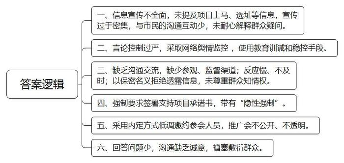
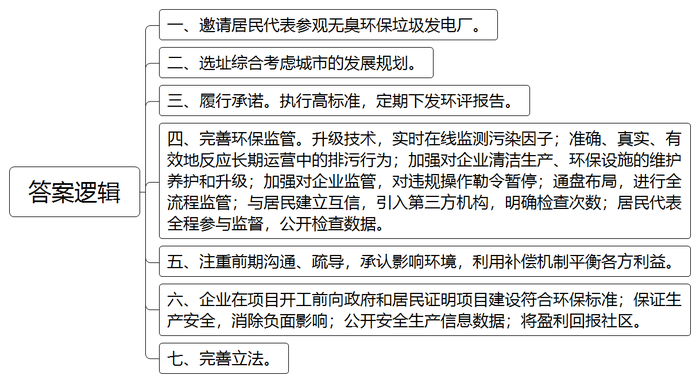
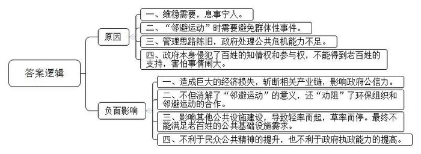
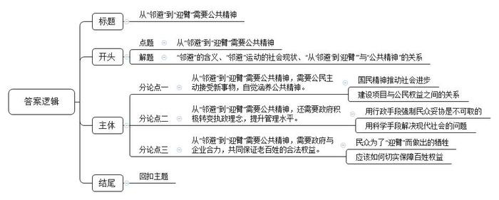

# 2015年黑龙江省公考《申论》题（A卷）

<!-- gwy:overview:start -->
> **黑龙江 · 2015 · 申论 · A类** ｜ 4 题 · 图片 4 处 · 答案随题折叠

导航：[题目](#题目) · [材料 1](#材料-1)
<!-- gwy:overview:end -->

> 候选采集稿。参考答案及解析来自粉笔页面，不代表官方答案或真实高分答卷；来源使用许可与原卷对应关系仍需人工核实。

## 给定材料

### 材料 1

PX的中文名称叫对二甲苯，一种芳烃类化合物，是石油化工产业链中的中间产品，是纺织服装、塑料制品等日用消费品生产的原料之一。客观上讲，PX有一定毒性，但毒性要比苯小很多，与食盐和酒精相当。

M市PX项目由市政府与市石化公司采取合资方式共同建设，项目选址初步定于M市石化乙烯厂内，2012年10月已正式获得国家发改委同意，并被列入国家“十二五”规划。该项目总投资35亿元，M市石化公司布点建设两套60万吨/年芳烃装置，每年预计生产约300亿元的销售收入，平均增加税收6.74亿元，财政收入2.04亿元。

鉴于之前厦门、大连、N市、彭州、昆明等地群众抗议PX项目事件，M市政府事先已预料到本地PX项目也会具有争议，于是从2014年2月27日起通过媒体向公众宣传、科普PX相关知识。但在3月30日，还是发生了当地民众的抗议行动。

### 材料 2

2014年3月17日，M市政府组织媒体召开会议，就项目的投资规模、选址等向媒体做了通报。3月18日起，“PX”开始频繁出现在当地媒体上。《M日报》接连发表《PX到底有没有危害》《揭开PX的神秘面纱》等一系列文章。这些文章均以普及PX项目知识为主，而未提及该市PX项目上马的相关信息。

但据多名参与抗议的市民称，媒体密集的宣传让他们感觉PX项目“上马在即”，令他们产生“紧迫感”。支持PX项目的人对政府的宣传同样不满：“政府应该多和市民沟通互动，针对各种疑问请专家学者耐心解释，而不是把他们认为正确的信息一股脑‘塞’给市民。”石油专业毕业的陈明希望看到项目选址等公示信息，可是没有。

此次会议中，当地网站负责人接到了市政府“严控PX有害言论”的要求。与此同时，《积极做好石化重点项目宣传工作》的文件中提到，市委宣传部门等要加强网络舆情监控，“对发表过激言论的网民进行身份核查，进行教育训诫和稳控。”

从3月19日开始，M市电视台和M市石化公司电视台每日播出市委石油产业专题学习会的视频。视频中，中国工程院院士、清华大学化工科学与技术研究院院长金教授面对市委市政府主要领导，对PX项目解疑释惑。金教授称，PX项目只是一个普通石化项目，之所以之前很多群众不接受，是“因为不了解”。他建议政府要“和群众交朋友”：邀请群众参观生产厂车间，设立公众参观日和群众代表监督会。但直至3月30抗议PX事件开始前，M市群众和政府还没有“交上朋友”。当地一位媒体人透露，他早在4年前就听说本地想要上马PX项目。期间，也有民间组织去环保局索要相关信息，相关人员以“保密”的名义拒绝透露信息。

### 材料 3

2014年3月中下旬，M市卫校学生李林和她的同学们被要求签署一份《支持PX项目建设承诺书》。承诺书要求签名者维护发展PX项目的决策；不听谣、不信谣、不传谣，不发表妨碍PX项目建设的言论，绝不组织、不参与任何反对和阻挠PX项目建设的活动。

这是李林第一次知道PX项目，第一次知道M市可能将上马PX项目。承诺书引起同学们的议论纷纷，他们上网搜索后，知道了厦门、大连等地的PX事件。4月1日晚，李林在网上发言：坚决不签名，评论中支持者众多。

原来，3月中下旬起，M市要求当地石化系统的工作人员、教育系统的工作人员和部分学生签署《支持PX项目承诺书》。M市政府一位公务员说，正是考虑此前国内多地PX项目上马前发生过“造谣、传谣事件”，市政府才考虑制作承诺书，并期望民众通过正常渠道反映对项目的关切。但一些单位和学校在要求签署承诺书时带有“隐性的强制”，比如强调如果不签，会“对高考不利”“对升迁不利”等。一位科级干部说：“我不了解PX，被强迫签字后，就更不相信宣传材料了。”

3月27日晚上7点半，M市政府有关部门召集当地活跃且有影响力的网友开PX推广会。会议由高新区管委会主任T及宣传部网管科科长主持。知情人士透露，会议召开前，M市PX项目工作组要求本地家教网站邀请50名左右的活跃、知名网友参会，并希望以“内定”的方式“低调”邀约网友。但一家网站将推广会的消息公开发布后，本打算控制在50人左右的会议，最终参会者达到近250人，远远超出主办方预想。

会上T主任就PX项目做了解读后想离场，但与会者均不同意，要求他留下回答网友提问。T主任同意留下，但限定只回答3个问题。3个问题的回答都没能令在场网友满意，随后，有网友和工作人员发生了争吵。

会后，参会的网友互相交换了电话号码、加了微信。

3月30日早上约8点，约100人聚集在市委大院门口，一起抗议M市PX项目。4月3日召开的新闻发布会上，M市副市长强调：在社会没有达成充分共识前绝不会启动该项目。

### 材料 4

S市是一座地域空间小、人口密度高、污染负荷重的城市。由于城区范围的急剧扩张，大量污水处理厂、垃圾焚烧发电厂、垃圾填埋场等市政设施需要建设，但亟需的市政设施项目却往往由于公众的反对而难以推动。

平湖垃圾焚烧厂（以下简称“平湖厂”）在2000年规划之初就遭到附近居民的反对。当时的区政府主管副局长带着50名居民代表前往澳门参观垃圾发电厂，澳门垃圾发电厂无臭环保，最终居民同意了发电厂的进驻。平湖厂在一期建成之初，1000米范围内没有居民住宅。但随着城市化进程不断推进，周边社区向平湖厂快速发展，导致工厂与居民区之间的距离越来越近，其中辅城坳社区和上木古社区离平湖厂的距离分别仅为130米和300米。两个烟囱经常在夜间不定时地直接排放浓烟，刺鼻的臭气弥漫在辅城坳和周边社区上空，“烟尘所产生的微粒铺天盖地，洒在居民的窗台上、饭桌上甚至人的身体上。”社区人大代表Z女士说。平湖厂对附近居民的影响越来越严重，厂群矛盾越来越难以调和。“从单一的职能部门内部来看，项目没有问题，但是综合来看就会有问题。”一位负责人说。

据平湖厂周边居民反映，平湖厂建厂时区政府有关部门承诺按澳门标准进行建设，然而后来执行的排放标准是国家标准，其中的大部分指标都落后于澳门标准。而且，相关主管部门在垃圾焚烧发电厂建成之初承诺，每季度会向周边社区下发环保测试评估报告，可是直到2009年初群体性事件发生之前，辅城坳社区居民并未收到相关报告。

相较于对垃圾焚烧污染的顾虑，公众更期望监管的完善。据了解，S市市政设施的监管主要集中于环保监管，环保监管也不能完全满足公众需要，因为对于公众比较关注的臭气、二噁英等污染因子，技术上仍难以实现实时在线监测。监测结果虽然基本实现达标，但难以准确、真实、有效地反映企业长期运营中的排污行为；环保部门只能关注企业环保设施是否正常运转、废气是否达标排放，而对企业清洁生产、环保设施的维护养护和升级改造等方面缺少约束力、强制力和引导力。

S市城管委副主任记不住自己当了多少次垃圾焚烧的义务宣传员。这两年，他发现群众的态度有了一个明显的转变。“以前，老百姓不清楚垃圾焚烧是否有污染，还可以坐下来沟通、科普。现在我最常听到的一句话却是，‘别说那么多，我也不管有没有污染，你建在别处我不管，我就是不想让你建在我家门口’。”

清华大学环境学院教授L认为，“要想让垃圾焚烧项目顺利推进，就要平衡好利益相关方的关系。要注重前期沟通，让百姓有合理预期。通过环评的项目不能说搬就搬，说停就停，政府进退失据，就会让社会更加不信任垃圾焚烧项目。”

“无论多先进，垃圾焚烧厂还是扰民设施，要承认这种环境影响。我们不能总寄希望于公众自愿牺牲既得利益，还是要利用补偿机制让居民感受到利益平衡。”中科院生态环境所研究员Z说。

某市城管委固废管理中心主任K认为，这不是个人素质问题，而是整个社会看法的体现。“你说没污染，很多居民是同意的，但是他种的茶叶就会被采购商压价，他的房价就会比别人低。这些反对垃圾焚烧项目的居民不是没素质，而是他有实际利益的牺牲。”

### 材料 5

新加坡国土面积仅有大约700平方公里，主岛新加坡岛是居民集中的岛屿。新加坡的炼化设施大多集中在距主岛不足两公里的裕廊岛以及以附近一些岛屿为基础而加以扩大和改造的地块上。裕廊岛目前有90多家顶级化工厂入驻。政府在通盘布局考虑之下，对化工项目进行全流程的监管。例如，项目用地前期评估由多部门联手参与，并引入公众咨询机制；项目上马须通过一套严格流程，尤其着重其安全评估；发生生产事故后积极妥善应对，尽可能披露足够多信息满足公众知情要求，缓解对于安全的担忧，赢得公众信任。

韩国是PX出口大国。韩国大型化工项目开工前，企业需向政府和居民证明项目建设符合环保标准。对于居民的反对，政府会采取疏导、补偿等措施，并加强对企业的监管。一旦发现企业在建设中违规操作，政府会勒令暂停项目建设，企业自身在尽力保证PX生产安全和消除负面影响方面也付出了巨大努力。以三星道达尔化工企业为例，这家公司采用的安全管理标准以及废水废气排放要求都要远远高于政府标准。蔚山园区所有企业的废水废气处理都通过电子摄像头实时接受市政环境人员的监测。为消除民众顾虑，企业还会在官方网站上公开主要的安全生产信息和数据，供民众随时查询。韩国化工企业也将部分盈利拿出来回报当地社区。SK集团于1997年投资上千亿韩元建造蔚山生态公园，成为当地居民休闲娱乐的重要场所。

日本在垃圾处理方面还有很多细节要求。除了与居民建立互信外，排放气体要严格按照《大气污染防治法》排放。第三方机构1个月检查1次，二噁英1年检查4次，废水2个月检查1次。运行过程中，居民代表全程参与监督，相关检查数据全部公开。除了《大气污染防治法》，还制订了专门的《水质污浊防治法》《废弃物处理法》等法律。

### 材料 6

1980年美国《基督教科学箴言报》在一篇报道中，第一次用“邻避”这个词来描述美国人对化工垃圾的排斥和反抗，后来媒体和学界以此概括在现代化进程中，社会必需的公共设施遭到选址社区排斥甚至引起群体抗议的现象（对应的英文短语是“NIMBY”，音译为“邻避”，也就是“Not in my backyard”，“别在我的后院”的缩写）。与之相关的设施即为邻避设施，抗议活动则为邻避活动。在1980年的美国，由垃圾填埋场、机场、监狱、收容所、戒毒服务中心等设施选址引发的冲突逐渐增多。尽管民众都认为这些设施对城市发展不可或缺，却希望远离自己，落址他处。仅在1980-1987年间，美国就有81家申请建垃圾填埋场、核电厂等设施，最终只有6家完工。同一时期、在一些欧洲国家，由核废料储存选址问题引发的抗议，发展成为影响广泛的环境保护运动。1990年以后，亚洲一些国家或地区，如日本、韩国、中国台湾也不时出现以反对环境污染为主题的邻避运动。随着城市建设突飞猛进，邻避运动在中国内地也成为一个突出现象，备受关注。有学者称，邻避运动构成当前中国“社会运动的日常形式”。

### 材料 7

纵观我国近年在各地发生的邻避运动，“一闹就停”已成为地方政府应对邻避运动的惯有模式。

N市PX项目是有国家化工产业振兴规划所确立的国家生产力布局重点战略项目。项目选址在N市石化经济技术开发区内，总投资约558.7亿元，但因为当地民众的抗议而终止。这意味着，单单停止PX项目使得N市当地的投资损失高达600亿元，而其将带动的产业链条也将因此被斩断，审批机构的公信力也受到严重损害。华南师范大学副教授T认为，从解决这些事件的指导思想和最终目的来看，并非是出于利益公平博弈和裁断，也不是单纯考虑维护环境利益，而只是简单地为了维稳需要，息事宁人。显然，此种处理方式和处理思路并不是解决中国邻避问题的有效出路。中国社科院研究员Y也表示，有些人虽然认识到环境破坏和邻避运动的因果关系，但仍把邻避运动视为应该避免发生的“群体事件”。“那这种想法不但消解了邻避运动的意义——维护环境利益，孤立了邻避运动，同时也‘劝阻’了民间环保组织与邻避运动的参与合作”。也有学者认为，各地类似事件已经非常清晰地说明，如果还是沿用简单陈旧的管理思路看待和处理邻避运动，那么未来还将出现的不过又是一个个曾经相识的项目，轻率而起，潦草而停。

“邻避效应”的存在，既考验政府的公共管理能力，又考验公众的公共精神。所谓公共精神，是指公民具有超越个人狭隘眼界和个人直接功利目的，关怀公共事务、事业和利益的思想境界和行为态度。以公共责任意识为实质内容的公共精神有着丰富的社会内涵；首先它体现为公民尊重国家法度和政府行政，并与政府合作的精神态度，其中包括积极参与公共事务管理与合理监督政府行政的精神态度；其次，它体现为公民自觉关怀与维护公共安全、公共卫生、公共环境、公共资源、公共财务等公共利益的态度与情怀；其三，它体现为公民在公共生活中理解、尊重、包容他人并与他人平等相处、合作共事的精神气度和行为取向。

公共精神需要公民在参与公共生活实践中得到培养和提升。鼓励和推动公民参与公共生活实践，包括鼓励和推动公民参加从国家层面到公民社会层面再到城乡社区层面的公共事务管理，其中尤其是参加公民社会的自治和社区公共事务管理，其关键则在于为公民平等地参与各个层面和方面的公共事务管理提供条件、机会、平台和社会信任网络。

2009年，广州市番禺区垃圾焚烧发电厂选址曾经引发邻避运动。但广州市番禺区市民、曾经的维权领袖、投入关注此事的广州媒体人、学者，并没有满足于原址被否决的自利目标，不再满足于“别建在我家后院”的邻避诉求，而是长期保持与官方互动。当初参与组织策划抗议行动的维权领袖不再是“敏感人物”，而是广州市政府的座上宾。原来淹没在众多ID当中的普通网民成为民意代表、社会活动家、他们多次受邀参与市长、副市长的座谈会，就垃圾焚烧项目的可行性进行反复论证，协商，参与了整个决策过程的论证、评议乃至行动。

这批成熟起来的公民，从环境抗争运动中体验到了参与公共决策的成就感，而对官方来说，则在这个开放议事渠道、增加民意代表的社会治理模式当中，减轻了决策压力，将民众的抗议处理从“政治化”转变为“例行化”处理，进而纳入制度化轨道。在官民协同治理过程中，如果没有维权公民理性而富有建设性的抗争技巧，政府可能仍然停留在封闭式决策的路径依赖上；但反过来说，没有广州市政府相对开放的现代社会治理姿态，再高明的行家里手，恐怕也难以参与到决策环节当中去。

### 材料 8

在发达国家的现代进化过程中，政府和公众对邻避设施的选址所持态度的变化主要分三个阶段：第一个阶段是1970—1986年，人们开始对这些设施提出回避的要求。第二个阶段是1987年以后，这样的反抗达到高峰，对邻避性设施，公众的意见基本上是反对的，第三个阶段即1992年以后，邻避运动开始发生了转型，管理部门意识到，不能因为有不同的意见、反对声比较强烈，就停止提供这些设施。因为它们一旦短缺的话，公共生活本身就会受到影响。所以，上个世纪90年代开始，从政府、提供这些设施的企业到一些社会志愿团体，都开始考虑怎么改进矛盾的状况。进入21世纪，人们开始讲邻避性设施的提供要和社区的再造、城市的再造整合在一起，以进入一个良性的循环，从邻避情结转变为迎臂效应（对应的英文短语是“YIMBY”，音译为“迎臂”，也就是“Yes in my backyard”，“可以在我家后院”的缩写），人们对其不排斥甚至于欢迎。举例来说，某城市要建立一个污水处理厂，城市非常小，没有更多可供选择的余地。但最后方案出来，很多社区都希望污水处理的项目能在自己社区附近。为什么呢？因为它和社区的重新营造结合在一起，通过这个项目，地面做了一个人工的湖泊，对湖泊的周边进行相应的改造。所以有些社区，特别是老旧社区，非常希望这个项目能够在这里落地。

## 题目

### 第 1 题

**阅读“给定资料**1**\-**3**”，请概括M市政府在推动PX项目的过程中存在哪些不足。（20分）**

关联材料：材料 1、材料 2、材料 3

作答要求：

要求：内容全面、准确，字数在300字以内。

第 1 题 · 答案与解析

**参考答案（粉笔题库参考内容）**

一、信息宣传不全面，未提及项目上马、选址等信息，宣传过于密集，与市民的沟通互动少，未耐心解释群众疑问。

二、言论控制过严，采取网络舆情监控，使用教育训诫和稳控手段。

三、缺乏沟通交流，缺少参观、监督渠道；反应慢、不及时；以保密名义拒绝透露信息，未尊重群众知情权。

四、强制要求签署支持项目承诺书，带有“隐性强制”。

五、采用内定方式低调邀约参会人员，推广会不公开、不透明。

六、回答问题少，沟通缺乏诚意，搪塞敷衍群众。

**参考答案说明：**答案从“信息宣传”“言论控制”“沟通交流”“签署承诺书”“召开推广会”“回答问题”六个方面进行分条撰写，各条要点在内容上是并列且无交叉的。

**解析状态：unknown（来源未提供）**

### 第 2 题

**阅读“给定资料**4**\-**5**”，假如某市要建立一个垃圾处理发电厂，请就如何能够得到附近居民的认同提出建议。（20分）**

关联材料：材料 4、材料 5

作答要求：

要求：内容全面、具有可行性，字数在300字以内。

第 2 题 · 答案与解析

**参考答案（粉笔题库参考内容）**

一、邀请居民代表参观无臭环保垃圾发电厂。

二、选址综合考虑城市的发展规划。

三、履行承诺。执行高标准，定期下发环评报告。

四、完善环保监管。升级技术，实时在线监测污染因子；准确、真实、有效地反应长期运营中的排污行为；加强对企业清洁生产、环保设施的维护养护和升级；加强对企业监管，对违规操作勒令暂停；通盘布局，进行全流程监管；与居民建立互信，引入第三方机构，明确检查次数；居民代表全程参与监督，公开检查数据。

五、注重前期沟通、疏导，承认影响环境，利用补偿机制平衡各方利益。

六、企业在项目开工前向政府和居民证明项目建设符合环保标准；保证生产安全，消除负面影响；公开安全生产信息数据；将盈利回报社区。

七、完善立法。

**参考答案说明：**答案从“居民参观”“城市规划”“履行承诺”“完善监管”“注重沟通”“企业作为”“完善立法”七个方面进行分条撰写，各要点在内容上是并列且无交叉的。

**解析状态：unknown（来源未提供）**

### 第 3 题

**很多地区的公共服务设施建设都出现了“一闹就停”的现象，请分析这一现象产生的原因和负面影响。（20分）**

关联材料：材料 7、材料 8

作答要求：

要求：分析透彻、表述准确，条理清楚，字数在300字以内。

第 3 题 · 答案与解析

**参考答案（粉笔题库参考内容）**

原因：

一、维稳需要，息事宁人。

二、“邻避运动”时需要避免群体性事件。

三、管理思路陈旧，政府处理公共危机能力不足。

四、政府本身侵犯了百姓的知情权和参与权，不能得到老百姓的支持，害怕事情闹大。

影响：

一、造成巨大的经济损失，斩断相关产业链，影响政府公信力。

二、不但消解了“邻避运动”的意义，还“劝阻”了环保组织和邻避运动的合作。

三、影响其他公共设施建设，导致轻率而起，草率而停。最终不能满足老百姓的公共基础设施需求。

四、不利于民众公共精神的提升，也不利于政府执政能力的提高。

**参考答案说明：**答案要点分别阐述了产生“一闹就停”现象的原因和其引发的负面影响，可从两方面进行分条撰写，各条要点在内容上是并列且无交叉的。

**解析状态：unknown（来源未提供）**

### 第 4 题

**阅读给定资料，结合你的理解，请以“从‘邻避’到‘迎臂’需要公共精神”为题目，写一篇议论文。（40分）**

关联材料：材料 1、材料 2、材料 3、材料 4、材料 5、材料 6、材料 7、材料 8

作答要求：

要求：观点明确，思路清晰，逻辑严谨，表述流畅，字数不少于1200字。

第 4 题 · 答案与解析

**参考答案（粉笔题库参考内容）**

**从“邻避”到“迎臂”需要公共精神**

“邻避”指居民所在地单位因担心建设项目如垃圾场、核电厂、殡仪馆等设施对身体健康、环境质量和资产价值等带来诸多负面影响，从而激发人们的嫌恶情结，滋生“不要建在我家后院”的心理，往往采取强烈和坚决的、有时高度情绪化的集体反对甚至抗争行为。无论是国内昆明地区的PX项目还是国外的基础设施建设都出现了“邻避”运动。而广州市政府把“邻避”变成了老百姓欢迎的“迎臂”让老百姓和政府都看到了希望，这种希望的根源就是公共精神。

所谓公共精神，是指公民具有超越个人狭隘眼界和个人直接功利目的，关怀公共事务、事业和利益的思想境界和行为态度。从“邻避”到“迎臂”需要公共精神。诚然，公共基础设施建在我家后院会不会有污染的争议从未平息，但这并不妨碍我们对公民公共精神的反思。“邻避运动”这样一个考题如此沉重地摆在了每一人的面前。倘若我们都不允许公共设施建在我家后院，那么依照“己所不欲，勿施于人”的原则，公共设施到底改建在哪里呢？显然，从“邻避”到“迎臂”的转变需要公共精神的提升。发达国家也经历了这样的运动，而且经历了不同的阶段。我们国家的“邻避”才刚刚开始，如何实现从“邻避”到“迎臂”，需要公共精神，更需要政府作为，提升百姓的公共精神。

**从“邻避”到“迎臂”需要公共精神，需要公民主动接受新事物，自觉涵养公共精神。**“欲维新吾国，当先维新吾民”，从梁启超到孙中山再到共产党，所有社会的进步力量，无不把“国民精神”作为发展的根本。正如梁启超所说，“苟有新民，何患无新制度，无新政府，无新国家”。而所谓“精神”并不是摸不着看不到的空虚之物。考虑到大家都需要污水处理厂，所以我同意在不影响我个人福利的前提下在我家后院建厂，这也是公共精神的体现。也只有这种精神才能使“邻避”转化为“迎臂”。

**从“邻避”到“迎臂”需要公共精神，不仅需要公民付出，还需要政府积极转变执政理念，提升管理水平。**问题在于我们政府该如何采取正确方法提升百姓的公共精神，这值得每一级政府深刻思考。以行政手段强制要求民众签订承诺书、召开推广会在老百姓的强烈要求下勉强回答老百姓的3个问题的做法显然不能提升公共精神。所以从“邻避”到“迎臂”需要公共精神，更需要政府提升自身的治理能力，运用科学的手段解决现代社会产生的一系列新问题。广州市政府就是因此才实现了从“邻避”到“迎臂”的转变。

**从“邻避”到“迎臂”需要公共精神，需要政府与企业合力，共同保证老百姓的合法权益。**民众的“邻避运动”越来越频繁不能不说是一开始就为公共便利付出了巨大的代价。无论是一开始承诺的标准根本达不到，还是后来农产品因环保问题而降价，都导致“迎臂”之人付出了沉重的代价。我们不能要求每一位公民都有“苟利国家生死以，岂因祸福避趋之”的高尚情怀，只有认真地听取老百姓的利益诉求，求真务实地解决老百姓遇到的实际问题才能实现从“邻避”到“迎臂”的大转变。

顾炎武说：“天下兴亡匹夫有责。”实现从“邻避”到“迎臂”转变的美好愿望，既是老百姓的美好期待，也是政府应尽的责任，更需要公共精神的提升。只要我们牢牢抓住转变政府治理方式和保障老百姓根本利益这两条主线，美好的愿景就一定会转化为现实。

**文章分析：**

**从“邻避”到“迎臂”需要公共精神**

**【标题的优点：**严格按照题目的要求，以“从‘邻避’到‘迎臂’需要公共精神”为标题。**】**

（1）<u>“邻避”指居民所在地单位因担心建设项目如垃圾场、核电厂、殡仪馆等设施对身体健康、环境质量和资产价值等带来诸多负面影响</u>，<u>从而激发人们的嫌恶情结</u>，<u>滋生</u><u>“不要建在我家后院”的心理</u>，<u>往往采取强烈和坚决的、有时高度情绪化的集体反对甚至抗争行为</u>。（2）<u>无论是国内昆明地区的</u><u>PX项目还是国外的基础设施建设都出现了“邻避”运动</u>。而（3）<u>广州市政府把</u><u>“邻避”变成了老百姓欢迎的“迎臂”让老百姓和政府都看到了希望</u>，<u>这种希望的根源就是公共精神</u>。

**【开头的优点：**★内容方面。范文的开头是紧扣题目给定的“从‘邻避’到‘迎臂’需要公共精神”这一标题展开的。首先，开头点出主题，做到了主题明确。其次，对“从‘邻避’到‘迎臂’需要公共精神”这一主题进行了分析阐述：（1）先指出了“邻避”的含义。（2）再指出了“邻避”运动的社会现状。（3）最后以广州为例，指出了“从‘邻避’到‘迎臂’”与“公共精神”的关系。★文字表达方面。使用了“无论……还……”“而……”等关联词，使语言表达有逻辑性。**】**

<u>所谓公共精神</u>，<u>是指公民具有超越个人狭隘眼界和个人直接功利目的</u>，<u>关怀公共事务、事业和利益的思想境界和行为态度</u>。从“邻避”到“迎臂”需要公共精神。诚然，公共基础设施建在我家后院会不会有污染的争议从未平息，但这并不妨碍我们对公民公共精神的反思。“邻避运动”这样一个考题如此沉重地摆在了每一人的面前。倘若我们都不允许公共设施建在我家后院，那么依照“己所不欲，勿施于人”的原则，公共设施到底改建在哪里呢？<u>显然</u>，<u>从</u><u>“邻避”到“迎臂”的转变需要公共精神的提升</u>。发达国家也经历了这样的运动，而且经历了不同的阶段。我们国家的“邻避”才刚刚开始，如何实现从“邻避”到“迎臂”，需要公共精神，更需要政府作为，提升百姓的公共精神。

【**过渡段的优点：**范文过渡段分析了“从‘邻避’到‘迎臂’需要公共精神”中“公共精神”的含义、“邻避”“迎臂”与“公共精神”的关系。此外，还要注意过渡段末尾的“我们国家的‘邻避’才刚刚开始，如何实现从‘邻避’到‘迎臂’需要公共精神，更需要政府作为，提升百姓的公共精神”是用来引起下文的过渡句。】

**从****“邻避”到“迎臂”需要公共精神，需要公民****主动接受新事物，自觉涵养公共精神****。**（1）“欲维新吾国，当先维新吾民”，<u>从梁启超到孙中山再到共产党</u>，<u>所有社会的进步力量</u>，<u>无不把</u><u>“国民精神”作为发展的根本</u>。正如梁启超所说，“苟有新民，何患无新制度，无新政府，无新国家”。（2）而<u>所谓</u><u>“精神”并不是摸不着看不到的空虚之物</u>。考虑到大家都需要污水处理厂，所以<u>我同意在不影响我个人福利的前提下在我家后院建厂</u>，这也是公共精神的体现。也只有这种精神才能使“邻避”转化为“迎臂”。

【**论述段****1的优点：**★观点句：范文的观点句是紧扣“从‘邻避’到‘迎臂’需要公共精神”这一文章主题提出的。形式上，它在段首处直接写出，位置突出，容易发现。内容上，关键词突出，内容要点明确，可以明显看出它是从“公民自觉”入手，指出了“从‘邻避’到‘迎臂’需要公共精神”。★论述内容：（1）先从历史角度出发，介绍了“国民精神推动社会进步”；（2）再从现实角度出发，介绍了“建设项目与公民权益之间的关系”。注意：以上两个方面的内容都是紧扣“从‘邻避’到‘迎臂’需要公共精神，需要公民主动接受新事物，自觉涵养公共精神”这个观点句进行分析论述的，论述的针对性强，内容层次清晰。最后，在论述方法和论据的选取上做到了讲道理、举例子相结合，做到了丰富多样。】

**从****“邻避”到“迎臂”需要公共精神，****不仅需要公民付出，还****需要政府****积极转变执政理念，****提升管理水平。**（1）问题在于我们政府该如何采取正确方法提升百姓的公共精神，这值得<u>每一级政府深刻思考</u>。<u>以行政手段强制要求民众签订承诺书、召开推广会在老百姓的强烈要求下勉强回答老百姓的</u><u>3个问题的做法显然不能提升公共精神</u>。所以从“邻避”到“迎臂”需要公共精神，（2）更需要<u>政府提升自身的治理能力</u>，<u>运用科学的手段解决现代社会产生的一系列新问题</u>。广州市政府就是因此才实现了从“邻避”到“迎臂”的转变。

【**论述段****2的优点：**★观点句：范文的观点句是紧扣“从‘邻避’到‘迎臂’需要公共精神”这一文章主题提出的。形式上，它在段首处直接写出，位置突出，容易发现。内容上，关键词突出，内容要点明确，可以明显看出它是从“政府引导”入手，指出了“从‘邻避’到‘迎臂’需要公共精神”。★论述内容：（1）先介绍了“用行政手段强制民众妥协是不可取的”；（2）再介绍了“用科学手段解决现代社会的问题”。注意：以上两个方面的内容都是紧扣“从‘邻避’到‘迎臂’需要公共精神，不仅需要公民付出，还需要政府积极转变执政理念，提升管理水平”这个观点句进行分析论述的，论述的针对性强，内容层次清晰。最后，在论述方法和论据的选取上做到了讲道理、举例子相结合，做到了丰富多样。】

**从****“邻避”到“迎臂”需要公共精神，需要****政府与企业合力，共同****保证老百姓的合法权益。**（1）民众的“邻避运动”越来越频繁不能不说是<u>一开始就为公共便利付出了巨大的代价</u>。无论是一开始<u>承诺的标准根本达不到</u>，还是后来<u>农产品因环保问题而降价</u>，都<u>导致</u><u>“迎臂”之人付出了沉重的代价</u>。（2）我们<u>不能要求每一位公民都有</u>“苟利国家生死以，岂因祸福避趋之”的<u>高尚情怀</u>，只有<u>认真地听取老百姓的利益诉求</u>，<u>求真务实地解决老百姓遇到的实际问题才能实现从</u><u>“邻避”到“迎臂”的大转变</u>。

【**论述段****3的优点：**★观点句：范文的观点句是紧扣“从‘邻避’到‘迎臂’需要公共精神”这一文章主题提出的。形式上，它在段首处直接写出，位置突出，容易发现。内容上，关键词突出，内容要点明确，可以明显看出它是从“保证百姓权益”入手，指出了“从‘邻避’到‘迎臂’需要公共精神”。★论述内容：（1）先介绍了“民众为了‘迎臂’而做出的牺牲”；（2）再介绍了“应该如何切实保障百姓权益”。注意：以上两个方面的内容都是紧扣“从‘邻避’到‘迎臂’需要公共精神，需要政府与企业合力，共同保证老百姓的合法权益”这个观点句进行分析论述的，论述的针对性强，内容层次清晰。最后，在论述方法和论据的选取上做到了讲道理、举例子相结合，做到了丰富多样。】

【**论述段之间的关系：**★内容的内在逻辑：范文的论述段之间是依照“提出对策”的逻辑展开的。论述段1先写了“公民个人主动接受新事物”，论述段2再写了“政府积极转变执政方式”，论述段3接着写了“政府企业切实保障群众权益”。★段与段的外在衔接：论述段2的段首处的过渡句“从‘邻避’到‘迎臂’需要公共精神，不仅需要公民付出，还需要政府积极转变执政理念，提升管理水平”起到了承接论述段1、引出了论述段2的作用。】

顾炎武说：“天下兴亡匹夫有责。”（1）实现<u>从</u><u>“邻避”到“迎臂”转变的美好愿望</u>，既是老百姓的美好期待，也是政府应尽的责任，更<u>需要公共精神的提升</u>。（2）只要我们牢牢抓住<u>转变政府治理方式和保障老百姓根本利益</u>这两条主线，<u>美好的愿景就一定会转化为现实</u>。

【**结尾的优点：**范文的结尾回扣了“从‘邻避’到‘迎臂’需要公共精神”这一主题。（1）总结了“从‘邻避’到‘迎臂’需要公共精神”；（2）发出了号召希望，阐述了深远意义。】

**解析状态：unknown（来源未提供）**

