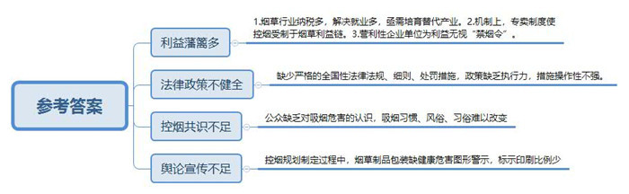
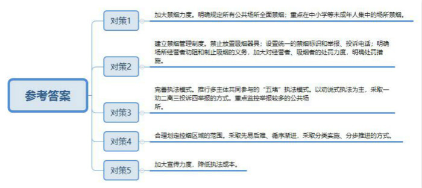
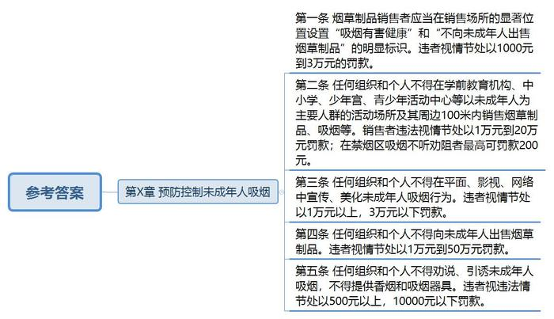
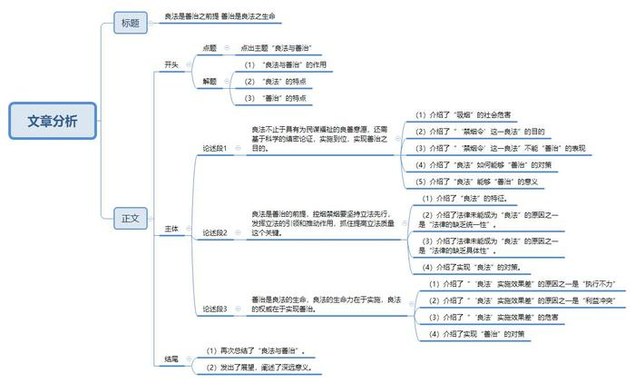

# 2015年黑龙江省公考《申论》题（B卷）

<!-- gwy:overview:start -->
> **黑龙江 · 2015 · 申论 · B类** ｜ 4 题 · 图片 4 处 · 答案随题折叠

导航：[题目](#题目) · [材料 1](#材料-1)
<!-- gwy:overview:end -->

> 候选采集稿。参考答案及解析来自粉笔页面，不代表官方答案或真实高分答卷；来源使用许可与原卷对应关系仍需人工核实。

## 给定材料

### 材料 1

医学研究表明，吸烟有害身心健康这一点毫无疑问。但是不吸烟的人是否就一定健康长寿，吸烟之人是否就一定体弱病残寿短呢？那也不见得。正因为如此，这自然也就成为控烟与禁烟的一道障碍。我们一方面说吸烟有害身心健康，但是又能看到一些八九十岁的吸烟者，相反却有许多四五十岁不吸烟的病夫。所以面对卷烟，我们到底吸还是不吸，控还是不控，禁还是不禁，一直以来也有争论，有不同的杂音。但是争论归争论，杂音归杂音，烟草中含有尼古丁等多种致癌有害物质这是不可争辩的事实。

所谓禁烟，就是禁止吸烟。就目前我国的国情来说，有人认为，全面禁烟是不现实的，也是不可能的。自人们开始吸烟，距今已有近两百多年的历史，据说最早是印第安人发现烟草并开始吸食的，之后迅速传到中国并逐步推广沿袭下来。据有关媒体报道，中国将近有3亿多烟民，数字巨大，这么多烟民有力地推动了中国烟草业的强势发展，使得中国烟草行业至今依然繁荣似火，烟草行业也成为国家纳税大户，每年上缴国家利税近万亿元，成为国家经济的一个重要支柱，为国家的发展奠定了坚实基础，同时还解决了数以千万人的就业问题，有利于维护社会稳定。因此面对这样的现实，当前中国全面禁烟是不可能的，也是不现实的。所谓控烟，就是控制吸烟。实际上这和禁烟是有区别的，控烟只是控制或者减少而已，而禁烟就是杜绝吸烟。

### 材料 2

多年来，中国烟草一直保持着七个“世界第一”：烟叶种植面积第一，烟叶收购量第一，卷烟产量第一，卷烟消费量第一，吸烟人数第一，烟草利税第一，死于吸烟相关疾病人数第一。烟草流行一般有4个阶段，而我国则处于烟草流行的早期，所以烟草消费量还很高。“在发达国家，烟草消费量都是呈下降趋势的，这和烟草流行的阶段有关。我国这么高吸烟率，在10年或者20年之后，将会导致非常高的相关疾病发病率及死亡率，会给国家的医疗保险系统带来很大的负担。”专家A先生说。他认为，中国目前的政策应对并不是很理想。比如保护人们免受烟草烟雾危害，提供戒烟帮助，警示烟草危害，确保禁止烟草广告、促销和赞助，提高烟税等几大方面，都不理想。

此前，我国“控烟”效果之所以不佳，皆因各种控烟措施很不得力，不是法规偏软，就是措施难以操作，甚至有些控烟行动只是停留在口头呼吁而已。为什么这些控烟措施不得力呢？从经济效益看，烟草行业一直是我国的纳税大户，为我国的财政创收做出了巨大的贡献。更重要的是，政府部门和烟草行业一直关系密切，除了表现在经济方面，还体现在机制上。我国许多烟草企业既是企业，还是拥有公共权利的主体，既当运动员，还当裁判，这种特殊的专卖制度决定了权利必然受制于烟草利益链，控烟就等于自剜其肉，控烟的措施和行政权力被资本俘获就成为必然。

### 材料 3

国家卫计委2014年12月10日就控烟法制化建设情况举行发布会，卫计委宣传司B副司长表示，我国吸烟人数超过3亿。目前，我国15岁以上的人群吸烟率为28.1%，7.4亿非吸烟人群遭受二手烟的危害。每年死于吸烟相关疾病的人数达到136.6万，约10万人死于二手烟的“暴露”导致的相关疾病。

B在发布会上表示，我国是世界上最大的烟草生产国和消费国，也是受烟草危害最严重的国家之一。面对严峻的控烟形式，国务院重拳出击。不久前，国务院就《公共场所控制吸烟条例》（以下简称《条例》）公开征求社会各界意见，按照规定，对于个人违反《条例》处以50元-500元的罚款，场所经营管理者违法的要处以最高3万元的罚款。“我们认为这个罚款额度与其他的国家和地区，包括我们的香港特别行政区相比较，并不算高。”B表示，罚款不是目的，关键是要通过罚款的形式对违法者起到教育和震慑作用，从而改变不文明的吸烟行为。据了解，2008年以来，哈尔滨、天津、青岛、长春、深圳等十五个城市相继颁布实施或者修订了地方性的控烟法规。

颇受关注的《北京市控制吸烟条例》也于2014年11月28日获表决通过，2015年6月1日起开始实施。目前，北京室内已全面禁烟，若在禁烟区吸烟不听劝阻者，最高可罚款200元。对经营者的处罚视其违法行为从2000元至1万元不等。对烟草制品销售者的违法行为也视情节轻重给予从1万元到20万元的处罚力度。值得注意的是，《北京市控制吸烟条例》对于烟草制品的销售者也有明确的规定。比如，条例要求烟草制品销售者应当在销售场所的显著位置设置“吸烟有害健康”和“不向未成年人出售烟草制品”的明显标识。同时烟草制品销售者要禁止下列的行为：向未成年人出售烟草制品；在幼儿园、中小学校、少年宫及其周边100米内销售烟草制品；通过自动售货机或者移动通信互联网等网络渠道非法销售烟草制品，等等。此外，该条例还明确规定，以未成年人为主要人群的活动场所和妇幼保健机构的室外区域也要禁止吸烟，教师不得在中小学生面前吸烟，等等。

“我们注意到它是一个公共场所的控烟条例，也就是说种植烟草、烟价、税收这些，在公共场所控烟部分都没有包含在里面，只是截取了其中一部分。”中国政法大学C教授认为，国务院此次出台的控烟条例实际上是把控烟工作截出了一段。如此一来，控烟的执法对象就仅限于公共场所，而不涉及种植烟草、烟价、税收等。另外，吸烟这种行为实际上是非常短暂、非常个人化的行为，在执法上必须要有非常及时、现场能够控制的工作机制。“这也是我们涉及多个部门来进行执法的一个关键。”C认为，鉴于吸烟人群总数非常大，单一部门执法效力不大，必须多部门执法。

### 材料 4

从2014年1月1日起，《兰州市公共场所控制吸烟条例》开始实行。如今控制吸烟条例施行已经一年多时间，兰州公共场所控制吸烟效果究竟如何？连日来记者进行了调查采访。2015年4月23日10时许，记者来到位于滨河东路的省图书馆进行采访。刚进一楼大厅，就看到醒目处张贴着禁烟的标识，图书馆内十分寂静，读者进出、走路、说话，声音都很轻。西侧读者阅览室内坐着十几名读者，有的在翻看报纸，有的在阅读杂志，有的读者还一边看一边在本子上记录着。读者群中以男性读者居多，年龄以中老年人为主。阅览室的一位女工作人员轻声向记者介绍：“这些男性读者中确实有不少人是烟民，原来他们大多一边看报一边吸烟，图书馆禁烟以后如今他们都养成了习惯，不在图书馆里吸烟了。”图书馆是在去年1月开始禁烟的，刚开始读者确实有些不习惯，但工作人员劝阻时他们还是能积极配合。大约半个多月后就很少有读者抽烟了，之后读者看书不吸烟也成了习惯。

医院原来是吸烟“重灾区”，在家属陪伴患者进医院，在看病、挂号、取药等环节上抽烟，这在医院原来是司空见惯的事情，更不要说患者住院、家属陪员寂寞抽烟了，那是住院部过道内陪员吞云吐雾的场面随处可见。这几天，记者先后几次探访省人民医院，发现原来这些镜头已成了历史。

据记者几天连续采访了解到的情况看，行政事业单位包括卫生机构、养老企业以及大、中、小学校等禁烟效果都很明显。

记者采访了解到，虽然禁烟在行政事业单位效果显著，但在网吧、KTV、饭馆等休闲娱乐场所，禁烟令还是形同虚设，这些场所依然烟雾缭绕。4月22日，记者走进西站一家网吧，墙上虽然张贴着禁止吸烟的宣传牌，但坐在电脑前的许多网友对此视而不见。不少人嘴上叼着香烟吞云吐雾，整个网吧大厅内烟雾缭绕，空气中弥漫着香烟的混合气味。

记者询问一位正在吸烟的中年男子，是否看到了墙上的禁烟标识，该男子用审视的眼光看了记者一眼，然后说单位上不让吸烟，回到家老婆也不让吸烟，你说到娱乐场所还不让人吸烟，这还让不让人活了？网吧虽然有标识，但在这里大家都在吸烟，自己也就跟着吸烟放松放松。

网吧一位工作人员告诉记者，在网吧吸烟似乎成了一条大家默许的规矩，网民在网吧吸烟好像天经地义，成了铁律，而几乎每个网吧的网民都在吸烟，并且他们也管不过来那么多人。“网民是网吧的上帝，如果你不让他们吸烟，谁还愿意到你这里来玩呢？网吧也要生存，这实在是没有办法的事情。”工作人员一脸无奈地说道。

而据记者调查了解，市区许多饭馆和火锅店内，类似的情况也比比皆是。4月22日19时许，记者和朋友走进大众巷的一家餐馆。一进到里面就能闻到一股烟味，几乎所有桌子旁边都有吸烟的人，烟民们一边潇洒的吸烟，一边聊着天吃饭，一副优哉游哉的样子。而记者看到参观墙上就张贴着禁止吸烟的宣传牌，但吸烟的人依然“腾云驾雾”。记者询问餐厅经理时，对方苦笑着说，顾客就是餐馆的衣食父母，如今餐饮业竞争愈加激烈，如果你再不让人家吸烟，人家就会去别的餐馆消费，这不是自己砸自己的锅吗？开家餐馆不容易，厨师、服务人员算上要十几个人，没有顾客吃饭餐馆如何维持？权衡之下，他们只好选择被动禁烟，如果劝说顾客不听，那他们也只能顺其自然。

记者调查发现，出于自身生存原因，娱乐场所对顾客吸烟只能睁一只眼闭一只眼，显然禁烟令在娱乐场所成了聋子的耳朵。

无视禁烟令，部分公共场所控烟难确实是不争的事实，而这也让不少市民无辜遭受二手烟的危害。很多人把在公共场合吸烟不当回事，怎样才能制止这种行为？

对此，兰州大学哲学和社会学院兼职教授、社会学家D认为：兰州禁烟宣传与立法应该同步进行。禁烟是一项社会系统工程，不能仅靠一些规定制约，需要配备专门管理人员实行处罚措施。禁烟要像禁止酒驾那样，加大处罚力度。但目前兰州市仅出台了公共场所控制吸烟条例，没有相应的法律条文。而没有相应的惩处法律措施，禁烟令只能是一纸空文。

### 材料 5

美国：2009年6月，美国出台《家庭吸烟预防和烟草控制法》。根据法案，政府有关部门有权降低烟草制品尼古丁含量，有权禁止将香烟制成糖果口味吸引年轻人。烟草公司也被要求用“吸烟有害”等字样覆盖香烟盒的广告画。在美国，公共场所禁烟令得到很好的执行，当吸一根烟要面临250美元的公共场所经济罚款时，自然不会有任何人和自己的钱袋子过不去。当然，美国公共场所禁烟，也并非一味的封堵，而同样有疏导，如设置有限的吸烟点，以满足特定人群的烟瘾，在这些区域以外则严格禁烟。

芬兰：2010年10月1日，芬兰禁烟法修正案生效。新修订的禁烟法规定，任何人违反法律向未成年人出售香烟或替未成年人购买香烟，当事人将被处以罚款或被判处6个月的监禁。

新加坡：新加坡对于违反禁烟令的绝招就是重罚，在禁烟区吸烟将被罚款200新元，而阻挠禁烟令执行将被处以1000新元的罚款或监禁6个月。

### 材料 6

在中国控烟规划制定的过程当中，争议最大最激烈的就是关于在烟草制品包装上放不放图形警示的问题。在国外，烟盒上都会印上烂掉的肺、烂牙以及骷髅头等一些触目惊心的图案。但是我们国家，烟盒上只有类似“吸烟有害健康”的文字。这个做法远远不符合国际烟草控制框架公约实施细则。更有意思的是，国内香烟生产企业在包装设计上也内外有别，在国内销售时就会印非常优雅漂亮的外包装，但在国外销售就会印上符合国际公约的辅助警示图案。

公众也在诟病到目前为止的很多烟草政策都不够彻底，缺乏执行力。比如，目前已经有不少地方做了公共场所禁烟立法，却很少有人在公共场所吸烟受到处罚，因为缺乏具体有效的处罚措施和执行力度。有专家认为，如果一直缺少全国性的有依据的法律法规，控烟政策就不会有很强的执行力。然而我们却依然没有出台一部行之有效的法律。

中国需要限制香烟消费，这种限制不仅仅体现于加大税收比例和买卖限制上，如果真的想要限制香烟消费，我们更需要从舆论宣传的角度出发。不可否认，我们没有在舆论上发挥本身应该发挥的作用。香烟文化成为了中国特有社交现象，香烟成为国人对于气质的独特理解，并产生出人际交往中独特的香烟文化。眼下有几点是很容易做到的，一方面，明确香烟的危害，加大宣传，以强制性手段规定健康危害标示的印刷比例；另一方面，政府也需要加大财政补贴力度，帮助烟草依赖省份尽快培养出一批能够和烟草种植相替代的产业。

### 材料 7

2012年5月31日，作为中国首部规定包括办公场所在内的室内公共场所全面禁烟的地方性法规《哈尔滨市防止二手烟草烟雾危害条例》正式实施。这一条例被许多人称为史上最严的禁烟法规，它的最“严”不仅体现在禁烟范围上，更体现在对禁烟的要求上。

“几乎所有的公共场所都开始禁烟。”哈尔滨市卫生局地方病防治办公室主任Z说，以往许多城市禁烟，都允许在禁烟场所设立吸烟区，但是哈市这次禁烟条例中明确规定所有禁止吸烟场所，不得设置吸烟室或者划定吸烟区，这就真正实现了公共场所全面禁烟。不仅如此，像学前教育机构、中小学、少年宫、青少年活动中心和其他未成年人集中的场所，室外场所也同样不得吸烟。

为确保禁烟有效推行，《条例》明确规定：禁烟场所应建立禁止吸烟管理制度，并在醒目位置设置统一的禁止吸烟标识和有关行政管理部门举报、投诉电话；禁止吸烟场所内不设置与吸烟有关的器具；对在禁止吸烟的场所吸烟的，劝其停止吸烟，对不听劝阻的，可向有关部门举报、投诉等。如果吸烟者在禁止吸烟场所吸烟且不听劝阻，由有关行政管理部门处以200元罚款；如果是场所的经营者不履行规定，由有关部门予以警告，并责令限期改正，逾期不改正的，处以二千元以上一万元以下罚款；情节严重的，处以一万元以上三万元以下罚款。

在乘坐出租车、公共汽车等公共交通工具时，如果驾驶员在车船内吸烟，乘客有权劝阻，对不听劝阻的，乘客有权向交通运输行政管理部门投诉、终止乘车船、免付车船费。而乘客在出租车、公共电汽车、轮渡船等公共交通工具内吸烟的，驾驶员和其他乘客有权劝阻，对不听劝阻的，有权要求其离开。

“立法有了，有效执行是关键”。为切实做好禁烟工作，哈市推出了“五堵”执法模式，即一靠吸烟人自律；二靠公共场所经营者、管理者制止和劝阻；三靠非吸烟人制止、劝阻；四靠社会义务监督员和志愿者劝阻；五靠处罚。同时，哈市还在划定控烟区域范围时，本着先易后难、循序渐进的原则，采取分类实施、分步推进的方式。考虑到宾馆、饭店的室内场所，如果立即禁止吸烟很难做到，控烟条例施行后，旅馆、餐饮的室内场所将在一定期限内划定吸烟的楼层、包房，期满后全面禁止吸烟。此外，针对吸一根烟，从点着到吸完不过几分钟的时间，举报后执法者很难在第一时间赶到现场进行处理的情况，执法人员将采取对举报较多的公共场所进行重点监控的方式，如果是经营者不及时劝阻，他们将对该场所进行处罚。

“其实处罚并不是目的，我们真正的目的是要把吸烟率降下来。”Z说，哈市此次禁烟以劝说式执法为主，采取一劝二离三投诉四举报的方式，并不是一定要罚款，只要其中一种方式能阻止吸烟就行。

2013年7月25日，记者从哈尔滨市防烟办获悉，在世卫组织公布的《世界卫生组织全球烟草流行报告》中，被誉为“为世界发展中国家提供黄金样本”的“哈尔滨控烟模式”获得了全球卫生组织的肯定。世卫组织总干事陈冯富珍博士在巴拿马会议中公布的《世界卫生组织全球烟草流行报告》中，赞扬了中国哈尔滨市在迈向成为无烟城市工作中取得的进步。世卫组织中国代表处技术官员安吉拉•普拉特博士说：“哈尔滨的无烟法律在中国处于领先地位。哈尔滨要求所有的公共场所和工作场所禁烟，不仅在宣传上更容易让公众知晓，在执法成本上也更低。看到黑龙江哈尔滨在保护市民健康方面取得如此大的进展，我们十分高兴。”

### 材料 8

2015年6月1日以后，北京市室内公共场所全面禁烟，这意味着现在“带顶儿”的场所都要禁烟了。而婚宴上，新娘子给宾客点喜烟是一个由来已久的婚宴传统，这一习俗将面临控烟条例的全面挑战。

北京市已经出台的室内公共场所全面禁烟的控烟条例似乎正撞上了这一传统习俗。婚宴现场，亲人、朋友聚集，完全符合室内公共场合的定义，而在这样喜庆的特殊场合，真的需要禁烟吗？答案是肯定的。传统习俗本来就具有两重性，存在着新与旧、进步与落后、积极与消极相对立的两面性，也就是说，在所有的习俗、风俗中，既有精华，又有糟粕。而吸烟不仅严重危害人们的身体健康，是多种致命疾病的“罪魁祸首”，而且容易引起火灾，给社会和家庭都带来巨大的灾难。因此，喜烟风俗的存在弊大于利，完全应该也必定会被社会发展所淘汰。

北京市出台的控烟条例正是这样一个契机，用不容置疑的态度坚决地对室内公共场合吸烟说“不”。任何的传统和习惯都不能成为禁烟的“缺口”，因为一旦有了“例外”，那势必会造成“千里之堤，毁于蚁穴”的状况出现。以往的控烟条例的推行就证明了这一点，禁烟的执行总是给各种风俗习惯、各种“情非得已”让路，最后退了一步又一步，使控烟条例在一些场合成了“一纸空文”。

### 材料 9

中国政府于2003年签署了世界卫生组织《烟草控制框架公约》，并于2006年1月正式生效。按照公约及其实施准则，缔约方必须立法以防止公众接触烟草烟雾，应在公约对其生效之后5年内实现公共场所全面禁烟。然而，经过这么多年的努力，全面控烟在中国仍然举步维艰。国务院法制办2014年11月24日公布了我国首部《公共场所控制吸烟条例（送审稿）》征求社会各界意见。

公共场所控烟，预防控制未成年人吸烟都是老生常谈的话题。尽管控烟进入立法程序，多少令人期待，不过，正所谓“徒法不足以自行”，控烟立法究竟能走多远，是否能让控烟行动摆脱当下的困境，仍有待观察。

从控烟条例的送审稿来看，无论是影视剧播吸烟镜头最高罚3万，还是室内公共场所一律禁烟，都可以看出控烟力度的加强。因为证据确凿，影视剧播吸烟镜头的相关罚款，执行起来并不存在太大的难度。但是，对于室内公共场所一律禁烟，究竟靠啥来保证，具体又如何执行，假如缺乏相关的细则与可操作性，控烟立法遭遇执法困境，将在所难免。

控烟立法在这方面并非没有考量，就连谁该带头控烟，国家公务人员不得在公务活动中抽烟，都要事无巨细地提及，但问题在于，既然立法并非道德规劝，那么，假如国家公务人员并未带头控烟，甚至开会的时候领导还带头吸烟，这事儿究竟谁来管？具体又该如何执行？如果这些仍然缺乏可操作的手段的话，立法沦为空谈，甚至因为立法执行而消弭立法的严肃性，恐怕并非杞人忧天。

### 材料 10

《中共中央关于全面推进依法治国若干重大问题的决定》指出，法律是治国之重器，良法是善治之前提。建设中国特色社会主义法治体系，必须坚持立法先行，发挥立法的引领和推动作用，抓住提高立法质量这个关键。要恪守以民为本、立法为民的理念，贯彻社会主义核心价值观，使每一项立法都符合宪法精神、反映人民意志、得到人民拥护。要把公正、公平、公开原则贯穿立法全过程，完善立法体制机制，坚持立改废释并举，增强法律法规的及时性、系统性、针对性、有效性。

法律的生命力在于实施，法律的权威也在于实施。各级政府必须坚持在党的领导下、在政治轨道上开展工作，加快建设智能科学、权责法定、执政严明、公开公正、廉洁高效、守法诚信的法治政治。依法全面履行政治职能，推进机构、职能、权限、程序、责任法定化，推行政府权力清单制度。健全依法决策机制，把公众参与、专家论证、风险评估、合法性审查、集体讨论决定确定为重大行政决策法定程序，建立行政机关内部重大决策合法性审查机制，建立重大决策终身责任追究制度及责任倒查机制。深化行政执法体制改革，健全行政执法和刑事司法衔接机制。坚持严格规范公正文明执法，依法惩处各类违法行为，加大关系群众切身利益的重点领域执法力度，建立健全行政裁量权基准制度，全面落实行政执法责任制。强化对行政权力的制约和监督，完善问题纠错机制。全面推进政务公开，检查以公开为常态，不公开为例外原则，推进决策公开、执行公开、管理公开、服务公开、结果公开。

## 题目

### 第 1 题

**根据“给定材料”，概括当前我国控烟工作需要破解的主要难题。（15分）**

关联材料：材料 1、材料 2、材料 3、材料 4、材料 5、材料 6、材料 7、材料 8、材料 9、材料 10

作答要求：

要求：准确、全面、有条理、不超过200字。

第 1 题 · 答案与解析

**参考答案（粉笔题库参考内容）**

一、利益藩篱多。1.烟草行业纳税多，解决就业多，亟需培育替代产业。2.机制上，专卖制度使控烟受制于烟草利益链。3.营利性企业单位为利益无视“禁烟令”。

二、法律政策不健全。缺少严格的全国性法律法规、细则、处罚措施，政策缺乏执行力，措施操作性不强。

三、控烟共识不足。公众缺乏对吸烟危害的认识，吸烟习惯、风俗、习俗难以改变。

四、舆论宣传不足。控烟规划制定过程中，烟草制品包装缺健康危害图形警示，标示印刷比例少。

**解析**

**参考答案说明：**本参考答案分别从“利益藩篱”“控烟共识”“法律法规”“舆论宣传”等不同领域进行分条撰写。各条要点之间在内容上是并列关系。

**考点**：问题类

**来源**：2015年黑龙江省公考《申论》题（B卷）

### 第 2 题

**省政府打算在全省推广“给定材料7”中提到的“哈尔滨控烟模式”，如果由你负责这项工作，请分析说明应重点抓好哪些工作？（20分）**

关联材料：材料 1、材料 2、材料 3、材料 4、材料 5、材料 6、材料 7、材料 8、材料 9、材料 10

作答要求：

要求：条理清楚，所提措施具体，有针对性，不超过250字。

第 2 题 · 答案与解析

**参考答案（粉笔题库参考内容）**

一、加大禁烟力度。明确规定所有公共场所全面禁烟；重点在中小学等未成年人集中的场所禁烟。

二、建立禁烟管理制度。禁止放置吸烟器具；设置统一的禁烟标识和举报、投诉电话；明确场所经营者劝阻和制止吸烟的义务，加大对经营者、吸烟者的处罚力度，明确处罚措施。

三、完善执法模式。推行多主体共同参与的“五堵”执法模式。以劝说式执法为主，采取一劝二离三投诉四举报的方式。重点监控举报较多的公共场所。

四、合理划定控烟区域的范围。采取先易后难、循序渐进，采取分类实施、分步推进的方式。

五、加大宣传力度，降低执法成本。

**解析**

**参考答案说明：**答案从“加大禁烟力度”“建立禁烟管理制度”“完善禁烟执法模式”“合理划定控烟区域的范围”“加大宣传力度”五个不同方面进行了分条撰写。各条要点之间在内容上是并列关系。并且撰写每条要点时，都提炼出了概括性强的总结词前置，标清了序号，满足了题目要求中规定的“条理清楚”。

**来源**：2015年黑龙江省公考《申论》题（B卷）

### 第 3 题

**参考“给定材料”，就国务院的“控烟”立法中应如何制定预防控制未成年人吸烟的内容，提出自己的立法建议。（25分）**

关联材料：材料 1、材料 2、材料 3、材料 4、材料 5、材料 6、材料 7、材料 8、材料 9、材料 10

作答要求：

要求：建议具体，具有合法性，正当性，可行性，以法律条文式列写，不超过400字。

第 3 题 · 答案与解析

**参考答案（粉笔题库参考内容）**

**第X章 预防控制未成年人吸烟**

**第一条** 烟草制品销售者应当在销售场所的显著位置设置“吸烟有害健康”和“不向未成年人出售烟草制品”的明显标识。违者视情节处以1000元到3万元的罚款。

**第二条** 任何组织和个人不得在学前教育机构、中小学、少年宫、青少年活动中心等以未成年人为主要人群的活动场所及其周边100米内销售烟草制品、吸烟等。销售者违法视情节处以1万元到20万元罚款；在禁烟区吸烟不听劝阻者最高可罚款200元。

**第三条** 任何组织和个人不得在平面、影视、网络中宣传、美化未成年人吸烟行为。违者视情节处以1万元以上，3万元以下罚款。

**第四条** 任何组织和个人不得向未成年人出售烟草制品。违者视情节处以1万元到50万元罚款。

**第五条** 任何组织和个人不得劝说、引诱未成年人吸烟，不得提供香烟和吸烟器具。违者视违法情节处以500元以上，10000元以下罚款。

**解析**

**参考答案说明：**内容上，本参考答案从“烟草制品销售者设置标识”“未成年人活动场所控烟”“宣传渠道方面控烟”“不得向未成年销售烟草制品”“不得引诱未成年人吸烟”五个方面的立法建议进行了分条撰写。各条答案要点之间在内容上是并列关系，没有交叉。格式上，本参考答案加上了“第X章”“第一条”等字样，符合题干要求的“以法律条文式列写”。

**考点**：提出对策类

**来源**：2015年黑龙江省公考《申论》题（B卷）

### 第 4 题

**以“良法与善治”为主题，结合材料，写一篇议论文。（40分）**

关联材料：材料 1、材料 2、材料 3、材料 4、材料 5、材料 6、材料 7、材料 8、材料 9、材料 10

作答要求：

要求：

（1）自拟题目；

（2）观点鲜明，中心明确；

（3）紧密结合给定材料；

（4）字数不少于1200字。

第 4 题 · 答案与解析

**参考答案（粉笔题库参考内容）**

**良法是善治之前提 善治是良法之生命**

**——从“禁烟令”说开去**

**良法的施行是实现善治，而善治是良法的生命，从而推动道德和社会进步。**马克思曾经说过，道德是良好法律的内化。依人类本性和历史经验来看，能内化为公民道德的法律必是良法，其有两个基本特征：一是着眼于增进人民福祉，二是有详尽规定并强力推行而成为公民习惯。而从治理成本和成效来看，最好的善治，应该是无为而治。放在法治社会的语境来理解，无为而治的前提是要让法律内化为公民的道德自律。

**良法不止于具有为民谋福祉的良善意愿，还需基于科学的缜密论证，实施到位，实现善治之目的。**以控烟禁烟为例，大量医学研究和临床实例已经明证：吸烟有害健康，是一系列呼吸系统和心肺恶症的元凶之一。在我国，烟民数量多，相关疾病高发病率不仅严重危害人民健康，还大大加重了社会医疗负担，拖累了经济发展。毫无疑问，“禁烟令”是各级政府为使群众免遭吸烟危害而设立的良法。而推行“禁烟令”屡遭挫折、效果不佳的事实又告诉我们一个道理：良法需要实施到位，才能实现善治之目的，从而改善人民处境，推动社会进步。

**良法是善治的前提，控烟禁烟要坚持立法先行，发挥立法的引领和推动作用，抓住提高立法质量这个关键。**习近平总书记在《在庆祝全国人民代表大会成立60周年大会上的讲话》中引用古典名言指出：国无常强，无常弱。奉法者强则国强，奉法者弱则国弱。这里讲的奉法当然是指良法。要实现善治，要实现科学合理的控烟禁烟，首先必须有好的禁烟法律法规，必须具有充分的针对性、及时性、系统性、可操作性，必须易于执行。一直以来，我国兰州、北京、上海，乃至全国各地禁烟运动屡屡失败，重要原因之一就是一系列禁烟令往往停留在地方性政府条例和规章制度范畴内，缺乏全国性的统一法律规定，权威力量不足，执法效力不足。另一方面，禁烟条例多是一些方向性的大致规范，缺乏专业法律所必须的具体细则和可操作性。比如执法主体是谁，哪种行为受何种处罚都不明确；对相关行政管理部门、场所经营者、吸烟者以及非吸烟者等主体的责任、权利和义务未明确划分。这需要我们在充分调研各地实际情况的基础上，尽快建立起全国性禁烟法律法规，完善法律条目，规定针对不同违法行为的详尽处罚措施。

**善治是良法的生命，良法的生命力在于实施，良法的权威在于实现善治。**“法令行则国治，法令弛则国乱。”禁烟令的失败，另一个主要原因是执法难、执行不力。对于违规烟民，政府部门疲于监管，又未能充分发挥社会各界力量，违规行为基本未受到处罚。即使真处罚了，200元的罚款也未必起到教育和震慑效果。另一方面，在烟草行业作为支柱产业和纳税大户的中国，禁烟令还常常受制于利益藩篱，既有来自利益相关政府部门和烟草企业的消极对待，也不受娱乐业、餐饮业、网吧等需要讨好烟民的经营组织欢迎。因此，各地出台的禁烟条例，往往流于空谈和口号，立法缺失有效执行甚至消弭了法律的权威性。哲学家尼采说过，人类道德行为是从火刑中萃取出来的。只有明确处罚措施，加大处罚力度，做到有法必依、违法必究，法律才能成为公民的行动指南。近年来，“酒驾入刑”成效显著，就是立法和执法同步推进的结果。

在大力倡导依法治国，建立法治国家、法治政府和法治社会的今天，我们必须牢固树立“**法律是治国之重器，良法是善治之前提**”的法治信念。与此同时，还必须坚持善治是良法之生命的信念。良法，只有被施行，走入百姓日常生活被遵守，才能实现善治。也只有这样，控烟禁烟才能取得成效，法治建设才能改善风俗习惯，推动社会进步。

**解析**

**文章分析**

**良法是善治之前提 善治是良法之生命**

**——从“禁烟令”说开去**

【**标题的优点：**首先，范文的标题“良法是善治之前提 善治是良法之生命”突出了“良法与善治”这一主题。其次，它在形式上采用对称式结构，点出“良法与善治”之间的关系是相辅相成的，使标题更加完整、饱满。】

**良法的施行是实现善治，而善治是良法的生命**，（1）<u>从而推动道德和社会进步</u>。（2）马克思曾经说过，<u>道德是良好法律的内化</u>**。**依人类本性和历史经验来看，<u>能内化为公民道德的法律必是良法</u>，其有两个基本特征：<u>一是着眼于增进人民福祉而立法</u>，二是有<u>详尽规定并强力推行而成为公民习惯</u>。（3）而从治理成本和成效来看，<u>最好的善治</u>，<u>应该是无为而治</u>。放在法治社会的语境来理解，无为而治的前提是<u>要让法律内化为公民的道德自律</u>。

【**开头的优点：**★内容方面。范文的开头是紧扣题目给定的“良法与善治”这一主题展开的。首先，开头第二句话点出主题，做到了主题明确。其次，对“良法与善治”这一主题进行了分析阐述，指出了（1）“良法与善治”的作用。（2）“良法”的特点。（3）“善治”的特点。★文字表达方面：使用了“一是……其次是……”“而……”等关联词，使语言表达有逻辑性。】

**良法不止于具有为民谋福祉的良善意愿，还需基于科学的缜密论证，实施到位，实现善治之目的。**以控烟禁烟为例，大量医学研究和临床实例已经明证：吸烟有害健康，是一系列呼吸系统和心肺恶症的元凶之一。（1）在我国，烟民数量多，相关疾病高发病率不仅严重<u>危害人民健康</u>，还大大<u>加重了社会医疗负担</u>，<u>拖累了经济发展</u>。（2）毫无疑问，“禁烟令”是各级政府为使群众<u>免遭吸烟危害而设立的良法</u>。（3）而<u>推行</u>“<u>禁烟令</u>”<u>屡遭挫折</u>、<u>效果不佳</u>的事实又告诉我们一个道理：（4）良法<u>需要实施到位</u>，<u>才能实现善治</u>之目的，从而（5）<u>改善人民处境</u>，<u>推动社会进步</u>。

【**论述段1的优点：**本题严格要求按“给定材料”来写文章，所以观点句和相应的论述内容都要严格按照题目要求和对应材料来写。★观点句：范文的观点句是紧扣“良法与善治”这一文章主题提出的。形式上，它在段首处直接写出，位置突出，容易发现。内容上，关键词突出，内容要点明确，可以明显看出它是从“目的和过程”入手，指出了“良法与善治”之间的关系。★论述内容：（1）介绍了“吸烟”的社会危害；（2）介绍了“‘禁烟令’这一良法”的目的；（3）介绍了“‘禁烟令’这一良法”不能“善治”的表现；（4）介绍了“良法”如何能够“善治”的对策；（5）介绍了“良法”能够“善治”的意义。以上几个方面的内容都是紧扣“良法不止于具有为民谋福祉的良善意愿，还需基于科学的缜密论证”这个观点句进行分析论述的，论述的针对性强，内容层次丰富。最后，在论述方法和论据的选取上做到了讲道理、举例子相结合，做到了丰富多样。】

**良法是善治的前提，控烟禁烟要坚持立法先行，发挥立法的引领和推动作用，抓住提高立法质量这个关键。**习近平总书记在《在庆祝全国人民代表大会成立60周年大会上的讲话》中引用古典名言指出：国无常强，无常弱。奉法者强则国强，奉法者弱则国弱。这里讲的奉法当然是指良法。（1）要实现善治，要实现科学合理的控烟禁烟，首先<u>必须有好的禁烟法律法规</u>，<u>必须具有充分的针对性</u>、<u>及时性</u>、<u>系统性</u>、<u>可操作性</u>，<u>必须易于执行</u>。（2）一直以来，我国兰州、北京、上海，乃至全国各地禁烟运动屡屡失败，重要<u>原因之一就是一系列禁烟令往往停留在地方性政府条例和规章制度范畴内</u>，<u>缺乏全国性的统一法律规定</u>，<u>权威力量不足</u>，<u>执法效力不足</u>。（3）另一方面，禁烟条例多是一些<u>方向性的大致规范</u>，<u>缺乏专业法律所必须的具体细则和可操作性</u>。比如执法主体是谁，哪种行为受何种处罚都不明确；对相关行政管理部门、场所经营者、吸烟者以及非吸烟者等主体的责任、权利和义务未明确划分。（4）这需要我们<u>在充分调研各地实际情况的基础上</u>，<u>尽快建立起全国性禁烟法律法规</u>，<u>完善法律条目</u>，<u>规定针对不同违法行为详尽的处罚措施</u>。

【**论述段2的优点：**本题严格要求按“给定材料”来写文章，所以观点句和相应的论述内容都要严格按照题目要求和对应材料来写。★观点句：范文的观点句是紧扣“良法与善治”这一文章主题提出的。形式上，它在段首处直接写出，位置突出，容易发现。内容上，关键词突出，内容要点明确，可以明显看出它是从“对策”入手，指出了“良法应有的特征”。★论述内容：（1）介绍了“良法”的特征；（2）介绍了法律未能成为“良法”的原因之一是“法律的缺乏统一性”；（3）介绍了法律未能成为“良法”的原因之一是“法律的缺乏具体性”。（4）介绍了实现“良法”的对策。以上几个方面的内容都是紧扣“良法是善治的前提，控烟禁烟要坚持立法先行，发挥立法的引领和推动作用，抓住提高立法质量这个关键”这个观点句进行分析论述的，论述的针对性强，内容层次丰富。并且这几个方面的论述是有内在逻辑顺序的，先讲“‘良法’的特征”然后讲“法律未能成为‘良法’的原因”最后讲“实现‘良法’的对策”。最后，在论述方法和论据的选取上做到了讲道理、举例子相结合，做到了丰富多样。】

**善治是良法的生命，良法的生命力在于实施，良法的权威在于实现善治。**“法令行则国治，法令弛则国乱。”（1）禁烟令的失败，另一个<u>主要原因是执法难</u>、<u>执行不力</u>。对于违规烟民，政府部门<u>疲于监管</u>，又<u>未能充分发挥社会各界力量</u>，<u>违规行为基本未受到处罚</u>。即使真处罚了，200元的罚款也<u>未必起到教育和震慑效果</u>。（2）另一方面，在烟草行业作为支柱产业和纳税大户的中国，禁烟令还常常<u>受制于利益藩篱</u>，既有<u>来自利益相关政府部门和烟草企业的消极对待</u>，也<u>不受娱乐业</u>、<u>餐饮业</u>、<u>网吧等需要讨好烟民的经营组织欢迎</u>。（3）因此，各地出台的禁烟条例，往往<u>流于空谈和口号</u>，<u>立法缺失有效执行甚至消弭了法律的权威性</u>。哲学家尼采说过，人类道德行为是从火刑中萃取出来的。（4）<u>只有明确处罚措施</u>，<u>加大处罚力度</u>，<u>做到有法必依</u>、<u>违法必究</u>，<u>法律才能成为公民的行动指南</u>。近年来，“酒驾入刑”成效显著，就是立法和执法同步推进的结果。

【**论述段3的优点：**本题严格要求按“给定材料”来写文章，所以观点句和相应的论述内容都要严格按照题目要求和对应材料来写。★观点句：范文的观点句是紧扣“良法与善治”这一文章主题提出的。形式上，它在段首处直接写出，位置突出，容易发现。内容上，关键词突出，内容要点明确，可以明显看出它是从“良法与善治的关系”入手，指出了“善治的重要性”。★论述内容：（1）介绍了“‘良法’实施效果差”的原因之一是“执行不力”；（2）介绍了“‘良法’实施效果差”的原因之一是“利益冲突”；（3）介绍了“‘良法’实施效果差”的危害。（4）介绍了实现“善治”的对策。以上几个方面的内容都是紧扣“善治是良法的生命，良法的生命力在于实施，良法的权威在于实现善治”这个观点句进行分析论述的，论述的针对性强，内容层次丰富。最后，在论述方法和论据的选取上做到了讲道理、举例子相结合，做到了丰富多样。】

【**论述段之间的关系：**★内容的内在逻辑：范文的论述段之间是依照“二者关系”的逻辑展开的。论述段1先写了“良法不止于具有为民谋福祉的良善意愿，还需基于科学的缜密论证”，论述段2再写了“良法是善治的前提，控烟禁烟要坚持立法先行，发挥立法的引领和推动作用，抓住提高立法质量这个关键”，论述段3最后写了“善治是良法的生命，良法的生命力在于实施，良法的权威在于实现善治”。★段与段的外在衔接：论述段1的段尾处的过渡句“良法需要实施到位，才能实现善治之目的，从而改善人民处境，推动社会进步”，起到了承接论述段1、引出了论述段2的作用。】

（1）在大力倡导依法治国，建立法治国家、法治政府和法治社会的今天，我们必须牢固树立“法律是治国之重器，<u>良法是善治之前提</u>”的<u>法治信念</u>。与此同时，还必须<u>坚持善治是良法之生命的信念</u>。<u>良法</u>，<u>只有被施行</u>，走入百姓日常生活被遵守，<u>才能实现善治</u>。（2）也只有这样，控烟禁烟<u>才能取得成效</u>，法治建设<u>才能改善风俗习惯</u>，<u>推动社会进步</u>。

【**结尾的优点：**范文的结尾回扣了“良法与善治”这一主题。（1）再次总结了“良法与善治”；（2）发出了展望，阐述了深远意义。】

**考点**：文章写作题

**来源**：2015年黑龙江省公考《申论》题（B卷）

