# 2015年黑龙江省公务员录用考试《行测》题（边远地区卷）

<!-- gwy:overview:start -->
> **黑龙江 · 2015 · 行测 · 边远地区卷** ｜ 120 题 · 图片 115 处 · 答案随题折叠

| 题型模块 | 题量 | 题号 |
| --- | ---: | ---: |
| 常识判断 | 20 | 1–20 |
| 言语理解与表达 | 30 | 21–50 |
| 数量关系 | 15 | 51–65 |
| 判断推理 | 35 | 66–100 |
| 资料分析 | 20 | 101–120 |
| **合计** | **120** | |

导航：[题型与作答说明](#题型与作答说明) · [题目](#题目) · [材料 1](#材料-1)
<!-- gwy:overview:end -->

> 候选采集稿。参考答案及解析来自粉笔页面，不代表官方答案或真实高分答卷；来源使用许可与原卷对应关系仍需人工核实。

## 题型与作答说明

常识判断

（20题）

根据题目要求，在四个选项中选出一个最恰当的答案。

言语理解与表达

（30题）

本部分包括表达与理解两方面的内容。请根据题目要求，在四个选项中选出一个最恰当的答案。

数量关系

（15题）

在这部分试题中，每道题呈现一段表述数字关系的文字，要求你迅速、准确地计算出答案。

判断推理

（35题）

本部分包括图形推理、定义判断、类比推理与逻辑判断四种类型的试题，在四个选项中选出一个最恰当的答案。

资料分析

（20题）

所给出的图、表、文字或综合性资料均有若干个问题要你回答。你应根据资料提供的信息进行分析、比较、计算和判断处理。

## 题目

### 第 1 题

2014年政府工作报告指出要着重解决好现有“三个1亿人”问题，指的是：

A. 促进约1亿农业转移人口落户城镇，改造约1亿人居住的城镇棚户区和城中村，引导约1亿人在中西部地区就近城镇化

B. 解决约1亿农村人口的吃饭问题，解决约1亿农村人口的饮水安全问题，改善约1亿贫困地区农村儿童营养状况

C. 促进约1亿城镇人口就业，解决约1亿城镇人口就近就医问题，解决约1亿城镇老年人口养老问题

D. 引导约1亿农民工在中西部地区就近就业，促进约1亿城镇下岗人员再就业，减少约1亿贫困人口

第 1 题 · 答案与解析

**参考答案（粉笔题库参考内容）**

A

**解析**

本题考查新思想。

2014年，李克强总理在政府工作报告中提出，今后一个时期，着重解决好现有“三个1亿人”问题，促进约1亿农业转移人口落户城镇，改造约1亿人居住的城镇棚户区和城中村，引导约1亿人在中西部地区就近城镇化。

故正确答案为A。

**考点**：经济建设

**来源**：2015年黑龙江省公务员录用考试《行测》题（公检法卷）第1题

### 第 2 题

下列哪项不是发育成台风的主要因素？

A. 广阔的热带海洋

B. 气温高导致海水大量蒸发升空

C. 地球自转偏向力

D. 不期而至的强风吹散空气漩涡

第 2 题 · 答案与解析

**参考答案（粉笔题库参考内容）**

D

**解析**

台风是指形成于热带或副热带26℃以上广阔海面上的热带气旋。台风的形成需要有广阔的热带海洋，海水温度在26.6℃以上，以使海水大量蒸发升空，提供热带气旋高温、高湿的空气；另外需要依靠地球自转偏向力，以形成强大的低压涡旋。A、B、C项均是发育成台风的主要因素，D项不是形成台风的因素。

本题为选非题，故正确答案为D。

**考点**：自然地理

**来源**：2015年黑龙江省公务员录用考试《行测》题（公检法卷）第2题

### 第 3 题

关于自然光学现象的成因，下列解释错误的是：

A. 晚霞：太阳光斜照至地球时，遇到悬浮在大气层高处的细小尘粒产生散射

B. 地球极光：来自太阳的高能带电粒子流与大气摩擦生热发光

C. 彩虹：阳光照射到空中接近球形的小水滴光线发生色散及衍射

D. 海市蜃楼：光在均匀的空气中连续发生折射和全反射

第 3 题 · 答案与解析

**参考答案（粉笔题库参考内容）**

C

**解析**

A项正确，晚霞是指傍晚日落前后的天边出现的五彩缤纷的彩霞。晚霞的形成都是由于空气对光线的散射作用。当太阳光射入大气层后，遇到大气分子和悬浮在大气中的微粒，就会发生散射。这些大气分子和微粒本身是不会发光的，但由于它们散射了太阳光，使每一个大气分子都形成了一个散射光源。

B项正确，极光是来自太阳的高能带电粒子与地球上层大气中的中性原子相互作用引起的。这些高能粒子能激活(通过碰撞)那些束缚于中性原子上的化合价，使其放电发光，并由于高强度摩擦发热放光，产生带色光。

C项错误，彩虹是太阳光照射到空气中的水滴、微尘等，光线经折射、反射、色散，在天空上形成拱形的七彩光谱，雨后常见。其中没有光的衍射，光的衍射是指光在传播过程中，遇到障碍物或小孔时，光将偏离直线传播的途径而绕到障碍物后面传播的现象。

D项正确，海市蜃楼，简称蜃景，是一种因为光的折射和全反射而形成的自然现象，是地球上物体反射的光经大气折射而形成的虚像。

本题为选非题，故正确答案为C。

**考点**：物理常识

**来源**：2015年黑龙江省公务员录用考试《行测》题（公检法卷）第3题

### 第 4 题

下列我国的世界遗产所在省（区）不属于黄河流域的是：

A. 五台山

B. 莫高窟

C. 避暑山庄

D. 孔庙、孔府及孔林

第 4 题 · 答案与解析

**参考答案（粉笔题库参考内容）**

C

**解析**

C项“避暑山庄”位于河北省承德市市区北部，不属于黄河流域。A项“五台山”位于山西省；B项“莫高窟”位于甘肃省；D项“孔庙、孔府及孔林”位于山东省，这些省份均属于黄河流域的范围。

本题为选非题，故正确答案为C。

**考点**：中国地理

**来源**：2015年黑龙江省公务员录用考试《行测》题（公检法卷）第4题

### 第 5 题

关于太阳，下列说法不正确的是：

A. 通过核聚变来释放能量

B. 目前已经进入衰老期

C. 所产生的能量主要靠辐射方式传播

D. 集中了太阳系中的绝大部分的质量

第 5 题 · 答案与解析

**参考答案（粉笔题库参考内容）**

B

**解析**

B项说法不正确，太阳是一颗黄矮星，黄矮星的寿命大致为100亿年，目前太阳大约45.7亿岁，还没进入衰老期。A、C、D项说法均正确，太阳是太阳系的中心天体，集中了太阳系99.86%的质量，它通过核聚变来释放能量，所产生的能量主要靠辐射方式传播。

本题为选非题，故正确答案为B。

**考点**：自然地理

**来源**：2015年黑龙江省公务员录用考试《行测》题（公检法卷）第5题

### 第 6 题

下列哪些选项不能证明地球是圆的？

A. 同一时刻不同地区相同杆子的影子长度不同

B. 月全食时的阴影是圆形的

C. 太阳东升西落

D. 帆船驶向岸边时，岸上的人总是先看到桅杆

第 6 题 · 答案与解析

**参考答案（粉笔题库参考内容）**

C

**解析**

C项错误，太阳东升西落是地球自转的结果，地球自西向东自转，所以生活在地球上的人会觉得太阳从东边升起，西方落下，这个现象只能证明地球自转，无法证明地球是圆的。A、B、D项所描述的现象，均是地球是球体的证据。

本题为选非题，故正确答案为C。

**考点**：自然地理

**来源**：2015年黑龙江省公务员录用考试《行测》题（公检法卷）第6题

### 第 7 题

西欧封建社会末期是“人”和“世界”被发现的时代。“人”和“世界”被发现是指：

A. 文艺复兴和新航路开辟

B. 启蒙运动和圈地运动

C. 工业革命和资产阶级的兴起

D. 殖民掠夺和宗教改革

第 7 题 · 答案与解析

**参考答案（粉笔题库参考内容）**

A

**解析**

A项正确。西欧封建社会末期，文艺复兴运动兴起，新兴资产阶级以人文主义为武器，要求以人为中心而非以“神”为中心，追求人的个性解放和自由平等，因此说“人”被发现；随着生产力的发展，天文、地理知识的进步和航海造船技术的发达，西欧国家开辟新航路，打破世界各地相互隔绝和孤立的局面，世界由分散走向整体，因此说新航路开辟使“世界”被发现。

故正确答案为A。

**来源**：2015年黑龙江省公务员录用考试《行测》题（公检法卷）第7题

### 第 8 题

关于我国农业，下列说法正确的是：

A. 农民直接从棉株上采下来的棉花称作皮棉

B. 甘蔗是我国最主要的糖料作物

C. 花生是我国播种面积最大的油料作物

D. “三大谷物”指的是稻谷、小麦和高粱

第 8 题 · 答案与解析

**参考答案（粉笔题库参考内容）**

B

**解析**

B项正确，我国的糖料作物，南方以甘蔗为主，北方以甜菜为主，但甘蔗的种植范围和规模远大于甜菜。因此，总体上看，我国最重要的糖料作物是甘蔗。

A项错误，农民直接从棉株上采下来的棉花是“籽棉”，皮棉是把籽棉进行扎花，脱离了棉籽的棉纤维。

C项错误，我国播种面积最大的油料作物是油菜，主要分布在长江流域。

D项错误，“三大谷物”指的是稻谷、玉米和小麦。

故正确答案为B。

**考点**：中国地理

**来源**：2015年黑龙江省公务员录用考试《行测》题（公检法卷）第9题

### 第 9 题

下列文艺作品与其著作者对应正确的是：

A. 肖邦——《命运交响曲》

B. 达·芬奇——《物种起源》

C. 卢梭——《忏悔录》

D. 狄更斯——《悲惨世界》

第 9 题 · 答案与解析

**参考答案（粉笔题库参考内容）**

C

**解析**

C项正确，《忏悔录》是法国思想家卢梭的自传作品。A项错误，《命运交响曲》是德国著名音乐家贝多芬的代表作。B项错误，《物种起源》的作者是英国生物学家达尔文。D项错误，《悲惨世界》是法国大作家雨果创作的长篇小说。

故正确答案为C。

**考点**：文化常识

**来源**：2015年黑龙江省公务员录用考试《行测》题（公检法卷）第10题

### 第 10 题

甲、乙、丙三人合伙开一饭店，店名为“客来香”，依法登记。甲全权负责饭店对外事务。顾客丁来店中用餐时，被服务员戊不小心烫伤。丁欲向法院起诉，则：

A. 被告应为“客来香”饭店

B. 甲、乙、丙为共同被告，并注明“客来香”字号

C. 被告应为甲

D. 甲和戊为共同被告

第 10 题 · 答案与解析

**参考答案（粉笔题库参考内容）**

B

**解析**

《最高人民法院关于适用〈中华人民共和国民事诉讼法〉的解释》（2015年2月4日起实施）第六十条规定：“在诉讼中，未依法登记领取营业执照的个人合伙的全体合伙人为共同诉讼人。个人合伙有依法核准登记的字号的，应在法律文书中注明登记的字号。全体合伙人可以推选代表人；被推选的代表人，应由全体合伙人出具推选书。”本题中，甲、乙、丙合伙开办的饭店有依法登记，因此丁向法院起诉，全体合伙人甲、乙、丙为共同被告，同时注明登记字号“客来香”。

故正确答案为B。

**考点**：民法典

**来源**：2015年黑龙江省公务员录用考试《行测》题（公检法卷）第14题

### 第 11 题

下列书籍中不属于我国古代兵书的是：

A. 《司马法》

B. 《六韬》

C. 《三略》

D. 《五蠹》

第 11 题 · 答案与解析

**参考答案（粉笔题库参考内容）**

D

**解析**

D项不属于我国古代兵书，《五蠹》主要内容是根据韩非子对古今社会不断变迁的看法，论述法治应当适应时代的要求，并提出实际的权势比空头的仁义更有效，反对政治上顽固守旧的态度。

A、B、C三项均属于我国古代兵书，《司马法》是先秦时期重要军事著作之一，大约成书于战国初期；《六韬》又称《太公六韬》《太公兵法》，是集先秦军事思想之大成的兵书，成书于春秋战国时期；《三略》原称《黄石公三略》，是著名的古代汉族军事著作，大约成书于秦末汉初。

本题为选非题，故正确答案为D。

**考点**：文学常识

**来源**：2015年黑龙江省公务员录用考试《行测》题（公检法卷）第15题

### 第 12 题

关于中国的邻国，下列说法正确的是：

A. 哈萨克斯坦是最大的内陆国

B. 印度最大的宗教是佛教

C. 阿富汗属亚热带季风气候

D. 越南与新中国建交最早

第 12 题 · 答案与解析

**参考答案（粉笔题库参考内容）**

A

**解析**

A项正确，哈萨克斯坦是世界上最大的内陆国家；B项错误，印度最大的宗教是印度教，信徒人数约占印度人口的80%；C项错误，阿富汗虽位于亚热带，但因远离海洋且海拔高，属于大陆性气候；D项错误，与中国建交最早的邻国是前苏联，于1949年10月2日建交，越南与中国建交于1950年1月18日。

故正确答案为A。

**考点**：其他

**来源**：2015年黑龙江省公务员录用考试《行测》题（公检法卷）第16题

### 第 13 题

关于地球资源，下列表述不正确的是：

A. 生物资源主要分为植物资源、动物资源和人口资源

B. 地热能的利用会造成较大的环境污染

C. 水是以气态、液态和固态三种形式组成相互联系的水圈

D. 煤、石油、天然气属于不可再生的化石燃料

第 13 题 · 答案与解析

**参考答案（粉笔题库参考内容）**

B

**解析**

B项表述不正确，地热能是由地壳抽取的天然热能，这种能量来自地球内部的熔岩，并以热力形式存在，是一种无污染、可再生的清洁能源。A、C、D项表述均正确。

本题为选非题，故正确答案为B。

**考点**：自然地理

**来源**：2015年黑龙江省公务员录用考试《行测》题（公检法卷）第17题

### 第 14 题

下列选项中诗句与所描述的事物对应不正确的是：

A. 出淤泥而不染，濯清涟而不妖——莲

B. 一节复一节，千枝攒万叶——竹

C. 嘈嘈切切错杂弹，大珠小珠落玉盘——二胡

D. 千锤万凿出深山，烈火焚烧若等闲——石灰

第 14 题 · 答案与解析

**参考答案（粉笔题库参考内容）**

C

**解析**

C项对应不正确，“嘈嘈切切错杂弹，大珠小珠落玉盘”出自唐代诗人白居易的《琵琶行》，描写的是琵琶。A项正确，“出淤泥而不染，濯清涟而不妖”出自北宋文学家周敦颐的《爱莲说》，描写的是莲。B项正确，“一节复一节，千枝攒万叶”出自清代画家、文学家郑板桥的《竹》，描写的是竹。D项正确，“千锤万凿出深山，烈火焚烧若等闲”出自明代诗人于谦的《石灰吟》，描写的是石灰。

本题为选非题，故正确答案为C。

**考点**：文学常识

**来源**：2015年黑龙江省公务员录用考试《行测》题（公检法卷）第18题

### 第 15 题

关于诺贝尔文学奖，下列说法不正确的是：

A. 中国、印度都有人获得

B. 《雪国》是获奖作家川端康成的作品

C. 《百年孤独》是获奖作品

D. 列夫•托尔斯泰是获奖作家

第 15 题 · 答案与解析

**参考答案（粉笔题库参考内容）**

D

**解析**

D项说法不正确，列夫·托尔斯泰是19世纪俄国伟大作家，他没有获得过诺贝尔文学奖。A、B、C三项说法均正确。

A项，中国的莫言、印度的泰戈尔都曾获得诺贝尔文学奖。

B项，《雪国》是日本作家川端康成的第一部中篇小说。

C项，加夫列尔·加西亚·马尔克斯凭借《百年孤独》获得1982年诺贝尔文学奖。

本题为选非题，故正确答案为D。

**考点**：文学常识

**来源**：2015年黑龙江省公务员录用考试《行测》题（公检法卷）第19题

### 第 16 题

以下各项中，不属于中华人民共和国国家机构的是：

A. 全国人民代表大会

B. 中华人民共和国主席

C. 国务院总理

D. 民族自治地方的自治机关

第 16 题 · 答案与解析

**参考答案（粉笔题库参考内容）**

C

**解析**

本题考查法律常识。

A项正确，根据《宪法》第五十七条规定：“中华人民共和国全国人民代表大会是最高国家权力机关。它的常设机关是全国人民代表大会常务委员会。”全国人民代表大会是国家机构。

B项正确，根据《宪法》第七十九条规定：“中华人民共和国主席、副主席由全国人民代表大会选举。有选举权和被选举权的年满四十五周岁的中华人民共和国公民可以被选为中华人民共和国主席、副主席。中华人民共和国主席、副主席每届任期同全国人民代表大会每届任期相同。”中华人民共和国主席是国家机构。

C项错误，根据《宪法》第八十五条规定：“中华人民共和国国务院，即中央人民政府，是最高国家权力机关的执行机关，是最高国家行政机关。”国务院总理不属于中华人民共和国国家机构，而是国务院的组成人员。

D项正确，根据《宪法》第一百一十二条规定：“民族自治地方的自治机关是自治区、自治州、自治县的人民代表大会和人民政府。”民族自治地方的自治机关是国家机构。

本题为选非题，故正确答案为C。

**考点**：宪法

**来源**：2015年黑龙江省公务员录用考试《行测》题（边远地区卷）第16题

### 第 17 题

《中华人民共和国环境保护法》中所指的“环境”不包括：

A. 大气

B. 人文遗迹

C. 城市

D. 星球

第 17 题 · 答案与解析

**参考答案（粉笔题库参考内容）**

D

**解析**

本题考查法律常识。《环境保护法》第二条规定：“本法所称环境，是指影响人类生存和发展的各种天然的和经过人工改造的自然因素的总体，包括大气、水、海洋、土地、矿藏、森林、草原、湿地、野生生物、自然遗迹、人文遗迹、自然保护区、风景名胜区、城市和乡村等。”因此，星球不在“环境”的范围内。

本题为选非题，故正确答案为D。

**考点**：其他法律法规

**来源**：2015年黑龙江省公务员录用考试《行测》题（边远地区卷）第17题

### 第 18 题

历史上不少人在遭遇人生困境后写下不朽名著，以下不属于这种情况的是：

A. 屈原与《离骚》

B. 孔子与《论语》

C. 孙膑与《孙膑兵法》

D. 司马迁与《史记》

第 18 题 · 答案与解析

**参考答案（粉笔题库参考内容）**

B

**解析**

本题考查人文常识。

A项正确，《离骚》是战国时期楚国屈原创作的作品，是屈原根据楚国政治现实和自己的不平遭遇，“发愤以抒情”创作出的一首政治抒情诗。

B项错误，《论语》是春秋时期一部语录体散文集，由孔子的弟子及其再传弟子编纂而成，主要记录孔子及其弟子的言行。其并非孔子遭遇人生困境后编写的。

C项正确，《孙膑兵法》是我国古代军事著作，作者为孙膑。孙膑被庞涓陷害施以膑刑后潜心军事理论研究，最终写成《孙膑兵法》。

D项正确，《史记》是西汉史学家司马迁在被施以宫刑后撰写的一部纪传体史书，被列为“二十四史”之首，其被鲁迅誉为“史家之绝唱，无韵之离骚”。

本题为选非题，故正确答案为B。

**考点**：文学常识

**来源**：2015年黑龙江省公务员录用考试《行测》题（边远地区卷）第18题

### 第 19 题

对1919年某个上海人而言，下列情况不可能出现的是：

A. 喝咖啡

B. 住欧式洋房

C. 看张爱玲的小说

D. 穿中山装

第 19 题 · 答案与解析

**参考答案（粉笔题库参考内容）**

C

**解析**

本题考查人文常识。

A项正确，1884年英国人首先将咖啡传到中国台湾，台湾开始种植咖啡。1892年法国传教士将咖啡从越南带到云南宾川县，是中国大陆最早的关于咖啡种植的记载。

B项正确，欧式洋房源于上海，是西洋文明的生活方式与中国文化交织的产物，自19世纪中期起，为上海、福建和广东一带所流行。

C项错误，张爱玲，我国现代作家，1920年9月30日出生于上海。因此，1919年时不可能出现张爱玲的小说。

D项正确，1911年辛亥革命爆发后，孙中山在保留军服某些式样的基础上，吸取了中式服装和西装的优点，将便装式样发展成为中山装，之后中山装成为中国男子普遍穿用的服装。

本题为选非题，故正确答案为C。

**考点**：中国历史

**来源**：2015年黑龙江省公务员录用考试《行测》题（边远地区卷）第19题

### 第 20 题

关于古汉语中的词汇，下列解释错误的是：

A. 左迁——升职

B. 于归——女子出嫁

C. 乞骸骨——请求退休

D. 弥月——婴儿满月

第 20 题 · 答案与解析

**参考答案（粉笔题库参考内容）**

A

**解析**

本题考查人文常识。

A项错误，左迁，即降低官职。汉代贵右贱左，故将贬官称为左迁，后世沿用之。

B项正确，于归，指女子出嫁，明末程登吉在《幼学琼林·卷二·婚姻类》中写道：“女嫁曰于归，男婚曰完娶。”

C项正确，乞骸骨，即自请退职，意为请求使骸骨归葬故乡，回老家安度晚年。

D项正确，弥月，也称满月，指小儿初生满一个月，柳永在《中吕宫·送征衣》中写道：“诞弥月，瑶图缵庆，玉叶腾芳。”

本题为选非题，故正确答案为A。

**考点**：文化常识

**来源**：2015年黑龙江省公务员录用考试《行测》题（边远地区卷）第20题

### 第 21 题

中低端手机的巨大出货量推动了国产手机的繁荣，但低端意味着低利润，国产手机仍\_\_\_\_于“来料加工、仿制生产”的流水线生产经营理念，在产品创新方面缺乏核心竞争力。目前，大多数国产手机没有实质的功能和核心创新，很难获得强大的品牌影响力，最终还是只能\_\_\_\_于中低端市场。

依次填入画横线部分最恰当的一项是：

A. 拘泥 着眼

B. 醉心 落脚

C. 局限 游走

D. 固守 混迹

第 21 题 · 答案与解析

**参考答案（粉笔题库参考内容）**

C

**解析**

第一空，由“低端”“仿制生产”可知，该空应填入含消极色彩的词，B项“醉心”是指对于某项事物沉醉于其中，属于褒义词，感情色彩与原文不符，排除。

第二空，与“中低端市场”搭配，应填入含消极色彩的词，A项“着眼”是指（从某方面）考虑、观察，常搭配“未来”“长远利益”等褒义词，与后文“中低端市场”搭配不当，排除；D项“混迹”指隐藏本来面目混杂在某种场合，文中并未体现国产手机隐藏本来面目混在低端市场中之意，排除。C项“游走”指游荡在某个区域，填入横线处表达国产手机只能在“中低端市场”进行活动和销售，符合题意，当选。

故正确答案为C。

【文段出处】《通信信息报》2012年10月《国产手机走出国门需摆脱三低老路》

**考点**：实词填空、词的辨析-感情色彩、词的辨析-搭配对象

**来源**：2015年黑龙江省公务员录用考试《行测》题（公检法卷）第22题

### 第 22 题

自然界中每种动物都有自己的独特之处，作为电影艺术的动物更强调个性。正如电影一贯塑造典型人物形象一样，以动物为主角的影片在\_\_\_\_动物充满神秘色彩的生活的同时，格外注重突出不同种类中每个动物的性格特征，\_\_\_\_地刻画典型的动物形象。

依次填入画横线部分最恰当的一项是：

A. 呈现 不遗余力

B. 展示 入木三分

C. 记录 浓墨重彩

D. 描绘 活灵活现

第 22 题 · 答案与解析

**参考答案（粉笔题库参考内容）**

A

**解析**

第一空，与“生活”搭配。D项“描绘”一词与“生活”无法搭配，常见搭配为“描绘生活点滴”等，故排除D项。

第二空，与前文“格外注重突出不同种类······”对应可知，文段想表达一种不惜一切努力与代价来表现出“动物形象”，所以A项“不遗余力”更加符合语境，当选。B项“入木三分”虽常与“刻画”搭配，但必须刻画的是能够“深入”的对象，如“人性”，而非文段中的“动物形象”，排除；C项“浓墨重彩”意为浓重的笔墨和色彩，原为绘画的一种风格，现多形容着力描写刻画，但常见搭配是“浓墨重彩的一笔”“浓墨重彩的山水画”等，一般不与“动物形象”搭配，排除。

故正确答案为A。

【文段出处】《世界电影中的“动物之歌”》

**考点**：对应关系-前后呼应、混搭填空、词的辨析-搭配对象

**来源**：2015年黑龙江省公务员录用考试《行测》题（公检法卷）第23题

### 第 23 题

贺兰山岩画自发现以来，给人们的震撼和向人们提出的问题几乎同样多。有关岩画的内容、年限、创作族群等问题，专家们\_\_\_\_，贺兰山岩画上空的这些谜团至今依然烟云缭绕。考古界有句名言：“唯一能确定的就是不确定！”贺兰山岩画似乎\_\_\_\_了这句话，岩画研究中的诸多观点都陷入了一种不可确定中。

依次填入画横线部分最恰当的一项是：

A. 唇枪舌剑 延伸

B. 莫衷一是 呼应

C. 不置可否 诠释

D. 各持己见 印证

第 23 题 · 答案与解析

**参考答案（粉笔题库参考内容）**

D

**解析**

第一空，根据“这些谜团至今依然烟云缭绕”可知：还没有固定的结论来解释贺兰山岩画，故所填词语应表达专家们持有不同的意见与看法，B项“莫衷一是”形容意见分歧，没有一致的看法，D项“各持己见”指每个人都坚持自己的意见，均可。A项“唇枪舌剑”形容辩论时言语锋利，争辩激烈，文段没有提及辩论，排除；C项“不置可否”是指没有表明态度，和文段最后提到的“岩画研究中的诸多观点”刚好相反，文段中的意思是专家们表达了自己的观点，但没有形成统一的看法，故应排除。

第二空，根据后文“岩画研究中的诸多观点都陷入了一种不可确定中”可知，横线词语表达贺兰山岩画证明了这句话，D项“印证”指通过其他事物进一步证明，符合文意。B项“呼应”指文章前后相照应，和文意无关，排除。

故正确答案为D。

【出处】《岩画：贺兰山的文身》

**考点**：对应关系-前后呼应、混搭填空、词的辨析-搭配对象

**来源**：2015年黑龙江省公务员录用考试《行测》题（公检法卷）第25题

### 第 24 题

成语“心知肚明”的发明人可能从未思考过它的生物学含义。在食物安全性和有效性的判断上，心知肚明是\_\_\_\_的，当人吃了有害食物的时候，消化道微生物和肠道神经元会立即启动\_\_\_\_机制而使人上吐下泻，尽快尽多地将有害物质排出。

依次填入画横线部分最恰当的一项是：

A. 适用 免疫

B. 准确 保护

C. 科学 防御

D. 普遍 平衡

第 24 题 · 答案与解析

**参考答案（粉笔题库参考内容）**

B

**解析**

第一空填入的词应该与“从未思考过它的生物学含义”这句话对应，“适用”“准确”“科学”均符合文意，“普遍”一词不准确，前后文都未提及心知肚明的普遍性，故排除D项。

第二空填入的词语应该与后文“尽快尽多地将有害物质排出”对应，故填入“保护”更加符合语境意思。A项“免疫”指人体对微生物或毒素有抵抗力，但并非强调将其排出。C项“防御”强调不允许毒素进入体内，则更谈不上排出。故“保护”一词用在此处最为准确。

故正确答案为B。

【文段出处】《中国社会科学在线》2012年8月《人体共生微生物关涉人类心理及身体健康》

**考点**：实词填空、对应关系-前后呼应

**来源**：2015年黑龙江省公务员录用考试《行测》题（公检法卷）第26题

### 第 25 题

创新需要良好的环境。\_\_\_\_固然可能少犯错、不犯错，但难免落入慵懒颓废的泥潭；冒险突破可能趟出一条新路来，但要遭受种种挫折、付出不少代价。因此，鼓励创新，就要建立一套有效的激励机制，给创新者以人力、物力、财力、信息和政策的保证，尤其要营造\_\_\_\_的创新环境，容忍出错、允许试错、坚决纠错，在激励人们创新的同时，防范和降低人们为创新所承担的风险。

依次填入画横线部分最恰当的一项是：

A. 按部就班 和谐

B. 扬长避短 融洽

C. 上行下效 多元

D. 墨守成规 宽松

第 25 题 · 答案与解析

**参考答案（粉笔题库参考内容）**

D

**解析**

第一空，由“固然”可知，空格处所填词语与“创新”语义相反，故排除B项“扬长避短”。“扬长避短”意为发扬长处和优点，避开短处和缺点，与创新无关。A项“按部就班”意为按一定的规矩、程序办事，也指拘泥于常规，缺乏创新精神。C项“上行下效”意为上级或长辈怎么做，下级或晚辈就跟着学（多用于贬义）。D项“墨守成规”形容固守现成的规矩不肯改进。A、C、D三项均含有无创新精神之意。

第二空，填入的词是用来形容“容忍出错、允许试错、坚决纠错……”这种创新的氛围的，由“容忍”“允许”等词可知，填入“宽松”最为准确与恰当。

故正确答案为D。

【文段出处】《人民日报》 2013 年 3 月《 创新，政府职能转变的引擎》

**考点**：对应关系-主题词、对应关系-前后呼应、混搭填空、词的辨析-搭配对象

**来源**：2015年黑龙江省公务员录用考试《行测》题（公检法卷）第27题

### 第 26 题

对于美国频频挥舞“贸易大棒”，中国商务部多次强调，贸易保护主义不仅对他国不公，对本国企业也没有好处，希望美方不要以看似\_\_\_\_但实际带有很强政治背景的措施来实施贸易保护主义，而应恪守反对贸易保护主义的承诺，以更加\_\_\_\_的方法妥善处理贸易摩擦。

依次填入画横线部分最恰当的一项是：

A. 不偏不倚 积极

B. 义正辞严 务实

C. 大义凛然 理性

D. 冠冕堂皇 公平

第 26 题 · 答案与解析

**参考答案（粉笔题库参考内容）**

D

**解析**

本题第二空为突破口。整个文段围绕“贸易保护主义”展开论述，根据文段可知，“贸易保护主义”实为一种不公平的贸易方式，故第二空应填入“公平”一词，强调中美双方应以更加“公平”的方法进行贸易。“积极”“务实”“理性”均非文段表述重点。故基本锁定答案为D项。

以第一空验证，“冠冕堂皇”形容表面上庄严体面或光明正大的样子，用在此处可用以讥讽美国挥舞“贸易大棒”的做法，符合文意。

故本题正确答案为D。

【成语积累】

不偏不倚：指不偏向任何一方，公平公正地对待问题。

义正辞严：指理由非常正当而且充足，措辞有力。

大义凛然：指威严不可侵犯的样子，形容为了正义事业坚强不屈。

【文段出处】《中国新闻网》2013年5月《美国商务部初裁对中国输美胶合板征收反倾销税》

**考点**：对应关系-前后呼应、混搭填空、词的辨析-搭配对象

**来源**：2015年黑龙江省公务员录用考试《行测》题（公检法卷）第34题

### 第 27 题

公共生活中的某些失范行为和无序现象若得不到及时治理，就可能会产生反面的\_\_\_\_效应，个体在这种环境中很容易被激发和诱导，随波逐流，助长无序。很多国家的法律在公共场所禁烟、维护环境卫生等方面都有明确规定且有效执行，正是为了\_\_\_\_,在微小的失范和无序积累前就加以制止。

依次填入画横线部分最恰当的一项是：

A. 示范 防微杜渐

B. 辐射 惩前毖后

C. 连锁 上行下效

D. 扩张 以儆效尤

第 27 题 · 答案与解析

**参考答案（粉笔题库参考内容）**

A

**解析**

本题突破口为第二空。空格后由“在微小的失范和无序积累前就加以制止”对空格处所填成语进行解释，与之对应最为准确的即A项“防微杜渐”。“防微杜渐”意为在错误或坏事刚露头时就及时制止，不让它发展蔓延，与“微小”“制止”等词对应十分准确；B项“惩前毖后”是指批判以前所犯的错误，要吸取教训，防止以后再次发生；C项“上行下效”是指上面的人如何做，下面的人就跟着学；D项“以儆效尤”是指处理一件错事、坏事来警告那些还有此项行为的人，均不符合文意。以第一空验证，“示范效应”搭配得当，且符合文意。

故正确答案为A。

【文段出处】《文汇报》2012年10月《“破窗”理论与社会管理》

**考点**：对应关系-前后呼应、混搭填空、词的辨析-搭配对象

**来源**：2015年黑龙江省公务员录用考试《行测》题（公检法卷）第35题

### 第 28 题

对于传承经典，站在当代立场上的中国学者虽然看到了以往理论框架不适应当下国际视野及跨学科发展趋势的需要，但是他们中的相当一部分人也认识到，在这个传统框架下\_\_\_\_的中国民俗学基础是深厚的，如果\_\_\_\_地抛弃这个传统，那么我们的研究将使民俗学的主体性越来越弱，以至于被\_\_\_\_到其他学科中去。

依次填入画横线部分最恰当的一项是：

A. 打造 直接 同化

B. 形成 武断 淹没

C. 建立 盲目 整合

D. 奠定 轻易 涵盖

第 28 题 · 答案与解析

**参考答案（粉笔题库参考内容）**

D

**解析**

本题考查词语的搭配。第一空，填入的词语应该与“基础”相搭配，A项的“打造”无法与“基础”搭配，故排除。

第三空，B项的“淹没”有覆盖之意，往往搭配水和声音，故排除；C项的“整合”侧重于把内部零散的东西彼此衔接起来，而民俗学并不属于其他学科内部的，与文段表述不符，故排除。

第二空，代入验证，“轻易地抛弃这个传统”搭配恰当且符合语境。

故正确答案为D。

【文段出处】2011年11月《庞建春：近年来中国民俗学研究趋向的新观察》

**考点**：实词填空、对应关系-前后呼应、词的辨析-搭配对象

**来源**：2015年黑龙江省公务员录用考试《行测》题（公检法卷）第36题

### 第 29 题

批评者该如何批评艺术家？此处的批评当然不只是\_\_\_\_的批评、毫不留情的“炮轰”、恨铁不成钢的指责，还包括善意的提醒、温和的建议以及诚恳的交流等等。但是，无论是声色俱厉还是\_\_\_\_, 都应该坚守一个底线，即真实、善意、有真见解、\_\_\_\_内心的操守。

依次填入画横线部分最恰当的一项是：

A. 消极 和风细雨 守护

B. 苛刻 循循善诱 笃定

C. 激烈 推心置腹 遵循

D. 严厉 温文尔雅 秉持

第 29 题 · 答案与解析

**参考答案（粉笔题库参考内容）**

D

**解析**

第一空所填的词语与“毫不留情”构成同意并列，轻重程度相同，应该填一个程度较重的词，“消极”与“苛刻、激烈、严厉”相比，程度较轻，排除A项。

第二空是以“是……还是……”为标志的反义并列，前面“声色俱厉”主要指的是说话的声音和脸色表现出一种严厉的姿态，那么第二空填入的词语应该与“声色俱厉”意思相反，“循循善诱”指引导别人学习，不符合文意，故排除B项。“推心置腹”形容真心待人，不符合文意，故排除C项。“温文尔雅”指态度温和，举止优雅，与“声色俱厉”形成对比，符合文意。

第三空，“秉持操守”为常见的固定搭配。

故正确答案为D。

【文段出处】《中国青年报》2011 年 6 月《 有多少批评其实在恭维》

**考点**：关联关系-并列关系、对应关系-前后呼应、混搭填空、词的辨析-搭配对象

**来源**：2015年黑龙江省公务员录用考试《行测》题（公检法卷）第37题

### 第 30 题

在文学史上，科幻文学是近期才出现的东西，它伴随着近代科学出现，随着世界的现代化而发展。在此之前，虽然也广泛存在幻想文学，但是但丁的《神曲》和玛丽·雪莱的《科学怪人》之间却存在着无法跨越的鸿沟。科幻文学的本质性要素是科学的内核，科学精神的核心一定是可知论，是反对蒙昧主义。栖身于科学的幻想作品，才能称之为科幻文学。

根据上文，科幻文学和幻想文学根本区别在于，科幻文学：

A. 是基于现实的想象

B. 以科学为依托

C. 出现时间较晚

D. 具有启发民智的作用

第 30 题 · 答案与解析

**参考答案（粉笔题库参考内容）**

B

**解析**

根据文段中“科幻文学的本质性要素是科学的内核”“栖身于科学的幻想作品，才能称之为科幻文学”等句可知，科幻文学是“以科学为依托”的。

故正确答案为B。

【文段出处】《经济观察报》2012年11月《很多莫言，为什么只有一个刘慈欣？》

**考点**：细节判断题

**来源**：2015年黑龙江省公务员录用考试《行测》题（公检法卷）第38题

### 第 31 题

人们一般认为，诚信与否是个人品德问题，与他人无关。但是个人品德却不仅仅是个人问题，它还会通过外部性产生社会效果——个人道德的亏欠，最终可能会“报应”到整个社会头上。从制度经济学的角度来看，一个好的经济制度和治理机制应当能够抑制负外部性，否则经济秩序可能走向崩溃，要通过制度和机制使始作俑者承担应有的责任，而不是让他人或者整个市场为之埋单。

对这段文字的主旨概括最准确的是：

A. 个人品德缺失得由全社会埋单

B. 经济制度对经济秩序意义重大

C. 诚信既是社会问题又是经济问题

D. 需用制度抑制不诚信的负外部性

第 31 题 · 答案与解析

**参考答案（粉笔题库参考内容）**

D

**解析**

文段首句通过转折词“但”指出问题，个人品德会通过外部性产生社会效果，接下来从制度经济学的角度进行分析，尾句通过“要通过”提出对策，即“制度和机制”需发挥作用，从根本上预防不诚信者带来的外部性问题，结合选项可知，D项为文段中心的同义表述，当选。

A项，文段提出的对策是靠制度和机制，而非全社会埋单，排除；

B项，对应分析问题的表述，非重点，且没有提到“诚信”这一话题，排除；

C项，为提出问题的表述，非重点，排除。

故正确答案为D。

【文段出处】《不诚信的外部性》

**考点**：关联词-对策

**来源**：2015年黑龙江省公务员录用考试《行测》题（公检法卷）第39题

### 第 32 题

报纸受出版时间的限制，广播电视受播出时间的限制，而互联网媒体没有发布时间的限制，加上制作、发布的简便，使得新媒体的时效性远远胜过传统媒体。原先新闻的定义是，新闻是新近发生的事实的报道；而现在，新闻是正在发生的事实的报道。经常见到的情况是，新闻的传播与事件的进程同步。

这段文字主要说明：

A. 互联网媒体新闻发布具有实时性

B. 新媒体重新诠释了“新闻”的定义

C. 新媒体与传统媒体存在较大差异

D. 新闻的传播应注重与事件同步

第 32 题 · 答案与解析

**参考答案（粉笔题库参考内容）**

B

**解析**

文段首句对比报纸、广播电视与互联网媒体，指出“新媒体的时效性远远胜过传统媒体”。也正因为此，现在的新闻与以往相比在时效性上有了质的提高，即“新闻的传播与事件的进程同步”，故文段重在说明，新媒体改变了新闻的含义，结合选项可知，B项为文段中心的同义替换。

A、C两项是文段开头介绍背景的内容，非文段重点，排除；D项中“应”与文意不符，新闻传播与事件同步已经是一个现实存在的结果，排除。

故正确答案为B。

**考点**：分述句特征-引入铺垫

**来源**：2015年黑龙江省公务员录用考试《行测》题（公检法卷）第40题

### 第 33 题

未来的旧金山将整个运转在一个被称之为“氢网”的系统上。按照设计师们的构想，在因海平面升高而被淹没的沿海地区，将建起新的水产资源开发区，在开发区内，一个个海藻池、一座座高层建筑林立而起。旧金山以多雾闻名，这个设计很好地利用了这一自然资源：新颖奇特的集雾装置“雾花”将从雾气和海藻中获取淡水并将其转变成氢气用作燃料。

关于未来的旧金山，下列说法与原文相符的是：

A. 新的水产资源开发区将随着海平面的升高而扩大

B. 可以通过集雾装置提供氢气来解决燃料能源问题

C. 城市运转将建立在海水淡化技术提升的基础上

D. 将全面使用“雾花”这种海水净化系统

第 33 题 · 答案与解析

**参考答案（粉笔题库参考内容）**

B

**解析**

细节判断题，在读懂文段的基础上一一对应。A项“扩大”之意无从体现，为无中生有，排除；C项偷换概念，将文中的“从雾气和海藻中获取淡水”变成了“海水淡化”，故排除；D项文中没有提到将全面使用这个系统，程度过重，排除；B项根据文段尾句可以得出，当选。

故正确答案为B。

【文段出处】《半月谈网》 2013 年 6 月 《 100 年后我们住在这样的城市》

**考点**：细节判断题

**来源**：2015年黑龙江省公务员录用考试《行测》题（公检法卷）第41题

### 第 34 题

作家、艺术家作为最富有创造性的主体和最具活力的媒介，一旦投身于一项文化交流行为之中，就势必要承担双重的义务或双重的角色：把自身的文化传播到自身以外的文化中去，再把自身以外的文化引回自身。这样，我们在审视外国作家与中国文化关系时，就不可能，也不应该将中国文化、中国思想设想为一成不变的辐射中心，来进行单向度的观照和贸易往来式的清点，必须进行双向、互动的考察，具体地研究在接受彼此文化过程中，产生的新的想象和创造。

这段文字意在说明：

A. 文化交流不应是单向度的灌输而应是双向互动

B. 文化交流研究重点要集中在交流中创新的元素

C. 真正的学者是肩负双重义务扮演双重角色的人

D. 学者在文化交流中要扮演双向传播者才有活力

第 34 题 · 答案与解析

**参考答案（粉笔题库参考内容）**

A

**解析**

文段开篇指出作家、艺术家在文化交流中承担双重义务或角色，用冒号进行解释说明，接下来通过“这样”对前文进行总结，之后引出对策，我们在审视外国作家与中国文化关系时必须进行双向、互动的考察，即是强调文化交流应是双向互动的，对应A项，当选。B项没有体现“双向”“互动”的含义，排除；C项没有包含“文化交流”这个主题词，排除；D项对应首句的表述，非重点，且“学者”和首句的“作家、艺术家”并非同一概念，排除。

故正确答案为A。

**考点**：关联词-对策

**来源**：2015年黑龙江省公务员录用考试《行测》题（公检法卷）第42题

### 第 35 题

收藏的功利性并不会削弱收藏作为高雅文化艺术活动的魅力，反而能够促进收藏事业的发展。从古至今，纯粹的非功利性的收藏可以说绝无仅有。保值、增值的客观需求，促使人们对各类器物的鉴定和欣赏水平不断提升。如果离开一定的历史条件来奢谈所谓纯粹的收藏鉴赏，对于收藏事业来说只能造成观念的混乱。

这段文字意在强调：

A. 业界对收藏活动中的功利化不以为然

B. 非功利性收藏对收藏事业发展意义不大

C. 收藏事业中的“功利主义”思想无可厚非

D. 绝大多数收藏活动是在获利驱动下进行的

第 35 题 · 答案与解析

**参考答案（粉笔题库参考内容）**

C

**解析**

首句提出观点，即收藏的功利性不会削弱收藏作为高雅文化艺术活动的魅力，反而能够促进收藏事业的发展。后面运用例子来加以论证，总体强调收藏的功利性的好处。结合选项，C项表述与文段观点相符，当选。

A、B、D三项均为无中生有，排除。

故正确答案为C。

【文段出处】《国际金融报》 2013 年 4 月《 收藏功利属性无可厚非》

**考点**：分述句特征-其他

**来源**：2015年黑龙江省公务员录用考试《行测》题（公检法卷）第43题

### 第 36 题

元朝人画山水的基本态度发生了改变，不像宋朝人那么追求真山真水，却注意自己的“有笔有墨”，大家所称的“宋人丘壑”和“元人笔墨”正是指此。换言之，宋朝人爱大自然胜过笔墨，而元朝人爱自己的笔墨胜过大自然，＿＿＿＿＿＿＿＿＿＿。

填入画横线部分最恰当的一句是：

A. 由此反映出宋元艺术家或刚或柔的不同情怀

B. 由此可见元代画家造诣成就之非凡

C. 这种求变的主张遂弥漫于整个元代画坛

D. 这就是元朝画家重笔墨趣味的原因所在

第 36 题 · 答案与解析

**参考答案（粉笔题库参考内容）**

D

**解析**

本题为语句填空题。根据文段的含义，填入的句子应该对文段起到总结的作用。文段开篇提出元朝人画山水画的态度发生改变，并与宋朝人追求真山真水的态度进行对比，进而通过转折词“却”引出元朝人注重对笔墨的运用，故D项的表述与此一致，可以放在段尾起到总结作用。

A项，文段重点强调的是元朝注重笔墨的做法，故横线处填入的是对元朝做法的总结，而不是宋元的对比，排除；B项中的“造诣成就之非凡”和C项中的“求变的主张”在文段中均未体现，排除。

故正确答案为D。

**考点**：横线在结尾

**来源**：2015年黑龙江省公务员录用考试《行测》题（公检法卷）第44题

### 第 37 题

“软实力”概念的提出者美国知名学者约瑟夫·奈深入阐释并推广了国际理论中的另一个新概念——“巧实力”，它是兼具硬实力和软实力优点的一种整体性战略。①实现巧实力，第一，要为国家设立长期的国际定位目标和战略规划。第二，准确列出可用资源目录，涵盖政治、经济、文化等各领域。②第三，评估试图影响目标的资源与偏好，“知己知彼，百战不殆”，清晰地分析行为对象间的差异，③熟悉其所掌握的资源，有助于更好地设定本国外交战略，实现国家意图。第四，在各种权力之间做出重组或选择。无论是硬实力还是软实力，它们的效用应当彼此强化，而不是相互削弱。④第五，评估成功实现目标的可能性，以此来明确自身的国际能力限度，谨慎制定切实可行的外交政策，而不是妄自尊大地做出错误的战略抉择。

上面这段文字缺少这样一句话：“如何权衡它们之间的关系，形成更有效、更灵活的战略方案，将是未来国家的战略重心。”这句话在文中最恰当的位置是：

A. ①

B. ②

C. ③

D. ④

第 37 题 · 答案与解析

**参考答案（粉笔题库参考内容）**

D

**解析**

需要填入的语句中有关键指代词——“它们”，并且需要“权衡它们之间的关系”，以此为突破口回到文段验证可知，位置③之前没有合适的指代对象，故排除C项。位置①之前介绍“巧实力”的概念，随后紧跟要实现“巧实力”应如何去做，衔接十分紧密，无法插入其他语句，故排除A项。位置②之前强调准确列出需要涵盖各个领域的目录，但并不需要权衡各领域之间的关系，故可知“它们”并非之前各种领域，故排除B项。代入位置④验证，位置④之前强调“硬实力”和“软实力”应当“彼此强化，而不是相互削弱”，恰好在分析二者之间的关系，衔接“如何权衡它们之间的关系······”一句最为恰当。

故正确答案为D。

【文段出处】《广州日报》2008年12月《约瑟夫·奈：“软实力”到“巧实力”的战略家》

**考点**：横线在中间

**来源**：2015年黑龙江省公务员录用考试《行测》题（公检法卷）第45题

### 第 38 题

如果将汉字视为一个生命体，它的演化有两种基本方式，一种是渐变，一种是突变。渐变，常常由书写工具的变迁引起。甲骨文笔画硬朗挺拔，是因为刻在坚硬的龟甲之上。隶书最初是刻在竹简上的（后来才用墨写），所以转折提笔间有一种雕琢的韵味。至于楷书的中正平和，是毛笔书写时代的字形逐步趋向规范和标准化的结果。这都不是一道命令下来改的，而是很自然的历史进程。＿＿＿＿＿＿＿＿＿＿＿＿。秦王朝为了政治的需要，发布“书同文”的政令，在全国推行“小篆”。小篆改变原先那种弯弯曲曲的笔画线条，整理出一种笔画匀整、便于书写的新字体。更大的突变发生在半个多世纪前，国家推行简体字政策，2000多个汉字被简化和标准化。

填入划横线部分最恰当的一句是：

A. 汉字字形的改变发生在秦代

B. 当然，书写工具的变迁并不是唯一原因

C. 然而，到了秦代情况发生了变化

D. 相比之下，政治常常是最强大的突变力量

第 38 题 · 答案与解析

**参考答案（粉笔题库参考内容）**

D

**解析**

语句填空题，空格位于文段中间，承上启下，注重与前后文的衔接。文段前半部分提出汉字演化的两种方式：渐变和突变。空格之前的内容均为自然而然的“渐变过程”；空格之后介绍秦王朝以“政令”的形式推行“小篆”，与前文的自然而然恰好相反，即突变的过程。由此可排除A、B两项；再根据后文“更大的突变发生在······”可知，空格处应体现一种“突变”，且“政治”与后文秦王朝的“政令推行”对应得当，故D项更为准确。

故正确答案为D。

【文段出处】《三联生活周刊》2012年8月《我们与这个时代的字》

**考点**：横线在中间

**来源**：2015年黑龙江省公务员录用考试《行测》题（公检法卷）第46题

### 第 39 题

大学发展遇到的困难是可以理解的，如知识成倍增长，新学科不断出现，旧学科依然存在，学校的扩大趋势不可阻挡，因此大学变得更难管理，足以耗尽管理者的聪明才智，学校的性质决定了大多数管理者是从教育者中挑选出来的，由于缺乏管理方面的训练，很可能陷入可悲的境地，他们因学术经历而被任命，之后却再没有时间来思考学术问题，学校的扩大要求他们不遗余力地寻求资金等各种支持发展的资源，他们在为保持发展自己的研究中心而奋斗时，也越来越深地卷入了筹集资金和事务的苦役。

这段文字意在强调：

A. 大学扩张的主客观因素

B. 大学管理者应具备的素质

C. 大学管理者陷入困境的原因

D. 选拔大学管理者的最佳途径

第 39 题 · 答案与解析

**参考答案（粉笔题库参考内容）**

C

**解析**

文段首先提出大学发展过程中可能遇到的种种困难使得大学更难管理，并由此推出大学的管理者可能陷入的种种困境。结合选项可知，C项为文段中心的同义表述，当选。

A项主体为大学，偏离“大学管理者”这一主体，排除；B项为过度推断，文段只是在强调大学管理者遇到的困难，而并非强调其自身应具备的素质，排除；D项“选拔”一词无中生有，排除。

故正确答案为C。

**考点**：关联词-因果

**来源**：2015年黑龙江省公务员录用考试《行测》题（公检法卷）第47题

### 第 40 题

①这些实验告诉我们：科研进展有时就像马拉松赛，而不是很快就能见分晓的短程赛跑

②科学发展是人类追求的一个长期目标，但一些具体研究项目却往往是在一个较短时间尺度内进行和完成的

③有些研究项目的数据积累工作已持续了几个世纪，有的每年产生数以百计的论文，有的十年才产生一个数据点

④也有一些科学实验或科研项目却不可能在短期内完成，例如：人类寿命研究、地壳变动情况勘查、太阳表面变化观察等，有可能需要几十年甚至几个世纪的时间

⑤尽管如此，一些有远见的科学家仍以他们的奉献精神和坚韧不拔的毅力，将科学实验成果传承了下去

⑥如此漫长的实验因此受到各种外在条件和因素的挑战，如研究重点的转移和技术的变化等，并经常受到资金不足和人员变动的制约

将以上6个句子重新排列，语序正确的是：

A. ③④⑥②⑤①

B. ②③④①⑥⑤

C. ②④③⑥⑤①

D. ③②④①⑤⑥

第 40 题 · 答案与解析

**参考答案（粉笔题库参考内容）**

C

**解析**

对比选项，确定首句。②句提出科学发展是长期目标，但一些具体研究项目常在短时间内完成，③句具体举例说明研究项目数据积累耗时很久。按照逻辑顺序，应先提出总体观点，再进行具体举例论证，故②句应在③句之前，②句更适合作为首句，排除A、D两项。

对比B、C两项，观察②句后接③句还是④句。②句指出部分研究项目可短期完成，④句通过“也有一些······却”论述有些科研项目无法短期完成，与②句语义相反，衔接紧密，而③句是对耗时久的项目进行具体举例，为④句的具体展开，解释说明，故④句应在③句之前，排除B项，C项当选。

故正确答案为C。

【文段出处】《文汇报》2013年3月《慢科学——五个时间跨度漫长的科学实验带来的启示》

**考点**：确定顺序、确定首句-首句特征

**来源**：2015年黑龙江省公务员录用考试《行测》题（公检法卷）第48题

### 第 41 题

由于环境公益诉讼所针对的是众多个体，受污染者与排污方之间的博弈有着较高的交易成本，在先前缺乏环境公益诉讼渠道的情况下，受污染方其实很难在高交易成本条件下获得赔偿，也就是双方之间不可能形成合作型博弈。在新的法律环境下，可能发生的变化在于，排污方考虑到遭受公益诉讼的可能而更多地采取合作立场，就此而言，围绕环境问题，双方更有可能达成合作博弈，也就是排污方将部分污染收益分配给被污染方。从福利结果来看，交易成本固定的情况下，合作的总福利比不合作的福利来得更大。

这段文字意在说明：

A. 受污染者如果不走法律途径很难得到赔偿

B. 环境公益诉讼能促使受污染方和排污者达成合作博弈

C. 新的法律措施使污染收益合理分配成为可能

D. 交易成本是受污染者和排污方达成合作博弈的前提条件

第 41 题 · 答案与解析

**参考答案（粉笔题库参考内容）**

C

**解析**

文段首先提出环境公益诉讼无法形成合作型博弈的问题，随后提出“在新的法律环境下”这种情况会发生改变，即可能达成合作博弈，收益分配亦会更加合理。结合选项可知，C项为文段表意中心的同义替换，当选。A项并非文段重点，排除；B项，“环境公益诉讼”非文段重点，且“促使······达成合作博弈”过于绝对，排除；D项的必要条件关系为无中生有，排除。

故正确答案为C。

【文段出处】《文汇报》2014年5月《法经济学视角下的环境公益诉讼》

**考点**：分述句特征-引入铺垫

**来源**：2015年黑龙江省公务员录用考试《行测》题（公检法卷）第49题

### 第 42 题

虽然知识产权本质上是程度不一的知识垄断，但是由知识产权引起的知识垄断情形中的“垄断”含义与传统的反垄断法中“垄断”的含义有很大区别。由知识产权引起的“知识垄断”，主要是指知识产权法授予的排他权；如果该种排他权导致了相应产品或服务的市场垄断，那么，“知识垄断”也包括这种市场垄断的后果。无论权利人对该种排他权“滥用”与否，都存在两种可能，一是权利人利用排他权逐渐控制相应的产品市场、造成反竞争的后果，二是并没有控制市场、没有造成反竞争的后果。而前一种正是反垄断法可能要予以制裁的情形。

下列说法与原文相符的是：

A. 排他权会导致知识垄断

B. 反竞争是由滥用知识产权引起的

C. 知识产权本质上就是知识市场垄断

D. 法律应对造成市场垄断的知识产权进行干预

第 42 题 · 答案与解析

**参考答案（粉笔题库参考内容）**

D

**解析**

A项，根据“由知识产权引起的‘知识垄断’，主要是指知识产权法授予的排他权；如果该种排他权导致了相应产品或服务的市场垄断，那么，‘知识垄断’也包括这种市场垄断的后果”可知，排他权只是可能会导致知识垄断，并非一定会导致，“会导致”表述过于绝对，排除；

B项，根据“无论权利人对该种排他权‘滥用’与否，都存在两种可能，一是权利人利用排他权逐渐控制相应的产品市场、造成反竞争的后果，二是并没有控制市场、没有造成反竞争的后果”可知，反竞争不一定是由滥用知识产权引起的，“由滥用知识产权引起的”表述过于绝对，排除；

C项，根据“虽然知识产权本质上是程度不一的知识垄断，但是由知识产权引起的知识垄断情形中的‘垄断’含义与传统的反垄断法中‘垄断’的含义有很大区别”可知，知识产权本质上是知识垄断，但不等同于知识市场垄断，“就是知识市场垄断”偷换概念，排除；

D项，根据“权利人利用排他权逐渐控制相应的产品市场、造成反竞争的后果······前一种正是反垄断法可能要予以制裁的情形”可知，法律应对造成市场垄断的知识产权进行干预，表述正确，当选。

故正确答案为D。

【文段出处】《中国社会科学报》2010年1月《“反知识垄断”：超越IT领域看》

**考点**：细节判断题

**来源**：2015年黑龙江省公务员录用考试《行测》题（公检法卷）第50题

### 第 43 题

端午节之所以物化为“粽子节”，从传统文化的角度看，固然是一种“删繁就简”，是一种退守；而从社会公众的角度看，却是一种无奈的、被动的选择。很简单，这些年来，我们在对待传统节日的问题上，往往习惯于依赖“刺激消费”这样的路径，而拙于补充一些新鲜的、健旺的文化元素，以替代那些日渐消逝的传统仪式和内容，久而久之，则只能任由那些看上去肤浅却实用的商业操作来填补“空白”。

这段文字意在强调：

A. 缺少文化元素的创新导致传统节日日渐物化

B. 传统节日融入公共文化生活才能更具生命力

C. 传统节日文化现状已偏离了原有的民俗意义

D. 端午节变为“粽子节”实属文化退守的无奈之举

第 43 题 · 答案与解析

**参考答案（粉笔题库参考内容）**

A

**解析**

文段以“粽子节”作为引子，引出我们对于传统节日的不当做法，即依赖“刺激消费”的路径，而很少补充新鲜的文化元素，导致以“肤浅却实用的商业操作”来填补空白这一后果。由此可知，文段强调“文化元素”的重要性。结合选项可知，只有A项包含这一主题词，“日渐物化”与文段中“刺激消费”“商业操作”等词对应得当。

其他三项均未出现“文化元素”这一概念，与文段中心不符，均排除。

故正确答案为A。

【文段出处】《新京报》2013年6月《让端午节多些文化元素的创想》

**考点**：主题词

**来源**：2015年黑龙江省公务员录用考试《行测》题（公检法卷）第51题

### 第 44 题

创新源泉的另一个重要方向，就是面向历史的发掘。每一次回顾历史都可能是一次观念的清理和创新。研究和发掘新的史料，也是一次价值观的梳理，＿＿＿＿＿＿＿＿＿＿。重新发现历史，建立当下社会观念与历史价值的承继关系，这是奠定创新思维的一个重要因素，我们要在前人的肩膀上瞭望未来，不是简单地忽略或者漠视历史积累，不断重复曾经的创新过程。

填入画横线部分最恰当的一句是：

A. 历史无法重来

B. 与其重读历史，不如创造历史

C. 一切历史都是当代史

D. 历史是胜利者的历史

第 44 题 · 答案与解析

**参考答案（粉笔题库参考内容）**

C

**解析**

本题为语句填空题。空格位于文段中间，需把握对上下文的衔接。文段前面论述了研究和发掘史料与观念创新的关系，后文指出建立当下社会观念与历史价值的关系很重要，故填入的句子应该体现“当下”与“历史”的关系。C项中的“当代史”与文段的“当下”对应恰当；A项并未体现出历史与当下的关系；B项中的“创造历史”与D项中的“胜利者的历史”在文段中均未提及。

故正确答案为C。

**考点**：横线在中间

**来源**：2015年黑龙江省公务员录用考试《行测》题（公检法卷）第52题

### 第 45 题

在赌博过程中，人们倾向认为既往事件容易影响未来事件的发生几率，这被称为“赌徒谬论”。英国科学家招募了31名大脑脑岛受伤的患者让其玩投币机，结果只有“赢”和“差点赢了”两种；同时还招募了13名大脑其他区域有损伤的患者以及16名健康人进行对比研究。研究发现，除了脑岛受伤的被试者，其他人在获得“差点赢了”的结果时，继续参与游戏的欲望都加强了，这些人都印证了“赌徒谬论”。科学家认为赌徒的脑岛区域可能极度活跃，令其容易做出不合逻辑的推理，未来或许可以脑岛为靶向治疗赌瘾，即通过药物或心理疗法来降低脑岛的活跃性。

下列说法与原文相符的是：

A. 大脑受损伤者并不受“赌徒谬论”的影响

B. 降低脑岛的活跃度可能会抑制赌博冲动

C. 赌博上瘾的人在日常生活中易做出不合逻辑的推理

D. 脑岛损伤者难以估算未来事件的发生几率

第 45 题 · 答案与解析

**参考答案（粉笔题库参考内容）**

B

**解析**

B项对应的是文中最后一句“未来或许可以脑岛为靶向治疗赌瘾，即通过药物或心理疗法来降低脑岛的活跃性”，可以推导出在不久的将来降低脑岛的活跃性可能抑制赌博的冲动。“可能”与“或许”的对应十分准确，当选。A项表述过于绝对，排除；C项中“日常生活”为无中生有，排除；D项文段并未提及，排除。

故正确答案为B。

【文段出处】《科技日报》2014年4月《英研究人员发现“脑岛”区域可能与赌瘾有密切关系》

**考点**：细节判断题

**来源**：2015年黑龙江省公务员录用考试《行测》题（公检法卷）第53题

### 第 46 题

起床后的第一件事是摸手机，吃饭先拿起手机拍照传微博，一桌人都对着手机，有一句没一句地聊天，半夜都要从枕头底下掏出手机来看看新闻······智能手机渗透到生活的方方面面，已经对个人生活和社会交往产生不良影响。针对人们日渐依赖智能手机的现象，专家呼吁要“数字节食”——人们应该合理利用智能手机，而不是被手机掌控，全民都需要认识到手机上瘾的危害。

根据这段文字，作者接下来最有可能：

A. 介绍“数字节食”概念是如何出现的

B. 就如何减少对智能手机的依赖给出建议

C. 回顾传统手机时代人们简单而健康的生活

D. 说明智能手机在哪些方面给生活造成了影响

第 46 题 · 答案与解析

**参考答案（粉笔题库参考内容）**

B

**解析**

文段首句先介绍了一些智能手机影响个人生活和社会交往的例子，接着强调这种行为已经产生不良影响，给出具体的对策要“数字节食”。接语选择题应该照应文段最后的话题，既然文段最后已经提到人们应该合理利用智能手机，接下来就应该具体说明怎么合理利用，故答案选择B项。

A项，文段已经给出“数字节食”概念的来源，接语选择题需要选择文段中还未介绍的内容，故应排除。

C项，“传统手机时代”属于无关话题，文段中没有涉及，应排除。

D项，文段第一部分就是介绍的智能手机给生活造成的影响，应排除。

故正确答案为B。

【出处】新华网《中国人日渐依赖智能手机 专家呼吁“数字节食”》

**考点**：接语选择题

**来源**：2015年黑龙江省公务员录用考试《行测》题（公检法卷）第54题

### 第 47 题

以前美国制造业出口大量高附加值的小件商品，而将低附加值产品及组装外包给其他国家。现在这一形势发生了某些逆转，个别企业出于物流方面的考虑，将某些笨重低值产品的组装重新安排在国内，而将高价值的配件生产仍安排在海外。尽管如此，从全球范围看，新兴国家的比较优势还很明显，制造业的发展潜力尚存。现代产业内贸易理论表明，一旦某个国家在某个行业或产品形成优势，由于规模报酬递增和不完全竞争等因素，会使这一优势强化。因此，在经历了数十年的制造业转移后，中国等新兴国家在制造业方面的优势已经形成，这是对美国制造业回归的很大挑战。

这段文字主要介绍了：

A. 美国制造业回暖对新兴国家造成巨大冲击

B. 提高科技含量与附加值有利于制造业发展

C. 国际分工体系的变化为美国制造业的回归提供契机

D. 美国制造业在与新兴市场竞争方面并不具备全面优势

第 47 题 · 答案与解析

**参考答案（粉笔题库参考内容）**

D

**解析**

文段尾句以“因此”引导，对文段进行总结，意在表达新兴国家在制造业方面的优势对美国制造业形成很大挑战。结合选项可知，D项为文段中心的同义表述，当选。

A项，与文段逻辑相反，文段强调新兴国家有优势，冲击美国，排除；

B、C两项为结论前的内容，非重点，故排除。

故正确答案为D。

【文段出处】《求是》2014 年 6 月 《 美国制造业回归的真相和中国的应对》

**考点**：关联词-因果

**来源**：2015年黑龙江省公务员录用考试《行测》题（公检法卷）第55题

### 第 48 题

人们头脑中的偏见，往往是来自\_\_\_\_\_\_\_\_，我们对于一件事情知道得越少，就越容易形成判断，而且是越容易形成强烈的单纯判断。

填入画横线部分最恰当的一项是：

A. 愚昧

B. 无知

C. 傲慢

D. 歧视

第 48 题 · 答案与解析

**参考答案（粉笔题库参考内容）**

B

**解析**

由空后“知道得越少，就越容易形成判断”，可知，偏见的来源是“知道得少”，B项“无知”指缺乏知识、不明事理，符合文意，当选。

A项，“愚昧”指愚蠢而不明事理，侧重于形容愚笨，与文意不符，排除；C项，“傲慢”指轻视别人，对人没有礼貌，D项“歧视”指不平等地看待，均与“知道得少”无关，排除。

故正确答案为B。

【文段出处】《看见》

**考点**：实词填空、对应关系-前后呼应、词的辨析-搭配对象、词的辨析-词义侧重

**来源**：2015年黑龙江省公务员录用考试《行测》题（边远地区卷）第48题

### 第 49 题

①这个制玉工具直到现在还是主要工具

②俗语说：“玉不琢，不成器”

③历代只不过在精致及便利方面有所改进罢了

④因为玉的硬度很高，古代青铜或铁的刀具都刻画不动它

⑤所以很早就有了琢磨之法，就是用比它硬度更高的金刚砂、解玉砂来磨它

⑥据考古发掘所得的证明，殷商时代的玉器制作中已有旋车的工具

将以上6个句子重新排列，语序正确的是：

A. ①③⑥②④⑤

B. ②④⑤⑥①③

C. ④⑤②⑥③①

D. ⑥①③②④⑤

第 49 题 · 答案与解析

**参考答案（粉笔题库参考内容）**

B

**解析**

对比首句，①句出现指代词“这······”，指代不明不适合做首句，排除A项；②句援引名言，指出玉需要雕琢；④句利用“因为”，指出玉的硬度高，难雕刻；⑥句指出雕琢玉器时需要用到的工具。故应先引出“玉需要雕琢”这一话题，后再具体解释，故②句在④⑥句之前，排除C、D项。

故正确答案为B。

【文段出处】《古玉的制作工具与方法》

**考点**：确定顺序、确定首句-非首句特征

**来源**：2015年黑龙江省公务员录用考试《行测》题（边远地区卷）第49题

### 第 50 题

如果一个国家没有在其人口中形成对某种主要文明的认同，没有相通的种族构成，其内部凝聚力就不会强大，那么即使产生人口增长，具有众多人口，也难以形成数量优势和国家可用的有利战略资源。奥匈帝国在这方面就很典型。在与普鲁士争夺德意志控制权时，哈布斯堡王朝虽然已有3700万人口，却还是因为人口结构过于驳杂，难以形成统一的凝聚力，在19世纪下半叶败给了普鲁士。

这段文字意在说明：

A. 人口未必是国家的有利战略资源

B. 民族的凝聚力是国家强盛的基础

C. 国民的文化认同对国家至关重要

D. 人口结构与国家凝聚力息息相关

第 50 题 · 答案与解析

**参考答案（粉笔题库参考内容）**

D

**解析**

文段首句利用“如果”，从反面提出观点，说明了国家的凝聚力与人民的认同感以及种族构成有密切联系，接着通过奥匈帝国的例子进行论证，表明人口结构确实会影响国家凝聚力。D项指出了人口结构和国家凝聚力的关系，概括了文段的中心，当选。

A、C两项没有提到文段核心话题“国家凝聚力”，偏离文段核心话题，排除；

B项，文段没有提到“民族凝聚力”和“国家强盛”的关系，且“基础”程度过重，排除。

故正确答案为D。

【文段出处】《重塑版图，第三波世界人口变迁与政治》

**考点**：分述句特征-举例子

**来源**：2015年黑龙江省公务员录用考试《行测》题（边远地区卷）第50题

### 第 51 题

甲乙两个办公室的员工都不到20人，如果从甲办公室调到乙办公室若干人，则甲的人数是乙的人数的2倍；如果乙调到甲办公室相同的人数，则甲的人数就是乙的3倍，则原来甲办公室有多少人？

A. 16

B. 17

C. 18

D. 19

第 51 题 · 答案与解析

**参考答案（粉笔题库参考内容）**

B

**解析**

根据题意，两次调动存在一定的等量关系，故可设未知数列方程求解。设原来甲办公室有a人，乙办公室有b人，两次调动的人数为m。则方程应为：a-m=2(b+m)；a+m=3（b-m）。化简后得：7a=17b。因甲乙两个办公室人数都不到20人，故可得a=17，b=7，即原来甲办公室有17人。

故正确答案为B。

**来源**：2015年黑龙江省公务员录用考试《行测》题（公检法卷）第56题

### 第 52 题

小李某月请了连续5天的年假，这5天的日期数字相乘为7893600，问他最后一天年假的日期是：

A. 25日

B. 26日

C. 27日

D. 28日

第 52 题 · 答案与解析

**参考答案（粉笔题库参考内容）**

B

**解析**

对题干数字“7893600”进行分析可知，此数并非9的倍数，依次代入排除：

A项：假设最后一天是25日，则5天日期数字相乘=25×24×23×22×21，所得结果含有两个3因子，故所得结果为9的倍数，不符合题干分析结果，排除；

B项：假设最后一天是26日，则5天日期数字相乘=26×25×24×23×22，所得结果仅含有一个3因子，不能被9整除，满足条件；

C项：假设最后一天是27日，则5天日期数字相乘=27×26×25×24×23，所得结果含有9因子，可以被9整除，不符合题干分析结果，排除；

D项：假设最后一天是28日，则5天日期数字相乘=28×27×26×25×24，所得结果含有9因子，不符合题干分析结果，排除。

故正确答案为B。

**考点**：公倍数与公约数问题

**来源**：2015年黑龙江省公务员录用考试《行测》题（公检法卷）第57题

### 第 53 题

甲、乙两船同时从A地出发，甲船逆流前往B地，乙船顺流前往C地，1小时后两艘船同时掉头航向A地，甲船比乙船早1小时返回，已知甲船的静水速度是水流的3倍，那么甲船的静水速度和乙船的静水速度之比是：

A. 3:5

B. 2:3

C. 3:4

D. 2:5

第 53 题 · 答案与解析

**参考答案（粉笔题库参考内容）**

A

**解析**

因“甲船的静水速度是水流的3倍”，故可假设甲船静水速度为3，水流速度为1，则甲船逆流与顺流的速度分别为2、4。甲船先逆流前往B地，后顺流返往A地，路程相同，速度与时间成反比，则甲船逆流与顺流的时间之比为2：1，即甲逆行了1小时，则顺行了0.5小时。因乙船比甲船晚1小时到达，则乙逆流了1.5小时，顺流了1小时，故乙船逆流与顺流的速度比为2：3，因水流速度为1，故乙船实际逆流与顺流速度分别为4、6，静水速度为5。则甲乙两船静水速度之比为3：5。

故正确答案为A。

**考点**：流水行船

**来源**：2015年黑龙江省公务员录用考试《行测》题（公检法卷）第58题

### 第 54 题

环形跑道的周长为400米，甲、乙两人骑车同时从同一地点出发，匀速相向而行，16秒后甲、乙相遇。相遇后，乙立即调头，6分40秒后甲第一次追上乙。问甲追上乙的地点距原来的起点多少米？

A. 8

B. 20

C. 180

D. 192

第 54 题 · 答案与解析

**参考答案（粉笔题库参考内容）**

D

**解析**

根据“甲、乙两人骑车同时从同一地点出发，匀速相向而行，16秒后甲、乙相遇”，可得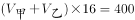······①，根据“相遇后，乙立即调头，6分40秒后甲第一次追上乙（6分40秒=400秒)”,可得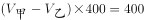······②。由①②解得，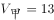米/秒，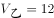米/秒。当两人第一次相遇时，乙走了16秒，所走路程为12×16=192米，此时距离起点为192米。

相遇后，乙立即调头。当甲第一次追上乙时，甲应比乙多走一圈。两人所走时间相同，路程与速度成正比，则所走路程之比为13:12，即甲走了13圈整、乙走了12圈整，两人重新回到第一次相遇时的位置，此时距离起点的距离同样为192米。

故正确答案为D。

**考点**：相遇追及

**来源**：2015年黑龙江省公务员录用考试《行测》题（公检法卷）第59题

### 第 55 题

某项工程，甲工程队单独施工需要30天完成，乙施工队单独施工需要25天完成，甲队单独施工了4天后改由两队一起施工，期间甲队休息了若干天，最后整个工程共耗时19天完成，问甲队中途休息了几天？

A. 1

B. 3

C. 5

D. 7

第 55 题 · 答案与解析

**参考答案（粉笔题库参考内容）**

D

**解析**

赋值此项工程的工程量为150，则此时甲的效率为5，乙的效率为6。甲单独施工了4天，剩余工作量＝150－4×5＝130。因整个工程共耗时19天，所以乙工作了19－4＝15天，15天共计施工6×15＝90，故可得剩余工作量130－90＝40，是由甲施工完成的，需要40÷5＝8天完成，则在剩下的15天当中，甲中途休息了15－8＝7天。

故正确答案为D。

**考点**：给完工时间型

**来源**：2015年黑龙江省公务员录用考试《行测》题（公检法卷）第60题

### 第 56 题

工厂组织工人参加技能培训，参加车工培训的有17人，参加钳工培训的有16人，参加铸工培训的有14人，参加两项及以上培训的人占参加培训总人数的2/3，三项培训都参加的有2人，问总共有多少人参加了培训？

A. 24

B. 27

C. 30

D. 33

第 56 题 · 答案与解析

**参考答案（粉笔题库参考内容）**

B

**解析**

设参加培训的总人数为n。

根据三集合容斥原理非标准公式：A+B+C-只满足两个条件的个数-2×满足三个条件的个数=总数-三个条件都不满足的个数，可得方程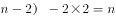，解得n=27。

故正确答案为B。

备注：参加两项及以上培训的人数包括只参加两项及参加三项的人。

**考点**：三集合

**来源**：2015年黑龙江省公务员录用考试《行测》题（公检法卷）第61题

### 第 57 题

某单位将100多名实习生分配到2个不同的部门中，如果要按照5：9的比例分配，则需要额外招4个实习生才能按要求比例分配。如要按照7：11的比例分配，最后会多出2个人，问该单位至少需要再招几个实习生才能按照3：7的比例分配给2个部门？

A. 2

B. 4

C. 6

D. 8

第 57 题 · 答案与解析

**参考答案（粉笔题库参考内容）**

C

**解析**

设两次分配中，第一种方案共分配了x份，第二种方案共分配了y份。第一种方案，还需要额外招4个实习生才能按比例分配，可知还剩10个实习生没有分配，则可得单位总人数=14x+10；根据第二种方案，则可得单位总人数=18y+2。总人数不变，即14x+10=18y+2，化简后得7x+4=9y，即7x+4为9的倍数，当x=11时满足要求，此时y=9，总人数计算得164，若按10人一组分配，则至少需要再招聘6人。

故正确答案为C。

**来源**：2015年黑龙江省公务员录用考试《行测》题（公检法卷）第62题

### 第 58 题

老师在课堂上出了18道速算题，规定学生答对一题得6分，答错一题倒扣1分。一位学生全部做完，得了94分，他答对了多少道题？

A. 12

B. 14

C. 16

D. 17

第 58 题 · 答案与解析

**参考答案（粉笔题库参考内容）**

C

**解析**

方法一：

设答对题目x道，则答错题目(18-x)道，根据题意得：6x-(18-x)=94，解得x=16。

方法二：

当18道题目全部答对时得分为18×6=108分，而答错一道损失6+1=7分，所以答错题目数为(108-94)÷7=2道，因此答对的题目数为18-2=16。

故正确答案为C。

**考点**：和差倍比问题

**来源**：2015年黑龙江省公务员录用考试《行测》题（边远地区卷）第58题

### 第 59 题

三行三列间距相等共有九盏灯，任意亮起其中的三盏组成一个三角形，持续5秒后换另一个三角形。那么如此持续亮。亮完所有的三角形组合至少需要多少秒？

A. 380

B. 390

C. 410

D. 420

第 59 题 · 答案与解析

**参考答案（粉笔题库参考内容）**

A

**解析**

在题干当中，九盏灯组成一个九宫格。九宫格当中，在同一直线上的三个点不能构成三角形，即米字型四条线和最外围四条线：

共8种组合不能构成三角形。在九盏灯当中任意选出三盏灯，除构成直线外，其他均可构成一个三角形。从九盏灯当中选出三盏灯一共有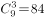种组成形式，除去8种直线组合外，还有84－8＝76种三角形组合，则共需76×5＝380秒。

故正确答案为A。

**考点**：排列组合问题-其他

**来源**：2015年黑龙江省公务员录用考试《行测》题（公检法卷）第64题

### 第 60 题

某单位共有10个进修的名额分到下属科室，每个科室至少一个名额，若有36种不同分配方案，问该单位最多有多少个科室？

A. 7

B. 8

C. 9

D. 10

第 60 题 · 答案与解析

**参考答案（粉笔题库参考内容）**

B

**解析**

根据插板法，m个相同的元素分成n组，每组至少1个元素，则情况数为种。将10个名额分给n个科室，每个科室至少分得一个名额，则有种情况。由于求该单位最多有多少个科室，将选项由大到小依次代入：D项，当n=10，有种情况，排除；C项，当n=9，有种情况，排除；B项，当n=8，有种情况，当选。

故正确答案为B。

**考点**：同素分堆问题

**来源**：2015年黑龙江省公务员录用考试《行测》题（公检法卷）第65题

### 第 61 题

一支有100多人的旅行团乘坐汽车，如果每辆车都乘坐29人，结果剩下4人；如果增加一辆车，则所有游客正好平均分到各辆车上，问此时每辆车乘坐了多少人？

A. 23

B. 24

C. 26

D. 28

第 61 题 · 答案与解析

**参考答案（粉笔题库参考内容）**

B

**解析**

设在第一种方案中有x辆车，第二种方案中每辆车分得y人，则依据题意可列方程：29x+4=（x+1）y。因x必为整数，依次代入选项。

A项：当y=23时，x不能为整数，排除；

B项：当y=24时，x=4，此时总人数（4+1）×24=120人，满足条件，当选；

C项：当y=26时，x不能为整数，排除；

D项：当y=28时，x=24，此时总人数=（24+1）×28=700>100多，排除。

故正确答案为B。

**考点**：和差倍比问题

**来源**：2015年黑龙江省公务员录用考试《行测》题（公检法卷）第66题

### 第 62 题

小区内空着一排相邻的8个车位，现有4辆车随机停进车位，恰好没有连续空位的停车方式共有多少种？

A. 48

B. 120

C. 360

D. 1440

第 62 题 · 答案与解析

**参考答案（粉笔题库参考内容）**

B

**解析**

题目要求求出“恰好没有连续空位的停车方式有多少种”，即排列组合中“不相邻问题”，可使用插空法求解。四辆车停进四个不同的车位，共有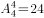种方式。然后在四辆车空出的5个空当中选出4个，即可满足“没有连续空位的停车方式”，共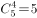种方式。则满足条件的停车方式一共有：24×5=120种。

故正确答案为B。

**考点**：不相邻问题

**来源**：2015年黑龙江省公务员录用考试《行测》题（公检法卷）第67题

### 第 63 题

已知一内直径为1250px，内高2500px的圆柱形木桶，装满了浓度为20%的盐水溶液，使其倾斜45度倒出部分溶液后放平，再加满清水，问此时木桶内盐水溶液的浓度是多少？

A. 10%

B. 12.5%

C. 13.3%

D. 15%

第 63 题 · 答案与解析

**参考答案（粉笔题库参考内容）**

D

**解析**

当木桶倾斜45度时，所倒出的溶液部分为腰为1250px的三角状部分（如下图所示），因，

，则，故AC=AB=CF=BF=1250px，则所倒出部分应刚好为圆柱体BACF的一半，为整个木桶的1/4。倒出的溶液为原溶液的1/4，则倒出的溶质也应为原溶质的1/4。假设木桶的容量为100，则原溶质为20，现溶质为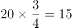，则此时溶液的浓度=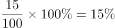。

故正确答案为D。

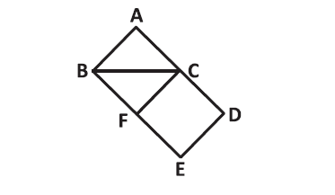

**考点**：几何结论类-三角形相关

**来源**：2015年黑龙江省公务员录用考试《行测》题（公检法卷）第68题

### 第 64 题

从A地到B地的道路如图所示，所有转弯均为直角，问如果要以最短距离从A地到达B地，有多少种不同的走法可以选择？

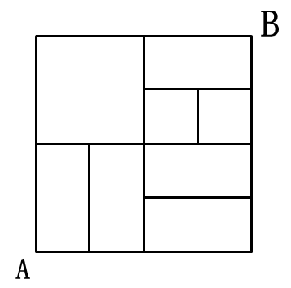

A. 14

B. 15

C. 18

D. 21

第 64 题 · 答案与解析

**参考答案（粉笔题库参考内容）**

B

**解析**

若要从A地到B地的路程最短，只能向上或向右行走，可依据描点法解题，如图所示：

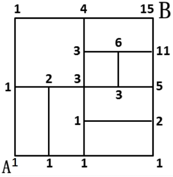

因此有15种走法可以选择。

故正确答案为B。

**考点**：基础排列组合

**来源**：2015年黑龙江省公务员录用考试《行测》题（公检法卷）第69题

### 第 65 题

某商场采购一种电冰箱，先按进价15%的利润定价，此后按定价的90%出售，结果每台获利210元，这种电冰箱的进价是多少元？

A. 6000

B. 5000

C. 4000

D. 3000

第 65 题 · 答案与解析

**参考答案（粉笔题库参考内容）**

A

**解析**

设冰箱的进价为x元，则根据题意得：(1+15%)x×90%-x=210，解得x=6000。

故正确答案为A。

**考点**：经济利润问题

**来源**：2015年黑龙江省公务员录用考试《行测》题（边远地区卷）第65题

### 第 66 题

权利反比原则指的是行使权力的人必须在权力执行的范围内最后得利，而权力最小的人最先得利的原则。七人每天一起捕鱼，在缺乏计量工具的前提下，下列哪项分配方法符合权利反比原则？

A. 通过抽签决定分配的人和拿取顺序

B. 由七人中最年长的负责分成七份，由最年轻的将每份分配到各人

C. 成立分配委员会和民主监督会，双方共同负责分配方案

D. 负责分成七份的那个人最后取走属于自己的那一份

第 66 题 · 答案与解析

**参考答案（粉笔题库参考内容）**

D

**解析**

第一步：关键词查找。

权利反比原则概念的关键词为：“行使权力的人必须在权力执行的范围内最后得利，而权力最小的人最先得利”。

第二步：逐一分析选项。

A项：“通过抽签决定”不能体现出权力的大和小，不符合定义要件，排除；

B项：由年长的分成七份，体现出了权力的行使，但是由年轻的负责分配到人，那不能保证年长的最后才被分配到，因此，不符合“行使权力的人在权力执行的范围内最后得利”，不符合定义要件，排除；

C项：同样不能体现出权力的大和小，不符合定义要件，排除；

D项：负责分份的人体现出权力的行使，即权力较大，而最后取走体现出“行使权力的人必须在权力执行的范围内最后得利”，满足定义要件，当选。

故正确答案为D。

**考点**：单定义-其他句式

**来源**：2015年黑龙江省公务员录用考试《行测》题（公检法卷）第74题

### 第 67 题

潜台词本是戏剧用词，指的是台词实际包含而没有明确说出的意见，所谓题外之话，言外之意。丰富的潜台词往往能使表演更加耐人寻味。

根据上述定义，以下哪项表述中包含典型的潜台词：

A. 历史老师讲课时说：中国地大物博，是礼仪之邦

B. 违章司机对交警说：我有急事，没看清交通标志线

C. 法官判说：判处被告有期徒刑十年

D. 电视上天气预报员说：今天最高气温为24摄氏度，多云

第 67 题 · 答案与解析

**参考答案（粉笔题库参考内容）**

B

**解析**

第一步：查找关键词。

潜台词概念的关键词为：“实际包含而没有明确说出的意见”、“言外之意”。

第二步：逐一分析选项。

A项：历史老师明确指出了意见，并没有“言外之意”，两个关键词均不满足，排除；

B项：违章司机在面对违章时，并没有明确指出他面对处罚时的意见，而他的言外之意是说“我有急事，并不是故意违章的，请不要处罚”，体现了“潜台词”的含义，当选；

C项：法官的意见很明确，不符合“潜台词”的定义要件，排除；

D项：天气预报员的意见同样非常明确，不符合“潜台词”的定义要件，排除。

故正确答案为B。

**考点**：单定义-其他句式

**来源**：2015年黑龙江省公务员录用考试《行测》题（公检法卷）第75题

### 第 68 题

生态补偿是指通过对损害资源环境的行为进行收费，提高行为的成本，从而促使损害行为的主体减少带来外部不经济性的行为，达到保护资源环境的目的。

根据上述定义，下列属于生态补偿的是：

A. 在火车站等公共场所随地吐痰、乱扔垃圾的行人通常会被执勤人员拦住并罚款

B. 为避免有人随意游牧，管理部门规定，一旦有人违反则向其工作单位通报

C. 某政府用大型客运公司缴纳的各项税款和费用，修缮路况堪忧的国道

D. 为修复因游人过多对景区内绿色植被的破坏，某地区风景旅游区提高了门票价格

第 68 题 · 答案与解析

**参考答案（粉笔题库参考内容）**

A

**解析**

第一步：关键词查找。

生态补偿概念的关键词：1.方式：“对损害资源环境的行为进行收费”、2.目的：“保护资源环境”。

第二步：逐一分析选项。

A项：破坏环境会被拦住并罚款，体现出生态补偿概念的关键词1和2，满足定义要件，当选；

B项：“向单位通报”没有体现出“对损害资源环境的行为进行收费”，不满足关键词1，排除；

C项：使用税款修缮道路，没有体现出“损害或保护资源环境的行为”，不满足关键词1和2，排除；

D项：提高门票价格，并不是针对“对破坏环境的行为进行收费”，其目的也不是“使损害行为的主体减少行为达到保护环境的目的”，而是“修复景区的破坏”，不满足关键词1和2，排除。

故正确答案为A。

**考点**：方式目的

**来源**：2015年黑龙江省公务员录用考试《行测》题（公检法卷）第76题

### 第 69 题

由普通民事纠纷演化为暴力犯罪事件，最后不得不引入国家强制力才能最终解决纠纷的现象，称为纠纷的漏斗效应。

根据上述定义，以下不属于纠纷的漏斗效应的是：

A. 小赵婚后一直怀疑妻子有外遇，最近妻子入职新公司，小赵开始怀疑妻子与上司有染，在和妻子的一次争吵后，冲到妻子公司将其上司打伤

B. 张某因为耕地问题，与邻居李某关系不和，曾多次发生冲突，经多方调停未果，最后一次在冲突中张某因殴打李某的母亲被判故意伤害罪而入狱

C. 小王曾借款3万给小张，并签订了借款协议，但到期后小张并未还款且恶意拖欠，小王多次试图沟通但小张总是抵赖，小王将小张打成重伤，被判入狱

D. 田家因门口道路长期被刘家占用而不满，两家人曾经因此到村委会理论，也曾爆发多次肢体冲突，但矛盾依然没有解决，最终田家长子因驾车撞毁刘家住房而被判刑

第 69 题 · 答案与解析

**参考答案（粉笔题库参考内容）**

A

**解析**

第一步：关键词查找。

漏斗效应的关键词为：1.原因：“普通民事纠纷演化为暴力犯罪事件”、2.结果：“不得不引入国家强制力才能最终解决”。

第二步：逐一分析选项。

A项：在争吵后，将妻子公司上司打伤，体现出关键词1“普通民事纠纷演化为暴力犯罪事件”，但并没有引入国家强制力解决，即没有体现出关键词2，故不能体现出漏斗效应，当选；

B项：张某因“耕地问题”逐步发展到“被判入狱”，上升到法律层面，属于通过国家的强制力解决，体现出漏斗效应的关键词1和2，满足定义要件，排除；

C项：因“借款协议”逐步发展到“被判入狱”，上升到法律层面，属于通过国家的强制力解决，体现出漏斗效应的关键词1和2，满足定义要件，排除；

D项：因“占道不满”逐步发展到“被判入狱”，上升到法律层面，属于通过国家的强制力解决，体现出漏斗效应的关键词1和2，满足定义要件，排除。

本题为选非题，故正确答案为A。

**考点**：原因结果

**来源**：2015年黑龙江省公务员录用考试《行测》题（公检法卷）第77题

### 第 70 题

T型人才是指按知识结构区分出来的一种新型人才类型，用字母“T”来表示他们的知识结构特点。“一”表示有广博的知识面，“丨”表示知识的深度，两者的结合，既有较深的专业知识，又有广博的知识面，这类集“深”与“博”于一身的人才，不仅在横向上具备比较广泛的一般性知识修养，而且在纵向的专业知识上具有较深的理解能力和独到见解。

根据上述定义，下列不属于T型人才的是:

A. 诺贝尔化学奖获得者米兰格尔，一生获得15个名誉博士学位，并开创了粒子物理，表面化学等新学科，直到70多岁还有技术发明问世

B. 某跨国公司新任命的中国区财务总监赵某能讲四种语言，同时拥有经济学博士和法学学士学位，曾经在亚洲工作过

C. 在高校工作的王老师毕业于经济学系，后又攻读了数学博士学位，目前从事数量经济学的研究与教学工作，并在这一研究方向上有很深的造诣

D. 古希腊著名哲学家亚里士多德的研究还涉及了物理学、诗歌、音乐、生物学、逻辑学、政治以及伦理学等

第 70 题 · 答案与解析

**参考答案（粉笔题库参考内容）**

C

**解析**

第一步：关键词查找。

定义关键词：1.“有广博的知识面”、2.“有较深的专业知识”、3.集“深”与“博”于一身。

第二步：逐一分析选项。

A项：获得诺贝尔化学奖，开创了“粒子物理、表面化学”，且还有技术发明，体现出米兰格尔广博的知识面和较深的专业知识，满足关键词1、2、3，排除；

B项：从事财务管理，会四种语言，且拥有经济学和法学双学位，体现出赵某具有较深的专业知识和广博的知识面，满足关键词1、2、3，排除；

C项：王老师目前从事于“数量经济学的研究与教学工作”，只能体现出关键词2有较深的专业知识，并不能体现出关键词1，当选；

D项：著名哲学家，且研究涉及物理学、诗歌、音乐等，体现出亚里士多德具有较深的专业知识和广博的知识面，满足关键词1、2、3，排除。

本题为选非题，故正确答案为C。

**考点**：单定义-其他句式

**来源**：2015年黑龙江省公务员录用考试《行测》题（公检法卷）第78题

### 第 71 题

核心家庭是指一对夫妇和子女两代人所组成的家庭，通常不和其他亲属住在一起。

根据上述定义，下列属于核心家庭的是:

A. 张女士母亲去世得早，她见父亲一人生活孤单，就把他接到自己家来一起生活了，这样能够在各方面照顾父亲

B. 王先生、王太太都在忙事业，双方的父母都不在身边，唯一的儿子正在念高中，平常家中无人做家务，只得雇了一个钟点工来照顾他们的生活起居

C. 李经理家境殷实，儿子虽然已经娶了媳妇，但仍然与他们一起过，李经理也乐得他们继续“啃老”

D. 刘老太唯一的女儿嫁出去后，刘老太就与丈夫两人一起生活；后来丈夫去世，她就一个人单过，不愿意与女儿女婿住在一起

第 71 题 · 答案与解析

**参考答案（粉笔题库参考内容）**

B

**解析**

第一步：关键词查找。

定义关键词：1.“一对夫妇和子女两代人组成”、2.“不和其他亲属住在一起”。

第二步：逐一分析选项。

A项：张女士将父亲接到家中，相对于父亲，张女士是子女，而其母亲去世，不符合关键词1，排除；

B项：王先生家中由“王先生和王太太、儿子”两代构成，且满足关键词2“不和其他亲属住在一起”，当选；

C项：李经理家中包含“儿媳妇”，“儿媳妇”属于除儿女之外亲戚的一种，不满足关键词2，排除；

D项：在刘老太的家中，仅包含刘老太一个人，不满足定义关键词1“与子女两代人组成”，排除。

故正确答案为B。

**考点**：主客体

**来源**：2015年黑龙江省公务员录用考试《行测》题（公检法卷）第79题

### 第 72 题

印象管理指个体为了使他人形成对自己积极的、正面的印象而在他人面前展示自我的努力。根据上述定义，下列不属于印象管理的是:

A. 学术研讨会上，张教授滔滔不绝、旁征博引，引起大家的注意和赞赏

B. 学校举办登山比赛，体育委员王同学一马当先，率先冲上山顶，赢得一片掌声

C. 三岁的淘淘在幼儿园十分淘气，经常在墙壁上画画，老师说了很多次他还是如此

D. 王女士是一家美容院的老板，平时她十分注意皮肤保养和梳妆打扮，总给人一种光彩照人的感觉

第 72 题 · 答案与解析

**参考答案（粉笔题库参考内容）**

C

**解析**

第一步：关键词查找。

定义关键词：1.目的：“为了使他人形成对自己积极的、正面的印象”、2.方式：“在他人面前展示自我的努力”。

第二步：逐一分析选项。

A项：为了引得大家的注意和赞赏，张教授滔滔不绝、旁征博引。体现出关键词1和2，排除；

B项：一马当先、赢得掌声，体现出关键词1和2，排除；

C项：淘淘的表现并没有体现出“使老师形成对他的积极正面的印象这样的目的”，且淘气地在墙上画画也不属于“展示自我”，故不符合定义，当选；

D项：注意保养打扮，给人光彩照人的感觉，体现出关键词1和2，排除。

本题为选非题，故正确答案为C。

**考点**：方式目的

**来源**：2015年黑龙江省公务员录用考试《行测》题（公检法卷）第80题

### 第 73 题

投资：回报

A. 广告：打折

B. 洽谈：生意

C. 竞争：优势

D. 入股：分红

第 73 题 · 答案与解析

**参考答案（粉笔题库参考内容）**

D

**解析**

第一步：判断题干词语间逻辑关系。

因为投资，所以有回报，并且只有投资才有回报，二者为因果对应关系和条件对应关系。

第二步：判断选项词语间逻辑关系。

A项：广告与打折之间不存在因果对应关系，与题干逻辑关系不一致，排除；

B项：洽谈生意，二者为动宾关系，与题干逻辑关系不一致，排除；

C项：竞争与优势之间不存在因果对应关系，与题干逻辑关系不一致，排除；

D项：因为入股，所以有分红，并且只有入股才有分红，二者为因果对应关系和条件对应关系，与题干逻辑关系一致，当选。

故正确答案为D。

**考点**：逻辑关系-对应关系

**来源**：2015年黑龙江省公务员录用考试《行测》题（公检法卷）第81题

### 第 74 题

舞台：道具：演员

A. 汽车：驾驶：司机

B. 操场：足球：学生

C. 商场：商品：消费者

D. 工厂：机器：工人

第 74 题 · 答案与解析

**参考答案（粉笔题库参考内容）**

D

**解析**

第一步：判断题干词语间逻辑关系。

演员在舞台上使用道具，其中第一词为状语，第二词为宾语，第三词为主语。三者为人物、地点及其工具的对应关系。

第二步：判断选项词语间逻辑关系。

A项：司机驾驶汽车，第二词为谓语，三者不是人物、地点及其工具的对应关系，与题干逻辑关系不一致，排除。

B项：学生在操场踢足球，三者为人物、地点及其工具的对应关系，与题干逻辑关系一致，保留；

C项：消费者在商场购买商品，三者为人物、地点及其工具的对应关系，与题干逻辑关系一致，保留；

D项：工人在工厂操作机器，三者为人物、地点及其工具的对应关系，与题干逻辑关系一致，保留；

对比B、C、D三项，B项的学生和C项的消费者均是一种身份，而D项的工人与题干的演员均为一种职业，D项比BC两项与题干逻辑关系更一致。

故正确答案为D。

**考点**：语法关系

**来源**：2015年黑龙江省公务员录用考试《行测》题（公检法卷）第82题

### 第 75 题

拍摄：剪辑：放映

A. 诊断：检查：康复

B. 编辑：征稿：出版

C. 化妆：演出：喝彩

D. 开采：加工：销售

第 75 题 · 答案与解析

**参考答案（粉笔题库参考内容）**

D

**解析**

第一步：判断题干词语间逻辑关系。

题干三词之间存在一定的先后顺序，先拍摄，然后剪辑，最后放映。

第二步：判断选项词语间逻辑关系。

A项：应先检查，然后诊断，顺序颠倒，排除；

B项：应先征稿，然后编辑，顺序颠倒，排除；

C项：喝彩并不存在一定的顺序逻辑，在哪个阶段都可以赢得喝彩，演出前往往也有喝彩声，排除；

D项：先开采，然后加工，最后销售，符合题干的先后顺序，当选。

故正确答案为D。

**考点**：逻辑关系-对应关系

**来源**：2015年黑龙江省公务员录用考试《行测》题（公检法卷）第83题

### 第 76 题

牙刷 对于 （    ） 相当于 （    ） 对于 墨汁

A. 口腔 砚台

B. 杯子 墨水瓶

C. 牙膏 毛笔

D. 水 书法

第 76 题 · 答案与解析

**参考答案（粉笔题库参考内容）**

C

**解析**

题目要求求出两个词的对应关系，可代入求解。

A项：牙刷在口腔内使用，砚台并非在墨汁内使用，逻辑关系不对应，排除；

B项：牙刷放在杯子里，而墨水瓶并不放在墨汁里，后面词组的逻辑关系与前面词组相反，排除；

C项：牙刷需要与牙膏配套使用，毛笔需要与墨汁配套使用，前后之间逻辑关系完全相符，当选；

D项：用牙刷刷牙前可能需要沾水，而书法是成品，用墨汁写成，因为毛笔的使用一定需要墨汁，排除。

故正确答案为C。

**考点**：逻辑关系-对应关系

**来源**：2015年黑龙江省公务员录用考试《行测》题（公检法卷）第84题

### 第 77 题

美国一项研究表明，二手烟雾对非烟民的危害远甚于烟民本人。吸烟的人在损害自身心血管系统的同时，系统可以进行自我调节以便于抵消吸烟造成的部分后果，而不吸烟的人的身体无法适应烟雾吸入后的变化，因此，被动吸烟对非烟民所造成的影响远远大于对烟民的影响。

以下哪项如果为真，可以支持上述研究结论？

A. 肺癌患者85%以上是由吸烟导致，癌症死亡总数的30%是由吸烟导致的

B. 烟民和非烟民结成夫妇，后者死于心脏病的风险比前者高30%

C. 被动吸烟是位于主动吸烟、饮酒类疾病之后的第三类最可预防的死因

D. 日吸四包烟的有20年的烟龄的烟民，其配偶有可能死于肺癌

第 77 题 · 答案与解析

**参考答案（粉笔题库参考内容）**

B

**解析**

第一步：找出论点和论据。

论点：被动吸烟对非烟民所造成的影响远远大于对烟民的影响。

论据：二手烟雾对非烟民的危害远甚于烟民本人。吸烟的人在损害自身心血管系统的同时，系统可以进行自我调节以便于抵消吸烟造成的部分后果，而不吸烟的人的身体无法适应烟雾吸入后的变化。

第二步：逐一分析选项。

A项：仅说明吸烟对烟民的影响，并未说明对非烟民造成的影响，属于无关选项，排除；

B项：指出吸烟能够对非烟民造成更为严重的影响，即会使非烟民死于心脏病的风险高出30%，补充论据，加强了题干论点，当选；

C项：可预防的死因与题干所述的被动吸烟对烟民和非烟民所产生的影响无关，属于无关选项，排除；

D项：仅说明烟民的配偶可能会死于肺癌，其配偶是否吸烟不知道，即不涉及烟民和非烟民之间的比较，因此，不具有支持力度，排除。

故正确答案为B。

**考点**：补充论据

**来源**：2015年黑龙江省公务员录用考试《行测》题（公检法卷）第94题

### 第 78 题

大家只有同心协力，才能把事情办好，事情没有办好，因此，大家没有同心协力。

以下哪项中的推理形式与题干中的推理形式相同？

A. 若被害人身上发现王某的DNA，则王某就是本案的重大犯罪嫌疑人。在被害人指甲中检验到了王某的DNA，因此，王某是本案的重大犯罪嫌疑人

B. 张同学上场担任主辩手，实验中学辩论队就能赢，实验中学辩论队没有赢，因此，张同学没有上场担任主辩手

C. 薄荷只有在温暖的气候下才能很好地生长，薄荷生长得很好，因此，薄荷是在温暖的气候下生长的

D. 人不犯我，我不犯人，我未犯人，因此，人未犯我

第 78 题 · 答案与解析

**参考答案（粉笔题库参考内容）**

D

**解析**

题干的逻辑关系为：只有A才B，因为非B，所以非A。

逐一分析选项。

A项：如果A则B，因为A，所以B。与题干逻辑关系并不对应，排除；

B项：如果A则B，因为非B，所以非A。与题干逻辑关系并不对应，排除；

C项：只有A才B，因为B，所以A。与题干逻辑关系并不对应，排除；

D项：只有A才B，因为非B，所以非A。与题干逻辑关系完全对应，当选。

故正确答案为D。

**考点**：推理形式

**来源**：2015年黑龙江省公务员录用考试《行测》题（公检法卷）第95题

### 第 79 题

会玩的孩子更适应社会交往，心理也更加健康；相反，不少性格内向、孤僻，甚至有交往困难等行为问题的孩子，大多小时候缺少和同伴的玩耍。如果一个孩子交往技能比较差，就容易产生焦虑、紧张、多疑等负性情绪，从而影响正常生活和学习。如果这些负性情绪长期得不到释放，甚至可能导致闭缩性人格。

由此可以推出：

A. 只有给孩子充分的时间玩耍，孩子的心理才可能健康发展

B. 只要让孩子有充分的时间玩耍，孩子的心理就能健康发展

C. 有心理缺陷的孩子，都是因为小时候没有得到足够的时间玩耍

D. 只要孩子会玩耍，长大后就能适应社会

第 79 题 · 答案与解析

**参考答案（粉笔题库参考内容）**

A

**解析**

题干的主要论述关系为：①心理不健康的孩子大多缺少和同伴的玩耍；②孩子交往差→容易产生负性情绪→可能导致闭缩性人格。

逐一分析选项。

A项：由①“心理不健康的孩子大多缺少和同伴的玩耍”可以推知，只有给孩子充分的时间玩耍，孩子的心理才可能健康发展，能由题干推出，当选；

B项：只要让孩子有充分的时间玩耍，孩子的心理就能健康发展，表述过于绝对，并不能由题干推出，排除；

C项：题干中只是说心理不健康的孩子大多缺少和同伴的玩耍，表述过于绝对，排除；

D项：题干中只是说会玩的孩子更适应社会交往，表述过于绝对，并不能由题干推出，排除。

故正确答案为A。

**考点**：日常结论

**来源**：2015年黑龙江省公务员录用考试《行测》题（公检法卷）第96题

### 第 80 题

家里有四个孩子，分别为甲、乙、丙和丁，一天，放在餐桌上的糖果少了几颗，母亲问是谁偷吃了糖果，四个孩子各有说辞：

甲说：我们中有人偷吃了糖果；

乙说：我们四个都没偷吃糖果；

丙说：乙和丁至少有一人没有偷吃糖果；

丁说：我没偷吃糖果。

如果四个孩子中有两个说的是真话，有两个说的是假话，则说真话的是：

A. 甲和丙

B. 甲和丁

C. 乙和丙

D. 乙和丁

第 80 题 · 答案与解析

**参考答案（粉笔题库参考内容）**

A

**解析**

第一步：分析题干找关系。

甲：有些人偷吃了；

乙：所有人都没偷吃；

丙：乙没偷吃 或 丁没偷吃；

丁：丁没偷吃。

分析题干条件可知，甲和乙的话为矛盾关系，必有一真一假。

第二步：看其余。

根据题干条件可知，四个孩子的话为两真两假，甲和乙为一真一假，故丙和丁也必为一真一假。可以通过假设法来确定：假设丁的话为真，此时丙的话也会为真，与“丙和丁必有一真一假”矛盾。因此，丁的话“丁没偷吃”为假，即丁偷吃了糖果，丙的话为真，说明乙没有偷吃糖果。由于丁偷吃了糖果，可推出“有人偷吃了糖果”，所以甲的话也一定为真。

综上，说真话的为甲和丙。

故正确答案为A。

**考点**：两真两假

**来源**：2015年黑龙江省公务员录用考试《行测》题（公检法卷）第97题

### 第 81 题

面对能源危机，一些国家开始寻找替代能源，使用玉米加工车用乙醇汽油已经不再是新鲜事了，因此不少人认为，使用玉米生产能源，既可以消化库存的陈化粮，又发展了石油替代能源，这将是未来能源发展的趋势之一，是利国利民的一项政策。

下列哪项如果为真，不能削弱上述结论？

A. 目前看来，生产车用乙醇汽油将消耗大量的水资源

B. 乙醇汽油会对车辆的发动机等关键部件造成严重腐蚀

C. 生产1吨乙醇要消耗3.5吨玉米，如此一来，每年就要消耗玉米近万吨，这将危及全国的粮食储备

D. 使用玉米作为生产能源，可以适当提高玉米价格，进而增加农民收入和农民产粮的积极性

第 81 题 · 答案与解析

**参考答案（粉笔题库参考内容）**

D

**解析**

第一步：找出论点和论据。

论点：使用玉米生产能源，将是未来能源发展的趋势之一，是利国利民的一项政策。

论据：使用玉米生产能源，既可以消化库存的陈化粮，又发展了石油替代能源。

要削弱论点就要指出，用玉米生产能源并不是一项利国利民的政策。

第二步：逐一分析选项。

A项：生产乙醇汽油将消耗大量水资源，提出了反向论据，证明使用乙醇汽油不好，能够削弱题干结论。排除；

B项：会对关键部件造成严重腐蚀，同样提出了反向论据，证明使用乙醇汽油不好，能够削弱结论，排除；

C项：危及粮食储备，提出了反向论据，证明用玉米生产乙醇汽油会带来负面的影响，能够削弱结论，排除；

D项：说明使用玉米作为生产能源的积极影响，加强了题干论证，故无任何削弱作用，当选。

本题为选非题，故正确答案为D。

**考点**：削弱选非题

**来源**：2015年黑龙江省公务员录用考试《行测》题（公检法卷）第98题

### 第 82 题

精神病其实不是一个病理学的概念，而是一个社会学的概念。假如家属或权力机构强行把一个人送入精神病院，那么，这个人几乎只能被诊断成“精神病人”。家属和权力机构对他的“症状”的描述，成为判断他是否是精神病人的重要信息。而他如果说受到了迫害，并进行反抗，则恰恰符合精神病诊断标准中关于“妄想”“躁狂”之类的描述。他的自辩权利也被这个无敌的逻辑取消：你说自己不是精神病，那么，你恰恰在此时是，是因为你拒绝承认自己有病——这正是精神病人的一种表现；而你承认了，你当然就是了。

以下哪项最可能从上述断定中推出？

A. 精神病的诊断标准仅仅是“精神病人”的家属或相关权力机构的指控

B. 家属或权力机构将某人送入精神病院，只是为了让他得到及时有效的治疗

C. 大多数在精神病院治疗的精神病人其实并没有精神病

D. 在自己是否患有精神病这一问题上，被强制关入精神病院的个人表达是苍白无力的

第 82 题 · 答案与解析

**参考答案（粉笔题库参考内容）**

D

**解析**

通读题干，逐一分析选项：

A项：题干中为“家属和权力机构对他的‘症状’的描述，成为判断他是否是精神病人的重要信息”，并非“精神病的诊断标准仅仅是‘精神病人’的家属或相关权力机构的指控”，表述过于绝对，排除；

B项：题干中无任何关于家属将某人送进精神病院的目的描述，选项描述无中生有，不能推出，排除；

C项：在精神病院治疗的病人有没有精神病无法得知，题干中无任何相关描述，选项描述无中生有，不能推出，排除；

D项：由题干的最后一句可以得知，“精神病人”对自辩的表达是没有效果的，都会被无敌的逻辑取消，可以推出，当选。

故正确答案为D。

**考点**：日常结论

**来源**：2015年黑龙江省公务员录用考试《行测》题（公检法卷）第99题

### 第 83 题

就网友提出的“能否不到驾校培训就直接考驾驶证”这一问题，公安部交通管理局回应称，我国法律法规没有规定申请驾驶证必须经过驾校培训，但必须在道路上学习驾驶技术。根据《道路交通安全法实施条例》第20条有关规定，在道路上学习驾驶，应当按照公安机关交通管理部门指定的路线、时间进行。在道路上学习机动车驾驶技能应当使用教练车，在教练随车指导下进行，与教学无关的人员不得乘坐教练车。

根据以上信息，不能得出以下哪项？

A. 如果有教练随车指导，则可以在公路上学习驾驶

B. 如果找不到教练指导，则无法在道路上学习驾驶技术

C. 如果只有驾校才有教练车，则申请驾驶证必须先上驾校

D. 如果已经申请到了驾驶证，则肯定在道路上学习过驾驶技术

第 83 题 · 答案与解析

**参考答案（粉笔题库参考内容）**

A

**解析**

第一步，分析题干逻辑关系。

申请驾驶证→在道路学习驾驶技术→使用教练车且教练随车指导。

第二步，逐一分析选项。

A项：教练随车指导→在公路上学习驾驶，为题干的肯后命题，而肯后并不能推出确定性结论，则不能由题干推出，当选；

B项：-教练指导→在道路上学习驾驶技术，为题干的逆否命题，可以推出，排除；

C项：因在道路上学习驾驶技术需使用教练车，而只有驾校才有教练车，故可推知申请驾驶证必须要去驾校，可以推出，排除；

D项：由题干“申请驾驶证→在道路学习驾驶技术”可以推出，如果已经申请到了驾驶证，则一定在道路上学习过驾驶技术，满足题干条件，排除。

本题为选非题，故正确答案为A。

**考点**：常规翻译

**来源**：2015年黑龙江省公务员录用考试《行测》题（公检法卷）第100题

### 第 84 题

人类智力可分为流体智力和晶体智力两类。流体智力是一个人生来就具有进行智力活动的能力，即学习和解决问题的能力，它依赖于先天的禀赋，随神经系统的成熟而提高，不受教育与文化的影响。而晶体智力是指以习得的经验为基础的认知能力，受后天的经验影响较大。

根据上述定义，下列属于晶体智力的是：

A. 记忆力

B. 逻辑分析能力

C. 会弹琴

D. 会哭泣

第 84 题 · 答案与解析

**参考答案（粉笔题库参考内容）**

C

**解析**

第一步：找出定义关键词。

流体智力：“人生来就具有进行智力活动的能力”，“依赖于先天的禀赋，随神经系统的成熟而提高，不受教育与文化的影响。”

晶体智力：“以习得的经验为基础的认知能力，受后天的经验影响较大。”

第二步：逐一分析选项。

A项：记忆力是先天的禀赋，没有受后天经验的影响，不符合定义，排除；

B项：逻辑分析能力，不涉及“以习得的经验为基础”，不符合定义，排除；

C项：会弹琴是从以习得的经验为基础的能力，受后天的经验影响较大，符合定义，当选；

D项：会哭泣是先天的，没有受后天经验的影响，不符合定义，排除。

故正确答案为C。

**考点**：常规问法

**来源**：2015年黑龙江省公务员录用考试《行测》题（边远地区卷）第84题

### 第 85 题

摆拍就是在摄影过程中，被拍摄者完全知道有人在为自己拍照，从而使摄影者有较充分的时间，在做好拍摄准备以及被拍摄者固定好姿势以后，完成拍摄。

根据上述定义，下列属于摆拍的是：

A. 看到眼前壮丽的美景，小王兴奋不已，双手张开，像是要把美景拥抱在怀里，嘴里还喊着小李快给他来一张

B. 小张只喜欢拍风景，只喜欢静静地与大自然对话。在旅游过程中，同事们喊他拍照，他很不情愿

C. 邻居小王家的孩子刚满三岁，却非常顽皮，小王拍了不少他淘气玩耍的镜头

D. 老周晚年爱上摄影，常常背起相机去采风，遇到新鲜事、新鲜人，都爱举起相机畅快地拍摄一通

第 85 题 · 答案与解析

**参考答案（粉笔题库参考内容）**

A

**解析**

第一步：找出定义关键词。

“被拍摄者完全知道有人在为自己拍照”、“做好拍摄准备以及被拍摄者固定好姿势以后，完成拍摄”。

第二步：逐一分析选项。

A项：小王像是要把美景拥抱在怀里，符合“做好拍摄准备以及被拍摄者固定好姿势以后，完成拍摄”，嘴里还喊着小李快给他来一张，符合“被拍摄者完全知道有人在为自己拍照”，符合定义，当选；

B项：小张只喜欢拍风景，同事们喊他拍照，他很不情愿，小张不情愿，最终是否完成拍摄未知，不明确选项，排除；

C项：小王家的孩子刚满三岁，非常顽皮，小王拍了不少他淘气玩耍的镜头，说明不是固定好的姿势，不符合“做好拍摄准备以及被拍摄者固定好姿势以后，完成拍摄”，不符合定义，排除；

D项：老周遇到新鲜事、新鲜人，都爱举起相机畅快地拍摄一通，不符合“被拍摄者完全知道有人在为自己拍照”，不符合定义，排除。

故正确答案为A。

**考点**：原因结果

**来源**：2015年黑龙江省公务员录用考试《行测》题（边远地区卷）第85题

### 第 86 题

本科：学历

A. 品德：教育

B. 家庭：婚姻

C. 校长：职务

D. 恋人：爱情

第 86 题 · 答案与解析

**参考答案（粉笔题库参考内容）**

C

**解析**

第一步：判断题干词语间逻辑关系。

本科是学历的一种，二者为种属关系。

第二步：判断选项词语间逻辑关系。

A项：品德指品格德行，教育是培养的过程，二者无明显逻辑关系，与题干逻辑关系不一致，排除；

B项：存在婚姻关系后组建家庭，二者是对应关系，与题干逻辑关系不一致，排除；

C项：校长是职务的一种，二者是种属关系，与题干逻辑关系一致，当选；

D项：恋人之间存在爱情，二者是对应关系，与题干逻辑关系不一致，排除。

故正确答案为C。

**考点**：逻辑关系-包容关系

**来源**：2015年黑龙江省公务员录用考试《行测》题（边远地区卷）第86题

### 第 87 题

某公司经理发现，该公司A部门里每一位员工都有自己喜欢的同事；至少有一位员工不信任任何一位同事；如果得不到每位员工的信任，那么就不可能有资格当选下届工会主席。

根据以上信息，一定可以得出以下哪项？

A. 该公司有人不自信

B. 该公司有人不能当选下届工会主席

C. 该公司同事关系很糟

D. 该公司下届工会主席一定得到所有员工的喜欢

第 87 题 · 答案与解析

**参考答案（粉笔题库参考内容）**

B

**解析**

第一步：翻译题干。

（1）所有员工→有自己喜欢的同事；

（2）至少有一位员工不信任任何一位同事；

（3）-得到每位员工的信任→有资格当选下届工会主席。

第二步：逐一分析选项。

A项：题干中没有提及自信，属于无关选项，排除；

B项：根据条件（3）可知，-得到每位员工的信任→有资格当选下届工会主席，由条件（2）可知，至少有一人不信任任何一位同事，则存在有人无法得到每位员工的信任，则有人不能当选下届工会主席，可以推出，当选；

C项：根据题干无法判断同事关系是否糟糕，无关选项，排除；

D项：根据条件（3）的逆否命题可知有资格当选下届工会主席→得到每位员工的信任，但信任和喜欢无关，无关选项，排除。

故正确答案为B。

**考点**：常规翻译

**来源**：2015年黑龙江省公务员录用考试《行测》题（边远地区卷）第87题

### 第 88 题

甲、乙、丙、丁四人先后来到一个农场工作。甲说：“我刚到农场时，在玉米地旁种了十几棵桃树。”乙说：“我刚来时正赶上农场附近新修公路，把桃树林都砍了。”丙说：“农场的玉米都是我种的。”丁说：“我刚到的第一天，正赶上摘桃，树上的桃又大又甜。”

据此判断，四人来到农场的先后顺序是：

A. 丙、甲、丁、乙

B. 丙、丁、甲、乙

C. 甲、丁、乙、丙

D. 甲、丙、丁、乙

第 88 题 · 答案与解析

**参考答案（粉笔题库参考内容）**

A

**解析**

第一步：分析题干。

（1）甲：玉米旁种桃树

（2）乙：桃林被砍

（3）丙：丙种玉米

（4）丁：丁摘桃

第二步：根据题干条件分析选项。

由（1）和（3）可知，丙在甲之前来到农场，排除C项和D项。由（1）和（4）可知，丁在甲之后来到农场，排除B项。

故正确答案为A。

**考点**：排除法

**来源**：2015年黑龙江省公务员录用考试《行测》题（边远地区卷）第88题

### 第 89 题

科学家设计了一个实验来探讨人类如何评估自我行为。研究人员付给每个参加实验的学生5美元，然后问他们，如果这次实验结束之后，有人要他们进行慈善捐款，请预估自己及其他人会捐出多少钱。结果，实验对象预测（平均）自己会捐2.44美元，但别人只会捐1.83美元。事后真的要求实验对象捐钱时，这些人平均只捐了1.53美元。另一项实验中，请实验对象预估自己会在慈善活动中买多少花，结果发现，他们均过分高估了自己实际买花的数量。

根据以上实验，科学家可能会得出以下哪项结论？

A. 我们并不像其他人所想的那样有爱心

B. 相比对自己的了解，人们更了解他人

C. 人们会高估自己可能的善意行为

D. 人们倾向于粉饰自己的各种行为

第 89 题 · 答案与解析

**参考答案（粉笔题库参考内容）**

C

**解析**

日常结论题，根据题干信息逐一分析选项。

A项：题干中实验对象预测自己会捐2.44美元，但实际结果自己只捐了1.53美元，实际捐款低于预测自己捐款数额，可以推出我们并不像自己所想的那样有爱心，而非其他人所想，排除；

B项：题干中实验对象预测自己会捐2.44美元，别人只会捐1.83美元，但实际结果自己只捐了1.53美元，未涉及别人捐款的实际结果，选项不能推出更了解他人，排除；

C项：题干中实验对象预测自己会捐2.44美元，但实际结果自己只捐了1.53美元，高估了自己捐款数额，另一项实验中，实验对象过分高估了自己慈善活动中实际买花的数量，两个实验都说明人们会高估自己可能的善意行为，选项可以推出，当选；

D项：题干中没有对做出的行为进行解释，即不涉及人们倾向于粉饰自己的各种行为，无关选项，排除。

故正确答案为C。

**考点**：日常结论

**来源**：2015年黑龙江省公务员录用考试《行测》题（边远地区卷）第89题

### 第 90 题

从所给四个选项中，选择最合适的一个填入问号处，使之呈现一定规律性：

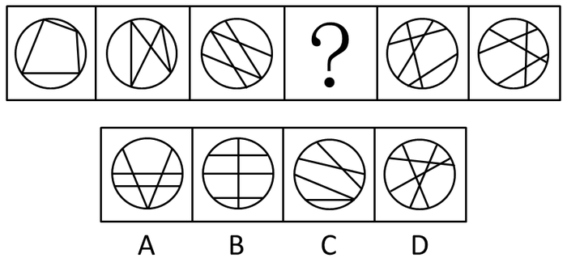

A. A

B. B

C. C

D. D

第 90 题 · 答案与解析

**参考答案（粉笔题库参考内容）**

B

**解析**

每个图形圆内都由四条直线将一个圆分割成多个封闭空间，考虑数面。观察发现，题干图形圆内分别包含：5、6、7、（ ）、9、10个面，为连续自然数列。故所求图形圆内应包含8个面，只有B项满足条件。

故正确答案为B。

**考点**：数量规律-面

**来源**：2015年黑龙江省公务员录用考试《行测》题（公检法卷）第101题

### 第 91 题

从所给的四个选项中，选择最合适的一个填入问号处，使之呈现一定的规律性：

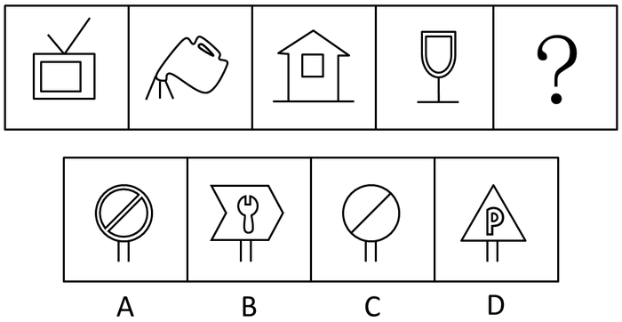

A. A

B. B

C. C

D. D

第 91 题 · 答案与解析

**参考答案（粉笔题库参考内容）**

B

**解析**

图形元素构成凌乱，考虑数数。观察发现，每个图形均由两个部分构成，满足这一规律的只有B项。

故正确答案为B。

**考点**：数量规律-素

**来源**：2015年黑龙江省公务员录用考试《行测》题（公检法卷）第102题

### 第 92 题

从所给四个选项中，选择最合适的一个填入问号处，使之呈现一定规律性：

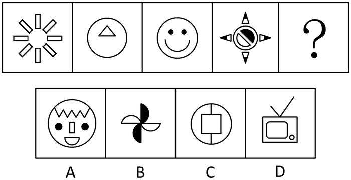

A. A

B. B

C. C

D. D

第 92 题 · 答案与解析

**参考答案（粉笔题库参考内容）**

A

**解析**

图形元素构成凌乱，考虑数数。观察可以发现，题干图形分别由1、2、3、4、？种元素构成，为连续自然数列，故所求图形应由5种元素构成，满足条件的只有A项。

故正确答案为A。

**考点**：数量规律-素

**来源**：2015年黑龙江省公务员录用考试《行测》题（公检法卷）第103题

### 第 93 题

从所给四个选项中，选择最合适的一个填入问号处，使之呈现一定规律性：

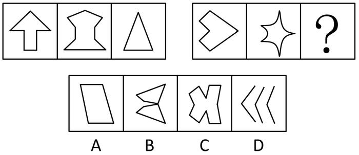

A. A

B. B

C. C

D. D

第 93 题 · 答案与解析

**参考答案（粉笔题库参考内容）**

C

**解析**

题干由两组图形构成，第一组图形均为竖向对称图形，第二组前两个图形都为横向对称图形，且仅包含一个封闭面，满足条件的只有C项。

故正确答案为C。

**考点**：属性规律-对称性

**来源**：2015年黑龙江省公务员录用考试《行测》题（公检法卷）第104题

### 第 94 题

从所给四个选项中，选择最合适的一个填入问号处，使之呈现一定规律性：

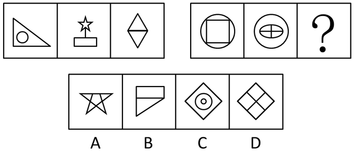

A. A

B. B

C. C

D. D

第 94 题 · 答案与解析

**参考答案（粉笔题库参考内容）**

A

**解析**

题干由两组图形构成。观察发现，第一组图形均由两个封闭面构成，第二组前两个图形均由五个封闭面构成，故第三个图形应满足此规律。符合条件的只有A项。

故正确答案为A。

**考点**：数量规律-面

**来源**：2015年黑龙江省公务员录用考试《行测》题（公检法卷）第105题

### 第 95 题

从所给四个选项中，选择最合适的一个填入问号处，使之呈现一定规律性：

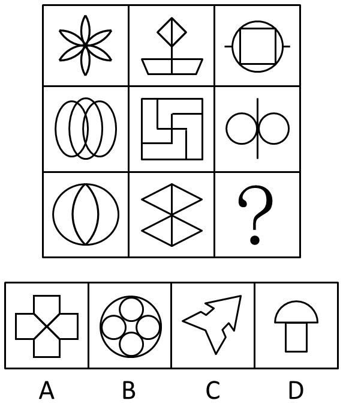

A. A

B. B

C. C

D. D

第 95 题 · 答案与解析

**参考答案（粉笔题库参考内容）**

D

**解析**

题干为九宫格图形，考虑从横行或竖列找到规律。观察发现，九宫格第一列图形均由曲线构成，第二列图形均由直线构成，第三列图形均由曲线和直线两种元素构成，满足条件的只有D项。

故正确答案为D。

**考点**：属性规律-曲直性

**来源**：2015年黑龙江省公务员录用考试《行测》题（公检法卷）第106题

### 第 96 题

从所给四个选项中，选择最合适的一个填入问号处，使之呈现一定规律性：

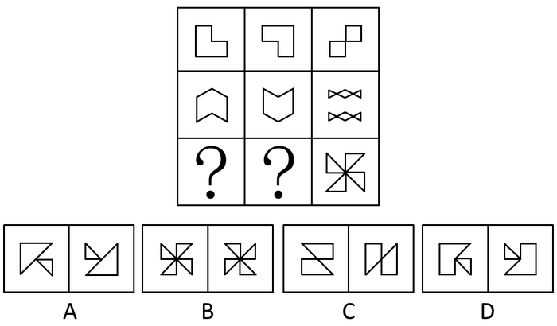

A. A

B. B

C. C

D. D

第 96 题 · 答案与解析

**参考答案（粉笔题库参考内容）**

C

**解析**

图形元素组成相似，优先考虑样式规律。观察发现，九宫格每一行的前两个图形去同存异得到第三个图形，第三行图形也应满足此规律。去同存异得到风车样式的图形只有C项符合。

故正确答案为C。

**考点**：样式规律-加减同异

**来源**：2015年黑龙江省公务员录用考试《行测》题（公检法卷）第107题

### 第 97 题

以下四个选项中去掉哪一项之后，所剩的图形呈现一定的规律性：

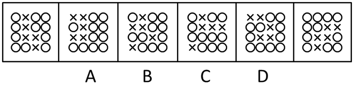

A. A

B. B

C. C

D. D

第 97 题 · 答案与解析

**参考答案（粉笔题库参考内容）**

D

**解析**

题干图形均由○和×图形构成，在数数找不到规律的基础上，考虑二者之间的特殊关系。观察发现，除了D选项，其他5个图形均由“×”图形将“○”图形分成了相离的两份。

故正确答案为D。

**考点**：数量规律-素、黑白块类

**来源**：2015年黑龙江省公务员录用考试《行测》题（公检法卷）第108题

### 第 98 题

把下面的六个图形分为两类，使每一类图形都有各自的共同特征或规律，分类正确的一项是：

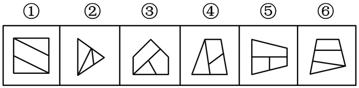

A. ①②⑥；③④⑤

B. ①②③；④⑤⑥

C. ①③⑥；②④⑤

D. ①③④；②⑤⑥

第 98 题 · 答案与解析

**参考答案（粉笔题库参考内容）**

A

**解析**

解析一：题干六个图形均由3个封闭面构成，在数线、数面找不到规律的基础上，考虑图形间的拼接关系。观察发现，图形③④⑤中的三个面中，两两之间均包含一条公共边，而①②⑥图形仅存在两个封闭面之间存在公共边（即只有两个面有共同的边，三个面之间不存在两两相交）。符合这一规律的分组为A项。

故正确答案为A。

解析二：元素组成不同，且无明显属性规律，考虑数量规律。观察发现，题干均有一个外框，内部有线条交叉，可以数内部交点。图③④⑤内部交点数为1，而图①②⑥内部交点数为0。符合这一规律的分组为A项。

故正确答案为A。

**考点**：数量规律-点、特殊规律-图形间关系

**来源**：2015年黑龙江省公务员录用考试《行测》题（公检法卷）第109题

### 第 99 题

从所给的四个选项中，选择最合适的一个填入问号处，使之呈现一定的规律性。

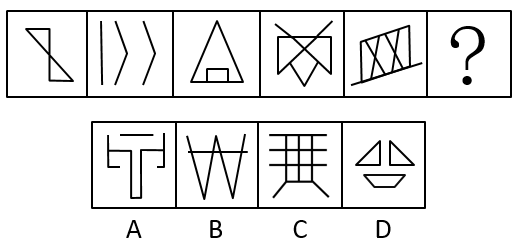

A. A

B. B

C. C

D. D

第 99 题 · 答案与解析

**参考答案（粉笔题库参考内容）**

C

**解析**

元素组成不同，且无明显属性规律，优先考虑数量规律。观察图形发现，图形均由直线构成，优先考虑线数量，已知图形线数量分别是4、5、6、7、8，故“？”处线数量应为9。A项10，B项5，C项9，D项10。

故正确答案为C。

**考点**：数量规律-线

**来源**：2015年黑龙江省公务员录用考试《行测》题（边远地区卷）第99题

### 第 100 题

某国际组织会徽的图案是一幅从北极方向勾勒的世界地图，地图上标有陆地和海洋、经线和纬线。经纬线由8条直线和五个同心圆组成，地图底部和左右两侧为橄榄枝，衬托着地球。

根据上述描述，下列最符合的会徽图案是：

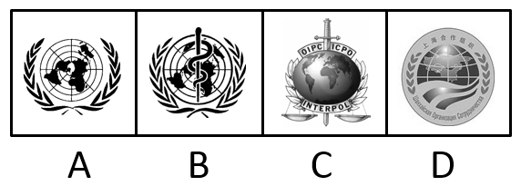

A. A

B. B

C. C

D. D

第 100 题 · 答案与解析

**参考答案（粉笔题库参考内容）**

A

**解析**

第一步：找出定义关键词。

“从北极方向勾勒的世界地图”、“有陆地和海洋、经线和纬线”、“经纬线由8条直线和五个同心圆组成”、“地图底部和左右两侧为橄榄枝”。

第二步：逐一分析选项。

A项：选项图案是从北极方向勾勒的世界地图，经纬线由8条直线和五个同心圆组成，底部和左右两侧有橄榄枝，符合定义，当选；

B项：选项图案是世界地图和蛇缠绕权杖构成，不符合“经纬线由8条直线组成”，不符合定义，排除；

C项：选项图案没有经线和纬线，不符合“经纬线由8条直线和五个同心圆组成”，不符合定义，排除；

D项：选项是上海合作组织成员国地图，不符合“从北极方向勾勒的世界地图”，不符合定义，排除。

故正确答案为A。

**考点**：单定义-其他句式

**来源**：2015年黑龙江省公务员录用考试《行测》题（边远地区卷）第100题

## 材料 1

2011年底，全国共有乡镇综合文化站34139个，平均每站面积由2006年的277.01平方米，增长到2011年的516.38平方米，平均每站文化活动用房面积由2006年的175.49平方米，增长到2011年的391.00平方米。

        2006~2011年，每年乡镇综合文化站从业人员和专职人员增长比例均保持在5%左右，2011年底，全国乡镇综合文化站从业人员78148人，专职人员52718人。

        2011年，全国各级财政对乡镇综合文化站的财政拨款达到42.76亿元，比2006年增加31.84亿元，增幅高达291.6%，年均增长28.6%。各级财政对乡镇综合文化站的投入占全国文化事业总投入的10.9%，占群众文化投入的41.1%，分别比2006年提高4.0个百分点和7.3个百分点。

        2011年，全国乡镇综合文化站共组织文艺活动32.64万次，比2006年增长20.0%；举办训练班15万次，比2006年增长26.8%；培训人数1232万人次，比2006年增长230%。

        2011年底，全国乡镇综合文化站共指导群众业余文艺团队154799支，辖区内社区（村）文化活动室360649个。

### 第 101 题

2011年底，全国乡镇综合文化站总面积约为多少万平方米？

A. 1763

B. 1335

C. 946

D. 599

第 101 题 · 答案与解析

**参考答案（粉笔题库参考内容）**

A

**解析**

根据题干“全国乡镇综合文化站总面积”，定位材料第一段可得：2011 年底，全国共有乡镇综合文化站34139 个，平均每站面积为516.38 平方米。可判定本题为现期平均数问题，故总面积=516.38×34139>500×30000=1500万平方米，结合选项只有A项符合。

故正确答案为A。

**考点**：文字资料、现期平均数

**来源**：2015年黑龙江省公务员录用考试《行测》题（公检法卷）第111题

### 第 102 题

2011年全国群众文化投入约为多少亿元？

A. 77

B. 96

C. 104

D. 123

第 102 题 · 答案与解析

**参考答案（粉笔题库参考内容）**

C

**解析**

根据题干“全国群众文化投入”定位材料第三段可得：2011年全国各级财政对乡镇综合文化站的财政拨款达到42.76亿元，占群众文化投入的41.1%。可判定本题为现期比重问题。根据公式可得全国群众文化投入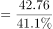，略大于100。

故正确答案为C。

**考点**：文字资料、现期比重

**来源**：2015年黑龙江省公务员录用考试《行测》题（公检法卷）第112题

### 第 103 题

2011年全国文化事业总投入约是2006年的多少倍？

A. 1\. 6倍

B. 2\. 5倍

C. 3\. 9倍

D. 5\. 3倍

第 103 题 · 答案与解析

**参考答案（粉笔题库参考内容）**

B

**解析**

根据题干“2011年······约是2006年的多少倍”，结合选项数据时间为2011年，可判定本题为现期倍数问题。定位材料第三段可得：2011年，全国各级财政对乡镇综合文化站的财政拨款达到42.76亿元，比2006年增加31.84亿元，各级财政对乡镇综合文化站的投入占全国文化事业总投入的10.9%，比2006年提高4.0个百分点。全国文化事业总投入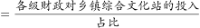，则2011年全国文化事业总投入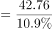，2006年全国文化事业总投入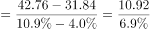，故2011年是2006年的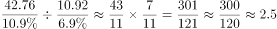倍。

故正确答案为B。

**考点**：文字资料、现期倍数

**来源**：2015年黑龙江省公务员录用考试《行测》题（公检法卷）第113题

### 第 104 题

2011年，平均每个乡镇综合文化站从业人员约组织文艺活动多少次？

A. 2

B. 4

C. 6

D. 8

第 104 题 · 答案与解析

**参考答案（粉笔题库参考内容）**

B

**解析**

根据题干“2011年，平均······约多少次”,结合选项数据时间为2011年，可判定本题为现期平均数问题。定位材料第二段可得：2011年全国乡镇综合文化站从业人员78148人；定位材料第四段可得：2011年，全国乡镇综合文化站共组织文艺活动32.64万次。故平均每人组织活动数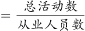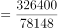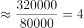次。

故正确答案为B。

**考点**：文字资料、现期平均数

**来源**：2015年黑龙江省公务员录用考试《行测》题（公检法卷）第114题

### 第 105 题

能够从资料中推出的是：

A. 2011年文化活动用房面积占乡镇综合文化站总面积的63%

B. 2011年乡镇综合文化站举办的训练班平均每次有超过90人接受培训

C. 2011年平均每个乡镇综合文化站指导群众业余文艺团队约4.5支

D. 2011年各级财政对乡镇综合文化站的财政拨款是2006年的2.9倍

第 105 题 · 答案与解析

**参考答案（粉笔题库参考内容）**

C

**解析**

A项：定位材料第一段可得，2011年平均每站文化活动用房面积391.00平方米，乡镇综合文化站平均每站面积516.38平方米。故占比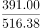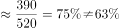，错误；

B项：定位材料第四段可得，2011年举办的训练班15万次，培训人次1232万人次。故平均每次培训人数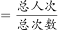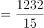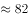人，小于90人，错误；

C项：定位材料第一段可得；2011年底全国共有乡镇综合文化站34139个；定位材料最后一段可得；2011年底共指导群众业余文艺团队总数154799支。则平均每个乡镇综合文化站指导业余文艺团队数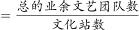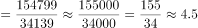，正确；

D项：定位材料第三段可得，2011年各级财政对乡镇综合文化站的财政拨款比起2006年的增幅为291.6%。则根据公式：倍数=1+增长率可得，2011年各级财政对乡镇综合文化站的财政拨款是2006年的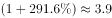倍，错误。

故正确答案为C。

**考点**：文字资料、综合分析

**来源**：2015年黑龙江省公务员录用考试《行测》题（公检法卷）第115题

## 材料 2

2010年人民法院审理婚姻家庭、继承一审案件收结案情况

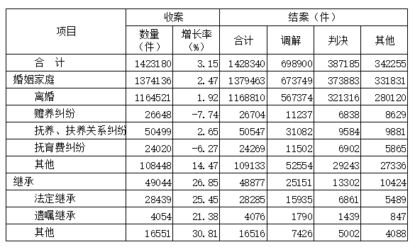

### 第 106 题

以下案件类型中，2010年收案数占当年婚姻家庭类案件总收案数比重比上年有所提升的是：

A. 离婚类案件

B. 赡养纠纷类案件

C. 抚养、扶养关系纠纷案件

D. 抚育费纠纷案件

第 106 题 · 答案与解析

**参考答案（粉笔题库参考内容）**

C

**解析**

根据题干“2010年······占······比重比上年······”,可判定本题为两期比重问题。定位表格材料收案增长率列可得：2010年婚姻家庭类案件总收案数增长率b=2.47%，离婚类案件增长率，赡养纠纷类案件增长率，抚养、扶养关系纠纷案件增长率，抚育费纠纷案件增长率。根据两期比重比较结论，当a＞b时，比重上升，只有C选项抚养、扶养关系纠纷案件。

故正确答案为C。

**考点**：两期比重、统计表

**来源**：2015年黑龙江省公务员录用考试《行测》题（公检法卷）第116题

### 第 107 题

2010年结案的婚姻家庭类案件中，以调解方式结案的比重比判决方式约高多少个百分点？

A. 11

B. 16

C. 22

D. 26

第 107 题 · 答案与解析

**参考答案（粉笔题库参考内容）**

C

**解析**

根据题干“2010年······比重比······高多少个百分点”，结合材料数据时间为2010年，可判定本题为现期比重问题。定位表格材料可得：2010年结案的婚姻家庭类案件数为1379463件，以调解方式结案数为673749件，以判决方式结案数为373883件。则以调解方式结案占2010年结案的婚姻家庭类案件的比重为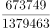，以判决方式结案占2010年结案的婚姻家庭类案件的比重为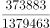。故以调解方式结案的比重比判决方式约高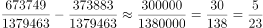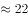个百分点。

故正确答案为C。

**考点**：现期比重、统计表

**来源**：2015年黑龙江省公务员录用考试《行测》题（公检法卷）第117题

### 第 108 题

2010年收到的法定继承案件比上年的增加了多少件？

A. 4535

B. 5769

C. 7238

D. 9022

第 108 题 · 答案与解析

**参考答案（粉笔题库参考内容）**

B

**解析**

根据题干所求“2010年收到的法定继承案件比上年的增加了多少件”，可判定本题为增长量计算问题。定位表格材料倒数第三行可得：2010年收到法定继承案件28439件，增长率为25.45%。根据增长量计算公式：增长量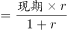可得，2010年收到的法定继承案件比上年的增加了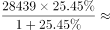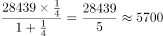件，与B项最接近。

故正确答案为B。

**考点**：增长量计算、统计表

**来源**：2015年黑龙江省公务员录用考试《行测》题（公检法卷）第118题

### 第 109 题

以下案件类型中，2010年以调解方式结案的案件占该类型总结案数的比重最高的是：

A. 抚养、扶养关系纠纷案件

B. 抚育费纠纷案件

C. 其他类婚姻家庭案件

D. 其他类继承案件

第 109 题 · 答案与解析

**参考答案（粉笔题库参考内容）**

A

**解析**

根据题干“2010年······占······比重最高的是······”，结合材料数据时间为2010年，可判定本题为现期比重问题。定位表格材料可得各选项占该类型总结案数的比重分别为：抚养、扶养关系纠纷案件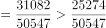，抚育费纠纷案件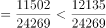，其他类婚姻家庭案件，其他类继承案件。

因此，比重最高的为抚养、扶养关系纠纷案件。

故正确答案为A。

**考点**：现期比重、统计表

**来源**：2015年黑龙江省公务员录用考试《行测》题（公检法卷）第119题

### 第 110 题

与其他类型案件相比，2010年遗嘱继承案件体现出什么样的特点？

A. 只有遗嘱继承案件的总结案数多于收案数

B. 只有遗嘱继承案件的收案数比上年有所上升

C. 只有遗嘱继承案件的调解案件数不足总结案数的40%

D. 只有遗嘱继承案件的已判决案件数超过总结案数的1/3

第 110 题 · 答案与解析

**参考答案（粉笔题库参考内容）**

D

**解析**

A 项：定位表格材料收案和结案数量合计列可得，除了遗嘱继承总结案数4076 多于收案数4054，抚育费纠纷总结案数24269 同样多于收案数24020，“只有”表示只有一个，表述不当，错误；

B 项：收案数比上年上升，即为收案数大于去年，因此只要增长率大于0 即可。定位表格材料收案列增长率一列可得，增长率大于0 的不止遗嘱继承案件一种，错误；

C 项：定位表格材料可得，遗嘱继承案件总结案数为4076件，调解案件数为1790件。故遗嘱继承案件的调解案件数占总结案数的比重为，比重超过40%，错误；

D 项：定位表格材料的判决和合计列，判断已判决案件数是否超过总结案数的1/3，只需比较各个指标判决案件数和的大小关系，可得只有遗嘱继承案件的已判决案件（1439）超过总结案数的，正确。

故正确答案为D。

**考点**：统计表、综合分析

**来源**：2015年黑龙江省公务员录用考试《行测》题（公检法卷）第120题

## 材料 3

2010年，我国医院总数为20918家，较上年增长627家，医院接待诊疗20.40亿人次，比上年增长1.18亿人次，综合医院接待诊疗人次占全部医院接待诊疗人次的74.1%，是位居第二的中医医院诊疗人次的4.6倍。

### 第 111 题

2007~2010年间，中医医院占医院总数比重同比下降最快的一年是：

A. 2007年

B. 2008年

C. 2009年

D. 2010年

第 111 题 · 答案与解析

**参考答案（粉笔题库参考内容）**

C

**解析**

由题干“比重同比······最快”可知为简单的加减计算题，比重的变化快慢直接作差比较即可。

定位表格材料可知，2007年中医医院占医院总数比重为13.7%，2006年比重为13.8%，2007年下降量为13.8%-13.7%=0.1%；

同理，2008年中医医院比重下降量为13.7%-13.6%=0.1%；

2009年中医医院比重下降量为13.6%-13.4%=0.2%；

2010年中医医院比重下降量为13.4%-13,3%=0.1%。

比较四个下降量，2009年最大，故下降最快的一年是2009年。

故正确答案为C。

**考点**：简单加减计算、综合资料

**来源**：2015年黑龙江省公务员录用考试《行测》题（公检法卷）第121题

### 第 112 题

与2009年相比，2010年我国约增加了多少家其他类医院？

A. 15

B. 54

C. 128

D. 627

第 112 题 · 答案与解析

**参考答案（粉笔题库参考内容）**

A

**解析**

根据题干所求“与2009年相比，2010年我国约增加了多少家其他类医院”，可判定本题为增长量计算问题。定位表格材料可得：2009年医院总数为20291家，其他类医院所占比重为2.4%；2010年医院总数为20918家，其他类医院所占比重为2.4%。故与2009年相比，2010年我国其他类医院约增加了20918×2.4%-20291×2.4%=(20918-20291)×2.4%家。

故正确答案为A。

**考点**：增长量计算、综合资料

**来源**：2015年黑龙江省公务员录用考试《行测》题（公检法卷）第122题

### 第 113 题

2010年，我国政府办的专科医院有多少家？

A. 1100

B. 1400

C. 1700

D. 2000

第 113 题 · 答案与解析

**参考答案（粉笔题库参考内容）**

B

**解析**

根据题干“2010年”“政府办的专科医院”等信息，定位表格材料可得：2010年医院总数为20918家，专科医院占医院总数的18.9%；定位图形材料可得：政府办专科医院占专科医院总数的35.6%。可判定本题为现期比重问题，故2010年我国政府办专科医院有家，与B项最接近。

故正确答案为B。

**考点**：现期比重、综合资料

**来源**：2015年黑龙江省公务员录用考试《行测》题（公检法卷）第123题

### 第 114 题

2010年，平均每家综合医院的接待诊疗者人次数约是中医医院的多少倍？

A. 0\. 94

B. 1\. 05

C. 1\. 16

D. 1\. 27

第 114 题 · 答案与解析

**参考答案（粉笔题库参考内容）**

A

**解析**

根据题干“2010年······是······的多少倍”，结合数据材料时间为2010年，可判定本题为现期倍数问题。定位文字资料可知，综合医院的接待诊疗人次是位居第二的中医医院诊疗人次的4.6倍，即；定位表格材料可知，2010年医院总数为20918家，综合医院占比为65.4%，综合医院数为20918×65.4%，中医医院占比为13.3%，中医医院数为20918×13.3%。根据题意列式：，与A项最接近。

故正确答案为A。

**考点**：现期倍数、综合资料

**来源**：2015年黑龙江省公务员录用考试《行测》题（公检法卷）第124题

### 第 115 题

能够从上述资料中推出的是：

A. 2006-2010年间，医院总数持续增加

B. 2009年全国医院共接待诊疗者21.58亿人次

C. 2010年的政府办医院中，一半以上是中医医院

D. 与2006年相比，2010年专科医院数增速高于综合医院

第 115 题 · 答案与解析

**参考答案（粉笔题库参考内容）**

D

**解析**

A项：定位表格材料可得，2008年医院总数19712小于2007年医院总数19852，所以2008年医院总数下降，错误；

B项：定位文字材料可得：2010年，我国医院接待诊疗者20.40亿人次，比上年增长1.18亿人次。故2009年接待诊疗者为（20.40-1.18）=19.22亿人次，错误；

C项：定位表格材料可得，医院总数为20918家，中医医院占比为13.3%；定位图形材料可得，政府办医院占医院总体的比重为46%，中医医院中政府办占比为81.2%。则政府办医院总数为20918×46%，中医医院中政府办医院数为20918×13.3%×81.2%。故2010年的政府办医院中，中医医院占比为，错误；

D项：定位表格材料可得，2006年和2010年医院总数以及综合医院和专科医院各自的占比，进而可以求出综合医院和专科医院在2006和2010年的数量。根据增长率=可得，增长率的比较只需比较大小即可。专科医院为，综合医院为，两个式子均含有，故只需比较和大小，前者大于1，后者小于1，正确。

故正确答案为D。

**考点**：综合分析、综合资料

**来源**：2015年黑龙江省公务员录用考试《行测》题（公检法卷）第125题

## 材料 4

### 第 116 题

2012年我国硕士研究生毕业生人数较上一年增长了多少万人？

A. 5.65

B. 5.50

C. 5.35

D. 5.20

第 116 题 · 答案与解析

**参考答案（粉笔题库参考内容）**

B

**解析**

根据“2012年······较上一年增长了多少万人”，可判定本题为增长量计算问题。定位表格中硕士研究生的毕业生人数，2011年为37.97万人，2012年为43.47万人，则增长量=现期量-基期量=43.47-37.97=5.5万人。

故正确答案为B。

**考点**：增长量计算、统计表

**来源**：2015年黑龙江省公务员录用考试《行测》题（边远地区卷）第116题

### 第 117 题

与上年相比，2012年普通本专科招生人数增长量约是研究生招生人数增长量的多少倍？

A. 2.5

B. 3

C. 3.5

D. 4

第 117 题 · 答案与解析

**参考答案（粉笔题库参考内容）**

A

**解析**

根据“2012年······约是······的多少倍”，可判定本题为现期倍数的计算问题。定位表格中招生人数，2011年普通本专科为681.50万人，2012年为688.83万人，2011年研究生为56.02万人，2012年为58.97万人，则有：倍。

故正确答案为A。

**考点**：现期倍数、统计表

**来源**：2015年黑龙江省公务员录用考试《行测》题（边远地区卷）第117题

### 第 118 题

2012年我国专科毕业生中，成人专科毕业生所占比重约为：

A. 14%

B. 20%

C. 26%

D. 32%

第 118 题 · 答案与解析

**参考答案（粉笔题库参考内容）**

C

**解析**

根据“2012年我国专科毕业生中，······所占比重······”，可判定本题为现期比重的计算问题。定位表格中毕业生人数，2012年普通专科320.89万人，成人专科115.33万人，则比重。

故正确答案为C。

**考点**：现期比重、统计表

**来源**：2015年黑龙江省公务员录用考试《行测》题（边远地区卷）第118题

### 第 119 题

2012年普通高等学校在校生规模增速最慢的是：

A. 普通专科

B. 普通本科

C. 硕士研究生

D. 博士研究生

第 119 题 · 答案与解析

**参考答案（粉笔题库参考内容）**

A

**解析**

根据“2012年普通高等学校在校生规模增速最慢······”，可判定本题为比较一般增长率大小的问题。定位表格中在校生人数，增速情况有：

普通专科：；

普通本科：；

硕士研究生：；

博士研究生：；

则2012年普通专科在校生规模增速最慢。

故正确答案为A。

**考点**：一般增长率、统计表

**来源**：2015年黑龙江省公务员录用考试《行测》题（边远地区卷）第119题

### 第 120 题

能够从上述资料中推出的是：

A. 2011年我国本科在校生人数低于专科在校生人数

B. 2012年我国普通本科的招生人数同比增速快于成人本科

C. 2011年我国博士毕业生占研究生毕业人数的比重超过一成

D. 2012年我国成人本专科在校生中，专科生占比超过六成

第 120 题 · 答案与解析

**参考答案（粉笔题库参考内容）**

C

**解析**

A项：定位表格，2011年我国本科在校生人数=普通本科在校生人数+成人本科在校生人数=1349.66+233.61=1583.27万人，专科在校生人数=普通专科在校生人数+成人专科在校生人数=958.85+313.88=1272.73万人，则2011年我国本科在校生人数高于专科在校生人数，错误；

B项：定位表格，2012年我国普通本科的招生人数同比增速为，成人本科的招生人数同比增速为，故2012年我国普通本科的招生人数同比增速低于成人本科，错误；

C项：定位表格，2011年我国博士毕业生人数5.03万人，研究生毕业人数43万人，比重，正确；

D项：定位表格，2012年我国成人本专科在校生583.11万人，其中专科生335.56万人，占比，错误。

故正确答案为C。

**考点**：统计表、综合分析

**来源**：2015年黑龙江省公务员录用考试《行测》题（边远地区卷）第120题

