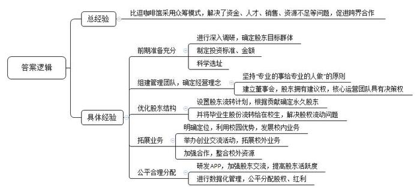
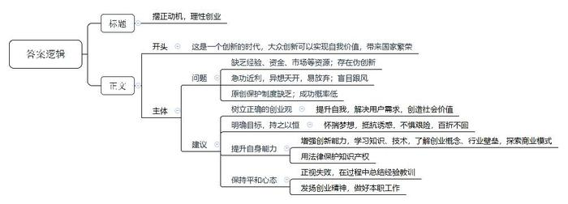
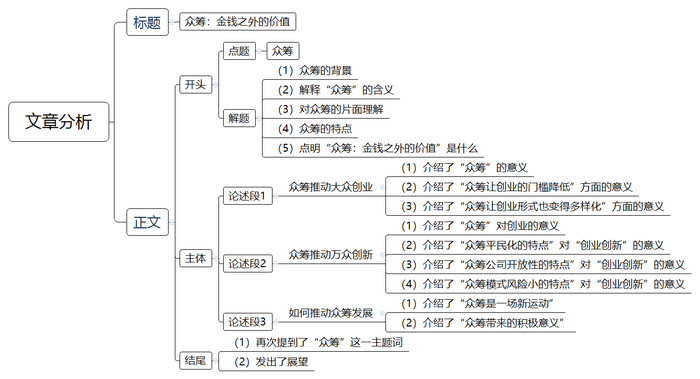

# 2016年公务员多省联考《申论》题（黑龙江A卷：省直）

> 候选采集稿。参考答案及解析来自粉笔页面，不代表官方答案或真实高分答卷；来源使用许可与原卷对应关系仍需人工核实。

## 给定材料

### 材料 material-cbf4dd9e6c718ae3

深圳的创业者乔峤想要做一款智能耳机，他发现，60%的人都会在跑步过程中听歌，并用手机APP记录运动数据。如果有产品能同时解决跑步人群运动数据记录和听歌的需求，又能通过音乐来实现运动激励，会有很好的市场前景。乔峤对记者说，他想针对每个人的身体特征，设计和提供有效的音乐服务产品，做到每一个硬件设备都是针对个人定制的。

可是，光有好点子还不行，初始创业的乔峤，面临既缺资金、又缺人才的尴尬，他尝试着用股权众筹的方式来实现自己的创业梦想。在众筹网上，他发布了自己的股权众筹商业计划书，以出让公司10%股份的方式，融资187万元，最低投资额1万元。最终，吸引了16名投资者参与。乔峤告诉记者，这些投资者为他引入了互联网、音乐、体育领域的强大资源，其中，几个最志同道合的投资人干脆直接加入了创业团队。

### 材料 material-bff55b8865b3d92c

在众多的创业者中还有这样一些与众不同的人，人们把他们的创业形式称之为社会创业。

年轻女孩小丁，为了解决残疾人和行动迟缓的老年人穿脱衣裤不便的问题，研发生产出了可拆卸的特制衣裤，并在这些特制衣裤上增加了加热、中药、磁极、按摩等辅助功能，患者试用后，好评如潮，目前产品已经投入市场。小丁还为此申请了专利，注册了有限责任公司。

行为心理学认为，人对任何付出都是希望能有所回报的。一直以来，我国公益项目对捐赠人的奖励多是精神奖励，捐赠人的心理难以得到很好的满足，限制了公益事业的发展。小韩和小张创立了“路人甲”公众小额捐赠平台。他们希望把鼓励捐赠行为实体化物质化，能用商业的手段，解决这个社会问题。“路人甲的惠捐模式”在中国是首创，即用户在捐赠10元后即可兑换―张答谢券，凭着这张答谢券可享受众多合作商家的超值优惠和在线服务。这样―来受助者得助，捐赠人有答谢，商家得客户，捐赠人、商业机构和公益项目（或受助人）三者之间形成一个非常好的公益的价值闭环，互惠共赢，同时也挖掘了优质捐款户背后的巨大价值。

人们把小丁、小韩、小张这样的创业者称为社会创业家。第二届芝华士“赢之有道”社会创业家大赛的评委们用自己独特的视角与丰富的经验表达了对这些人的理解。

著名经济学家A：我所理解的社会创业家是新一代企业家，他们通常受过良好的教育，承担社会责任，关注自然环境，拥有人文情怀，追求远景理想，他们以创新的商业模式拓展可持续增长路径，在为企业和社会创造财富的同时，也回应社会挑战，推进社会进步。作为评委，我关注参赛者的激情与智慧、理想与务实的平衡。

资深财经评论员B：社会资源的发展有两个终极目标，第一个是效率，第二个公平。普通的创业者一般的商业诉求是解决效率问题，并且通过提高效率来获得商业上利润的诉求，但是人类社会缺的另外一个目标就是公平。有的时候效率和公平之间是有矛盾的，社会创业家就是兼顾效率和公平的这样一批创业者，他们和一般创业者最大的区别就是他们更多强调的是公平。对于整个社会资源分配当中的一些处于弱势的群体，通过商业的行为、商业的链条架构来提升他们的地位，我觉得这是社会创业家与一般创业者最大的不同。

技术创业投资基金合伙人C：首先我不认为哪个企业家是和社会脱离关系的。他们不论是提供产品还是提供服务，哪种方式都或多或少对社会产生了影响或创造了价值。如果有的创业家所做的事情是完全公益的，那么我佩服他。但是在毫不盈利的前提下，我并不建议这样做。

风险投资人D：社会创业家创业的第一动机更多是想实现“改变世界或改变社会”的目的，跟“发明者”和“追梦者”类似，不是以传统利润模式导向而是出于更高一层的梦想和驱动创业。这些创业者会比一般创业者对自己的产品、服务或项目设的禁区更多，但也比一般创业者对自己的梦想有着更超乎一般的执着和理念。用自己的优势结合梦想找到一个更有颠覆性的产品和思路是很重要的。

甘客科技创始人E：社会创业者就是创业者中的NGO（非政府组织）。他们创业是源于为特定群体、社会创造更大的价值。因此，他们的责任感、使命感更强，更有社会情怀，而非简单地追求个人财富的积累。这是创业的新型价值体系，更具有社会公益意义。

### 材料 material-76f20198712e3515

在某大学生创业大赛现场，5名女孩准备筹集40万元资金，到武汉近郊去承包50亩地，种植有机蔬菜。台上陈述的女孩充满激情和自信，台下观众也不时报以阵阵掌声。当评委问到“你们种过蔬菜吗？”“你们的创业资金从哪里来？”“农民凭什么把土地转包给你们？”“你们种出来的有机蔬菜准备卖给谁？”等问题时，她们的回答却难以令人满意。如今，创业已经成为青年人口中的高频词语，对大学生而言，创业正在变得“简单”，曾经的理想似乎也触手可及。

机械专业硕士小杨，进入杭州一家民营企业从事技术工作不满半年。因没有期待中的高薪，没有理想中的激情，他开始琢磨创业。此后，他每天都在与人交谈，项目、资金、人脉、经验等问题弄得他头疼，深感创业之艰的他最终放弃了创业梦。

某投资基金首席合伙人阎先生拥有20多年投资经历，曾位列《福布斯》中国年度最佳创业投资人榜首。他参与过投资的企业包括完美世界、环球雅思、凡客、分众传媒、百度、阿里巴巴、巨人网络等著名企业。在阎先生看来，当创业成了一种“时尚”和“运动”时，多数人都急功近利地把创业当成了投机行为。他说，“从时下来看，创业的动机大多是源自对财富和名声的渴望。”

某著名网站策略营销总监范女士认为，赚钱是创业的应有之意，但更多成功的创业者却是从想要赚钱开始，“继而”解决了用户需求，是在解决用户需求、创造社会价值这条路上不断自我追问、探寻并最终走向成功之地的。如果仅仅停留在“为了赚钱”上是赚不到钱的。星巴克CEO舒尔茨曾说：为钱创业是肤浅的，应为梦想所驱动。在创业路上有太多诱惑，也有太多艰险，只有怀揣理想的人才能够抵抗诱惑，才能够不惧艰险，朝着自己的目标前行，百折而不回。诺奖得主菲尔普斯在《大繁荣》中指出：大多数创新并非是亨利·福特类型的孤独的梦想家带来的，而是由千百万普通人共同推动，他们有自由的权利去构思、开发和推广新产品与新工艺，或对现状进行改进。正是这种大众参与的创新带来了普通民众的繁荣兴盛——物质条件的改善加上广义的“美好生活”。大众创新带来了国家繁荣。

某公司创始人卢先生在接受记者采访时说，目前创业氛围很好，但创业却也成为一种时尚，仿佛不去创业就是落伍了。创业项目的选择部分属于异想天开型的，部分属于复制型的。而现实需要创新型、技术型的项目，那些通过移动互联网，把原有的商业模式去中间化，搞流量，然后再找商业模式，这样的创新都是伪创新。仅怀着一腔热血，就幻想着自己只要去创业就能成为下一个马云，而对创业的概念，对行业隐形的壁垒和门槛却知之甚少，这是许多大学生创业伊始的真实写照。在国内的互联网创业环境中，有一个特别不好的特性就是抄袭成风。很多创业者往往有一个好的创意，但却因为没有好的原创保护制度来保护，导致被其他一些公司抄袭过去，这些公司凭借着更雄厚的资本实力，迅速把原创者打败并挤出市场。

领英中国区总裁在日前的一次公开演讲中，用自身经验阐述了关于创业的两个公理：第一，创业成功是一个小概率的事件，每一个成功故事背后更多是失败；第二，创业没有失败者。即使是创业项目失败，作为创业者而言，过程中积累的经验将促进个人成长，即可定义为成功者。他认为，创业是没有失败者的历程。

ZUK联合创始人陈先生同样表达了对年轻人创业的观点。陈先生说：“创业是一件很复杂的事情，其实做好每一件事情就是创业。”

### 材料 material-6eae1f2636ce3967

在北京西北部一栋办公楼冷飕飕的地下室里，一群想要成为企业家的人正聚集在计算机屏幕前，注视着他们最新的项目雏形。而在几公里之外，在一个暖意融融、装修更为豪华的地下演讲厅里，30多名经理和创业者也在讨论有关新产品和新公司的创意。这两群人都验证着中国社会对创业热潮日益增长的兴趣。英语在线教学服务“英语流利说”创始人王某表示：“初创是令人迷恋的新事物。”“中国的创业精神呈现一种上升趋势。顶级风投公司正在寻找年轻的创业者——整套生态系统逐步形成。”

据不完全统计，从2013年5月至今中央层面已经出台至少22份相关文件促进创业创新。各地方政府也纷纷出台政策，简政放权，从财税、金融、保障服务、政策激励等方面支持创新型企业特别是创新型小微企业发展，使各种创新资源向企业集聚，让更多金融产品和服务对接创新需求，用创新的翅膀使中国企业飞向新高度。2015年10月19日，在全国大众创业万众创新活动周启动仪式上，李克强总理被现场热烈气氛所感染而登台发表即席演讲，称“要为创新创业者站台”。李克强总理指出，大企业员工和草根创业者通过创新创业都可以成为更多财富的创造者和拥有者。这既是收入分配结构调整的重要内容，也促进了社会公平正义。双创为所有人提供了公平竞争的机会，让有能力的人通过自身奋斗获得上升通道。

## 题目

### 第 1 题

**假定你是有关部门的一名工作人员，准备将“比逗咖啡馆”的创业经验向广大学生进行推介。请根据给定资料**4**\-**6**，归纳总结“比逗咖啡馆”的主要成功经验。（20分）**

关联材料：material-cbf4dd9e6c718ae3

作答要求：

要求：

（1）内容准确全面，总结有深度、有条理。

（2）字数不超过300字。

### 第 2 题

**给定资料**7**提到了“社会创业”和“社会创业家”两个概念，请你根据给定资料指出：**

**（1）“社会创业”的主要内涵；**

**（2）“社会创业家”的主要特点。（15分）**

关联材料：material-bff55b8865b3d92c

作答要求：

要求：

（1）分析透彻、表达准确；

（2）不超过200字。

### 第 3 题

**假如你是某大学就业指导中心的工作人员，受邀为即将毕业的大学生做一次关于“创业”的专题报告，请你结合给定资料**3**，为其草拟一份讲话稿。（25分）**

关联材料：material-76f20198712e3515

作答要求：

要求：

（1）写出主要内容即可，不需要成文；

（2）观点明确，建议可行，语言简洁，有逻辑性；

（3）不超过300字。

### 第 4 题

**参考给定资料，结合当前政府推动“大众创业，万众创新”的社会形势，以“众筹：金钱之外的价值”为题，自选角度，写一篇议论文。（40分）**

关联材料：material-6eae1f2636ce3967

作答要求：

要求：

（1） 观点明确，认识深刻；

（2） 内容充实，结构完整；

（3） 逻辑清晰，语言流畅；

（4） 字数不少于1100字。

## 答案与解析

第 1 题

**参考答案（粉笔题库参考内容）**

比逗咖啡馆采用众筹模式，解决了资金、人才、销售、资源不足等问题，促进跨界合作。其成功的主要经验有：

1.前期准备充分。进行深入调研，确定股东目标群体，制定投资标准、金额，科学选址。

2.组建管理团队，确定经营理念。坚持“专业的事给专业的人做”的原则；建立董事会，股东拥有建议权，核心运营团队具有决策权。

3.优化股东结构。设置股东流转计划，根据贡献确定永久股东；并将毕业生股份流转给在校生，解决股权流动问题。

4.拓展业务。明确定位，利用校园优势，发展校内业务；举办创业交流活动，拓展校外业务；加强合作，整合校外资源。

5.公平合理分配。研发APP，加强股东交流，提高股东活跃度；进行数据化管理，公平分配股权、红利。

**解析**

**参考答案说明**：本答案以总分结构总结了“比逗咖啡馆”的成功经验。首先对“比逗咖啡馆”的成功经验进行了整体说明；接着从“前期准备”“团队建设与经营理念”“股东流转”“拓展业务”“公平分配”这几个方面进行了具体介绍。各条要点之间彼此独立，互不交叉，每条具体经验还提炼出了概括性较强的总括词前置。

**考点**：考点经验启示类

**来源**：来源2016年公务员多省联考《申论》题（黑龙江A卷：省直）

第 2 题

**参考答案（粉笔题库参考内容）**

社会创业是一种为特定群体和社会创造更大价值，采用商业模式，关注社会需要的创业行为。

社会创业家特点：一、受过良好教育，承担社会责任，关注自然环境，拥有人文情怀，追求远景理想；以创新的商业模式拓展可持续增长路径。二、兼顾效率与公平，更强调公平。通过商业行为、商业链条架构提升弱势群体的地位。三、更执着于“改变世界或改变社会”的梦想，对产品、服务或项目设置更多禁区。四、更有使命感、社会情怀，更具公益性。

**解析**

**参考答案说明**：本参考答案宏观上分成“内涵”与“特点”两个要素。在“内涵”内部，用“一种……创业行为”的句式解释了“社会创业”。在“特点”内部，又从“良好教育”“兼顾效率与公平”“执着梦想”“有使命感”等不同的方面进行了分条撰写。各条要点之间在内容上相互并列，没有交叉。

**考点**：考点多要素组合类

**来源**：来源2016年公务员多省联考《申论》题（黑龙江A卷：省直）

粉笔申论页面对本题只提供「解析视频」入口，该入口是会员推广位，页面无视频地址与文字解析。

第 3 题

**参考答案（粉笔题库参考内容）**

摆正动机，理性创业

这是一个创新的时代，大众创新可以实现自我价值，带来国家繁荣。

但依然存在问题：一、缺乏经验、资金、市场等资源；存在伪创新。二、急功近利，异想天开，易放弃；盲目跟风。三、原创保护制度缺乏；成功概率低。

我们大学生应该做到：一、树立正确的创业观。提升自我，解决用户需求，创造社会价值。二、明确目标，持之以恒。怀揣梦想，抵抗诱惑，不惧艰险，百折不回。三、提升自身能力。增强创新能力，学习知识、技术，了解创业概念、行业壁垒，探索商业模式；用法律保护知识产权。四、保持平和心态。正视失败，在过程中总结经验教训；发扬创业精神，做好本职工作。

**解析**

**参考答案说明：**（1）格式方面，本参考答案写到了“标题”“正文”。（2）正文部分，一方面从内容来看，围绕着“理性创业”这一主题，本参考答案的开头先写到了“理性创业”的意义；主体部分指出了创业存在的问题，并从“树立正确的创业观”“明确目标，持之以恒”“提升自身能力”“保持平和心态”四个方面给出了“理性创业”的建议。另一方面，形式上，本参考答案做到了分条撰写，整体上条理较为清晰。（3）本参考答案能够结合题目中“简洁”“有逻辑性”等要求，在语言表达上做到了简洁，段落及句子之间的衔接自然。

**考点**：考点总结类

**来源**：来源2016年公务员多省联考《申论》题（黑龙江A卷：省直）

第 4 题

**参考答案（粉笔题库参考内容）**

**众筹：金钱之外的价值**

在“大众创业，万众创新”的时代精神的感召下，**众****筹**——一种公开向不特定的群众募资的新型商业模式诞生了。在一些人看来，众筹不就是大家筹钱吗？这种对众筹的理解是片面的，没有看到众筹超越金钱之外的价值。

除了能快速募集资金，众筹模式还具有门槛低、多样性、开放性、依靠大众、注重创新等特点。**这种新模式带来不仅仅是金钱，而是机会、梦想、平台；是新思路，新模式，新视野；是更加公平正义、更和谐的社会关系。**

**众筹筹的不仅是钱，更是机会、平等和梦想。众筹是****“大众创业”的驱动力，它让创业变得大众化、平民化、机会平等化，它让每个普通人都有机会实现“梦想”，让广大人民群众都有参与创业、分享创业成果的机会，从而有效调节收入分配结构，促进社会公平正义。**在众筹模式没有大规模兴起之前，创业是少部分“专业”人士的特权，只有要么自身资金雄厚要么拿到专业投资机构的钱，才有资格创业。众筹的兴起，就是把这种“特权”变为“普权”，你不需要有钱，只需要有能力和梦想，能获得大家的信任，大家就愿意支持你创业，创业的门槛大大降低。**与此同时**，创业形式也变得多样化，创业不必再自己经营企业，而是可以通过投入资金、技术、智慧、人脉等多种形式参与，这使得参与创业的机会触手可及。众筹不仅降低了创业的门槛，化解了创业风险，整合了社会资源，还让人民群众共享创业的时代红利。

**众筹对创业的支持主要体现在对****“万众创新”的有效支持上。**对创业的驱动，主要不是体现在金钱上，而是体现在创新上。众筹让创业变为靠创新驱动，而不再靠资金、政策、资源等传统的要素驱动。

**首先，众筹的平民化决定了众筹依靠创新驱动**。众筹驱动的创新和以往的专业化、精英化路线不同，是一种“万众创新”的人民创新路线。相对于筹资，众筹筹集的更多是智慧、梦想、信任。参与众筹者，很多都是工薪阶层，是草根。他们资金有限，但智慧无穷。这种模式会倒逼众筹的企业用更集约、更省钱、更高效、更智慧的方式，来驱动企业发展。**其次，众筹公司结构的开放性有利于企业保持持续创新。**以“一八九八咖啡馆”为例，其股东不仅人数众多，还包括各种不同行业、年龄、专业的人，而这些人既是公司股东又是生产者、消费者，他们会不断给公司带来新资源、新思想，从而避免企业走向单一、呆板、僵化。**最后，众筹模式风险低、压力小，为创新营造了宽松的环境。**众筹解放了创业者，让创业者不需要赌上身家性命去创业，从而使创业者敢于创新。众筹的开放性使企业人才更加多样化，创业者无须成为全才通才，从而可以更加专注于自己的领域深入思考，更容易出创新成果。

**众筹既需要群众智慧，也离不开党和政府的正确引导，还需要政策和法律的保驾护航。**它是一场在党和政府领导下的发动人民、依靠人民、组织人民的新经济运动，是我党群众路线在经济领域的新体现。金钱是众筹的基本要素，但众筹绝不仅仅意味着金钱。它让人民有更多的机会，使社会分配更加公平，让经济发展更有活力；它是“大众创业”的根据地，是“万众创新”的发动机。

我们有理由相信，在党和国家的号召下，在广大人民群众的努力下，在良好社会环境的孕育下，众筹一定能筹出一个更加开放、平等、自由、公平、正义的新世界。

**解析**

**文章分析**

**众筹：金钱之外的价值**

【**标题的优点：**严格按照题目的要求，以“众筹：金钱之外的价值”为标题。】

（1）在“大众创业，万众创新”的时代精神的感召下，（2）**众筹**——一种公开向不特定的群众募资的新型商业模式诞生了。（3）在一些人看来，众筹不就是大家筹钱吗？这种对众筹的理解是片面的，没有看到众筹超越金钱之外的价值。

（4）除了能快速募集资金，众筹模式还具有门槛低、多样性、开放性、依靠大众、注重创新等特点。（5）**这种新模式带来不仅仅是金钱，而**是机会、梦想、平台**；**是新思路，新模式，新视野**；**是更加公平正义、更和谐的社会关系**。**

【**开头的优点：**★内容方面：范文的开头是紧扣题目给定的“众筹：金钱之外的价值”这一标题展开的。首先，开头第一句话点出主题，做到了主题明确。其次，对“众筹：金钱之外的价值”这一主题进行了分析阐述，指出了（1）“众筹”的背景；（2）“众筹”的含义；（3）对众筹的片面理解；（4）众筹的特点；（5）“众筹：金钱之外的价值”是什么。注意以上5个方面的阐述在逻辑上有先后顺序：先写“背景”“含义”，再写“问题”，最后再说明“特点”“价值”。★文字表达方面：排比、反问的修辞手法，使文字表达更加形象、有力。】

**众筹筹的不仅是钱，更是机会、平等和梦想。**（1）**众筹是****“大众创业”的驱动力****，它让****创业变得大众化、平民化、机会平等化****，它让每个****普通人都有机会实现****“梦想”****，让广大****人民群众都有参与创业、分享创业成果的机会****，从而****有效调节收入分配结构****，****促进社会公平正义**。（2）在众筹模式没有大规模兴起之前，创业是少部分“专业”人士的特权，只有要么自身资金雄厚要么拿到专业投资机构的钱，才有资格创业。众筹的兴起，就是把这种“特权”变为“普权”，你不需要有钱，只需要有能力和梦想，能获得大家的信任，大家就愿意支持你创业，创业的门槛大大降低。（3）与此同时，创业形式也变得多样化，创业不必再自己经营企业，而是可以通过投入资金、技术、智慧、人脉等多种形式参与，这使得参与创业的机会触手可及。众筹不仅降低了创业的门槛，化解了创业风险，整合了社会资源，还让人民群众共享创业的时代红利。

【**论述段****1的优点：**★观点句：范文的观点句是紧扣“众筹：金钱之外的价值”这一文章主题提出的。形式上，它在段首处直接写出，位置突出，容易发现。内容上，关键词突出，内容要点明确，可以明显看出它是从“众筹对创业的积极意义”入手，指出了“众筹是‘大众创业’的驱动力”。★论述内容：（1）介绍了“众筹”的意义；（2）介绍了“众筹让创业的门槛降低”方面的意义；（3）介绍了“众筹让创业形式也变得多样化”方面的意义。注意：以上几个方面的内容都是紧扣“众筹是‘大众创业’的驱动力，它让创业变得大众化、平民化、机会平等化”这个观点句进行分析论述的，论述的针对性强，内容层次丰富。最后，在论述方法主要是讲道理，做到了丰富有力。】

**众筹对创业的支持主要体现在对****“万众创新”的有效支持上。**对创业的驱动，主要不是体现在金钱上，而是体现在创新上。（1）众筹让创业变为靠创新驱动，而不再靠资金、政策、资源等传统的要素驱动。

（2）**首先，****众筹的平民化决定了众筹依靠创新驱动**。众筹驱动的创新和以往的专业化、精英化路线不同，是一种“万众创新”的人民创新路线。相对于筹资，众筹筹集的更多是智慧、梦想、信任。参与众筹者，很多都是工薪阶层，是草根。他们资金有限，但智慧无穷。这种模式会倒逼众筹的企业用更集约、更省钱、更高效、更智慧的方式，来驱动企业发展。（3）**其次，众筹公司结构的开放性有利于企业保持持续创新。**以“一八九八咖啡馆”为例，其股东不仅人数众多，还包括各种不同行业、年龄、专业的人，而这些人既是公司股东又是生产者、消费者，他们会不断给公司带来新资源、新思想，从而避免企业走向单一、呆板、僵化。（4）**最后，众筹模式风险低、压力小，为创新营造了宽松的环境。**众筹解放了创业者，让创业者不需要赌上身家性命去创业，从而使创业者敢于创新。众筹的开放性使企业人才更加多样化，创业者无须成为全才通才，从而可以更加专注于自己的领域深入思考，更容易出创新成果。

【**论述段****2的优点：**★观点句：范文的观点句是紧扣“众筹：金钱之外的价值”这一文章主题提出的。形式上，它在段首处直接写出，位置突出，容易发现。内容上，关键词突出，内容要点明确，可以明显看出它是从“众筹对创新的积极意义”入手，指出了“众筹对创业的支持主要体现在对‘万众创新’的有效支持上”。★论述内容：（1）介绍了“众筹”对创业的意义；（2）介绍了“众筹平民化的特点”对“创业创新”的意义；（3）介绍了“众筹公司开放性的特点”对“创业创新”的意义；（4）介绍了“众筹模式风险小的特点”对“创业创新”的意义。注意：以上几个方面的内容都是紧扣“众筹对创业的支持主要体现在对‘万众创新’的有效支持上”这个观点句进行分析论述的，论述的针对性强，内容层次丰富。并且这几个方面的论述是有内在逻辑顺序的，先讲“众筹众筹对创业的意义”，然后讲“众筹的平民化、众筹公司的开放性、众筹模式的风险小等特点对创业的意义”。在论述方法的选取上，本段主要采取了讲道理的方式进行论证，在论述的时候做到了层次多样，内容丰富。】

**众筹既需要群众智慧，也离不开党和政府的正确引导，还需要政策和法律的保驾护航。**（1）它是一场在党和政府领导下的发动人民、依靠人民、组织人民的新经济运动，是我党群众路线在经济领域的新体现。金钱是众筹的基本要素，但众筹绝不仅仅意味着金钱。（2）它让人民有更多的机会，使社会分配更加公平，让经济发展更有活力；它是“大众创业”的根据地，是“万众创新”的发动机。

【**论述段****3的优点：**★观点句：范文的观点句是紧扣“众筹：金钱之外的价值”这一文章主题提出的。内容上，关键词突出，内容要点明确，可以明显看出它是从“如何发挥众筹的价值”入手，指出了“众筹既需要群众智慧，也离不开党和政府的正确引导和政策保障”。★论述内容：（1）介绍了“众筹是一场新运动”；（2）介绍了“众筹带来的积极意义”。注意：以上几个方面的内容都是紧扣“众筹既需要群众智慧，也离不开党和政府的正确引导，还需要政策和法律的保驾护航”这个观点句进行分析论述的，论述的针对性强，内容层次丰富。最后，在论述方法的选取上，本段主要采取了讲道理的方式进行论证，在论述的时候做到了层次多样，内容丰富。】

【**论述段之间的关系**：★内容的内在逻辑：范文的论述段之间是依照“意义-对策”的逻辑展开的。论述观点1、2先写了“众筹是‘大众创业’的驱动力”“众筹对创业的支持主要体现在对‘万众创新’的有效支持上”，论述观点3再写了“众筹既需要群众智慧，也离不开党和政府的正确引导，还需要政策和法律的保驾护航”。】

我们有理由相信，在党和国家的号召下，在广大人民群众的努力下，在良好社会环境的孕育下，众筹一定能筹出一个更加开放、平等、自由、公平、正义的新世界。

【**结尾的优点**：范文的结尾回扣了“众筹：金钱之外的价值”这一主题。（1）再次提到了“众筹”这一主题词。（2）发出了展望。】

**参考答案二：**

**众筹：金钱之外的价值**

张小龙

在“大众创业，万众创新”的时代精神的感召下，**众筹****——一种公开向不特定的群众募资的新型商业模式诞生了**。在一些人看来，众筹不过就是大家筹钱吗？这种是对众筹片面的理解，没有看到众筹超越金钱之外的价值。除了能快速募集资金，众筹模式还具有门槛低、多样性、开放性、依靠大众、注重创新等特点，它带来的价值不仅仅是金钱，还是机会、梦想、平台；是新思路，新模式，新视野；是更加公平正义，更和谐的社会关系。**众筹筹的不仅是钱，而是机会、平等和梦想。**

众筹是“大众创业”的驱动力，它**让创业变得大众化、平民化、机会平等化。**众筹**让每个普通人都有机会实现****“梦想”**，**让广大人民群众都有参与创业的机会，分享创业成果**，从而**有效调节收入分配结构，促进社会公平正义**。在众筹模式没有大规模兴起之前，创业是少部分“专业”人士的特权，只有要么自身资金雄厚要么拿到专业投资机构的钱，才有资格创业。众筹的兴起，就是把这种“特权”变为“普权”，你不需要有钱，只需要有能力、梦想，能获得大家信任，大家就愿意支持你创业，**创业的门槛大大降低**。与此同时，**创业形式也变得多样化**，创业不必再自己成立经营企业，可以通过投入资金、技术、智慧、人脉等多种形式参与，这使得参与创业的机会触手可及。众筹不仅降低了创业的门槛，化解了创业风险，整合社会资源，还让大家共享创业收益，让人民群众也能共享创业的时代红利。

**众筹对创业支持主要体现在众筹对****“万众创新”的有效支持上**。众筹对创业驱动，主要不体现在金钱上，而是体现在创新上。众筹让创业变得靠创新驱动，而不是靠资金、政策、资源等传统的要素驱动。

**首先，众筹的平民化决定了众筹依靠创新驱动。**众筹驱动的创新和以往的专业化、精英化路线不同，是一种“万众创新”的人民创新路线。比起筹资来说，众筹筹集的更多是智慧、梦想、信任。参与众筹者，很多都是工薪阶层，是草根。他们资金有限，但智慧无穷。这种模式会倒逼着众筹的企业用更集约，更省钱，更高效，更智慧的方式，来驱动企业发展。

**其次，众筹公司结构的开放性有利于企业保持持续创新。**以“一八九八咖啡馆”为例，其股东不仅人数众多，其中还包括各种不同行业、年龄、专业的人，而这些人既是公司股东又是生产者消费者，他们会不断给公司带来新资源、新思想，避免企业走向单一呆板僵化。

**再次，众筹模式的风险低、压力小为创新营造了宽松的环境。**众筹解放了创业者，让我们不需要堵上身家性命去创业，从而使创业者敢于创新。众筹的开放性使企业人才更加多样化，无需创业者成为全才通才，可以更加专注于自己领域深入思考，更容易出创新成果。

金钱是众筹的基本要素，但众筹的价值绝不仅仅意味着金钱，它让人民有更多的机会，使社会分配更加公平，让经济发展更有活力，它是“大众创业”的根据地，是“万众创新”的发动机。它是一场在党和政府领导下的发动人民、依靠人民、组织人民的众筹运动，是我党群众路线在经济领域的新体现。众筹既需要群众智慧，也离不开党和政府的正确引导，还需要政策和法律保驾护航。我们有理由相信，在党和国家的号召下，在广大人民群众的努力下，在良好的社会环境的孕育下，众筹一定能筹出一个更加开放、平等、自由、公平、正义的新世界！

**考点**：考点文章写作题

**来源**：来源2016年公务员多省联考《申论》题（黑龙江A卷：省直）

