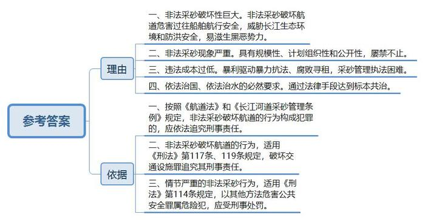
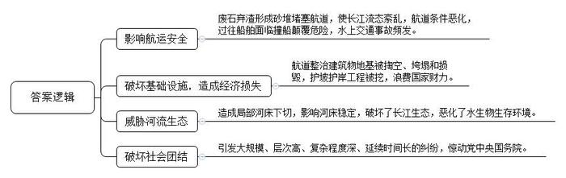
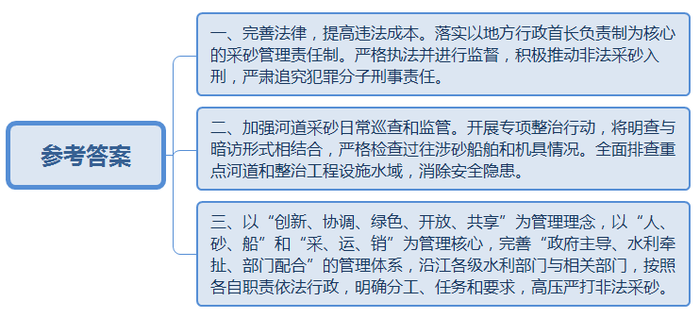
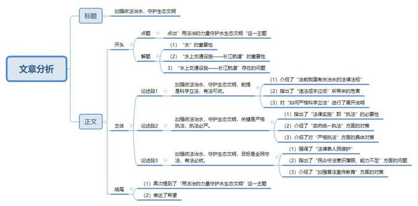

# 2016年公务员多省联考《申论》题（黑龙江B卷：公检法）

<!-- gwy:overview:start -->
> **黑龙江 · 2016 · 申论 · B类** ｜ 4 题 · 图片 4 处 · 答案随题折叠

导航：[题目](#题目) · [材料 1](#材料-1)
<!-- gwy:overview:end -->

> 候选采集稿。参考答案及解析来自粉笔页面，不代表官方答案或真实高分答卷；来源使用许可与原卷对应关系仍需人工核实。

## 给定材料

### 材料 1

为贯彻落实党的十八届三中、四中、五中全会精神，保障长江经济带发展战略决策顺利实施，2015年11月2日至7日，水利部、交通运输部联合派出检查组，对长江水利委员会、长江航务管理局和江苏、安徽、江西、湖北、湖南等5省长江河道采砂管理情况开展了专项检查。

检查组先后到达南京、芜湖、九江、黄冈、武汉、岳阳等6市。在南京，查看了江苏省南京板桥基地、综合执法平台，乘船巡查南京市水域；在芜湖，查看了芜湖市采砂管理基地，乘船巡查芜湖市水域；在九江，查看了九江市综合执法基地、砂场整治现场、砂石集散中心、庐山区拆解采砂船现场；在黄冈，查看了浠水县执法基地，乘船巡查戴家洲水域；在武汉，乘执法船巡查长江二桥至白沙洲水域；在岳阳，查看了岳阳市采砂管理实时监控系统。每到一处，检查组现场查阅各地采砂管理日常巡查、值班记录、执法案卷等文件资料。检查组还与长江水利委员会、长江航务管理局，各省水利厅和相关市人民政府及其水行政主管部门，以及长江海事、航道、公安等部门进行了座谈。

检查组认为，一年来，在长江中下游相关地方人民政府的重视下，各级水行政主管部门与长江海事、航道、公安等相关部门密切配合，按照各自职责依法行政，严厉打击非法采砂，共同维护了长江河势稳定、保障了防洪和通航安全。目前，长江河道采砂秩序总体可控，为长江经济带发展战略决策的顺利实施提供了有力保障。

检查组强调，长江河道采砂管理面临的形势依然严峻，采砂管理工作已经步入深水区，需要以创新的思维逐步破解困扰采砂管理工作的各种难题。

检查组要求沿江各地及相关部门，进一步提高对采砂管理工作重要性、敏感性、复杂性、艰巨性和长期性的认识，认真落实以地方行政首长负责制为核心的采砂管理责任制。

### 材料 2

长期以来，长江河道内非法采砂、乱采滥挖的情况十分严重。偷采现象时有发生，执法成本和难度加大，暴力执法也经常发生。

2009年10月16日晚至17日上午，湖北省水利厅对长江河道蕲春县蕲河段、武穴段进行了暗访检查，暗访组发现30多艘小型采砂船扎堆采砂作业。

16日21：15，在“鄂江左112”江堤，该江域中心灯火通明，机声隆隆，一片繁忙作业景象，约30多艘小型采砂船正在采砂作业。该作业水域离黄同砂管基地不足1公里。22:00，一艘小艇驶近，在采砂聚集水域的上游观望。22:20，小艇向采砂船靠近。22:27，陆续有采砂船熄灯并往下游撤离。22:40左右，该水域的采砂船全部撤离。23:00，在上述水域下游约4公里处，撤离的部分小型采砂船正在往左岸停靠。次日0:10，又有7、8艘船陆续在此停靠。17日9:45，在“鄂江左83+400”处，暗访组发现武穴龙王庙水域有一艘双链斗大型采砂船正从下游往上游航行，其后有7艘2000吨级空船机随行，伺机偷采作业。从这次检查发现的问题来看，偷采现象严重，主要体现三个特点：一是具有规模性。30多艘小型采砂船聚集偷采，且有大型“吸砂王”在江上出现，伺机偷采。二是具有计划组织性。无论从30多艘小型采砂船聚集偷采和20分钟时间内全部撤离，还是从大型“吸砂王”引领7艘空船机来看，都表明了偷采具有周密的计划性和组织性。三是具有公开性，30多艘采砂船在砂管执法基地的视野范围内聚集开采，一致开灯，可谓明目张胆，不算“偷采”。

2010年4月27日至29日，湖北省水利厅暗访组对汉江河道采砂管理情况进行了巡查暗访，发现汉江河道非法采砂现象正在反弹。数百艘采砂船舶正在进行非法采砂活动，其中荆门境内有443艘（钟祥市220艘，沙洋县223艘）。当时，湖北正进入汛期，大规模的非法采砂活动不仅扰乱了河道采砂管理秩序，而且威胁着河势稳定和防洪安全。情急之下，省水利厅立即向荆门市水利局发出紧急通报，要求联合海事、公安等部门迅速开展专项整治行动，严厉打击非法采砂行为。

2013年5月13日，太阳刚落，长江中游戴家洲右方江面驶入20多艘外表斑驳的小船，它们船头连船尾，沿岸一字排开。

随着机器轰鸣，小船正面的吸砂泵开始工作，船面上，碗口粗的管道全力抽砂。江中百余艘运砂船排起长队，前船装满开走，后船补上，这种集体非法采砂场面绵延数百米。5月14日凌晨2点，采砂船增至30余艘。一些过路船，由于辨不清哪是航标灯，哪是采砂船桅灯，担心走错航道，只好暂且抛锚，天亮再行。

在谈及长江非法采砂情况时，长江航道局工程建设指挥部人员田某深表担忧，“戴家洲这一段正在实施汛后护坡、护岸工程，非法采砂迟早会挖空坡岸下方的基础。”

在非可采区采砂还会改变长江流道，造成航道江水分流、航槽淤积、航道变浅。长江航道局执法人员称，泸州到宜宾维护航道深度为3.0米，5月份计划达到3.2米，目前，不少江段只有2.7米，“继续非法采砂，很难维持通航标准”。

在戴家洲，大部分运砂船严重超载，江水几乎要漫过船帮，长江各段都有砂船因超载而断裂、沉没。“非法采砂船因身份非法，海损、人员伤亡事故多数私了，很难统计。”

非法采砂之所以屡禁不止，暴利是关键。今年3月，质量最好的洞庭湖黄砂每吨均价45元，同比上涨30%，长江中游江砂价格月月涨，均价超过15元。小型吸砂船1小时采砂500吨至600吨，按一晚偷采10小时，计5000吨来算，一晚毛利超过7万元，“‘吸砂王’船，一晚上能采上万吨”。

目前，管理长江采砂的法规《长江河道采砂管理条例》规定，非法采砂情节严重者，罚款10万元至30万元，拆除采砂机具。外地籍非法移动采砂船只，罚款1万元至3万元，遣返船籍所在地。非法采砂船或驾驶员无证行驶，公安部门可行政拘留不超过15天。据武汉市水务执法人员介绍，非法采砂属行政违法行为，不构成刑事犯罪，涉案金额再大，违法者也不会坐牢。去年，武汉市查获非法采砂船66艘，罚款总计89.4万元，平均1艘船罚款1万多元，“武汉江段一年非法采砂动辄百万吨、市场价值上亿元，如此违法成本，几乎可忽略不计。”

“这一暴利行业，形成较完整的产业链条，涉及经济利益面广，组织严密，行动迅速，从望风、盯梢的马仔到船老大，一旦事发，一呼百应。”一位不愿透露姓名的知情人士表示，如今，采砂利益链条买通了一些地方执法和管理部门，上级来检查，他们会通风报信。在长江上游，国家至今没有划定可采区，有的地方政府立“规”立“法”，自行划定可采区拍卖。这类拍卖的中标门槛极高，资格审核通过后，至少交纳1000万元费用，后期还需缴纳砂石资源费。有的地方政府错误地认为河道资源属于地方集体所有，未经河道主管部门同意，成立砂石管理站擅自与采砂业主签订开采协议，甚至低价拍卖资源开采权，造成违法开采、违规开采，扰乱砂石开采市场。

河道采砂技术简单，操作简便，而收益立竿见影。如果不申请行政许可、不缴纳相关费用，进行非法采砂，那么利润更是可观，可以算是暴利。在暴利的驱动下，为了实现某一河段或某一水域的垄断经营，黑恶势力便出现了，即使其他采砂户进来采砂，也要向其交纳一定的“保护费”或“出让费”。涉黑、涉恶势力对采砂活动的渗透，因其具有一定的组织性、集体性，并具有一定的暴力性，给采砂管理执法增加了很大难度。

2014年4月12日晚上，武汉市汉南区水务局采砂管理人员发现长江河道水洪段有釆砂船舶正在进行非法作业。23时许，该局联合长江航运公安局牌洲派出所组成联合执法队共8人展开打击行动，现场查获4艘非法采砂船舶。4艘采砂船舶均没有船名、船号和船籍港等标识，且船员不肯提供船舶证件，拒绝配合调查。执法队员决定将4艘采砂船舶分别押送至不同码头，以便调查处理。在押送过程中，突然，10余名不明身份人员乘坐2艘快艇急速驶来，并登上采砂船舶，强行阻挠押送和执法。执法队员遂立刻汇报，就在汇报时，对方强行没收了队员们的通讯手机，并进行殴打和恐吓，同时强行劫持4名执法人员登上快艇离去。4艘非法采砂船也乘机逃脱。案件发生后，长江航运公安局会同长江海事局立即派出执法艇展开搜救，在长江多个水域用探照灯查找和高音机喊话，直至13日凌晨2时，在长江南岸的辉洲湾才找到被劫持的4名执法队员。

### 材料 3

近年来，由于建筑用砂需求激增，黄砂价格居高不下，盗采江砂成为一些不法分子的暴富捷径。受利益驱使，大量非法采砂人在禁采区甚至主航道内非法采砂，采砂过程中抛弃的废石弃渣直接堆到河道里形成砂堆影响河道，并致使长江流态紊乱，航道条件恶化。为躲避打击，非法采砂船常采用昼伏夜出方式，且在盗采作业时无警示标识，使过往船舶面临撞船倾覆危险。据有关部门统计，2012年，登记在册的长江水上交通事故，超过70%涉及非法采砂，死亡失踪人数占比高达42.1%。非法采砂船为了多采砂，不分地点，哪里有好砂就在哪里下泵抽砂，致使国家投入巨资兴建的丁坝、护岸等航道整治建筑物地基被掏空、垮塌和损毁。如长江干线戴家洲水道，国家投资2亿多元建设的航道护坡护岸工程，被非法采砂挖得千疮百孔；2013年初，长江下游九江水道鳊鱼滩航道整治工程被3艘挖砂船近距离非法采砂破坏，国家耗资数百万元才得以修复。据不完全统计，每年非法采砂数量达数千万立方米，从而在江底形成深潭，造成局部河床下切，严重影响河床稳定。同时，非法采砂恣意搅动河道泥沙、随意排污，破坏了长江生态，恶化了水生物的生存环境。由河道采砂引发的纠纷规模之大，影响层次之高，其尖锐复杂程度和延续历程，在湖北、江西两省长江边界河段颇为典型。湖北省武穴市、江西省瑞昌市双方群众因在该河段为争夺较好的采砂地点时常发生纠纷，且波及到两省省委和政府，甚至惊动了党中央国务院。

### 材料 4

2016年3月9日，全国人大代表、交通运输部长江航务管理局唐局长说，长江航道作为国家水上交通重要基础设施，是“依托黄金水道推动长江经济带发展”国家战略的重要支撑。鉴于当前长江干线水域非法采砂行为泛滥，严重破坏长江航道、危害过往船舶航行安全、威胁长江生态环境的现状，他提出：“应依照《刑法》对在长江上非法采砂严重破坏航道危及航运安全的行为，以破坏交通设施罪定罪量刑，严格追究其刑事责任。”唐局长说，屡禁不止的非法采砂行为，破坏性巨大。“长江航道是重要的水上交通设施。依法保护长江航道，保护长江生态环境，刻不容缓。”唐局长表示：“违法成本过低，是非法采砂屡禁不止的重要原因。”据唐局长介绍，国务院《长江河道采砂管理条例》颁布后，水利部和交通运输部建立了加强长江河道采砂管理合作机制，合同沿江省、市政府组织水利行政执法部门和长江海事、航道、公安机关，采取专项联合执法治理非法采砂行为。同时，《航道法》和《长江河道采砂管理条例》，对非法采砂破坏航道的行为也都有“构成犯罪的，依法追究刑事责任”的相关规定。但在具体司法实践中，由于主客观原因，尚无因非法采砂破坏航道的行为而以破坏交通设施罪被依法追究刑事责任的先例。“长期以来，行政机关只能将非法采砂行为责任追究停留在行政处罚上，形成了非法采砂获得巨大但违法成本十分低的局面，导致不法分子趋利而动、暴力抗法甚至腐败寻租。”为此，唐局长建议，对非法采砂严重破坏长江航道、危及航行安全行为，应依照《刑法》第117条、119条，以破坏交通设施罪，严格追究其刑事责任。他还建议最高人民法院和最高人民检察院对其法律量刑适用问题作出司法解释，以满足司法操作的基本需要，依法保护长江航道，保护长江生态环境。

还有专家指出“非法采砂”情节严重的可以适用《刑法》第114条，该条采用列举加兜底方法列举了危害公共安全的行为，即“放火、决水、爆炸、投毒或者以其他危险方法”。《刑法》第114条规定具体包括了放火罪、决水罪、爆炸罪、投毒罪，以其他危险方法危害公共安全罪等5种罪名。“以其他危险方法危害公共安全罪是指故意使用放火、决水、爆炸、投毒以外的危险方法危害公共安全的行为”。按照刑法学理论上的分类，以其他危险方法危害公共安全罪属于典型的危险犯，即不仅要求行为人实施完毕刑法规定的特定犯罪行为，还要求犯罪行为产生足以造成某种危害社会的结果发生的危险状态，但不要求犯罪行为实际发生某种危害结果。

河道防洪工程是保障两岸人民群众生命、财产和公共安全的重要屏障，河道内非法采砂严重破坏河床自然形态，致使河道水流状态发生变化，泥砂冲淤平衡被严重破坏。特别是目前较流行的大型真空泵吸砂船，吸砂泵一般功率在150千瓦以上，吸砂管管径50厘米，8小时连续作业可采砂2000吨，管长最长达25米，可深入河床表层以下10~12米。按水下河床稳定坡度1∶14~1∶20计算，影响半径达160~220米。在堤防、控导工程安全保护区内非法超深采砂，导致河床严重下切，致使深槽迫岸，险段增加，防洪压力增大，加之洪水的不断冲洗，防洪标准大大降低，河堤面临被掏空的威胁。一旦汛期较大，洪水来临，脆弱的防洪工程有被冲决的危险，严重危及两岸人民群众的公共安全。

### 材料 5

党的十八届三中全会指出，建设生态文明，必须建立系统完整的生态文明制度体系，实行最严格的源头保护制度、损害赔偿制度、责任追究制度，完善环境治理和生态修复制度，用制度保护生态环境。在全面推进依法治国的大背景下，坚持运用法律手段解决社会突出问题。打击河道非法采砂，决不可脱离法律的轨道，这是法制社会依法治水的必然。为了更好地管理河道采砂，需要我们从法律运行的全过程中寻求解决之道，严格执法并对执法进行监督。目前，我国涉及河道采砂的法律法规主要有：《中华人民共和国水法》、《中华人民共和国河道管理条例》、《长江河道采砂管理条例》、《河道采砂收费管理办法》等。以法治守护平安，确保公共安全、提升人民群众安全感和满意度，确保人民安居乐业、社会安定有序、国家长治久安。

2016年，长江河道采砂管理首次开展统一清江行动。春节刚过不久，万物悄然复苏，长江干流八省市却度过了不平静的两天。2月29日—3月1日，在长江水利委员会统一安排部署下，长江宜宾以下干流开展了为期2天的统一清江行动。四川、重庆、湖北、湖南、江西、安徽、江苏、上海等8省(直辖市)水行政主管部门统一行动，在各自境内长江河道上开展了一轮严厉打击非法采砂的执法行动，有效维护了长江河道采砂管理稳定可控的秩序。

按照长江水利委员会的统一部署，沿江各地各级政府高度重视此次清江行动，各地水行政主管部门结合实际制定具体行动方案，明确清江行动的分工、任务和要求，以高压严打态势，确保清江行动有序开展。

谋定后动，成效显著。清江行动期间，重庆市水利局出动巡查船艇5艘，车辆12台，人员80人，联合相关部门检查5次，委派3个督导组对江津、主城六区、涪陵、长寿、万州、忠县等区县清江行动开展情况进行督导抽查。重庆共查获非法采砂行为1起，查扣船舶4艘，有效地威慑了非法采砂行为。

江西省九江市采砂办集中调配多艘执法船艇，40多名执法人员参加清江行动，对长江过往涉砂船舶进行严格检查，查看了采砂船集中停靠和砂场运营情况，严密监控长江水安段、江新洲段、八里江口段、红光段、马当等省际交界水域涉砂船舶(机具)情况。

上海市水务局对浏河口、宝山锚地、下扁担沙、新浏河沙、吴淞锚地、创建水阐、横沙水道、北港水道等重点水域进行检查，共开展执法检查3次，出动执法人员35人次，陆上巡查120公里，出动执法船艇2艘次，登检涉砂船舶5艘，登记涉砂船舶56艘，责令整改1起，涉及许可项目1件。

8个省市统一行动，形成一个环环相扣的执法链条，有效打击了非法采砂行为。目前清江行为虽已结束，但是长江河道采砂管理仍任重道远，随着长江经济带发展战略的逐步推进，对长江河道采砂管理工作提出了新的更高要求。而从现实上看，今后一段时期内，长江河道来沙量锐减的状态将长期维持，砂石供需矛盾将长期存在并日益突出，长江河道采砂管理面临的形势将更加复杂且严峻。

对此，长江水利委员会河道采砂管理局局长马某表示，当前和今后一个时期，将深入贯彻落实中央和水利部、长江水利委员会的决策部署，以“创新、协调、绿色、开放、共享”为管理理念，以“人、砂、船”和“采、运、销”为管理核心，逐步完善“政府主导、水利牵扯头、部门配合”的管理体系，采取系列措施将采砂管理由“治标”向“标本兼治”推进，基本实现采砂管理“依法、科学、有序”的目标，确保长江河势稳定、防洪、通航和水生态安全，为全面实现小康社会和长江经济带发展战略实施提供可靠保障。

## 题目

### 第 1 题

**根据给定资料2~5，请你分析有人建议“非法采砂入刑”的理由与依据。（25分）**

关联材料：材料 2、材料 3、材料 4、材料 5

作答要求：

要求：

（1）全面深入，紧扣资料；

（2）观点明确，说理充分；

（3）语言准确，条理清晰；

（4）字数不超过350字。

第 1 题 · 答案与解析

**参考答案（粉笔题库参考内容）**

**理由**

一、非法采砂破坏性巨大。非法采砂破坏航道危害过往船舶航行安全，威胁长江生态环境和防洪安全，易滋生黑恶势力。

二、非法采砂现象严重。具有规模性、计划组织性和公开性，屡禁不止。

三、违法成本过低。暴利驱动暴力抗法、腐败寻租，采砂管理执法困难。

四、依法治国、依法治水的必然要求。通过法律手段达到标本共治。

**依据**

一、按照《航道法》和《长江河道采砂管理条例》规定，非法采砂破坏航道的行为构成犯罪的，应依法追究刑事责任。

二、非法采砂破坏航道的行为，适用《刑法》第117条、119条规定，破坏交通设施罪追究其刑事责任。

三、情节严重的非法采砂行为，适用《刑法》第114条规定，以其他方法危害公共安全罪属危险犯，应受刑事处罚。

**解析**

**参考答案说明：**本参考答案从“非法采砂入刑”的“理由”和“依据”两个方面进行了分层撰写，其中“理由”方面从“非法采砂破坏性巨大”“非法采砂现象严重”“违法成本过低”“依法治国、依法治水的必然要求”四个角度进行了分条撰写；“依据”方面则按照“《航道法》和《长江河道采砂管理条例》”“《刑法》第117条、119条”“《刑法》第114条”等几个不同的法条规定进行了分条撰写。各条要点之间在内容上是相互独立，不存在交叉。

**考点**：多要素组合类

**来源**：2016年公务员多省联考《申论》题（黑龙江B卷：公检法）

### 第 2 题

**请你根据给定资料3，概括说明非法采砂的危害。（15分）**

关联材料：材料 3

作答要求：

要求：

（1）简明扼要，全面准确；

（2）字数不超过200字。

第 2 题 · 答案与解析

**参考答案（粉笔题库参考内容）**

1.影响航运安全。废石弃渣形成砂堆堵塞航道，使长江流态紊乱，航道条件恶化，过往船舶面临撞船颠覆危险，水上交通事故频发。

2.破坏基础设施，造成经济损失。航道整治建筑物地基被掏空、垮塌和损毁，护坡护岸工程被挖，浪费国家财力。

3.威胁河流生态。造成局部河床下切，影响河床稳定，破坏了长江生态，恶化了水生物生存环境。

4.破坏社会团结。引发大规模、层次高、复杂程度深、延续时间长的纠纷，惊动党中央国务院。

**解析**

**参考答案说明**：本参考答案从“航运安全”“经济损失”“河流生态”“社会团结”这4个方面对非法采砂的危害进行了分类撰写。各条要点在内容上并列，且没有交叉。

**考点**：影响类 其他 其他

**来源**：2016年公务员多省联考《申论》题（黑龙江B卷：公检法）

### 第 3 题

**假如你是给定资料1中专项检查组的工作人员，就沿江各地及相关部门如何做好采砂管理工作，进一步提出具体要求。（20分）**

关联材料：材料 1、材料 2、材料 3、材料 4、材料 5

作答要求：

要求：

（1）紧扣全篇资料；

（2）措施有针对性、可行性；

（3）条理清晰，全面准确；

（4）字数不超过300字。

第 3 题 · 答案与解析

**参考答案（粉笔题库参考内容）**

一、完善法律，提高违法成本。落实以地方行政首长负责制为核心的采砂管理责任制。严格执法并进行监督，积极推动非法采砂入刑，严肃追究犯罪分子刑事责任。

二、加强河道采砂日常巡查和监管。开展专项整治行动，将明查与暗访形式相结合，严格检查过往涉砂船舶和机具情况。全面排查重点河道和整治工程设施水域，消除安全隐患。

三、以“创新、协调、绿色、开放、共享”为管理理念，以“人、砂、船”和“采、运、销”为管理核心，完善“政府主导、水利牵扯、部门配合”的管理体系，沿江各级水利部门与相关部门，按照各自职责依法行政，明确分工、任务和要求，高压严打非法采砂。

**解析**

**参考答案说明**：参考答案从“完善法律”“加强巡查和监管”“加强合作”这三个方面进行了分条撰写，各条要点之间在内容上是并列关系，没有交叉。并且撰写每条要点时，都提炼出了概括性强的总结词并前置。

**来源**：2016年公务员多省联考《申论》题（黑龙江B卷：公检法）

### 第 4 题

**结合给定资料，以“用法治的力量守护水生态文明”为主题，自拟题目，写一篇议论文。（40分）**

关联材料：材料 1、材料 2、材料 3、材料 4、材料 5

作答要求：

要求：

（1）自选角度，自拟题目；

（2）观点明确，见解深刻；

（3）论证充分，语言流畅；

（4）结合资料，联系实际；

（5）字数1000—1200字。

第 4 题 · 答案与解析

**参考答案（粉笔题库参考内容）**

**加强依法治水，守护生态文明**

“水是生命之源、生产之要、生态之基。”长江航道作为我国水上交通重要基础设施，是“依托黄金水道推动长江经济带发展”国家战略的重要支撑。然而近年来，长江航道内非法采砂、乱采滥挖的现象十分严重，既破坏了长江的河床稳定和生态环境，又威胁了公众安全，带来巨大危害。在全面推进依法治国的时代背景下，运用法律手段打击非法采砂，加强依法治水守护生态文明已迫在眉睫。

**加强依法治水，守护生态文明，前提是科学立法，有法可依。**目前，我国现行的涉及河道采砂的法律法规，将非法采砂作为行政违法行为进行处罚。过低的违法成本和非法采砂带来的巨大经济利润，造成非法采砂屡禁不止，甚至出现暴力抗法、腐败寻租等现象。维护长江河势稳定、保障公共安全，必须要严格科学立法，严厉打击非法采砂，推动非法采砂入刑并对其法律量刑适用问题作出司法解释，以破坏交通设施罪或危害公众安全罪依法追究非法采砂者的刑事责任，加大惩罚力度，增加违法成本，提高法治的威慑力。

**加强依法治水，守护生态文明，关键是严格执法，执法必严。**天下之事，不难于立法，而难于法之必行，法律的生命在于实施。要以“人、砂、船”和“采、运、销”为管理核心，逐步完善“政府主导、水利牵扯、部门配合”的管理体系，各级地方政府、水利、公安、海事、航道等部门要紧密配合，加强河道采砂日常巡查和监管，结合明察与暗访形式，利用采砂管理实时监控系统，统一执法，全面排查，专项整治。依照法律规定，一旦发现非法采砂的企业和个人，要坚决打击、从严查处，责令整改。要加强对监管部门的监督，对不作为、乱作为的行为，发现一起，严肃查处一起。同时，要将打击非法采砂工作常态化，只有建立起强有力的长效机制，不放过任何蛛丝马迹，才能彻底做到有法必依、标本兼治。

**加强依法治水，守护生态文明，目标是全民守法，有法必依。**人民权益要靠法律保障，法律权威要靠人民维护，保护长江航道人人有责任，人人有义务。违法采砂甚至暴力抗法，都是民众守法意识的缺失和守法能力的不足的突出表现。要加强普法宣传教育，对非法采砂，引导群众从正面典型中感悟守法对己、与人、为国都是好事，看到违法对自己及家人、社会造成的危害，营造学法、尊法、守法、用法的法治环境。

数千年来，长江横贯中华大地，日夜奔腾不息，以自己甘美的乳汁哺育了中华民族，长江河道对民族发展和国家兴盛极端重要。只有通过依法治水，坚持科学立法、坚持严格执法、坚持全面守法，做到有法可依、有法必依、执法必严、违法必究，方能践行“创新、协调、绿色、开放、共享”的管理理念，保障长江经济带发展战略的顺利实施，保护长江流域水生态文明。

**文章分析：**

**加强依法治水，守护生态文明**

【**标题的优点：**首先，范文的标题“加强依法治水，守护生态文明”突出了“用法治的力量守护水生态文明”这一主题。其次，它在形式上采用对称式结构，前半句点出对策，后半句点出了意义，使标题更加完整、饱满。】

（1）“<u>水是生命之源</u>、<u>生产之要</u>、<u>生态之基</u>。”（2）<u>长江航道</u>作为我国<u>水上交通重要基础设施</u>，是“依托黄金水道推动长江经济带发展”国家战略的<u>重要支撑</u>。（3）然而近年来，长江航道内<u>非法采砂</u>、<u>乱采滥挖的现象十分严重</u>，既破坏了长江的河床稳定和生态环境，又<u>威胁了公众安全</u>，<u>带来巨大危害</u>。**在全面推进依法治国的时代背景下，运用法律手段打击非法采砂，加强依法治水守护生态文明已迫在眉睫。**

【**开头的优点：**★内容方面。范文的开头是紧扣题目给定的“用法治的力量守护水生态文明”这一主题展开的。首先，开头点出了主题，做到了主题明确。其次，对“用法治的力量守护水生态文明”这一主题进行了分析阐述，指出了（1）“水”的重要性。（2）“水上交通设施——长江航道”的重要性。（3）“水上交通设施——长江航道”存在的问题。★文字表达方面：使用了“然而……”“既……又……”等关联词，使语言表达有逻辑性。】

**加强依法治水，守护生态文明，前提是科学立法，有法可依。**（1）目前，<u>我国现行</u>的涉及河道采砂的<u>法律法规</u>，将非法采砂作为行政违法行为进行处罚。（2）<u>过低的违法成本</u>和非法采砂带来的巨大经济利润，造成<u>非法采砂屡禁不止</u>，甚至出现暴力抗法、腐败寻租<u>等现象</u>。（3）维护长江河势稳定、保障公共安全，必须<u>要严格科学立法</u>，<u>严厉打击非法采砂</u>，推动非法采砂入刑并对其法律量刑适用问题作出司法解释，以破坏交通设施罪或危害公众安全罪依法追究非法采砂者的刑事责任，加大惩罚力度，增加违法成本，提高法治的威慑力。

【**论述段1的优点：**★观点句：范文的观点句是紧扣“用法治的力量守护水生态文明”这一文章主题提出的。形式上，它在段首处直接写出，位置突出，容易发现。内容上，关键词突出，内容要点明确，可以明显看出它是从“科学立法”的角度入手，指出了“如何依法治水来守护生态文明”。★论述内容：（1）介绍了“当前我国有关治水的法律法规”；（2）指出了“违法成本过低”所带来的危害；（3）对“如何严格科学立法”进行了展开说明。注意：以上三个方面的内容都是紧扣“加强依法治水，守护生态文明，前提是科学立法，有法可依”这个观点句进行分析论述的，论述的针对性强，内容层次丰富。★论述方法：采取了讲道理和举例子相结合的论证方式，做到了丰富多彩。】

**加强依法治水，守护生态文明，关键是严格执法，执法必严。**（1）天下之事，不难于立法，而难于法之必行，<u>法律的生命在于实施</u>。（2）要<u>以“人、砂、船”和“采、运、销”为管理核心</u>，逐步完善“政府主导、水利牵扯、部门配合”的管理体系，各级地方政府、水利、公安、海事、航道等部门要紧密配合，加强河道采砂日常巡查和监管，结合明察与暗访形式，利用采砂管理实时监控系统，统一执法，全面排查，专项整治。（3）依照法律规定，一旦发现非法采砂的企业和个人，要坚决打击、从严查处，责令整改。要<u>加强对监管部门的监督</u>，对不作为、乱作为的行为，发现一起，严肃查处一起。同时，要将<u>打击非法采砂工作常态化</u>，只有建立起强有力的长效机制，不放过任何蛛丝马迹，才能彻底做到有法必依、标本兼治。

【**论述段2的优点：**★观点句：范文的观点句是紧扣“用法治的力量守护水生态文明”这一文章主题提出的。形式上，它在段首处直接写出，位置突出，容易发现。内容上，关键词突出，内容要点明确，可以明显看出它是从“严格执法”的角度入手，指出了“如何依法治水来守护生态文明”。★论述内容：（1）指出了“法律实施”即“执法”的必要性；（2）介绍了“政府统一执法”方面的对策；（3）介绍了对“严格执法”方面的具体对策。注意：以上三个方面的内容都是紧扣“加强依法治水，守护生态文明，关键是严格执法，执法必严”这个观点句进行分析论述的，论述的针对性强，内容层次丰富。★论述方法：采取了讲道理的论证方式，做到了论述深刻。】

**加强依法治水，守护生态文明，目标是全民守法，有法必依。**（1）人民权益要靠法律保障，<u>法律权威要靠人民维护</u>，<u>保护长江航道人人有责任</u>，人人有义务。（2）违法采砂甚至暴力抗法，都是<u>民众守法意识的缺失和守法能力的不足</u>的突出表现。（3）要<u>加强普法宣传教育</u>，对非法采砂，引导群众从正面典型中感悟守法对己、与人、为国都是好事，看到违法对自己及家人、社会造成的危害，营造学法、尊法、守法、用法的法治环境。

【**论述段3的优点：**★观点句：范文的观点句是紧扣“用法治的力量守护水生态文明”这一文章主题提出的。形式上，它在段首处直接写出，位置突出，容易发现。内容上，关键词突出，内容要点明确，可以明显看出它是从“全民守法”的角度入手，指出了“如何依法治水来守护生态文明”。★论述内容：（1）强调了“法律靠人民维护”；（2）指出了“民众守法意识薄弱、能力不足”方面的问题；（3）介绍了“加强普法宣传教育”方面的对策。注意：以上三个方面的内容都是紧扣“加强依法治水，守护生态文明，目标是全民守法，有法必依”这个观点句进行分析论述的，论述的针对性强，内容层次丰富。★论述方法：采取了讲道理的论证方式，做到了论述深刻。】

【**论述段之间的关系**：★内容的内在逻辑：范文的论述段之间是依照递进的逻辑展开的。论述段1先写了“科学立法”；论述段2再写了“严格执法”；论述段3最后写了“全民守法”。】

数千年来，长江横贯中华大地，日夜奔腾不息，以自己甘美的乳汁哺育了中华民族，长江河道对民族发展和国家兴盛极端重要。只有通过<u>依法治水</u>，坚持<u>科学立法</u>、坚持<u>严格执法</u>、坚持<u>全面守法</u>，做到有法可依、有法必依、执法必严、违法必究，方能践行“创新、协调、绿色、开放、共享”的管理理念，保障长江经济带发展战略的顺利实施，<u>保护</u>长江流域<u>水生态文明</u>。

【**结尾的优点**：范文的结尾回扣了“用法治的力量守护水生态文明”这一主题。（1）再次提到了“科学立法”“严格执法”和“全面守法”这三个方面的对策。（2）表达了希望。】

**解析**

**考点**：文章写作题

**来源**：2016年公务员多省联考《申论》题（黑龙江B卷：公检法）

