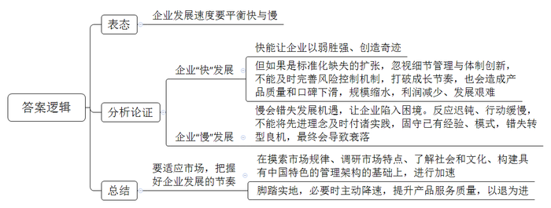
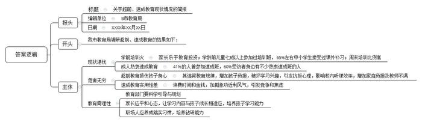

# 2017年公务员多省联考《申论》题（黑龙江A卷：省直）

<!-- gwy:overview:start -->
> **黑龙江 · 2017 · 申论 · 副省级** ｜ 4 题 · 图片 4 处 · 答案随题折叠

导航：[题目](#题目)
<!-- gwy:overview:end -->

> 候选采集稿。参考答案及解析来自粉笔页面，不代表官方答案或真实高分答卷；来源使用许可与原卷对应关系仍需人工核实。

## 给定材料

### 材料 material-fa8e0bb1b0a7760b

近年来，泰山景区注重泰山主体文化的重现，以文化体验为主的观光游发展迅猛，游客总量逐年攀升。在游客量保持较高水平的同时，如何解决好均衡游客分布、延展产业链条，让游客留下来的问题，实现从景点旅游向全域旅游的转型，成为泰山景区发展的一项重点。

为了营造最具中国特色的国际慢城，打造闲适从容的理想栖居，泰山景区规划建设泰山慢谷，打造景区东西两翼“慢生活”区，调整泰山景区旅游发展供给侧，希望通过引入慢城文化探秘泰山亲切、闲适的另一面，以平安长寿、健康养生、闲适宜居、泰山文化为四大特色，建成国际慢城。未来，泰山慢谷的建设将有效疏解泰山人流，吸引更多客源，增加游客停留时间，从而带动消费、促进经济腾飞。

泰山景区无论是区位条件，还是自然资源、文化资源，都有利于建设国际慢城。根据初步规划，泰山慢谷总面积为62.37平方公里，包括大津口乡下辖的9个行政村和天烛峰、玉泉寺两个景区，区位条件得天独厚。天烛峰和玉泉寺两个景区的开发已经成熟，能迅速融入泰山慢谷的建设中。大津口乡位于泰山东部，交通便利，乡政府驻地距高铁站12公里。乡内有两条主要道路，连接全乡大部分村落。乡内河流大多为自然河流，村落建设基本都沿河流分布。大津口乡共计1.5万余人，民风淳朴，居民仍然保持有机餐饮的习惯，人口规模和生活方式都适合建设慢城。大津口乡还是山东省“乡村记忆工程”试点乡镇，拥有独特的自然环境和优越的宜居环境，以及丰富的非物质文化遗产和丰厚的人文历史。

泰山慢谷的总体定位是以壮美山川、深谷秀水、古树茶园、石筑原乡为生态基底，以慢生态、慢出行、慢生活、慢产业、慢服务、慢协作为营造方式，将国际慢城理念与泰山文化自然双遗产深度融合，突出泰山独有的生态特色、文化特色，打造集养生、休闲、度假、体验等中高端旅游产品于一体的国际慢城。

泰山慢谷力推自身独有的特色，包括全时旅游、标志产品等。结合四季特色，推出四季慢运动、四季慢生活，春赏花采茶、夏耕读研学、秋登高采摘、冬养生滑雪，同时开发系列标志土特产、吉祥物、工艺品等。

泰山慢谷的建设摒弃了将慢城建设等同于旅游开发、旧村改造的传统模式，创新提出了“景区、园区、社区、乡村”共建共享的模式。泰山慢谷将泰山的历史文化、民间传说进行梳理，通过智慧解说系统、旅游项目、体验项目等弘扬泰山文化。根据区域内不同的自然和文化优势，泰山慢谷进行分区规划。核心区域在慢谷小镇周围，这里将举办泰山论坛、文艺表演、美术展览等。此外在不同的区域分别建设花乡慢谷、禅修慢谷、养生乐园、耕读农园、记忆家园、慢活彩色森林等。

泰山慢谷通过科学的规划和论证，将建有一路、两心、两环、四区、四带。其中，“一路”指的是生态旅游之路；“两心”指的是作为文化休闲旅游核心的慢谷小镇、作为原住民公共服务中心的慢村集镇；“两环”指的是山地河谷风情环、乡村田园风情环；“四区”指的是南部文化旅游服务区、中部运动休闲体验区、东部养生研学体验区、北部原乡风情体验区；“四带”指的是汉御道七彩田园风情带、天烛峰古松石坞风情带、周御道幽谷瀑布风情带、玉泉寺古木禅意风情带。

### 材料 material-e711fbcb9e7b38fb

H集团张总在一次中层干部会议上问到：什么让石头漂在水面上？答：速度，速度能使沉甸甸的石头漂起来。H集团对“速度”的执著简直达到了无以复加的程度。贴满集团工厂、办公室各个角落的是集团的行动理念“迅速反应，马上行动”。H集团是“速度”最忠实的践行者和最大的受益者。“速度能使沉甸甸的石头漂起来”的潜台词是速度可以创造奇迹，速度可以以弱胜强。H集团诞生的时候只是一家破败的工厂，家底几乎是一穷二白，而实力强大的、国际级的竞争对手早已群雄环伺。H集团在短短20年的时间里，在强势洋品牌的夹缝中发展壮大，成为了行业的标杆企业。一个服务商对H集团的速度感触颇深，有次下午，他刚在H集团总部确定营销方案，第二天飞回北京，吃惊地看到北京的卖场里这套方案的活动物料就已经全部布置完毕。

F公司曾作为餐饮行业的一匹黑马，在短时间内扩张到700多家店，可是标准化缺失的扩张使其产品质量和口碑迅速下滑，不得不壮士断腕，将门店数缩减了一大半，又回到了起点。无独有偶，J集团看到房地产市场前景广阔，迅猛扩张，销售金额、营业收入同比大幅增长，可是净利润却较上年明显减少。由于J集团无暇顾及细节管理与体制更新，风险控制机制也没有及时完善，成长节奏被破坏，本该大步向前的公司步履艰难了起来。

### 材料 material-f17a9dac6161fd06

近年，B市经济的飞速发展，带动了超前教育市场的快速生长，引起了B市政府的重视。市政府要求市教育部门组织人员开展相关调研工作，下面是此次调研所收集的部分材料：

(1)“B市儿童成长状况数据”的调查显示，3至6岁的孩子七成以上都参加过各种培训班，育儿支出占家庭平均收入的23%，近六成的家长把孩子的教育投资放在首位。孩子们的周末时间有41%被各类培训班所占据，留给去广场、公园和游乐场的时间仅有9%。对比26.3%的全国平均数据，B市孩子们的周末时间被培训班占据的比例偏高。

(2)一到周末，不少学龄前儿童的时间就被早教班、才艺班、素质拓展班等各种培训班填满。幼儿园孩子的学习压力堪比小学生，学前教育成了“超前教育”。新任妈妈李某将全部心思放在孩子的学习上，孩子从1岁开始学认字，3岁开始学外语，还有钢琴、围棋、绘画、游泳。尚未上学，孩子就每天在和时间赛跑，参加各类培训班。

(3)针对B市中小学超前教育的调查发现，65%左右的学生参加过超前教育，40%受调查的老师表明班中接受过超前教育的学生占大多数。在接受调查的学生中，约88%选择校外补习接受超前教育，仅有少数由父母辅导。调查者发现，在接受调查的学生、家长和老师中大多认为超前教育会在一定程度上增加学习负担。还有的学生不仅没学到有用的知识，甚至因为听不懂而对课程产生了抗拒心理。调查数据还表明超前学习影响了校内听课效率：64%的学生会因为已经提前学习过一遍而偶尔在课堂上开小差，11%会因此经常开小差，4%的学生甚至表示自己因此从来不听讲。

（4）调研发现，很多幼儿园和小学教师对学前教育超前之风有很大意见。一些孩子过早参加了学前教育，却因为生长发育阶段决定了理解力跟不上，导致似懂非懂、似学非学，反而影响了日后正常的学习，而且破坏了学习兴趣。有专家建议，教育重在激发天性、保护个性，最重要的不是学到了什么，而是培养良好的学习能力，形成浓厚的学习兴趣。学前教育也应该有科学的规划，让学习内容和成长阶段相适应。这需要家长保持平和的心态，也要求教育机构的科学引导。

（5）为满足市民们接受继续教育的强烈要求，各种速成班、速成法如雨后春笋般涌现。“欲速则不达，但现在很多人，太心浮气躁了！”一位老师说，现在市面上充斥着各种“速成法”，让人眼花缭乱。就像现在到处流传的各种减肥速成教程一样，很多人非常迷恋，见一个试一个，总抱怨没什么效果，却还是乐此不疲地去尝试。

（6）某媒体的千人在线调查显示，受访者中，41%的人曾参加速成班，60%受访者身边有不少热衷速成班的人。对于速成教育的效果，37%的人觉得有用，63%的人则认为用处不大，其中18%的人直言“完全没用”。张先生感觉工作中竞争压力较大，一直存在心理焦虑。他曾报过一个会计速成班，一个月课程结束后，张先生觉得自己学到不少东西，背了很多公式，但遇到实际问题，他总是想不起该用哪种方法解决。王女士认为自己知识储备不足，需要充电再教育。去年她报了一期英语速成班，在速成班里，老师确实教了很多新颖的方法记单词，但单词量一多，那些方法就全忘了，而且容易搞混。

（7）调查显示，40%的人担心速成教育盛行加剧了急功近利的社会风气；34%的人认为这会浪费大家的时间和金钱；18%的人觉得会加大人们的竞争压力和焦虑。“速成教育并不靠谱”，曾参加过某种速成班的李先生反思说。现在很多人形成了一种“速成习惯”，凡是遇到什么难题，首先总是去想有没有捷径。不能说这完全是个坏习惯，但这种思维方式如果走向极端，就会让人变得急功近利，逐渐丢掉静下来钻研问题的耐心和能力。“还是应该脚踏实地学习真本事，不迷信速成法。”

### 材料 material-0c7bd3759d2b5436

随着经济社会发展，越来越多的人在度假方式上，开始追求一种闲适的节奏：或是在家陪陪家人、或在田园放松心灵、或做点自己感兴趣的事……而这种观念也正是社会更加成熟自信、文明进步的一种表现。

A市位于我国西部地区，具有丰富的旅游文化资源，是一座以旅游立市的小型城市。近年来，该市以休闲生活为旅游新卖点，提出“在这里正大光明地浪费光阴”“没有任何一件事是必须做的，只需随心住下，随性闲游！”等旅游消费主张来吸引游客，受到游客们的青睐。

2016年，A市新市长上任后，经过调查研究，系统提出了“打造休闲生活旅游城市，提高居民生活幸福感”的构想，重点围绕本地旅游资源，加强规划建设，将现代化理念与传统生活方式相结合，进一步打造“四季如春、休闲养生”的旅游生活城市，使游客和本地市民在这里不仅可以享受现代化带来的各种便利，更可以过上一种健康闲适的幸福生活。这一构想的提出得到了市民的支持。

在黄金周假期前两天，传来了“高速免费”“景点降价”的消息。A市市民汪先生因担心人满为患，临时取消了长途出游的安排。当换种度假方式时，他很快便开始享受这种新的节奏了。汪先生携妻儿开车来到郊区一个水库，在青山绿水间垂钓，中午就地野餐，傍晚则将一天的收获带回家做成美味鱼汤。汪先生告诉记者说：“尽管只钓到七八条小鱼，但一家人在一起的亲近感让我觉得惬意，这种生活正是我向往的。”28岁的胡女士则在黄金周期间选择宅在家里做卫生、看书、喝茶……她说：“刚工作时遇到假期不是在各家亲戚间奔波，就是在人山人海的景点抢镜头，不然就觉得虚度了。现在我宁愿做什么事都无需紧赶慢赶，享受悠闲的生活。最好的景致就在自己心里。”

## 题目

### 第 1 题

**根据材料**2**，概括该景区调整旅游发展供给侧方案的主要内容。（15分）**

关联材料：材料 material-fa8e0bb1b0a7760b

作答要求：

要求：

（1）全面准确、简明、有条理；

（2）不超过200字

第 1 题 · 答案与解析

**参考答案（粉笔题库参考内容）**

注重泰山文化，景点旅游向全域旅游转型，建设泰山慢谷，打造慢生活区，引入慢城文化，建成国际慢城：1.总体定位是将慢城理念与文化自然遗产融合，突出生态文化特色。2.力推独有特色，如全时旅游、标志产品。3.创新提出“景区、园区、社区、乡村”共建共享模式并分区规划。4.科学规划论证，将建一路两心两环四区四带。

**解析**

**参考答案说明：**答案按照“发展重点和总体方案”“总体定位”“独有特色”“创新模式”“科学规划”的“总-分”形式进行了分条撰写。每条要点之间内容上没有交叉。

**考点**：考点概括主要内容类

**来源**：来源2017年公务员多省联考《申论》题（黑龙江A卷：省直）

粉笔申论页面对本题只提供「解析视频」入口，该入口是会员推广位，页面无视频地址与文字解析。

### 第 2 题

**结合给定资料**4**~**5**，谈谈你对企业发展速度的认识。（20分）**

关联材料：材料 material-e711fbcb9e7b38fb

作答要求：

要求：

（1）分析透彻，表达准确；

（2）不超过300字

第 2 题 · 答案与解析

**参考答案（粉笔题库参考内容）**

企业发展速度要平衡快与慢。一方面，快能让企业以弱胜强、创造奇迹。但如果是标准化缺失的扩张，忽视细节管理与体制创新，不能及时完善风险控制机制，打破成长节奏，也会造成产品质量和口碑下滑，规模缩水，利润减少、发展艰难。另一方面，慢会错失发展机遇，让企业陷入困境。反应迟钝、行动缓慢，不能将先进理念及时付诸实践，固守已有经验、模式，错失转型良机，最终会导致衰落。因此，要适应市场，把握好企业发展的节奏。要在摸索市场规律、调研市场特点、了解社会和文化、构建具有中国特色的管理架构的基础上，进行加速。还要脚踏实地，必要时主动降速，提升产品服务质量，以退为进。

**解析**

**参考答案说明：**内容上，按照观点观点现象分析题的内在逻辑，本题先进行了表态（平衡发展速度的快慢），再做出分析论证（对“快”和“慢”的利弊进行分析），最后进行总结（提出对策）。形式上，本题做到了条理清晰、逻辑顺畅，还添加了“因此”等词承接上下文。

**考点**：考点观点现象分析类

**来源**：来源2017年公务员多省联考《申论》题（黑龙江A卷：省直）

粉笔申论页面对本题只提供「解析视频」入口，该入口是会员推广位，页面无视频地址与文字解析。

### 第 3 题

**根据给定资料**7**，假定你是B市教育部门的工作人员，请整理一份关于超前、速成教育现状的简报，供领导参考。（25分）**

关联材料：材料 material-f17a9dac6161fd06

作答要求：

要求：

（1）紧扣材料，内容全面；

（2）层次分明，有逻辑性；

（3）不超过350字。

第 3 题 · 答案与解析

**参考答案（粉笔题库参考内容）**

关于超前、速成教育现状情况的简报

B市教育局 XXXX年XX月XX日

我市教育局调研超前、速成教育的结果如下：

现状堪忧。学前培训火。家长乐于教育投资；学龄前儿童七成以上参加过培训班，65%左右中小学生接受过课外补习；周末培训比例高。成人热衷速成教育。41%的人曾参加速成班，60%受访者身边有不少热衷速成班的人。

危害无穷。超前教育损伤孩子身心。其违背教育规律，增加孩子负担，破坏学习兴趣，引发抗拒心理，影响校内听课效率，增加家庭负担及教师不满。速成教育实用性差。浪费时间和金钱，加剧急功近利风气，引发竞争和焦虑。

教育需理性。教育部门要科学引导与规划；家长应平和心态，让学习内容与孩子成长相适应，培养孩子学习能力；职场人应养成踏实习惯，培养钻研能力。

**解析**

**参考答案说明：**（1）格式上，本参考答案按照“报头+正文”的格式要求展开。（2）本题在内容上，按照“开头+主体”展开，首先介绍了调研的背景，然后介绍了B市超前教育与速成教育的基本情况，再介绍了超前教育与速成教育的危害，最后提出对策。做到了分条撰写，各条要点之间没有交叉。

**参考答案****二**

关于超前、速成教育现状情况的简报

B市教育局 XXXX年XX月XX日

我市教育局调研超前、速成教育的结果如下：

超前教育：1.基本情况：学前培训火。家长乐于教育投资；学龄前儿童七成以上参加过培训班，65%左右中小学生接受过课外补习；周末培训比例高。2.危害：损害孩子身心。其违背教育规律，增加孩子负担，影响学习兴趣和听课效率，引发抗拒心理，增加家庭负担及教师不满。

速成教育：1.基本情况：成人热衷速成教育。41%的人曾参加速成班，60%受访者身边有不少热衷速成班的人。2.危害：实用性差。浪费时间和金钱，加剧急功近利风气，引发竞争和焦虑。

教育部门要科学引导规划；家长应平和心态，让学习内容与孩子成长相适应；职场人应踏实，培养钻研能力。

**考点**：考点总结类

**来源**：来源2017年公务员多省联考《申论》题（黑龙江A卷：省直）

### 第 4 题

**参考给定资料，以“平衡”为主标题，自拟副标题，自选角度，写一篇议论文。（40分）**

关联材料：材料 material-0c7bd3759d2b5436

作答要求：

要求：

（1）自选角度，立意明确；

（2）联系实际，不拘泥于给定材料；

（3）思路清晰，语言流畅；

（4）字数1000-1200字。

第 4 题 · 答案与解析

**参考答案（粉笔题库参考内容）**

**平衡**

**——幸福生活需处理好“快”与“慢”的关系**

老话虽说“速度造就成功”，但老话又说“过犹不及”。环视周遭，有多少人因追求工作的快速高效而长期加班最终患上重疾，又有多少企业发展之初就因盲目扩张而最终倒闭，甚至有些父母为了咿呀学语的孩子将来有出息而追求超前教育……一幕幕因“快”导致的悲剧令人扼腕。我们亟需重新审视我们的生活，找到“快”与“慢”的平衡点，让悲剧不再重演，让生活更加幸福。

**我们要平衡工作与生活，让身心协调，在快节奏中享受慢的生活。**随着社会变革的加快，生活成本提高，很多人不得不开启了24小时在岗的超人化工作模式。可随之而来的，人们的健康被严重透支，甚至因过劳而死亡。其实，人生不仅有工作中的金戈铁马，独当一面，还有生活中的兴趣、闲暇、情感。我们要找到快工作与慢生活的平衡点，既要在工作中讲究方法，告别瞎忙，提高效率；又要学会健康休闲，调整身心状态，享受休闲的生活，体味人生的意义。

在“快”的皮鞭的驱使下，不仅造成了生活和工作的失衡，同样也给企业的发展带来重创，也让我们的教育失去原本的色彩。

**企业发展需平衡速度与质量，自身和时代，让企业稳定发展，长远发展**。速度是发展的第一要义，但不是事事讲速度。对于企业而言，战略上应该慢下来，思虑周详，战略才能决胜；行动应该高效，执行力强才能从“小字辈”做成“老字号”。但令人遗憾的是，有很多企业为了更大的市场，更丰厚的利润，罔顾自身条件，急功近利，盲目扩张。这无异于一叶障目，一味地追求经济效益，必将忽视标准化生产，导致产品与社会脱节、质量下降，品牌贬值。长此以往，企业的发展之路必将荆棘丛生。因此，企业在保持高速发展的同时，又要结合自身发展状况，主动降速，以退为进。要敢于驱动创新，优化人才体系，提升企业竞争能力，使企业发展能够长久可持续。

**教育要在孩子天性和教育内容间做平衡，尊重教育规律，用无用成就大用。**关于教育的理论已经数不胜数，但几乎所有教育学家都反对在教育上揠苗助长。然而，可悲的是很少有家长在教育上不是功利派。四年级学完小学课程，初一复习备战中考，高一就学完了所有高中的课程。只有第一名才会有出息，看似一心为了孩子好，实质上却是忽视了孩子的理解能力，罔顾孩子自然的生长规律。长此以往，不仅会降低孩子的听课效率，破坏学习兴趣，更会造成孩子的伪成熟，甚至会酿成更大的悲剧。由此可见，成长永远都不是急于求成的事情，应该有科学规划，让教育的内容与成长阶段相契合。用一本书、一场旅行、一次思想的碰撞，来挖掘孩子的潜能，激发他们的天性，来增加他们生命的厚度，发现真正的自己。

“拳头缩回去，是为了更有力地打出去。”平衡就像中国的太极拳，不是不发展，而是更好地发展，更科学地发展，更持续地发展。“快”不是不顾一切，要注重质量，“慢”也不是懒惰，要有智慧。让我们把握好快与慢的平衡，不急不缓、不浮不躁、循序渐进、稳稳当当地前进吧！

**解析**

**文章分析**

**平衡**

**——幸福生活需处理好“快”与“慢”的关系**

【**标题的优点：**内容上，主标题突出了“平衡”这一主题，副标题明确了平衡的具体内容是“快”与“慢”的关系。形式上，采用了主副搭配的结构，使文章主题、角度都很清晰。】

老话虽说“速度造就成功”，但老话又说“过犹不及”。（1）环视周遭，有多少人因追求工作的快速高效而长期加班最终患上重疾，又有多少企业发展之初就因盲目扩张而最终倒闭，甚至有些父母为了咿呀学语的孩子将来有出息而追求超前教育…….一幕幕因“快”导致的悲剧令人扼腕。（2）我们亟需重新审视我们的生活，找到“快”与“慢”的平衡点，让悲剧不再重演，让生活更加幸福。

【**开头的优点：**★内容方面。范文的开头是紧扣题目给定的“平衡”这一主题展开的。开头分析阐述了（1）工作生活、企业发展、教育等方面求快的现状、危害；（2）平衡快与慢。★文字表达方面：使用了“但……”“有……又有……甚至……”等关联词，使语言表达有逻辑性。】

**我们要****平衡工作与生活****，****让身心协调****，****在快节奏中享受慢的生活****。**（1）随着社会变革的加快，生活成本提高，很多人不得不开启了24小时在岗的超人化工作模式。可随之而来的，人们的健康被严重透支，甚至因过劳而死亡。其实，人生不仅有工作中的金戈铁马，独当一面，还有生活中的兴趣、闲暇、情感。（2）我们要找到快工作与慢生活的平衡点，既要在工作中讲究方法，告别瞎忙，提高效率；又要学会健康休闲，调整身心状态，享受休闲的生活，体味人生的意义。

【**论述段****1的优点：**★观点句：范文的观点句是紧扣“平衡”这一文章主题提出的。形式上，它在段首处直接写出，位置突出，容易发现。内容上，关键词突出，内容要点明确，可以明显看出它是从“平衡工作生活的快与慢”入手，指出了“要享受慢生活”。★论述内容：（1）快节奏的工作、生活的状况及其危害；（2）平衡工作与生活的做法。注意：以上几个方面的内容都是紧扣“我们要平衡工作与生活，让身心协调，在快节奏中享受慢的生活”这个观点句进行分析论述的，论述的针对性强，内容层次丰富。在论述方法和论据的选取上做到了讲道理、举例子相结合，做到了丰富多样。】

在“快”的皮鞭的驱使下，不仅造成了生活和工作的失衡，同样也给企业的发展带来重创，也让我们的教育失去原本的色彩。

【**过渡段的优点：**范文过渡段分析了“‘快’给生活、工作、企业发展、教育”带来的危害，承接了论述段1，引出了论述段2、3。】

**企业发展需平衡速度与质量****，自身和时代，让企业稳定发展，长远发展。**（1）速度是发展的第一要义，但不是事事讲速度。对于企业而言，战略上应该慢下来，思虑周详，战略才能决胜；行动应该高效，执行力强才能从“小字辈”做成“老字号”。（2）但令人遗憾的是，有很多企业为了更大的市场，更丰厚的利润，罔顾自身条件，急功近利，盲目扩张。这无异于一叶障目，一味地追求经济效益，必将忽视标准化生产，导致产品与社会脱节、质量下降，品牌贬值。长此以往，企业的发展之路必将荆棘丛生。（3）因此，企业在保持高速发展的同时，又要结合自身发展状况，主动降速，以退为进。要敢于驱动创新，优化人才体系，提升企业竞争能力，使企业发展能够长久可持续。

【**论述段****2的优点：**★观点句：范文的观点句是紧扣“平衡”这一文章主题提出的。形式上，它在段首处直接写出，位置突出，容易发现。内容上，关键词突出，内容要点明确，可以明显看出它是从“平衡企业发展的快与慢”入手，指出了“企业要平衡速度与质量”。★论述内容：（1）速度对企业发展的重要性；（2）过分追求速度的危害；（3）企业的正确发展之路。注意：以上几个方面的内容都是紧扣“企业发展需平衡速度与质量，自身和时代，让企业稳定发展，长远发展”这个观点句进行分析论述的，论述的针对性强，内容层次丰富。在论述方法和论据的选取上做到了讲道理、举例子相结合，做到了丰富多样。】

**教育要在孩子天性和教育内容间做平衡****，****尊重教育规律****，用无用成就大用****。**关于教育的理论已经数不胜数，但几乎所有教育学家都反对在教育上揠苗助长。（1）然而，可悲的是很少有家长在教育上不是功利派。四年级学完小学课程，初一复习备战中考，高一就学完了所有高中的课程。只有第一名才会有出息，看似一心为了孩子好，实质上却是忽视了孩子的理解能力，罔顾孩子自然的生长规律。长此以往，不仅会降低孩子的听课效率，破坏学习兴趣，更会造成孩子的伪成熟，甚至会酿成更大的悲剧。（2）由此可见，成长永远都不是急于求成的事情，应该有科学规划，让教育的内容与成长阶段相契合。用一本书、一场旅行、一次思想的碰撞，来挖掘孩子的潜能，激发他们的天性，来增加他们生命的厚度，发现真正的自己。

【**论述段****3的优点：**★观点句：范文的观点句是紧扣“平衡”这一文章主题提出的。形式上，它在段首处直接写出，位置突出，容易发现。内容上，关键词突出，内容要点明确，可以明显看出它是从“平衡教育的快与慢”入手，指出了“教育要兼顾孩子的天性和教育内容”。★论述内容：（1）教育追求速度的现状及危害；（2）正确的教育方法。注意：以上几个方面的内容都是紧扣“教育要在孩子天性和教育内容间做平衡，尊重教育规律，用无用成就大用”这个观点句进行分析论述的，论述的针对性强，内容层次丰富。在论述方法和论据的选取上做到了讲道理、举例子相结合，做到了丰富多样。】

【**论述段之间的关系**：★内容的内在逻辑：范文的论述段之间是依照“并列”的逻辑展开的。论述段1先写了“工作生活中要平衡快与慢”，论述段2再写了“企业发展要平衡快与慢”，论述段3写了“教育要平衡快与慢”。★段与段的外在衔接：段3的“在‘快’的皮鞭的驱使下，不仅……同样……也让……”起到了承接论述段1，引出了论述段2、3的作用。】

“拳头缩回去，是为了更有力地打出去。”平衡就像中国的太极拳，不是不发展，而是更好地发展，更科学地发展，更持续地发展。“快”不是不顾一切，要注重质量，“慢”也不是懒惰，要有智慧。让我们把握好快与慢的平衡，不急不缓、不浮不躁、循序渐进、稳稳当当地前进吧!

【**结尾的优点**：范文的结尾回扣了“平衡”这一主题，发出了号召希望。】

**考点**：考点文章写作题

**来源**：来源2017年公务员多省联考《申论》题（黑龙江A卷：省直）

粉笔申论页面对本题只提供「解析视频」入口，该入口是会员推广位，页面无视频地址与文字解析。

