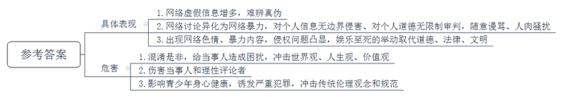
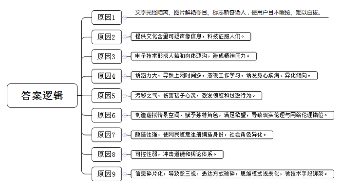
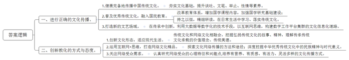
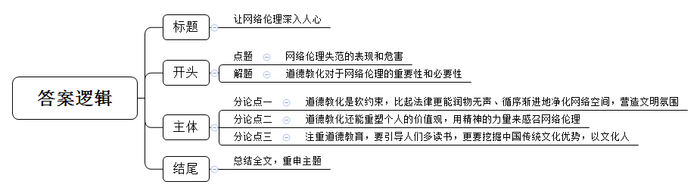

# 2017年公务员多省联考《申论》题（黑龙江B卷：公检法）

> 候选采集稿。参考答案及解析来自粉笔页面，不代表官方答案或真实高分答卷；来源使用许可与原卷对应关系仍需人工核实。

## 给定材料

### 材料 material-cfe6cb9dbbdab64a

美国学者理查德·斯皮内洛说过：“技术往往比伦理学理论发展得快，而这方面的滞后效应往往会给我们带来相当大的危害。”确实，网络伦理的失范会给社会带来一系列问题。

关于网络伦理，有学者指出这是20世纪中叶以来新兴的应用伦理学研究的重要内容，是指人们在网络空间中应该遵守的行为道德准则和规范。

随着互联网的蓬勃发展，我们遭遇的网络虚假信息越来越多，花样也变得层出不穷，时常难辨真伪，如轰动一时的朱自清《背影》因“违反交规”被逐出教材、香蕉得艾滋病濒临灭绝、哈尔滨赚钱不给老婆花算家暴、东莞警方将拘留非法同居者、95后女网友“身体换旅行”等等。这样的虚假新闻不仅混淆是非，给当事人造成了困扰，而且引发了对世界观、人生观、价值观的冲击，危害不小。从技术层面讲，谣言的产生是因为网络的开放性和匿名性；从社会层面讲，是由于权威信息的滞后以及危机预警能力差；从受众层面讲，是因为公众具有猎奇、娱乐、恐慌、盲从及网上宣泄的心理。

2015年，“成都女司机被打事件”的当事人被“人肉搜索”，个人隐私被大肆转发。一场因违章而引发的文明开车讨论，异化成对当事人二次伤害的“网络暴力”事件。当事人面对镜头泣不成声，其家人表示抗议，要诉诸法律，却引来网友更多批判。部分网民对个人信息无边界侵害、对个人道德无限制审判，甚至为了一时情绪的发泄随意谩骂、人肉骚扰，给当事人以及理性的评论者带来了不可言说的伤害。

中国预防青少年犯罪研究会的统计资料显示：目前未成年人犯罪总数中，有70%的少年犯因网络色情、暴力内容影响而诱发盗窃、抢劫、强奸等几类严重犯罪，对传统伦理观念和伦理规范带来了严重的冲击。在此类事件中，青少年可以通过低价、便捷的方式连接互联网，同时利用网络的匿名性，使得网络侵害者与受害者之间的关系复杂化，继而将网络影响现实化。

2016年7月12日，文化部公布了对一批网络表演平台的查处结果，26个网络表演平台被查处，16881名网络表演者被处理。“现在手机几乎成了学生的标配，直播平台里防不胜防的色情信息实在让人担心。”北京一位家长说。“新华视点”记者调查发现，随着网络直播终端从PC端走向移动端，直播开始步入全民时代。与此同时，网络直播中的色情、暴力、侵权等问题也随之凸显，严重影响青少年的身心健康。

如果说2015年是网红年的话，2016年就是直播年了。六间房秀场上，一团队打着户外主播的名义进山林捕杀野生动物，且手段残忍，却吸引了至少三万多粉丝的关注。在这场娱乐的无极限狂欢中，什么道德、法律、文明都被抛掉，取而代之的是娱乐至死的疯狂举动。不可否认，这种无序性源于网络的低门槛、开放性和相对虚拟等特质，但更是“眼球经济”在背后推波助澜。

### 材料 material-9b092a5e22d2b8d7

网络上文字内容的光怪陆离、图片的鲜艳夺目、标志的新奇诱人，都会使网络用户目不暇接，难以自拔。作家王蒙将触屏时代的到来称为“心智灾难”。在他看来，触屏和电视一样，提供了一些文化含量可疑的声像信息，让人们再度被科技征服。电脑与鼠标、触屏和智能手机先后冲进生活、杀入头脑，它们“提供了最全面的服务与引领，也许还有劫持”。如多伦多大学学者纳尔逊·塔尔所说：“今天，电子技术将人脑加速到一个异乎寻常的速度，而人的肉体却原地不动，这样形成的鸿沟造成了巨大的精神压力。”在强大的诱惑力面前，人们不知不觉地在网上投入了过多的时间，感知了一些不该感知或不宜过多感知的内容，忽视了正常的工作、学习和生活。在这样的过程中，网络用户被诱发生理和心理疾病，导致异化倾向的概率是非常高的。

2015年7月29日，一场EXO跟TFboys的粉丝在网上的骂战引发了极高的关注。起因是由于一则TFboys小学生粉丝所录制的视频指责EXO，引发了EXO和TFboys双方粉丝在网上互掐。仅仅几分钟的视频，在24小时内微博浏览量飙升3300万，瞬间登上了“微博热门话题榜”。对此，心理专家说：“现在的孩子自降生下来就生活在网络环境之中，网络中各种各样的讯息几乎无时无刻不在影响着他们。孩子会为自己制定角色，作为某个明星的粉丝，就是一种角色意识。角色一旦不被认知，加上网络的污秽之气，孩子不自觉地就会模仿，特别是骂人用语，这其实就是网络暴力的行为，它伤害孩子的心灵，激发愤怒，从而做出过激行为。”网络制造了源于但又远于生活的虚拟情景空间，上网者被赋予了独特的角色，能够满足现实生活中难以实现的各种欲望，久而久之，就导致了现实伦理与网络伦理的错位。现实世界中的普通人张三，在网络游戏中可以是受万人敬仰的大英雄，身边美女环绕，众将惟其马首是瞻。

2016年6月28日上午，某省公安厅召开“飓风10号”专案新闻发布会，通报了近期成功打掉“传销式”网络交友诈骗案的情况。该团伙的诈骗手段是利用QQ、微信等网络聊天工具，从网络上下载面容姣好的女性图片作为头像，以交男朋友的形式，通过微信红包和银行转账等方式骗取受害人的金钱。“在网上没有人知道你是一条狗。”网络的隐匿性使人们可以随意注册身份，编造个人所期望的身份资料，使人们可以体验其自由选择的各种社会角色，达成各种交际目的，甚至包括经济诈骗、感情欺骗等。这是网络导致网民社会角色异化的典型案例。通过网络，网民可以实现性别异化（男人可以用女人的思维、情感、表达方式在网上交友，反之亦然）、年龄异化（老人可以用年轻人的口气、情调、交流方式在网上交友，反之亦然）、身份异化（上网者可以随意编造自己的职业、学历、经历、婚姻状况等等，以各种身份出现在网上交际场合，赢得对方的好感以至迷恋）。

### 材料 material-98eda50504862792

发挥中国传统文化在修复网络生态、建设网络伦理等方面的作用，首先需要正确的文化传播。中华优秀传统文化如何在互联网时代实现良好的传承、弘扬、发展、革新？如何通过恢复和创新“诗书礼乐”国学教育体系，使网民对中国文化精神内化于心、外化于行？2016年5月14日，中国文化网络传播首届高峰论坛在北京师范大学举行，专家就相关话题展开了讨论。

当下，国民的文化认同是国家安全的文化基础，国民的文明修养不高已成为中国现代化成功与否的瓶颈等话题已成为大众意识到的问题。“观乎人文以化成天下者，言圣人观察人文，则《诗》《书》《礼》《乐》之谓，当法此教而‘化成天下’也。”人文是什么？以文化人的“文”指的是什么？圣人观察人与社会的关系规律，选择诗书礼乐为教法，来改变天下人的行为习惯，向大同文明前进。“文”，乃诗书礼乐也。诗是谈吐的训练，书是文笔的锤炼，礼是举止的修炼，乐是性情的冶炼，健康完备地传播中国传统文化的内容在现代传播过程中显得尤其重要。

正因为传统文化在陶冶人心方面的重要性，在新的历史条件下，我们必须全面认识祖国传统文化，古为今用，推陈出新，积极开展优秀文化教育普及活动，发挥国民教育在文化传承创新中的基础性作用，从而为网络伦理的建设与规范奠定坚实的基础。因此，应该在各层次教育体系中增加国学课程内容，加强国学研究基础建设，我们在日常也应该提倡尊孔读经，尊重圣人，尊重文化，尊重良心，尊重道德，博之以文，约之以礼。时时力戒——贪嗔痴慢疑；每日精进——恒喜孝诚习；改掉坏秉性——恨怨恼怒烦；发掘善天性——仁义礼智信。只有持之以恒、精研细读，大众才能把国学作为一种生命价值和生活规约。也只有这样，才能发挥传统文化在网络伦理建设中的作用。

在信息化建设下，新兴的互联网技术重构了社会空间，文化生态、文艺生态发生了巨大变化，传统文艺场域受到冲击，新型社会空间需要新的文艺场域形成。中国文联文艺资源中心副主任冉茂金认为，在这个信息社会大环境发展趋势之下，传统文化的现代传播要以传承为生、以创新为命。传统文化对现代化建设有着重要的积极意义，又能够丰富网络空间的内容建设和价值观建设。故宫、国博等单位的数字化工程，都是传统文化的现代化传播方式。每一代的文化都是包容开放的，有着很多的创新。传统文化要融入今天的工作形态和生活形态，就需要文化单位利用大数据等数字化的技术手段，以互联网思维构建数字工作平台集群的文化信息化道路。

### 材料 material-b4173cac7274500d

习近平总书记在第二届世界互联网大会的主旨演讲中指出：“要加强网络伦理、网络文明建设，发挥道德教化引导作用，用人类文明优秀成果滋养网络空间、修复网络生态。”

2016年里约奥运会，中国女排夺冠。国内外各大媒体纷纷进行报道，有网友表示，“这是奥运会三大球中夺冠的唯一一支亚洲队，而且是女子项目，真不错。”各舆论平台都发表了满满正能量的评论，网络空间难得地呈现出一片欢欣鼓舞的气象。女排奥运夺冠与女排精神成为网络流行的话题，女排精神也成为鼓舞国人实现中国梦的重要动力。

有评论指出，国人感动于女排无畏无惧、自强不息精神力量的同时，一种“女排精神成就中国”的说法也随之蔓延。殊不知，中国梦才是成就女排精神的根本。梦想是引导前进的目标。女排精神并非凭空产生，也不是无根发芽，而是源于一种力量、一种激情，那就是把国家利益、民族利益和每个人的具体利益紧密联系在一起的中华民族伟大复兴的中国梦。

我国近7亿网民的海量规模充分证明，网络空间已经成为公众生活不可分割的精神家园。广大网民对于继承和弘扬中华优秀文化的需求更为迫切，也充分意识到净化网络空间、建设和规范网络伦理的必要性。从网络评论、新闻跟帖留言、论坛话题等方面可以看出，女排精神以及作为源泉的中国梦必将成为润化网络空间的强大“正能量”，正确加以引导、运用，一定会在建设网络伦理、修复网络生态中发挥重要作用。

## 题目

### 第 1 题

**根据给定材料**2**，概括当前网络伦理失范的具体表现和危害。（15分）**

关联材料：material-cfe6cb9dbbdab64a

作答要求：

要求：

（1）全面准确，简明扼要；

（2）不超过200字。

### 第 2 题

**根据给定资料**3**\-**4**，从网络特点的角度分析给出当前网络伦理失范的成因。（20分）**

关联材料：material-9b092a5e22d2b8d7

作答要求：

要求：

（1）紧扣资料，全面准确，条理清晰；

（2）不超过250字。

### 第 3 题

**假如你是某市文明办的工作人员，给定资料**5**\-**6**是你搜集的资料，请就“如何弘扬优秀传统文化，发挥教化引导作用，滋养网络空间、修复网络生态”，向领导提出建议。（25分）**

关联材料：material-98eda50504862792

作答要求：

要求：

（1）内容全面；

（2）观点明确；

（3）层次分明；

（4）不超过400字。

### 第 4 题

**就个体而言，由道德的教化引导来实现网络伦理的提升，是一个由外在约束到内心自觉的过程。结合给定资料，联系实际，以“约束与自觉”为主旨，自拟题目，写一篇议论文。（40分）**

关联材料：material-b4173cac7274500d

作答要求：

要求：

（1）不拘泥于给定资料；

（2）观点明确、内容充实；

（3）结构完整；

（4）1000-1200字。

## 答案与解析

第 1 题

**参考答案（粉笔题库参考内容）**

具体表现：1.网络虚假信息增多，难辨真伪；2.网络讨论异化为网络暴力，对个人信息无边界侵害、对个人道德无限制审判，随意谩骂、人肉骚扰；3.出现网络色情、暴力内容，侵权问题凸显，娱乐至死的举动取代道德、法律、文明。

危害：1.混淆是非，给当事人造成困扰，冲击世界观、人生观、价值观；2.伤害当事人和理性评论者；3.影响青少年身心健康，诱发严重犯罪，冲击传统伦理观念和规范。

**解析**

**参考答案说明**：本参考答案宏观上分成了“具体表现”和“危害”两个要素。在“具体表现”上，从“网络虚假信息”“网络暴力”“网络直播”这三个方面进行了分条撰写。“危害”也与之一一对应，体现在“混淆是非”“伤害当事人和理性评论者”“影响青少年身心健康”这三方面。各条要点之间在内容上相互并列，没有交叉。

**参考答案二**

1.网络虚假信息增多，难辨真伪，混淆是非，给当事人造成困扰，冲击世界观、人生观、价值观。

2.网络讨论异化为“网络暴力”，对个人信息无边界侵害、对个人道德无限制审判，随意谩骂、人肉骚扰，给当事人和理性评论者带来伤害。

3.出现网络色情、暴力内容，侵权凸显，冲击传统伦理观念和伦理规范，诱发青少年严重犯罪，影响青少年身心健康。

4.出现娱乐至死的无序性举动，导致道德、法律、文明被抛弃。

**考点**：考点多要素组合类

**来源**：来源2017年公务员多省联考《申论》题（黑龙江B卷：公检法）

第 2 题

**参考答案（粉笔题库参考内容）**

1.文字光怪陆离、图片鲜艳夺目、标志新奇诱人，使用户目不暇接、难以自拔。2.提供文化含量可疑声像信息，科技征服人们。3.电子技术形成人脑和肉体鸿沟，造成精神压力。4.诱惑力大，导致上网时间多，忽视工作学习，诱发身心疾病、异化倾向。5.污秽之气，伤害孩子心灵，激发愤怒和过激行为。6.制造虚拟情景空间，赋予独特角色，满足欲望，导致现实伦理与网络伦理错位。7.隐匿性强，使网民随意注册编造身份，社会角色异化。8.可控性弱，冲击道德和舆论体系。9.信息碎片化，导致毁三观，表达方式破碎，思维模式浅表化，被技术手段绑架。

**解析**

**参考答案说明：**本参考答案从“文字图片标志”“声像信息”“电子技术”“网络诱惑力”“网络污秽之气”“虚拟情景空间”“网络隐匿性”“网络可控性”“信息碎片化”九个方面进行了分条撰写。各条要点之间在内容上相互并列，没有交叉。

**考点**：考点原因类

**来源**：来源2017年公务员多省联考《申论》题（黑龙江B卷：公检法）

第 3 题

**参考答案（粉笔题库参考内容）**

一、进行正确的文化传播。

1.健康完备地传播中国传统文化。夯实文化基础，提升谈吐、文笔、举止、性情等素养。2.普及优秀传统文化，融入国民教育。改革教育体系，增加国学课程内容，加强国学研究基础建设；持之以恒，精细研读，在日常生活中学习、落实传统文化。3.打造新的文艺场域。在传承中创新，利用大数据等数字化的技术手段，以互联网思维，构建数字工作平台集群的文化信息化道路。

二、创新教化的方式与态度。

1.创新文化形态，适应现代生活。传统文化和网络文化相融合，挖掘弘扬传统文化的故事、精神，理解传承传统文化承载的价值理念、传统美德。2.运用互联网+思维，打造网络文化精品。探索文化网络传播的方法和途径；深度挖掘中华优秀传统文化中的民族精神与时代意义。3.关注网络受众需求。认真研究网络受众的心理特征和兴趣点，培养有营养、有质感、有活力、灵活多样的文化传播方式。

**解析**

**参考答案说明**：本参考答案宏观上分为“进行正确的文化传播”“创新教化的方式与态度”两个方面。在“进行正确的文化传播”方面，又从“健康完备地传播中国传统文化”“普及优秀传统文化，融入国民教育”“打造新的文艺场域”等不同的工作维度进行了分条撰写。在“创新教化的方式与态度”方面，又从“创新文化形态，适应现代生活”“运用互联网+思维，打造网络文化精品”“关注网络受众需求”等不同的工作维度进行了分条撰写。各条要点之间在内容上相互并列，没有交叉。

**考点**：考点提出对策类

**来源**：来源2017年公务员多省联考《申论》题（黑龙江B卷：公检法）

第 4 题

**参考答案（粉笔题库参考内容）**

**让网络伦理深入人心**

网络暴力、污言秽语、造谣诈骗、虚假炒作……网络空间似乎弥漫着乌烟瘴气。网络文明的建设，网络生态的修复，网络行为的约束都迫在眉睫，应该早日提上日程。虽然我们出台了不少法律条文、行为规范，然而“徒法不足以自行”，更多还要依靠道德教化来重建网络伦理。从号召多读书到价值观的重塑，从文明氛围的熏陶到传统文化的弘扬，**道德教化让网络伦理成为个人内化于心、外化于行的自觉意识和自主行为。**

**道德教化是软约束，比起法律更能润物无声、循序渐进地净化网络空间，营造文明氛围。**网络需要秩序，维持秩序的手段通常包括风俗、舆论、宗教、道德、法律等，其中法律和道德是最主要的途径。网络治理的一个基本原则是“网络并非法外之地”，网络治理的更高原则是“网络是人们平等分享技术进步和顺利获得社会交往乐趣的空间”，后者就需要引入网络伦理。因此，在流动化时代和高匿名性的网络空间，道德调解是极具建设性的，它通过舆论评价和个人反省自检，唤起人们主动对照网络伦理规范的要求，更提醒当事人要严于律己，与他人理性讨论，彼此尊重。

**道德教化还能重塑个人的价值观，用精神的力量来感召网络伦理。**人肉搜索、碎片化阅读、娱乐至死……这些网络行为一定程度上反映了网络上独特的价值观。这样的价值观是脱离传统伦理和主流价值观的，网络也是一个社会形态，离开了道德教化，同样是一盘散沙。中国古代大一统国家之所以能够维持两千余年，靠的就是“纲常名教”这样的道德教化。西方国家的现代文明秩序也得益于各种社会组织参与其中的广泛社会教化。可以相信，网络伦理建设将使每个网民受益，通过澄清网络空间，可以增大网民在网络世界驰骋的自由度，落实网民个人信息存取、流动的安全性，最终提高网民因网络带来的便利、高效而获得的幸福感。

当然，道德教化的过程可能会更漫长，因为任何一种站得住脚的道德要求都要经历无数次试错，积累持久和广泛的日常生活基础。但我们不能因噎废食，而应砥砺前行。

**注重道德教育，要引导人们多读书，更要挖掘中国传统文化优势，以文化人。**网络似乎占用了大家大多的时间，碎片化的阅读更是肢解了我们的价值观，重读经典、多读经典是救赎当前网络伦理的重要途径。更关键的是要充分重视传统文化的教化作用。当然，对待传统文化有一个去粗取精、深入挖掘、整理加工的过程。多挖掘中国传统文化精髓中的“仁爱”、“诚信”、“义利”、“慎独”的精神资源，从而促进一个良好的网络伦理规范的构建。

网络时代是大势所趋，各国更应高瞻远瞩，未雨绸缪，**道德教化势必会成为网络伦理构建最关键的手段。**对于每个个体而言，无论是普通网民，还是企业、社会组织，在网络使用、信息传播、新闻报道等方面都要坚守底线、坚守道德，只有这样，**人类的尊严、自由、秩序才能在互联网世界得到有效保障。**

**解析**

**文章分析**

**让网络伦理深入人心**

【**标题的优点：**首先，范文的标题“让网络伦理深入人心”突出了“网络伦理”这一主题。其次，形式上，文字简洁明快。】

（1）网络暴力、污言秽语、造谣诈骗、虚假炒作……网络空间似乎弥漫着乌烟瘴气。（2）网络文明的建设，网络生态的修复，网络行为的约束都迫在眉睫，应该早日提上日程。虽然我们出台了不少法律条文、行为规范，然而“徒法不足以自行”，更多还要依靠道德教化来重建网络伦理。（3）从号召多读书到价值观的重塑，从文明氛围的熏陶到传统文化的弘扬，**道****德教化让网络伦理成为个人内化于心、外化于行的自觉意识和自主行为。**

【**开头的优点：**★内容方面：范文的开头是紧扣题目给定的“网络伦理”这一主题展开的。首先，开头点出主题，做到了主题明确。其次，对“网络伦理”这一主题进行了分析阐述，指出了（1）“网络伦理”失范的表现。（2）“网络伦理”建设的紧迫性。（3）道德教化对“网络伦理”的意义。★文字表达方面：长短句配合使用，使语言表达有节奏感。】

**道德教化是软约束，比起法律更能润物无声、循序渐进地净化网络空间，营造文明氛围。**（1）网络需要秩序，维持秩序的手段通常包括风俗、舆论、宗教、道德、法律等，其中法律和道德是最主要的途径。网络治理的一个基本原则是“网络并非法外之地”，网络治理的更高原则是“网络是人们平等分享技术进步和顺利获得社会交往乐趣的空间”，后者就需要引入网络伦理。（2）因此，在流动化时代和高匿名性的网络空间，道德调解是极具建设性的，它通过舆论评价和个人反省自检，唤起人们主动对照网络伦理规范的要求，更提醒当事人要严于律己，与他人理性讨论，彼此尊重。

【**论述段****1的优点：**★观点句：范文的观点句是紧扣“网络伦理”这一文章主题提出的。形式上，它在段首处直接写出，位置突出，容易发现。内容上，关键词突出，内容要点明确，可以明显看出它是从“道德教化净化网络空间”入手，指出了道德教化对“网络伦理”的意义。★论述内容：（1）先介绍了“网络需要法律和道德维持秩序”；（2）接着介绍了“道德对网络空间的意义”。注意：以上两个方面的内容都是紧扣“道德教化是软约束，比起法律更能润物无声、循序渐进地净化网络空间，营造文明氛围”这个观点句进行分析论述的，论述的针对性强，内容层次丰富。最后，在论述方法上采用了道理论证，做到了论述有力。】

**道德教化还能重塑个人的价值观，用精神的力量来感召网络伦理。**（1）人肉搜索、碎片化阅读、娱乐至死……这些网络行为一定程度上反映了网络上独特的价值观。这样的价值观是脱离传统伦理和主流价值观的，网络也是一个社会形态，离开了道德教化，同样是一盘散沙。（2）中国古代大一统国家之所以能够维持两千余年，靠的就是“纲常名教”这样的道德教化。西方国家的现代文明秩序也得益于各种社会组织参与其中的广泛社会教化。可以相信，网络伦理建设将使每个网民受益，通过澄清网络空间，可以增大网民在网络世界驰骋的自由度，落实网民个人信息存取、流动的安全性，最终提高网民因网络带来的便利、高效而获得的幸福感。

【**论述段****2****的优点：**★观点句：范文的观点句是紧扣“网络伦理”这一文章主题提出的。形式上，它在段首处直接写出，位置突出，容易发现。内容上，关键词突出，内容要点明确，可以明显看出它是从“道德教化感召网络伦理”入手，指出了道德教化对“网络伦理”的意义。★论述内容：（1）先介绍了“网络伦理失范的表现及危害”；（2）接着介绍了“网络伦理建设的意义”。注意：以上两个方面的内容都是紧扣“道德教化还能重塑个人的价值观，用精神的力量来感召网络伦理”这个观点句进行分析论述的，论述的针对性强，内容层次丰富。最后，在论述方法和论据的选取上做到了讲道理、举例子相结合，做到了丰富多样。】

当然，道德教化的过程可能会更漫长，因为任何一种站得住脚的道德要求都要经历无数次试错，积累持久和广泛的日常生活基础。但我们不能因噎废食，而应砥砺前行。

【**过渡段的优点：**范文过渡段分析了“道德教化的过程很漫长”等方面的内容，此外，还要注意过渡段末尾的“但我们不能因噎废食，而应砥砺前行”是用来引起下文的过渡句。】

**注重道德教育，要引导人们多读书，更要挖掘中国传统文化优势，以文化人。**（1）网络似乎占用了大家大多的时间，碎片化的阅读更是肢解了我们的价值观，重读经典、多读经典是救赎当前网络伦理的重要途径。更关键的是要充分重视传统文化的教化作用。（2）当然，对待传统文化有一个去粗取精、深入挖掘、整理加工的过程。多挖掘中国传统文化精髓中的“仁爱”、“诚信”、“义利”、“慎独”的精神资源，从而促进一个良好的网络伦理规范的构建。

【**论述段****3****的优点：**★观点句：范文的观点句是紧扣“网络伦理”这一文章主题提出的。形式上，它在段首处直接写出，位置突出，容易发现。内容上，关键词突出，内容要点明确，可以明显看出它是从“注重道德教育、挖掘传统文化”入手，指出了如何通过道德教化提升网络伦理。★论述内容：（1）先介绍了“读书和传统文化教化的必要性”；（2）接着介绍了“网络伦理建设需要挖掘传统文化”。注意：以上两个方面的内容都是紧扣“注重道德教育，要引导人们多读书，更要挖掘中国传统文化优势，以文化人”这个观点句进行分析论述的，论述的针对性强，内容层次丰富。最后，在论述方法上采用了道理论证，做到了论述有力。】

网络时代是大势所趋，各国更应高瞻远瞩，未雨绸缪，道德教化势必会成为网络伦理构建最关键的手段。对于每个个体而言，无论是普通网民，还是企业、社会组织，在网络使用、信息传播、新闻报道等方面都要坚守底线、坚守道德，只有这样，人类的尊严、自由、秩序才能在互联网世界得到有效保障。

【**结尾的优点：**范文的结尾回扣了“网络伦理”这一主题，并发出了号召希望。】

**考点**：考点文章写作题

**来源**：来源2017年公务员多省联考《申论》题（黑龙江B卷：公检法）

