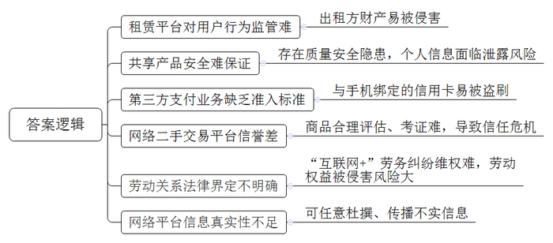
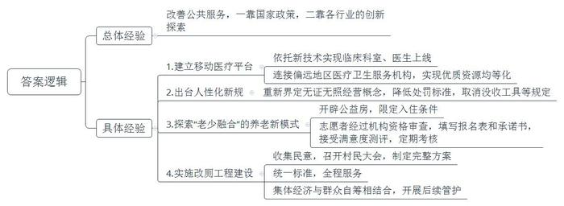
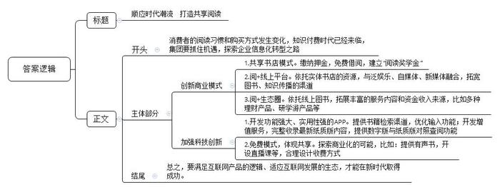

# 2018年公务员多省联考《申论》题（黑龙江A卷：省直）

<!-- gwy:overview:start -->
> **黑龙江 · 2018 · 申论 · 省直** ｜ 4 题 · 图片 4 处 · 答案随题折叠

导航：[题目](#题目) · [材料 1](#材料-1)
<!-- gwy:overview:end -->

> 候选采集稿。参考答案及解析来自粉笔页面，不代表官方答案或真实高分答卷；来源使用许可与原卷对应关系仍需人工核实。

## 给定材料

### 材料 1

互联网的风起云涌，不仅从根本上颠覆了许多传统行业，同时也创造了新的行业和机遇。21世纪初，有学者提出了互联网时代协同消费的理念和发展模式，并将其分为若干阶段。最初是代码共享，即通过互联网向用户提供信息，但信息流是单向的，用户不能参与其中进行评论和交流。当互联网进入Web2.0时代，用户开始通过网络平台向陌生人分享信息、表达观点，但也仅限于内容或信息，不涉及实物交易，一般也不存在金钱报酬，单纯是生活共享或内容共享。

随着物物相联时代的到来，网络平台公司通过互联网重新整合社会闲散资源和富余劳动力，然后再按需精准配置，实现物尽其用，社会分配从专业化向社会化转变，真正实现了离线资源的共享，即线上的分享协作渗透、延伸至线下，并由此改变了我们的文化和经济世界。如今，需求方不但可以享受到低价与个性化服务，还得到了社交机会。对企业而言，随着加入网络的节点及节点间的连接增加，网络的价值会随着用户数量的增加而呈几何倍数的增长。

### 材料 2

美国某房屋租赁公司曾发生一起恶性事故。一名房东发现她的公寓被从该公司网站招来的房客洗劫一空。她在给该公司的信上写道：“他们在我的柜子上凿了个洞，劫走了里面的护照、现金、信用卡和我奶奶的珠宝首饰，他们掠走了我的一切。”这大概是所有人对互联网时代协同消费经济模式的顾虑了。某调查公司针对美国用户对这一经济模式看法的调研数据显示，在参与的人群中，有57%的用户表示，对这种消费模式感兴趣，但仍有顾虑；而在熟悉这种经济模式的人群中，有69%的用户认为，除非信任的人推荐，否则不会相信。

共享充电宝在成为许多市民生活“标配”的同时，也引发了不少争议。除了共享充电宝自身的质量安全外，使用者可能还会面临个人信息泄露的风险。曹先生是一位互联网公司的程序员，他说：“每次看到有人使用共享充电宝，我都为他们捏把汗。其实它本质上就是一台电脑，有电脑的地方就会有黑客。现在大数据、算法不断发展，数据公司和社交软件合作，无孔不入地对个人信息进行收集。如今，我们消费时常扫二维码，通过第三方支付对其进行授权，但第三方支付其实都绑定了个人身份信息、银行卡信息，在扫码过程中，就存在信息泄露的可能。”

谢女士便遭遇了这样的问题。某日，她在一台ATM机旁看到了一条“使用手机扫描二维码，免费赢取百万大奖”的广告，下面还附有一个二维码。谢女士顺手扫描了一下，并按照提示下载了一款APP。但让她万万没有想到的是，没过几天，与手机绑定的信用卡就被盗刷了。事实上，第三方支付的兴起，给用户带来极大便利的同时，也带来了很大的风险和争议。一位业内人士表示，不管技术行不行，背景清不清，什么样的企业都可以拓展第三方支付业务，这样的局面不乱套才怪。

“互联网+”催生了很多以APP为平台的服务业务，比如租车、私厨、保洁等，但这些经济活动在遇到纠纷时很难维权。邓先生等7名厨师，通过某公司APP网约客户，成为上门掌勺的“私厨”。日前，他们起诉要求法院确认自己和该公司存在劳动关系，要求支付双倍工资、休息加班费等酬劳。该公司认为，根据双方签订的商务合作协议，邓先生等人通过其旗下的APP平台，依照客户需求接单并提供服务，是否接单和工作时间均由邓先生等人自行掌握，他们不接受公司管理，因此双方并非劳动关系。那么，通过APP和客户建立联系进行服务，是否就算是和APP的运营公司建立了劳动关系？有法律界人士认为，“互联网+”劳务是近年来兴起的劳务形式，网络服务平台运营方与加入平台的劳动者之间是否构成劳动关系是一个尚有争议的法律问题，并没有明确规定，这就造成劳动权益被侵害的风险加大。

本应更方便、更优惠的互联网协同消费经济，有时反而会让人陷入麻烦。随着家庭用品的加速升级换代，让闲置物品流转起来变成“动动手指就能办成的事”，也成为商家瞄准的一片蓝海。不过，由于买卖无需“打照面”、交钱与交货环节分离等原因，网络二手交易平台的信誉难以尽如人意，“省时省力不省心”是不少人的共同印象。与一般商品不同，非标准化是二手商品的最大特点，其损耗程度、保养情况等很难得到最合理的评估、考证。如何让“踏实放心”取代买卖双方的“彼此猜忌”，还有待进一步研究。

某些网站只需付费即可杜撰发布不实词条，让人对这场新经济的盛宴又多添了几分忧虑。有网友打趣，互联网平台在实现“与世界分享你的知识、经验和见解”的同时，也在分享着以假乱真的故事。一方面，这一创新模式让人们醉心于知识的汪洋；另一方面，利益架构起来的知识岛屿往往会误导人们求知的航向。一位哲人曾说，一切背离了公正的知识都应叫做狡诈，而不应称为智慧。平台的开放性与真实性从来都不是背道而行，更不容许贪婪的欲望主导信息的传播。每个人不管是主动分享，还是被动接收，都应遵守规则、承担责任，用客观理性的观念培育知识的植株，做一名慧眼识珠的花匠、恪尽职守的护花使者，知识的花朵才会灿然盛开、传递芬芳。

### 材料 3

党的十九大提出，要完善公共服务体系，提高公共服务水平，不断提升人民的满意度、幸福感和获得感。要实现这一目标，既需要国家拿出顶层设计，也需要各行各业多一些探索，多一些创意。日前，某周刊开辟了一个专栏，专门刊发关于积极推进公共服务的相关简讯，下面摘录其中几则。

**（一）移动医院将专家请到家**

今年开始，A省省立医院尝试建立了“移动医疗平台”，依托新技术实现53个临床科室、500余名医生全部上线，并连接西南多省的市县医院及基层社区卫生服务中心100余家。

4月初，西南边陲某瑶族自治县人民医院骨科的李医生遇到一疑难病例，通过A省省立医院建立的“移动医疗平台”，李医生与省立医院在该领域的权威专家联动，很快得到专家的会诊结论，确定了下一步治疗方案。“移动医疗平台”让基层医院分享到优质的医疗资源，让基层患者分享到高水平的诊疗医术。通过它，让优质医疗资源上下贯通，提升基层医疗服务能力，一定程度上化解了民众“看病难、看病贵”的难题，提高了公众对医疗卫生服务的满意度。

**（二）新规出台让瓜农不为难**

老张是一位瓜农，每到丰收的日子，他总是喜忧参半。去年夏天的一个早晨，他开着拖拉机去城里卖瓜。他本想去政府指定的地方卖，可没想到一进城，就遇到有人要买瓜，他刚停下车卖了一个，电子台秤就被巡逻的执法人员收走了。老张沮丧地到服务大厅交了罚款，拿回被收缴的电子台秤。事后老张说，他也知道自己错了，不该在路边卖，但罚款太高，一天辛苦都白费了。更糟糕的是，为了拿回电子台秤，他折腾了一上午，西瓜都蔫了。

今年，老张就不必再为此担忧、沮丧了。国务院新颁布的《无证无照经营查处办法》对无证无照经营的概念进行了重新界定，同时降低了罚款数额，取消了“没收工具”等规定。

**（三）养老机构变志愿者之家**

日前，B市一家养老机构探索“老少融合”的养老新模式，养老院里不光住老人，年轻人也能入住。这家养老机构坐落在一栋大楼里，在老人们的居室之间专门为年轻人开辟了一些公益房。不过，年轻人想要入住是有条件的，他们不仅要具备养老服务的热情，还必须为老人提供多种形式的志愿服务，通过累积服务时间来兑换住宿权和抵扣房租。

同时，为了避免公益“变味”，该机构也想了很多办法。志愿者不但要在入住前经过机构的资格审查，填写报名表和承诺书，承诺每周参与志愿服务不低于一定次数，还要在每次志愿服务之后接受老人的满意度测评。虽然目前并无强制规定志愿者能入住多久或者一定要服务到什么程度。不过，机构每半年会开展一次考核，按照志愿者的参与积极性及完成效果，决定其是否延续入住。

资深北漂小郑说：“公益房的创意真是太棒了，我在这住了一年多，不仅帮我解决了房租太贵的现实问题，还为我提供了平台去帮助需要帮助的老人，真是一举两得，大家都说，这里是我们志愿者和老人共同的家。”

**（四）让方便之处真方便**

在Z市北坪村，村民一般管厕所叫“圈”，数尺见方，放块木板或者水泥板就成了方便之处——大家口中的“便所”。夏天如厕，周围全是蝇蚊；冬天如厕，冻得瑟瑟发抖。村民常常打趣说，“这村里最不方便的地方就‘便所’”。今年，村里下决心启动了“小厕所”改造的“大工程”。改厕前，村书记老付为了把好事办好，领着村“两委”班子成员挨家挨户地跑，在村民炕头上唠大家到底想要什么样的厕所，然后又召开村民大会，跟大家一起商量改厕的具体方式，最终形成了完整的改厕方案，把资金来源、改造目标、施工方式、验收标准等村民关心的问题一一明确。为保证效果，村里严把入口关，采取“统一招标耗材、统一施工队伍、统一施工规范、统一检查验收”的方式，从物料准备、厕所改造、便器安装等方面实行全程服务。

在老付看来，改厕的工程建设只是第一步，更重要的是像掏粪等一系列的后续管护该怎样运营。为此，村里再次召开村民大会，集体研究决定，除了拿出村集体经济收入的一部分进行补贴外，还要实行群众自筹制度，每年向每户村民收取50元的维护费，让大家一起出力。

### 材料 4

只需缴纳99元押金，便可免费把书从书店带回家；10天内归还可享免费借阅，押金随时退还；3个月内读完12本可享返还押金的8%作为“阅读奖学金”……日前，W省新华发行集团旗下的某书店以首创“共享书店”的身份正式亮相。这家书店一度走红网络，有着“全国最美书店”“全国首家O2O智慧书城”等称号。“共享书店”实现了由买书到借书，把书店变成自家书房，由个人阅读到共享阅读的重大转变。

“共享书店”是基于对用户需求的分析和把握，依托实体书店的原有资源，通过运营模式的颠覆式变革，实现阅读服务的转型升级。该集团总经理说：“近年来，消费者阅读习惯和购买方式发生了巨大变化，我们相信未来所有的书店都会实现共享。如今，我们的‘阅+线上平台’已经进驻100多家全国知名泛娱乐、自媒体、新媒体，未来还将推出更多理财产品、研学游产品等等，打造‘阅+生态圈’。”

与W省新华发行集团异曲同工，商务印书馆的《新华字典》APP日前正式上线。据了解，这款APP提供了单字、词语、汉语拼音、部首、笔画数、四角号码等一框式检索渠道，并且支持手写、摄像头取字和语音输入等功能，全面满足了用户查字、输字需求。它还具有两大特色功能，一是提供了动态和静态两种标准笔顺，并支持屏幕跟写，用户可识别、掌握3500个基础汉字的笔画；二是由专业播音员对1万余个汉字进行播读，用户也可以点击“朗读”键测试自己普通话的准确性。此外，该APP还开发了生字本、知识问答、汉字游戏等增值服务，并完整收录《新华字典》最新纸质版全部内容，提供数字版与纸质版对照查阅功能。但同时，该APP每天仅有2个字免费体验、完整版需付费40元的情况也引发了争议。有媒体认为《新华字典》的收费行为是“思维落后”“缺乏诚意”，单靠权威不足以赢得市场；也有媒体称，“《新华字典》作为一本工具书，具有较强的社会服务功能，但它本身也是一种文化产品，是商品。通过有偿服务来维护版权以及促进软件研发是行业通行惯例，有其合理性。”从现有的手机应用市场来看，国际流行的语言字典价格均在百余元甚至数百元人民币，远超《新华字典》的40元定价。

知识付费近年来已被社会逐渐接受，这是对知识的一种尊重，也是保持产品持续发展、服务用户的必要方式。《新华字典》作为有价值的知识产品，出品方推出APP时考虑营利因素，无可厚非。但是，直接向用户收费的方式是否与现阶段新媒体产业的发展有些脱节？开放和共享是互联网经济的主要特征，一款收费的APP既相对封闭，也无法体现共享精神。《新华字典》要在互联网时代取得成功，前提是符合互联网产品的逻辑、适应互联网发展的生态。

### 材料 5

从16世纪开始，关于梁祝故里的争议就一直不断。在各地反映梁祝故事的戏曲和民间文艺作品中，梁祝的故乡一直没有得到确定。据考证，梁祝故事的流传涉及多个城市。一直以来，各地都言之凿凿，声称自己是正宗嫡派。相对于竞争故里的热闹，中国民俗保护开发研究中心的陈教授在田野调查时发现，如今能原汁原味地将梁祝传说从头至尾讲一个钟头的人，只剩寥寥无几的几位老人了。“人们所熟悉的梁祝，只剩一个简单的故事、一个概念。它所蕴含的精神实质和文化内核，实已到了濒危的境地！”面对这样的危机，各地都认识到，合作才能共赢，一花独放不是春，百花齐放春满园。经过多方协商，这些城市达成共识，共同发布“梁祝传说”联合申遗倡议书，确立起“天下梁祝文化是一家”的理念。终于，“梁祝传说”进入我国第一批非物质文化遗产名录。

在这些城市的共同协作下，对梁祝遗存的保护与抢救也取得了很大成绩：抢救了一批梁祝文化传承人的录音、录像；整理了一批梁祝传说、歌谣；收集了一批历代有关梁祝的记载与相关文物、资料；保护了一批与梁祝传说有关的遗址遗迹；创作了一批关于梁祝的文艺作品，出版了《梁祝文化大观》《梁祝文库》等专著。与此同时，共享“梁祝”品牌资源，也给各遗存地注入了发展活力。依托梁祝文化资源，有的城市举办中国梁祝婚俗节、建设梁祝文化园，有的打造梁祝文化小镇，以此带动婚纱摄影、婚庆、休闲旅游等文化产业发展，有的对景区进行改造，恢复传统的观蝶节等。

### 材料 6

2011年，全国美术馆开始实行免费开放，在一片叫好声中，也有人担心：面对国内美术馆缺少固定陈列、展品参差不齐的现状，观众愿不愿意走进去？即便走进去了，在公众审美需求不断变化的今天，怎样吸引他们驻足？2012年开始，文化部每年组织推出“全国美术馆馆藏精品展出季”活动，除以国家重点美术馆为代表的一些大型综合类美术馆每年都推出重磅展览之外，还有一些地市级甚至县级的基层美术馆也积极参与其中。参与的美术馆多了，藏在深闺的作品露脸频繁了，公共教育与推广的手段也丰富了。各美术馆打破自身馆藏资源局限和束缚，加强合作，惠民措施层出不穷。像C省美术馆的“水印年华——省美术馆馆藏版画作品精选”巡展至西部多个省，某著名画家私人艺术馆的“艺术回顾展”巡展至公立美术馆，都吸引了大量观众；D省美术馆将展出的所有馆藏精品用微信平台展现，方便观众查阅、分享和收藏，吸引了3500余名观众参与。5年来，“全国美术馆馆藏精品展出季”共推出展览150余个，展出藏品近18000件（套），观众总量约800万人次。

无独有偶，从2017年9月28日到今年2月，深藏于故宫博物院养心殿的268件文物也“移驾”首都博物馆，接受公众的检阅，这也是养心殿文物首次“出宫”。很多人都激动地说：“这下好了，想细看养心殿的文物，再也不用趴窗户了。”大批珍贵文物走出故宫，不仅仅是博物馆系统内部的一次完美合作，还有着更为深广的意义。即文物不再一味地深“藏”不露，矜持内敛，而是正在以越来越开放的姿态，越来越亲民的路径，融入老百姓的生活。正如一位学者所言，一个一流的博物馆并不在于藏品有多么丰富，而在于人们要有机会看到这个馆里珍贵的藏品，并将博物馆文化融入自己的生活中去，从中汲取有助于现实生活的灵感。

如今飞入寻常百姓家的“王谢堂前燕”，可谓比比皆是。如公众像“追剧”一样密切关注海昏侯墓的考古挖掘。无论是展示时间，还是展览手段，均创下了纪录。这样的努力，既是一种文化普及，也是一次全民性的价值提升。遗憾的是，从全国范围看，文物休眠的情形不在少数。由于资金缺乏，在许多县级文保所，众多国宝级文物多年深藏在地库之中。有些文保所甚至连一个像样的仓库都没有，大量宝贵的出土文物就随意堆放在地上，令人叹息。第三次全国文物普查数据显示，全国登记的不可移动文物高达76万处，而被列为全国重点文物保护单位的仅4000余处。这里面有多少文物常年深藏“冷宫”、不为人知？听任文物闲置，无疑是一种极大的文化浪费。而国内不少地方，虽然也建起了宏伟富丽的博物馆，但由于理念的落后以及过度保护的错误意识，能够展出来与公众见面的文物仍十分有限。文物就应该走出封闭状态，接受公众的观赏，让公众共享。一个人若有幸在众多传承有序、历史和文化价值极高的文物精品中获得滋养，也一定是受用终生。正如一位知名学者所言：“<u>当一件件文物、一幅幅</u><u>佳作</u><u>走出</u><u>高墙深闺，</u><u>来到寻常</u><u>百姓</u><u>中间，</u><u>虽然它的容颜依旧，它的价值却早已跨越了市场定位，带给百姓的不仅仅是自豪，还有自信，让他们更加坚定地沿着自己民族的道路走向未来。</u>”

## 题目

### 第 1 题

**根据给定资料**2**，概括互联网协同消费经济存在哪些问题。（15分）**

关联材料：材料 2

作答要求：

要求：

（1）全面准确、简明、有条理；

（2）不超过200字。

第 1 题 · 答案与解析

**参考答案（粉笔题库参考内容）**

1.租赁平台对用户行为监管难。出租方财产易被侵害。

2.共享产品安全难保证。存在质量安全隐患，个人信息面临泄露风险。

3.第三方支付业务缺乏准入标准。与手机绑定的信用卡易被盗刷。

4.网络二手交易平台信誉差。商品合理评估、考证难，导致信任危机。

5.劳动关系法律界定不明确。“互联网+”劳务纠纷维权难，劳动权益被侵害风险大。

6.网络平台信息真实性不足。可任意杜撰、传播不实信息。

**解析**

**参考答案说明：**本参考答案从“租赁平台”“共享产品”“第三方支付”“网络二手交易平台”“互联网劳务关系”“网络平台信息”这六个方面展开，各条答案要点之间在内容上相互并列，没有交叉。

### 第 2 题

**根据给定资料**3**，分别阐述各则简讯在改善公共服务方面有哪些可借鉴的经验。（20分）**

关联材料：材料 3

作答要求：

要求：

（1）分析透彻，表达准确，简明扼要；

（2）不超过250字。

第 2 题 · 答案与解析

**参考答案（粉笔题库参考内容）**

改善公共服务，一靠国家政策，二靠各行业的创新探索。具体有：1.建立移动医疗平台。依托新技术实现临床科室、医生上线；连接偏远地区医疗卫生服务机构，实现优质资源均等化。2.出台人性化新规。重新界定无证无照经营概念，降低处罚标准，取消没收工具等规定。3.探索“老少融合”的养老新模式。开辟公益房，限定入住条件；志愿者经过机构资格审查，填写报名表和承诺书，接受满意度测评，定期考核。4.实施改厕工程建设。收集民意，召开村民大会，制定完整方案；统一标准，全程服务；集体经济与群众自筹相结合，开展后续管护。

**解析**

**参考答案说明：**本参考答案形式上呈“总分”结构，先总体地介绍了四则简讯在改善公共服务方面的经验；其次分别从“建立移动医疗平台”“出台人性化新规”“探索‘老少融合’的养老新模式”和“实施改厕工程建设”四个方面介绍了具体经验，各条要点在内容上相互并列，没有交叉。

### 第 3 题

**给定资料**4**为企业在信息化时代如何推动转型升级提供了有益启示。某省的出版社发行集团将召开部分下属企业负责人参加的座谈会，集团总经理将在会上作动员讲话，请结合这些启示，为总经理草拟一份讲话提纲。（25分）**

关联材料：材料 4

作答要求：

要求：

（1）切合主题，内容具体；

（2）条理清楚，层次分明；

（3）不超过350字。

第 3 题 · 答案与解析

**参考答案（粉笔题库参考内容）**

顺应时代潮流 打造共享阅读

消费者的阅读习惯和购买方式发生变化，知识付费时代已经来临，集团要抓住机遇，探索企业信息化转型之路。

一、创新商业模式：1.共享书店模式。缴纳押金，免费借阅，且有“阅读奖学金”。2.阅+线上平台。依托实体书店的资源，与泛娱乐、自媒体、新媒体融合，拓宽图书、知识传播的渠道。3.阅+生态圈。推出更多理财产品、研学游产品等，拓展服务内容和资金收入来源。二、加强科技创新：1.开发功能强大、实用性强的APP。提供书籍检索渠道，优化输入功能；开发增值服务，完整收录最新纸质版内容，提供数字版与纸质版对照查阅功能。2.免费模式，体现共享。探索商业化的可能，合理设计收费方式。

总之，要满足互联网产品的逻辑、适应互联网发展的生态，才能在新时代取得成功。

**解析**

**参考答案说明：**（1）本题主要写到了正文这一部分。按照“开头+主体部分+结尾”的结构展开。（2）为了体现逻辑性，还加上了连接语承接上下文。

### 第 4 题

**“给定资料**6**”中提到：“当一件件文物、一幅幅佳作走出高墙深闺，来到寻常百姓中间，虽然它的容颜依旧，它的价值却早已跨越了市场定位，带给百姓的不仅仅是自豪，还有自信，让他们更加坚定地沿着自己民族的道路走向未来。”请你从对这句话引发的思考说开去，自拟题目，自选角度，写一篇议论文。（40分）**

关联材料：材料 1、材料 2、材料 3、材料 4、材料 5、材料 6

作答要求：

要求：

（1）自选角度，立意明确；

（2）思路清晰，语言流畅；

（3）联系实际，不拘泥于给定资料；

（4）字数1000～1200字。

第 4 题 · 答案与解析

**参考答案（粉笔题库参考内容）**

**共享文化芬芳 涵养民族未来**

全国美术馆实行免费开放、私人艺术馆举办巡展、故宫博物院镇馆藏品频频集体“出宫”……十八大以来，以开放文化馆藏品资源、让百姓共享共赏为主旋律的文化惠民工程不断推进，公共文化服务体系建设进入新阶段。在我看来，不管是历史文物还是名人佳作都是国家的文化资源、全民的精神财富，让人民群众共享应成为基本共识与原则。这一努力所创造出的经济效益、文化效益、社会效益，滋养了民族的未来。

何谓共享文化芬芳？**首先要免费向社会公众开放，拆除门槛，创造机会，让共享更普惠、更广泛；其次要加强宣传讲解文物佳作背后的故事，让共享更系统、更深刻；最后还要加强地区之间合作、线上线下结合，让共享更丰富、更便捷**。博物馆、美术馆、文化馆等公共文化设施免费开放是时代大势，也是群众文化需求的必然。事实证明，政府这项文化惠民工程深得民心，真正实现了公共文化资源服务广大群众的理念。进一步来讲，民众在欣赏文物佳作的同时，将文化内化于心，才是政策的本意。所以，门票虽免费，服务不能免，方能吸引观众、留住观众。比如提供讲解咨询、推动各地区馆际交流等，还可以借助微信、微博、移动客户端等技术手段，展现馆藏资源，方便民众随时随地查阅、分享和收藏。

文化共享，它的价值早已跨越了市场定位，还有着更为深广的意义。即**文化已融入到寻常百姓的日常生活中去，人们从中丰富了文化知识、陶冶了情操，汲取到有助于现实生活的灵感，进而提升了全民的人文素养和文化自信，孕育出全民族相通的伦理道德、情感性格和价值认同**。我们在《诗词大会》选手的妙语连珠中领悟到了诗词的优美和大义，我们在毛笔筷子等器物中见识了古代工匠的智慧和技艺，我们在原始古朴的贺兰山岩画前，触摸到了远古先民对生活的勇气和情感……当这些优秀文化融入生活，转化为人民的情感认同和行为习惯时，就会推动全民性的价值提升。同时，中华儿女因这源远流长的文化纽带，紧紧连在一起，烧烙出了不可磨灭的华夏印记，磨合出了无比坚定的民族认同。

为了让文化共享的芬芳更可持续，释放出更多价值，并进一步扩大中华文化影响力，我们**要合理利用这些优秀文化，在传承中发展它，做大、做强、做优文化产业**。在现代文明里，市场是最好的保护，使用是最好的传承。文物、佳作如果只是放在馆内静态展示，容易造成机构因经费短缺陷入难以为继的境地，更遑论与公众共享了。所以，我们要以现代商业意识推动文化资源向文化资本转变，让优秀文化资源真正“活起来”“活得精彩”“活得长久”，走上一条可持续发展道路。这既需要我们舍得投入人财物，科学开发利用文化资源，打响东方文化品牌，也需要我们建立健全机制体制，规范文化产业市场，呈现出更多优质产品。

文化为人类连接了昨天和今天，也为走向明天提供了精神食粮。对于一个民族而言，文化是集体记忆，更是前行力量。我们必须清醒地认识到，历史文化传统决定了一个民族的道路选择，不忘本来，方能更加坚定地走向未来。

**文章分析**

**共享文化芬芳 涵养民族未来**

【**标题的优点：**首先，范文的标题“共享文化芬芳 涵养民族未来”突出了“文化共享”这一主题。其次，它在形式上采用对称式结构，前半句点出主题，后半句点出了意义，使标题更加完整、饱满。】

全国美术馆实行免费开放、私人艺术馆举办巡展、故宫博物院镇馆藏品频频集体“出宫”……（1）十八大以来，<u>以开放文化馆藏品资源</u>、<u>让百姓共享共赏为主旋律的文化惠民工程不断推进</u>，<u>公共文化服务体系建设进入新阶段</u>。在我看来，（2）不管是<u>历史文物</u>还是<u>名人佳</u>作都<u>是国家的文化资源、全民的精神财富</u>，<u>让人民群众共享应成为基本共识与原则</u>。（3）这一努力所<u>创造出的经济效益、文化效益、社会效益</u>，<u>滋养了民族的未来</u>。

【**开头的优点：**★内容方面。范文的开头是紧扣题目给定的“当一件件文物、一幅幅佳作走出高墙深闺，来到寻常百姓中间，虽然它的容颜依旧，它的价值却早已跨越了市场定位，带给百姓的不仅仅是自豪，还有自信，让他们更加坚定地沿着自己民族的道路走向未来”这句话展开的。首先，开头点出主题，做到了主题明确。其次，对“文化共享”这一主题进行了分析阐述，（1）先指出了“十八大以来，文化惠民工作的成果”；（2）接着指出了“文化的重要意义”；（3）最后指出了“文化共享的积极作用”。★文字表达方面：使用了“不管……还是……”等关联词，使语言表达有逻辑性。此外，使用了比喻这一修辞手法，使文字表达更加形象、有力。】

何谓共享文化芬芳？**首先要免费向社会公众开放，拆除门槛，创造机会，让共享更普惠、更广泛；其次要加强宣传讲解文物佳作背后的故事，让共享更系统、更深刻；最后还要加强地区之间合作、线上线下结合，让共享更丰富、更便捷**。（1）博物馆、美术馆、文化馆等<u>公共文化设施免费开放是时代大势</u>，也是<u>群众文化需求的必然</u>。事实证明，（2）政府这项<u>文化惠民工程深得民心</u>，真正<u>实现了公共文化资源服务广大群众的理念</u>。进一步来讲，民众在欣赏文物佳作的同时，<u>将文化内化于心</u>，<u>才是政策的本意</u>。所以，（3）<u>门票虽免费</u>，<u>服务不能免</u>，<u>方能吸引观众、留住观众</u>。比如提供<u>讲解咨询</u>、<u>推动各地区馆际交流</u>等，还可以<u>借助</u>微信、微博、移动客户端等<u>技术手段</u>，<u>展现馆藏资源</u>，<u>方便民众随时随地查阅、分享和收藏</u>。

【**论述段****1****的优点：**★观点句：范文的观点句是紧扣“文化共享”这一文章主题提出的。形式上，它在段首处直接写出，位置突出，容易发现。内容上，关键词突出，内容要点明确，可以明显看出它是从“具体方式”入手，指出了“文化共享的措施”。★论述内容：（1）先介绍了“公共文化设施免费开放是一种趋势”；（2）接着介绍了“政府的文化惠民工程深得民心”；（3）最后介绍了“通过合作提升服务质量吸引观众、留住观众”。注意：以上三个方面的内容都是紧扣“首先要免费向社会公众开放，拆除门槛，创造机会，让共享更普惠、更广泛；其次要加强宣传讲解文物佳作背后的故事，让共享更系统、更深刻；最后还要加强地区之间合作、线上线下结合，让共享更丰富、更便捷”这个观点句进行分析论述的，论述的针对性强，内容层次丰富。最后，在论述方法和论据的选取上做到了讲道理、举例子相结合，做到了丰富多样。】

文化共享，它的价值早已跨越了市场定位，还有着更为深广的意义。即**文化已融入到寻常百姓的日常生活中去，人们从中丰富了文化知识、陶冶了情操，汲取到有助于现实生活的灵感，进而提升了全民的人文素养和文化自信，孕育出全民族相通的伦理道德、情感性格和价值认同**。（1）我们在<u>《诗词大会》</u>选手的妙语连珠中领悟到了<u>诗词的优美和大义</u>，我们在<u>毛笔筷子</u>等器物中见识了<u>古代工匠的智慧和技艺</u>，我们在原始古朴的<u>贺兰山岩画</u>前，触摸到了远古<u>先民对生活的勇气和情感</u>……<u>当这些优秀文化融入生活</u>，<u>转化为人民的情感认同和行为习惯时</u>，就会<u>推动全民性的价值提升</u>。同时，（2）<u>中华儿女因这源远流长的文化纽带</u>，<u>紧紧连在一起</u>，烧烙出了不可磨灭的<u>华夏印记</u>，磨合出了无比坚定的<u>民族认同</u>。

【**论述段****2****的优点：**★观点句：范文的观点句是紧扣“文化共享”这一文章主题提出的。形式上，它在段首处直接写出，位置突出，容易发现。内容上，关键词突出，内容要点明确，可以明显看出它是从“积极影响”入手，指出了“文化共享的重要意义”。★论述内容：（1）先介绍了“优秀文化融入生活推动全民性的价值提升”；（2）接着介绍了“中华儿女因文化相连，进而产生民族认同”。注意：以上两个方面的内容都是紧扣“文化已融入到寻常百姓的日常生活中去，人们从中丰富了文化知识、陶冶了情操，汲取到有助于现实生活的灵感，进而提升了全民的人文素养和文化自信，孕育出全民族相通的伦理道德、情感性格和价值认同”这个观点句进行分析论述的，论述的针对性强，内容层次丰富。最后，在论述方法和论据的选取上做到了讲道理、举例子相结合，做到了丰富多样。】

为了让文化共享的芬芳更可持续，释放出更多价值，并进一步扩大中华文化影响力，我们**要合理利用这些优秀文化，在传承中发展它，做大、做强、做优文化产业**。（1）在<u>现代文明</u>里，<u>市场是最好的保护</u>，<u>使用是最好的传承</u>。<u>文物、佳作</u>如果<u>只是放在馆内静态展示</u>，容易造成<u>机构因经费短缺陷入难以为继的境地</u>，更遑论与公众共享了。所以，<u>我们要以现代商业意识推动文化资源向文化资本转变</u>，让优秀文化资源真正“活起来”“活得精彩”“活得长久”，<u>走上一条可持续发展道路</u>。（2）这既需要我们<u>舍得投入人财物</u>，<u>科学开发利用文化资源</u>，<u>打响东方文化品牌</u>，也需要我们<u>建立健全机制体制</u>，<u>规范文化产业市场</u>，<u>呈现出更多优质产品</u>。

【**论述段****3****的优点：**★观点句：范文的观点句是紧扣“文化共享”这一文章主题提出的。形式上，它在段首处直接写出，位置突出，容易发现。内容上，关键词突出，内容要点明确，可以明显看出它是从“保护传承文化”入手，指出了“文化共享的措施”。★论述内容：（1）先介绍了“市场思维对于激活文化资源的意义”；（2）接着介绍了“运用市场思维保护文化的具体措施”。注意：以上两个方面的内容都是紧扣“我们要合理利用这些优秀文化，在传承中发展它，做大、做强、做优文化产业”这个观点句进行分析论述的，论述的针对性强，内容层次丰富。最后，在论述方法和论据的选取上做到了讲道理、举例子相结合，做到了丰富多样。】

文化为人类连接了昨天和今天，也为走向明天提供了精神食粮。（1）<u>对于一个民族而言</u>，<u>文化是集体记忆</u>，<u>更是前行力量</u>。（2）我们必须清醒地认识到，<u>历史文化</u>传统决定了一个民族的道路选择，<u>不忘本来</u>，<u>方能更加坚定地走向未来</u>。

【**结尾的优点：**（1）范文的结尾回扣了“共享文化”这一主题；（2）发出了号召、阐述了深远意义】

**解析状态：unknown（来源未提供）**

