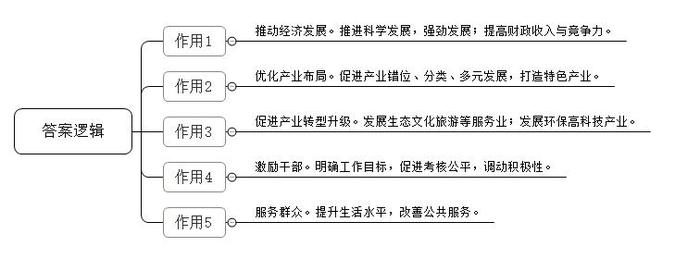
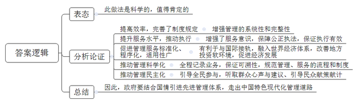
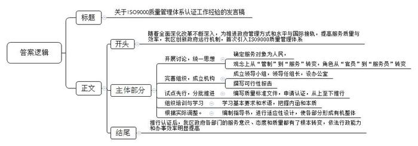
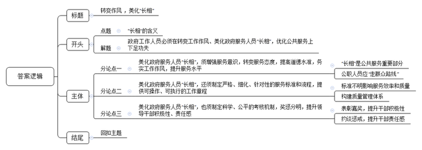

# 2018年公务员多省联考《申论》题（黑龙江B卷：公检法）

> 候选采集稿。参考答案及解析来自粉笔页面，不代表官方答案或真实高分答卷；来源使用许可与原卷对应关系仍需人工核实。

## 给定材料

### 材料 material-0be2075534cb9f90

政府绩效考核是指运用科学的方法和标准对政府部门及其工作人员完成工作的数量、质量、效率及行为模式等方面进行综合评价的管理手段和过程，通俗地说就是“评官评政”。其目的在于通过掌握政府部门的绩效，建立与绩效挂钩的激励机制，提高政府部门及其工作人员的积极性、主动性、创造性，促进其潜能的最大发挥，实现组织与个人的共同成长，最终通过绩效考核促使政府部门提供让群众满意的公共服务。

在过去的30多年中，我国一直以GDP为主要内容对地方经济发展和领导干部政绩进行考核，取得了较好的效果，但也带来了不少问题，如一些地区以牺牲资源和环境为代价一味地追求GDP增长等。这种单纯以GDP作为地方经济发展和领导干部考核指标的评价体系越来越受到社会的诟病。

近年来，G市积极实行乡镇分类考核，让发展的指挥棒不再只唯GDP，而是注重地域特色，并凭借创建“科学定位、分类考核”机制荣获了“2017年度中国政府创新最佳实践奖”。这种差异化的考核体系，强烈地透露出当地科学发展的精神，推动全市经济社会呈现出强劲发展态势。去年，G市完成财政收入35.02亿元，同比增长15.3%，连续两年荣获全省科学发展综合考核评价先进县(市)。在全国县域经济竞争力排名130位，发展潜力排名79位，两项排名均列全省第二。

新出台的乡镇分类考核办法，引导乡镇错位发展、分类发展。根据各地经济实力、资源禀赋、功能定位等，按照工业、农业、现代服务业、城市建设和综合发展等工作重点，将全市各乡镇划分成5类不同区域，设计了5种考核体系，各乡镇根据区域类型不同，分别突出现代服务业、开放型经济、工业和民营经济以及生态环保等工作重点。

伍桥镇是个传统农业乡镇，但在过去的考核中，经济指标却和工业乡镇占比一样。这使得镇干部必须拿出大量时间和精力外出寻找工业项目。由于先天不足，不但工业没有很大突破，农业优势也未得到充分发挥。作为贫困乡镇，招商引资本已不易，而考核数据却年年递增，乡镇干部人人有指标。“整天忙于不熟悉的招商引资和应付统计数据”，一些干部甚至不知道全乡10个村的分布情况，“对于农业为主的乡镇，反正年底肯定是垫底的，干部没什么积极性，而且由于担心污染环境，群众不支持新建工业企业，高科技企业也不可能来这里啊。”当地一位乡镇干部苦恼地说，“待在农业乡镇，很多人觉得没前途。数字出官，官出数字，只有在数据上做文章。”伍桥镇落入这个“考核怪圈”，是因为与其他22个乡镇遵循着同一套考核办法。这种传统的考核办法让“打篮球的”和“踢足球的”同场比赛，导致各地不同的基础条件和发展特色被忽视。

传统的乡镇考核办法只注重考量财政收入、工业增加值等经济指标，导致各乡镇都往一条道上挤。实行差异化考核后，由于不再盲目追求工业经济指标，各乡镇纷纷放开手脚唱响“特色经”：田南镇依托富硒优势，引进浙江某集团投资20亿元发展富硒有机农业项目；灰埠镇投入近900万元资金改造集镇，使集镇承载力大大提升……

在考核中取得好名次有了希望，干部做工作也有了前所未有的积极性。在新的考核方式下，越来越多的乡镇找到了自己的主攻方向：新街镇工业基础好，就主攻招商引资，强攻工业经济，上半年引进新型工业项目9个，总签约资金达7亿多元；红星镇依托临近省会城市的优势，大力发展服务业，着重保护生态环境，实行产业发展“优一、选二、进三”战略，全力服务昌西文化产业园“五城”建设；瑞州街道把服务瑞阳新区建设作为“第一要务”，干部纷纷反映工作的目标性更强了。

在分类考核的指挥棒下，G市的老百姓享受到了比以往更多的实惠。八景镇建成了全省一流的乡镇集贸市场、全省首家农村数字化影院，并投资2000多万元建设设施一流的人民医院；石脑镇投入1.5亿元，启动中心小学改造、农贸市场改扩建等10多个民生项目。

### 材料 material-e04f77bfcaf24fa8

政府在社会生活中举足轻重，政府管理的优劣、政府效率的高低必然对社会发展产生重大影响。对此，记者专门进行了调研。在某地综合服务大厅，记者发现：首先，在内部管理上，制度和规定虽然多，但缺乏系统性和完整性，内部质量管理体系不够健全，不够科学，管理和控制不到位，执行走样、变调；其次，在业务管理上，存在着职责不清、程序不明、执法随意性大、服务意识不强、管理效率低、成本高、监督制约机制不到位等问题，并在一定程度上影响了政府形象，直接或间接地影响了行政机关职能作用的发挥。这说明，大力改进和提高这些地方政府行政管理的管理质量和工作效率迫在眉睫。

ISO9000质量管理体系是国际标准化组织制定的国际标准之一。该标准可帮助组织实施并有效运行质量管理体系，是质量管理体系通用的要求和指南。我国在20世纪90年代将ISO9000系列标准转化为国家标准，随后，各行业也将ISO9000系列标准转化为行业标准。

ISO9000质量管理体系最初源于制造业，由于在提高组织效率和改进产品质量方面的巨大推动作用，进而扩展到服务业和公共部门。在国际上，美国、新加坡、马来西亚、英国、加拿大、以色列等国家的政府部门，运用ISO9000国际标准的原理和方法改善政府部门内部管理，并获得了可喜的成功。

以提高质量为核心、强调过程方法的ISO9000质量管理体系为政府部门强化服务意识、提高服务质量带来了先进的理念和工具。实践证明，政府部门推行ISO9000质量管理体系，有利于政府增强服务意识，提高工作效能。

### 材料 material-6baeae7d2a50fb2e

B区是A市高新企业、科研机构、大专院校最为密集的地区。随着全面深化改革的不断深入，特别是进一步融入“一带一路”国家发展战略，B区委、区政府面临着管理方式、管理水平如何与国际接轨，政府职能如何向公共管理模式转变等一系列挑战和考验。

B区委、区政府在实践中，创新政府运行机制，将质量管理认证全面引入政府管理体系，政府服务质量与效率大大提高。他们在政府系统引进ISO9000标准认证，实现政府工作从“管制”到“服务”的转变，成为我国首家全面推行质量管理体系认证的地方政府。

“推行认证后，B区政府有了质的飞跃。”B区的群众和投资者普遍反映，现在政府机关工作人员笑脸服务多了，“衙门习气”少了，政府部门的服务意识、服务态度和服务质量都有了根本转变。与此同时，全区各部门依法行政能力不断增强，办事效率明显提高。有数据显示，一般文件的办文时间由ISO9000质量管理体系运行前的7至15天缩短为3至5天，三分之二的文件当天办结；工作重大差错率和有效投诉均为零，测评目标达标率为百分之百。这些都是B区在引入ISO9000质量管理体系之后发生的变化。

ISO9000认证标准注重“以顾客为关注焦点”。谁是政府的顾客呢？为此B区政府组织全区公务员进行大学习和大讨论。讨论中，公务员纷纷就“为谁执政、为谁服务”和“如何行政、如何服务”等问题，联系B区和本部门实际，各抒己见，“政府的顾客是人民”成为共识。不少公务员提出，推行质量管理体系，必须完成思想观念上从“管制”到“服务”的转变和政府工作人员角色上从“官员”到“服务员”的转换。

为确保投入人员多、涉及范围广的标准认证工作扎实有序推进，区政府发文成立了区ISO9000质量管理体系认证工作领导小组，由区长任领导小组组长，成员由党政各部门负责人组成，设立了具体开展贯彻质量管理标准和申请认证工作的ISO9000办公室，并由质量认证领导小组撰写了指导全区认证工作的可行性报告。

区质量技术监督局常局长介绍说，全区认证工作试点先行分三批推进。区党政办、组织部、计划和科技局、经济发展局、规划建设管理局首批试点启动，对这些工作部门的每一个工作岗位的职能、权限、责任、办事流程和时限等都要依法、依规作出相应的具体描述，并作出刚性的约束和要求，汇合成册，即成为使用和审核的依据，统称质量标准文件。编写这5个单位的质量标准文件历时3个月，文件篇幅70余万字。这5个单位开始按文件标准试运行，半年后申请认证，并成功通过国际权威认证机构——BSI（英国标准协会）的现场审核。这5个党政职能部门成为B区首批获得ISO9000认证的行政单位。

当年7月份，保税业务管理局等13个党政职能部门第二批启动贯标工作。12月通过国际权威认证机构——德国莱茵TUV（技术监督协会）的ISO9000认证，标志着B区全部二级职能部门的行政管理、服务工作按照ISO9000标准，纳入了程序化、规范化和标准化的轨道。

半年后，具有行政执行职能的事业单位、各街道办事处和社区服务中心等24个基层单位分两批继续扩展贯标工作，当年全部通过德国莱茵TUV认证。至此，B区所属机关20个职能部门、15个行政执行类事业单位和4个基层街道办事处全部纳入了行政管理质量标准体系。

对于B区各个政府部门来说，实施质量管理体系是一个全新的尝试，如何更好地理解和把握ISO9000标准的基本要求和内在价值是关键。为此，B区政府组织了政府领导、行政人员及内审员进行培训，认真学习ISO9000体系相关知识，特别是把握构建ISO9000整个体系的基础、基本术语和概念的内涵与本质，实现“不是用ISO9000的语言规范工作，而是用ISO9000的方法和理念规范工作”。

作为一种外来的、还是从企业延伸过来的制度创新，地方政府推行ISO9000质量管理一开始就面临诸多困难。政府机关面对的工作对象及要处理的事务复杂多样，而且不同部门的工作环境、工作内容和工作目标也不尽相同。B区在推行ISO标准认证过程中，不少部门将“质量管理”简单地理解为“目标管理”，将“质量控制”错误地理解为“质量认证”，认为只要严格遵循ISO9000质量管理体系的规定程序，完成了相关目标，就实现了全面质量管理。ISO9000标准的有些原则与政府机关原有的一些制度并不完全一致，这就需要各部门根据自身实际对ISO9000标准进行适当调整。B区地税局根据地税管理的具体要求，结合创建《标准化分局建设办法》《地税局管理制度汇编》《岗位操作规范汇编》等相关文件编制了103个《作业指导书》，并在此基础上，根据自身的实际情况对ISO标准中的条文进行适应设计，编写了16个程序化文件，把各环节、各部门、各岗位连接成为有机的整体。

## 题目

### 第 1 题

**根据“给定资料**1**～**2**”，简要概括差异化考核对G市发展的推动作用。（15分）**

关联材料：material-0be2075534cb9f90

作答要求：

要求：

（1）内容全面，条理清楚，简明扼要；

（2）不超过150字。

### 第 2 题

**根据“给定资料**3**～**4**”，对我国部分地方政府积极推行ISO9000质量管理体系的现象进行评价。（20分）**

关联材料：material-e04f77bfcaf24fa8

作答要求：

要求：

（1）分析透彻，表达准确，简明扼要；

（2）不超过250字。

### 第 3 题

**为进一步提高政府公共服务质量，A市决定在B区召开ISO9000质量管理体系认证工作经验交流会，B区张副区长将在会上做经验交流发言。请你根据“给定资料**5**”，为张副区长草拟一份经验交流发言稿的内容提要。（25分）**

关联材料：material-6baeae7d2a50fb2e

作答要求：

要求：

（1）内容全面，符合实际；

（2）条理清楚，逻辑清晰，不考虑格式；

（3）不超过350字。

### 第 4 题

**“给定资料**6**”中提到：“在政府为社会公众提供的公共服务中，政府工作人员的‘长相’却是整体服务的一部分”。请你根据对这句话的理解，结合给定资料，自选角度，自拟题目，写一篇议论文。（40分）**

关联材料：material-0be2075534cb9f90

作答要求：

要求：

（1）观点鲜明，认识深刻；

（2）思路清晰，语言流畅；

（3）联系实际，不拘泥于给定资料；

（4）字数1000～1200字。

## 答案与解析

第 1 题

**参考答案（粉笔题库参考内容）**

1.推动经济发展。推进科学发展，强劲发展；提高财政收入与竞争力。

2.优化产业布局。促进产业错位、分类、多元发展，打造特色产业。

3.促进产业转型升级。发展生态文化旅游等服务业；发展环保高科技产业。

4.激励干部。明确工作目标，促进考核公平，调动积极性。

5.服务群众。提升生活水平，改善公共服务。

**解析**

**参考答案说明：**本参考答案从“推动经济发展”“优化产业布局”“促进产业转型”“激励干部”“服务群众”这五个方面把差异化考核对G市发展的推动作用进行了分条撰写，各条答案要点之间在内容上是并列关系，没有交叉。

**考点**：考点影响类

**来源**：来源2018年公务员多省联考《申论》题（黑龙江B卷：公检法）

粉笔申论页面对本题只提供「解析视频」入口，该入口是会员推广位，页面无视频地址与文字解析。

第 2 题

**参考答案（粉笔题库参考内容）**

此做法是科学的，值得肯定的。理由如下：

1.提高效率，完善了制度规定。增强管理的系统性和完整性。

2.提升服务水平，推动执行。增强了服务意识，保障公正执法，保证执行有效。

3.促进管理服务标准化、程序化，适用性广。有利于与国际接轨，融入世界经济体系，改善地方投资软环境，促进经济发展。

4.推动管理科学化。全程记录业务，保证可溯性，规范管理、服务的流程和制度。

5.推动管理民主化。引导全民参与，听取群众心声与建议、引导民众献策献计。

因此，政府要结合国情引进先进管理体系，走出中国特色现代化管理道路。

**解析**

**参考答案说明：**思路方面，本参考答案按照观点现象分析题“解释抽象的观点、现象（本题分析对象“部分地方政府积极推行ISO9000质量管理体系”直白易懂，且资料中未涉及相关释义，可不写）+表态+分析论证+总结”的一般答题思路展开。内容方面，本参考答案先对“我国部分地方政府积极推行ISO9000质量管理体系”这一现象进行表态，再从“完善制度”“提升服务”“促进管理标准化”“推动管理科学化”“推动管理民主化”等5个方面指出“积极推行ISO9000质量管理体系”的意义，最后对“积极推行ISO9000质量管理体系”这一举措进行了总结。词句表达上，本答案的撰写利用了“理由如下……”“因此……”这样一些连接语，使得答案各要素在逻辑上联系更紧密。

**考点**：考点观点现象分析类

**来源**：来源2018年公务员多省联考《申论》题（黑龙江B卷：公检法）

粉笔申论页面对本题只提供「解析视频」入口，该入口是会员推广位，页面无视频地址与文字解析。

第 3 题

**参考答案（粉笔题库参考内容）**

关于ISO9000质量管理体系认证工作经验的发言稿

随着全面深化改革不断深入，为推进政府管理方式和水平与国际接轨，提高服务质量与效率，我区创新政府运行机制，首次引入ISO9000质量管理体系，具体经验如下：

一、开展讨论，统一思想。确定服务对象为人民，观念上从“管制”到“服务”转变，角色从“官员”到“服务员”转变。二、完善组织，成立机构。成立领导小组，领导任组长，设办公室，撰写可行性报告。三、试点先行，分批推进。编写质量标准文件，申请认证，从上至下推行。四、组织培训与学习。学习基本要求和术语，把握内涵和本质。五、根据实际调整。编制指导书，进行适应性设计，使各部分形成有机整体。

推行认证后，我区政府各部门的服务意识、态度和质量都有了根本转变，依法行政能力和办事效率明显提高。

**解析**

**参考答案说明****：**（1）本题虽然不要求考虑格式，但为了保险起见，建议加上标题。（2）正文部分，一方面从内容来看，围绕着“ISO9000质量管理体系认证”这一主题，本参考答案的开头先写到了“推进ISO9000质量管理体系的背景和目的”；主体部分从“开展讨论，统一思想”“完善组织，成立机构”“试点先行，分批推进”“组织培训与学习”“根据实际调整”等几个方面给出了具体的经验；结尾则介绍了B区在引入ISO9000质量管理体系之后产生的效果。另一方面，形式上，本参考答案做到了分段、分条撰写，整体上条理较为清晰。

**考点**：考点总结类

**来源**：来源2018年公务员多省联考《申论》题（黑龙江B卷：公检法）

粉笔申论页面对本题只提供「解析视频」入口，该入口是会员推广位，页面无视频地址与文字解析。

第 4 题

**参考答案（粉笔题库参考内容）**

**转变作风 美化“长相”**

强化政府的公共服务职能，建设高效服务型政府是时代发展的必然趋势和要求。政府的公共服务不仅包括硬件方面的有形物质实体，更多的是为群众提供无形的产品。而在这一过程中政府服务人员的“长相”却是政府服务的一部分。**“长相”即工作效率、服务态度、工作作风，其直接决定着公共服务质量和群众满意度**。因此，政府工作人员必须在转变工作作风、美化“长相”，在优化公共服务上下足功夫。

**美化政府服务人员“长相”，须增强服务意识，转变服务态度，提高道德水准，务实工作作风，提升服务水平。**政府的“长相”是公共服务的重要部分，是一种无形的产品，体现的质量标准应该是可信度、公正性、及时性、亲和力等内在品质。群众最关心的内容就是政府提供的服务是否能满足其需求和期望。因此，在公众面前展示政府工作人员良好的“长相”，必须“走群众路线”，政府工作人员不论黑白美丑的长相，都必须微笑服务、热情服务、高效服务、真诚服务、贴心服务，让群众点赞的政府工作人员，就是“长相”最美的公仆。

**美化政府服务人员“长相”，还须制定严格、细化、针对性的服务标准和流程，提供可操作、可执行的工作章程。**随着改革全面深入，我国政府管理方式面临诸多挑战。李克强总理曾在国务院常务会议上讲述一个要求群众“证明你妈是你妈”的荒诞故事，痛斥某些政府工作人员为民办事设多道“障碍”。公职人员职责不清、标准不明、程序混乱直接影响服务效率和质量。为更好地满足民众需求，需加快构建质量管理体系，如一些地方政府建立ISO9000质量管理体系，明确工作岗位的职能、权限和责任，制定符合实际的程序手册、操作文件，做到工作中有规可依。增强工作人员依法行政能力，尤其是领导干部发挥带头示范作用，提高服务质量、效率，实现行政管理、服务工作程序化、规范化、标准化。

**美化政府服务人员“长相”，也须制定科学、公平的考核机制，奖惩分明，提升领导干部积极性、责任感。**邓小平说：“制度好可以使坏人无法任意横行，制度不好可以使好人无法充分做好事，甚至会走向反面”。因此好的考核制度是公职人员提供优质服务的根本保证。政府服务在空间、时间上不断变化，因此在考核方式上也要有创新、求突破，结合实际情况，有针对性地进行差异化、达标式的考核。一方面，要通过表彰嘉奖，提升干部积极性、主动性、创造性；另一方面，通过约谈惩罚，提高干部责任感、使命感。当这些具体的考核指标化为政府工作人员日常面对群众的自然“长相”时，政府工作人员的“长相”自然就是美丽的，群众评价自然是满意的。

服务好不好，要看乡亲们是哭还是笑。能不能让老百姓有需而来，满意而归，工作人员的服务态度起到了决定性的作用。只有政府工作人员在公共服务中真正注重“长相”，转变工作作风，改善服务态度，才能真正提高群众的满意度，才能增强政府的公信力和凝聚力！

**解析**

**文章分析**

**转变作风 美化“长相”**

【**标题的优点：**首先，范文的标题“转变作风 美化‘长相’”突出了“政府工作人员的‘长相’”这一主题。其次，它在形式上采用对称式结构，使标题更加完整、饱满。】

（1）强化政府的公共服务职能，建设高效服务型政府是时代发展的必然趋势和要求。政府的公共服务不仅包括硬件方面的有形物质实体，更多的是为群众提供无形的产品。而在这一过程中政府服务人员的“长相”却是政府服务的一部分。**“长相”即工作效率****、****服务态度****、****工作作风****，****其直接决定着公共服务质量和群众满意度**。因此，政府工作人员必须在转变工作作风、美化“长相”，在优化公共服务上下足功夫。

【**开头的优点：**★内容方面。范文的开头是紧扣题目给定的“政府工作人员的‘长相’”这一主题展开的。首先，开头即点出主题，做到了主题明确。其次，对“政府工作人员的‘长相’”这一主题进行了分析阐述，指出了（1）“背景”。（2）“政府的公共服务”。（3）“‘长相’的含义”。★文字表达方面：使用了“而”“不仅……更多的是……”“因此”等关联词，使语言表达更有逻辑性。】

**美化政府服务人员“长相”，须增强服务意识，转变服务态度，提高道德水准，务实工作作风，提升服务水平。**（1）政府的“长相”是公共服务的重要部分，是一种无形的产品，体现的质量标准应该是可信度、公正性、及时性、亲和力等内在品质。（2）群众最关心的内容就是政府提供的服务是否能满足其需求和期望。因此，在公众面前展示政府工作人员良好的“长相”，必须“走群众路线”，政府工作人员不论黑白美丑的长相，都必须微笑服务、热情服务、高效服务、真诚服务、贴心服务，让群众点赞的政府工作人员，就是“长相”最美的公仆。

【**论述段****1****的优点：**★观点句：范文的观点句是紧扣“政府工作人员的‘长相’”这一文章主题提出的。形式上，它在段首处直接写出，位置突出，容易发现。内容上，关键词突出，内容要点明确，可以明显看出它是从“意识态度”入手，指出了“如何美化政府工作人员的‘长相’”。★论述内容：（1）介绍了“公共服务的标准”；（2）介绍了“群众关心的内容”；（3）“如何展示政府工作人员良好的‘长相’”。注意：以上三个方面的内容都是紧扣“美化政府服务人员‘长相’，须增强服务意识，转变服务态度，提高道德水准，务实工作作风，提升服务水平”这个观点句进行分析论述的，论述的针对性强，内容层次丰富。在论述方法和论据的选取上做到了讲道理和举例子相结合，做到了丰富多样。】

**美化政府服务人员“长相”，还须制定严格、细化、针对性的服务标准和流程，提供可操作、可执行的工作章程。**（1）随着改革全面深入，我国政府管理方式面临诸多挑战。李克强总理曾在国务院常务会议上讲述一个要求群众“证明你妈是你妈”的荒诞故事，痛斥某些政府工作人员为民办事设多道“障碍”。公职人员职责不清、标准不明、程序混乱直接影响服务效率和质量。（2）为更好地满足民众需求，需加快构建质量管理体系，如一些地方政府建立ISO9000质量管理体系，明确工作岗位的职能、权限和责任，制定符合实际的程序手册、操作文件，做到工作中有规可依。增强工作人员依法行政能力，尤其是领导干部发挥带头示范作用，提高服务质量、效率，实现行政管理、服务工作程序化、规范化、标准化。

【**论述段****2****的优点：**★观点句：范文的观点句是紧扣“政府工作人员的‘长相’”这一文章主题提出的。形式上，它在段首处直接写出，位置突出，容易发现。内容上，关键词突出，内容要点明确，可以明显看出它是从“标准流程”入手，指出了“如何美化政府工作人员的‘长相’”。★论述内容：（1）介绍了“政府管理方式面临诸多挑战，影响服务效率和质量”；（2）介绍了“构建质量管理体系”。注意：以上两个方面的内容都是紧扣“美化政府服务人员‘长相’，还须制定严格、细化、针对性的服务标准和流程，提供可操作、可执行的工作章程”这个观点句进行分析论述的，论述的针对性强，内容层次丰富。在论述方法和论据的选取上做到了讲道理和举例子相结合，做到了丰富多样。】

**美化政府服务人员“长相”，也须制定科学、公平的考核机制，奖惩分明，提升领导干部积极性、责任感。**（1）邓小平说：“制度好可以使坏人无法任意横行，制度不好可以使好人无法充分做好事，甚至会走向反面”。因此好的考核制度是公职人员提供优质服务的根本保证。政府服务在空间、时间上不断变化，因此在考核方式上也要有创新、求突破，结合实际情况，有针对性地进行差异化、达标式的考核。（2）一方面，要通过表彰嘉奖，提升干部积极性、主动性、创造性；（3）另一方面，通过约谈惩罚，提高干部责任感、使命感。当这些具体的考核指标化为政府工作人员日常面对群众的自然“长相”时，政府工作人员的“长相”自然就是美丽的，群众评价自然是满意的。

【**论述段****3****的优点：**★观点句：范文的观点句是紧扣“政府工作人员的‘长相’”这一文章主题提出的。形式上，它在段首处直接写出，位置突出，容易发现。内容上，关键词突出，内容要点明确，可以明显看出它是从“考核机制”入手，指出了“如何美化政府工作人员的‘长相’”。★论述内容：（1）介绍了“好的考核制度是公职人员提供优质服务的根本保证”；（2）介绍了“表彰嘉奖，提升干部积极性”；（3）介绍了“约谈惩罚，提升干部责任感”。注意：以上三个方面的内容都是紧扣“美化政府服务人员‘长相’，也须制定科学、公平的考核机制，奖惩分明，提升领导干部积极性、责任感”这个观点句进行分析论述的，论述的针对性强，内容层次丰富。在论述方法和论据的选取上做到了讲道理和举例子相结合，做到了丰富多样。】

服务好不好，要看乡亲们是哭还是笑。能不能让老百姓有需而来，满意而归，工作人员的服务态度起到了决定性的作用。只有政府工作人员在公共服务中真正注重“长相”，转变工作作风，改善服务态度，才能真正提高群众的满意度，才能增强政府的公信力和凝聚力！

【**结尾的优点：**范文的结尾回扣了“政府工作人员的‘长相’”这一主题。再次总结了“如何美化政府工作人员的‘长相’”，并阐述了深远意义。】

**考点**：考点文章写作题

**来源**：来源2018年公务员多省联考《申论》题（黑龙江B卷：公检法）

粉笔申论页面对本题只提供「解析视频」入口，该入口是会员推广位，页面无视频地址与文字解析。

