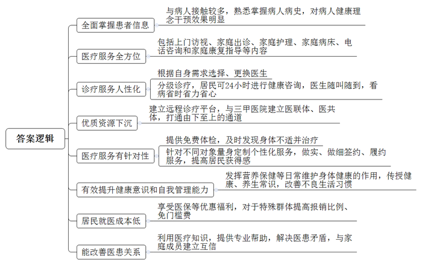
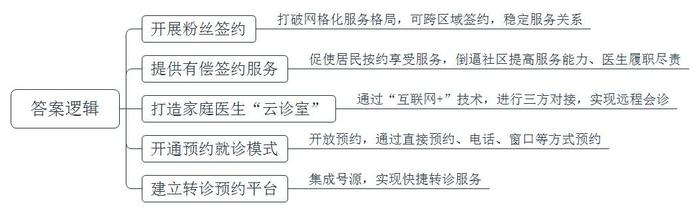
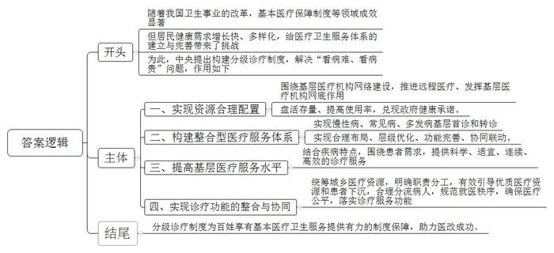
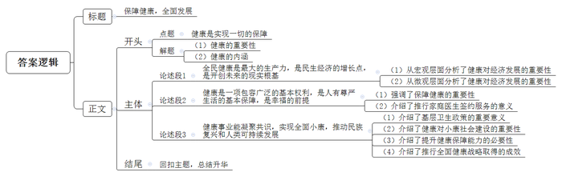

# 2019年黑龙江省公考《申论》题（急需紧缺岗位）

> 候选采集稿。参考答案及解析来自粉笔页面，不代表官方答案或真实高分答卷；来源使用许可与原卷对应关系仍需人工核实。

## 给定材料

### 材料 material-d0282e89d825cda4

习近平总书记在党的十九大报告中指出：“要完善国民健康政策，为人民群众提供全方位全周期健康服务。”这充分体现了我们党对健康在促进人的全面发展和经济社会协调发展中重大作用的整体思路。

十九大报告中谈到实施健康中国战略，要进一步深化医药卫生体制改革，全面建立中国特色基本医疗卫生制度、医疗保障制度和优质高效的医疗卫生服务体系，健全现代医院管理制度，要加强基层医疗卫生服务体系和全科医生队伍建设。

家庭医生，又称全科医生，起源于18世纪的欧美，正式形成于20世纪60年代的美国。和专科医生不同，家庭医生是最基层的医生，也是病人接触最多的医生，对病人健康理念的干预效果最明显。在发达国家，家庭医生制度已经发展得非常成熟。例如在美国，公民在获得医疗保险之后，就可以选择家庭医生来为自己提供基本的医疗服务。这一服务不需要签约，如果对家庭医生不满意，可以随时更换。除了疾病的治疗之外，家庭医生在美国还发挥着体检、营养保健等日常维护身体健康的作用。

对于中国而言，家庭医生概念是舶来品，20世纪80年代才引入国内。现阶段中国的家庭医生主要包括基层医疗卫生机构注册的全科医生（含助理全科医生和中医类别全科医生），以及具备能力和资质的乡镇卫生院医师、乡村医生和公立医院退休临床医生等。家庭医生面向家庭和社区，以保障居民身体健康、提供个性化服务为宗旨，身兼基本医疗、公共卫生和健康管理三大职责，肩负着健康守门人的重担。

以下摘自D市家庭医生签约服务工作纪实：

“没什么大问题，就是普通感冒，给你开点药，回去多喝水就行了。”邓爱明认真检查后告诉患者李莉。邓爱明是D市绿洲路社区卫生服务中心的内科医生，也是李莉的家庭医生，对李莉的病史很熟悉。

“以前不进社区医院，不管得啥病都上市里的医院，排队都要排半天，病人太多，见了医生也说不上两句话，开完药就完事儿，想多问两个问题都不行。现在小病都来这儿，因为在这里看病省时、省力、省心，而且还可以享受医保报销额度优惠等政策。如果行动不便，还可以让家庭医生到家里看病，随叫随到，啥时候都行。”李莉说。

“居民可以24小时向家庭医生咨询健康问题、寻求帮助或者直接找医生看病，居民步行15分钟即可就医，分级诊疗的推进，让我们这儿的患者多了起来。”绿洲路社区卫生服务中心党支部书记张文雯介绍。

“所有乡镇（社区）医院与辖区内三甲医院建立医联体、医共体，打通了从下到上的通道，优质资源顺利下沉，让签约居民在家门口就能享受到三甲医院的服务。”D市卫健委基层卫生科科长许芙蓉说。远程诊疗平台的建立，更是让签约居民在家门口就可以享受到优质服务。

D市2018年有22万余人签约了服务协议。今年截至4月份，已签约50833人，签约率14.4%。家庭医生还为有需要的签约居民提供上门访视、家庭出诊、家庭护理、家庭病床、电话咨询和家庭康复指导等服务。“户户拥有家庭医生，人人分享基本医疗。”D市卫健委副主任郭丽莉说，这是他们的努力目标。

觉得自己年纪不大，身体挺好，六工镇下六工村村民宋建江以前从未做过体检。2017年首次免费健康体检，他故意溜掉了。2018年他没“躲过去”，在镇卫生院参加了体检。第二天，医生告知他患有胆结石。听从医生建议后，他到D市人民医院住院治疗，并很快康复。

“手术及住院费总计8128元，我只花了1468元。”宋建江说，“如果等病严重了再去医院，花钱多不说，能不能治好都是问题！以后再忙也要按时体检。”

六工镇卫生院家庭医生杨静来到下六工村三组村民付新花家。经过检查后，杨静告诉付新花：“高压118，低压76，血压正常；血糖4.8，正常。”听到这个结果，付新花很高兴，并告诉杨静，这几个月她头不晕，口不干，饮食正常，体重没有明显变化……

“现在可不敢胡吃海喝，得少吃盐油、少吃肉，多吃蔬菜多运动。”付新花说，她2017年参加全民体检，查出有糖尿病，杨医生给她制定了个性化的康复指导方案，经过近一年的康复治疗，她各项指标都恢复正常了。

“现在大家都特别注重养生了，杨医生一来，除了检查看病，更多的是给我们传授一些健康、养生的常识，我们也慢慢地改变了那些不良的生活起居习惯。”付新花说：“每天早晨、晚上，村里广场上锻炼的人特别多。”

六工镇卫生院院长杨晓琴说：“从过去的一生病就到大医院扎堆，到现在有健康问题先拨打家庭医生的电话咨询，居民的健康意识和自我管理能力均有所提高。”

“杨医生，我这几天头特别晕，不知道是咋回事？”一天晚上，D市六工镇下六工村村民杨千电话求助该村签约医生杨静。

接完电话，杨静拿上设备，骑车15分钟赶到杨千家为他检查，确诊为血压升高而引发头晕，建议杨千到镇卫生院住院治疗。

“杨医生说住院治疗7天，费用在900元左右，我自己只要花100元左右就够了，要在大医院治疗，自己得花1300元左右。”杨千告诉记者，像他这样的低收入家庭人员和持有计划生育“两证”的家庭人员，住院可以提高5%的报销比例，免80元的门槛费。

为了让老百姓享受“多（慢性病患者长处方）、快（绿色转诊通道）、好（综合性、连续性的服务）、省（特殊病人提高医保报销比例）”的医疗红利，D市针对不同的对象人群“量身定制”个性化签约服务包，做实、做细签约、履约服务，提升签约居民的获得感。

家住柏树林辖区马场子居委会的陈凤彩老人今年96岁，5年前因脑出血住院，出院后老人一直瘫痪卧床，大小便失禁，无自主吞咽功能，生活不能自理，长期需要定期更换胃管和导尿管。去年，老人的家属找到了该社区卫生服务中心。根据老人的情况，中心与老人的家属签订了《家庭医生签约服务协议书》，马场子全科医师团队定期到老人家里，为老人更换胃管和导尿管，服务三年以来，老人的家属和团队的医生都成了熟人、朋友。“除了照顾我妈，我们家人遇到什么健康问题，都第一时间给医生打电话，他们及时给予解答，还提供专业的帮助和建议，小病小痛都能解决，省得我们自己上网去查。”陈凤彩的大女儿说。由于家庭医生与家庭成员建立了互信关系，家庭医生可以利用自己掌握的医疗知识，对服务家庭遇到的健康问题给予及时的解答，提供专业帮助，随时化解医患矛盾，防止因为服务家庭不了解医疗专业知识，造成悲剧的发生。

### 材料 material-c553381c10a663d9

A市是我国最早进行家庭医生签约服务试点的城市之一。据第三方调查显示，A市居民对家庭医生的知晓率达到近九成，92.1%的签约居民表示找家庭医生就诊很方便，对家庭医生服务态度、服务效果的满意度分别达到95.5%和89.1%。

据A市卫健委的吴主任介绍：2011年，A市启动家庭医生制度试点，由社区卫生服务中心全科医生担任家庭医生。在自愿的原则下，通过服务过程引导，由社区发动，逐步与居民建立签约服务关系。通过试点引导居民认识、接触与逐步接受家庭医生服务，初步建立家庭医生与签约居民之间的联系，称之为“A市家庭医生制度1.0版”。

随后，A市针对有效利用医疗资源、就诊人群、就诊习惯进行了大数据的科学分析，并根据大数据分析结果，设计了“1+1+1”医疗机构组合签约政策。2015年11月，在家庭医生签约基础上，A市启动了“1+1+1”医疗机构组合签约试点（即居民可自愿选择一名社区卫生服务中心的家庭医生签约，并可再在全市范围内选择一家区级医院、一家市级医院进行签约），优先满足本市60岁以上老人、慢性病居民、妇女、儿童等重点人群签约需求，着力打造家庭医生制度2.0版。

2019年6月19日，A市所有社区卫生服务中心均已启动“1+1+1”医疗机构组合签约试点，实现100%社区覆盖。

2017年，C市创新开展了家庭医生“粉丝”签约服务，这种签约方式打破以居住地为单位的网格化服务格局。居民可跨辖区选择自己信任的家庭医生签约，使医患之间建立起更加稳定、互信的服务关系。对家庭医生而言，如果粉丝量下滑，说明自身服务质量受到质疑，会因压力被倒逼改进服务。75岁的石老患有中风，又长期受糖尿病的困扰。经多方求医、反复比较后，石老觉得程建国医生医术高超，服务态度也很好。石老就此成了程医生的“粉丝”。无论程医生调往哪个辖区，石老都要找他为自己的健康把脉。

C市在实践中发现，部分群众对无偿签约服务的依从性不高，配合健康管理的意识也不强，而有偿服务能建立更紧密牢固的契约服务关系。为引导签约居民主动配合家庭医生的健康管理，2017年12月，C市开始尝试有偿签约服务。有偿签约促使签约居民仔细对照协议约定享受服务，倒逼社区卫生服务中心提高服务能力，督促家庭医生更好地履职尽责。据了解，无偿免费服务包含12类46项内容，如建立居民健康档案、预防接种、特定人群和疾病的健康管理等。有偿增值服务包含5类11项内容，如CR摄片、住院门槛费优惠、挂号费优惠等，可满足特殊人群需求。

最近，C市家庭医生签约服务又出“新招”。杏林街道社区卫生服务中心打造家庭医生“云诊室”，通过“互联网+”技术手段，使居民、社区中心全科医师、医联体三甲医院专家三方“对接”，实现远程会诊。一些常见病，可以直接视频问诊、在线购药；对于疑难杂症，还可以连接北、上、广等城市甚至海外的医院实现远程会诊，为签约居民提供了更多方便。

C市还为签约“家庭医生”的居民实行预约就诊的新模式，社区卫生服务机构所有号源都可以开放预约。居民可直接和签约医生预约，也可以通过社区卫生服务中心预约电话或窗口同签约医生预约。居民按照预约时间就诊，机构会将预约就诊居民导诊至其签约医生处候诊。

C市建立了全市转诊预约统一平台，能够集成所有医院号源，并为签约“家庭医生”的居民建立快捷转诊通道。如果由于诊疗技术或设备的原因，导致患者的疾病无法在社区治疗，医生会为患者提供转诊服务，转往大医院的相应科室，并给签约家庭医生的患者提供提前三天预约的便利。

## 题目

### 第 1 题

**请根据****“给定资料**1**”，分析D市家庭医生签约服务与普通医疗服务相比所具有的优势。（25分）**

关联材料：material-d0282e89d825cda4

作答要求：

要求：

（1）紧扣资料，观点明确；

（2）分析透彻，条理清晰；

（3）不超过400字。

### 第 2 题

**请根据****“给定资料**2**”，****概括****C市在创新家庭医生签约服务方面的经验做法。（15分）**

关联材料：material-c553381c10a663d9

作答要求：

要求：

（1）紧扣资料，观点明确；

（2）概括全面，条理清晰；

（3）不超过200字。

### 第 3 题

**假如你是一名准备参加分级诊疗制度研讨会的卫健委工作人员，请根据****“给定资料**3**”和“给定资料**4**”，围绕“分级诊疗制度在解决看病贵问题方面的作用”，撰写一篇发言提纲。（20分）**

关联材料：material-d0282e89d825cda4

作答要求：

要求：

（1）紧扣资料，内容完整；

（2）条理清晰，不考虑格式；

（3）不超过400字。

### 第 4 题

**请对****“给定资料**5**”中划线句子“健康的获得与实现对每个人都是至关重要的，永远不要放弃对健康的追求……”进行深入思考，联系实际，自拟题目，写一篇文章。（40分）**

关联材料：material-d0282e89d825cda4

作答要求：

要求：

（1）自选角度，立意明确；

（2）依据“给定资料”，但不拘泥于“给定资料”；

（3）思路清晰，语言流畅；

（4）总字数1000～1200字。

## 答案与解析

第 1 题

**参考答案（粉笔题库参考内容）**

1.全面掌握患者信息。与病人接触较多，熟悉掌握病人病史，对病人健康理念干预效果明显。

2.医疗服务全方位。包括上门访视、家庭出诊、家庭护理、家庭病床、电话咨询和家庭康复指导等内容。

3.诊疗服务人性化。根据自身需求选择、更换医生；分级诊疗，居民可24小时进行健康咨询，医生随叫随到，看病省时省力省心。

4.优质资源下沉。建立远程诊疗平台，与三甲医院建立医联体、医共体，打通由下至上的通道。

5.医疗服务有针对性。提供免费体检，及时发现身体不适并治疗；针对不同对象量身定制个性化服务，做实、做细签约、履约服务，提高居民获得感。

6.有效提升健康意识和自我管理能力。发挥营养保健等日常维护身体健康的作用，传授健康、养生常识，改善不良生活习惯。

7.居民就医成本低。享受医保等优惠福利，对于特殊群体提高报销比例、免门槛费。

8.能改善医患关系。利用医疗知识，提供专业帮助，解决医患矛盾，与家庭成员建立互信。

**解析**

**参考答案说明：**本参考答案从“全面掌握患者信息”“医疗服务全方位”“诊疗服务人性化”“优质资源下沉”“医疗服务有针对性”“有效提升健康意识和自我管理能力”“居民就医成本低”“能改善医患关系”这八个方面进行了分条撰写。各条答案要点之间在内容上相互并列，没有交叉。

**考点**：考点特点类

**来源**：来源2019年黑龙江省公考《申论》题（急需紧缺岗位）

粉笔申论页面对本题只提供「解析视频」入口，该入口是会员推广位，页面无视频地址与文字解析。

第 2 题

**参考答案（粉笔题库参考内容）**

1.开展粉丝签约。打破网格化服务格局，可跨区域签约，稳定服务关系。

2.提供有偿签约服务。促使居民按约享受服务，倒逼社区提高服务能力、医生履职尽责。

3.打造家庭医生“云诊室”。通过“互联网+”技术，进行三方对接，实现远程会诊。

4.开通预约就诊模式。开放预约，通过直接预约、电话、窗口等方式预约。

5.建立转诊预约平台。集成号源，实现快捷转诊服务。

**解析**

**参考答案说明：**本参考答案从“开展粉丝签约”“提供有偿签约服务”“打造家庭医生‘云诊室’”“开通预约就诊模式”“建立转诊预约平台”五个方面对C市在创新家庭医生签约服务方面的经验做法进行了分条撰写。各条答案要点之间在内容上相互并列，没有交叉。

**考点**：考点经验启示类

**来源**：来源2019年黑龙江省公考《申论》题（急需紧缺岗位）

粉笔申论页面对本题只提供「解析视频」入口，该入口是会员推广位，页面无视频地址与文字解析。

第 3 题

**参考答案（粉笔题库参考内容）**

随着我国卫生事业的改革，基本医疗保障制度等领域成效显著。但居民健康需求增长快、多样化，给医疗卫生服务体系的建立与完善带来了挑战。为此，中央提出构建分级诊疗制度，解决“看病难、看病贵”问题，作用如下：

一、实现资源合理配置。围绕基层医疗机构网络建设，推进远程医疗、发挥基层医疗机构网底作用，盘活存量、提高使用率，兑现政府健康承诺。二、构建整合型医疗服务体系。实现慢性病、常见病、多发病基层首诊和转诊，实现合理布局、层级优化、功能完善、协同联动。三、提高基层医疗服务水平。结合疾病特点，围绕患者需求，提供科学、适宜、连续、高效的诊疗服务。四、实现诊疗功能的整合与协同。统筹城乡医疗资源，明确职责分工，有效引导优质医疗资源和患者下沉，合理分流病人，规范就医秩序，确保医疗公平，落实诊疗服务功能。

分级诊疗制度为百姓享有基本医疗卫生服务提供有力的制度保障，助力医改成功。

**解析**

**参考答案说明：**（1）本题是公文题，要求写一份发言提纲，不需要考虑格式，只写正文即可。（2）正文部分，一方面从内容来看，围绕着“分级诊疗制度”这一主题，本参考答案的开头部分先写到了“实施分级诊疗制度的背景”；主体部分从“实现资源合理配置”“构建整合型医疗服务体系”“提高基层医疗服务水平”“实现诊疗功能的整合与协同”等四个方面给出了具体作用；最后结尾部分简单总结深化。另一方面，形式上，本参考答案做到了分段、分条撰写，整体上条理较为清晰。

**考点**：考点总结类

**来源**：来源2019年黑龙江省公考《申论》题（急需紧缺岗位）

粉笔申论页面对本题只提供「解析视频」入口，该入口是会员推广位，页面无视频地址与文字解析。

第 4 题

**参考答案（粉笔题库参考内容）**

**保障健康，全面发展**

党的十九大报告将“实施健康中国战略”作为国家发展基本方略中的重要内容，在战略上确定了健康的重要性。正如习近平总书记所说：“没有全民健康，就没有全面小康。”健康不仅仅指体魄康健，而是在身体上、精神上、社会适应上完全处于良好的状态，生理健康、心理健康、道德健康三方面构成健康的整体概念，健康是实现一切的保障。

**全民健康是最大的生产力****，****是民生经济的增长点****，****是开创未来的现实根基****。**从宏观来看多年来中国的经济发展得益于“人口红利”，从“中国制造”到“中国智造”的转变推动了中国经济的转型升级，这背后得益于中国人健康素质和劳动品质的提升。从微观来看，对于企业和员工而言，健康是劳动和创造的基础，只有群众身体健康，没有后顾之忧，才能全身心投入工作中。维护员工的职业安全和身心健康不仅能保证工作任务的及时完成，而且会提升产品的质量，一个身心健康的人在生产和服务过程中会投入更多的感情，让产品更人性化，更受市场的欢迎。

**健康是一项包容广泛的基本权利，是人有尊严生活的基本保障，是幸福的前提。**有位哲人说“拥有健康并不能拥有一切，但失去健康却会失去一切”。健康并不是人唯一的追求，但是健康是所有追求的保障。然而，健康并不会跟随人的一生，人吃五谷杂粮总是要有个头疼脑热的病，这时对于健康的保障就显得尤为重要。当前，我国推行的家庭医生签约服务让很多人过上了有尊严的、幸福的生活。从入户照顾常年卧病在床的老人减轻儿女负担和老人内疚感，到给所有民众提供免费体检，帮助患者实现“小病好治、大病早治”的治疗目标；从个性化指导，保障患者隐私，到低保收入家庭提高报销比例，让看病不再难；全面健康战略充分保障了人民群众的健康权利，增强了群众的幸福感和安全感。

**健康事业能凝聚共识，实现全面小康，推动民族复兴和人类可持续发展。**小康不小康，关键看老乡。这是全国和全民族的共识。目前“送医下乡”、“分级诊疗”、“健康扶贫”等卫生政策向农村倾斜，在一定程度上填平了城市与乡村医疗水平的巨大鸿沟。实现全面小康的农村环节正在打通，全民健康战略为小康社会的实现打造了现实基础。放眼未来，提升群众的健康素养和保障健康的能力是民族复兴的应有之义。从摘掉“东亚病夫”的帽子到“中国防控模式”的推广，中国在健康事业上不仅凝聚了国内共识，还赢得了世界人民的赞同。全民健康战略为人类的可持续发展提供了范例。

幸福的首要条件在于健康。实现全民健康是亿万人民的共同期盼，我们有理由相信，矢志不渝地推进保障人民健康系统工程，满足人民健康需求，就一定能够迎来健康之光，为人类健康事业发展增添更多光彩！

**解析**

**文章分析**

**保障健康，全面发展**

【**标题的优点**：首先，范文的标题突出了“健康”这一主题。其次，它在形式上采用了对称式结构，前半句点出了主题，后半句点出了意义，使标题更加完整、饱满。】

（1）党的十九大报告将“实施健康中国战略”作为国家发展基本方略中的重要内容，在战略上确定了健康的重要性。正如习近平总书记所说：“没有全民健康，就没有全面小康。”（2）健康不仅仅指体魄康健，而是在身体上、精神上、社会适应上完全处于良好的状态，生理健康、心理健康、道德健康三方面构成健康的整体概念，**健康是实现一切的保障。**

【**开头的优点：**★内容方面。范文的开头是紧扣题目给定的“健康”这一主题展开的。首先，开头开门见山点出主题，做到了主题明确。其次，对“健康”这一主题进行了分析阐述，指出了（1）健康的重要性；（2）健康的内涵。★文字表达方面：使用了“不仅仅……而是”等连接词，使语言表达具有严谨的逻辑性；长短句配合使用，使语言表达更加丰富、带有节奏感。】

**全民健康是最大的生产力，是民生经济的增长点，是开创未来的现实根基。**从宏观来看（1）多年来中国的经济发展得益于“人口红利”，从“中国制造”到“中国智造”的转变推动了中国经济的转型升级，这背后得益于中国人健康素质和劳动品质的提升。从微观来看，（2）对于企业和员工而言，健康是劳动和创造的基础，只有群众身体健康，没有后顾之忧，才能全身心投入工作中。维护员工的职业安全和身心健康不仅能保证工作任务的及时完成，而且会提升产品的质量，一个身心健康的人在生产和服务过程中会投入更多的感情，让产品更人性化，更受市场的欢迎。

【**论述段****1****的优点：**★观点句：范文的观点句是紧扣“健康”这一文章主题提出的。形式上，它在段首处直接写出，位置突出，容易发现。内容上，关键词突出，内容要点明确，可以明显看出它是从“健康是最大的生产力，是民生经济的增长点”展开了论述。★论述内容：（1）从宏观层面分析了健康对经济发展的重要性；（2）从微观层面分析了健康对经济发展的重要性。注意：以上两个方面的内容都是紧扣“全民健康是最大的生产力，是民生经济的增长点，是开创未来的现实根基”这个观点句进行分析论述的，论述的针对性强，内容层次丰富。在论述方法上采用了讲道理、举例子相结合的方式，论述清晰透彻。】

**健康是一项包容广泛的基本权利，是人有尊严生活的基本保障，是幸福的前提。**有位哲人说“拥有健康并不能拥有一切，但失去健康却会失去一切”。（1）健康并不是人唯一的追求，但是健康是所有追求的保障。然而，健康并不会跟随人的一生，人吃五谷杂粮总是要有个头疼脑热的病，这时对于健康的保障就显得尤为重要。当前，（2）我国推行的家庭医生签约服务让很多人过上了有尊严的、幸福的生活。从入户照顾常年卧病在床的老人减轻儿女负担和老人内疚感，到给所有民众提供免费体检，帮助患者实现“小病好治、大病早治”的治疗目标；从个性化指导，保障患者隐私，到低保收入家庭提高报销比例，让看病不再难；全面健康战略充分保障了人民群众的健康权利，增强了群众的幸福感和安全感。

【**论述段****2****的优点：**★观点句：范文的观点句是紧扣“健康”这一文章主题提出的。形式上，它在段首处直接写出，位置突出，容易发现。内容上，关键词突出，内容要点明确，可以明显看出它是从“健康是基本权利，是人有尊严生活的基本保障”展开了论述。★论述内容：（1）强调了保障健康的重要性；（2）介绍了推行家庭医生签约服务的意义。注意：以上两个方面的内容都是紧扣“健康是一项包容广泛的基本权利，是人有尊严生活的基本保障，是幸福的前提”这个观点句进行分析论述的，论述的针对性强，内容层次丰富。在论述方法上采用了讲道理、举例子相结合的方式，论述清晰透彻。】

**健康事业能凝聚共识，实现全面小康，推动民族复兴和人类可持续发展。**小康不小康，关键看老乡。这是全国和全民族的共识。（1）目前“送医下乡”、“分级诊疗”、“健康扶贫”等卫生政策向农村倾斜，在一定程度上填平了城市与乡村医疗水平的巨大鸿沟。（2）实现全面小康的农村环节正在打通，全民健康战略为小康社会的实现打造了现实基础。放眼未来，（3）提升群众的健康素养和保障健康的能力是民族复兴的应有之义。从摘掉“东亚病夫”的帽子到“中国防控模式”的推广，（4）中国在健康事业上不仅凝聚了国内共识，还赢得了世界人民的赞同。全民健康战略为人类的可持续发展提供了范例。

【**论述段****3****的优点：**★观点句：范文的观点句是紧扣“健康”这一文章主题提出的。形式上，它在段首处直接写出，位置突出，容易发现。内容上，关键词突出，内容要点明确，可以明显看出它是从“健康能实现全面小康，推动人类发展”展开了论述。★论述内容：（1）介绍了基层卫生政策的重要意义；（2）介绍了健康对小康社会建设的重要性；（3）介绍了提升健康保障能力的必要性；（4）介绍了推行全面健康战略取得的成效。注意：以上四个方面的内容都是紧扣“健康事业能凝聚共识，实现全面小康，推动民族复兴和人类可持续发展”这个观点句进行分析论述的，论述的针对性强，内容层次丰富。在论述方法上采用了讲道理、举例子相结合的方式，论述清晰透彻。】

【**论述段之间的关系：**★内容的内在逻辑：范文的论述段之间是依照“并列”的逻辑展开的。论述段1写了“全民健康是最大的生产力，是民生经济的增长点，是开创未来的现实根基”，论述段2写了“健康是一项包容广泛的基本权利，是人有尊严生活的基本保障，是幸福的前提”，论述段3写了“健康事业能凝聚共识，实现全面小康，推动民族复兴和人类可持续发展”，论述逻辑清晰、层次分明。】

幸福的首要条件在于健康。实现全民健康是亿万人民的共同期盼，我们有理由相信，矢志不渝地推进保障人民健康系统工程，满足人民健康需求，就一定能够迎来健康之光，为人类健康事业发展增添更多光彩！

【**结尾的优点：**范文的结尾回扣了“健康”这一主题，并且发出了对未来的展望，做到了首尾呼应。】

**考点**：考点文章写作题

**来源**：来源2019年黑龙江省公考《申论》题（急需紧缺岗位）

粉笔申论页面对本题只提供「解析视频」入口，该入口是会员推广位，页面无视频地址与文字解析。

