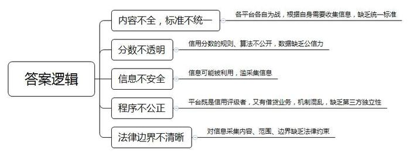
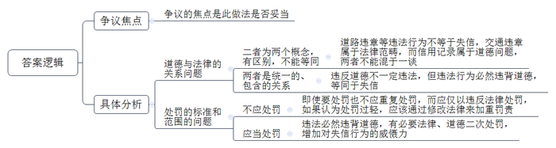
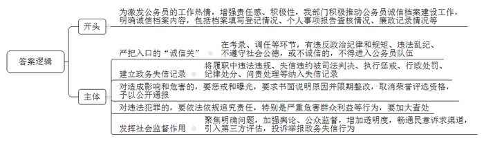
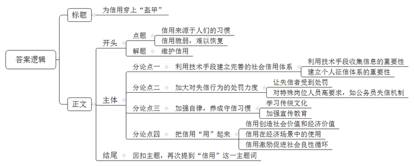

# 2019年公务员多省联考《申论》题（黑龙江公检法卷）

<!-- gwy:overview:start -->
> **黑龙江 · 2019 · 申论 · 公检法** ｜ 4 题 · 图片 4 处 · 答案随题折叠

导航：[题目](#题目) · [材料 1](#材料-1)
<!-- gwy:overview:end -->

> 候选采集稿。参考答案及解析来自粉笔页面，不代表官方答案或真实高分答卷；来源使用许可与原卷对应关系仍需人工核实。

## 给定材料

### 材料 1

随着移动互联网、大数据、云计算技术与金融的深度结合，信用经济已深入到城市生活的方方面面，不用交押金、不用办卡，市民在“信用图书馆”足不出户就能线上借还图书；拥有市民卡的持卡人通过“医信付”可以享受到“先诊疗后付费”的优惠政策，解决了就医前充值排队带来的不便；先住后付的“免押金信用住”服务遍及全国各大酒店；免费借用雨伞和充电宝的“信用借还”服务覆盖了机场、地铁等主要的交通枢纽，许多城市在医疗、交通、政务等领域，先享受服务后付费、信用认证等模式已经悄然兴起，以个人信用体系为基础的信用经济，正在悄悄改变中国。来自蚂蚁金服的一组统计数据显示，2017年全国便已有381个城市开启了信用免押服务，有近2000万人享受过免押服务，合计免除押金超过150亿元。“无现金社会”的背后，不仅是人们支付方式的改变，更是人们信用的累积，“看不见”“摸不着”的个人信用在逐步“变现”。

2016年6月，国务院发布了《关于建立完善守信联合激励和失信联合惩戒制度 加快推进社会诚信建设的指导意见》，指出：依法依规运用信用激励和约束手段，构建政府、社会共同参与的跨地区、跨部门、跨领域的守信联合激励和失信联合惩戒机制，促进市场主体依法诚信经营，维护市场正常秩序，营造诚信社会环境。截至2019年2月底，各部门已经签署联合惩戒备忘录51个，联合激励备忘录5个，既包括联合激励又包括联合惩戒的备忘录3个，制定联合奖惩措施100多项，初步建立起“发起—响应—反馈”机制，实现了备忘录对重点领域全覆盖及跨地区、跨部门、跨行业的奖惩联动。各地区各部门协同联动，通过守信联合激励和失信联合惩戒，既做联合监管的“加法”，又做优化服务的“乘法”，实现“守信者一路绿灯，失信者处处受限”的局面。

### 材料 2

《左传·昭会八年》中有“君子之言，信而有征，故怨远于其身”之语。其中，“信而有征”即为“可验证其言为信实，或征求、验证信用。”在现代社会，征信就是专业的、独立的第三方机构为企业或个人建立信用档案，依法采集、客观记录其信用信息，并依法对外提供信用信息服务的一种活动，它为专业化的授信机构提供了一个信用信息共享的平台，个人信息征集包括以下几个方面情况：个人身份信息、居住信息、职业信息、信用交易信息、个人住房公积金信息、个人养老保险金信息、个人缴纳水费、电费、燃气费等公用事业费用信息、个人欠税信息、法院判决信息等。征信机构采集的信息都是个人在经济金融活动中产生的信用信息，对于一些与信用无关的信息，则不予采集。个人信用评分、个人信用报告是征信机构提供的产品，反映信息主体的信用状况。

2015年1月，中国人民银行下发《关于做好个人征信业务准备工作的通知》，同意芝麻信用、腾讯征信、深圳前海征信、鹏元征信等8家机构开展个人征信业务试点。

芝麻信用是阿里巴巴集团蚂蚁金服旗下的子公司，信用信息主要来源于阿里巴巴的电商交易数据、蚂蚁金服的互联网金融数据，并与公安网等公共机构及商业合作伙伴建立数据合作。芝麻信用依托阿里云的大数据分析技术，整合分析用户的个人信息，涵盖了信用卡还款、网购、支付转账、理财、水电煤缴费、租房信息、社交关系等方面，从用户的信用历史、行为偏好、履约能力、身份特质和人脉关系五个维度评价用户的还款意愿和还款能力，对不同的用户给出相应的芝麻信用分。芝麻信用分是根据采集的个人用户信息进行加工、整理、计算后得出的信用评分，分值范围从350分到950分，分值越高代表信用水平越好，较高的芝麻分可以帮助个人获得更高效、更优质的服务。芝麻信用已经与北京银行签署战略合作协议，并已成为蚂蚁花呗，蚂蚁借呗等互联网金融领域快速授信、现金分期服务的信用依据，同时与合作伙伴在租车、租房、婚恋、签证、公共事业服务等多个生活领域展开合作。

腾讯征信依托于腾讯集团，由旗下财付通团队负责，信用信息主要来自社交、游戏、电商及第三方支付平台和合作平台，通过QQ、微信、财付通、QQ空间，腾讯网、QQ邮箱等社交网络上的大量信息，如在线时长、登录行为、虚拟财产、支付频率、购物习惯、社交行为等，用其大数据平台TDBank，采集并处理包括即时通信、SNS、电商交易、虚拟消费、关系链、游戏行为、媒体行为和基础画像等数据，并利用统计学、传统机器学习的方法，综合考察用户的消费偏好、资产构成、身份属性和信用历史四个维度，为用户建立基于线上行为的征信服务，已推出的产品包括人脸识别、反欺诈产品、信用评分和信用报告。腾讯信用评分以星级的方式展现，信用星级一共7颗星，亮星颗数越多代表信用越良好，目前已与浦发银行信用卡中心展开合作，并涉足人人贷、小贷公司、婚恋交友、租房租车等多个领域。

相关资料显示，试点机构除了将个人信用信息用于信贷、融资等金融活动外，更多地接入多元的经济社会场景（互联网领域为满足用户的特定需求推出的某种产品或应用），有一半以上的机构将依据各自的信用分数作为出行、求职、社交等活动的评估参考。

多数试点机构会在相应平台上对用户提供信用分数报告，部分用户表达了自己的疑问和担忧。“不知道自己的信用分是怎么算的”，有的用户对信用分数的计算方法表示了疑问，“只要上网购物，就难免自己的信息被利用。不论大公司小公司，都很难保证用户数据百分之百安全。”有的用户对个人信息安全表达了自己的担忧。

一家第三方支付综合方案供应公司的负责人表示，目前在个人信息的采集上，一些信息已经超出了央行征信报告所需要的数据范围。一些企业本身既有基础数据，又有借贷业务，再出个人征信报告，就会存在既当运动员，又当裁判员的问题，在程序上难以保证公平，在业务上也不具有第三方独立性。

中央财经大学郭教授表示，试点机构个人征信数据采集从线下转移到线上，渗透到个人生活细节中，手握网民生活细节的大数据，哪些该纳入、哪些不该纳入，还得由法律来界定。

### 材料 3

张某原是S市一家公司的驾驶员，专门从事危化品运输车辆驾驶工作。这项工作虽说辛苦，但每个月也给张某带来近万元的收入。由于工作繁忙和自己的疏忽大意，张某名下的个人家庭用车检验有效期满后，连续3年未参加机动车定期安全技术检验，2018年10月交警部门按规定对张某进行了处罚。2019年初，张某交通信用被评为较重失信，并报送S市信用办和抄送主管部门市交通局。随后，张某所在的公司因为他是较重交通失信人员的原因，认为他不适合再从事危化品运输车辆驾驶工作，对其作出解聘决定。面对这一解聘决定，张某感到很不理解：自己的工作表现一直很好，就因自己的家庭用车没年检把自己定为较重交通失信人员很不合理，由于这个原因还丢了工作，处罚太重了，况且自己已经接受了交通违法处罚，交通违法和失信就是两个概念，根本没什么关系。

S市将交通失信行为从低到高分为三个层次：一般、较重、严重，对不同行为实施差别化信用管理。一般失信以提醒、教育为主，较重、严重失信会受到联动惩戒。较重以上交通失信人往往存在多次闯红灯、不礼让斑马线、违法停车等行为，部分还有酒驾、交通肇事甚至肇事后逃逸的历史。对于S市“较重、严重交通失信人员影响从业”的做法，市民纷纷表达了各自的看法。

市民A：道德是道德，法律是法律，违法和失信是不同的概念。虽然违法者多有失信，但并不能等同于失信。某人违法驾驶，仍可能信用极佳；处处遵守交通规则的人，信用未必就好，交通违章属于法律范畴，而信用记录属于道德问题，两者不能混于一谈。

市民B：违反了交通法规，在给予相应处罚的同时还在个人信用上记上一笔，有重复处罚之嫌。现行的法律已对不同程度的违法进行了相应处罚，假如认为处罚过轻，不能产生足够的威慑力和减少违法行为，那么应该通过修改法律加重罚责来解决。法治社会要讲责罚对等，违法者的权利同样需要得到保障，处罚并非越重越好或越多越好，不能随便附加处罚。

市民C：较重交通违法行为已经受到了法律惩罚，把其纳入信用惩戒体系，是不是管得有点儿太宽，有把信用体系当成“万能解药”的味道，会不会有点儿太滥。

市民D：“严重交通失信”具有较为严重的社会危害性，也是一种失信行为，属于社会信用管理体系范畴：对这样的行为仅仅按照交通法律法规施罚，震慑力略显不够，如果加一道“紧箍咒”，则将成为约束其行为的利器。

市民E：违反道德不一定违反法律，但违反法律一定有违道德。违反了交通法规还要在道德层次给予惩戒，从逻辑上讲没有问题。交通失信行为本质上是不遵守规则的表现，不知道遵守交通规则的人，一定缺少了对法律法规的敬畏。这样的人员在单位就职，有可能成为破坏秩序的人，联合惩戒是对不文明、不守法现象的倒逼。

### 材料 4

“如果管不好自己的‘诚信档案’，今后可能付出更大代价。”河北、黑龙江、福建、辽宁、河南、北京等多个省市政府发文，就建立公务员诚信档案出台了具体的实施方案。现实中，贴着“标签”的公务员，也时有诚信“瑕疵”：有的公务员虚报谎报成绩，瞒报失误，用假政绩、假数字欺上瞒下；有的财产申报不实、个人有关事项造假……

根据各地发布的政务诚信建设相关文件，公务员诚信档案记录的内容主要包括公务员档案填写登记情况、个人事项报告查核情况、廉政记录情况、遵守规定和承诺践诺情况等。一些省市专门强调严把公务员入口的“诚信关”，凡是在考录、调任等工作的各个环节中，发现有违反政治纪律和政治规矩、违法乱纪、不遵守社会公德行为的，或者弄虚作假等不诚信记录的，不得进入公务员队伍。

河北省相关文件要求，各级政府要加强对本级政府部门、下级政府及公务员的信用记录建设，重点将政府和公务员在履职过程中，因违法违规、失信违约被司法判决、执行惩戒、行政处罚、纪律处分、问责处理等信息纳入失信记录。加大对各级政府部门和公务员失信行为的惩戒和曝光力度，对存在政务失信记录的政府和部门，上级政府和部门要根据其失信行为对经济社会发展造成的损失情况和社会影响程度，要求其书面说明原因并限期整改，依规取消其参加各类荣誉评选的资格，对其失信行为予以公开通报，并对主要负责人依法依规追究责任。对公务员在行政过程中懒政怠政，不遵守法律、法规和有关制度，以权谋私、失职渎职等行为，特别是严重危害群众利益、有失公平公正，交易违约等行为，要加大查处。

甘肃省相关文件规定，加大对各级人民政府和公务员失信行为的惩处和曝光力度，追究责任，惩戒到人。发挥社会舆论监督作用，畅通民意诉求渠道，引入第三方评估，对政务失信行为进行投诉举报。

国家行政学院汪教授说：“手握公权力的公务员，如果在履职过程中出现失信行为，损毁的是政府公信力。针对公务员群体的诚信档案，应该以问题为导向，有所聚焦，逐条明确，公务员诚信档案建设更为重要的是透明度，对失信行为的评价监督要引入公众监督。”

某权威报社评论员文章认为，诚信社会建设人人有责，公务员在诚信社会建设中更承担着做表率、当模范的任务。建立公务员诚信档案，记录公务员方方面面的信用信息，有利于激发公务员的工作热情，增强工作责任感，调动工作积极性，从而促进工作的开展。

法学专家杜教授表示：现代社会应当是信用社会，大到一座城市一个行业，小到一家企业每个个人，其优与差、好与坏的首要评价标准应该是“信用”。

### 材料 5

“饶先生，您好！您已被法院纳入失信人员名单，无法购买飞机票。”被执行人饶某某准备坐飞机从新疆返回湖南老家给私家汽车年审，不料受限买不了机票，只能去改乘高铁。可刚到高铁站一问，饶某某顿时傻了眼，自己连高铁票也买不了了。几千公里的路程，只能花几天时间坐普快列车回家办事。饶某某终于到家，却发现车辆已被法院查封，无法办理年检，需等法院解除查封后方能办理。饶某某没想到自己回家办事，却处处碰壁、处处受限。

原来，饶某某、杨某曾向丁某某借款2万元未还，法院判决生效后，丁某某申请执行。饶某某、杨某一直找各种借口，均拒不还钱。经法院调查发现，被执行人饶某某名下有一辆小轿车，执行人员立即予以查封。被执行人饶某某、杨某有能力履行却拒不执行，被依法纳入失信被执行人名单。因自己的失信行为导致在生活中寸步难行，饶某某悔不当初。近日，饶某某主动到法院偿还了借款及利息。

国家发改委统计数据显示，截至2018年底，全国法院累计公布失信被执行人名单1227万人次，民航部门已限制1703万人次购买机票，铁路部门限制544万人次购买列车软卧、高铁和其他动车组一等座以上车票。约346万名失信被执行人慑于信用惩戒主动履行法律义务。

### 材料 6

J市桂林路有个特殊的小报摊，用木板简单搭建的桌子上摆着数十种报纸，桌子一侧放着一张报刊价格表和一个写着“请自动投币，谢谢大家”的纸盒，盒子里放了大约十几块的零钱。据周围商户说，这个无人看守的报摊，已经在这里10年了。70岁的马大爷，他每天上午都会来买报纸，已经有七八年了。他说：“有时零钱不够，欠了几角钱，第二天也都想着来补上。因为摊主信任他，他不能辜负这份信任。”

摊主张女士每天早晨8点时把报纸归类摆放整齐后，摆上自制的零钱盒，便回家照顾孩子，一般都是到下午才来收摊，清点一天的销量。每天卖出的报纸与零钱盒里的钱数，基本都能对上账。张女士说，顾客都是老街坊，没有不给钱的，无人报摊一摆就是10年。“如今越来越多的人通过手机、电脑看资讯，看报纸的人少了，我也想过撤摊，但一想到这么多年来支持的老顾客们，读报已经成为周围许多居民的习惯，就又打消了念头。自己经营的不仅是报纸，还有十余年的邻里情与街坊们对这份诚信的坚守。”

店里没有导购，没有收银员，甚至连屏障都没有，顾客手机扫码支付即买即走，2018年5月起，这种新零售模式陆续出现在H市一些高端写字楼里。便利店里的货架上摆放着泡面、饼干、矿泉水等30多种进口零食饮料，旁边有付款的二维码，付款方式就是扫码支付。店里没有摄像头监控，是否付款全凭顾客自觉。这种纯开放式的“无人便利店”，成了企业员工的24小时“自助茶水间”。创始人L介绍说：“两个月里，纯开放式的无人便利店销售了32万件商品，后台数据显示，每月仅有5件商品错付(付了A商品拿了B商品)，所有商品无一丢失，这种经营模式非常考验人的诚信度。”

### 材料 7

“自古皆有死，民无信不立”“大德不官，大道不器，大信不约”“言必信，行必果”“与国人交，止于信”“敬事而信，节用而爱人，使民以时”，在《论语》中“信”字出现了38次，频次高于描述道德规范的多数词汇，如善（36次）、义（24次）、敬（21次）、勇（16次）、耻（16次）。在我国，崇尚信用的风尚有几千年的传统，儒家把“信”作为立国、治国的根本，“信”作为儒家的伦理范畴，既是儒家实现“仁”这个道德原则的重要条件之一，又是其道德修养的内容之一。

“信用”这个词包含着极其丰富的内涵。从伦理道德层面看：信用主要是指参与社会和经济活动的当事人之间所建立起来的、以诚实守信为道德基础的“践约”行为；从法律层面看：《民法通则》中规定“民事活动应当遵守自愿、公平、等价有偿、诚实守信的原则”；从经济学层面看：信用是指在商品交换或者其他经济活动中授信人在充分信任受信人能够实现其承诺的基础上，用契约关系向受信人放贷，并保障自己的本金能够回流和增值的价值运动。

诚实守信得到社会的推崇和信任，失信则将受到谴责和孤立。当人们都认同并遵守这种价值观和道德准则的时候，社会信用环境就会优化，失信的行为就会减少。有社会学家曾说：“信用常常不用争取而自行出现，信用一旦丧失，就很难完全恢复……”

## 题目

### 第 1 题

**根据****“给定资料**2**”，概括目前我国个人征信业务试点机构存在的主要问题。（15分）**

关联材料：材料 2

作答要求：

要求：

（1）内容全面，语言准确，条理清晰；

（2）不超过200字。

第 1 题 · 答案与解析

**参考答案（粉笔题库参考内容）**

一、内容不全，标准不统一。各平台各自为战，根据自身需要收集信息，缺乏统一标准。

二、分数不透明。信用分数的规则、算法不公开，数据缺乏公信力。

三、信息不安全。信息可能被利用，滥采集信息。

四、程序不公正。平台既是信用评级者，又有借贷业务，机制混乱，缺乏第三方独立性。

五、法律边界不清晰。对信息采集内容、范围、边界缺乏法律约束。

**参考答案说明：**本参考答案从“内容不全，标准不统一”“分数不透明”“信息不安全”“程序不公正”“法律边界不清晰”五个方面展开。各条答案要点之间在内容上相互并列，没有交叉。

**解析状态：unknown（来源未提供）**

### 第 2 题

**“给定资料**3**”中，S市“较重、严重交通失信人员影响从业”的做法引发了市民争议，请结合给定资料，指出市民们争议的焦点问题，并加以分析。（20分）**

关联材料：材料 3

作答要求：

要求：

（1）内容全面，语言准确，分析合理；

（2）不超过300字。

第 2 题 · 答案与解析

**参考答案（粉笔题库参考内容）**

争议的焦点是此做法是否妥当，具体有：

争议一：道德与法律的关系问题。

一方认为二者为两个概念，有区别，不能等同。道路违章等违法行为不等于失信，交通违章属于法律范畴，而信用记录属于道德问题，两者不能混于一谈；

另一方认为两者是统一的、包含的关系。违反道德不一定违法，但违法行为必然违背道德，等同于失信。

争议二：处罚的标准和范围的问题。

一方认为不应处罚。即使要处罚也不应重复处罚，而应仅以违反法律处罚，如果认为处罚过轻，应该通过修改法律来加重罚责；

另一方认为应当处罚。违法必然违背道德，有必要法律、道德二次处罚，增加对失信行为的威慑力。

**参考答案说明：**本参考答案先指出了“争议焦点”，接着分别从“道德与法律的关系问题”“处罚的标准和范围的问题”两个方面进行了“具体分析”。各条要点之间在内容上相互并列，没有交叉。

**解析状态：unknown（来源未提供）**

### 第 3 题

**政府某部门拟开展公务员诚信档案建设工作。假如你是该部门的工作人员，根据****“给定资料**4**”，请拟写一份关于开展诚信档案建设工作的工作要点，供领导参考。（25分）**

关联材料：材料 4

作答要求：

要求：

（1）内容全面，条理清晰；

（2）措施合理，不考虑格式；

（3）不超过400字。

第 3 题 · 答案与解析

**参考答案（粉笔题库参考内容）**

为激发公务员的工作热情，增强责任感、积极性，我部门积极推动公务员诚信档案建设工作，明确诚信档案内容，包括档案填写登记情况、个人事项报告查核情况、廉政记录情况等。具体如下：

一、严把入口的“诚信关”。在考录、调任等环节，有违反政治纪律和规矩、违法乱纪、不遵守社会公德，或不诚信的，不得进入公务员队伍。

二、建立政务失信记录。将履职中违法违规、失信违约被司法判决、执行惩戒、行政处罚、纪律处分、问责处理等纳入失信记录。

三、对造成影响和危害的，要惩戒和曝光，要求书面说明原因并限期整改，取消荣誉评选资格，予以公开通报。

四、对违法犯罪的，要依法依规追究责任，特别是严重危害群众利益等行为，要加大查处。

五、发挥社会监督作用。聚焦明确问题，加强舆论、公众监督，增加透明度，畅通民意诉求渠道，引入第三方评估，投诉举报政务失信行为。

**参考答案说明：**（1）本参考答案不写格式，只写正文这一个部分。（2）一方面从内容上看，围绕着“诚信档案建设工作”这一主题，开头写到了“诚信档案建设工作”的目的、主要内容；主体从“严把入口”“建立政务失信记录”“惩戒和曝光”“依法依规追究责任”“发挥社会监督作用”这五个方面介绍了诚信档案建设工作的具体措施。另一方面从形式上看，本参考答案做到了分段、分条撰写，整体上条理颇为清晰。

**解析状态：unknown（来源未提供）**

### 第 4 题

**“给定资料**7**”中提到“**<u><b>信用常常不用争取而自行出现，信用一旦丧失，就很难完全恢复</b></u><u><b>……</b></u>**” 请根据对这句话的理解，联系实际，自拟题目，写一篇文章。（40分）**

关联材料：材料 1、材料 2、材料 3、材料 4、材料 5、材料 6、材料 7

作答要求：

要求：

（1）自选角度，立意明确；

（2）参考“给定资料”，但不拘泥于“给定资料”；

（3）思路明晰，语言流畅；

（4）总字数1000～1200字。

第 4 题 · 答案与解析

**参考答案（粉笔题库参考内容）**

**为信用穿上“盔甲”**

有社会学家指出，“信用常常不用争取而自行出现，信用一旦丧失，就很难完全恢复……”这句话有两个层次的含义：一是信用来源自人们的习惯，二是信用脆弱，难以恢复。既然信用如此脆弱，我们就应该细心保护，给它穿上“盔甲”，避免它受到破坏。

信用的“盔甲”应该是立体、多方面的，我们可以**利用技术手段建立信用体系，加大失信处罚力度，加强自律养成习惯和把信用****“用”起来，**全方位、多层次地为信用保驾护航。

**应利用技术手段建立完善的社会信用体系。**我们要通过技术手段收集社会成员的信用信息，构建社会信用体系。社会上每人每天都会做出大量的行为，购物、出行、上网等等，这些行为全部汇总就是海量的个人信用信息，如果我们不是通过技术手段收集这些信息，工作量是难以想象的；建立社会信用体系有利于准确识别社会成员的信用水平，谁守信谁失信，一目了然。为每个人建立信用档案，保证我们可以最大限度地辨识身边的人，了解他的信用状况，为大众贴上了信用标签。

**应加大对失信行为的处罚力度。**让失信者受到处罚，使之认识到自己行为的危害性，最终达到惩前毖后的效果。失信者无法贷款，无法乘坐飞机、高铁等。对一些特殊岗位人员的信用要求应该更高，处罚力度应该更大。公务员是公权力的行使者，承担管理社会的职责。他们一旦失信造成的危害更大。失信者不能成为公务员。如果公务员失信必须受到惩戒和曝光。如果涉嫌违法犯罪的，必须严肃追究法律责任。

**应加强自律，养成守信习惯。**培养个人信用，我们要学习传统文化中优秀的“信”文化，使人们内心产生对建立信用的渴求与向往。孔子就提出过“自古皆有死，民无信不立”、“言必信，行必果”等著名论断，我们通过学习，有助于全社会建立起讲信用的氛围。可以在学校内设置诚信课堂，学习论语等传统经典，教授学生诚信的文化。还可以在全社会范围内宣传信用知识，学习诚信体系的使用与失信的处罚规则，让人们养成守信的好习惯。

**我们还应该把信用****“用”起来。**现代商业社会强调“流通创造价值”，而信用可以节省交易环节，极大提高流通的效率，从而促进社会价值和经济价值的释放。因此，我们应该设置各种各样的场景、平台、机制，使我们的信用可以真正的“用”起来。典型的场景有贷款买房，守信者的贷款利率完全可以比失信者的利率低；再如租房租车，守信者的押金就可以低于失信者，甚至严重失信者根本无法租到房子车子。信用使用的范围越广，守信者受到的激励越明显，效果越广泛，那么引发更多人讲信用，最终形成全社会的良性循环。

孔子说“人而无信，不知其可也”，引申出来，没有信用的社会将是混乱无序的。我们要通过技术、处罚、自律和把信用“用”起来四个方面，为信用穿上“盔甲”，使社会形成良性循环，释放出更大的社会与经济价值。

**文章分析**

**为信用穿上****“盔甲”**

【**标题的优点：**首先，范文的标题“为信用穿上‘盔甲’”突出了“信用”这一主题。其次，形式上，使用了比喻的修辞手法，使得标题更加形象生动，有吸引力。】

有社会学家指出，“信用常常不用争取而自行出现，信用一旦丧失，就很难完全恢复……”这句话有两个层次的含义：（1）<u>一是信用来源自人们的习惯</u>，（2）<u>二是信用脆弱</u>，<u>难以恢复</u>。既然信用如此脆弱，我们就<u>应该细心保护</u>，给它穿上“盔甲”，<u>避免它受到破坏</u>。

【**开头的优点：**★内容方面。范文的开头是紧扣“信用”这一主题展开的。首先，开头即点出主题，做到了主题明确。其次，对“信用”这一主题进行了分析阐述：（1）指出了“信用来源自人们的习惯”；（2）接着指出了“信用脆弱，难以恢复，应该细心保护”。★文字表达方面：使用了“一是”“二是”“既然……就应该”等关联词，使语言表达有逻辑性。】

信用的“盔甲”应该是立体、多方面的，我们可以**利用技术手段建立信用体系，加大失信处罚力度，加强自律养成习惯和把信用****“用”起来，**全方位、多层次地为信用保驾护航。

【**过渡段的优点：**范文过渡段分析了保护“信用”的对策这一方面的内容，此外，还要注意过渡段末尾的“我们可以利用技术手段建立信用体系，加大失信处罚力度，加强自律养成习惯和把信用‘用’起来，全方位、多层次地为信用保驾护航”是用来引起下文的过渡句。】

**应利用技术手段建立完善的社会信用体系。**（1）<u>我们要通过技术手段收集社会成员的信用信息</u>，<u>构建社会信用体系</u>。社会上每人每天都会做出大量的行为，购物、出行、上网等等，这些行为全部汇总就是海量的<u>个人信用信息</u>，如果我们不是通过技术手段收集这些信息，工作量是难以想象的；（2）<u>建立社会信用体系有利于准确识别社会成员的信用水平</u>，谁守信谁失信，一目了然。为每个人<u>建立信用档案</u>，保证我们可以最大限度地辨识身边的人，了解他的信用状况，为大众贴上了<u>信用标签</u>。

【**论述段****1的优点：**★观点句：范文的观点句是紧扣“信用”这一文章主题提出的。形式上，它在段首处直接写出，位置突出，容易发现。内容上，内容要点明确，可以明显看出它是从“技术手段”入手，指出了“完善社会信用体系”。★论述内容：（1）介绍了“利用技术手段收集个人信用信息的重要性”；（2）介绍了“建立个人征信体系的重要性”。注意：以上两个方面的内容都是紧扣“应利用技术手段建立完善的社会信用体系”这个观点句进行分析论述的，论述的针对性强，内容层次丰富。最后，在论述方法和论据的选取上做到了讲道理、举例相结合，做到了丰富多样。】

**应加大对失信行为的处罚力度。**（1）<u>让失信者受到处罚</u>，<u>使之认识到自己行为的危害性</u>，<u>最终达到惩前毖后的效果</u>。失信者无法贷款，无法乘坐飞机、高铁等。（2）对一些<u>特殊岗位人员的信用要求应该更高</u>，<u>处罚力度应该更大</u>。公务员是公权力的行使者，承担管理社会的职责。他们一旦失信造成的危害更大。失信者不能成为公务员。如果公务员失信必须受到惩戒和曝光。如果涉嫌违法犯罪的，<u>必须严肃追究法律责任</u>。

【**论述段****2的优点：**★观点句：范文的观点句是紧扣“信用”这一文章主题提出的。形式上，它在段首处直接写出，位置突出，容易发现。内容上，内容要点明确，可以明显看出它是从“处罚失信行为”入手，指出了“如何保护信用”。★论述内容：（1）介绍了“让失信者受到惩罚”；（2）介绍了“加大对特殊岗位的失信者的处罚力度”。注意：以上两个方面的内容都是紧扣“应加大对失信行为的处罚力度”这个观点句进行分析论述的，论述的针对性强，内容层次丰富。最后，在论述方法和论据的选取上做到了讲道理、举例相结合，做到了丰富多样。】

**应加强自律，养成守信习惯。**（1）<u>培养个人信用</u>，<u>我们要学习传统文化中优秀的</u><u>“信”文化</u>，<u>使人们内心产生对建立信用的渴求与向往</u>。孔子就提出过“自古皆有死，民无信不立”、“言必信，行必果”等著名论断，<u>我们通过学习</u>，<u>有助于全社会建立起讲信用的氛围</u>。（2）可以在学校内设置诚信课堂，学习论语等传统经典，<u>教授学生诚信的文化</u>。还可以<u>在全社会范围内宣传信用知识</u>，<u>学习诚信体系的使用与失信的处罚规则</u>，<u>让人们养成守信的好习惯</u>。

【**论述段****3的优点：**★观点句：范文的观点句是紧扣“信用”这一文章主题提出的。形式上，它在段首处直接写出，位置突出，容易发现。内容上，内容要点明确，可以明显看出它是从“加强自律”入手，指出了“如何保护信用”。★论述内容：（1）介绍了“学习传统文化”；（2）介绍了“加强教育宣传”。注意：以上两个方面的内容都是紧扣“应加强自律，养成守信习惯”这个观点句进行分析论述的，论述的针对性强，内容层次丰富。最后，在论述方法和论据的选取上做到了讲道理、举例相结合，做到了丰富多样。】

**我们还应该把信用****“用”起来。**（1）现代商业社会强调“流通创造价值”，而<u>信用可以节省交易环节</u>，<u>极大提高流通的效率</u>，<u>从而促进社会价值和经济价值的释放</u>。（2）因此，<u>我们应该设置各种各样的场景</u>、<u>平台</u>、<u>机制</u>，使我们的信用可以真正的“用”起来。典型的场景有贷款买房，守信者的贷款利率完全可以比失信者的利率低；再如租房租车，守信者的押金就可以低于失信者，甚至严重失信者根本无法租到房子车子。（3）<u>信用使用的范围越广</u>，<u>守信者受到的激励越明显</u>，<u>效果越广泛</u>，<u>那么引发更多人讲信用</u>，<u>最终形成全社会的良性循环</u>。

【**论述段****4****的优点：**★观点句：范文的观点句是紧扣“信用”这一文章主题提出的。形式上，它在段首处直接写出，位置突出，容易发现。内容上，内容要点明确，可以明显看出它是从“用”入手，指出了“如何建设信用体系”。★论述内容：（1）介绍了“信用可以促进社会价值和经济价值的释放”；（2）介绍了“信用在经济场景中的使用”；（3）介绍了“信用激励促进社会良性循环”。注意：以上两个方面的内容都是紧扣“我们还应该把信用‘用’起来”这个观点句进行分析论述的，论述的针对性强，内容层次丰富。最后，在论述方法和论据的选取上做到了讲道理、举例相结合，做到了丰富多样。】

【**论述段之间的关系**：★内容的内在逻辑：范文的论述段之间是依照并列逻辑展开的。论述段1先写了“建立完善的社会信用体系”，论述段2再写了“惩罚失信行为”，论述段3接着写了“养成守信习惯”，论述段4最后写了“用”。★段与段的外在衔接：论述段4的段首处的过渡句“我们还应该把信用‘用’起来”，起到了承接论述段3引出论述段4的作用。】

（1）孔子说“人而无信，不知其可也”，引申出来，<u>没有信用的社会将是混乱无序的</u>。（2）<u>我们要通过技术</u>、<u>处罚、自律和把信用</u><u>“用”起来四个方面</u>，<u>为信用穿上</u><u>“盔甲”</u>，<u>使社会形成良性循环</u>，<u>释放出更大的社会与经济价值</u>。

【**结尾的优点：**范文的结尾回扣了“信用”这一主题。（1）再次提到了“信用”；（2）发出了号召希望。】

**解析状态：unknown（来源未提供）**

