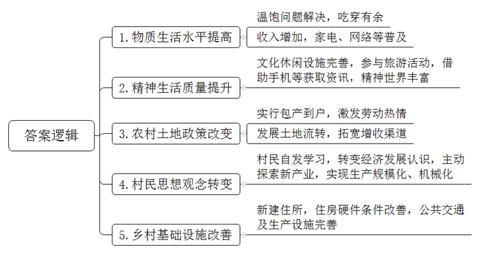
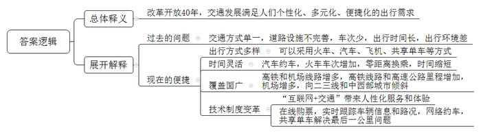
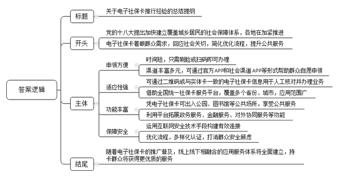
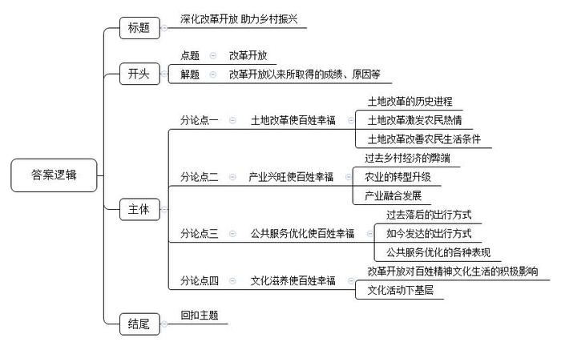

# 2019年公务员多省联考《申论》题（黑龙江县乡、普通选调卷）

<!-- gwy:overview:start -->
> **黑龙江 · 2019 · 申论 · 县乡卷** ｜ 4 题 · 图片 4 处 · 答案随题折叠

导航：[题目](#题目) · [材料 1](#材料-1)
<!-- gwy:overview:end -->

> 候选采集稿。参考答案及解析来自粉笔页面，不代表官方答案或真实高分答卷；来源使用许可与原卷对应关系仍需人工核实。

## 给定材料

### 材料 1

丰收的季节，陕北高原到处是红彤彤的苹果。63岁的赵家村村民老赵看着果实，满眼的喜悦。借助改革开放的东风，四十年来他用劳动创造了财富，改变了自己家的生活状况，也见证了他们村乃至黄土高原翻天覆地的变化。

“经常前胸贴后背，每天除了想吃还是吃，饿的不行呀。”回忆起那时候的生活，打开话匣子的老赵苦笑着。

苦菜、烧圪卷、麻汤饭、酸菜现在作为特色饭菜招待远方客人，可在老赵眼中，这些都是有时代印记的饭菜，“那时就吃糠叶饭，偶尔吃个玉米窝头都幸福的不行。”老赵说。

那个年代人们主要是为吃穿发愁，孩子们盼望着正月到来有肉有饺子吃，条件好点的还能穿上新衣服，最难熬的要数青黄不接的三、四月了，常常吃不上饭。“记得当时村里有一家买回来猪肉，还没做熟就被孩子们吃得差不多了，日子过得太辛酸了。”老赵感慨。

1978年，来自远方的“包产到户”消息传遍了黄土高原的每个乡间田野，大家都期待的分田到户，让老赵看到了希望。“把地分到户以后，村民干劲十足啊！天不亮全家的劳动力都上山劳动，直到晚上看不见才回家。山地上全部种的是小麦、高粱、谷子等粮食作物，平地上家家户户都种白菜、萝卜等时令蔬菜，不到第三个年头，交过公粮后自家的粮仓再也没有空过。”老赵说，从那时起，孩提时代憧憬的顿顿吃白面，成为了家常便饭。“早上吃白面馒头，下午吃白面面条，招待亲戚客人再也不用问邻居家借了，肉也不再是过年的奢侈品。”老赵回想着过往脱口而出。

经过几年勤劳奋斗，老赵家里吃的穿的都解决了，口袋里也有些余钱，他就开始考虑住的问题。在村里，盖新房不止是老赵一家，在解决温饱问题后，农村开始兴建住所，改善居住环境。手表、自行车、缝纫机、收音机“三转一响”早已是陈年往事，冰箱、洗衣机、彩色电视机成了普及品，网络、汽车和智能设备走进农户家中，生活水平发生了巨大变化。

随着改革开放的不断深入，黄土地上的农民也在感受着不一样的社会气息。老赵不断从报纸书刊上获得社会变革的信息，而这些信息也一步一步改变着他对农村经济发展的认识。

在政府的宣传引导下，老赵的思想发生了转变，他开始放弃种植小麦转而种植苹果，这在当时引起了不小的轰动。“不种麦子你吃啥呀？”“咱祖祖辈辈都是种地的好把式，种苹果能行吗？”当初许多村民劝他的声音依旧在耳旁环绕，然而“一根筋”的他并不为所动，坚持走自己的路。如今，长得郁郁葱葱的果树就是对他最好的回报，“你看我这苹果，个大皮薄颜色好，看见就有胃口。”老赵笑着说。

“种苹果也是辛苦，但是钱袋子鼓起来了呀！”老赵说，现在十亩苹果每年可收入八九万元，尝到种植苹果甜头的他继续扩大种植规模，还添置了许多果园农业机械。他指着远处的山峁说，那边有他新建的十亩果园，等新园挂果，他的收入可以再翻一番，即使将来老的干不动了，二十亩果园流转给他人坐收流转金，也是一笔不菲的收入。

站在老赵家门口，大门左右角上的两只洁白陶瓷鸽子造型栩栩如生，枣红色瓷砖上写着“吉祥如意步步高，一帆风顺年年好，家和万事兴”。走进院内，硬化过的院落再也不怕雨天泥泞不堪，水龙头一拧白花花的自来水流个不停，干净整洁的玻璃替代了过去糊窗用的麻纸，院子一旁新建的果库也即将投入使用，整个院内散发着勃勃生机。站在村口往村里看，一排排窑洞跟城里的小区一样，整整齐齐。

“真是没想到我现在也能过上这样的日子，”翻着老照片的老赵感慨道，“想跟老伙伴唠几句，手机拿起来就打。想看看新鲜事，微信上多着呐。想到县里买东西，村口一天有好几辆班车。村里还建了一个图书室，摆上了科学种养殖的有关书籍。晚上，大伙自发集合在村民广场，唠唠各自的想法，也有了休闲的好去处。这两年，大家还结成团，到北京、内蒙转了转，可开心啦。”

### 材料 2

30多年前，刚结婚的陈霞和丈夫蜜月旅行，从老家霍县乘坐小巴车，在土路上颠簸了3个小时才到达安平市。住了一夜，第二天一早从安平市乘坐早晨6点的客车，晚上8点才到南京。

“现在，早上在家从容地吃完早饭，网上订个高铁票，‘滴滴’叫个车，30分钟到安平站，再乘坐高铁1个半小时就可以赶到南京吃午饭了。”现已年近花甲的陈霞感慨道，“现在的年轻人度蜜月，没有到不了的远方。”

陈霞的感慨，引发了许多人的共鸣。广西的张健至今保留着一封1986年的家书。那一年，他被上海市交通学校录取。张健的父亲在家书中用简单的几行字，道出了当时的“漫漫长路”：“我上月26日在南宁送你上车后，乘下午4点22分的火车到玉林下车……等待回县城的车，直到晚上8点半都没等到，后来搭一辆老乡的大货车回县里，半夜才到家。”

在张健求学期间，南宁至上海的直达特快列车每天仅有一趟，全程42小时。“如此漫长的旅程，由于开窗透气，蒸汽机车飞扬的煤灰从开启的车窗飘入，让白衫变成黑衣。”如今，南宁与上海之间已有高铁、特快列车、快速列车开行，多个车次可供选择，最快的高铁车次全程只要12个小时。去年8月，张健从南宁出发回乡探望父亲，零距离换乘动车、班车，全程仅用3个小时。不仅是陆路交通，张健家乡人坐飞机也越来越方便了。前些年，玉林和南宁之间的航线也开通了。

陈霞和张健的经历是我国交通大发展的一个缩影。

党的十八大后，中国交通进入了新一轮的高速发展期。2016年，铁路部门调整了列车运行图，安排开行旅客列车3400多对，比原来增加近300对，增加的部分向二、三线和中西部城市倾斜；截至2017年底，高铁营业里程2.5万公里，占世界高铁营业里程的三分之二；高速公路里程达13.6万公里，居世界之首；民用航空机场共229个，是改革开放初期的3倍……

让阳县自行车运动协会资深会员孙春想不到的是，几十年后，渐渐没落的自行车竟然又成了人们喜欢的出行方式之一。孙春回忆说，在过去很长一段时间里，中国被外界称为“自行车王国”。能有一辆“永久”或“凤凰”牌自行车，不亚于现在的小汽车。后来，随着摩托车、电动车、汽车的兴起，自行车渐渐没落。近两年来，共享单车在各地兴起，解决了人们“出行最后一公里”的问题，自行车迎来了“新生”。与40年前不同的是，如今的自行车只是人们众多出行方式的选择之一。这个看似回到原点的出行方式，背后却是交通工具插上互联网翅膀后的又一次更新迭代。

“互联网＋交通”正在满足人们个性化、多元化、便捷化的出行需求。买列车票再也不用到车站排队，在家里动动手指就可以实现；在很多城市旅游乘坐公交，手机APP可以实时告知公交的“行踪”和路况信息；想要打车，手机上网就可以约车……多地打造“城市交通大脑”，新技术带来的变革一直在继续，相关制度也在不断跟进。

对于每一个出行者来说，<u>40年巨变之后，“说走就走，路不再长”</u>，已成为现实。

### 材料 3

2018年4月22日，在首届“数字中国”建设成果展览会上，青岛市民刘女士领取到了国家人社部签出的首张电子社保卡。在接下来的短短几个月里，电子社保卡迅速普及，丽水、福州、新余、九江、广州、南宁、海口等多地群众陆续申领到电子社保卡。

成都市民王女士得知这一消息后，马上掏出手机进行申领。“把社保卡‘放进’手机，只需几十秒，简单的很！比如，从支付宝里点击‘城市服务’，选择所在城市，通过‘刷脸’认证就行了。以后办理相关社保业务，忘带社保卡，用手机扫码也能办。”据了解，为让群众“少跑腿，好办事”，电子社保卡申领渠道丰富多元，不仅包含各地人社部门官方APP、各地政务服务APP，还有社保卡发卡银行APP、支付宝、微信、平安一账通、云闪付等社会渠道APP，持卡人可自愿选择申领渠道。

工作人员介绍，电子社保卡有两种表现形式，一是手机端显示电子社保卡二维码，用于信息系统识别人员身份、缴费结算、办理业务，二是手机端显示与实体卡一致的电子社保卡信息，用于人工核对并办理业务。

目前，全国统一的电子社保卡已经在26个省份、230个城市发放。随着一个又一个的城市被“点亮”，“电子社保卡地图”上星光熠熠，“一部智能机走天下”的梦想照进了更多人的日常生活之中。

“党的十八大明确提出了加快建立覆盖城乡居民的社会保障体系。十八大以来，社会保障工作的各个方面都在加紧推进。着眼群众需求，回应社会关切，不断简化优化办事流程，提升公共服务信息化水平，是移动互联网‘助力’人社服务的缩影。”工作人员说，“我们积极拥抱移动互联网、大数据和云计算，充分满足群众诉求，建立了全国社保卡服务平台，迎来了电子社保卡，开启了‘人社移动服务’新时代。”

电子社保卡以实体社保卡为基础，与实体社保卡“一一对应”，是社保卡线上应用的有效凭证。部分先行地区通过多项民生服务精准发力，让这张“无形卡”发挥出“大能量”。

南宁市将电子社保卡融入“智慧城市”建设，持卡人仅需提供电子社保卡二维码即可出入公园、图书馆、博物馆等市民公共场所，实现“一码通城”。宁夏回族自治区以及西宁、潮州等地方结合电子社保卡开展医保移动支付相关业务，持卡人在药店展示电子社保卡二维码，便可就医购药，用卡体验大幅提升。青岛市推出“电子时间银行”这一创新应用，为志愿者提供长期可靠的记录管理和通存通兑功能，践行了社保“记录一生、保障一生、服务一生”的承诺。此外，还有更多城市通过电子社保卡开通了就医服务功能，就医时出示手机端电子社保卡，看病后不用排队就可直接线上缴费支付。

电子社保卡全面推进应用的同时，各地人社部门不断加强基础支撑平台建设、“互联网+人社”服务矩阵建设、社保卡金融功能应用、对外协同服务平台建设等。电子社保卡应用将在实体社保卡应用基础上，进一步发挥其身份认证、缴费结算、业务办理的重要作用。

展望未来，查询社保权益记录、办理待遇资格认证、就医购药支付结算、办理参保缴费等功能也会相继上线，电子社保卡还将逐步嵌入到各地政务服务、智慧城市、金融服务等应用场景。

今年年初，福州市民曾女士因为流行性感冒来到药店，从走进药店，到付款完毕，只用不到十分钟。“以前忘带社保卡又急着买药就多花不少钱，现在，动动指尖，省时省心。”她告诉记者，领取电子社保卡以来，自己买药都是靠“扫码”，每次结算都很顺利。“在我的推荐下，电子社保卡已成为身边亲戚同事们的‘标配’。”

有关工作人员表示，电子社保卡以实体社保卡安全体系为基础，结合电子认证、人工智能等互联网安全技术手段，构建了网络与持卡人之间的有效连接，从而确保“实人、实名、实卡”。用电子社保卡在手机端查询信息、办理业务时，借助在线认证、密码验证、人脸识别、风险控制等多种认证方式，能够确保“是我办事”“是我查询”，不用担心被冒用、盗刷和信息泄露。

2018年底，全国社保卡持卡人数超过12亿人，覆盖全国88%的人口。下一步，随着电子社保卡的推广普及，社保卡线上线下相融合的应用服务体系将全面建立，置身社保卡多元化服务生态圈中，持卡群众将获得更为广泛、细致、贴心的服务，尽享信息时代的“速度与温情”。

### 材料 4

蜿蜒盘旋的山路、生机盎然的苗木，初冬时节，《╳╳日报》的两名记者来到F县罗坝村苗木种植基地采访，呈现在记者眼前的是漫山的红枫、桂花和玉兰苗木，让人心旷神怡。

接待记者的是罗坝村苗木种植大户老周。40年前那场波澜壮阔的伟大变革，让老周从自家5亩责任田起家，带领周边村民投身到荒山种植的大潮中，全镇上万亩荒废的山丘地重新披上绿衣裳。老周说：“当年村里的一系列改革，真正改到我们心里去了，不管怎么改，老百姓的利益不受损失，改革促进了增产增收，得实惠的还是我们老百姓”。

F县地貌以丘陵为主，传统农作物的种植模式很难有起色，当地土地坑坑洼洼不能形成规模，种植的品种单一加上耕种方法原始，收成好的年景只能是解决温饱，遇到个天灾人祸的就饭都吃不上，大半年都要饿肚子。穷则思变，改革开放以来，F县开始了规模绿化苗木种植，经过多年的发展壮大，全县苗木产业规模已逾33万亩。面对记者，老周自豪地说，仅他所在的罗坝村，苗木产业最兴盛的那些年，苗木经纪人就多达200人。当时的客户群不仅覆盖全国各地，有的苗木还走出国门，卖到意大利和韩国。在这之前，老周怎么也想不到，看上去并不起眼的苗木，市场竟有这么好：“大伙儿站在山包边就把买卖给做了。”苗木种植规模化发展让广大苗农的生活水平得到了极大提高，以前不敢想的出国旅游、买小汽车等都变成了现实。

产业兴旺是农业农村发展的物质基础，是促进农民脱贫增收、生活富裕的保障，也是汇聚人财物力支撑乡村振兴的原动力。记者从F县林业局了解到，F县委县政府高度重视苗木种植产业的可持续发展，通过加大招商力度，引进了省内外30多家林业产业化龙头企业，这些企业带来了先进的生产技术和敏锐的市场导向，潜移默化地影响并改进了F县原有的苗木生产结构，绿化和美化苗木占比下降，彩化和艺化苗木种植比例大幅提升。老周平时经常关注国家的发展形势，感受到了国家在农村工作的新举措和力度，从中看到了新的发展机遇，积极响应县委号召，根据市场需求率先调整种植结构，走上了苗木种植专业化、标准化和品牌化的发展道路。日前，F县标准生产、规模布局的工厂化育苗新模式正在逐渐形成，产品涵盖观赏绿化苗、经果林苗、用材苗、花卉、盆景和草坪地被等六大类400多个品种，年销售7亿多株，交易额40多亿元。

如今，在新政策的引领下苗农们尝到了转型发展的甜头。市场份额没少，赚到的钱更多。最为关键的是，通过产业结构及时调整，激发了苗农的种植热情，促进了苗木产业的持续发展。去年，老周所在的罗坝村人均收入就高达26400元。面对记者的镜头，老周动情地说：“没有党的好政策哪有今天的好日子，大家都说‘<u>改革开放富百姓，党的政策暖人心；发展是条致富路，奔向小康永不停。</u>’”老周的话语充分代表了改革开放四十年来，在党的政策引领下脱贫致富的广大人民群众的心声。

## 题目

### 第 1 题

**请根据“给定资料1”，归纳提炼改革开放以来赵家村发生的变化。（15分）**

关联材料：材料 1

作答要求：

要求：

（1）依据资料，观点明确；

（2）内容全面，条理清晰；

（3）不超过200字。

第 1 题 · 答案与解析

**参考答案（粉笔题库参考内容）**

1.物质生活水平提高。温饱问题解决，吃穿有余；收入增加，家电、网络等普及。

2.精神生活质量提升。文化休闲设施完善，参与旅游活动，借助手机等获取资讯，精神世界丰富。

3.农村土地政策改变。实行包产到户，激发劳动热情；发展土地流转，拓宽增收渠道。

4.村民思想观念转变。村民自发学习，转变经济发展认识，主动探索新产业，实现生产规模化、机械化。

5.乡村基础设施改善。新建住所，住房硬件条件改善，公共交通及生产设施完善。

**解析**

**参考答案说明：**本参考答案从“物质生活水平提高”“精神生活质量提升”“农村土地政策改变”“村民思想观念转变”“乡村基础设施改善”五个方面展开，各条答案要点之间在内容上相互并列，没有交叉。

**考点**：变化类

**来源**：2019年公务员多省联考《申论》题（黑龙江县乡、普通选调卷）

### 第 2 题

**请结合“给定资料2”，谈谈对划线句子****“40年巨变之后，‘说走就走，路不再长’”****的理解。（20分）**

关联材料：材料 2

作答要求：

要求：

（1）紧扣资料，观点明确；

（2）分析透彻，条理清晰；

（3）不超过300字。

第 2 题 · 答案与解析

**参考答案（粉笔题库参考内容）**

一、这句话的意思是改革开放40年，交通发展满足人们个性化、多元化、便捷化的出行需求。

二、以前交通方式单一，道路设施不完善，车次少，出行时间长，出行环境差。

三、如今出行方便快捷。具体表现在：1.出行方式多样：可以采用火车、汽车、飞机、共享单车等方式。2.时间灵活：汽车约车，火车车次增加，零距离换乘，时间缩短。3.覆盖面广：高铁和机场线路增多，高铁线路和高速公路里程增加，机场增多，向二三线和中西部城市倾斜。4.技术制度变革：“互联网+交通”带来人性化服务和体验；在线购票，实时跟踪车辆信息和路况，网络约车，共享单车解决最后一公里问题。

**解析**

**参考答案说明：**思路方面，本参考答案按照词句解释题“总体释义+展开解释”的一般答题思路展开。内容方面，本参考答案先解释了“40年巨变之后，‘说走就走，路不再长’”的含义；接着分析了改革开放前交通出行的问题、改革开放后出行便捷的表现。词句表达方面，本答案加上了“以前”“如今”等表时间逻辑的词，增强了答案的逻辑性。

**考点**：词句解释类

**来源**：2019年公务员多省联考《申论》题（黑龙江县乡、普通选调卷）

### 第 3 题

**某市正准备推行电子社保卡，假设你是该市人社部门的工作人员，请根据“给定资料3”，就各地在推行电子社保卡过程中的经验，写一份总结提纲。（25分）**

关联材料：材料 3

作答要求：

要求：

（1）紧扣资料，内容完整；

（2）条理清晰，不考虑格式；

（3）不超过400字。

第 3 题 · 答案与解析

**参考答案（粉笔题库参考内容）**

关于电子社保卡推行经验的总结提纲

党的十八大提出加快建立覆盖城乡居民的社会保障体系，各地在加紧推进。电子社保卡着眼群众需求，回应社会关切，简化优化流程，提升公共服务。各地经验如下：

一、申领方便。1.时间短，只需刷脸或扫码即可办理；2.渠道丰富多元，可通过官方APP和社会渠道APP等形式帮助群众自愿申领。二、适应性强。1.可通过二维码或与实体卡一致的电子社保卡信息用于人工核对并办理业务；2.借助全国统一社保卡服务平台，覆盖多个省份、城市，应用范围广。三、功能丰富。1.凭电子社保卡可出入公园、图书馆等公共场所，享受公共服务；2.利用平台拓展政务服务、金融服务、对外协同服务等功能。四、保障安全。1.运用互联网安全技术手段构建有效连接；2.优化流程，多样化认证，打消群众安全顾虑。

随着电子社保卡的推广普及，线上线下相融合的应用服务体系将全面建立，持卡群众将获得更优质的服务。

**解析**

**参考答案说明：**（1）格式方面，本参考答案写到了“标题”“正文”两个部分。（2）正文部分，一方面从内容来看，围绕着“电子社保卡”这一主题，本参考答案的开头写到了推广电子社保卡的背景；主体部分从“申领方便”“适应性强”“功能丰富”“保障安全”等几个方面介绍了经验；结尾进行总结。另一方面，形式上，本参考答案做到了分段、分条撰写，整体上条理较为清晰。

**考点**：总结类

**来源**：2019年公务员多省联考《申论》题（黑龙江县乡、普通选调卷）

### 第 4 题

**“给定资料4”中提到“改革开放富百姓，党的政策暖人心；发展是条致富路，奔向小康永不停。”请结合对这句话的思考，联系实际，自拟题目，写一篇文章。（40分）**

关联材料：材料 1、材料 2、材料 3、材料 4

作答要求：

要求:

（1）自选角度，立意明确；

（2）参考“给定资料”，但不拘泥于“给定资料”；

（3）思路明晰，语言流畅；

（4）总字数1000~1200字。

第 4 题 · 答案与解析

**参考答案（粉笔题库参考内容）**

**深化改革开放 助力乡村振兴**

改革春风已然伴随我们走过四十多个年头，从“鸡毛换糖”到全球电商，从乡土中国到美丽中国。这40年我们砥砺奋进，创造了一个又一个传奇。农村土地改革，解决百姓温饱问题；乡村振兴，让农民生活富裕；公共服务水平的提高，让服务更贴心；文化服务的普及，使百姓获得精神滋养。人民过上了好日子，都得益于党的好政策，得益于40年坚持不懈的改革。

**土地改革使百姓幸福。**1978年，“包产到户”消息传遍乡间田野，分田到户让老百姓看到希望。农民生产热情高涨，撸起袖子加油干。解放土地资源，改善生活条件。从吃不饱到吃的好，从破居所到新楼房，从“三转一响”到智能家居，借助土地改革政策，依靠农民的勤劳与智慧，农民过上了梦寐以求的好日子，百姓的获得感、幸福感、安全感逐渐提高。

**产业兴旺使百姓幸福。**习近平总书记说：“乡村振兴，关键是产业要振兴”。在过去的十几年中，城乡发展不均衡，产业单一，缺乏特色，农村发展没有产业支撑，致使乡村衰败，新农村建设陷入困境。随着农村全面深化改革，乡村振兴之风袭来，改变农业生产落后的现状，通过引进先进技术，吸引社会资源，促进农业产业化、规模化，助推农业转型升级。当前农村正在走产业融合发展之路，农村不仅有农业，还能促进一、二、三产业融合发展。产业的兴旺为百姓的幸福提供持续有力的保障。

**公共服务优化使百姓幸福。**过去，交通方式单一，交通设施不完善，车次少，出行耗时长等问题成为了每个出行者的困扰。而如今，“四十年巨变，说走就走，路不再长”。高铁提速，朝发夕至；网上约车，随时出行……人们的出行呈现个性化、多元化、便捷化态势。公共服务的提升不止体现在交通上，而是体现于方方面面。作为公共服务的重要内容，医疗条件的改善直接增加了百姓的幸福感，电子社保卡覆盖广，功能多，适用性强，让持卡群众获得广泛、细致、贴心的服务。

**文化滋养使百姓幸福。**改革以来不仅让农民真正有了持续稳定的收入来源，经济宽裕，衣食无忧，生活便利。同时更丰富了老百姓的精神文化生活，增强人民群众的归属感，自豪感和责任感，满足了群众多样化、多元化的文化需求。文化活动下基层将一份份丰富多彩、亮点纷呈、热气腾腾的“文化大餐”送到老百姓的家门口、心坎上，增长知识，满足娱乐需求，让群众乐享“文化盛宴”。

改革发展不是一蹴而就的，乡村的振兴也不可能毕其功于一役。我们必须坚定信心、锁定目标，苦干实干、久久为功。未来，我们将持续按照产业兴旺、生态宜居、乡风文明、治理有效、生活富裕的总要求振兴乡村。为希望的田野绘就了收获的金色，让农业成为有奔头的产业，让农民成为有吸引力的职业，让农村成为安居乐业的美丽家园。

**文章分析**

**深化改革开放 助力乡村振兴**

【**标题的优点：**首先，范文的标题“深化改革开放，助力乡村振兴”突出了“改革开放”这一主题。其次，它在形式上采用对称式结构，前半句点出主题，后半句点出了目的，使标题更加完整、饱满。】

改革春风已然伴随我们走过四十多个年头，从“鸡毛换糖”到全球电商，从乡土中国到美丽中国。（1）<u>这40年我们砥砺奋进</u>，<u>创造了一个又一个传奇</u>。<u>农村土地改革</u>，<u>解决百姓温饱问题</u>；<u>乡村振兴</u>，<u>让农民生活富裕</u>；<u>公共服务水平的提高</u>，<u>让服务更贴心</u>；<u>文化服务的普及</u>，<u>使百姓获得精神滋养</u>。（2）人民过上了好日子，都<u>得益于党的好政策</u>，<u>得益于40年坚持不懈的改革</u>。

【**开头的优点：**★内容方面。范文的开头是紧扣题目给定的“改革开放富百姓，党的政策暖人心；发展是条致富路，奔向小康永不停”这句话展开的。首先，开头第一句话点出主题，做到了主题明确。其次，对“改革开放”这一主题进行了分析阐述：（1）先指出了“改革开放四十年来的成果”（2）再指出了“改革开放成果得益于党的好政策”。★文字表达方面：使用了排比等修辞手法，使文字表达更加形象、有力。】

**土地改革使百姓幸福。**（1）<u>1978年</u>，<u>“包产到户”消息传遍乡间田野</u>，<u>分田到户让老百姓看到希望</u>。（2）<u>农民生产热情高涨</u>，<u>撸起袖子加油干</u>。（3）<u>解放土地资源</u>，<u>改善生活条件</u>。从吃不饱到吃的好，从破居所到新楼房，从“三转一响”到智能家居，<u>借助土地改革政策</u>，<u>依靠农民的勤劳与智慧</u>，<u>农民过上了梦寐以求的好日子</u>，<u>百姓的获得感、幸福感、安全感逐渐提高</u>。

【**论述段1的优点：**★观点句：范文的观点句是紧扣“改革开放”这一文章主题提出的。形式上，它在段首处直接写出，位置突出，容易发现。内容上，要点明确，可以明显看出它是从“土地改革”入手，指出了“改革开放的影响”。★论述内容：（1）先介绍了“土地改革的历史进程”；（2）接着介绍了“土地改革激发农民热情”；（3）最后介绍了“土地改革改善农民生活条件”。注意：以上三个方面的内容都是紧扣“土地改革使百姓幸福”这个观点句进行分析论述的，论述的针对性强，内容层次丰富。最后，在论述方法和论据的选取上做到了讲道理、举例子相结合，做到了丰富多样。】

**产业兴旺使百姓幸福。**习近平总书记说：“乡村振兴，关键是产业要振兴”。（1）<u>在过去的十几年中</u>，<u>城乡发展不均衡</u>，<u>产业单一</u>，<u>缺乏特色</u>，<u>农村发展没有产业支撑</u>，<u>致使乡村衰败</u>，<u>新农村建设陷入困境</u>。（2）随着农村全面深化改革，乡村振兴之风袭来，<u>改变农业生产落后的现状</u>，<u>通过引进先进技术</u>，<u>吸引社会资源</u>，<u>促进农业产业化、规模化</u>，<u>助推农业转型升级</u>。（3）当前<u>农村正在走产业融合发展之路</u>，农村不仅有农业，还能<u>促进一、二、三产业融合发展</u>。产业的兴旺为百姓的幸福提供持续有力的保障。

【**论述段2的优点：**★观点句：范文的观点句是紧扣“改革开放”这一文章主题提出的。形式上，它在段首处直接写出，位置突出，容易发现。内容上，要点明确，可以明显看出它是从“产业兴旺”入手，指出了“改革开放的影响”。★论述内容：（1）先介绍了“过去乡村经济的弊端”；（2）接着介绍了“农业的转型升级”；（3）最后介绍了“农村的产业融合发展”。注意：以上三个方面的内容都是紧扣“产业兴旺使百姓幸福”这个观点句进行分析论述的，论述的针对性强，内容层次丰富。最后，在论述方法和论据的选取上以讲道理为主，做到了层次清晰，内容深刻。】

**公共服务优化使百姓幸福。**（1）<u>过去</u>，<u>交通方式单一</u>，<u>交通设施不完善</u>，<u>车次少</u>，<u>出行耗时长等问题成为了每个出行者的困扰</u>。（2）而如今，“四十年巨变，说走就走，路不再长”。高铁提速，朝发夕至；网上约车，随时出行……<u>人们的出行呈现个性化、多元化、便捷化态势</u>。（3）公<u>共服务的提升</u>不止体现在交通上，而是<u>体现于方方面面</u>。作为公共服务的重要内容，<u>医疗条件的改善直接增加了百姓的幸福感</u>，<u>电子社保卡覆盖广</u>，<u>功能多</u>，<u>适用性强</u>，<u>让持卡群众获得广泛、细致、贴心的服务</u>。

【**论述段3的优点：**★观点句：范文的观点句是紧扣“改革开放”这一文章主题提出的。形式上，它在段首处直接写出，位置突出，容易发现。内容上，要点明确，可以明显看出它是从“公共服务优化”入手，指出了“改革开放的影响”。★论述内容：（1）先介绍了“过去落后的出行方式”；（2）接着介绍了“如今发达的出行方式”；（3）最后介绍了“公共服务优化的各种表现”。注意：以上三个方面的内容都是紧扣“公共服务优化使百姓幸福”这个观点句进行分析论述的，论述的针对性强，内容层次丰富。最后，在论述方法和论据的选取上做到了讲道理、举例子相结合，做到了丰富多样。】

**文化滋养使百姓幸福。**改革以来不仅让农民真正有了持续稳定的收入来源，经济宽裕，衣食无忧，生活便利。（1）同时更<u>丰富了老百姓的精神文化生活</u>，<u>增强人民群众的归属感</u>，<u>自豪感和责任感</u>，<u>满足了群众多样化、多元化的文化需求</u>。（2）文化活动下基层将一份份丰富多彩、亮点纷呈、热气腾腾的“文化大餐”送到老百姓的家门口、心坎上，<u>增长知识</u>，<u>满足娱乐需求</u>，<u>让群众乐享“文化盛宴”</u>。

【**论述段4的优点：**★观点句：范文的观点句是紧扣“改革开放”这一文章主题提出的。形式上，它在段首处直接写出，位置突出，容易发现。内容上，要点明确，可以明显看出它是从“文化发展”入手，指出了“改革开放的影响”。★论述内容：（1）先介绍了“改革开放对百姓精神文化生活的积极影响”；（2）接着介绍了“文化活动下基层”。注意：以上两个方面的内容都是紧扣“文化滋养使百姓幸福”这个观点句进行分析论述的，论述的针对性强，内容层次丰富。最后，在论述方法和论据的选取上做到了讲道理、举例子相结合，做到了丰富多样。】

【**论述段之间的关系**：★内容的内在逻辑：范文的论述段之间是依照“并列”的逻辑展开的。论述段1先写了“土地改革”，论述段2再写了“产业发展”，论述段3接着写了“优化公共服务”，论述段4最后写了“文化发展”。★段与段的外在衔接：论述段1、2、3、4围绕“改革开放”这一主题，逐一论证，呈现并列关系。】

（1）<u>改革发展不是一蹴而就的</u>，<u>乡村的振兴也不可能毕其功于一役</u>。我们必须坚定信心、锁定目标，苦干实干、久久为功。未来，我们将持续按照产业兴旺、生态宜居、乡风文明、治理有效、生活富裕的总要求振兴乡村。（2）为希望的田野绘就了收获的金色，<u>让农业成为有奔头的产业</u>，<u>让农民成为有吸引力的职业</u>，<u>让农村成为安居乐业的美丽家园</u>。

【**结尾的优点：**范文的结尾回扣了“改革开放”这一主题。（1）再次提到了“改革开放”；（2）发出了号召希望，阐述了“改革发展”的深远意义。】

**解析状态：unknown（来源未提供）**

**考点**：文章写作题

**来源**：2019年公务员多省联考《申论》题（黑龙江县乡、普通选调卷）

