# 2019年黑龙江边境县（市、区）急需紧缺专业岗公务员考试《行测》题

<!-- gwy:overview:start -->
> **黑龙江 · 2019 · 行测 · 统考** ｜ 120 题 · 图片 110 处 · 答案随题折叠

| 题型模块 | 题量 | 题号 |
| --- | ---: | ---: |
| 常识判断 | 20 | 1–20 |
| 言语理解与表达 | 35 | 21–55 |
| 数量关系 | 10 | 56–65 |
| 判断推理 | 35 | 66–100 |
| 资料分析 | 20 | 101–120 |
| **合计** | **120** | |

导航：[题型与作答说明](#题型与作答说明) · [题目](#题目) · [材料 1](#材料-1)
<!-- gwy:overview:end -->

> 候选采集稿。参考答案及解析来自粉笔页面，不代表官方答案或真实高分答卷；来源使用许可与原卷对应关系仍需人工核实。

## 题型与作答说明

常识判断

（20题）

根据题目要求，在四个选项中选出一个最恰当的答案。

言语理解与表达

（35题）

本部分包括表达与理解两方面的内容。请根据题目要求，在四个选项中选出一个最恰当的答案。

数量关系

（10题）

在这部分试题中，每道题呈现一段表述数字关系的文字，要求你迅速、准确地计算出答案。

判断推理

（35题）

本部分包括图形推理、定义判断、类比推理与逻辑判断四种类型的试题，在四个选项中选出一个最恰当的答案。

资料分析

（20题）

所给出的图、表、文字或综合性资料均有若干个问题要你回答。你应根据资料提供的信息进行分析、比较、计算和判断处理。

## 题目

### 第 1 题

党的十九大报告指出，新时代我国社会主要矛盾是：

A. 人民对于建立先进的工业国的要求同落后的农业国的现实之间的矛盾

B. 人民对于经济文化迅速发展的需要同当前经济文化不能满足人民需要的状况之间的矛盾

C. 人民日益增长的物质文化需要同落后的社会生产之间的矛盾

D. 人民日益增长的美好生活需要和不平衡不充分的发展之间的矛盾

第 1 题 · 答案与解析

**参考答案（粉笔题库参考内容）**

D

**解析**

本题考查政治常识。

A项、B项错误，1956年中共八大关于政治报告的决议中指出：“我们国内的主要矛盾，已经是人民对于建立先进的工业国的要求同落后的农业国的现实之间的矛盾，已经是人民对于经济文化迅速发展的需要同当前经济文化不能满足人民需要的状况之间的矛盾。”

C项错误，1981年中国共产党第十一届六中全会指出：“在社会主义初级阶段，我国社会的主要矛盾是人民日益增长的物质文化需要同落后的社会生产之间的矛盾。”

D项正确，党的十九大报告指出：“中国特色社会主义进入新时代，我国社会主要矛盾已经转化为人民日益增长的美好生活需要和不平衡不充分的发展之间的矛盾。我国稳定解决了十几亿人的温饱问题，总体上实现小康，不久将全面建成小康社会，人民美好生活需要日益广泛，不仅对物质文化生活提出了更高要求，而且在民主、法治、公平、正义、安全、环境等方面的要求日益增长。同时，我国社会生产力水平总体上显著提高，社会生产能力在很多方面进入世界前列，更加突出的问题是发展不平衡不充分，这已经成为满足人民日益增长的美好生活需要的主要制约因素。”

故正确答案为D。

### 第 2 题

经过长期努力，中国特色社会主义进入了新时代，这是我国发展新的历史方位。这个新时代，是承前启后、继往开来、在新的历史条件下继续夺取中国特色社会主义伟大胜利的时代，是      ，是      ，是      ，是      。

①决胜全面建成小康社会、进而全面建设社会主义现代化强国的时代

②全国各族人民团结奋斗、不断创造美好生活、逐步实现全体人民共同富裕的时代

③久经磨难的中华民族从站起来到富起来的时代

④全体中华儿女勠力同心、奋力实现中华民族伟大复兴中国梦的时代

⑤我国日益走近世界舞台中央、不断为人类作出更大贡献的时代

依次填入划横线部分最恰当的一项是：

A. ②③④⑤

B. ①②③④

C. ①③④⑤

D. ①②④⑤

第 2 题 · 答案与解析

**参考答案（粉笔题库参考内容）**

D

**解析**

本题考查政治常识。

①②④⑤正确，党的十九大报告中指出：“经过长期努力，中国特色社会主义进入了新时代，这是我国发展新的历史方位。……这个新时代，是承前启后、继往开来、在新的历史条件下继续夺取中国特色社会主义伟大胜利的时代，是决胜全面建成小康社会、进而全面建设社会主义现代化强国的时代，是全国各族人民团结奋斗、不断创造美好生活、逐步实现全体人民共同富裕的时代，是全体中华儿女勠力同心、奋力实现中华民族伟大复兴中国梦的时代，是我国日益走近世界舞台中央、不断为人类作出更大贡献的时代。”

③错误，党的十九大报告中指出：“中国特色社会主义进入新时代，意味着近代以来久经磨难的中华民族迎来了从站起来、富起来到强起来的伟大飞跃，迎来了实现中华民族伟大复兴的光明前景。”

故正确答案为D。

### 第 3 题

童蒙教材，是我国古代对儿童进行启蒙教育的主要读物。与前代相比，两汉时期的童蒙教材有了长足的进步和发展。以下童蒙教材始出现于汉朝的是：

A. 《凡将篇》

B. 《论语》

C. 《百家姓》

D. 《声律启蒙》

第 3 题 · 答案与解析

**参考答案（粉笔题库参考内容）**

A

**解析**

本题考查人文常识。

A项正确，《凡将篇》为西汉武帝时司马相如撰，属文字学之书，作为当时地方官学及私学的识字启蒙教材，同时作为考试的依据。其解说文字的内容多被许慎《说文解字》所采用。

B项错误，《论语》是一本语录体的书，是孔子的弟子和再传弟子对孔子言行的记录，约成书于春秋战国时期。《论语》是儒学和中华文化最重要的一部经典。汉后2000多年，儒学是中华文化的主干，而孔子是儒学的创始人，儒学的基本思想都在《论语》中，所以《论语》也被称为“中国人的圣经”。

C项错误，《百家姓》是我国流传时间最长、流传最广的一种蒙学教材，约成书于北宋初年。它的成书和普及甚至早于《三字经》。《百家姓》采用四言体例，句句押韵，像一首四言诗，便于诵读和记忆，因此流传至今，影响极深。

D项错误，《声律启蒙》是训练儿童应对、掌握声韵格律的启蒙读物，成书于清朝康熙年间，作者是车万育。

故正确答案为A。

### 第 4 题

根据我国《民法典》，不满八周岁的未成年人为无民事行为能力人，由其        代理实施民事法律行为。

A. 父母

B. 抚养人

C. 法定代理人

D. 指定代理人

第 4 题 · 答案与解析

**参考答案（粉笔题库参考内容）**

C

**解析**

本题考查法律常识。

《民法典》第二十条规定：“不满八周岁的未成年人为无民事行为能力人，由其法定代理人代理实施民事法律行为。”

故正确答案为C。

### 第 5 题

关于液体，下列叙述正确的是：

A. 液体表面张力随温度的下降而减小

B. 液体表面有自动缩小表面积的趋势

C. 与液体表面层的分子相比，液体内部的分子有更大的势能

D. 表面层内的分子比在液体内部的分子有较大的位能

第 5 题 · 答案与解析

**参考答案（粉笔题库参考内容）**

B

**解析**

本题考查科技常识。

A项错误、B项正确，表面张力指作用于液体表面单位长度上使液体收缩的力，其方向与液面相切。从微观上解释表面张力，表面张力是分子间相互作用力的体现。分子间距离较小时，排斥占优势，距离较大时吸引力占优势。在液体内部，分子距离在左右（为分子间平衡距离，这时分子所受合力为零），而在液体表面分子比较稀疏，分子距离大于，此时分子间作用力表现为相互吸引。由于表面张力的作用，液体总是具有缩小表面积的倾向，因此液滴常呈球形，如雨滴、肥皂泡等。由于温度升高使分子热运动加剧，分子间引力减弱，故表面张力多随温度升高而减小。

C项错误，D项正确，如下图所示，当分子距离小于时，要减小分子间的距离必须克服斥力做功，此时分子势能随分子间距离的减小而增大；如果分子间距离大于，分子间的相互作用表现为引力，要增大分子间的距离必须克服引力做功，此时分子势能随分子间距离增大而增大。所以说，分子势能随距离而变化，势能最低处为液体分子的平衡距离处，分子间距离大于或小于此值时体系势能皆升高。在液体内部，分子距离在左右，而在液体表面分子比较稀疏，分子距离大于，因此表面层内的分子比在液体内部的分子具有更大的势能（由于各物体间存在相互作用而具有的、由各物体间相对位置决定的能叫势能，又称作位能）。

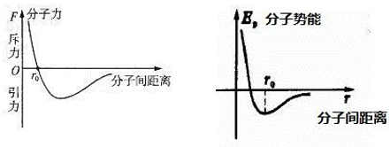

故正确答案为BD。

注：本题虽然是单选题，但是B、D项都是正确的，所以选二者任何一个都可以算正确。

### 第 6 题

我国“南水北调工程”中的东线工程从长江下游扬州江都抽引长江水，利用        及与其平行的河道逐级提水北送，输水到天津。

A. 京杭大运河

B. 输水总干渠

C. 汉江

D. 淮河

第 6 题 · 答案与解析

**参考答案（粉笔题库参考内容）**

A

**解析**

本题考查地理国情。

南水北调工程有东、西、中三条线路。东线工程从长江下游江苏省扬州江都抽引长江水，利用京杭大运河及与其平行的河道逐级提水北送，并连接起调蓄作用的洪泽湖、骆马湖、南四湖、东平湖。出东平湖后分两路输水，其中一路向北，经隧洞穿黄河，流经山东、河北至天津。

故正确答案为A。

【知识扩展】

“南水北调工程”中线工程从长江中游北岸支流汉江加坝扩容后的丹江口水库引水，跨越长江、淮河、黄河、海河四大流域，可基本自流到北京、天津。西线工程在长江上游通天河、支流雅砻江和大渡河上游筑坝建库，开凿穿过长江与黄河的分水岭巴颜喀拉山的输水隧洞，调长江水入黄河上游，补充黄河水资源的不足，主要解决涉及青海、甘肃、宁夏、内蒙古、陕西、山西等黄河上中游地区和渭河关中平原的缺水问题。

### 第 7 题

随着劳动力成本的迅速上涨，我国家政服务的每小时平均价格也不断上升。在我国家政服务市场竞争日益激烈的背景下，若其他条件不变，最可能引起家政服务市场的需求曲线从P1变化为P2的是：

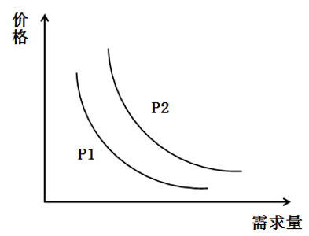

①放宽市场准入，鼓励资本投资

②改进管理机制，降低管理费用

③提倡专业分工，追求生活品质

④居民收入上涨，生活成本降低

A. ①②

B. ②③

C. ②④

D. ③④

第 7 题 · 答案与解析

**参考答案（粉笔题库参考内容）**

D

**解析**

本题考查经济常识。

从题干中的需求曲线上可以看出：当价格不变时（在Y轴取一点作水平虚线），P1到P2表现为需求量增加；当需求量不变时（在X轴取一点作垂直虚线），P1到P2表现为价格上涨。这种需求曲线向右上方移动的情况叫做需求上升，说明消费者愿意在更高的价格上购买更多商品。

①错误，放宽市场准入，鼓励资本投资会使更多的企业加入到家政服务市场，显著提高家政服务市场的供给，同时由于供给突然增多，导致供过于求，会引起价格的下降，不符合题干的需求曲线。

②错误，改进管理机制，降低管理费用能有效减少家政服务企业的成本，在需求不变的情况下，会引起价格下降，不符合题干的需求曲线。

③正确，提倡专业分工即让专业的人做专业的事，这种思想转变会使居民更多的去购买家政服务，而追求生活品质也会使居民更倾向于优质价高家政服务，表现为居民愿意购买更多的优质高价的家政服务，符合题干的需求曲线。

④正确，居民收入上涨，生活成本降低，居民有更多的资金用于享受生活，会有更多的人购买家政服务，符合题干中价格不变，需求量上涨的情况。

综上，在其他条件不变情况下，③④最可能引起家政服务市场的需求曲线从P1变化为P2。

故正确答案为D。

### 第 8 题

总长度约55公里的港珠澳大桥穿越珠江口中华白海豚国家级自然保护区，大桥建设过程成功实现白海豚零伤亡。以下不可能是保护中华白海豚措施的是：

A. 改水上施工为陆域加工，改工地现浇为工厂制作，尽量减少海上作业时间和作业范围

B. 进入大桥施工区域，航船必须以十节以上航速高速通过，以防止航船吸引白海豚聚集

C. 水下爆破作业前及作业期间，采用声墙驱赶与噪音驱赶等措施赶走附近白海豚

D. 在挖掘或打桩作业开始前的5分钟内通过监视与监测，确保半径500米范围内无白海豚出没

第 8 题 · 答案与解析

**参考答案（粉笔题库参考内容）**

B

**解析**

本题考查科技常识。

为更好的保护白海豚，港珠澳大桥参建单位编制印发了《中华白海豚保护管理手册》。

A项正确，减少海上作业时间，一方面可以减少工程垃圾对白海豚生活环境的污染，另一方面也可以减少施工过程中工程设备误伤白海豚，可有效保护白海豚。

B项错误，港珠澳大桥所处的珠江口是现时中国水运业最繁忙、通航环境最复杂的水域。因此，应对进入大桥施工区域的航船实施限速，给白海豚留足避让时间。

C项正确，大桥在施工过程中采用声墙驱赶与噪音驱赶（“声驱法”）护豚，前者是以爆破点为中心，安排三到四艘船舶，呈扇形均匀分布，往开阔水域方向驱赶，半径为一千五百米；而后者是船只采用变速行驶，发出大小不一的噪音，促使白海豚迅速逃离，免受爆破伤害。

D项正确，根据《中华白海豚保护管理手册》，白海豚观察员要以望远镜观察海面，观测5分钟以上，而在中华白海豚繁殖高峰期的4到8月，升至10分钟，确保500米范围内没有白海豚活动后方可开始施工。

本题为选非题，故正确答案为B。

### 第 9 题

作为最早被人类驯化的鸟类，鸽子能够通过磁场准确识别方位，迅速找到回巢的路线。如果仅考虑磁场因素，在        上空，鸽子识别方位的能力受到的影响最大。

A. 赤道

B. 南极

C. 海洋

D. 北回归线

第 9 题 · 答案与解析

**参考答案（粉笔题库参考内容）**

B

**解析**

本题考查科技常识。

地球的磁场中磁南极大致指向地理北极附近，磁北极大致指向地理南极附近。磁力线分布特点是赤道附近磁场的方向是水平的，两极附近则与地表垂直。赤道处磁场最弱，两极最强。南极附近的磁力线与地表垂直，信鸽无法通过磁力线来辨认方向，南极对信鸽的影响最大。

故正确答案为B。

### 第 10 题

下列五种包装箱指示标识的含义，正确的是：

①表示此方向向上

②表示小心轻放

③表示放在有阳光的地方

④表示不能放在顶层

⑤表示禁止挤压

A. ①②

B. ①②③

C. ②③④

D. ①②④⑤

第 10 题 · 答案与解析

**参考答案（粉笔题库参考内容）**

A

**解析**

本题考查科技常识。

①正确，表示此方向向上；②正确，表示小心轻放（易碎）；③错误，表示防晒（怕热）；④错误，表示禁止堆码（该包装件不能堆码并且其上也不能放置其他负载）；⑤错误，表示由此夹起（表明装运货物时夹钳放置的位置）。

故正确答案为A。

### 第 11 题

矿井瓦斯是指存在于煤层中的烃类气体，以甲烷为主要成分，常常吸附在煤基质颗粒表面，是煤的伴生矿产资源。以下关于矿井瓦斯的说法不正确的是：

A. 要保持井下通风以将井下瓦斯浓度保持在较低水平

B. 瓦斯气体中毒是煤矿开采者面临的首要威胁

C. 通过特定的设备收集瓦斯，能够变“害”为宝

D. 由于瓦斯的存在，矿井下要严格控制热源和火源

第 11 题 · 答案与解析

**参考答案（粉笔题库参考内容）**

B

**解析**

本题考查科技常识。

A项正确，甲烷是可燃气体，矿井瓦斯浓度过高容易引发爆炸，因此要保持井下通风以将井下瓦斯浓度保持在较低水平。

B项错误，我国的大多数矿井属于高瓦斯矿井，我国煤矿事故大多数是由于瓦斯爆炸所致，当矿井中瓦斯浓度达到一定范围时遇明火即燃烧爆炸，这是煤矿开采者面临的首要威胁。

C项正确，瓦斯是一种易燃易爆气体，但同时是一种清洁能源。通过特定的设备收集瓦斯，将瓦斯气从煤矿中抽出来，一方面，能提高煤矿安全水平和工作效率，另一方面，使用这一清洁能源有助于减少温室气体排放量，能够变“害”为宝。

D项正确，由于瓦斯的存在，井下的一切热源和火源都可能引起瓦斯燃烧和爆炸，因此矿井下要严格控制热源和火源。

本题为选非题，故正确答案为B。

### 第 12 题

世界气象组织台风委员会从2000年1月1日起，采用具有亚洲风格的名字对西北太平洋地区的台风进行命名。台风命名表中共有140个名字，分别由亚太地区的14个成员国提供，按英文字母顺序循环使用。以下不属于中国提供的名字的是：

A. 杜鹃

B. 鲸鱼

C. 电母

D. 海棠

第 12 题 · 答案与解析

**参考答案（粉笔题库参考内容）**

B

**解析**

本题考查科技常识。

共有14个国家和地区有权命名西北太平洋产生的台风，分别是中国、中国香港、中国澳门、韩国、朝鲜、日本、柬埔寨、越南、泰国、老挝、菲律宾、马来西亚、密克罗尼西亚和美国。其中，由中国提供的名字是：海葵、悟空、玉兔、白鹿、风神、海神、杜鹃、电母、海马、海棠。鲸鱼是日本提供的名字。

本题为选非题，故正确答案为B。

### 第 13 题

世界四大渔场中，不是因寒、暖流交汇而形成的是：

A. 北海渔场

B. 秘鲁渔场

C. 北海道渔场

D. 纽芬兰渔场

第 13 题 · 答案与解析

**参考答案（粉笔题库参考内容）**

B

**解析**

本题考查地理国情。

A项正确，北海（大西洋东北部边缘海）渔场是由北大西洋暖流与来自北极的寒流交汇形成的一个渔场，冷暖水流在此交汇，鱼产丰富，种类繁多，主要产鲱、鲭、鳕等鱼。

B项错误，秘鲁渔场位于南美洲秘鲁沿岸，受单一上升补偿流（秘鲁寒流）影响而形成。上升流可以使海水发生搅动，营养盐上泛，吸引鱼类汇集。

C项正确，北海道渔场位于日本暖流与千岛寒流交汇处，地处亚洲东部，是世界第一大渔场。

D项正确，纽芬兰渔场是由墨西哥湾暖流与拉布拉多寒流交汇形成的，位于加拿大境内，大西洋上的纽芬兰岛附近海域，是世界著名渔场之一。

本题为选非题，故正确答案为B。

### 第 14 题

大气在运动过程中受到很多因素的影响，变得非常复杂，甚至彼此相邻的两个地区也常常出现截然不同的气候特征。下列选项最能够反映这一现象的是：

A. 山明水净夜来霜，数树深红出浅黄

B. 月生林欲晓，雨过夜如秋

C. 秋阴不散霜飞晚，留得枯荷听雨声

D. 一树春风有两般，南枝向暖北枝寒

第 14 题 · 答案与解析

**参考答案（粉笔题库参考内容）**

D

**解析**

本题考查地理国情。大气在运动过程中受到很多因素的影响，变得非常复杂。因此，全球各地的气候有着比较明显的差异，类型多种多样。大体上来说，全球从南向北在不同的纬度有着不同的气候带。但是在小的方面，同一纬度的地方也有可能出现不同的气候类型。 比如，受到山地、高原、森林、沙漠等地形影响，彼此相邻的两个地区也常常出现截然不同的气候特征，因此有“一山有四季，十里不同天”，“南枝向暖北枝寒，一种春风有两般”的农谚，生动地说明了气候类型的丰富。

A项错误，“山明水净夜来霜，数树深红出浅黄”出自唐代诗人刘禹锡所作的《秋词二首·其一》，意思是山明水净夜晚已经有霜，树叶由绿转为浅黄色，其中有几棵树的树叶已变成红色，在浅黄色中格外显眼。诗句描写了秋天的景象，与彼此相邻的两个地区也常常出现截然不同的气候特征无关。

B项错误，“月生林欲晓，雨过夜如秋”出自南宋诗人徐玑所作的《夏日怀友》，意思是月亮升起来了，树林将被月光照亮，雨后的夜晚仿佛是秋天一样。诗句描写了雨后的月夜，与彼此相邻的两个地区也常常出现截然不同的气候特征无关。

C项错误，“秋阴不散霜飞晚，留得枯荷听雨声”出自唐代诗人李商隐所作的《宿骆氏亭寄怀崔雍崔衮》，意思是秋空上阴云连日不散，霜飞的时节也来迟了，留得满地枯残的荷叶，好听深夜萧瑟的雨声。诗句描写了秋天的景象，与彼此相邻的两个地区也常常出现截然不同的气候特征无关。

D项正确，“一树春风有两般，南枝向暖北枝寒”出自北宋文学家苏轼所作的《一树春风》，意思是吹拂同一棵树的风却有两种，南枝被暖风吹，而北枝却被寒风吹。树木的南枝和北枝处于彼此相邻的两个地区，却有着一暖一寒两种不同的气候特征。

故正确答案为D。

### 第 15 题

边塞诗歌是中国诗词史上的一个重要流派。下列诗词与所处朝代面临的主要边境忧患，匹配正确的是：

A. 铁骑追骁虏，金羁讨黠羌——柔然

B. 借问长城侯，单于入朝谒——西夏

C. 但使龙城飞将在，不教胡马度阴山——突厥

D. 羌管悠悠霜满地，人不寐，将军白发征夫泪——蒙古

第 15 题 · 答案与解析

**参考答案（粉笔题库参考内容）**

C

**解析**

本题考查人文常识。

A项错误，“铁骑追骁虏，金羁讨黠羌”出自南朝诗人吴均所作的乐府诗《胡无人行》，南朝梁所处时期为502—557年，其面临的主要边境忧患为北朝时期的鲜卑族政权北魏和东魏（西魏）。柔然，公元四世纪后期至六世纪中叶，在蒙古草原上继匈奴汗国、鲜卑汗国等之后崛起的部落制汗国。

B项错误，“借问长城侯，单于入朝谒”出自隋炀帝杨广所作的《饮马长城窟行》，隋唐时期面临的主要边境忧患为北部突厥建立的政权。西夏是由党项族建立的与北宋并立的政权。

C项正确，“但使龙城飞将在，不教胡马度阴山”出自唐代诗人王昌龄所作的《出塞二首·其一》，隋唐时期面临的主要边境忧患为北部突厥建立的政权。

D项错误，“羌管悠悠霜满地，人不寐，将军白发征夫泪”出自北宋文学家范仲淹所作的《渔家傲·秋思》，北宋时期面临的主要边境忧患为北部契丹族建立的政权辽和党项族建立的政权西夏。

故正确答案为C。

### 第 16 题

海市蜃楼包括所有在空气密度反常分布时大气中出现的光学折射现象。以下不属于我国经常能看到海市蜃楼的地方是：

A. 湖南湘西

B. 广东惠来

C. 山东蓬莱

D. 浙江普陀

第 16 题 · 答案与解析

**参考答案（粉笔题库参考内容）**

A

**解析**

本题考查科技常识。

海市蜃楼是大气中由于光线的折射作用而形成的一种自然现象。当空气各层的密度有较大的差异时，远处的光线通过密度不同的空气层就发生折射，这时可以看见在空中或地面以下有远处物体的影像（如下图所示）。这种现象多在夏天出现于沿海一带或沙漠地方。古人误认为是蜃（大蛤蜊）吐气而形成的，所以叫蜃景。通称海市蜃楼。

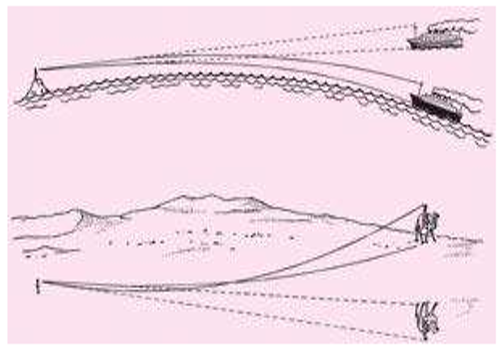

A项错误，湘西是湖南省西部地区的统称，既不属于沿海一带，也不属于沙漠地区，故出现海市蜃楼的概率很小。

B项正确，惠来县位于广东省东南部沿海地区，故出现海市蜃楼的概率较大。

C项正确，蓬莱市位于山东省东北部沿海地区，故出现海市蜃楼的概率较大。

D项正确，普陀区属浙江省舟山市辖区，位于舟山岛（舟山群岛主岛），属沿海一带，故出现海市蜃楼的概率较大。

本题为选非题，故正确答案为A。

### 第 17 题

下列说法正确的是：

A. 人体各种体液的pH值处在7.4左右的弱碱状态是最健康的

B. 亚健康会导致体质偏酸，进而导致包括癌症在内的各种疾病

C. 醋是pH值小于7的酸性物质，因此其属于典型的酸性食品

D. 人体能够通过调节的排出量来维持血液pH值的稳定

第 17 题 · 答案与解析

**参考答案（粉笔题库参考内容）**

D

**解析**

本题考查科技常识。

A项错误，人体体液包含细胞内液、细胞外液（包括血液、组织液和淋巴液等），还有分泌的各种消化液、排泄出的汗液、尿液等。人体内的不同体液有酸碱之分，弱碱状态并非就是最健康的状态，如胃液呈强酸性。因此，选项中人体各种体液呈弱碱状态是最健康的说法过于绝对。

B项错误，“酸碱体质论”认为，大多数人由于生活习惯及环境的影响，体液pH值都在7.35以下，他们的身体处于健康和疾病之间的亚健康状态，这些人就是酸性体质者，并且认为酸性体质会造成多种疾病，甚至诱发癌症，但这些说法没有科学根据。2018年11月，美国的“人体酸碱体质理论”之父罗伯特·欧·杨被美国法庭判处赔偿1.05亿美元，并当庭承认“酸碱体质理论”是个骗局。

C项错误，酸性食物和碱性食物并不是由口感来定的。如由碳、氮、硫、磷等元素组成的蛋白质，在人体内最后氧化成酸：碳变成碳酸、硫变成硫酸、磷变成磷酸、氮变成尿酸，这些最终产物是酸性物质，故称为酸性食物；又如，某些蔬菜、水果多含钾、钠、钙、镁等盐类，在人体内代谢后生成碱性物质，使体液成弱碱性，故称为碱性食物。进入人体的醋酸与乳酸、柠檬酸与焦性葡萄糖酸结合（反应），会放出二氧化碳和水，而二氧化碳则由肺部排除，因此减低了血液中的碳酸成分，使体液呈弱碱性。所以说醋酸是碱性食物。

D项正确，肺部可通过调节二氧化碳的排出量来调节血中碳酸（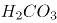)的浓度，从而维持血液pH值的相对稳定。当动脉血二氧化碳分压（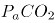)即浓度升高时，呼吸中枢兴奋，呼吸加深加快，排出增多，使血中浓度降低。反之，当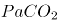降低时，呼吸变浅变慢，排出减少，使血中浓度升高。

故正确答案为D。

### 第 18 题

唐代之后，陆上丝绸之路逐渐衰落，海上丝绸之路逐渐兴盛的原因不包括：

A. 我国经济重心逐渐南移

B. 西域地区一度脱离了中原政权的控制

C. 陆上丝绸之路沿途的自然环境逐渐恶劣

D. 我国与东亚、东南亚地区的贸易量远超中东、欧洲地区

第 18 题 · 答案与解析

**参考答案（粉笔题库参考内容）**

D

**解析**

本题考查人文常识。

A项正确，唐代玄宗末年安史之乱爆发，北方经济遭到严重破坏，叛乱平定后，北方又陷入长期的藩镇混战之中，因此，经济发展比较缓慢。反之，南方未经安史兵祸，战乱较少，而大批逃避战乱的北方人又涌进南方，增加了南方的劳动力，带去了先进的生产技术，因此在唐朝后期，南方经济比北方经济发展迅速，全国的经济重心开始逐渐南移，致使陆上丝绸之路逐渐衰落。

B项正确，西域是陆上丝绸之路的必经之地，它沟通了中西方文化、商业等的往来。在古代史上，丝绸之路所到之处，必是繁荣之地。从西汉末年开始，西域就被纳入中原版图，到安史之乱后不久，西域就脱离了中原的统治，从而影响到陆上丝绸之路的发展。

C项正确，古代陆上丝绸之路具有难以克服的内在局限性。一方面，陆上丝绸之路对于沿途各国政治局势的变动极其敏感，往往某一国内部发生政治动荡，就会影响整条丝路的通畅。事实上，这种因中国西北以及中亚地区处于战争、动乱而使陆上丝路中断的情况，在历史上屡次发生。另一方面，陆上丝绸之路容易受到自然条件的极大限制，往往要穿越崇山峻岭与戈壁沙漠等极其艰苦的区域，从而使陆上远程贸易存在着运量小、时间长、成本高以及安全性低等一系列弊端。

D项错误，贸易量的多少在地区之间并没有特别明显的变化。

本题为选非题，故正确答案为D。

### 第 19 题

魏晋时期“建安七子”中的一位文学家被谢灵运称赞“才高八斗”，以下诗句是这位文学家作品的是：

A. 青青子衿，悠悠我心。但为君故，沉吟至今

B. 本自同根生，相煎何太急

C. 此中有真意，欲辨已忘言

D. 花间一壶酒，独酌无相亲

第 19 题 · 答案与解析

**参考答案（粉笔题库参考内容）**

B

**解析**

本题考查人文常识。

谢灵运曾这样评说：“天下才有一石，曹子建独占八斗，我得一斗，天下共分一斗。”这是说，天下的才能如果是一石（十斗为一石），曹植一个就占了八斗。所以被称赞的文学家指的是曹植。

A项错误，“青青子衿，悠悠我心。但为君故，沉吟至今”出自曹操的《短歌行》，意思是穿青色衣领的学子，你们令我朝夕思慕。只是因为您的缘故，我沉痛吟诵至今。

B项正确，“本自同根生，相煎何太急”出自曹植的《七步诗》，意思是豆子和豆秸本来是同一条根上生长出来的，豆秸怎能这样急迫地煎熬豆子呢？

C项错误，“此中有真意，欲辨已忘言”出自陶渊明的《饮酒·其五》，意思是这里面蕴含着人生的真正意义，想要辨识，却不知怎样表达。

D项错误，“花间一壶酒，独酌无相亲”出自李白的《月下独酌四首·其一》，意思是提一壶美酒摆在花丛间，自斟自酌无友无亲。

故正确答案为B。

注：本题题干有误，曹植不属于建安七子。建安七子是汉建安年间七位文学家的合称，包括孔融、陈琳、王粲、徐干、阮瑀、应玚、刘桢。

### 第 20 题

道是梨花不是，道是杏花不是。白白与红红，别是东风情味。曾记，曾记，人在武陵微醉。（《如梦令》——严蕊）

道是春来花未，道是雪来香异。竹外一枝斜，野人家。冷落竹篱茅舍，富贵玉堂琼榭。两地不同栽，一般开。（《昭君怨》——郑域）

上述两首词分别描写的是：

A. 梨花和杏花

B. 梅花和梨花

C. 桂花和菊花

D. 桃花和梅花

第 20 题 · 答案与解析

**参考答案（粉笔题库参考内容）**

D

**解析**

本题考查人文常识。

“道是梨花不是，道是杏花不是。白白与红红，别是东风情味。曾记，曾记，人在武陵微醉。”这几句词典意思是：“说它是梨花又不是梨花。说它是杏花它也不是杏花。花瓣白白又红红，难道是春风特有的情味？曾记得，曾记得，武陵渔人被陶醉。”此词所咏为红白桃花，这是桃花的一种，就是同树花分二色的桃花。此词绝不同于一般滞于物象的咏物词，它纯然从空际著笔，空灵荡漾，不即不离，写出红白桃花之高标逸韵，境界愈推愈高远，令人玩味无极而神为之旺。

“道是春来花未，道是雪来香异。竹外一枝斜，野人家。冷落竹篱茅舍，富贵玉堂琼榭。两地不同栽，一般开。”这几句词的意思是：“说它是花。春天却未到来。说它是雪，却幽香无比。冒着严寒，傍着竹林，在乡村的农舍绽放。无论是生长在荒野人家还是在亭台水榭的富贵之乡，都是一样的盛开。”这是一篇不同凡响的咏梅佳作。此词不仅描绘了梅花的外貌，而且揭示了梅花的品格，并以此暗示了作者本人虽怀才不遇却不肯放弃操守而随波逐流的情怀。

据此可知，第一首词描写的是桃花，第二首词描写的是梅花。

故正确答案为D。

### 第 21 题

随着现代通信工具的兴起，人们的联系越来越方便，如今仍在用纸笔亲手写信的人        ，相关的家书代写职业以及《情书大全》一类指点迷津的宝典也逐渐        。

依次填入划横线部分最恰当的一项是：

A. 寥寥无几 销声匿迹

B. 凤毛麟角 无人问津

C. 屈指可数 匿影藏形

D. 寥若星辰 无影无踪

第 21 题 · 答案与解析

**参考答案（粉笔题库参考内容）**

A

**解析**

第一空，根据“现代通信工具的兴起，人们的联系越来越方便”可知，用纸笔亲手写信的人很少，横线处体现“少”的意思且修饰“用纸笔亲手写信的人”。A项“寥寥无几”形容稀少，没有几个；C项“屈指可数”指扳着手指就可以数清楚，形容数量稀少；D项“寥若星辰”指稀少得好像早晨的星星，形容为数极少，三者均能体现“少”的含义，且可以用于修饰“用纸笔亲手写信的人”，保留。B项“凤毛麟角”指凤凰的羽毛，麒麟的角，比喻珍贵而稀少的人或物，文段并无“用纸笔亲手写信的人”很贵重这层意思，排除。

第二空，根据前文可知，横线处形容家书代写职业及宝典也越来越少的含义，D项“无影无踪”形容完全消失，不知去向，与 “逐渐”搭配不当，排除。比较A、C项，A项“销声匿迹”侧重不出声、不露面、消失不见，能体现“少”这层含义，符合语境。C项“匿影藏形”侧重隐藏形迹不露真相，可以是换另一种面目出现，文段并无“家书代写职业”换另一种职业形式出现，或“《情书大全》一类指点迷津的宝典”改头换面以另一种典籍的形式出现这种情况，排除C项。

故正确答案为A。

【文段出处】《视野|长信里爱可咀嚼，微信里只能点赞》

### 第 22 题

近年来，我们着力解决管党治党失之于宽、失之于松、失之于软的问题，使不敢腐的        作用充分发挥，不能腐、不想腐的效应初步        ，反腐败斗争压倒性态势正在形成。

依次填入划横线部分最恰当的一项是：

A. 震慑 显现

B. 威慑 显示

C. 警示 显耀

D. 警醒 显露

第 22 题 · 答案与解析

**参考答案（粉笔题库参考内容）**

A

**解析**

本题可从第二空入手，A项“显现”侧重“现”，即出现；B项“显示”侧重“示”，即表示；C项“显耀”侧重“耀”，即炫耀；D项“显露”侧重“露”，即隐藏的东西暴露出来。此处说的是我们着力解决管党治党存在的一些问题，不能腐、不想腐的效应初步出现了，A项“显现”最恰当，排除B、C、D三项。

验证第一空，A项“震慑”指使人震惊恐惧；我们进行反腐败斗争，加强管党治党，让人不敢腐，“震慑”填入恰当。

故正确答案为A。

【文段出处】《坚定不移推进党风廉政建设和反腐败斗争》

### 第 23 题

文物鉴定不仅是一门学问，还是一门技术，需要不间断的        ，任何人离开这一领域时间过长，技术就会        ，判断力就会下降。

依次填入划横线部分最恰当的一项是：

A. 练习 退化

B. 锻炼 生疏

C. 实践 弱化

D. 操作 退步

第 23 题 · 答案与解析

**参考答案（粉笔题库参考内容）**

B

**解析**

第一空，搭配“技术”，表示文物鉴定这门技术需要人不间断去做，B项“锻炼”指锻造或冶炼，C项“实践”指实际去做、履行，符合语境。A项“练习”指反复学习、实践，以求熟练，D项“操作”指按照一定的程序和技术要求进行活动或工作，均与“技术”搭配不当，排除。

第二空，所填词语表示人长久离开文物鉴定这一领域，其文物鉴定的技术就会不好的意思，B项“生疏”指因长期不用而不熟练，符合语境。C项“弱化”指使某种事物变弱，减轻程度，如弱化优势，与“技术”搭配不当，排除。

故正确答案为B。

【文段出处】《大智小技》

### 第 24 题

“国潮”为文化类节目的发展提供了新        ，并且让文化以文创产品的具体形象实现落地，延展了文化多维性的现实价值。有学者认为，文化与“国潮”在荧幕上的相遇是一种必然，“国潮”本身含有大量中华传统文化元素，同时极富          ，因此深受年轻人的喜爱和追捧。

依次填入划横线部分最恰当的一项是：

A. 机遇 影响力

B. 目标 创造力

C. 导向 吸引力

D. 思路 表现力

第 24 题 · 答案与解析

**参考答案（粉笔题库参考内容）**

D

**解析**

第一空，根据“让文化以文创产品的具体形象实现落地”可知，“国潮”促进了文化的发展，且与“落地”构成递进关系，D项“思路”符合文意。A项“机遇”指机会、有利的境遇，与“落地”构不成递进关系，排除；B项“目标”指想要达到的境地或标准，文段没有体现目标的意思，排除；C项“导向”指引导的方向，文段没有体现 “国潮”要起引导作用，排除。

验证第二空，D项“表现力”填入横线处表示在艺术作品中所表现出的感染力，符合语境。

故正确答案为D。

【文段出处】《文化类节目找准新的“打开方式”》

### 第 25 题

在改革开放的伟大实践中，中国大踏步赶上时代潮流，经济社会面貌发生了            的变化，        了持续高速发展的人间奇迹。

依次填入划横线部分最恰当的一项是：

A. 翻天覆地 创造

B. 日新月异 制造

C. 改弦更张 塑造

D. 改头换面 打造

第 25 题 · 答案与解析

**参考答案（粉笔题库参考内容）**

A

**解析**

由“人间奇迹”可知，经济社会面貌发生的变化是很大、很快的，让人惊叹。A项“翻天覆地”形容变化巨大而彻底，B项“日新月异”强调发展变化的速度很快，两者均符合语境，保留。C项“改弦更张”比喻改革制度或变更方法，没有体现变化大，不能与后文“人间奇迹”对应，排除。D项“改头换面”比喻只改形式，不变内容，含贬义，不符合文段感情色彩，排除。

第二空，比较A、B两项，A项“创造”侧重“创”，即创新，表示首先想出或做出（前所未有的事物）；B项“制造”侧重“制”，即制作，表示用人工使原材料成为可供使用的物品。此处强调中国改革开放以来发展速度特别快，堪称“人间奇迹”，用含有首创之意的“创造”更恰当，且“创造奇迹”为常用搭配，A项当选。

故正确答案为A。

【文段出处】《为什么中国的对外开放能够取得成功？》

### 第 26 题

当下国人阅读状况不佳        有生活节奏快、竞争压力大以及公共图书馆缺失、图书价格高等客观因素影响，也与浮躁、功利等不良的社会心态            。

依次填入划横线部分最恰当的一项是：

A. 必定 相得益彰

B. 虽然 相辅相成

C. 当然 休戚相关

D. 固然 密不可分

第 26 题 · 答案与解析

**参考答案（粉笔题库参考内容）**

D

**解析**

第一空，根据“生活节奏快、竞争压力大……等客观因素影响”和“浮躁、功利等不良的社会心态”可知，主客观因素均影响了国人的阅读状况，横线处应表示对客观因素的肯定，A项“必定”表示判断或推论的确凿或必然， C项“当然”表示对某一行为的确认或肯定，D项“固然”指诚然、虽然，均符合句子间的关系，保留。B项“虽然”通常引导转折关系，与句子间的关系不符，排除。

第二空，分析文意可知，横线处表示与社会心态有关的意思，D项“密不可分”形容十分紧密，不可分割，符合文意，当选。A项“相得益彰”指两个人或两件事物互相配合，双方的能力和作用更能显示出来，通常用作褒义的语境，和文段感情色彩不符，排除；C项“休戚相关”形容关系密切，利害一致，文段未提及利害关系，与文意不符，排除。

故正确答案为D。

【文段出处】《该向“读书冠军”学什么》

### 第 27 题

过去三年，人民日报海外版旗下的海外网，一跃成为中央媒体中            的网站，并成为支持海外版媒介融合的独特平台；过去一年，“海客”客户端以清新的形象、鲜明的定位深受读者喜欢，两个微信号“侠客岛”和“学习小组”在互联网舆论场中            ，成为时政解读的知名品牌。

依次填入划横线部分最恰当的一项是：

A. 独树一帜 崭露头角

B. 独领风骚 锋芒毕露

C. 一枝独秀 初露锋芒

D. 首屈一指 异军突起

第 27 题 · 答案与解析

**参考答案（粉笔题库参考内容）**

A

**解析**

第一空，根据“支持海外版媒介融合的独特平台”可知，横线处表示海外网在中央媒体中起到独特作用的意思，A项“独树一帜”比喻与众不同，自成一家，可表示独特的意思，当选。B项“独领风骚”形容超群出众，没有谁可与之相比，文段并未将其作对比，排除；C项“一枝独秀”比喻技高一筹，优势明显，文段并未提及其优势，与文意不符，排除；D项“首屈一指”表示居第一位，与文意无关，排除。

第二空，代入验证，“崭露头角”指初显露优异的才能，可与后文的“成为时政解读的知名品牌”相对应，当选。

故正确答案为A。

【文段出处】《人民日报海外版：从一份报纸到一个媒体集群》

### 第 28 题

现在社会上有这样一种观点：经济压力逐渐成为        年轻人结婚的主要因素。即便是有结婚意愿的年轻人，他们也常常因为置办房产、子女教育和赡养老人等费用过高，面对婚姻            。

依次填入画横线部分最恰当的一项是：

A. 阻碍 畏缩不前

B. 妨害 望而生畏

C. 妨碍 望而却步

D. 阻止 知难而退

第 28 题 · 答案与解析

**参考答案（粉笔题库参考内容）**

A

**解析**

第一空，分析文意可知，横线处表示经济压力已经成为年轻人不结婚的主要因素，A项“阻碍”指使不能顺利通过或发展，C项“妨碍”指干扰、阻碍，使事情不能顺利进行，均符合文意，保留。B项“妨害”指有害于、阻碍，侧重的是损害的结果，语义程度过重，排除；D项“阻止”指使不能前进，使行动停止，侧重停止的意思，语义程度过重，排除。

第二空，根据“置办房产、子女教育和赡养老人等费用过高”可知，有结婚意愿的年轻人也会被经济压力劝退，A项“畏缩不前”指因为害怕或有顾虑而退缩，可表达因顾虑高额费用而不敢结婚的意思，符合文意，当选。C项“望而却步”指远远望见了就害怕得后退，虽也能满足题意，但“望”与“面对”均有“看”之意，有语义重复嫌疑，排除。

故正确答案为A。

### 第 29 题

“佛系”心态的不良影响不容忽视。“佛系”心态会使人们容易丧失原则，            。一个人不能没有理想追求，没有理想追求就只会浑浑噩噩的度日，就容易走向虚无。“佛系”这种随意的生活态度，一定程度上正是缺乏理想追求的表现。而当人们有了理想追求的时候，它会        我们前进，人们也就有了生活的动力。

依次填入划横线部分最恰当的一项是：

A. 人云亦云 激发

B. 随遇而安 鼓励

C. 随波逐流 激励

D. 亦步亦趋 鼓动

第 29 题 · 答案与解析

**参考答案（粉笔题库参考内容）**

C

**解析**

第一空，对应“容易丧失原则”可知，横线处应表述没有原则、主见的意思，A项“人云亦云”指没有主见，只会随声附和；C项“随波逐流”比喻没有坚定的立场，缺乏判断是非的能力，只能随着别人走；D项“亦步亦趋”比喻由于缺乏主张，以别人为准，均可表示没有原则的意思，保留。B项“随遇而安”指处于各种环境都能安心自在，与文意无关，排除。

第二空，根据“有了生活的动力”可知，横线处表示推动我们前进的意思，C项“激励”指激发勉励，使振作，符合文意，当选。A项“激发”指激之使奋起，一般搭配“活力”，与“前进”搭配不当，排除；D项“鼓动”指以言语或行为使他人有所行动，一般用于宣传活动，且有唆使之意，偏贬义，与文段语境不符，排除。

故正确答案为C。

【文段出处】《透彻！“佛系”现象背后的反思》

### 第 30 题

当年的松阳也曾随着城市化进程的加速而        ，村里人不是选择进城务工，就是迁居城镇，乡村中留下的大都是老人孩子，很多老屋闲置了，破败了，无人管理维护，保存状况            。幸运的是，无数的人因此行动起来，才有了今天            的松阳。

依次填入划横线部分最恰当的一项是：

A. 萧索 奄奄一息 生意盎然

B. 凋敝 危若朝露 朝气蓬勃

C. 凋零 危在旦夕 欣欣向荣

D. 萧条 岌岌可危 生机勃勃

第 30 题 · 答案与解析

**参考答案（粉笔题库参考内容）**

D

**解析**

本题可从第二空入手，根据“很多老屋闲置了，破败了，无人管理维护”可知，该空表示保存状况很差的意思，D项“岌岌可危”形容非常危险，快要倾覆或灭亡，可形容保存状况不好的意思，符合文意，保留。B项“危若朝露”形容面临灭亡，情况危急；C项“危在旦夕”形容危险就在眼前，均侧重强调时间紧迫，危险就在眼前，但文段并未提及时间紧迫，与文意不符，排除；A项“奄奄一息”指气息微弱临近死亡，也可形容事物即将毁灭，但与“保存状况”搭配不当，排除。

第一、三空代入验证。萧条，指衰落的样子，符合文中松阳衰败之意；生机勃勃指生命力旺盛，可形容今天的松阳充满活力之意，当选。

故正确答案为D。

【文段出处】《看松阳怎样拯救老屋》

### 第 31 题

形式主义仅仅有外力        还远远不够，如果不能对形式主义的文化、社会、历史深层次的根源            ，那就不能真正除弊。

依次填入划横线部分最恰当的一项是：

A. 破除 干扰 斩草除根

B. 遏制 干涉 扬汤止沸

C. 打击 干碍 除恶务尽

D. 消除 干预 釜底抽薪

第 31 题 · 答案与解析

**参考答案（粉笔题库参考内容）**

D

**解析**

第一空，根据后文“那就不能真正除弊”可知，文段要体现出“形式主义”不能存在的意思。A项“破除”指去除，符合文意，保留；D项“消除”指使不存在，除去，符合文意，保留。B项“遏制”指控制，阻止，文段不是控制或阻止，是要使其没有，排除；C项“打击”指敲打、撞击、攻击，使受挫折，体现不出没有的意思，排除。

第二空，横线处词语与“外力”搭配，表意为通过用外力减弱形式主义，A项“干扰”指扰乱、打扰，文段强调的是用外力去减少形式主义不够，而不是去打扰或者扰乱，排除。D项“干预”指干涉、参与或者过问，符合文意，保留。

第三空，代入验证，D项“釜底抽薪”比喻从根本上解决问题，可与“根源”对应，表达从源头彻底清除之意，符合文意，当选。

故正确答案为D。

【文段出处】《谨防穿上了“新外衣”的形式主义》

### 第 32 题

①党的十九大是党和国家发展过程中一次            的盛会。

②辩论赛中选手要力求说到点子上，            地表明自己的看法。

③我国城市化进程不断加速，各地新建建筑            ，尽显繁荣。

依次填入划横线部分最恰当的一项是：

A. 空前绝后 直言不讳 星罗棋布

B. 承前启后 泾渭分明 层出不穷

C. 继往开来 直截了当 灿若繁星

D. 承上启下 旗帜鲜明 鳞次栉比

第 32 题 · 答案与解析

**参考答案（粉笔题库参考内容）**

D

**解析**

第一空，横线处词语形容党的十九大，A项“空前绝后”形容从前没有过、此后也不会有，语义过于绝对，排除；B、C、D三项均能体现十九大重要的承启作用，不做排除；

第二空，横线处词语搭配辩论选手，B项“泾渭分明”比喻界限清楚，是非、好坏分明，与辩手搭配不当，排除；C项“直截了当”形容简单明了、不绕弯子，D项“旗帜鲜明”比喻立场、观点、态度等非常鲜明，均符合文意；

第三空，横线处词语与建筑搭配，D项“鳞次栉比”多用来形容房屋或船只等排列得很密很整齐，符合文意，当选；C项“灿若繁星”比喻才能出众的人很多，与建筑搭配不当，排除。

故正确答案为D。

### 第 33 题

尽管历经了去年的            ，今年，投资者们仍是            。但，是大喜还是大悲？就看你自己的选择了。展望今年的投资方向，房产、股市依然是大众难以割舍的经典理财方式，而涉及区块链的投资则            ，在民间受到了追捧。

依次填入划横线部分最恰当的一项是：

A. 悲喜交加 卷土重来 蓬勃发展

B. 大起大落 跃跃欲试 异军突起

C. 跌宕起伏 摩拳擦掌 应运而生

D. 坎坷不平 兴致高昂 炙手可热

第 33 题 · 答案与解析

**参考答案（粉笔题库参考内容）**

B

**解析**

第一空，根据后文“是大喜还是大悲”可知，应该体现出会有好有坏两种情况，A、B、C项都能体现出有好有坏两种情况，D项“坎坷不平”形容前进道路上有许多困难，不是一帆风顺的，文段要体现出投资有好有坏，而不是遇到的困难，排除；

第二空，由文意及“尽管……仍”可知，前两空词语构成对应，体现出虽然投资有好有坏，但投资者依然有投资的想法，A项“卷土重来”指遭到失败以后再组织力量，而“悲喜交加”并无失败之意，排除；B项“跃跃欲试”形容心里急切地想试试，符合文意，C项“摩拳擦掌”形容战斗或劳动之前，人们精神振奋，跃跃欲试的样子，符合文意。

第三空，由“经典理财方式”可知，横线处词语表意为涉及区块链的投资与传统理财方式不同，B项“异军突起”比喻一支新力量突然出现，符合文意，当选；C项“应运而生”指随着某种形势而产生，文中并无所伴随的形势，排除。

故正确答案为B。

### 第 34 题

建立反腐败绩效考核评价体系，一方面可以        反腐败机关不断改善自己的工作，提高反腐败的效率，另一方面也可以        人民群众对国家反腐败机关工作的满意程度，从而在反腐败的过程中不断地寻求共识、        共识。

依次填入划横线部分最恰当的一项是：

A. 监督 反馈 形成

B. 敦促 了解 凝结

C. 督促 反映 凝聚

D. 促进 研判 达成

第 34 题 · 答案与解析

**参考答案（粉笔题库参考内容）**

C

**解析**

第一空，由“提高反腐败的效率”可知，横线处词语表意为推动反腐败工作发展，四个选项均符合文意，不做排除；

第二空，体现出考评体系能够显示满意程度的作用，A项“反馈”指将信息等返回，考评体系并无返回的作用，排除；D项“研判”指研究判断，多在法律、政府、新闻等比较严肃的领域内使用，与“满意程度”搭配不当，排除；

第三空，横线处词语与“共识”搭配，C项“凝聚”指聚集、积聚，固定搭配，当选；B项“凝结”是由气体变成液体或由液体变成固体，与“共识”搭配不当，排除；

故正确答案为C。

【文段出处】《适时建立反腐败绩效考核评价体系》

### 第 35 题

国家级和省级博物馆往往建设完善，参观者            ，甚至每天一早就出现排队的长龙；省级以下的公办博物馆则              。有的地方有充分的财政投入保障，博物馆拥有不错的硬件和软件设施，参观者的“回头率”较高；有的地方则缺乏对博物馆的投入，馆舍狭小老旧，展出品维护不当，专业讲解人员稀缺，导致博物馆            ，可能连当地人都不知道博物馆的大门朝哪个方向开。

依次填入划横线部分最恰当的一项是：

A. 纷至沓来 参差不齐 无人问津

B. 络绎不绝 良莠不齐 门庭冷落

C. 川流不息 泥沙俱下 无足轻重

D. 比肩接踵 大相径庭 门可罗雀

第 35 题 · 答案与解析

**参考答案（粉笔题库参考内容）**

B

**解析**

第一空， 由“每天一早就出现排队的长龙”可知，参观的人很多，四个选项均形容人多、接连不断地到来，符合文意，不予排除；

第二空，后文列举的财政保障充分和投入缺乏情况可知，省级以下公办博物馆好坏都有，A项“参差不齐”形容水平不一或很不整齐，B项“良莠不齐”指好的坏的混杂在一起，C项“泥沙俱下”比喻好坏不同的人或事物混杂在一起，均符合文意；D项“大相径庭”是比喻相差很远大不相同，不能体现好坏之间的区别，与文意不符，排除；

第三空，由文意可知，横线处词语表意为博物馆参观的人少，B项“门庭冷落”形容十分冷落，宾客稀少，符合文意，当选；A项“无人问津”比喻没有人来探问，程度过重，排除；C项“无足轻重”形容无关紧要，与文意不符，排除。

故正确答案为B。

【文段出处】《博物馆不能成“到此一游”的景点》

### 第 36 题

党的十九大报告强调，“推进绿色发展”“形成节约资源和保护环境的空间格局、产业结构、生产方式、生活方式”。我国幅员辽阔，生态环境多种多样，各地开发程度不同。这就要求我们依据资源环境承载能力、现有开发强度和发展潜力，实行差别化开发管理，把绿色发展理念贯穿到城镇建设、产业布局、土地利用等规划中，合理有效利用资源，形成绿色发展格局。

对上文理解不准确的是：

A. 资源环境承载能力决定了绿色发展格局

B. 不同地区的绿色发展方式应有差异

C. 城镇建设规划需要体现绿色发展理念

D. 绿色发展需要节约资源、保护环境

第 36 题 · 答案与解析

**参考答案（粉笔题库参考内容）**

A

**解析**

A项，对应文段“环境承载能力、现有开发强度和发展潜力”，实行差别化开发管理，形成绿色发展格局，故“资源环境承载能力决定了绿色发展格局”中“决定”表述过于绝对，当选。

B项，对应文段“生态环境多种多样，各地开发程度不同。这就要求我们依据资源环境承载能力，现有开发强度和发展潜力，实行差别化开发管理”，符合文意，排除。

C项，对应“把绿色发展理念贯穿到城镇建设、产业布局、土地利用等规则中”，符合文意，排除。

D项，对应“把绿色发展理念贯穿到城镇建设、产业布局、土地利用等规则中，合理有效利用资源，形成绿色发展格局”，符合文意，排除。

本题为选非题，故正确答案为A。

【文段出处】《推进绿色发展的三大抓手》

### 第 37 题

政府公共服务部门，必须要站在用户，以及民众的视角来对公共服务供给问题进行分析，对当前民众呼声很高的教育、医疗、交通等领域的公共服务供给不足，分布不均的问题及时加以解决。可以从社区网格化管理出发，要求社区干部离开电脑、离开办公室，走向街头，将民情、民意装在心里，并且积极地梳理与传递信息，确保决策层能够及时发现服务需求者的心理变化与需求变化。

下列作为这段文字的题目最合适的是：

A. 公共服务部门的“用户思维”

B. 小网格服务大民生

C. 干部下到基层，方能贴近民意

D. 基于公共服务供给问题的分析

第 37 题 · 答案与解析

**参考答案（粉笔题库参考内容）**

A

**解析**

文段提出观点，即政府公共服务部门，要站在用户的角度来思考问题，解决民众呼声较高的问题。“可以从社区网格化管理出发”为具体的措施，“将民情、民意装在心里”、“及时发现服务需求者的心理变化与需求变化”均对前文观点进行具体分析，故整个文段为总分结构，强调的重点是“用户思维”，A项符合文意，当选。

B项“网格”为具体的解释说明，不是文段重点，排除。

C项“下到基层”不是文段重点，文段重点是要站在民众的角度来分析公共服务供给问题，与文意不符，排除。

D项“基于公共服务供给问题的分析”表述不明确，文段强调的是“用户思维”，与文意不符，排除。

故正确答案为A。

【文段出处】《公共服务型政府建设问题及路径》

### 第 38 题

讲好中国故事、传播好中国声音，习近平总书记为我们树立了光辉典范。引用当地谚语、结合个人经历、讲述感人故事……党的十八大以来，习近平总书记在出访、出席重要国际会议、会见来访外国客人时，用外界听得懂的语言，                     。

填入画横线部分最恰当的一项是：

A. 创新对外话语表达，展示真实、立体、全面的中国

B. 以润物细无声的方式，增进世界对中国的了解

C. 立足本国，面向世界，让中国文化不断传播出去

D. 让中国理念、中国主张、中国方案更具触发共鸣的力量

第 38 题 · 答案与解析

**参考答案（粉笔题库参考内容）**

B

**解析**

空在结尾，需要与前文话题保持一致，文段开篇指出，要讲好中国故事，传播中国的声音，然后介绍习近平总书记在传播中国声音的方面是如何做的，即用外界听得懂的语言，用“引用当地谚语、结合个人经历、讲述感人故事”的方式，增加外界对中国的理解。对应选项，“引用当地谚语、结合个人经历、讲述感人故事”对应“润物细无声”，B项符合文意，当选。

A项“创新对外话语表达”指通过创新的形式进行传达，无中生有，排除。

C项“中国文化”与文段话题不一致，范围缩小，排除。

D项“触发共鸣的力量”文段未提及，文段重点在于如何传播中国声音、让世界了解中国的方式，排除。

故正确答案为B。

【文段出处】《为新时代新变革凝魂聚力》

### 第 39 题

然而，随着经学日益变成章句之学和庸俗的谶纬，情况便大不一样了。光武、章帝就因不满经学的烦琐多次命人“省减五经章句”；曾使王莽、刘秀荣登皇帝宝座的谶纬，后来也变成了篡权、谋反的工具，这表明一切都走到了专制王权期望的反面。因此，到东汉中期以后，皇权对经学和儒生的依赖开始变小，加上外戚、官宦专权，大封党羽、排挤士人，进一步拆散了经学与官僚政治的联盟。

本文段上文最有可能讲述的是：

A. 经学的理论来源与后续发展状况

B. 经学的特点和对官僚政治的影响

C. 经学的光辉历史与儒生的联系

D. 经学的主要内容与皇权的关系

第 39 题 · 答案与解析

**参考答案（粉笔题库参考内容）**

D

**解析**

本题问“上文最有可能讲述的是”，应该重点看首句，首句出现“然而”，表转折，转折之后介绍经学日益变成了章句之学，并走到了专制王权期望的反面，根据转折前后语义相反可知，转折前应该讲述经学的主要内容与皇权的关系，故D项符合文意，当选。

A项“后续发展情况”为文段中已经介绍过的内容，前文介绍的应该是文段中未出现的内容，排除。

B项没有强调“皇权”，文段重点介绍了“皇权”不再依靠经学，故转折前应当强调“皇权”对经学的依赖，选项与文意不符，排除。

C项“儒生”非转折之后的重点强调内容，上文不可能围绕该话题展开论述，排除。

故正确答案为D。

【文段出处】《经学何以如此迅速地衰落，经学的衰落及对后世的影响》

### 第 40 题

如果我们不再沿袭流行的模式，粗放式地将外国文论在中国的旅行简化为“西方文论在中国”与“前苏联文论在中国”，而是从话语实践的维度切入，直面世界文论发育的原生态，就要考虑到“西方文论”并不是铁板一块，譬如“欧陆文论”与“英美文论”在要旨与路向上就有很大分歧；就要考虑到“苏联文论”在不同时段也有不同内涵，至少“解冻”之前与“解冻”之后的苏联文论不应当等量齐观。因此，我们可以基于历史上实际发生的情形对外国文论展开比较细致的梳理。

本文段接下来最有可能讲述的是：

A. 展开对于外国文论的科学分类

B. 详细介绍不同时段的苏联文论

C. 描述外国文论进入中国的有关情况

D. 阐述多部外国文论译介研究

第 40 题 · 答案与解析

**参考答案（粉笔题库参考内容）**

A

**解析**

文段开篇指出从话语实践的角度看待世界文论的发展，就会知道西方文论并不是不可分割的，接着进行举例说明，介绍了“欧陆文论”与“英美文论”对重点与发展方向有分歧，以及不同时期的“苏联文论”有不同的内涵，尾句通过“因此”总结前文，强调我们可以根据历史实际对外国文论进行梳理，即我们可以根据实际情况对不同的文论进行归纳和分析，故接下来应该围绕对外国文论的归纳分析展开论述，对应A项。

B项“苏联文论”表述片面，为例子的内容，不是文段重点，排除。

C项“进入中国的有关情况”与文段话题不一致，排除。

D项“译介”文段未提及，下文应围绕对外国文论的归纳分析展开论述，而非“翻译外国文论”，与文段话题不一致，排除。

故正确答案为A。

【文段出处】《改革开放40年外国文论在中国的旅行》

### 第 41 题

几十年来，史学研究最大的变化之一，就是研究越做越细，课题越做越小，也越做越深。当然，这种越做越细、越做越小、越做越深的现象本身确实很好，历史学是应该做细、做小、做深——不细、不小、不深、大而不当，不接地气，从空到空，这样的历史学是没有出路的，也看不到发展的前景。

本文段接下来最有可能讲述的是：

A. 历史学做细、做小、做深可能的原因

B. 历史学做细、做小、做深创造的价值

C. 历史学做细、做小、做深带来的问题

D. 历史学做细、做小、做深开创的前景

第 41 题 · 答案与解析

**参考答案（粉笔题库参考内容）**

C

**解析**

根据提问方式可知，本题为接语选择题，重点关注文段尾句。尾句开头讲到“当然，这种越做越细、越做越小、越做越深的现象本身确实很好，历史学是应该做细、做小、做深”，后面用破折号引出解释说明的内容。尾句的重点词句是“本身确实很好”，根据其所要表达的语气可知，下文很可能讲的就是其他方面可能并没有那么好，也是存在一些问题的，对应C项。

A项，“历史学做细、做小、做深可能的原因”即为尾句“大而不当，不接地气，从空到空，这样的历史学是没有出路的，也看不到发展的前景”谈论的内容，下文不会继续谈论，排除；

B项“创造的价值”和D项“开创的前景”均为支持历史学做细、做小、做深的表述，而根据文段前面“本身确实很好”可知，下文应该反驳前文的观点，排除。

故正确答案为C。

【文段出处】《钱乘旦：谨防大众史学成为“戏说乾隆”》

### 第 42 题

新时代中国文化哲学研究要用哲学思维和视野，以人为主体，研究文化的产生、功能及其发展的基本规律。要在实践创造中进行文化创造，在历史进步中推动文化进步，植根中华文化、不忘本来，吸收外来文化、加强文化交流、突出文化创新，面向未来，在创造中华文化新辉煌中推动社会主义文化繁荣兴盛。

这段文字主要说的是：

A. 新时代中国文化哲学研究的使命担当

B. 新时代中国文化哲学研究的指导思想和研究方向

C. 要将文化哲学研究融入中国特色社会主义建设

D. 应通过文化交流推动社会主义文化繁荣兴盛

第 42 题 · 答案与解析

**参考答案（粉笔题库参考内容）**

A

**解析**

文段首句先用“新时代中国文化哲学研究要用哲学思维和视野，以人为本，研究文化”引出话题，然后具体介绍新时代中国文化哲学研究的作用即新时代中国文化哲学研究的使命担当，故文段重点为介绍中国文化哲学研究的具体作用部分，对应A项。

B项：为开篇话题引入部分的内容，非重点，排除。

C项：“融入中国特色社会主义建设”文段未涉及，无中生有，排除。

D项：文段说的是“在创造中华文化新辉煌中推动社会主义文化繁荣兴盛”，该项表述错误，排除。

故正确答案为A。

【文段出处】《新时代文化哲学研究的使命担当》

### 第 43 题

肿瘤抑制基因TP53基因正是对付细胞中DNA损伤的关键。TP53会编码产生一种P53蛋白，负责监控基因的完整性。在完成这项工作时，P53不仅异常严厉，甚至格外残酷。如果发现DNA受损，TP53就会促进DNA修复。一旦发现不可救药，TP53就会毫不犹豫地宣判异常细胞的死刑，启动凋亡程序，诱导相应细胞“自杀”，避免发生癌变。TP53基因的突变最常发生在编码P53蛋白质和DNA结合的部分。突变后生成的P53蛋白无法和目标DNA相结合，因此无法行使正常的检查和促进修复或凋零功能，癌症发生风险也就随之升高。

根据上述文字，以下说法不正确的是：

A. 正常工作的TP53基因可以将绝大部分癌变扼杀在萌芽之中

B. TP53基因自身发生突变，其抑癌功能就会受到影响

C. 人类血细胞对DNA损伤异常敏感，有利于清除癌变细胞

D. DNA受损的细胞可以在肿瘤抑制基因的作用下自我毁灭

第 43 题 · 答案与解析

**参考答案（粉笔题库参考内容）**

C

**解析**

A项：“P53不仅异常严厉，甚至格外残酷，如果发现DNA受损，TP53就会促进DNA修复，一旦发现不可救药，TP53就会毫不犹豫地宣判异常细胞的死刑，启动凋亡程序，诱导相应细胞‘自杀’，避免发生癌变”根据整个文段大意可知，该项表述正确，排除。

B项：根据“TP53基因的突变最常发生在编码P53蛋白质和DNA结合的部分，突变后生成的P53蛋白无法和目标DNA相结合，因此无法行使正常的检查和促进修复或凋零功能，癌症发生风险也就随之升高”可知，该项表述正确，排除。

C项：“血细胞”文段未提及，无中生有，当选。

D项：根据“如果发现DNA受损，TP53就会促进DNA修复，一旦发现不可救药，TP53就会毫不犹豫地宣判异常细胞的死刑，启动凋亡程序，诱导相应细胞‘自杀’”可知，该项表述正确，排除。

本题为选非题，故正确答案为C。

【文段出处】《大象为什么不得癌症？》

### 第 44 题

早在明朝晚期，徐光启就曾说过“欲求超胜，必先会通”，“会通”当然以交流为前提，没有交流哪来“会通”。自鸦片战争以降，中西两极相逢，中外隔绝之天下逐渐变为中外联属之天下，在这种千年未有的大变局中，学术当然也无法自外于世界，所以王国维说：“异日发明光大我国学术者，必在兼通世界学术之人，而不在一孔之陋儒，固可决也。”实际上也是如此，中国现代学术的确立及演进，无不得益于中外尤其是中西学术的交流与对话，可以说正是中西融汇的产物。那个时代辈出的大师没有一个不是“旧学邃密”“新知深沉”的。

这段文字的主要意思是：

A. 中西学术对话曾一度中断

B. 中国的学术发展离不开交流

C. 学术发展正处于千年未有的大变局中

D. 学术大师往往兼备新旧学识

第 44 题 · 答案与解析

**参考答案（粉笔题库参考内容）**

B

**解析**

文段开篇引用徐光启的话，指出交流的重要性，接着指出“学术当然也无法自外于世界”并以王国维的话进行论证，最后通过结论词“实际上”引出中心句，即中国现代学术的确立及演进无不得益于中外尤其是中西学术的交流与对话。故文段主题词是“交流”，重在强调中国的学术发展离不开交流，对应B项。

A项：为分述句的内容，非文段重点，排除。

C项：文段指出千年未有的大变局是“自鸦片战争以降、中西两极相逢”，故“正处于”表述错误，排除。

D项：为尾句补充说明的内容，非文段重点，排除。

故正确答案为B。

【文段出处】《周武：记改革开放后重启的中西学术交流》

### 第 45 题

中国民间一直存在以争讼为耻的传统思想，且官方也存在无讼和恶讼思维，故民间水务纠纷若不是很严重的话，当事双方一般并不愿意对簿公堂，而是选择依靠地方士绅等乡村精英予以协调解决，争取做到“以和为贵”。因此，从水务纠纷的处理机制来看，中国古代主要存在两种解决模式。一方面，对于一般的民间水务纠纷，往往由士绅、渠长等地方精英依据乡约自行调处；另一方面，对于情节严重，关涉较大的水务纠纷，可通过国家行政法律机制解决。

关于以上文字，下列理解错误的是：

A. 以争讼为耻辱是中国古代民间的传统思想

B. 乡约民规在古代民间的地位接近国家行政法律机制

C. 国家法律机制在古代民间水务纠纷处理中运用较少

D. 地方士绅是解决古代民间水务纠纷的重要力量

第 45 题 · 答案与解析

**参考答案（粉笔题库参考内容）**

B

**解析**

A项：根据“中国民间一直存在以争讼为耻的传统思想”可知，该项表述正确，排除。

B项：文段未涉及，无中生有，当选。

C项：根据“民间水务纠纷若不是很严重的话，当事双方一般并不愿意对簿公堂”“对于情节严重，关涉较大的水务纠纷，可通过国家行政法律机制解决”可知，该项表述正确，排除。

D项：根据“选择依靠地方士绅等乡村精英予以协调解决”可知，该项表述正确，排除。

本题为选非题，故正确答案为B。

【文段出处】《水务纠纷的化解之道》

### 第 46 题

目前许多农业电子商务网站的前身是农业信息服务网站，本身并不具备商业目的性，因而在转变为电子商务网站之初，将首要目标定位在吸引更多人关注和增加网站流量而非如何发挥商业价值上。在这种思路指导下，大多数农业电子商务网站往往重视网站的“新、全、奇”特点，打出“中国最大”“全国第一”的口号，以期获得更多的点击率和流量，但这并不能让市场和网民对这些网站有全面的了解，因此其中大量的信息资源并不被人所知，其商业价值也无法发挥出来。

这段文字的主要意思是：

A. 农业电子商务网站过多地侧重信息服务功能

B. 农业电子商务网站在实现商业目的上做得不够

C. 农业电子商务网站成功地获得网站流量和关注

D. 农业电子商务网站应注重宣传的真实性和创新性

第 46 题 · 答案与解析

**参考答案（粉笔题库参考内容）**

B

**解析**

文段先指出很多农业电子商务网站不具备商业目的性，因而在最初的目标定位放在吸引人关注和增加流量上，而忽视其商业价值。接着利用“这种思路”对前文进行总结，且后文“因此”进一步得出结论，指出农业电子商务网站单纯追求“新、全、奇”的做法导致其商业价值未发挥出来。故文段的核心话题为农业电子商务网站的商业价值。B项，提到主题词农业电子商务网站的商业目的，主题词准确，当选。

A项，“侧重信息服务功能”与文段相悖，排除；

C项，文段重在讨论电子商务网站的不足，而非“成功”之处，排除；

D项，对策围绕“宣传的真实性和创造性”，未提到核心话题“农业电子商务网站的商业性”，属于无关对策，排除。

故正确答案为B。

【文段出处】《我国农业电子商务现状与发展对策》

### 第 47 题

由于技术所限，过去传统媒体只能固定在某一个场景之中向受众传递信息，如早餐时间读报、黄金时间看电视等，传播的效果有限。如今，随着移动终端的日益普及，各种媒介几乎占据了用户除睡觉以外的所有时间。例如，许多人早上醒来的第一件事以及睡前的最后一件事都是查看手机，信息传播已经嵌入了人们24小时的生活场景之中。同时，大数据技术的兴起与普及为信息精准投放提供了技术条件，传播者能够依据用户的兴趣爱好个性化推送相应信息，用户的个性化需求得到了前所未有的尊重。

上述文段作者最有可能认同的是：

A. 媒体受众不再是千篇一律的社会成员，而是有个性特征和需求的用户

B. 移动媒体是对传统媒体的倾覆，传统媒体必须进行转型

C. 在固定场景中向受众传播信息的方式效果将会越来越有限

D. 媒体应该借助大数据技术对用户进行个性化推送，满足用户个性化需求

第 47 题 · 答案与解析

**参考答案（粉笔题库参考内容）**

A

**解析**

文段先指出过去由于技术限制，传统媒体只能在固定场合向受众传递信息，即用户人群较为固定。如今，随着“移动终端的普及”、“大数据技术的兴起”，媒体的传播更加普遍，受众不再局限于过去固定人群，且用户需求更多个性化信息的推送，对应A项。

B项，文段没有指出传统媒体“必须进行转型”，排除；

C项，文段仅指出了“传播的效果有限”，没有指出“越来越有限”，排除。

D项，对应“同时”之后，表述片面，排除。

故正确答案为A。

【文段出处】《“刚柔相济”新媒体时代主流意识形态的传播策略》

### 第 48 题

有研究显示，让试验对象每天摄入50克黑巧克力，15天后，这些人不仅血糖值有所下降，而且血液中的好胆固醇浓度增加了20%，坏胆固醇浓度减少了20%，摄入同样的量的白巧克力的人却未能收获同样的健康益处。有趣的是，人们常常担心巧克力受热融化后所含的抗氧化物质活性消失，但在试验中，即便是那些化掉之后重新凝固、外表看起来十分不体面的“陈年巧克力”，依然拥有强大的抗氧化能力，对试验对象的血糖和血脂控制有益。

以下无法从上述文字得知的是：

A. 黑巧克力的血糖控制效果比白巧克力更好

B. 白巧克力无法改善血液中的胆固醇浓度

C. 巧克力中抗氧化物质的活性受热后不会完全消失

D. 黑巧克力的抗氧化能力有助于血糖的控制

第 48 题 · 答案与解析

**参考答案（粉笔题库参考内容）**

B

**解析**

A项，根据实验内容可以看出，黑巧克力的健康效果更好，选项符合文意，排除；

B项，原文所述为“摄入同样的量的白巧克力的人却未能收获同样的健康益处”，并没有指出其无法改善胆固醇浓度，选项表述过于绝对，当选；

C项，根据原文“即便是那些化掉之后重新凝固、外表看起来十分不体面的‘陈年巧克力’，依然拥有强大的抗氧化能力”可知，选项表述正确，排除；

D项，根据原文“依然拥有强大的抗氧化能力，对试验对象的血糖和血脂控制有益”可知，黑巧克力的抗氧化能力有助于血糖的控制，选项表述正确，排除。

本题为选非题，故正确答案为B。

### 第 49 题

舆论历来是影响社会发展的重要力量，掌握了舆论，才能赢得人心。《史记》记载，陈胜、吴广起义时巧妙地打了一场漂亮的“舆论战”，他们让人在丝绸上写上“陈胜王”三个字，塞到鱼肚子里，然后“卒买鱼烹食，得鱼腹中书，固以怪之矣”。这还不够，他们又让人学狐狸叫，喊出“大楚兴，陈胜王”的口号。结果，当然是“卒中往往语，皆指目陈胜”，赢得了人心。

这段文字意在说明：

A. 掌握舆论主动的重要性

B. 舆论决定斗争的成败

C. 舆论可以人为营造

D. 自古以来人们善于利用舆论

第 49 题 · 答案与解析

**参考答案（粉笔题库参考内容）**

A

**解析**

文段首句指出，掌握了舆论才能赢得人心。随后举了《史记》中陈胜通过“舆论战”赢得人心的例子，进一步佐证观点，故文段为观点+解释说明结构，首句为重点，A项符合文意。

B项，“决定”程度过重，排除；C项，文段重在强调舆论的重要性，而非如何营造，排除；D项，文段介绍陈胜吴广的事件是作为例子证明舆论的重要性，并非讲述人们“自古以来”如何利用舆论，排除。

故正确答案为A。

【文段出处】《媒体融合：用得好是真本事》

### 第 50 题

历史表明，每一场工业革命都具有一定的破坏性，但最终都会带来更多的经济增长和发展机会。从世界范围来看，数字技术、机器人技术、人工智能及自动化、生物技术和纳米技术已经在经济、社会和环境等方面产生了根本性的影响。虽然技术进步会引发一定程度的焦虑，但它为发展带来的正面影响驱使我们在技术方面继续前行。我们唯一能做的就是为技术发展将会产生的影响做好应对措施。

这段文字主要说明了：

A. 要正视技术发展带来的机遇和挑战

B. 科技是一把双刃剑

C. 科技发展有威胁人类安全的潜在风险

D. 应关注技术进步引发的社会焦虑

第 50 题 · 答案与解析

**参考答案（粉笔题库参考内容）**

A

**解析**

文段先指出每一场工业革命都会带来一定破坏性，但结果都是好的。接下来举例指出很多技术进步已经产生了重大影响，虽然技术进步会引发焦虑但最终带来的影响都是正面的。到此文段意在指出技术进步会带来一定的负面影响，但最终结果都是正面的。接着文段指出我们能做的就是做好应对措施。故文段意在阐述我们要应对技术进步带来的负面影响和正面影响，A项“正视”意味客观看待、理性应对，符合文意，当选。

B项，没有对应文段尾句的对策，排除；C项，文段提到了科技的风险，但更强调其带来的正面影响，非重点，排除；D项，表述不全面，“为技术发展将会产生的影响做好应对措施”，可能产生的影响不仅有社会焦虑，还有正面影响，排除。

故正确答案为A。

【文段出处】《如何应对技术进步引发的社会焦虑》

### 第 51 题

加强和创新社会治理，要做到发展成果由人民共享。营造共建共治共享社会治理格局            ，要使社会治理的成效更多、更公平地惠及全体人民。随着人民对美好生活需要的范围更广，要求更高，我们要以一步一个脚印、久久为功的精神，用心用情办好民生实事。

填入划横线部分最恰当的一项是：

A. 重心在基层

B. 重点在民生

C. 共治是目标

D. 共享是目标

第 51 题 · 答案与解析

**参考答案（粉笔题库参考内容）**

D

**解析**

空在中间的语句填空题，需起到承上启下的作用。空前表明关于社会治理的目标是要做到发展成果由人民共享，空后表明社会治理的成效应更多、更公平地惠及全体人民。故可知，空前后内容均强调的是社会治理的成果应由人民共享、应惠及全体人民，对应D项。

A项，文段未提及有关“基层”的话题，故衔接上下文不当，排除；

B项，文段上下文强调的是惠及全体人民，即强调的是范围，故“民生”衔接上下文不当，排除；

C项，“共治”指共同治理，文段上下文强调的是将社会治理的成效惠及人民，而非与人民共同治理，故衔接不当，排除。

故正确答案为D。

【文段出处】《共建共治共享提升幸福成色》

### 第 52 题

①两个“推动构建”为新时代中国特色大国外交指明了方向。

②推动构建人类命运共同体，旨在回答人类与世界向何处去这一重大哲学和历史命题。

③“大道之行，天下为公”。

④推动构建“相互尊重，公平正义，合作共赢”的新型国际关系，其实质就是寻求处理国与国之间关系的新路。

⑤习近平总书记在党的十九大报告中指出：中国特色大国外交要推动构建新型国际关系，推动构建人类命运共同体。

将以上句子重新排列，语序正确的是：

A. ③⑤②④①

B. ①④⑤③②

C. ③⑤①④②

D. ⑤④②③①

第 52 题 · 答案与解析

**参考答案（粉笔题库参考内容）**

C

**解析**

根据选项可知，首句可能为③、①、⑤句，③句为名人名言，可起到引出下文的作用，作为首句合适。①句介绍了两个“推动构建”的作用，⑤句引用习近平总书记的报告，说明“两个构建”的内容。故可知，应先引出“两个构建”，再说明其作用，故⑤句应在①句前，排除B项。继续观察句子，可知②④两句为对“两个构建”的具体解释，故按照顺序，应④在②句前，排除A项。又①句为对两个构建作用的阐述，故应与④②两句衔接，或为①④②，或为④②①，排除D项。

故正确答案为C。

### 第 53 题

①从民间采撷并传承来的这些经典，口口传诵，齿颊生香。

②承天而来的节气与地结合，是一部民间的《诗经》。

③“清明高粱谷雨花，立夏谷子小满薯”“立秋荞麦白露花，寒露荞麦收到家”······

④大地上劳作的农人，感恩节气，节气就像一粒粒珍珠，被风串起，被时光串起，照亮在农人的心头，温暖在农人的心窝。

⑤从民谣、谚语到诗词文赋，文人们被节气的风吹出万千感慨，饱蘸时令的墨迹，采撷节气的珍珠，描摹丹青，赋诗成诵。

将以上句子重新排列，语序正确的是：

A. ⑤③②④①

B. ②⑤③①④

C. ④①③⑤②

D. ③⑤①②④

第 53 题 · 答案与解析

**参考答案（粉笔题库参考内容）**

B

**解析**

根据选项可知，首句不好判断，寻找其他线索，①句出现“从民间采撷并传承来的这些经典”指代词“这些”，故前一句可能为③④⑤，③句提到多句经典民谣，故③①捆绑，排除A、C、D三项，锁定正确答案为B项。

验证B项，衔接合适，正确。

故正确答案为B。

【文段出处】《节气之美》

### 第 54 题

澳门地理位置优越，对外开放程度高，各种思想交汇。因此，澳门特区政府一直高度重视青年学生的爱国教育，通过学校课程与教材建设，举办不同形式及内容的多元化活动，增强青年学生的民族自豪感和认同感，让学生、教师有更多机会深入认识国家发展，从法治、国家安全、中华优秀传统文化传承等方面，弘扬爱国爱澳精神。

对于这段文字，以下理解准确的是：

A. 澳门特区政府对爱国教育的重视主要由地理决定

B. 澳门学生、教师对国家发展的认识较为全面和深入

C. 学校教材建设利于从法治方面弘扬爱国爱澳精神

D. 举办多元化活动是青年学生爱国教育的组成部分

第 54 题 · 答案与解析

**参考答案（粉笔题库参考内容）**

D

**解析**

A项，根据“澳门地理位置优越，对外开放程度高，各种思想交汇”可知，澳门对爱国教育的重视的原因，还有对外开放程度高、各种思想交汇，故“主要由地理决定”表述错误，排除；

B项，根据“让学生、教师有更多机会深入认识国家发展”可知，文段仅表明学生和教师深入认识国家发展的机会多，而未表明其对国家发展的认识已经比较全面和深入，无中生有，排除；

C项，根据“通过学校课程与教材建设”“从法治、国家安全，中华优秀传统文化传承等方面弘扬爱国爱澳精神”可知“教材建设”“从法治方面”均表述片面，排除；

D项，根据“通过学校课程与教材建设，举办不同形式及内容的多元化活动，增强青年学生的民族自豪感和认同感”可知，举办多元化活动是爱国教育的组成部分表述正确，当选。

故正确答案为D。

### 第 55 题

在工作中，只有时刻践行群众路线，才能从根本上铲除滋生恃权骄横、命令主义的思想根源。要始终心怀人民，牢记人民群众是我们事业的最大后盾，一切工作要根植群众、服务群众，坚持情为民所系、权为民所用、利为民所谋，凡事多问“群众愿不愿意”“群众答不答应”“群众满不满意”。

下列选项中，最不能体现上述文段思想的是：

A. 心中为念农桑苦，耳里如闻饥冻声

B. 民为邦本，本固邦宁

C. 知屋漏者在宇下，知政失者在草野

D. 清风两袖朝天去，不带江南一寸棉

第 55 题 · 答案与解析

**参考答案（粉笔题库参考内容）**

D

**解析**

文段首先提出对策，说明时刻践行群众路线的意义，接着文段进一步阐释对策，说明做工作要始终心怀人民、扎根人民。故可知，整个文段均在强调在工作中要践行群众路线，在强调扎根人民的重要性。

A项，“心中为念农桑苦，耳里如闻饥冻声”指心里咋就难忘农民耕种苦，好像听到饥民受冻不绝声，真挚地表达了诗人为贫民着想的可贵精神，符合文意，排除；

B项，“民为邦本，本固邦宁”指只有以百姓为国家的根本，根本稳固了，国家就安宁了，符合践行群众路线的思想，排除；

C项，“知屋漏者在宇下，知政失者在草野”指知道房屋漏雨的人在房屋下，知道政治有过失的人在民间，意在强调要在准确把握人民群众意愿的前提下去办事，符合践行群众路线的思想，排除；

D项，“清风两袖朝天去，不带江南一寸棉”出自《拒礼诗》，意在强调为官要清廉，故无法体现群众路线的思想，当选。

本题为选非题，故正确答案为D。

### 第 56 题

某单位举行“青蓝工程”师徒结队活动。工龄在16年以上的作为高级导师，每人必须带2个或者3个徒弟。工龄在11至15年的有12人作为初级导师，每人必须带1个徒弟。工龄在5年以下的有28人作为徒弟。如果带3个徒弟的高级导师人数比带2个徒弟的高级导师人数多两人，那么该单位参与这项活动的一共有：

A. 43人

B. 46人

C. 49人

D. 52人

第 56 题 · 答案与解析

**参考答案（粉笔题库参考内容）**

B

**解析**

设带2个徒弟的高级导师人数为x，则带3个徒弟的高级导师人数为（x+2），12名初级导师每人带1名徒弟，根据题意可列式：2x+3（x+2）+12=28，解得x=2人，则参与这项活动的人数=2+4+12+28=46人。

故正确答案为B。

### 第 57 题

小陈上班要经过3个交通路口，在每个交通路口遇到红灯的概率分别为30%、40%、50%，则他上班最多遇到1个红灯的概率为：

A. 35%

B. 56%

C. 65%

D. 79%

第 57 题 · 答案与解析

**参考答案（粉笔题库参考内容）**

C

**解析**

小陈在3个路口遇到红灯概率分别为30%、40%、50%，则不遇到红灯的概率为70%、60%、50%。要求最多遇到1个红灯，分类讨论：3个路口都不遇到红灯概率=70%×60%×50%=21%，只有第1个路口遇到红灯的概率=30%×60%×50%=9%，只有第2个路口遇到红灯的概率=70%×40%×50%=14%，只有第3个路口遇到红灯的概率=70%×60%×50%=21%，分类讨论用加法，最多遇到1个红灯的概率=21%+9%+14%+21%=65%。

故正确答案为C。

### 第 58 题

甲、乙、丙、丁四人参加了法律知识竞赛问答活动，四人的平均分为82分，甲、乙、丙三人的平均分为80分，丙、丁二人的平均分为85分，那么丙的得分为：

A. 82分

B. 85分

C. 90分

D. 92分

第 58 题 · 答案与解析

**参考答案（粉笔题库参考内容）**

A

**解析**

根据题意可知，四人参加竞赛总得分=82×4=328分，甲、乙、丙三人竞赛总得分=80×3=240分，则丁竞赛得分=328-240=88分。丙、丁二人平均分为85分，丙竞赛得分=85×2-88=82分。

故正确答案为A。

### 第 59 题

小肖在某外卖公司做派送员，按公司规定，每派送1单外卖，可获得5元派送费。但如果外卖没有准时送达，则派送费会扣除3元。一天，小肖的派送费结算为188元，则他当日最多准时送达了：

A. 38单

B. 37单

C. 36单

D. 35单

第 59 题 · 答案与解析

**参考答案（粉笔题库参考内容）**

C

**解析**

设小肖当日准时送达了x单，每单可获得5元派送费，不准时送达了y单，每单可获得5-3=2元派送费，根据题意可列式：5x+2y=188，问最多，从多到少代入选项验证，代入A项，若x=38，则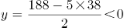，排除；代入B项，若x=37，则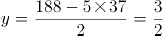，单数必须为整数，排除；代入C项，若x=36，则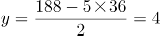，满足全部要求，D项不需要验证。

故正确答案为C。

### 第 60 题

小吴以每小时5千米的速度步行前往相距10千米的A村。与此同时，有一只信鸽从A村出发，以每小时45千米的速度飞向小吴。当信鸽与小吴相遇后，原地休息了0.3小时，飞回A村。当信鸽返回A村后，原地休息了0.3小时，又再次飞向小吴，相遇后原地休息0.3小时后飞回A村。则在整个过程中，信鸽的飞行路程共为：

A. 18千米

B. 27千米

C. 36千米

D. 45千米

第 60 题 · 答案与解析

**参考答案（粉笔题库参考内容）**

B

**解析**

第一次小吴与信鸽相遇时间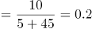小时，由题意可知，从信鸽第一次出发到第二次出发期间共经过了=0.2+0.3+0.2+0.3=1小时，此时小吴已经出发1×5=5千米，距离A村还有5千米，信鸽第二次出发与小吴相遇时间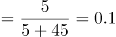小时。则在整个过程中，信鸽的飞行路程=（0.2+0.2+0.1+0.1）×45=27千米。

故正确答案为B。

### 第 61 题

甲、乙、丙三人一起拼车，统一出发，到不同地点。他们约定合乘部分车费平摊。已知甲、乙、丙三人实际支付费用分别为14元、28元、48元，那么在此次拼车过程中，乙节约了：

A. 14元

B. 28元

C. 42元

D. 48元

第 61 题 · 答案与解析

**参考答案（粉笔题库参考内容）**

C

**解析**

因为甲付钱最少，丙付钱最多，所以甲最早下车，丙最后下车。由于合乘部分费用均摊，可得甲乙丙三人付钱情况如下表：

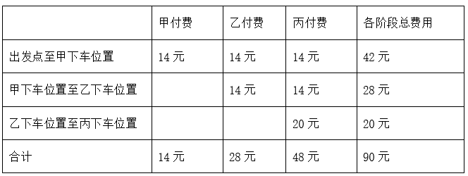

因此乙若单独从出发地打车到其下车位置需要支付42＋28＝70元，而实际乙只支付了28元，所以节省70-28＝42元。

故正确答案为C。

### 第 62 题

小王和小李沿着绿道往返运动，绿道总长度为6公里。小王每小时走4公里；小李每小时跑8公里。如果两人同时从绿道的一端出发，则两人第7次相遇时的地点距离出发点：

A. 0公里

B. 2公里

C. 3公里

D. 4公里

第 62 题 · 答案与解析

**参考答案（粉笔题库参考内容）**

D

**解析**

根据线性一端出发第n次相遇公式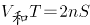，设第7次相遇所用时间为T，则有（4＋8）T＝2×7×6，解得T＝7小时，所以相遇7次时，小王走了7×4＝28公里，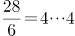，即小王走了4次绿道全程，回到出发地又走出4公里，故第7次相遇时距离两人出发地4公里。

故正确答案为D。

### 第 63 题

学校买来四种教材，语文教材是其余三种的，数学教材是其余三种的，英语教材是其余三种的，科学教材比数学教材少30本，则数学教材有：

A. 30本

B. 60本

C. 100本

D. 200本

第 63 题 · 答案与解析

**参考答案（粉笔题库参考内容）**

B

**解析**

设四种教材共x本，根据题意，语文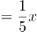，数学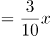，英语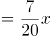，则科学教材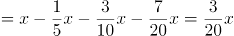，则数学教材数量-科学教材数量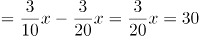，解的x＝200，则数学教材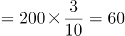本。

故正确答案为B。

### 第 64 题

某地计划修筑一条道路。如果该道路交由甲施工队先单独施工6天，乙施工队再单独施工15天即可完工；如果交由乙施工队先单独施工6天，那么甲施工队还需要单独施工24天才能修筑完成。如果这条道路交由甲施工队单独施工，道路修筑完成需要：

A. 30天

B. 32天

C. 36天

D. 40天

第 64 题 · 答案与解析

**参考答案（粉笔题库参考内容）**

C

**解析**

根据题意，6甲＋15乙＝6乙＋24甲，整理得18甲＝9乙，故甲：乙＝1：2，赋值甲的效率为1，乙的效率为2，可得工程总量＝6×1＋15×2＝36，故该工程由甲单独做需要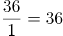天。

故正确答案为C。

### 第 65 题

小李的耳机充满电可通话6小时，或者待机210小时。某天小李乘坐火车，上车时耳机满电，而当他下车时耳机电量刚好用光。如果小李在火车上有一半的时间在通话，其余时间耳机均为待机状态，则他乘坐火车的时长为：

A. 9小时10分钟

B. 9小时30分钟

C. 10小时20分钟

D. 11小时40分钟

第 65 题 · 答案与解析

**参考答案（粉笔题库参考内容）**

D

**解析**

赋值耳机充满电的电量为210，则通话时耳机的工作效率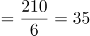，待机时耳机的工作效率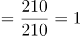。设小李的通话时间为t，待机时间也为t，则乘坐火车时长为2t，由题意可得35t＋t×1＝210，解得t＝5小时50分钟，所以整个坐车时间为11小时40分钟。

故正确答案为D。

### 第 66 题

从所给的四个选项中，选择最合适的一个填入问号处，使之呈现一定的规律性：

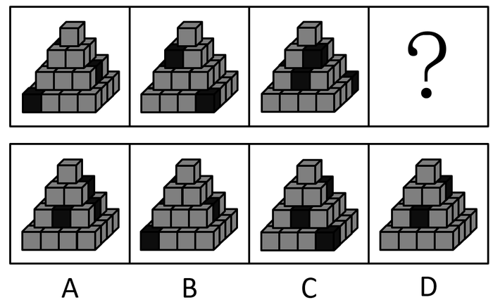

A. A

B. B

C. C

D. D

第 66 题 · 答案与解析

**参考答案（粉笔题库参考内容）**

A

**解析**

元素组成相同，优先考虑位置规律，先看最下面一层，只有一个小黑块，图1在左下角，图2在右下角，图3在右上角，小黑块每次逆时针平移3格，继续逆时针平移3格，应该平移到左上角，排除B、C项。对比A、D项发现，只有倒数第二层黑块的位置不一样，通过对题干倒数第二层黑块的观察发现，每幅图都应该是有两个黑块，有个别图看不到2个，是因为黑块平移到后面时被挡住了，故倒数第二层的两个黑块是每次同时逆时针平移2格，继续逆时针平移2格，对应A项。

故正确答案为A。

### 第 67 题

从所给的四个选项中，选择最合适的一个填入问号处，使之呈现一定的规律性：

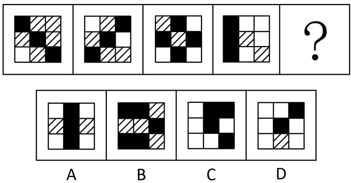

A. A

B. B

C. C

D. D

第 67 题 · 答案与解析

**参考答案（粉笔题库参考内容）**

C

**解析**

题干所有图形中均出现黑块、白块、阴影3种元素，单独看黑块和阴影元素的个数并无明显规律，考虑白块个数，题干依次是1、2、3、4、？，故？处应选择白块个数为5的选项，对应C项。

故正确答案为C。

### 第 68 题

把下面的图形分为两类，使每一类图形都有各自的共同特征或规律，分类正确的一项是：

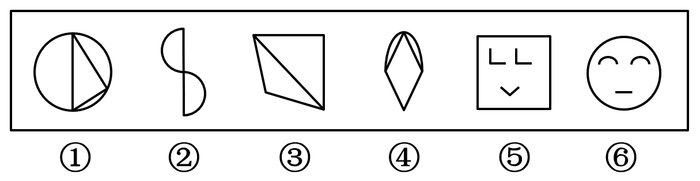

A. ①②③，④⑤⑥

B. ①③④，②⑤⑥

C. ①③⑤，②④⑥

D. ①②⑥，③④⑤

第 68 题 · 答案与解析

**参考答案（粉笔题库参考内容）**

C

**解析**

元素组成不同，属性无明显规律，考虑数量规律。题干图③和图⑤出现明显直角，优先考虑直角规律，图①③⑤图形中存在直角，图②④⑥图形中没有直角，对应C项。

故正确答案为C。

注：一组有规律，一组无规律并不是完全严谨的分组规律，只有在没有其他更好规律的情况下，才可以考虑。

### 第 69 题

从所给的四个选项中，选择最合适的一个填入问号处，使之呈现一定的规律性：

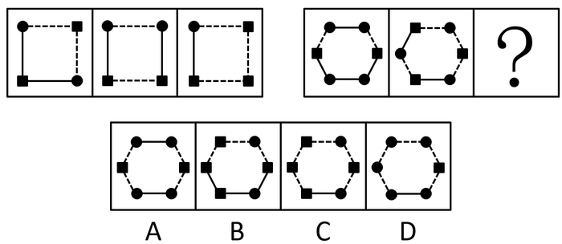

A. A

B. B

C. C

D. D

第 69 题 · 答案与解析

**参考答案（粉笔题库参考内容）**

C

**解析**

元素组成相似，图形轮廓及分隔区域相同，优先考虑黑白运算。观察第一组图可知，黑圆+黑圆=黑圆、黑块+黑圆=黑块、黑块+黑块=黑块、黑圆+黑块=黑块；第二组图运用规律，左上角“黑圆+黑块=黑块”，排除A、D项；对比B、C项，最大的区别就是小元素之间的连线是虚线还是实线，通过再次观察第一组图发现，实线和虚线之间也存在运算规律，虚线+虚线=虚线、实线+实线=实线、虚线+实线=虚线、实线+虚线=虚线；第二组图运用规律，左下角的线条为“实线+虚线=虚线”，排除B项，验证C项无误。

故正确答案为C。

### 第 70 题

从所给的四个选项中，选择最合适的一个填入问号处，使之呈现一定的规律性：

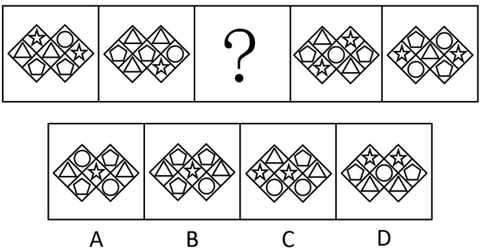

A. A

B. B

C. C

D. D

第 70 题 · 答案与解析

**参考答案（粉笔题库参考内容）**

B

**解析**

题干出现多个独立小元素，元素种类与个数均没有规律，考虑相邻比较。通过观察图1和图2发现，图1第二层最左边的两个三角形同时向右上平移了一层，图1第三层的两个五边形向左上平移了一层；验证图4和图5，满足图4第二层最左边的五边形和圆同时向右上平移了一层，第三层的五角星和三角形同时向左上平移了一层，规律验证成立。运用规律，图2第二层最左边的两个五边形同时向上平移了一格，变成了？处的第一层，排除ACD项，对应B项。

故正确答案为B。

### 第 71 题

紧急避险是指为了使国家、公共利益、本人或者他人的人身、财产和其他权利免受正在发生的危险，不得已采取的紧急避险行为，造成损害的，不负刑事责任。紧急避险不得超过必要限度造成不应有的伤害，否则仍应负刑事责任，但是可以减轻或者免除处罚。其中关于避免本人危险的规定，不适用于职务上、业务上负有特定责任的人。

根据上述定义，以下属于紧急避险的是：

A. 某主治医生为了防止自己感染，申请退出非典病人的急救工作

B. 某商贩为躲避城市管理人员的查处，在开车逃跑过程中撞到了行人

C. 孙某驾驶私家车送女儿参加高考的途中，由于时间紧急而闯了一个红灯

D. 公交车司机发现刹车失灵后，迫不得已撞向了一个无人值守的公安岗亭

第 71 题 · 答案与解析

**参考答案（粉笔题库参考内容）**

D

**解析**

第一步：找出定义关键词。

“为了使国家、公共利益、本人或者他人的人身、财产和其他权利免受正在发生的危险”、“不得已采取的紧急避险行为”、“不适用于职务上、业务上负有特定责任的人”。

第二步：逐一分析选项。

A项：医生的职责就是治病救人，属于业务上负有特定责任的人，因此不适用于紧急避险，不符合定义，排除；

B项：城市管理人员查处商贩属于合法行为，商贩并不存在危险，不符合“为了使国家、公共利益、本人或者他人的人身、财产和其他权利免受正在发生的危险”，不符合定义，排除；

C项：孙某由于时间紧急闯红灯，并不存在危险，不符合“为了使国家、公共利益、本人或者他人的人身、财产和其他权利免受正在发生的危险”，不符合定义，排除；

D项：公交车刹车失灵，存在危险，司机迫不得已撞向了一个无人值守的公安岗亭，符合“为了使国家、公共利益、本人或者他人的人身、财产和其他权利免受正在发生的危险”，也符合“不得已采取的紧急避险行为”，符合定义，当选。

故正确答案为D。

### 第 72 题

政策性收益是指由于某些政策、法规的变动而导致的个体收益，这种收益不会导致整个社会财富的增长，只会导致整个社会财富的重新分配。

根据上述定义，以下涉及政策性收益的是：

A. 某市优化了营商环境，使得该市外贸企业进出口额与利润均大幅增加

B. 小王挺身而出，制服歹徒，获得市政府见义勇为奖金5万元

C. 出于增强执法力量的考虑，某公安局获得了上级1000万元的财政拨款

D. 由于个人所得税新政策的实施，小李现在每月可以少缴纳个税216元

第 72 题 · 答案与解析

**参考答案（粉笔题库参考内容）**

D

**解析**

第一步：找出定义关键词。

“某些政策、法规的变动而导致的个体收益”、“不会导致整个社会财富的增长，只会导致整个社会财富的重新分配”。

第二步：逐一分析选项。

A项：该市外贸企业进出口额与利润均大幅增加，说明该市财富增加了，不符合“不会导致整个社会财富的增长，只会导致整个社会财富的重新分配”，不符合定义，排除；

B项：小王获得奖金5万元是因为其见义勇为的行为，不符合“某些政策、法规的变动而导致的个体收益”，不符合定义，排除；

C项：某公安局获得了上级1000万元的财政拨款，公安局不是个体，不符合“某些政策、法规的变动而导致的个体收益”，不符合定义，排除；

D项：由于个人所得税新政策的实施，小李现在每月可以少缴纳个税216元，符合“某些政策、法规的变动而导致的个体收益”，符合定义，当选。

故正确答案为D。

### 第 73 题

准群体是指人与人之间已有某种联系，有一定程度的共同关心点，有可能在某些时候形成集团，但目前还没有组织起来的人群。

根据上述定义，以下必定不属于准群体的是：

A. 在某网络论坛，正在讨论去某地旅游的网友

B. 一群定时出现在某广场跳广场舞的市民

C. 积极地参与某次志愿者活动的某高校大学生们

D. 某社区正在观看免费电影的来自附近各小区的居民

第 73 题 · 答案与解析

**参考答案（粉笔题库参考内容）**

C

**解析**

第一步：找出定义关键词。

“人与人之间已有某种联系，有一定程度的共同关心点”、 “目前还没有组织起来”。

第二步：逐一分析选项。

A项：正在讨论去某地旅游的网友，说明网友之间存在关于旅游的共同话题，符合“人与人之间已有某种联系，有一定程度的共同关心点”，符合定义，排除；

B项：市民定时一起跳广场舞，说明市民之间存在一定的联系，符合“人与人之间已有某种联系，有一定程度的共同关心点”，符合定义，排除；

C项：志愿者活动是经过组织的活动，参与的高校大学生们已经被组织起来，不符合“目前还没有组织起来”，不符合定义，当选；

D项：正在观看免费电影的来自附近各小区的居民，一起观看免费电影，符合“人与人之间已有某种联系，有一定程度的共同关心点”，符合定义，排除。

本题为选非题，故正确答案为C。

### 第 74 题

对越熟悉的东西越喜欢的现象，心理学上称为“多看效应”。多看效应不仅仅是在心理学实验中才出现，在生活中，我们也常常会见到。

根据上述定义，以下属于多看效应的是：

A. 最初见面印象越好，喜欢程度越高

B. 见面次数越多，喜欢程度越高

C. 越内向的人，越难以受到他人的喜欢

D. 最近一次见面印象越好，喜欢程度越高

第 74 题 · 答案与解析

**参考答案（粉笔题库参考内容）**

B

**解析**

第一步：找出定义关键词。

“对越熟悉的东西越喜欢的现象”。

第二步：逐一分析选项。

A项：最初见面印象越好，喜欢程度越高，最初印象是第一印象，不符合“对越熟悉的东西越喜欢的现象”，不符合定义，排除；

B项：见面次数越多，喜欢程度越高，见面次数越多说明越熟悉，符合“对越熟悉的东西越喜欢的现象”，符合定义，当选；

C项：越内向的人，越难以受到他人的喜欢，不符合“对越熟悉的东西越喜欢的现象”，不符合定义，排除；

D项：最近一次见面印象越好，喜欢程度越高，最近一次见面不代表更加的熟悉，不符合“对越熟悉的东西越喜欢的现象”，不符合定义，排除。

故正确答案为B。

### 第 75 题

切割营销是指从竞争的角度，清晰地切割出有利于企业的人群、市场区域、新品类别、认知差异和品牌主线，进而实现难得的成长时间和空间。

根据上述定义，以下属于切割营销的是：

A. 某饮料的广告词：年轻一代的选择

B. 某家庭生了四胞胎，引起社会关注，有奶粉品牌邀请四胞胎代言广告

C. 某企业要求营销人员必须了解每位客户，定期维护客户关系

D. 某公司通过积极参与各类公益活动，提升品牌形象

第 75 题 · 答案与解析

**参考答案（粉笔题库参考内容）**

A

**解析**

第一步：找出定义关键词。

“切割出有利于企业的人群、市场区域、新品类别、认知差异和品牌主线”。

第二步：逐一分析选项。

A项：年轻一代的选择，年轻一代是对人群的切割，符合“切割出有利于企业的人群、市场区域、新品类别、认知差异和品牌主线”，符合定义，当选；

B项：奶粉品牌是因为四胞胎引起社会关注才邀请其代言广告，不符合“切割出有利于企业的人群、市场区域、新品类别、认知差异和品牌主线”，不符合定义，排除；

C项：某企业要求营销人员必须了解每位客户，并没有对客户群体进行区分，不符合“切割出有利于企业的人群、市场区域、新品类别、认知差异和品牌主线”，不符合定义，排除；

D项：某公司通过积极参与各类公益活动，提升品牌形象，提升形象并没有切割出品牌主线，不符合“切割出有利于企业的人群、市场区域、新品类别、认知差异和品牌主线”，不符合定义，排除。

故正确答案为A。

### 第 76 题

词的兼类是指在词义上有联系，并在不同的场合经常具备两类或两类以上的词类的语法功能的词。兼类词的特有条件有三个，一是意义上有相关性，具有不同功能的词应该是一个词；二是功能上有排斥性，兼类词的不同功能必须是分别在不同的结构条件下实现的；三是功能上有稳定性，兼类词兼有的两个词类的属性是稳定、经常性的，而不是临时的，更不是具有个人风格的修辞行为。

根据上述定义，以下句子用到兼类词的是：

A. ①母亲很思念她的孩子。②信中寄托着浓浓的思念。

B. ①不能乱花钱。②这里的花真美

C. ①这是一个秘密。②你不能把这个秘密告诉他。

D. ①你就是一个活雷锋。②你的行为也太雷锋了吧。

第 76 题 · 答案与解析

**参考答案（粉笔题库参考内容）**

A

**解析**

第一步：找出定义关键词。

在词义上有联系、在不同的场合经常具备两类或两类以上的词类的语法功能、具有不同功能的词应该是一个词、不同功能必须是分别在不同的结构条件下实现的、有的两个词类的属性是稳定、经常性的，而不是临时的，更不是具有个人风格的。

第二步：逐一分析选项。

A项：二者的“思念”意思相同，前者的“思念”是动词的用法，后者的“思念”是名词用法，符合“在词义上有联系”、“在不同的场合经常具备两类或两类以上的词类的语法功能”、“具有不同功能的词应该是一个词、不同功能必须是分别在不同的结构条件下实现的”、“有的两个词类的属性是稳定、经常性的，而不是临时的，更不是具有个人风格的”，符合定义，当选；

B项：前者的“花”是消费金钱的意思，而后者的“花”是花朵的意思，二者意思完全不同，不符合“在词义上有联系”，不符合定义，排除；

C项：二者的“秘密”均为不能告知人别人的事情，不符合“具有不同功能的词应该是一个词”，不符合定义，排除；

D项：前者的“雷锋”是乐于助人的人，后者的“雷锋”是乐于助人，一个是名词的用法，一个是形容词的用法，但后者的雷锋用法，不符合“有的两个词类的属性是稳定、经常性的，而不是临时的，更不是具有个人风格的”，不符合定义，排除。

故正确答案为A。

### 第 77 题

实践合同又称要物合同，是指除当事人双方意思表示一致外，还须交付标的物或完成其他现实交付才能生效的合同。

根据上述定义，以下属于实践合同的是：

A. 农民老张与收购商签订的竹笋买卖合同

B. 小王与公司签订的劳动合同

C. 小梁购买房屋与开发商签订的购房合同

D. 小孙向小赵借钱买车签订的借款合同

第 77 题 · 答案与解析

**参考答案（粉笔题库参考内容）**

D

**解析**

第一步：找出定义关键词。

交付标的物或完成其他现实交付才能生效。

第二步：逐一分析选项。

A项：竹笋买卖合同经过买卖双方签字就会生效，不符合“交付标的物或完成其他现实交付才能生效”，不符合定义，排除；

B项：劳动合同经过买卖双方签字就会生效，不符合“交付标的物或完成其他现实交付才能生效”，不符合定义，排除；

C项：购房合同经过买卖双方签字就会生效， 不符合“交付标的物或完成其他现实交付才能生效”，不符合定义，排除；

D项：借款合同只有在交付借款之后才能生效，因此，符合“交付标的物或完成其他现实交付才能生效”，符合定义，当选。

故正确答案为D。

### 第 78 题

分配式谈判是指在零和条件下进行的谈判，本质是对于一份固定大小的利益谁应分得多少进行协商。当双方博弈时，一方得利必然意味着另一方吃亏，一方得益多少，另一方就吃亏多少，双方得失相抵，总数为零，这种情况就被称为“零和”。

根据上述定义，以下不属于分配式谈判的是：

A. 劳资双方的薪酬谈判

B. 商品房买卖方之间谈价钱

C. 夫妻俩商议两人之间如何分配家务

D. 两国针对边界划分问题开展谈判

第 78 题 · 答案与解析

**参考答案（粉笔题库参考内容）**

A

**解析**

第一步：找出定义关键词。

“在零和条件下进行的谈判”、“对于一份固定大小的利益谁应分得多少进行协商”、“双方得失相抵总数为零”。

第二步：逐一分析选项。

A项：劳资双方的薪酬谈判不涉及“在零和条件下进行的谈判”，因为双方的利益总和不符合“固定大小的利益”，不符合定义，当选；

B项：商品房买卖方之间谈价钱符合“在零和条件下进行的谈判”、“对于一份固定大小的利益谁应分得多少进行协商”、“双方得失相抵总数为零”，符合定义，排除；

C项：夫妻俩商议两人之间如何分配家务符合“在零和条件下进行的谈判”、“对于一份固定大小的利益谁应分得多少进行协商”、“双方得失相抵总数为零”，符合定义，排除；

D项：两国针对边界划分问题开展谈判符合“在零和条件下进行的谈判”、“对于一份固定大小的利益谁应分得多少进行协商”、“双方得失相抵总数为零”，符合定义，排除。

本题为选非题，故正确答案为A。

### 第 79 题

惯性思维是指人习惯性地因循以前的思路思考问题，仿佛物体运动的惯性。惯性思维常会造成思考事情时产生盲点，且缺少创新或改变的可能性。

根据上述定义，以下与惯性思维最相关的是：

A. 某科学家做了如下实验：他让50个人到一个房间观看蓝色物体30秒，然后让他们闭眼说出屋内红色物体的数量，结果无人能够说出

B. 小萧是某出版社编辑，日常工作经常需要校稿排版。一次，他在手机上阅读新闻的时候，很快就发现了其中的三个错别字

C. 如果有人问“什么老鼠用两只脚走路？”如果先回答是米老鼠，再问“什么鸭子用两只脚走路？”时，一般人会回答唐老鸭，其实答案是所有鸭子都是用两只脚走路的

D. 作为公交车司机，老李十几年如一日早起履行自己的职责。后来，公司考虑老李的年纪给他调换了工作，可是老李每天还是忍不住早起

第 79 题 · 答案与解析

**参考答案（粉笔题库参考内容）**

C

**解析**

第一步：找出定义关键词。

“人习惯性地因循以前的思路思考问题”、“造成思考事情时产生盲点”、“且缺少创新或改变的可能性”。

第二步：逐一分析选项。

A项：无人能够说出红色物体的数量不符合“人习惯性地因循以前的思路思考问题”、“造成思考事情时产生盲点”、“且缺少创新或改变的可能性”，不符合定义，排除；

B项：发现错别字不符合“人习惯性地因循以前的思路思考问题”、“造成思考事情时产生盲点”、“且缺少创新或改变的可能性”，不符合定义，排除；

C项：后面的问题是基于回答前一个问题的基础上的回答，思维因循守旧，符合“人习惯性地因循以前的思路思考问题”、“造成思考事情时产生盲点”、“且缺少创新或改变的可能性”，符合定义，当选；

D项：老李忍不住早起跟思考问题没有关系，只是多年来的个人习惯，不符合“人习惯性地因循以前的思路思考问题”、“造成思考事情时产生盲点”、“且缺少创新或改变的可能性”，不符合定义，排除。

故正确答案为C。

### 第 80 题

内在动机是指由个体内在需要引起的动机。由于个体对活动本身感到有兴趣，从活动中个体能得到满足、奖励和报酬，故活动本身成为个体从事该活动的推动力。

根据上述定义，以下不属于内在动机的是：

A. 小陈上课认真，平时也很认真地做作业复习功课，他最期待考试的时候能获得好成绩，享受同学们羡慕的眼光

B. 小何是一名大学生村官，他很乐于为村民解决各种问题，因为他在帮助村民解决问题时自己很有成就感

C. 小曾一直很努力地学习做生意，因为他知道要赚足够的钱，才能实现30岁环游世界的梦想

D. 小廖不想辜负父母对他的期盼，从事科研工作时非常努力，在很困难的课题上取得了好成绩

第 80 题 · 答案与解析

**参考答案（粉笔题库参考内容）**

D

**解析**

第一步：找出定义关键词。

“由个体内在需要引起的动机”、“个体对活动本身感到有兴趣”、“从活动中个体能得到满足、奖励和报酬”、“活动本身成为个体从事该活动的推动力”。

第二步：逐一分析选项。

A项：小陈努力学习为了考试的时候能获得好成绩，享受同学们羡慕的眼光，符合“由个体内在需要引起的动机”、“个体对活动本身感到有兴趣”、“从活动中个体能得到满足、奖励和报酬”、“活动本身成为个体从事该活动的推动力”，符合定义，排除；

B项：小何很乐于为村民解决各种问题是为了获得成就感，符合“由个体内在需要引起的动机”、“个体对活动本身感到有兴趣”、“从活动中个体能得到满足、奖励和报酬”、“活动本身成为个体从事该活动的推动力”，符合定义，排除；

C项：小曾努力赚钱是为了实现30岁环游世界的梦想，符合“由个体内在需要引起的动机”、“个体对活动本身感到有兴趣”、“从活动中个体能得到满足、奖励和报酬”、“活动本身成为个体从事该活动的推动力”，符合定义，排除；

D项：小廖从事科研工作时非常努力，是不想辜负父母对他的期盼，不符合“由个体内在需要引起的动机”、“个体对活动本身感到有兴趣”、 “活动本身成为个体从事该活动的推动力”，不符合定义，当选。

本题为选非题，故正确答案为D。

### 第 81 题

聆听：音乐

A. 注视：眼睛

B. 呼吸：清风

C. 抚摸：质地

D. 观赏：风景

第 81 题 · 答案与解析

**参考答案（粉笔题库参考内容）**

D

**解析**

第一步：判断题干词语间逻辑关系。

聆听音乐，聆听是动词，音乐是名词，二者构成动宾关系。

第二步：判断选项词语间逻辑关系。

A项：眼睛可以用来注视，二者是功能对应关系，与题干逻辑关系不一致，排除；

B项：呼吸和清风之间无必然逻辑关系，与题干逻辑关系不一致，排除；

C项：通过抚摸可以感受材料结构的性质，即质地，所以二者不是动宾关系，与题干逻辑关系不一致，排除；

D项：观赏风景，观赏是动词，风景是名词，二者构成动宾关系，与题干逻辑关系一致，当选。

故正确答案为D。

### 第 82 题

汽车：燃油

A. 面包：小麦

B. 飞机：零件

C. 植物：阳光

D. 蛋糕：烤箱

第 82 题 · 答案与解析

**参考答案（粉笔题库参考内容）**

C

**解析**

第一步：判断题干词语间逻辑关系。

燃油为汽车提供行驶的动力。

第二步：判断选项词语间逻辑关系。

A项：小麦是制作面包的原材料，与题干逻辑关系不一致，排除；

B项：零件是飞机的组成部分，二者是组成关系，与题干逻辑关系不一致，排除；

C项：阳光为植物提供成长的能源，与题干逻辑关系一致，当选；

D项：烤箱可以用来制作蛋糕，与题干逻辑关系不一致，排除。

故正确答案为C。

### 第 83 题

城市：农村

A. 街道：社区

B. 工业：农业

C. 硬件：软件

D. 学习：工作

第 83 题 · 答案与解析

**参考答案（粉笔题库参考内容）**

C

**解析**

第一步：判断题干词语间逻辑关系。

城市是以非农业产业和非农业人口集聚形成的较大居民点；农村是指以从事农业生产为主的劳动者聚居的地方，二者是并列关系中的矛盾关系。

第二步：判断选项词语间逻辑关系。

A项：街道和社区是两种不同的区域划分，二者是并列关系中的反对关系，与题干逻辑关系不一致，排除；

B项：工业和农业是两种不同的行业，二者是并列关系中的反对关系，与题干逻辑关系不一致，排除；

C项：硬件和软件是两种不同的计算机组成，二者是并列关系中的矛盾关系，与题干逻辑关系一致，当选；

D项：学习和工作是两种不同的生活状态，二者是并列关系中的反对关系，与题干逻辑关系不一致，排除。

故正确答案为C。

### 第 84 题

植物：煤炭

A. 白酒：陈醋

B. 淀粉：玉米

C. 牛奶：酸奶

D. 酸菜：白菜

第 84 题 · 答案与解析

**参考答案（粉笔题库参考内容）**

C

**解析**

第一步：判断题干词语间逻辑关系。

植物埋藏在地下，经过一系列复杂的变化会变成煤炭，二者是原材料的对应关系。

第二步：判断选项词语间逻辑关系。

A项：白酒和陈醋是两种不同的液体，二者是并列关系，与题干逻辑关系不一致，排除；

B项：玉米可以做成淀粉，二者是原材料对应关系，但是顺序反了，与题干逻辑关系不一致，排除；

C项：牛奶经过发酵会变成酸奶，二者为原材料的对应关系，与题干逻辑关系一致，当选；

D项：白菜可以做成酸菜，二者是原材料对应关系，但是顺序反了，与题干逻辑关系不一致，排除。

故正确答案为C。

### 第 85 题

手忙脚乱：慌张

A. 鹏程万里：遥远

B. 百口莫辩：心虚

C. 七上八下：繁忙

D. 白云苍狗：无常

第 85 题 · 答案与解析

**参考答案（粉笔题库参考内容）**

D

**解析**

第一步：判断题干词语间逻辑关系。

手忙脚乱形容做事慌张而没有条理，手忙脚乱形容慌张。

第二步：判断选项词语间逻辑关系。

A项：鹏程万里是比喻前程远大，与遥远无必然联系，与题干逻辑关系不一致，排除；

B项：百口莫辩形容事情无法说清楚，与心虚无必然联系，与题干逻辑关系不一致，排除；

C项：七上八下形容心里慌乱不安，无所适从的感觉，与繁忙无必然联系，与题干逻辑关系不一致，排除；

D项：白云苍狗比喻世事变幻无常，白云苍狗形容无常，与题干逻辑关系一致，当选。

故正确答案为D。

### 第 86 题

爱不释手：手不释卷

A. 高风亮节：两袖清风

B. 风声鹤唳：草木皆兵

C. 大同小异：相差无几

D. 出口成章：才思敏捷

第 86 题 · 答案与解析

**参考答案（粉笔题库参考内容）**

A

**解析**

第一步：判断题干词语间逻辑关系。

爱不释手指喜欢得舍不得放手；手不释卷指书本不离手，形容勤奋好学。爱不释手的喜爱范围大于手不释卷，后者是前者的一个表现。

第二步：判断选项词语间逻辑关系。

A项：高风亮节形容人品格高尚，有坚贞的节操；两袖清风比喻做官廉洁，现多数比喻为官清廉、不贪赃枉法严于律己的人。高风亮节的清高范围大于两袖清风，后者是前者的一个表现，与题干逻辑关系一致，当选；

B项：风声鹤唳指听到风声和鹤叫声，都疑心是追兵，形容惊慌失措，或自相惊扰的样子；草木皆兵形容失败者的恐惧心理，形容人在惊慌时疑神疑鬼。二者是近义关系，但风声鹤唳和草木皆兵之间不存在范围差距，与题干逻辑关系不一致，排除；

C项：大同小异指大体相同，略有差异；相差无几指二者距离不远，或差别不大。二者是近义关系，但大同小异和相差无几之间不存在范围差距，与题干逻辑关系不一致，排除；

D项：出口成章形容人文思敏捷，口才好；才思敏捷形容人的反应快，思维灵活，脑子很聪明。出口成章的才华范围小于才思敏捷，前者是后者的一个表现，与题干词语顺序相反，与题干逻辑关系不一致，排除。

故正确答案为A。

### 第 87 题

积少成多：熟能生巧

A. 水落石出：唇亡齿寒

B. 失之毫厘：谬以千里

C. 安危相易：福祸相生

D. 塞翁失马：焉知非福

第 87 题 · 答案与解析

**参考答案（粉笔题库参考内容）**

A

**解析**

第一步：判断题干词语间逻辑关系。

积少成多指一点一滴地积累起来，就会由少变成多，熟能生巧指熟练了就能产生巧办法，好办法。两词无明显逻辑关系，考虑拆词，因为一点一滴地积累起来，所以变得很多，因为熟练所以产生好办法，二者均是因果关系结构。

第二步：判断选项词语间逻辑关系。

A项：因为水落，所以石出，因为唇亡，所以齿寒，二者均是因果关系结构，与题干逻辑关系一致，当选；

B项：失之毫厘造成的结果是谬以千里，但失之与毫厘之间不是因果关系结构，与题干逻辑关系不一致，排除；

C项：安危相易指平安与危难相互转换，二者不是因果关系结构，与题干逻辑关系不一致，排除；

D项：塞翁失马不是因果关系结构，与题干逻辑关系不一致，排除。

故正确答案为A。

### 第 88 题

纸张：书本：知识

A. 毛衣：衣服：保暖

B. 螺丝：齿轮：工具

C. 水滴：海洋：资源

D. 电脑：网卡：信息

第 88 题 · 答案与解析

**参考答案（粉笔题库参考内容）**

C

**解析**

第一步：判断题干词语间逻辑关系。

纸张组成书本，二者是组成关系，书本中蕴藏着知识，二者是包容关系。

第二步：判断选项词语间逻辑关系。

A项：毛衣是衣服，二者是种属关系，与题干逻辑关系不一致，排除；

B项：螺丝和齿轮是不同的工具，与题干逻辑关系不一致，排除；

C项：水滴组成大海，二者是组成关系，海洋中蕴藏着资源，二者是包容关系，与题干逻辑关系一致，当选；

D项：网卡是在计算机网络上进行通讯的计算机硬件，与电脑是组成关系，但顺序颠倒，与题干逻辑关系不一致，排除。

故正确答案为C。

### 第 89 题

制度：完善：执行

A. 创新：发展：推动

B. 法规：健全：实施

C. 版权：保护：侵犯

D. 食品：安全：流通

第 89 题 · 答案与解析

**参考答案（粉笔题库参考内容）**

B

**解析**

第一步：判断题干词语间逻辑关系。

完善制度与执行制度均为动宾关系，且先完善再执行。

第二步：判断选项词语间逻辑关系。

A项：发展与创新不构成动宾关系，与题干逻辑关系不一致，排除；

B项：健全法规与实施法规均为动宾关系，且先健全再实施，与题干逻辑关系一致，当选；

C项：保护版权与侵犯版权均为动宾关系，但二者没有明显先后顺序，与题干逻辑关系不一致，排除；

D项：安全的食品，二者为偏正关系，与题干逻辑关系不一致，排除。

故正确答案为B。

### 第 90 题

撸起：袖子：加油干

A. 近水：楼台：先得月

B. 直挂：云帆：济沧海

C. 抽刀：断水：水更流

D. 风吹：草低：见牛羊

第 90 题 · 答案与解析

**参考答案（粉笔题库参考内容）**

B

**解析**

第一步：判断题干词语间逻辑关系。

撸起袖子的目的是加油干，二者为方式目的对应关系。

第二步：判断选项词语间逻辑关系。

A项：因为是水边的楼台，所以先得到月光，二者为因果关系，与题干逻辑关系不一致，排除；

B项：挂起云帆的目的是横渡沧海，二者为方式目的对应关系，与题干逻辑关系一致，当选；

C项：抽出宝刀想斩断水流，水不但没有被斩断，反而流得更湍急了，抽刀是为了断水，二者为方式目的对应关系，抽刀断水和水更流，二者为转折的对应关系，与题干逻辑关系不一致，排除；

D项：因为风吹开草，所以牛羊露出来，二者是因果关系，与题干逻辑关系不一致，排除。

故正确答案为B。

### 第 91 题

网店的客服诉求大致可以分为售前问题、售后问题和投诉。随着人工智能技术的发展，其中一部分重复性高、内容简单的问题，可以通过智能客服来答复。在智能客服系统完善后，它甚至能够比人工客服更快速、准确地回答这些问题。有人据此认为，网店人工客服这一岗位将会很快消失。

以下选项中最无法削弱上述论断的是：

A. 智能客服的研发成本远高于雇用数名人工客服

B. 智能客服无法与客户进行情感交流，开展客户维护

C. 智能客服对复杂问题的回应能力不如人工客服

D. 智能客服的完善需要相对漫长的过程

第 91 题 · 答案与解析

**参考答案（粉笔题库参考内容）**

A

**解析**

第一步：找出论点和论据。

论点：网店人工客服这一岗位将会很快消失。

论据：随着人工智能技术的发展，其中一部分重复性高、内容简单的问题，可以通过智能客服来答复。

第二步：逐一分析选项。

A项：智能客服的研发成本高低和网店人工客服这一岗位是否会很快消失无关，无法削弱，当选；

B项：智能客服无法开展客户维护，说明智能客服无法取代网店人工客服，即网店人工客服不会很快消失，可以削弱，排除；

C项：智能客服对复杂问题的回应能力不如人工客服，说明网店人工客服还有存在的意义，不会消失，可以削弱，排除；

D项：智能客服的完善需要相对漫长的过程，所以网店人工客服这一岗位就不会很快消失，可以削弱，排除。

故正确答案为A。

### 第 92 题

甲、乙、丙、丁4人，一人是教师，一人是医生，一人是作家，一人是律师。现已知：①甲的年龄比教师大；②乙和律师的籍贯不同；③丙与作家的籍贯相同；④作家的年龄比乙小；⑤甲与律师来自相同的城市；⑥教师的籍贯与乙相同。

根据以上的信息，以下说法不正确的是：

A. 作家的年龄比教师大

B. 医生与律师的籍贯相同

C. 医生的年龄比作家大

D. 律师与教师的籍贯不同

第 92 题 · 答案与解析

**参考答案（粉笔题库参考内容）**

B

**解析**

第一步：分析题干。

①甲的年龄比教师大；②乙和律师的籍贯不同；③丙与作家的籍贯相同；

④作家的年龄比乙小；⑤甲与律师来自相同的城市；⑥教师的籍贯与乙相同。

第二步：根据题干条件分析选项。

由②④⑥，可知乙是医生，又由②可知，乙和律师的籍贯不同，所以，医生和律师的籍贯不同，所以B项不正确。由①⑤，还有乙是医生，可知甲是作家，又由①可知甲的年龄比教师大，所以A项正确，排除。由④和乙是医生，可知医生的年龄比作家大，所以C项正确。由②⑥可知，律师和教师籍贯不同，所以D项正确。

本题为选非题，故正确答案为B。

### 第 93 题

赵、钱、孙、李参加单位工会组织的兴趣小组，现在有书法、围棋、瑜伽三种可以选择。已知三个兴趣小组都要有人参加，且每人只能选一种。

赵说：“如果我要参加书法小组，孙、李至少有一个会和我一起参加。”

钱说：“我不参加瑜伽小组，孙也一定不会参加。”

孙说：“赵一定不会参加围棋小组。”

李说：“我要和钱参加同一个小组，但我不参加书法小组。”

如果每个人说的都是真的，则下列判断正确的是：

A. 赵参加了围棋兴趣小组

B. 孙参加了瑜伽兴趣小组

C. 赵和孙参加了书法兴趣小组

D. 钱和李参加了围棋兴趣小组

第 93 题 · 答案与解析

**参考答案（粉笔题库参考内容）**

D

**解析**

第一步：分析题干。

（1）三个兴趣小组都要有人参加，且每人只能选一种。

（2）赵说：赵参加书法小组→孙或李参加书法小组

（3）钱说：钱不参加瑜伽小组且孙不参加瑜伽小组

（4）孙说：赵不参加围棋小组

（5）李说：李和钱参加同一个小组且他们没有参加书法小组

第二步：根据题干条件分析选项。

由（5）可知，李和钱参加同一个小组，则赵不能和其他人在同一个小组，否则跟（1）出现冲突。由（2）可知，若赵参加书法小组，则至少还有一个人跟他在一个小组，与前面推理出现冲突，所以赵不参加书法小组。再结合（5），所以参加书法小组的是孙。又根据（3）可知钱不参加瑜伽小组，所以钱和李参加了围棋兴趣小组。

故正确答案为D。

### 第 94 题

警方在确认嫌疑人时常让目击证人在几个人的照片中进行指认。一般而言，指认同一个人有罪的证人数目越多，这个人真正有罪的概率就越大。但是，如果众多的目击证人都同时指认出同一个嫌疑人，则这个指认结果反而是值得怀疑的。因为大部分证人只在犯人落荒而逃的时候匆匆瞥了她们一眼，因此在指认时错误的概率很高。在这种情况下，证人指认的结果存在不一致才是正常的。众多证人的指认一致，说明很可能存在其他原因导致了这一指认结果。

下列选项中的逻辑推断方式与题干不同的是：

A. 某汽车公司生产的汽车，无论驾驶年限多长，车检时的尾气排放检测结果均远低于国家标准。因此检测机构认为，该公司为生产的所有汽车都加装了尾气检测作弊设备

B. 两支篮球队实力相近，以往多次比赛两队的比分都很接近。但近期的一场比赛中，其中一支球队以大比分获胜。因此有球迷认为，这场比赛受到了操纵

C. 某国古代法律中规定，如果所有法官都一致认为嫌疑人有罪，该嫌疑人反而会被赦免

D. 某科研人员向学术期刊投了一篇文章，里面的所有研究数据非常完美地支持了他提出的研究假设，该期刊编辑因此认为这篇文章数据造假，将文章退回

第 94 题 · 答案与解析

**参考答案（粉笔题库参考内容）**

B

**解析**

第一步：分析题干。

题干结构为：若所有的结果都相同，则这个结果反而是值得怀疑的。

第二步：逐一分析选项。

A项：无论驾驶年限多长，车检时的尾气排放检测结果均远低于国家标准，所以检测机构认为该公司作弊，即所有的结果都相同，则这个结果反而是值得怀疑的，与题干结构一致，排除；

B项：近期的一场比赛中，其中一支球队以大比分获胜，这不是所有的结果都相同，跟题干的结构不一致，当选；

C项：所有法官都一致认为嫌疑人有罪，则该嫌疑人反而会被赦免，即所有的结果都相同，则这个结果反而是值得怀疑的，与题干结构一致，排除；

D项：文章里面所有研究数据都非常完美地支持了他提出的研究假设，所以编辑认为这篇文章数据造假，即所有的结果都相同，则这个结果反而是值得怀疑的，与题干结构一致，排除。

故正确答案为B。

### 第 95 题

甲、乙、丙三人前往游乐场游玩，游乐场内有三个园区，每个人都在三个园区玩了一定数量的游戏，游乐场内的每个游戏消费均是20元。已知：

①甲和乙各自在A园区花费的金额与丙在C园区花费的金额相同

②甲在B园区和乙在C园区花费的金额都是40元

③不存在两个人在三个园区都游玩了相同数量游戏的情况

④甲、乙、丙三人在游乐场内的游戏消费均为120元，无其他消费

那么可以推断：

A. 在三个园区消费金额都相同的只可能是甲

B. 在三个园区消费金额都相同的只可能是乙

C. 在三个园区消费金额都相同的只可能是丙

D. 甲、乙、丙没有一人在三个园区的消费金额都相同

第 95 题 · 答案与解析

**参考答案（粉笔题库参考内容）**

D

**解析**

第一步：分析题干。

①甲A=乙A=丙C

②甲B=乙C=40

③不存在两个人在三个园区都游玩了相同数量游戏的情况

④甲、乙、丙三人在游乐场内的游戏消费均为120元，无其他消费

⑤游乐场内的每个游戏消费均是20元

第二步：根据题干条件分析选项。

由②④可知，甲A+甲C=乙A+乙B=80元，又因为①③可知，甲A≠40元、乙A≠40元，否则与③冲突，所以甲A=乙A=20元或60元，排除A、B项。所以甲A=乙A=丙C=20元或60元，排除C项。

故正确答案为D。

### 第 96 题

某部门要外派员工参加一项会议。部门领导对此展开了以下讨论：

甲说：“此次会议非常重要，建议派部门全部员工参加。”

乙说：“如果派老陈外出参会，建议老张留在单位主持工作。”

丙说：“老陈在这次会议中需要发言，一定要参加。”

丁说：“单位工作需要正常开展，部门需要有人员留守。”

已知上述四人中只有一个人的建议没有被采纳，则可以推出：

A. 甲的建议没有被采纳，老张没有参加此次会议

B. 乙的建议没有被采纳，老陈和老张都去参加了此次会议

C. 丙的建议没有被采纳，老陈没有参加此次会议

D. 丁的建议没有被采纳，部门全部员工都参加了此次会议

第 96 题 · 答案与解析

**参考答案（粉笔题库参考内容）**

A

**解析**

本题属于真假推理题。

第一步：找出题干矛盾命题。

甲：全部参加

乙：陈→-张

丙：陈

丁：有的不参加

发现甲和丁互为矛盾关系，因此二者必有一真，必有一假。而题干给出只有一个人的建议没有采纳，因此没有被采纳的建议一定在甲和丁之间。

第二步：看其余。

甲和丁有人没有被采纳，则乙和丙的建议都被采纳了，即陈参加，张不参加。此时可以判断，甲的建议没有被采纳，A项可以推出。

故正确答案为A。

### 第 97 题

某生产企业想要获得更高的利润，要么改进生产工艺提升产品品质，要么压缩生产成本。该企业压缩了生产成本，获得了更多利润，那么该企业一定没有改进生产工艺。

下列选项中的逻辑推断方式与题干最为相似的是：

A. 企业为规范员工行为，加大违纪处罚力度或是提高个人素质都是可行的。如果一个企业的员工素质普遍都很高，那么就没必要建立严格的违纪处罚制度

B. 要扩大市场占有率，不仅要加大广告投入，还要提高生产合格率，如果市场占有率降低，可能是因为广告效果不理想

C. 货币汇率的影响因素一是经济增长速度的变化，二是经济规模比重的变化，所以汇率长期升值是经济长期增长造成的

D. 低碳消费可以提高资源利用率，还可以真正实现节能减排，低碳消费不但是个人行为，更应该是社会共同行为

第 97 题 · 答案与解析

**参考答案（粉笔题库参考内容）**

A

**解析**

第一步：分析题干的推理形式。

要么改进工艺，要么压缩成本。压缩成本→-改进工艺。

第二步：逐一分析选项。

A项：加大处罚力度或提高个人素质。个人素质高→-加大处罚力度。与题干推理形式相似，当选；

B项：扩大市场占有率→加大广告投入且提高生产合格率。市场占有率低→可能广告效果不理想，与题干推理形式不同，排除；

C项：货币汇率的影响因素一是经济增长速度的变化，二是经济规模比重的变化，所以汇率长期升值是经济长期增长造成的与题干推理形式不同，排除；

D项：无法翻译，与题干推理形式不同，排除；

故正确答案为A。

注：本题题干两件事的逻辑关系为“要么A要么B”的形式，但选项都不是该形式，因此只能找和“要么A要么B”最相似和一致的逻辑关联词，即A项的“或者A或者B”。

### 第 98 题

某单位计划派小李驻村挂职锻炼。已知驻村干部必须同时满足以下条件中的两项：会讲当地方言；有经济专业背景；有两年以上基层工作经验。

以下哪项如果为真，可以得出“小李必然不能参加挂职锻炼”的结论？

A. 小李在基层工作过两年，但他要么不会讲方言，要么不是经济专业的

B. 小李没在基层工作过，如果小李是经济专业的，那么他不会讲当地方言

C. 小李会讲当地方言，而且或者是经济专业，或者在基层工作过两年

D. 小李不是经济专业的，而且他可能在基层工作过两年

第 98 题 · 答案与解析

**参考答案（粉笔题库参考内容）**

B

**解析**

第一步：翻译题干。

驻村干部必须同时满足以下条件中的两项：会讲当地方言；有经济专业背景；有两年以上基层工作经验。

第二步：逐一分析选项。

A项：小李在基层工作过两年肯定了三个条件中的一项，但他要么不会讲方言，要么不是经济专业的，说明小李可以符合其中两项，可以参加基层锻炼，排除。

B项：小李没在基层工作过否定了其中一项，小李是经济专业的→他不会讲当地方言。小李是否是经济学专业有两种情况，第一种情况，小李是经济学专业，肯前必肯后，推出小李不会讲当地方言，结合小李没在基层工作过，此时小李必然不能参加挂职锻炼；第二种情况，小李不是经济学专业，结合小李没在基层工作过，此时小李必然不能参加挂职锻炼；因此不论哪种情况下，小李必然不能参加挂职锻炼，当选。

C项：小李会讲当地方言，而且或者是经济专业，或者在基层工作过两年，说明小李可能会去当地挂职，排除；

D项：小李不是经济专业的，而且他可能在基层工作过两年，但小李是否有经济专业背景不明确，无法推出，排除。

故正确答案为B。

### 第 99 题

近几年，购买轿车的人中买新车的人所占的比例下降了，一些销售商把这个现象归因于新车价格的增长，他们认为，即使完全扣除掉物价增长的因素，现在一辆新车的价格也比几年前高了很多。

以下哪项如果为真，最能反驳销售商的观点？

A. 一个人购买一辆新车到他下次买车会间隔几年时间

B. 一辆新车的价值往往下降的很快，但在一段时间后就不怎么下降了

C. 二手车销量的增加是由于现在市场上少数二手车经销商正低价抛售

D. 新车均价的改变是由于更多的人拒绝购买便宜的新车而选择购买二手车

第 99 题 · 答案与解析

**参考答案（粉笔题库参考内容）**

D

**解析**

第一步：找出论点和论据。

论点：新车价格的增长导致购买轿车的人中买新车的人所占的比例下降了。

论据：无。

本题只有论点，没有论据，削弱可以考虑否定论点，且论点为因果关系，也可以考虑因果倒置和他因削弱。

第二步：逐一分析选项。

A项：一个人购买一辆新车到他下次买车会间隔几年时间与近年买新车人数比例下降无关，无法削弱，排除；

B项：一辆新车的价值往往下降的很快，但在一段时间后就不怎么下降了，但新车价格到底是高是低不知道，无法削弱，排除；

C项：二手车销量的增加是由于现在市场上少数二手车经销商正低价抛售，论点讨论的是新车价格和成交量的关系，无法削弱，排除；

D项：指出新车均价的改变是由于更多的人拒绝购买便宜的新车而选择购买二手车，说明人们购买二手车是因，新车均价的改变是果，属于因果倒置，当选。

故正确答案为D。

### 第 100 题

某国家森林公园中，4个山地大猩猩家族爆发了呼吸系统传染病。据调查，这4个家族的山地大猩猩与游览者的互动很紧密，它们经常与人近距离接触。所以，如果游览者与山地大猩猩保持10米以上的距离，那么感染呼吸系统传染病的山地大猩猩数量将会大大降低。

下列哪项陈述最好地总结了上述论证中的缺陷？

A. 假设了游览者可能患有呼吸系统疾病

B. 忽略了其他与人接触过的山地大猩猩家族没有爆发呼吸系统传染病的状况

C. 忽视了不同地区的山地大猩猩发生呼吸系统传染病的症状是不一样的

D. 暗含了与游览者的紧密互动导致了山地大猩猩爆发呼吸系统传染病

第 100 题 · 答案与解析

**参考答案（粉笔题库参考内容）**

D

**解析**

第一步：找出论点和论据。

论点：如果游览者与山地大猩猩保持10米以上的距离，那么感染呼吸系统传染病的山地大猩猩数量将会大大降低。

论据：这4个家族的山地大猩猩与游览者的互动很紧密，它们经常与人近距离接触。

论据讨论的是大猩猩与人互动紧密，论点讨论的是大猩猩感染呼吸系统传染病，话题不一致，指出漏洞需说明二者之间的关系。

第二步：逐一分析选项。

A项：假设了游览者可能患有呼吸系统疾病，没有提及大猩猩与人互动，无法指出论证缺陷，排除；

B项：忽略了其他与人接触过的山地大猩猩家族没有爆发呼吸系统传染病的状况，其他与人接触过的山地大猩猩数量有多少不知道，且是否和人类互动紧密也不知道，无法指出论证缺陷，排除；

C项：大猩猩发生呼吸系统传染病的症状与论点论据无关，无法指出论证缺陷，排除；

D项：暗含了与游览者的紧密互动导致了山地大猩猩爆发呼吸系统传染病，指出了论据和论点之间的关系，在二者之间进行了搭桥，可以指出论证缺陷，当选。

故正确答案为D。

## 材料 1

近年来，在政策推动下，我国乡村旅游取得了很大的发展。2016年，全国有近10万个村开展休闲农业与乡村旅游活动，休闲农业与乡村旅游经营单位达290万家，其中农家乐超过200万家，而到了2017年，全国农家乐数量已达到了220万家。2017年，休闲农业和乡村旅游从业人员达到900万人，较2015年增加了110万人；休闲农业与乡村旅游接待人数从2012年的7.2亿人次增至2017年的28亿人次，年均复合增长率高达31.2%，占国内游客接待人次的56.0%，较上年提高了1.9个百分点。2013～2017年，休闲农业与乡村旅游营业收入增长迅速，2017年休闲农业与乡村旅游营业收入达7400亿元，占国内旅游总收入的16.2%，较上年提高了1.7个百分点。

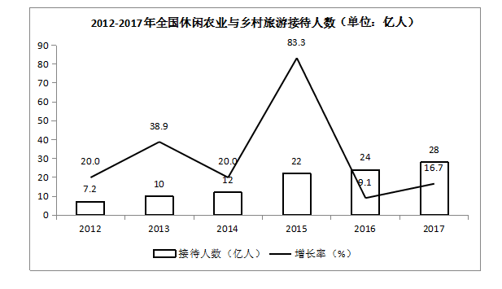

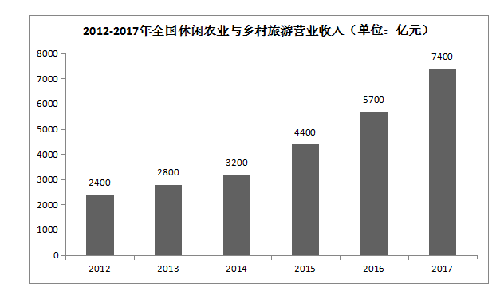

### 第 101 题

2015年全国休闲农业与乡村旅游从业人员年人均收入约为：

A. 3.2万元

B. 4.7万元

C. 5.6万元

D. 6.4万元

第 101 题 · 答案与解析

**参考答案（粉笔题库参考内容）**

C

**解析**

根据“2015年全国休闲农业与乡村旅游从业人员年人均收入约为······”，可判定本题为基期平均数问题。定位图二可知2015年全国休闲农业与乡村旅游营业收入为4400亿元；定位文字材料“2017年，休闲农业和乡村旅游从业人员达到900万人，较2015年增加了110万人”，可知2015年休闲农业和乡村旅游从业人员为900-110=790万人。结合公式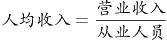 ，故2015年人均收入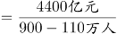 万元。

故正确答案为C。

### 第 102 题

与2012年相比，2017年全国休闲农业与乡村旅游接待人数约增加：

A. 2倍

B. 3倍

C. 4倍

D. 5倍

第 102 题 · 答案与解析

**参考答案（粉笔题库参考内容）**

B

**解析**

根据“与2012年相比，2017年全国休闲农业与乡村旅游接待人数约增加…”，结合选项，可判定本题为倍数比较问题。定位图一，可知2017年与2012年全国休闲农业与乡村旅游接待人数分别为28和7.2亿人。故2017年全国休闲农业与乡村旅游接待人数比2012年增加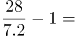倍。

故正确答案为B。

### 第 103 题

2015年全国休闲农业与乡村旅游接待人数同比增长率约是2014年的：

A. 3.6倍

B. 3.8倍

C. 4.2倍

D. 4.4倍

第 103 题 · 答案与解析

**参考答案（粉笔题库参考内容）**

C

**解析**

根据“2015年全国休闲农业与乡村旅游接待人数同比增长率约是2014年的······”，结合选项，可判定本题为现期倍数问题。定位图一，可知2015和2014年全国休闲农业与乡村旅游接待人数同比增长率分别是83.3%和20%，故所求为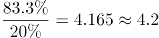倍。

故正确答案为C。

### 第 104 题

2012-2017年，全国休闲农业与乡村旅游接待人数年均增长率比其年均复合增长率约多：

A. 24.4个百分点

B. 26.6个百分点

C. 27.2个百分点

D. 28.4个百分点

第 104 题 · 答案与解析

**参考答案（粉笔题库参考内容）**

B

**解析**

根据“2012-2017年，全国休闲农业与乡村旅游接待人数年均增长率比其年均复合增长率约多…”，可判定本题为年均增长率问题。定位文字材料“休闲农业与乡村旅游接待人数从2012年的7.2亿人次增至2017年的28亿人次，年均复合增长率高达31.2%。”年均增长率 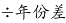，则2012年至2017年均增长率 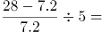。故2012-2017年，全国休闲农业与乡村旅游接待人数年均增长率比其年均复合增长率约多57.8%-31.2%=26.6个百分点。

故正确答案为B。

备注：本题同时出现“年均增长率”和“年均复合增长率”两个概念，说明这两个概念并不相同，需加以区分： “年均增长率”在本题中属于常见的估算方法，是整体增长率的平均值；“年均复合增长率”才是我们通常理解的严谨意义上的年均增长率。

### 第 105 题

根据资料，下列说法正确的是：

A. 2017年全国农家乐占休闲农业与乡村旅游经营单位数量的75%以上

B. 2016年国内旅游总收入超4万亿元

C. 2012-2017年，全国休闲农业与乡村旅游接待人数平均年增长超4亿人

D. 2013-2017年，全国休闲农业与乡村旅游营业收入增速最低的是2013年

第 105 题 · 答案与解析

**参考答案（粉笔题库参考内容）**

C

**解析**

A项：材料中并无2017年全国休闲农业与乡村旅游经营单位数量，故无法得知比重，错误；

B项：定位图二2016年全国休闲农业与乡村旅游经营收入为5700亿元；定位文字材料“2017年休闲农业与乡村旅游营业收入达7400亿元，占国内旅游总收入的16.2%，较上年提高了1.7个百分点”可知2016年占比为16.2%-1.7%=14.5%，故2016年国内旅游总收入为 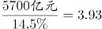万亿元，不足4万亿元，错误；

C项：定位文字材料“休闲农业与乡村旅游接待人数从2012年的7.2亿人次增至2017年的28亿人次”，结合公式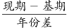 ，故2012-2017年，全国休闲农业与乡村旅游接待人数平均年增长为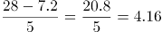 ，超过4亿人，正确；

D项：定位图二，2013年全国休闲农业与乡村旅游营业收入增速为 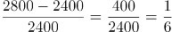；2014年全国休闲农业与乡村旅游营业收入增速为 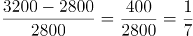；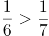 ，则2013年增速大于2014年增速，并非增速最低的年份，错误。

故正确答案为C。

## 材料 2

改革开放40年来，我国国民经济大踏步前进，经济总量连上新台阶，综合国力和国际影响力显著提升。2017年，我国国内生产总值按不变价计算比1978年增长33.5倍，年均增长9.5%，远高于同期世界经济2.9%左右的年均增速，在全球主要经济体中名列前茅。1978年，我国国内生产总值只有3679亿元，1991年上升到2万亿元，2000年突破10万亿元大关，2017年达到827122亿元，折合12.3万亿美元，占世界经济总量的15%左右，2017年经济增量折合1.2万亿美元。

40年来，我国积极把握全球化机遇、纵深推进对外开放，1978年货物进出口总额仅为206亿美元。2017年，货物进出口总额达到277923亿元，折合4.1万亿美元，比上年增长14.2%，居世界第一位。其中，出口153321亿元，增长10.8%；进口124602亿元，增长18.7%。货物出口差额（出口减进口）28719亿元，对“一带一路”沿线国家进出口总额73745亿元，其中出口43045亿元，增长12.1%；进口30700亿元，增长26.8%。

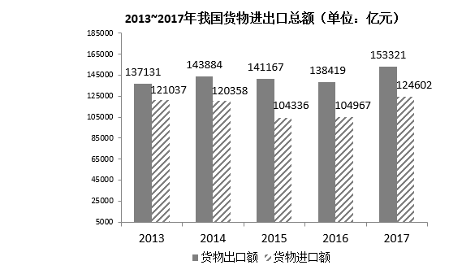

### 第 106 题

2017年世界经济总量约为：

A. 62万亿美元

B. 82万亿美元

C. 102万亿美元

D. 122万亿美元

第 106 题 · 答案与解析

**参考答案（粉笔题库参考内容）**

B

**解析**

由题干“2017年世界经济总量约为”，结合文字材料第一段，2017年我国国内生产总值达到12.3万亿美元，占世界经济总量的15%左右，判定本题为现期比重问题。根据现期比重公式：，则题目所求为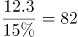万亿美元，B项符合。

故正确答案为B。

### 第 107 题

2014～2017年，我国货物进出口差额最大的一年是：

A. 2017年

B. 2016年

C. 2015年

D. 2014年

第 107 题 · 答案与解析

**参考答案（粉笔题库参考内容）**

C

**解析**

结合图形材料可得2014-2017年我国货物出口额与进口额数值，分别计算各年份货物进出口差额为：

2014年：143884-120358≈23500亿元；2015年：141167-104336≈36800亿元；

2016年：138419-104967≈33500亿元；2017年：153321-124602≈28700亿元；

则2015年我国货物进出口差额最大。

故正确答案为C。

### 第 108 题

2017年我国货物进出口总额比1978年增长约：

A. 168倍

B. 198倍

C. 228倍

D. 248倍

第 108 题 · 答案与解析

**参考答案（粉笔题库参考内容）**

B

**解析**

由题干“2017年·····比1978年增长约”，选项为xx倍，判定本题为一般增长率问题。结合文字材料第二段，1978年货物进出口总额为206亿美元；2017年，货物进出口总额达到4.1万亿美元，即41000亿美元。根据一般增长率计算公式：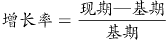，则题目所求为，即约增长198倍，B项符合。

故正确答案为B。

### 第 109 题

与2016年相比，2017年我国对“一带一路”沿线国家出口增加额比进口增加额约少：

A. 1623亿元

B. 1842亿元

C. 1915亿元

D. 2012亿元

第 109 题 · 答案与解析

**参考答案（粉笔题库参考内容）**

B

**解析**

由题干“与2016年相比，2017年我国···出口增加额比进口增加额约少”，判定本题为增长量计算问题。结合文字材料第二段，2017年，我国对“一带一路”沿线国家出口43045亿元，增长12.1%；进口30700亿元，增长26.8%。根据增长量计算公式：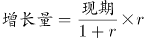，则出口增加额为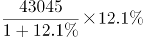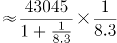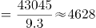亿元；进口增加额为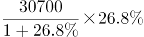6463亿元；则题目所求为4628-6463=-1835亿元，约少1835亿元，与B项较为接近。

故正确答案为B。

### 第 110 题

根据资料，以下说法不正确的是：

A. 1978～2017年，我国国内生产总值按不变价计算年均增速比同期世界经济约高出6.6个百分点

B. 2016年我国国内生产总值约为11.1万亿美元

C. 2017年我国对“一带一路”沿线国家进出口差额为12345亿元

D. 2017年我国货物进出口总额同比增加超过4万亿元

第 110 题 · 答案与解析

**参考答案（粉笔题库参考内容）**

D

**解析**

A项：结合文字材料第一段，2017年，我国国内生产总值按不变价计算比1978年增长33.5倍，年均增长9.5%，远高于同期世界经济2.9%左右的年均增速，则年均增速比同期世界经济约高9.5%-2.9%=6.6%，即约高6.6个百分点，正确；

B项：结合文字材料第一段，2017年，我国国内生产总值为12.3万亿美元，经济增量折合1.2万亿美元，则2016年我国国内生产总值约为12.3-1.2=11.1万亿美元，正确；

C项：结合文字材料第二段，2017年，我国对“一带一路”沿线国家出口43045亿元，进口30700亿元，进出口差额为43045-30700= 12345亿元，正确；

D项：结合图形材料，2017年我国货物进出口总额为（153321+124602）亿元，2016年我国货物进出口总额为（138419+104967）亿元，同比增加（153321+124602）-（138419+104967）=（153321-138419）+（124602-104967）<20000+20000=40000亿元，未超过4万亿元，错误。

本题为选非题，故正确答案为D。

## 材料 3

2018年，B省实现地区生产总值83608.59亿元，全省大力实施创新驱动发展战略，创新驱动指数从2014年的71.2%提高到2018年的88.4%，年均提升4.3个百分点。2018年R&D研发经费支出占GDP比重为2.56%，比2014年提高0.39个百分点。2018年国内发明专利授权量25.6万件，比2014年增长78%左右；每万人口发明专利拥有量15.53件，比2014年提高了约8件；高新技术企业数量达到19857家，比2014年增加近三倍，总量居全国第一。

2018年，B省高技术制造业增加值占规模以上工业比重、先进制造业增加值占规模以上工业比重分别达27.6%和49.39%，比2014年提高3.5个和1.2个百分点。经济增长方式由主要依靠劳动力数量和资本存量增长驱动，转变为主要依靠科学技术和人力资本增长，科技进步贡献率由2014年的53.05%提高到2018年的57.22%，其中2016年（56.44%）比2015年提升2.47个百分点。

### 第 111 题

2018年B省R&D研发经费支出约为：

A. 1500亿元

B. 2140亿元

C. 2500亿元

D. 3000亿元

第 111 题 · 答案与解析

**参考答案（粉笔题库参考内容）**

B

**解析**

根据题干“2018年······经费支出······”结合材料时间为2018年及文字材料第一段“2018年R&D研发经费支出占GDP比重为2.56%”可判定本题为现期比重问题。定位文字材料第一段“2018年，B省实现地区生产总值83608.59亿元”根据部分量=总体量×比重，代入数据，所求2090亿元，与B项最接近。

故正确答案为B。

### 第 112 题

2014年B省先进制造业增加值约是高技术制造业增加值的

A. 1.8倍

B. 2.0倍

C. 2.2倍

D. 2.4倍

第 112 题 · 答案与解析

**参考答案（粉笔题库参考内容）**

B

**解析**

根据题干“2014年······是······”结合选项为倍数及材料时间为2018年可判定本题为基期倍数问题。定位文字材料第二段“2018年，B省高技术制造业增加值占规模以上工业比重、先进制造业增加值占规模以上工业比重分别达27.6%和49.39%，比2014年提高3.5个和1.2个百分点。”由此可得2014年B省高技术制造业增加值占规模以上工业比重为27.6%-3.5%=24.1%，先进制造业为49.39%-1.2%=48.19%。根据部分量=总体量×比重，则倍。

故正确答案为B。

### 第 113 题

2014年～2018年，B省每万人口发明专利拥有量指数平均增幅为：

A. 6.5个百分点

B. 8.1个百分点

C. 9.3个百分点

D. 10.1个百分点

第 113 题 · 答案与解析

**参考答案（粉笔题库参考内容）**

D

**解析**

根据题干“2014年～2018年······平均增幅······”结合选项单位为百分点，可判定本题为年均增长量计算问题。定位表格材料第四行，根据，即10个百分点。与D项最接近。

故正确答案为D。

备注：虽然本题中的题干为平均增幅，但是选项中的答案为百分点，所以考虑指数作为一个百分数用加减的方式求解即可。

### 第 114 题

2014年～2018年，B省创新发展各个指标指数变动幅度排列正确的是：

A. 高新技术企业数量指数＞每万人口发明专利拥有量指数＞高技术制造业增加值占规模以上工业比重指数

B. 科技进步贡献率指数＞每万人口发明专利拥有量指数＞高技术制造业增加值占规模以上工业比重指数

C. 高新技术企业数量指数＞高技术制造业增加值占规模以上工业比重指数＞每万人口发明专利拥有量指数

D. R&D经费支出占GDP比重指数＞每万人口发明专利拥有量指数＞高新技术企业数量指数

第 114 题 · 答案与解析

**参考答案（粉笔题库参考内容）**

A

**解析**

定位表格材料最后一列，变动幅度比较大小，比较绝对值即可。A项: 高新技术企业数量指数(47%)＞每万人口发明专利拥有量指数(40.4%)＞高技术制造业增加值占规模以上工业比重指数(14.3%),符合大小关系。

故正确答案为A。

### 第 115 题

根据资料，以下说法正确的是：

A. 与2014年相比，2018年B省创新驱动指数的增长率超过24%

B. 2014年～2018年，B省先进制造业增加值占规模以上工业比重指数逐年提升

C. 2014年B省高新技术企业数量居全国第一

D. 2019年B省每万名就业人员R&D人员全时当量指数持续下降

第 115 题 · 答案与解析

**参考答案（粉笔题库参考内容）**

A

**解析**

A项：定位文字材料第一段，根据，正确；

B项：定位表格材料第8行，2014年与2015年的指数都是92.1%，并非逐年提升，错误；

C项：定位文字材料第一段“2018年······高新技术企业数量达到19857家，比2014年增加近三倍，总量居全国第一。”此时的第一指的是2018年，并非2014年,错误；

D项：材料中并未提及2019年的数据，错误。

故正确答案为A。

## 材料 4

2013年以来，C省全年农作物播种面积累计增加了超160万公顷，截至2018年末，全年农作物总播种面积由2013年末的721.1万公顷增加到了2018年末的882.4万公顷。其中粮食作物播种面积679.0万公顷，经济作物播种面积由2013年的159.4万公顷增加至203.4万公顷。

2018年，C省粮食总产量3553.3万吨，比上年增长9.2%，增幅同比提高9.6个百分点；蔬菜产量1006.5万吨，下降9.4%；油料产量201.5万吨，下降16.3%，较2016年减少了24万吨；甜菜产量515.9万吨，增长49.8%，增幅同比提高13.4个百分点；受极端天气等因素影响，水果产量为225.5万吨，仅为2016年产量的71.3%。

近年来，C省农牧业综合机械化水平逐年提高。2018年末，全省农牧业机械总动力3663.7万千瓦，综合机械化水平达到84%。

### 第 116 题

与2013年末相比，2018年末C省粮食作物播种面积增加了约：

A. 12%

B. 21%

C. 30%

D. 39%

第 116 题 · 答案与解析

**参考答案（粉笔题库参考内容）**

B

**解析**

根据题干“与2013年末相比，2018年末C省粮食作物播种面积增加了约”，结合选项为百分数，判定本题为一般增长率问题。定位文字材料第一段：截至2018年末，全年农作物总播种面积由2013年末的721.1万公顷增加到了2018年末的882.4万公顷。其中粮食作物播种面积679.0万公顷，经济作物播种面积由2013年的159.4万公顷增加至203.4万公顷。则2013年粮食作物播种面积=2013年农作物总播种面积-2013年经济作物播种面积=721.1-159.4=561.7万公顷，代入公式：。

故正确答案为B。

### 第 117 题

2018年C省大豆产量同比增长率比玉米的约多：

A. 36.0个百分点

B. 38.1个百分点

C. 40.2个百分点

D. 42.3个百分点

第 117 题 · 答案与解析

**参考答案（粉笔题库参考内容）**

A

**解析**

根据题干“2018年C省大豆产量同比增长率比玉米的约多”，可判定本题为一般增长率问题。定位表格材料可知：大豆产量：2017年为108.4万吨，2018年为179.4万吨；玉米产量：2017年为2085.0万吨，2018年为2700.0万吨；代入公式，则大豆产量增长率；玉米产量增长率；所求=65.5%-29.5%=36%，即约多36个百分点。

故正确答案为A。

### 第 118 题

2014～2018年，C省年末农牧业机械总动力同比增长率最高的一年是：

A. 2015年

B. 2016年

C. 2017年

D. 2018年

第 118 题 · 答案与解析

**参考答案（粉笔题库参考内容）**

D

**解析**

根据题干“2014～2018年，C省年末农牧业机械总动力同比增长率最高的一年是”，可判定本题为一般增长率的比较问题。定位图形材料可知，2014～2018年，C省年末农牧业机械总动力分别为：3632.6万千瓦、3805.1万千瓦、3331.0万千瓦、3484.0万千瓦、3663.7万千瓦。代入公式，则2015年增长率；2016年增长率小于0；2017年增长率；2018年增长率，则同比增长率最高的一年是2018年。

故正确答案为D。

### 第 119 题

以下农作物中，2016年C省产量最高的是：

A. 油料

B. 甜菜

C. 水果

D. 小麦

第 119 题 · 答案与解析

**参考答案（粉笔题库参考内容）**

C

**解析**

根据题干“以下农作物中，2016年C省产量最高的是”，结合材料相关数据，A项为基期计算问题，定位文字材料第二段：2018年，油料产量201.5万吨，下降16.3%，较2016年减少了24万吨；则2016年油料产量=201.5+24=225.5万吨；

B项为间隔基期问题，定位文字材料第二段：2018年，甜菜产量515.9万吨，增长49.8%，增幅同比提高13.4个百分点；则2017年同比增速=49.8%-13.4%=36.4%，代入公式：≈104%；万吨；

C项为现期比重问题，定位文字材料第二段：2018年，水果产量为225.5万吨，仅为2016年产量的71.3%。代入公式：万吨；

D项为直接找数，定位表格数据，2016年小麦产量为169.9万吨；

综上比较发现，2016年C省产量最高的是水果产量（约316万吨）。

故正确答案为C。

### 第 120 题

根据资料，下列说法正确的是：

A. 2013～2018年，C省猪肉年平均产量超过72.5万吨

B. 与2016年相比，C省2017年粮食总产量略有增加

C. 2014～2018年，C省农牧业综合机械化水平增加了5个百分点

D. 2015～2018年，C省稻谷产量的年均复合增长率约为31.8%

第 120 题 · 答案与解析

**参考答案（粉笔题库参考内容）**

D

**解析**

A项：定位表格数据：2013年-2018年，C省猪肉产量依次为：73.4万吨、73.3万吨、70.8万吨、72.1万吨、73.5万吨、71.4万吨，则年平均产量，错误；

B项：定位文字材料第二段：2018年，C省粮食总产量3553.3万吨，比上年增长9.2%，增幅同比提高9.6个百分点。则2017年粮食总产量的同比增速=9.2%-9.6%=-0.4%＜0，因此2017年粮食总产量同比下降，即与2016年相比，C省2017年粮食总产量有所下降，错误；

C项：定位图形材料：2014年农牧业综合机械化水平为79.8%，2018年为84.0%，则2014-2018年，C省农牧业综合机械化水平增加84%-79.8%=4.2%，即4.2个百分点，错误；

D项：定位表格数据：2015年稻谷产量为53.2万吨，2018年为121.9万吨，代入年均增长率公式： ，现期为2018年，基期为2015年，年份差为3，即，将r≈31.8%代入， ，等量关系成立，正确。

故正确答案为D。

