# 2019 黑龙江省公务员录用考试 行测（边境县）

<!-- gwy:overview:start -->
> **黑龙江 · 2019 · 行测 · 边境县** ｜ 120 题 · 图片 17 处

导航：[材料 1](#材料-1)
<!-- gwy:overview:end -->

> 行测 · 120 题 · 来源 上岸通 · 原始标题：2019年黑龙江边境县（市、区）急需紧缺专业岗公务员考试《行测》题
>
> ⚠ **本源（上岸通）为题面离线克隆，不含答案与解析**；题干/选项/图形/资料分析材料已完整保留。
> 同卷正本见 [行测-边境县.md](行测-边境县.md)（粉笔 sid 91634，120 题、含答案）。本文件仅作 qid 与源卷题号佐证。

## 第 1 题　qid 3_1_2ajlj · 常识判断

党的十九大报告指出，新时代我国社会主要矛盾是：

- **A**. 人民对于建立先进的工业国的要求同落后的农业国的现实之间的矛盾
- **B**. 人民对于经济文化迅速发展的需要同当前经济文化不能满足人民需要的状况之间的矛盾
- **C**. 人民日益增长的物质文化需要同落后的社会生产之间的矛盾
- **D**. 人民日益增长的美好生活需要和不平衡不充分的发展之间的矛盾

## 第 2 题　qid 3_1_2ajll · 常识判断

经过长期努力，中国特色社会主义进入了新时代，这是我国发展新的历史方位。这个新时代，是承前启后、继往开来、在新的历史条件下继续夺取中国特色社会主义伟大胜利的时代，是      ，是      ，是      ，是      。
①决胜全面建成小康社会、进而全面建设社会主义现代化强国的时代
②全国各族人民团结奋斗、不断创造美好生活、逐步实现全体人民共同富裕的时代
③久经磨难的中华民族从站起来到富起来的时代
④全体中华儿女勠力同心、奋力实现中华民族伟大复兴中国梦的时代
⑤我国日益走近世界舞台中央、不断为人类作出更大贡献的时代
依次填入划横线部分最恰当的一项是：

- **A**. ②③④⑤
- **B**. ①②③④
- **C**. ①③④⑤
- **D**. ①②④⑤

## 第 3 题　qid 3_1_2ajlm · 常识判断

童蒙教材，是我国古代对儿童进行启蒙教育的主要读物。与前代相比，两汉时期的童蒙教材有了长足的进步和发展。以下童蒙教材始出现于汉朝的是：

- **A**. 《凡将篇》
- **B**. 《论语》
- **C**. 《百家姓》
- **D**. 《声律启蒙》

## 第 4 题　qid 3_1_2ajln · 常识判断

根据我国《民法典》，不满八周岁的未成年人为无民事行为能力人，由其        代理实施民事法律行为。

- **A**. 父母
- **B**. 抚养人
- **C**. 法定代理人
- **D**. 指定代理人

## 第 5 题　qid 3_1_2ajlo · 常识判断

关于液体，下列叙述正确的是：

- **A**. 液体表面张力随温度的下降而减小
- **B**. 液体表面有自动缩小表面积的趋势
- **C**. 与液体表面层的分子相比，液体内部的分子有更大的势能
- **D**. 表面层内的分子比在液体内部的分子有较大的位能

## 第 6 题　qid 3_1_2ajls · 常识判断

我国“南水北调工程”中的东线工程从长江下游扬州江都抽引长江水，利用        及与其平行的河道逐级提水北送，输水到天津。

- **A**. 京杭大运河
- **B**. 输水总干渠
- **C**. 汉江
- **D**. 淮河

## 第 7 题　qid 3_1_2ajlu · 常识判断

随着劳动力成本的迅速上涨，我国家政服务的每小时平均价格也不断上升。在我国家政服务市场竞争日益激烈的背景下，若其他条件不变，最可能引起家政服务市场的需求曲线从P1变化为P2的是：

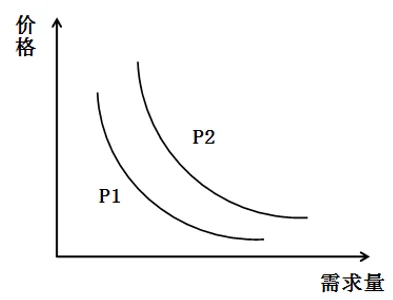

①放宽市场准入，鼓励资本投资
②改进管理机制，降低管理费用
③提倡专业分工，追求生活品质
④居民收入上涨，生活成本降低

- **A**. ①②
- **B**. ②③
- **C**. ②④
- **D**. ③④

## 第 8 题　qid 3_1_2ajlv · 常识判断

总长度约55公里的港珠澳大桥穿越珠江口中华白海豚国家级自然保护区，大桥建设过程成功实现白海豚零伤亡。以下不可能是保护中华白海豚措施的是：

- **A**. 改水上施工为陆域加工，改工地现浇为工厂制作，尽量减少海上作业时间和作业范围
- **B**. 进入大桥施工区域，航船必须以十节以上航速高速通过，以防止航船吸引白海豚聚集
- **C**. 水下爆破作业前及作业期间，采用声墙驱赶与噪音驱赶等措施赶走附近白海豚
- **D**. 在挖掘或打桩作业开始前的5分钟内通过监视与监测，确保半径500米范围内无白海豚出没

## 第 9 题　qid 3_1_2ajm2 · 常识判断

作为最早被人类驯化的鸟类，鸽子能够通过磁场准确识别方位，迅速找到回巢的路线。如果仅考虑磁场因素，在        上空，鸽子识别方位的能力受到的影响最大。

- **A**. 赤道
- **B**. 南极
- **C**. 海洋
- **D**. 北回归线

## 第 10 题　qid 3_1_2ajm4 · 常识判断

下列五种包装箱指示标识的含义，正确的是：

①表示此方向向上
②表示小心轻放
③表示放在有阳光的地方
④表示不能放在顶层
⑤表示禁止挤压

- **A**. ①②
- **B**. ①②③
- **C**. ②③④
- **D**. ①②④⑤

## 第 11 题　qid 3_1_2ajm6 · 常识判断

矿井瓦斯是指存在于煤层中的烃类气体，以甲烷为主要成分，常常吸附在煤基质颗粒表面，是煤的伴生矿产资源。以下关于矿井瓦斯的说法不正确的是：

- **A**. 要保持井下通风以将井下瓦斯浓度保持在较低水平
- **B**. 瓦斯气体中毒是煤矿开采者面临的首要威胁
- **C**. 通过特定的设备收集瓦斯，能够变“害”为宝
- **D**. 由于瓦斯的存在，矿井下要严格控制热源和火源

## 第 12 题　qid 3_1_2ajm7 · 常识判断

世界气象组织台风委员会从2000年1月1日起，采用具有亚洲风格的名字对西北太平洋地区的台风进行命名。台风命名表中共有140个名字，分别由亚太地区的14个成员国提供，按英文字母顺序循环使用。以下不属于中国提供的名字的是：

- **A**. 杜鹃
- **B**. 鲸鱼
- **C**. 电母
- **D**. 海棠

## 第 13 题　qid 3_1_2ajm8 · 常识判断

世界四大渔场中，不是因寒、暖流交汇而形成的是：

- **A**. 北海渔场
- **B**. 秘鲁渔场
- **C**. 北海道渔场
- **D**. 纽芬兰渔场

## 第 14 题　qid 3_1_2ajm9 · 常识判断

大气在运动过程中受到很多因素的影响，变得非常复杂，甚至彼此相邻的两个地区也常常出现截然不同的气候特征。下列选项最能够反映这一现象的是：

- **A**. 山明水净夜来霜，数树深红出浅黄
- **B**. 月生林欲晓，雨过夜如秋
- **C**. 秋阴不散霜飞晚，留得枯荷听雨声
- **D**. 一树春风有两般，南枝向暖北枝寒

## 第 15 题　qid 3_1_2ajmb · 常识判断

边塞诗歌是中国诗词史上的一个重要流派。下列诗词与所处朝代面临的主要边境忧患，匹配正确的是：

- **A**. 铁骑追骁虏，金羁讨黠羌——柔然
- **B**. 借问长城侯，单于入朝谒——西夏
- **C**. 但使龙城飞将在，不教胡马度阴山——突厥
- **D**. 羌管悠悠霜满地，人不寐，将军白发征夫泪——蒙古

## 第 16 题　qid 3_1_2ajmc · 常识判断

海市蜃楼包括所有在空气密度反常分布时大气中出现的光学折射现象。以下不属于我国经常能看到海市蜃楼的地方是：

- **A**. 湖南湘西
- **B**. 广东惠来
- **C**. 山东蓬莱
- **D**. 浙江普陀

## 第 17 题　qid 3_1_2ajmg · 常识判断

下列说法正确的是：

- **A**. A 人体各种体液的pH值处在7.4左右的弱碱状态是最健康的
- **B**. B 亚健康会导致体质偏酸，进而导致包括癌症在内的各种疾病
- **C**. C 醋是pH值小于7的酸性物质，因此其属于典型的酸性食品
- **D**. D 人体能够通过调节 CO_2 的排出量来维持血液pH值的稳定

## 第 18 题　qid 3_1_2ajms · 常识判断

唐代之后，陆上丝绸之路逐渐衰落，海上丝绸之路逐渐兴盛的原因不包括：

- **A**. 我国经济重心逐渐南移
- **B**. 西域地区一度脱离了中原政权的控制
- **C**. 陆上丝绸之路沿途的自然环境逐渐恶劣
- **D**. 我国与东亚、东南亚地区的贸易量远超中东、欧洲地区

## 第 19 题　qid 3_1_2ajmu · 常识判断

魏晋时期“建安七子”中的一位文学家被谢灵运称赞“才高八斗”，以下诗句是这位文学家作品的是：

- **A**. 青青子衿，悠悠我心。但为君故，沉吟至今
- **B**. 本自同根生，相煎何太急
- **C**. 此中有真意，欲辨已忘言
- **D**. 花间一壶酒，独酌无相亲

## 第 20 题　qid 3_1_2ajmv · 常识判断

道是梨花不是，道是杏花不是。白白与红红，别是东风情味。曾记，曾记，人在武陵微醉。（《如梦令》——严蕊）
道是春来花未，道是雪来香异。竹外一枝斜，野人家。冷落竹篱茅舍，富贵玉堂琼榭。两地不同栽，一般开。（《昭君怨》——郑域）
上述两首词分别描写的是：

- **A**. 梨花和杏花
- **B**. 梅花和梨花
- **C**. 桂花和菊花
- **D**. 桃花和梅花

## 第 21 题　qid 3_1_2ajn2 · 言语理解与表达

随着现代通信工具的兴起，人们的联系越来越方便，如今仍在用纸笔亲手写信的人        ，相关的家书代写职业以及《情书大全》一类指点迷津的宝典也逐渐        。
依次填入划横线部分最恰当的一项是：

- **A**. 寥寥无几  销声匿迹
- **B**. 凤毛麟角  无人问津
- **C**. 屈指可数  匿影藏形
- **D**. 寥若星辰  无影无踪

## 第 22 题　qid 3_1_2ajn5 · 言语理解与表达

近年来，我们着力解决管党治党失之于宽、失之于松、失之于软的问题，使不敢腐的        作用充分发挥，不能腐、不想腐的效应初步        ，反腐败斗争压倒性态势正在形成。
依次填入划横线部分最恰当的一项是：

- **A**. 震慑  显现
- **B**. 威慑  显示
- **C**. 警示  显耀
- **D**. 警醒  显露

## 第 23 题　qid 3_1_2ajn6 · 言语理解与表达

文物鉴定不仅是一门学问，还是一门技术，需要不间断的        ，任何人离开这一领域时间过长，技术就会        ，判断力就会下降。
依次填入划横线部分最恰当的一项是：

- **A**. 练习  退化
- **B**. 锻炼  生疏
- **C**. 实践  弱化
- **D**. 操作  退步

## 第 24 题　qid 3_1_2ajn9 · 言语理解与表达

“国潮”为文化类节目的发展提供了新        ，并且让文化以文创产品的具体形象实现落地，延展了文化多维性的现实价值。有学者认为，文化与“国潮”在荧幕上的相遇是一种必然，“国潮”本身含有大量中华传统文化元素，同时极富          ，因此深受年轻人的喜爱和追捧。
依次填入划横线部分最恰当的一项是：

- **A**. 机遇  影响力
- **B**. 目标  创造力
- **C**. 导向  吸引力
- **D**. 思路  表现力

## 第 25 题　qid 3_1_2ajnb · 言语理解与表达

在改革开放的伟大实践中，中国大踏步赶上时代潮流，经济社会面貌发生了            的变化，        了持续高速发展的人间奇迹。
依次填入划横线部分最恰当的一项是：

- **A**. 翻天覆地  创造
- **B**. 日新月异  制造
- **C**. 改弦更张  塑造
- **D**. 改头换面  打造

## 第 26 题　qid 3_1_2ajnc · 言语理解与表达

当下国人阅读状况不佳        有生活节奏快、竞争压力大以及公共图书馆缺失、图书价格高等客观因素影响，也与浮躁、功利等不良的社会心态            。
依次填入划横线部分最恰当的一项是：

- **A**. 必定  相得益彰
- **B**. 虽然  相辅相成
- **C**. 当然  休戚相关
- **D**. 固然  密不可分

## 第 27 题　qid 3_1_2ajnd · 言语理解与表达

过去三年，人民日报海外版旗下的海外网，一跃成为中央媒体中            的网站，并成为支持海外版媒介融合的独特平台；过去一年，“海客”客户端以清新的形象、鲜明的定位深受读者喜欢，两个微信号“侠客岛”和“学习小组”在互联网舆论场中            ，成为时政解读的知名品牌。
依次填入划横线部分最恰当的一项是：

- **A**. 独树一帜  崭露头角
- **B**. 独领风骚  锋芒毕露
- **C**. 一枝独秀  初露锋芒
- **D**. 首屈一指  异军突起

## 第 28 题　qid 3_1_2ajnf · 言语理解与表达

现在社会上有这样一种观点：经济压力逐渐成为        年轻人结婚的主要因素。即便是有结婚意愿的年轻人，他们也常常因为置办房产、子女教育和赡养老人等费用过高，面对婚姻            。
依次填入画横线部分最恰当的一项是：

- **A**. 阻碍  畏缩不前
- **B**. 妨害  望而生畏
- **C**. 妨碍  望而却步
- **D**. 阻止  知难而退

## 第 29 题　qid 3_1_2ajng · 言语理解与表达

“佛系”心态的不良影响不容忽视。“佛系”心态会使人们容易丧失原则，            。一个人不能没有理想追求，没有理想追求就只会浑浑噩噩的度日，就容易走向虚无。“佛系”这种随意的生活态度，一定程度上正是缺乏理想追求的表现。而当人们有了理想追求的时候，它会        我们前进，人们也就有了生活的动力。
依次填入划横线部分最恰当的一项是：

- **A**. 人云亦云  激发
- **B**. 随遇而安  鼓励
- **C**. 随波逐流  激励
- **D**. 亦步亦趋  鼓动

## 第 30 题　qid 3_1_2ajnm · 言语理解与表达

当年的松阳也曾随着城市化进程的加速而        ，村里人不是选择进城务工，就是迁居城镇，乡村中留下的大都是老人孩子，很多老屋闲置了，破败了，无人管理维护，保存状况            。幸运的是，无数的人因此行动起来，才有了今天            的松阳。
依次填入划横线部分最恰当的一项是：

- **A**. 萧索  奄奄一息  生意盎然
- **B**. 凋敝  危若朝露  朝气蓬勃
- **C**. 凋零  危在旦夕  欣欣向荣
- **D**. 萧条  岌岌可危  生机勃勃

## 第 31 题　qid 3_1_2ajns · 言语理解与表达

形式主义仅仅有外力        还远远不够，如果不能对形式主义的文化、社会、历史深层次的根源            ，那就不能真正除弊。
依次填入划横线部分最恰当的一项是：

- **A**. 破除  干扰  斩草除根
- **B**. 遏制  干涉  扬汤止沸
- **C**. 打击  干碍  除恶务尽
- **D**. 消除  干预  釜底抽薪

## 第 32 题　qid 3_1_2ajnu · 言语理解与表达

①党的十九大是党和国家发展过程中一次            的盛会。
②辩论赛中选手要力求说到点子上，            地表明自己的看法。
③我国城市化进程不断加速，各地新建建筑            ，尽显繁荣。
依次填入划横线部分最恰当的一项是：

- **A**. 空前绝后  直言不讳  星罗棋布
- **B**. 承前启后  泾渭分明  层出不穷
- **C**. 继往开来  直截了当  灿若繁星
- **D**. 承上启下  旗帜鲜明  鳞次栉比

## 第 33 题　qid 3_1_2ajo0 · 言语理解与表达

尽管历经了去年的            ，今年，投资者们仍是            。但，是大喜还是大悲？就看你自己的选择了。展望今年的投资方向，房产、股市依然是大众难以割舍的经典理财方式，而涉及区块链的投资则            ，在民间受到了追捧。
依次填入划横线部分最恰当的一项是：

- **A**. 悲喜交加  卷土重来  蓬勃发展
- **B**. 大起大落  跃跃欲试  异军突起
- **C**. 跌宕起伏  摩拳擦掌  应运而生
- **D**. 坎坷不平  兴致高昂  炙手可热

## 第 34 题　qid 3_1_2ajo2 · 言语理解与表达

建立反腐败绩效考核评价体系，一方面可以        反腐败机关不断改善自己的工作，提高反腐败的效率，另一方面也可以        人民群众对国家反腐败机关工作的满意程度，从而在反腐败的过程中不断地寻求共识、        共识。
依次填入划横线部分最恰当的一项是：

- **A**. 监督  反馈  形成
- **B**. 敦促  了解  凝结
- **C**. 督促  反映  凝聚
- **D**. 促进  研判  达成

## 第 35 题　qid 3_1_2ajo3 · 言语理解与表达

国家级和省级博物馆往往建设完善，参观者            ，甚至每天一早就出现排队的长龙；省级以下的公办博物馆则              。有的地方有充分的财政投入保障，博物馆拥有不错的硬件和软件设施，参观者的“回头率”较高；有的地方则缺乏对博物馆的投入，馆舍狭小老旧，展出品维护不当，专业讲解人员稀缺，导致博物馆            ，可能连当地人都不知道博物馆的大门朝哪个方向开。
依次填入划横线部分最恰当的一项是：

- **A**. 纷至沓来  参差不齐  无人问津
- **B**. 络绎不绝  良莠不齐  门庭冷落
- **C**. 川流不息  泥沙俱下  无足轻重
- **D**. 比肩接踵  大相径庭  门可罗雀

## 第 36 题　qid 3_1_2ajo4 · 言语理解与表达

党的十九大报告强调，“推进绿色发展”“形成节约资源和保护环境的空间格局、产业结构、生产方式、生活方式”。我国幅员辽阔，生态环境多种多样，各地开发程度不同。这就要求我们依据资源环境承载能力、现有开发强度和发展潜力，实行差别化开发管理，把绿色发展理念贯穿到城镇建设、产业布局、土地利用等规划中，合理有效利用资源，形成绿色发展格局。
对上文理解不准确的是：

- **A**. 资源环境承载能力决定了绿色发展格局
- **B**. 不同地区的绿色发展方式应有差异
- **C**. 城镇建设规划需要体现绿色发展理念
- **D**. 绿色发展需要节约资源、保护环境

## 第 37 题　qid 3_1_2ajo8 · 言语理解与表达

政府公共服务部门，必须要站在用户，以及民众的视角来对公共服务供给问题进行分析，对当前民众呼声很高的教育、医疗、交通等领域的公共服务供给不足，分布不均的问题及时加以解决。可以从社区网格化管理出发，要求社区干部离开电脑、离开办公室，走向街头，将民情、民意装在心里，并且积极地梳理与传递信息，确保决策层能够及时发现服务需求者的心理变化与需求变化。
下列作为这段文字的题目最合适的是：

- **A**. 公共服务部门的“用户思维”
- **B**. 小网格服务大民生
- **C**. 干部下到基层，方能贴近民意
- **D**. 基于公共服务供给问题的分析

## 第 38 题　qid 3_1_2ajo9 · 言语理解与表达

讲好中国故事、传播好中国声音，习近平总书记为我们树立了光辉典范。引用当地谚语、结合个人经历、讲述感人故事……党的十八大以来，习近平总书记在出访、出席重要国际会议、会见来访外国客人时，用外界听得懂的语言，                     。
填入画横线部分最恰当的一项是：

- **A**. 创新对外话语表达，展示真实、立体、全面的中国
- **B**. 以润物细无声的方式，增进世界对中国的了解
- **C**. 立足本国，面向世界，让中国文化不断传播出去
- **D**. 让中国理念、中国主张、中国方案更具触发共鸣的力量

## 第 39 题　qid 3_1_2ajoa · 言语理解与表达

然而，随着经学日益变成章句之学和庸俗的谶纬，情况便大不一样了。光武、章帝就因不满经学的烦琐多次命人“省减五经章句”；曾使王莽、刘秀荣登皇帝宝座的谶纬，后来也变成了篡权、谋反的工具，这表明一切都走到了专制王权期望的反面。因此，到东汉中期以后，皇权对经学和儒生的依赖开始变小，加上外戚、官宦专权，大封党羽、排挤士人，进一步拆散了经学与官僚政治的联盟。
本文段上文最有可能讲述的是：

- **A**. 经学的理论来源与后续发展状况
- **B**. 经学的特点和对官僚政治的影响
- **C**. 经学的光辉历史与儒生的联系
- **D**. 经学的主要内容与皇权的关系

## 第 40 题　qid 3_1_2ajob · 言语理解与表达

如果我们不再沿袭流行的模式，粗放式地将外国文论在中国的旅行简化为“西方文论在中国”与“前苏联文论在中国”，而是从话语实践的维度切入，直面世界文论发育的原生态，就要考虑到“西方文论”并不是铁板一块，譬如“欧陆文论”与“英美文论”在要旨与路向上就有很大分歧；就要考虑到“苏联文论”在不同时段也有不同内涵，至少“解冻”之前与“解冻”之后的苏联文论不应当等量齐观。因此，我们可以基于历史上实际发生的情形对外国文论展开比较细致的梳理。
本文段接下来最有可能讲述的是：

- **A**. 展开对于外国文论的科学分类
- **B**. 详细介绍不同时段的苏联文论
- **C**. 描述外国文论进入中国的有关情况
- **D**. 阐述多部外国文论译介研究

## 第 41 题　qid 3_1_2ajoc · 言语理解与表达

几十年来，史学研究最大的变化之一，就是研究越做越细，课题越做越小，也越做越深。当然，这种越做越细、越做越小、越做越深的现象本身确实很好，历史学是应该做细、做小、做深——不细、不小、不深、大而不当，不接地气，从空到空，这样的历史学是没有出路的，也看不到发展的前景。
本文段接下来最有可能讲述的是：

- **A**. 历史学做细、做小、做深可能的原因
- **B**. 历史学做细、做小、做深创造的价值
- **C**. 历史学做细、做小、做深带来的问题
- **D**. 历史学做细、做小、做深开创的前景

## 第 42 题　qid 3_1_2ajod · 言语理解与表达

新时代中国文化哲学研究要用哲学思维和视野，以人为主体，研究文化的产生、功能及其发展的基本规律。要在实践创造中进行文化创造，在历史进步中推动文化进步，植根中华文化、不忘本来，吸收外来文化、加强文化交流、突出文化创新，面向未来，在创造中华文化新辉煌中推动社会主义文化繁荣兴盛。
这段文字主要说的是：

- **A**. 新时代中国文化哲学研究的使命担当
- **B**. 新时代中国文化哲学研究的指导思想和研究方向
- **C**. 要将文化哲学研究融入中国特色社会主义建设
- **D**. 应通过文化交流推动社会主义文化繁荣兴盛

## 第 43 题　qid 3_1_2ajoe · 言语理解与表达

肿瘤抑制基因TP53基因正是对付细胞中DNA损伤的关键。TP53会编码产生一种P53蛋白，负责监控基因的完整性。在完成这项工作时，P53不仅异常严厉，甚至格外残酷。如果发现DNA受损，TP53就会促进DNA修复。一旦发现不可救药，TP53就会毫不犹豫地宣判异常细胞的死刑，启动凋亡程序，诱导相应细胞“自杀”，避免发生癌变。TP53基因的突变最常发生在编码P53蛋白质和DNA结合的部分。突变后生成的P53蛋白无法和目标DNA相结合，因此无法行使正常的检查和促进修复或凋零功能，癌症发生风险也就随之升高。
根据上述文字，以下说法不正确的是：

- **A**. 正常工作的TP53基因可以将绝大部分癌变扼杀在萌芽之中
- **B**. TP53基因自身发生突变，其抑癌功能就会受到影响
- **C**. 人类血细胞对DNA损伤异常敏感，有利于清除癌变细胞
- **D**. DNA受损的细胞可以在肿瘤抑制基因的作用下自我毁灭

## 第 44 题　qid 3_1_2ajof · 言语理解与表达

早在明朝晚期，徐光启就曾说过“欲求超胜，必先会通”，“会通”当然以交流为前提，没有交流哪来“会通”。自鸦片战争以降，中西两极相逢，中外隔绝之天下逐渐变为中外联属之天下，在这种千年未有的大变局中，学术当然也无法自外于世界，所以王国维说：“异日发明光大我国学术者，必在兼通世界学术之人，而不在一孔之陋儒，固可决也。”实际上也是如此，中国现代学术的确立及演进，无不得益于中外尤其是中西学术的交流与对话，可以说正是中西融汇的产物。那个时代辈出的大师没有一个不是“旧学邃密”“新知深沉”的。
这段文字的主要意思是：

- **A**. 中西学术对话曾一度中断
- **B**. 中国的学术发展离不开交流
- **C**. 学术发展正处于千年未有的大变局中
- **D**. 学术大师往往兼备新旧学识

## 第 45 题　qid 3_1_2ajog · 言语理解与表达

中国民间一直存在以争讼为耻的传统思想，且官方也存在无讼和恶讼思维，故民间水务纠纷若不是很严重的话，当事双方一般并不愿意对簿公堂，而是选择依靠地方士绅等乡村精英予以协调解决，争取做到“以和为贵”。因此，从水务纠纷的处理机制来看，中国古代主要存在两种解决模式。一方面，对于一般的民间水务纠纷，往往由士绅、渠长等地方精英依据乡约自行调处；另一方面，对于情节严重，关涉较大的水务纠纷，可通过国家行政法律机制解决。
关于以上文字，下列理解错误的是：

- **A**. 以争讼为耻辱是中国古代民间的传统思想
- **B**. 乡约民规在古代民间的地位接近国家行政法律机制
- **C**. 国家法律机制在古代民间水务纠纷处理中运用较少
- **D**. 地方士绅是解决古代民间水务纠纷的重要力量

## 第 46 题　qid 3_1_2ajoi · 言语理解与表达

目前许多农业电子商务网站的前身是农业信息服务网站，本身并不具备商业目的性，因而在转变为电子商务网站之初，将首要目标定位在吸引更多人关注和增加网站流量而非如何发挥商业价值上。在这种思路指导下，大多数农业电子商务网站往往重视网站的“新、全、奇”特点，打出“中国最大”“全国第一”的口号，以期获得更多的点击率和流量，但这并不能让市场和网民对这些网站有全面的了解，因此其中大量的信息资源并不被人所知，其商业价值也无法发挥出来。
这段文字的主要意思是：

- **A**. 农业电子商务网站过多地侧重信息服务功能
- **B**. 农业电子商务网站在实现商业目的上做得不够
- **C**. 农业电子商务网站成功地获得网站流量和关注
- **D**. 农业电子商务网站应注重宣传的真实性和创新性

## 第 47 题　qid 3_1_2ajoj · 言语理解与表达

由于技术所限，过去传统媒体只能固定在某一个场景之中向受众传递信息，如早餐时间读报、黄金时间看电视等，传播的效果有限。如今，随着移动终端的日益普及，各种媒介几乎占据了用户除睡觉以外的所有时间。例如，许多人早上醒来的第一件事以及睡前的最后一件事都是查看手机，信息传播已经嵌入了人们24小时的生活场景之中。同时，大数据技术的兴起与普及为信息精准投放提供了技术条件，传播者能够依据用户的兴趣爱好个性化推送相应信息，用户的个性化需求得到了前所未有的尊重。
上述文段作者最有可能认同的是：

- **A**. 媒体受众不再是千篇一律的社会成员，而是有个性特征和需求的用户
- **B**. 移动媒体是对传统媒体的倾覆，传统媒体必须进行转型
- **C**. 在固定场景中向受众传播信息的方式效果将会越来越有限
- **D**. 媒体应该借助大数据技术对用户进行个性化推送，满足用户个性化需求

## 第 48 题　qid 3_1_2ajok · 言语理解与表达

有研究显示，让试验对象每天摄入50克黑巧克力，15天后，这些人不仅血糖值有所下降，而且血液中的好胆固醇浓度增加了
20%
，坏胆固醇浓度减少了
20%
，摄入同样的量的白巧克力的人却未能收获同样的健康益处。有趣的是，人们常常担心巧克力受热融化后所含的抗氧化物质活性消失，但在试验中，即便是那些化掉之后重新凝固、外表看起来十分不体面的“陈年巧克力”，依然拥有强大的抗氧化能力，对试验对象的血糖和血脂控制有益。
以下无法从上述文字得知的是：

- **A**. 黑巧克力的血糖控制效果比白巧克力更好
- **B**. 白巧克力无法改善血液中的胆固醇浓度
- **C**. 巧克力中抗氧化物质的活性受热后不会完全消失
- **D**. 黑巧克力的抗氧化能力有助于血糖的控制

## 第 49 题　qid 3_1_2ajom · 言语理解与表达

舆论历来是影响社会发展的重要力量，掌握了舆论，才能赢得人心。《史记》记载，陈胜、吴广起义时巧妙地打了一场漂亮的“舆论战”，他们让人在丝绸上写上“陈胜王”三个字，塞到鱼肚子里，然后“卒买鱼烹食，得鱼腹中书，固以怪之矣”。这还不够，他们又让人学狐狸叫，喊出“大楚兴，陈胜王”的口号。结果，当然是“卒中往往语，皆指目陈胜”，赢得了人心。
这段文字意在说明：

- **A**. 掌握舆论主动的重要性
- **B**. 舆论决定斗争的成败
- **C**. 舆论可以人为营造
- **D**. 自古以来人们善于利用舆论

## 第 50 题　qid 3_1_2ajon · 言语理解与表达

历史表明，每一场工业革命都具有一定的破坏性，但最终都会带来更多的经济增长和发展机会。从世界范围来看，数字技术、机器人技术、人工智能及自动化、生物技术和纳米技术已经在经济、社会和环境等方面产生了根本性的影响。虽然技术进步会引发一定程度的焦虑，但它为发展带来的正面影响驱使我们在技术方面继续前行。我们唯一能做的就是为技术发展将会产生的影响做好应对措施。
这段文字主要说明了：

- **A**. 要正视技术发展带来的机遇和挑战
- **B**. 科技是一把双刃剑
- **C**. 科技发展有威胁人类安全的潜在风险
- **D**. 应关注技术进步引发的社会焦虑

## 第 51 题　qid 3_1_2ajop · 言语理解与表达

加强和创新社会治理，要做到发展成果由人民共享。营造共建共治共享社会治理格局            ，要使社会治理的成效更多、更公平地惠及全体人民。随着人民对美好生活需要的范围更广，要求更高，我们要以一步一个脚印、久久为功的精神，用心用情办好民生实事。
填入划横线部分最恰当的一项是：

- **A**. 重心在基层
- **B**. 重点在民生
- **C**. 共治是目标
- **D**. 共享是目标

## 第 52 题　qid 3_1_2ajoq · 言语理解与表达

①两个“推动构建”为新时代中国特色大国外交指明了方向。
②推动构建人类命运共同体，旨在回答人类与世界向何处去这一重大哲学和历史命题。
③“大道之行，天下为公”。
④推动构建“相互尊重，公平正义，合作共赢”的新型国际关系，其实质就是寻求处理国与国之间关系的新路。
⑤习近平总书记在党的十九大报告中指出：中国特色大国外交要推动构建新型国际关系，推动构建人类命运共同体。
将以上句子重新排列，语序正确的是：

- **A**. ③⑤②④①
- **B**. ①④⑤③②
- **C**. ③⑤①④②
- **D**. ⑤④②③①

## 第 53 题　qid 3_1_2ajot · 言语理解与表达

①从民间采撷并传承来的这些经典，口口传诵，齿颊生香。
②承天而来的节气与地结合，是一部民间的《诗经》。
③“清明高粱谷雨花，立夏谷子小满薯”“立秋荞麦白露花，寒露荞麦收到家”······
④大地上劳作的农人，感恩节气，节气就像一粒粒珍珠，被风串起，被时光串起，照亮在农人的心头，温暖在农人的心窝。
⑤从民谣、谚语到诗词文赋，文人们被节气的风吹出万千感慨，饱蘸时令的墨迹，采撷节气的珍珠，描摹丹青，赋诗成诵。
将以上句子重新排列，语序正确的是：

- **A**. ⑤③②④①
- **B**. ②⑤③①④
- **C**. ④①③⑤②
- **D**. ③⑤①②④

## 第 54 题　qid 3_1_2ajou · 言语理解与表达

澳门地理位置优越，对外开放程度高，各种思想交汇。因此，澳门特区政府一直高度重视青年学生的爱国教育，通过学校课程与教材建设，举办不同形式及内容的多元化活动，增强青年学生的民族自豪感和认同感，让学生、教师有更多机会深入认识国家发展，从法治、国家安全、中华优秀传统文化传承等方面，弘扬爱国爱澳精神。
对于这段文字，以下理解准确的是：

- **A**. 澳门特区政府对爱国教育的重视主要由地理决定
- **B**. 澳门学生、教师对国家发展的认识较为全面和深入
- **C**. 学校教材建设利于从法治方面弘扬爱国爱澳精神
- **D**. 举办多元化活动是青年学生爱国教育的组成部分

## 第 55 题　qid 3_1_2ajp0 · 言语理解与表达

在工作中，只有时刻践行群众路线，才能从根本上铲除滋生恃权骄横、命令主义的思想根源。要始终心怀人民，牢记人民群众是我们事业的最大后盾，一切工作要根植群众、服务群众，坚持情为民所系、权为民所用、利为民所谋，凡事多问“群众愿不愿意”“群众答不答应”“群众满不满意”。
下列选项中，最不能体现上述文段思想的是：

- **A**. 心中为念农桑苦，耳里如闻饥冻声
- **B**. 民为邦本，本固邦宁
- **C**. 知屋漏者在宇下，知政失者在草野
- **D**. 清风两袖朝天去，不带江南一寸棉

## 第 56 题　qid 3_1_2ajpj · 数量关系

某单位举行“青蓝工程”师徒结队活动。工龄在16年以上的作为高级导师，每人必须带2个或者3个徒弟。工龄在11至15年的有12人作为初级导师，每人必须带1个徒弟。工龄在5年以下的有28人作为徒弟。如果带3个徒弟的高级导师人数比带2个徒弟的高级导师人数多两人，那么该单位参与这项活动的一共有：

- **A**. 43人
- **B**. 46人
- **C**. 49人
- **D**. 52人

## 第 57 题　qid 3_1_2ajpk · 数量关系

小陈上班要经过3个交通路口，在每个交通路口遇到红灯的概率分别为
30%
、
40%
、
50%
，则他上班最多遇到1个红灯的概率为：

- **A**. A 35%
- **B**. B 56%
- **C**. C 65%
- **D**. D 

## 第 58 题　qid 3_1_2ajpl · 数量关系

甲、乙、丙、丁四人参加了法律知识竞赛问答活动，四人的平均分为82分，甲、乙、丙三人的平均分为80分，丙、丁二人的平均分为85分，那么丙的得分为：

- **A**. 82分
- **B**. 85分
- **C**. 90分
- **D**. 92分

## 第 59 题　qid 3_1_2ajpm · 数量关系

小肖在某外卖公司做派送员，按公司规定，每派送1单外卖，可获得5元派送费。但如果外卖没有准时送达，则派送费会扣除3元。一天，小肖的派送费结算为188元，则他当日最多准时送达了：

- **A**. 38单
- **B**. 37单
- **C**. 36单
- **D**. 35单

## 第 60 题　qid 3_1_2ajpn · 数量关系

小吴以每小时5千米的速度步行前往相距10千米的A村。与此同时，有一只信鸽从A村出发，以每小时45千米的速度飞向小吴。当信鸽与小吴相遇后，原地休息了0.3小时，飞回A村。当信鸽返回A村后，原地休息了0.3小时，又再次飞向小吴，相遇后原地休息0.3小时后飞回A村。则在整个过程中，信鸽的飞行路程共为：

- **A**. 18千米
- **B**. 27千米
- **C**. 36千米
- **D**. 45千米

## 第 61 题　qid 3_1_2ajpq · 数量关系

甲、乙、丙三人一起拼车，统一出发，到不同地点。他们约定合乘部分车费平摊。已知甲、乙、丙三人实际支付费用分别为14元、28元、48元，那么在此次拼车过程中，乙节约了：

- **A**. 14元
- **B**. 28元
- **C**. 42元
- **D**. 48元

## 第 62 题　qid 3_1_2ajpr · 数量关系

小王和小李沿着绿道往返运动，绿道总长度为6公里。小王每小时走4公里；小李每小时跑8公里。如果两人同时从绿道的一端出发，则两人第7次相遇时的地点距离出发点：

- **A**. 0公里
- **B**. 2公里
- **C**. 3公里
- **D**. 4公里

## 第 63 题　qid 3_1_2ajps · 数量关系

学校买来四种教材，语文教材是其余三种的
1/4
，数学教材是其余三种的
3/7
，英语教材是其余三种的

，科学教材比数学教材少30本，则数学教材有：

- **A**. 30本
- **B**. 60本
- **C**. 100本
- **D**. 200本

## 第 64 题　qid 3_1_2ajpt · 数量关系

某地计划修筑一条道路。如果该道路交由甲施工队先单独施工6天，乙施工队再单独施工15天即可完工；如果交由乙施工队先单独施工6天，那么甲施工队还需要单独施工24天才能修筑完成。如果这条道路交由甲施工队单独施工，道路修筑完成需要：

- **A**. 30天
- **B**. 32天
- **C**. 36天
- **D**. 40天

## 第 65 题　qid 3_1_2ajpu · 数量关系

小李的耳机充满电可通话6小时，或者待机210小时。某天小李乘坐火车，上车时耳机满电，而当他下车时耳机电量刚好用光。如果小李在火车上有一半的时间在通话，其余时间耳机均为待机状态，则他乘坐火车的时长为：

- **A**. 9小时10分钟
- **B**. 9小时30分钟
- **C**. 10小时20分钟
- **D**. 11小时40分钟

## 第 66 题　qid 3_1_2ajpv · 判断推理

从所给的四个选项中，选择最合适的一个填入问号处，使之呈现一定的规律性：

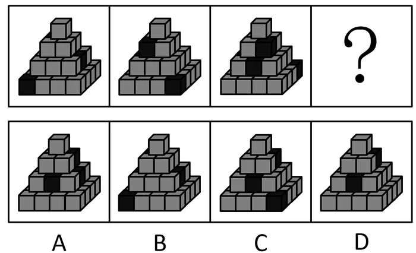

- **A**. A
- **B**. B
- **C**. C
- **D**. D

## 第 67 题　qid 3_1_2ajq1 · 判断推理

从所给的四个选项中，选择最合适的一个填入问号处，使之呈现一定的规律性：

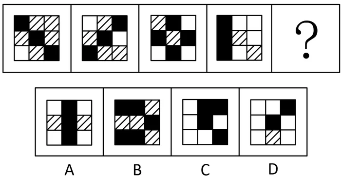

- **A**. A
- **B**. B
- **C**. C
- **D**. D

## 第 68 题　qid 3_1_2ajq3 · 判断推理

把下面的图形分为两类，使每一类图形都有各自的共同特征或规律，分类正确的一项是：

- **A**. ①②③，④⑤⑥
- **B**. ①③④，②⑤⑥
- **C**. ①③⑤，②④⑥
- **D**. ①②⑥，③④⑤

## 第 69 题　qid 3_1_2ajq5 · 判断推理

从所给的四个选项中，选择最合适的一个填入问号处，使之呈现一定的规律性：

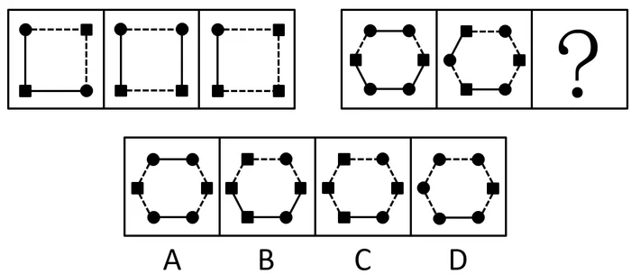

- **A**. A
- **B**. B
- **C**. C
- **D**. D

## 第 70 题　qid 3_1_2ajq6 · 判断推理

从所给的四个选项中，选择最合适的一个填入问号处，使之呈现一定的规律性：

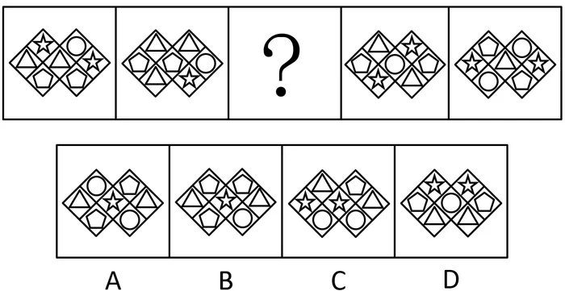

- **A**. A
- **B**. B
- **C**. C
- **D**. D

## 第 71 题　qid 3_1_2ak4u · 判断推理

紧急避险是指为了使国家、公共利益、本人或者他人的人身、财产和其他权利免受正在发生的危险，不得已采取的紧急避险行为，造成损害的，不负刑事责任。紧急避险不得超过必要限度造成不应有的伤害，否则仍应负刑事责任，但是可以减轻或者免除处罚。其中关于避免本人危险的规定，不适用于职务上、业务上负有特定责任的人。
根据上述定义，以下属于紧急避险的是：

- **A**. 某主治医生为了防止自己感染，申请退出非典病人的急救工作
- **B**. 某商贩为躲避城市管理人员的查处，在开车逃跑过程中撞到了行人
- **C**. 孙某驾驶私家车送女儿参加高考的途中，由于时间紧急而闯了一个红灯
- **D**. 公交车司机发现刹车失灵后，迫不得已撞向了一个无人值守的公安岗亭

## 第 72 题　qid 3_1_2ak4v · 判断推理

政策性收益是指由于某些政策、法规的变动而导致的个体收益，这种收益不会导致整个社会财富的增长，只会导致整个社会财富的重新分配。
根据上述定义，以下涉及政策性收益的是：

- **A**. 某市优化了营商环境，使得该市外贸企业进出口额与利润均大幅增加
- **B**. 小王挺身而出，制服歹徒，获得市政府见义勇为奖金5万元
- **C**. 出于增强执法力量的考虑，某公安局获得了上级1000万元的财政拨款
- **D**. 由于个人所得税新政策的实施，小李现在每月可以少缴纳个税216元

## 第 73 题　qid 3_1_2ak50 · 判断推理

准群体是指人与人之间已有某种联系，有一定程度的共同关心点，有可能在某些时候形成集团，但目前还没有组织起来的人群。
根据上述定义，以下必定不属于准群体的是：

- **A**. 在某网络论坛，正在讨论去某地旅游的网友
- **B**. 一群定时出现在某广场跳广场舞的市民
- **C**. 积极地参与某次志愿者活动的某高校大学生们
- **D**. 某社区正在观看免费电影的来自附近各小区的居民

## 第 74 题　qid 3_1_2ak51 · 判断推理

对越熟悉的东西越喜欢的现象，心理学上称为“多看效应”。多看效应不仅仅是在心理学实验中才出现，在生活中，我们也常常会见到。
根据上述定义，以下属于多看效应的是：

- **A**. 最初见面印象越好，喜欢程度越高
- **B**. 见面次数越多，喜欢程度越高
- **C**. 越内向的人，越难以受到他人的喜欢
- **D**. 最近一次见面印象越好，喜欢程度越高

## 第 75 题　qid 3_1_2ak52 · 判断推理

切割营销是指从竞争的角度，清晰地切割出有利于企业的人群、市场区域、新品类别、认知差异和品牌主线，进而实现难得的成长时间和空间。
根据上述定义，以下属于切割营销的是：

- **A**. 某饮料的广告词：年轻一代的选择
- **B**. 某家庭生了四胞胎，引起社会关注，有奶粉品牌邀请四胞胎代言广告
- **C**. 某企业要求营销人员必须了解每位客户，定期维护客户关系
- **D**. 某公司通过积极参与各类公益活动，提升品牌形象

## 第 76 题　qid 3_1_2ak53 · 判断推理

词的兼类是指在词义上有联系，并在不同的场合经常具备两类或两类以上的词类的语法功能的词。兼类词的特有条件有三个，一是意义上有相关性，具有不同功能的词应该是一个词；二是功能上有排斥性，兼类词的不同功能必须是分别在不同的结构条件下实现的；三是功能上有稳定性，兼类词兼有的两个词类的属性是稳定、经常性的，而不是临时的，更不是具有个人风格的修辞行为。
根据上述定义，以下句子用到兼类词的是：

- **A**. ①母亲很思念她的孩子。②信中寄托着浓浓的思念。
- **B**. ①不能乱花钱。②这里的花真美
- **C**. ①这是一个秘密。②你不能把这个秘密告诉他。
- **D**. ①你就是一个活雷锋。②你的行为也太雷锋了吧。

## 第 77 题　qid 3_1_2ak54 · 判断推理

实践合同又称要物合同，是指除当事人双方意思表示一致外，还须交付标的物或完成其他现实交付才能生效的合同。
根据上述定义，以下属于实践合同的是：

- **A**. 农民老张与收购商签订的竹笋买卖合同
- **B**. 小王与公司签订的劳动合同
- **C**. 小梁购买房屋与开发商签订的购房合同
- **D**. 小孙向小赵借钱买车签订的借款合同

## 第 78 题　qid 3_1_2ak55 · 判断推理

分配式谈判是指在零和条件下进行的谈判，本质是对于一份固定大小的利益谁应分得多少进行协商。当双方博弈时，一方得利必然意味着另一方吃亏，一方得益多少，另一方就吃亏多少，双方得失相抵，总数为零，这种情况就被称为“零和”。
根据上述定义，以下不属于分配式谈判的是：

- **A**. 劳资双方的薪酬谈判
- **B**. 商品房买卖方之间谈价钱
- **C**. 夫妻俩商议两人之间如何分配家务
- **D**. 两国针对边界划分问题开展谈判

## 第 79 题　qid 3_1_2ak56 · 判断推理

惯性思维是指人习惯性地因循以前的思路思考问题，仿佛物体运动的惯性。惯性思维常会造成思考事情时产生盲点，且缺少创新或改变的可能性。
根据上述定义，以下与惯性思维最相关的是：

- **A**. 某科学家做了如下实验：他让50个人到一个房间观看蓝色物体30秒，然后让他们闭眼说出屋内红色物体的数量，结果无人能够说出
- **B**. 小萧是某出版社编辑，日常工作经常需要校稿排版。一次，他在手机上阅读新闻的时候，很快就发现了其中的三个错别字
- **C**. 如果有人问“什么老鼠用两只脚走路？”如果先回答是米老鼠，再问“什么鸭子用两只脚走路？”时，一般人会回答唐老鸭，其实答案是所有鸭子都是用两只脚走路的
- **D**. 作为公交车司机，老李十几年如一日早起履行自己的职责。后来，公司考虑老李的年纪给他调换了工作，可是老李每天还是忍不住早起

## 第 80 题　qid 3_1_2ak57 · 判断推理

内在动机是指由个体内在需要引起的动机。由于个体对活动本身感到有兴趣，从活动中个体能得到满足、奖励和报酬，故活动本身成为个体从事该活动的推动力。
根据上述定义，以下不属于内在动机的是：

- **A**. 小陈上课认真，平时也很认真地做作业复习功课，他最期待考试的时候能获得好成绩，享受同学们羡慕的眼光
- **B**. 小何是一名大学生村官，他很乐于为村民解决各种问题，因为他在帮助村民解决问题时自己很有成就感
- **C**. 小曾一直很努力地学习做生意，因为他知道要赚足够的钱，才能实现30岁环游世界的梦想
- **D**. 小廖不想辜负父母对他的期盼，从事科研工作时非常努力，在很困难的课题上取得了好成绩

## 第 81 题　qid 3_1_2ak58 · 判断推理

聆听：音乐

- **A**. 注视：眼睛
- **B**. 呼吸：清风
- **C**. 抚摸：质地
- **D**. 观赏：风景

## 第 82 题　qid 3_1_2ak59 · 判断推理

汽车：燃油

- **A**. 面包：小麦
- **B**. 飞机：零件
- **C**. 植物：阳光
- **D**. 蛋糕：烤箱

## 第 83 题　qid 3_1_2ak5a · 判断推理

城市：农村

- **A**. 街道：社区
- **B**. 工业：农业
- **C**. 硬件：软件
- **D**. 学习：工作

## 第 84 题　qid 3_1_2ak5b · 判断推理

植物：煤炭

- **A**. 白酒：陈醋
- **B**. 淀粉：玉米
- **C**. 牛奶：酸奶
- **D**. 酸菜：白菜

## 第 85 题　qid 3_1_2ak5c · 判断推理

手忙脚乱：慌张

- **A**. 鹏程万里：遥远
- **B**. 百口莫辩：心虚
- **C**. 七上八下：繁忙
- **D**. 白云苍狗：无常

## 第 86 题　qid 3_1_2ak5d · 判断推理

爱不释手：手不释卷

- **A**. 高风亮节：两袖清风
- **B**. 风声鹤唳：草木皆兵
- **C**. 大同小异：相差无几
- **D**. 出口成章：才思敏捷

## 第 87 题　qid 3_1_2ak5e · 判断推理

积少成多：熟能生巧

- **A**. 水落石出：唇亡齿寒
- **B**. 失之毫厘：谬以千里
- **C**. 安危相易：福祸相生
- **D**. 塞翁失马：焉知非福

## 第 88 题　qid 3_1_2ak5f · 判断推理

纸张：书本：知识

- **A**. 毛衣：衣服：保暖
- **B**. 螺丝：齿轮：工具
- **C**. 水滴：海洋：资源
- **D**. 电脑：网卡：信息

## 第 89 题　qid 3_1_2ak5g · 判断推理

制度：完善：执行

- **A**. 创新：发展：推动
- **B**. 法规：健全：实施
- **C**. 版权：保护：侵犯
- **D**. 食品：安全：流通

## 第 90 题　qid 3_1_2ak5h · 判断推理

撸起：袖子：加油干

- **A**. 近水：楼台：先得月
- **B**. 直挂：云帆：济沧海
- **C**. 抽刀：断水：水更流
- **D**. 风吹：草低：见牛羊

## 第 91 题　qid 3_1_2ak5i · 判断推理

网店的客服诉求大致可以分为售前问题、售后问题和投诉。随着人工智能技术的发展，其中一部分重复性高、内容简单的问题，可以通过智能客服来答复。在智能客服系统完善后，它甚至能够比人工客服更快速、准确地回答这些问题。有人据此认为，网店人工客服这一岗位将会很快消失。
以下选项中最无法削弱上述论断的是：

- **A**. 智能客服的研发成本远高于雇用数名人工客服
- **B**. 智能客服无法与客户进行情感交流，开展客户维护
- **C**. 智能客服对复杂问题的回应能力不如人工客服
- **D**. 智能客服的完善需要相对漫长的过程

## 第 92 题　qid 3_1_2ak5j · 判断推理

甲、乙、丙、丁4人，一人是教师，一人是医生，一人是作家，一人是律师。现已知：①甲的年龄比教师大；②乙和律师的籍贯不同；③丙与作家的籍贯相同；④作家的年龄比乙小；⑤甲与律师来自相同的城市；⑥教师的籍贯与乙相同。
根据以上的信息，以下说法不正确的是：

- **A**. 作家的年龄比教师大
- **B**. 医生与律师的籍贯相同
- **C**. 医生的年龄比作家大
- **D**. 律师与教师的籍贯不同

## 第 93 题　qid 3_1_2ak5k · 判断推理

赵、钱、孙、李参加单位工会组织的兴趣小组，现在有书法、围棋、瑜伽三种可以选择。已知三个兴趣小组都要有人参加，且每人只能选一种。
赵说：“如果我要参加书法小组，孙、李至少有一个会和我一起参加。”
钱说：“我不参加瑜伽小组，孙也一定不会参加。”
孙说：“赵一定不会参加围棋小组。”
李说：“我要和钱参加同一个小组，但我不参加书法小组。”
如果每个人说的都是真的，则下列判断正确的是：

- **A**. 赵参加了围棋兴趣小组
- **B**. 孙参加了瑜伽兴趣小组
- **C**. 赵和孙参加了书法兴趣小组
- **D**. 钱和李参加了围棋兴趣小组

## 第 94 题　qid 3_1_2ak5l · 判断推理

警方在确认嫌疑人时常让目击证人在几个人的照片中进行指认。一般而言，指认同一个人有罪的证人数目越多，这个人真正有罪的概率就越大。但是，如果众多的目击证人都同时指认出同一个嫌疑人，则这个指认结果反而是值得怀疑的。因为大部分证人只在犯人落荒而逃的时候匆匆瞥了她们一眼，因此在指认时错误的概率很高。在这种情况下，证人指认的结果存在不一致才是正常的。众多证人的指认一致，说明很可能存在其他原因导致了这一指认结果。
下列选项中的逻辑推断方式与题干不同的是：

- **A**. 某汽车公司生产的汽车，无论驾驶年限多长，车检时的尾气排放检测结果均远低于国家标准。因此检测机构认为，该公司为生产的所有汽车都加装了尾气检测作弊设备
- **B**. 两支篮球队实力相近，以往多次比赛两队的比分都很接近。但近期的一场比赛中，其中一支球队以大比分获胜。因此有球迷认为，这场比赛受到了操纵
- **C**. 某国古代法律中规定，如果所有法官都一致认为嫌疑人有罪，该嫌疑人反而会被赦免
- **D**. 某科研人员向学术期刊投了一篇文章，里面的所有研究数据非常完美地支持了他提出的研究假设，该期刊编辑因此认为这篇文章数据造假，将文章退回

## 第 95 题　qid 3_1_2ak5m · 判断推理

甲、乙、丙三人前往游乐场游玩，游乐场内有三个园区，每个人都在三个园区玩了一定数量的游戏，游乐场内的每个游戏消费均是20元。已知：
①甲和乙各自在A园区花费的金额与丙在C园区花费的金额相同
②甲在B园区和乙在C园区花费的金额都是40元
③不存在两个人在三个园区都游玩了相同数量游戏的情况
④甲、乙、丙三人在游乐场内的游戏消费均为120元，无其他消费
那么可以推断：

- **A**. 在三个园区消费金额都相同的只可能是甲
- **B**. 在三个园区消费金额都相同的只可能是乙
- **C**. 在三个园区消费金额都相同的只可能是丙
- **D**. 甲、乙、丙没有一人在三个园区的消费金额都相同

## 第 96 题　qid 3_1_2ak5n · 判断推理

某部门要外派员工参加一项会议。部门领导对此展开了以下讨论：
甲说：“此次会议非常重要，建议派部门全部员工参加。”
乙说：“如果派老陈外出参会，建议老张留在单位主持工作。”
丙说：“老陈在这次会议中需要发言，一定要参加。”
丁说：“单位工作需要正常开展，部门需要有人员留守。”
已知上述四人中只有一个人的建议没有被采纳，则可以推出：

- **A**. 甲的建议没有被采纳，老张没有参加此次会议
- **B**. 乙的建议没有被采纳，老陈和老张都去参加了此次会议
- **C**. 丙的建议没有被采纳，老陈没有参加此次会议
- **D**. 丁的建议没有被采纳，部门全部员工都参加了此次会议

## 第 97 题　qid 3_1_2ak5o · 判断推理

某生产企业想要获得更高的利润，要么改进生产工艺提升产品品质，要么压缩生产成本。该企业压缩了生产成本，获得了更多利润，那么该企业一定没有改进生产工艺。
下列选项中的逻辑推断方式与题干最为相似的是：

- **A**. 企业为规范员工行为，加大违纪处罚力度或是提高个人素质都是可行的。如果一个企业的员工素质普遍都很高，那么就没必要建立严格的违纪处罚制度
- **B**. 要扩大市场占有率，不仅要加大广告投入，还要提高生产合格率，如果市场占有率降低，可能是因为广告效果不理想
- **C**. 货币汇率的影响因素一是经济增长速度的变化，二是经济规模比重的变化，所以汇率长期升值是经济长期增长造成的
- **D**. 低碳消费可以提高资源利用率，还可以真正实现节能减排，低碳消费不但是个人行为，更应该是社会共同行为

## 第 98 题　qid 3_1_2ak5p · 判断推理

某单位计划派小李驻村挂职锻炼。已知驻村干部必须同时满足以下条件中的两项：会讲当地方言；有经济专业背景；有两年以上基层工作经验。
以下哪项如果为真，可以得出“小李必然不能参加挂职锻炼”的结论？

- **A**. 小李在基层工作过两年，但他要么不会讲方言，要么不是经济专业的
- **B**. 小李没在基层工作过，如果小李是经济专业的，那么他不会讲当地方言
- **C**. 小李会讲当地方言，而且或者是经济专业，或者在基层工作过两年
- **D**. 小李不是经济专业的，而且他可能在基层工作过两年

## 第 99 题　qid 3_1_2ak5q · 判断推理

近几年，购买轿车的人中买新车的人所占的比例下降了，一些销售商把这个现象归因于新车价格的增长，他们认为，即使完全扣除掉物价增长的因素，现在一辆新车的价格也比几年前高了很多。
以下哪项如果为真，最能反驳销售商的观点？

- **A**. 一个人购买一辆新车到他下次买车会间隔几年时间
- **B**. 一辆新车的价值往往下降的很快，但在一段时间后就不怎么下降了
- **C**. 二手车销量的增加是由于现在市场上少数二手车经销商正低价抛售
- **D**. 新车均价的改变是由于更多的人拒绝购买便宜的新车而选择购买二手车

## 第 100 题　qid 3_1_2ak5r · 判断推理

某国家森林公园中，4个山地大猩猩家族爆发了呼吸系统传染病。据调查，这4个家族的山地大猩猩与游览者的互动很紧密，它们经常与人近距离接触。所以，如果游览者与山地大猩猩保持10米以上的距离，那么感染呼吸系统传染病的山地大猩猩数量将会大大降低。
下列哪项陈述最好地总结了上述论证中的缺陷？

- **A**. 假设了游览者可能患有呼吸系统疾病
- **B**. 忽略了其他与人接触过的山地大猩猩家族没有爆发呼吸系统传染病的状况
- **C**. 忽视了不同地区的山地大猩猩发生呼吸系统传染病的症状是不一样的
- **D**. 暗含了与游览者的紧密互动导致了山地大猩猩爆发呼吸系统传染病

## 材料 1

近年来，在政策推动下，我国乡村旅游取得了很大的发展。2016年，全国有近10万个村开展休闲农业与乡村旅游活动，休闲农业与乡村旅游经营单位达290万家，其中农家乐超过200万家，而到了2017年，全国农家乐数量已达到了220万家。2017年，休闲农业和乡村旅游从业人员达到900万人，较2015年增加了110万人；休闲农业与乡村旅游接待人数从2012年的7.2亿人次增至2017年的28亿人次，年均复合增长率高达31.2%，占国内游客接待人次的56.0%，较上年提高了1.9个百分点。2013～2017年，休闲农业与乡村旅游营业收入增长迅速，2017年休闲农业与乡村旅游营业收入达7400亿元，占国内旅游总收入的16.2%，较上年提高了1.7个百分点。

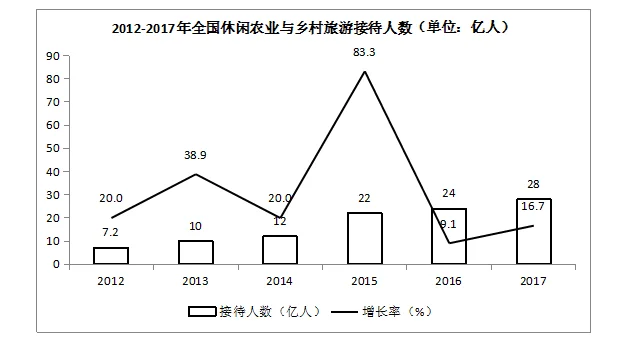

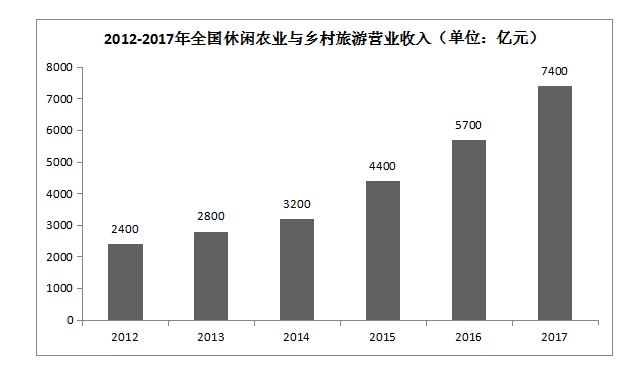

## 第 101 题　qid 3_1_2ak5s · 资料分析

2015年全国休闲农业与乡村旅游从业人员年人均收入约为：

- **A**. 3.2万元
- **B**. 4.7万元
- **C**. 5.6万元
- **D**. 6.4万元

## 第 102 题　qid 3_1_2ak5t · 资料分析

与2012年相比，2017年全国休闲农业与乡村旅游接待人数约增加：

- **A**. 2倍
- **B**. 3倍
- **C**. 4倍
- **D**. 5倍

## 第 103 题　qid 3_1_2ak5u · 资料分析

2015年全国休闲农业与乡村旅游接待人数同比增长率约是2014年的：

- **A**. 3.6倍
- **B**. 3.8倍
- **C**. 4.2倍
- **D**. 4.4倍

## 第 104 题　qid 3_1_2ak5v · 资料分析

2012-2017年，全国休闲农业与乡村旅游接待人数年均增长率比其年均复合增长率约多：

- **A**. 24.4个百分点
- **B**. 26.6个百分点
- **C**. 27.2个百分点
- **D**. 28.4个百分点

## 第 105 题　qid 3_1_2ak60 · 资料分析

根据资料，下列说法正确的是：

- **A**. A 2017年全国农家乐占休闲农业与乡村旅游经营单位数量的  以上
- **B**. B 2016年国内旅游总收入超4万亿元
- **C**. C 2012-2017年，全国休闲农业与乡村旅游接待人数平均年增长超4亿人
- **D**. D 2013-2017年，全国休闲农业与乡村旅游营业收入增速最低的是2013年

## 材料 2

改革开放40年来，我国国民经济大踏步前进，经济总量连上新台阶，综合国力和国际影响力显著提升。2017年，我国国内生产总值按不变价计算比1978年增长33.5倍，年均增长
9.5%
，远高于同期世界经济
2.9%
左右的年均增速，在全球主要经济体中名列前茅。1978年，我国国内生产总值只有3679亿元，1991年上升到2万亿元，2000年突破10万亿元大关，2017年达到827122亿元，折合12.3万亿美元，占世界经济总量的15%左右，2017年经济增量折合1.2万亿美元。
        40年来，我国积极把握全球化机遇、纵深推进对外开放，1978年货物进出口总额仅为206亿美元。2017年，货物进出口总额达到277923亿元，折合4.1万亿美元，比上年增长
14.2%
，居世界第一位。其中，出口153321亿元，增长
10.8%
；进口124602亿元，增长
18.7%
。货物出口差额（出口减进口）28719亿元，对“一带一路”沿线国家进出口总额73745亿元，其中出口43045亿元，增长
12.1%
；进口30700亿元，增长
26.8%
。

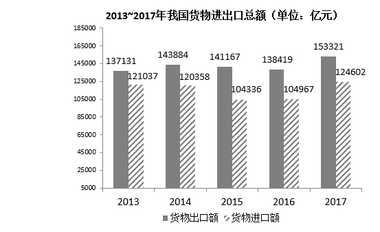

## 第 106 题　qid 3_1_2ak61 · 资料分析

2017年世界经济总量约为：

- **A**. 62万亿美元
- **B**. 82万亿美元
- **C**. 102万亿美元
- **D**. 122万亿美元

## 第 107 题　qid 3_1_2ak62 · 资料分析

2014～2017年，我国货物进出口差额最大的一年是：

- **A**. 2017年
- **B**. 2016年
- **C**. 2015年
- **D**. 2014年

## 第 108 题　qid 3_1_2ak63 · 资料分析

2017年我国货物进出口总额比1978年增长约：

- **A**. 168倍
- **B**. 198倍
- **C**. 228倍
- **D**. 248倍

## 第 109 题　qid 3_1_2ak64 · 资料分析

与2016年相比，2017年我国对“一带一路”沿线国家出口增加额比进口增加额约少：

- **A**. 1623亿元
- **B**. 1842亿元
- **C**. 1915亿元
- **D**. 2012亿元

## 第 110 题　qid 3_1_2ak65 · 资料分析

根据资料，以下说法不正确的是：

- **A**. 1978～2017年，我国国内生产总值按不变价计算年均增速比同期世界经济约高出6.6个百分点
- **B**. 2016年我国国内生产总值约为11.1万亿美元
- **C**. 2017年我国对“一带一路”沿线国家进出口差额为12345亿元
- **D**. 2017年我国货物进出口总额同比增加超过4万亿元

## 材料 3

2018年，B省实现地区生产总值83608.59亿元，全省大力实施创新驱动发展战略，创新驱动指数从2014年的
71.2%
提高到2018年的
88.4%
，年均提升4.3个百分点。2018年R&D研发经费支出占GDP比重为
2.56%
，比2014年提高0.39个百分点。2018年国内发明专利授权量25.6万件，比2014年增长

左右；每万人口发明专利拥有量15.53件，比2014年提高了约8件；高新技术企业数量达到19857家，比2014年增加近三倍，总量居全国第一。

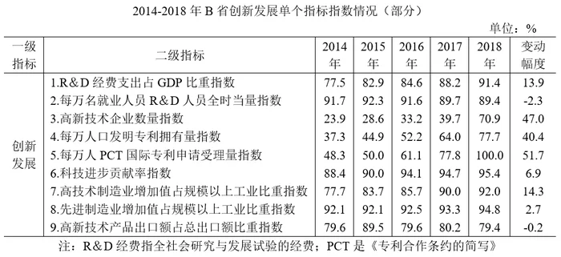

        2018年，B省高技术制造业增加值占规模以上工业比重、先进制造业增加值占规模以上工业比重分别达
27.6%
和
49.39%
，比2014年提高3.5个和1.2个百分点。经济增长方式由主要依靠劳动力数量和资本存量增长驱动，转变为主要依靠科学技术和人力资本增长，科技进步贡献率由2014年的
53.05%
提高到2018年的
57.22%
，其中2016年（
56.44%
）比2015年提升2.47个百分点。

## 第 111 题　qid 3_1_2ak66 · 资料分析

2018年B省R&D研发经费支出约为：

- **A**. 1500亿元
- **B**. 2140亿元
- **C**. 2500亿元
- **D**. 3000亿元

## 第 112 题　qid 3_1_2ak67 · 资料分析

2014年B省先进制造业增加值约是高技术制造业增加值的

- **A**. 1.8倍
- **B**. 2.0倍
- **C**. 2.2倍
- **D**. 2.4倍

## 第 113 题　qid 3_1_2ak68 · 资料分析

2014年～2018年，B省每万人口发明专利拥有量指数平均增幅为：

- **A**. 6.5个百分点
- **B**. 8.1个百分点
- **C**. 9.3个百分点
- **D**. 10.1个百分点

## 第 114 题　qid 3_1_2ak69 · 资料分析

2014年～2018年，B省创新发展各个指标指数变动幅度排列正确的是：

- **A**. A 高新技术企业数量指数 > 每万人口发明专利拥有量指数 > 高技术制造业增加值占规模以上工业比重指数
- **B**. B 科技进步贡献率指数 > 每万人口发明专利拥有量指数 > 高技术制造业增加值占规模以上工业比重指数
- **C**. C 高新技术企业数量指数 > 高技术制造业增加值占规模以上工业比重指数 > 每万人口发明专利拥有量指数
- **D**. D R&D经费支出占GDP比重指数 > 每万人口发明专利拥有量指数 > 高新技术企业数量指数

## 第 115 题　qid 3_1_2ak6a · 资料分析

根据资料，以下说法正确的是：

- **A**. 与2014年相比，2018年B省创新驱动指数的增长率超过24%
- **B**. 2014年～2018年，B省先进制造业增加值占规模以上工业比重指数逐年提升
- **C**. 2014年B省高新技术企业数量居全国第一
- **D**. 2019年B省每万名就业人员R&D人员全时当量指数持续下降

## 材料 4

2013年以来，C省全年农作物播种面积累计增加了超160万公顷，截至2018年末，全年农作物总播种面积由2013年末的721.1万公顷增加到了2018年末的882.4万公顷。其中粮食作物播种面积679.0万公顷，经济作物播种面积由2013年的159.4万公顷增加至203.4万公顷。
        2018年，C省粮食总产量3553.3万吨，比上年增长
9.2%
，增幅同比提高9.6个百分点；蔬菜产量1006.5万吨，下降
9.4%
；油料产量201.5万吨，下降
16.3%
，较2016年减少了24万吨；甜菜产量515.9万吨，增长
49.8%
，增幅同比提高13.4个百分点；受极端天气等因素影响，水果产量为225.5万吨，仅为2016年产量的
71.3%
。

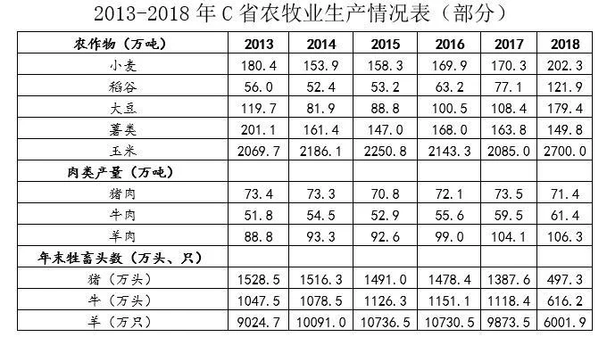

        近年来，C省农牧业综合机械化水平逐年提高。2018年末，全省农牧业机械总动力3663.7万千瓦，综合机械化水平达到
84%
。

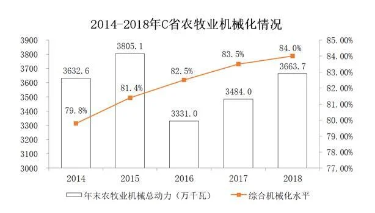

## 第 116 题　qid 3_1_2ak6b · 资料分析

与2013年末相比，2018年末C省粮食作物播种面积增加了约：

- **A**. A 12%
- **B**. B 21%
- **C**. C 30%
- **D**. D 39%

## 第 117 题　qid 3_1_2ak6c · 资料分析

2018年C省大豆产量同比增长率比玉米的约多：

- **A**. 36.0个百分点
- **B**. 38.1个百分点
- **C**. 40.2个百分点
- **D**. 42.3个百分点

## 第 118 题　qid 3_1_2ak6d · 资料分析

2014～2018年，C省年末农牧业机械总动力同比增长率最高的一年是：

- **A**. 2015年
- **B**. 2016年
- **C**. 2017年
- **D**. 2018年

## 第 119 题　qid 3_1_2ak6e · 资料分析

以下农作物中，2016年C省产量最高的是：

- **A**. 油料
- **B**. 甜菜
- **C**. 水果
- **D**. 小麦

## 第 120 题　qid 3_1_2ak6f · 资料分析

根据资料，下列说法正确的是：

- **A**. A 2013～2018年，C省猪肉年平均产量超过72.5万吨
- **B**. B 与2016年相比，C省2017年粮食总产量略有增加
- **C**. C 2014～2018年，C省农牧业综合机械化水平增加了5个百分点
- **D**. D 2015～2018年，C省稻谷产量的年均复合增长率约为 31.8%

---

## 答案与解析（来源交叉匹配：xingcezhenti）

> 来源卷（xingcezhenti）中无此卷，**答案源缺，全部待修**。
