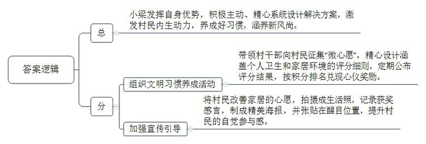
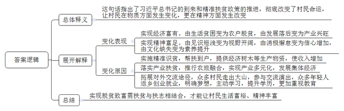
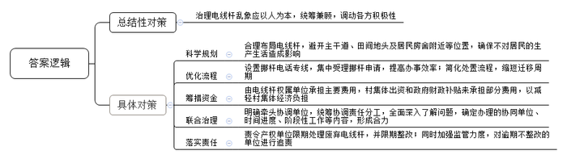
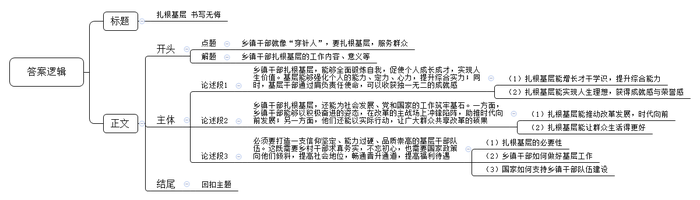

# 2020年0822公务员多省联考《申论》题（黑龙江乡镇、普通选调卷）

> 候选采集稿。参考答案及解析来自粉笔页面，不代表官方答案或真实高分答卷；来源使用许可与原卷对应关系仍需人工核实。

## 给定材料

### 材料 material-4b8a0fa944465388

杨树村曾是深度贫困村。经过几年的努力，村里绝大多数贫困户已经圆了脱贫梦。为了稳定增收，杨树村决心借助山清水秀的景致发展乡村旅游。2019年年初，在政府专项资金支持下，杨树村的美丽乡村项目顺利开工。水泥道路通村入户，古建民居修葺一新。竹木栅栏、青石台阶、小桥流水的景观设计，让昔日的深度贫困村华丽转身，好似世外桃源。

村里漂亮了，可是家居环境的改善是个“老大难”，远远望去村容村貌焕然一新，可是走进老百姓家里一看，庭院堆放杂乱、灶台藏污纳垢等现象普遍存在。以前村干部也曾多次上门做工作，但是老百姓认为这是自家的事，村干部管不着。关键时刻，省建筑装饰集团公司的驻村第一书记小梁发挥自身优势，为村里“精心设计”了一套解决方案。

8月的一天，一场“积分兑换心愿，勤劳改变习惯”的文明习惯养成活动在杨树村拉开帷幕。小梁和村干部一道向村民征集有关居家环境改善的“微心愿”，精心设计了十项涵盖个人卫生和家居环境的评分细则。每周公布评分结果，最终根据排名兑现前20名家庭的“微心愿”。“我们希望通过微心愿激发村民的内生动力，帮助大家养成好习惯，涵养新风尚。”小梁说。

村民们纷纷讲出了自己改善家居的愿望。“要是有台大彩电，忙完一天的农活。就可以陪孙子看动画片儿了。”村民王大娘说。“要是有台大冰箱就好了。吃不完的剩菜也不会蔫吧了。”村民张大伯说。村民们的这些心愿，配上摄影师为他们拍摄的生活照，被制成精美的海报，张贴在村里的醒目位置。其中一张是65岁的唐大妈笑呵呵在做针线活儿。“在整洁、干净的屋里做针线活儿，我心里那叫一个美！”海报上印着两行大字，这是唐大妈的获奖感言。看着村里乡亲父老，竟然也能像明星一样登上如此精美的海报，村民们的参与感更强了，改善家居环境一时间蔚然成风。小梁说，几个月以来，从锅碗瓢盆、个人卫生，到房前房后、禽畜养殖，杨树村变化很大。

村里夏大姐的丈夫常年在外打工，她自己则留在村里种地、看孩子。一个人忙里忙外，难免顾不上收拾屋子，脏乱差出了名。夏大姐为了实现心愿，更为了改变以前的生活，也参加了活动。“改变习惯其实挺难的！”活动中夏大姐发表感言，“以前咋舒服咋来，家里乱的不像样，现在动动手家里窗明几净的，自己住着也舒服就是累点也值，我一定要坚持到最后。”

从爱美之心人皆有之，到护美之行人人为之。杨树村这个新建成的美丽乡村，参加活动以来处处透着美美的气息。评比结果出来后，省建筑装饰集团公司如约为表现优异的家庭兑现“微心愿”，同时也为其他家庭送去棉服、抱枕、围巾等暖冬礼物。在活动现场，夏大姐领到了心想已久的热水器，脸上露出了笑容。

### 材料 material-ee104e1ca422358d

云雾缭绕，山高路远，十八洞村就在大山深处。作为偏远山区的一个苗族村落，十八洞村原本少人知晓。2013年11月3日，习近平总书记来到这里考察调研、访贫问苦，首次提出精准扶贫战略思想，十八洞村由此声名远播。

“再过多少年我也忘不了那一天！”石大娘回忆说：“那天下午，村里来了好多人，不一会儿，一群人走到我家门前，走在前面的那位身材魁梧，面带微笑，问我是不是你屋？我讲是的。他问可不可以到屋里坐下子？我说可以，可以，稀客稀客！”那时，石大娘还不知道来她家的是习近平总书记。

石大娘没有读过一天书，不认识一个字，嫁到十八洞村后，尽管每天从早到晚辛勤劳作，但由于自然条件差，穷乡僻壤，薄田寡地，一家人生活仍很贫困。“我和老伴儿本来以为这辈子就这样过下去了，也认命了。”石大娘说。习近平总书记的到来和精准扶贫政策的推进，彻底改变了老人一家的命运。县扶贫工作队将她家列为精准扶贫对象，纳入低保，送来了榉木苗、梨树苗，还帮着各种了三亩。来参观的游客越来越多，工作队帮她家开了个小商店，卖些饮料、方便面、书籍和纪念品等。“现在的日子，过去做梦都不敢想！”石大娘顺手向火塘里续了几块柴，火烧得更旺了。

2016年，十八洞村人均纯收入由2013年的1668元增加到8313元，贫困发生率由2013年的56.75%下降到1.28%。2017年，该村的当家产业猕猴桃挂果，全村人均收入首次突破万元。石大娘作为建档立卡贫困户，成了村里猕猴桃合作社的原始股东，2017年分红2000元，2018年分红2400元。“我现在一年四季餐餐有肉吃，神仙过的日子也就是这样了！”石大娘说。2019年，十八洞旅游公司正式运营，截至年底，游客超过60万人次，带动全村农家乐、乡村民宿大发展，猕猴桃、黄桃、腊肉、蜂蜜、山泉水等村里土特产品热销。2020年十八洞村溶洞景区将建设完成并对外开放，预计年游客量可达100万人次。

2019年国庆前几天，石大娘和村里农民艺术团的40多个姐妹到了北京，参加中央民族歌舞团的一场大型文艺晚会，献上了苗族情景表演《十八洞的今天变了样》。在十八洞村，像石大娘这样走出大山，到外面开眼界、见世面的村民越来越多。从城市回到家乡寻求发展的年轻人也越来越多，他们在十八洞村开起了农家乐，当起了导游。这天，石大娘21岁的外孙女小龙正好在家，她已取得学前教育专业的大专文凭证，正自考本科。“以后我要在十八洞村开一家幼儿园，梦想总是要有的。”她自信而爽朗。

“以前的十八洞村是袋子空、家里空、寨子空、精神空。”县扶贫工作队的伍副队长说：“现在村民收入多了，年轻人多了，全村人致富奔小康的心气足足的！”“对十八洞村来说，最大的变化是人的变化。”县委宣传部周副部长说。

### 材料 material-40dc9907e4bdcd9a

乡间公路，两米多宽，刚好供一辆车通行。不巧的是，此路中“长”出一根电线杆，占了路面近半米。车行至此，弯转不得，直行也不畅，一长段出村的道路成了摆设，J县星火村的村民没少为废旧电线杆的事烦心。

“开车到这里，傻眼，只好倒回去。”顺着星火村党总支马副书记指的方向看过去——道路两旁、宅前屋后、田间地头，悬空线杆不时见到，分布极不规则，还有不少已经闲置废弃。最近的杆子离村民家宅不过数米，村民们开玩笑地抱怨道：“道路拓宽、房屋翻建，还都得看杆子的‘脸色’。”

废旧线杆碍事，为啥不挪动个地？想请走，没那么容易，星火村党总支奚书记细数线杆的“娘家”，电力、电信、联通、移动、有线电视……就连小灵通的杆子现在还在竖着呢！这么多单位的线杆，要挪得一家一家打电话咨询，打报告申请，电话那头听完诉求，都是先报价格，估算下来，废弃不用的杆，拔走，3000块钱一根，挪地方更贵，一根得1万多块钱，而且流程走下来，移杆周期至少也得两三个月，星火村共34根废弃空杆要拔除，81根尚在使用的线杆要迁移，算算账，这笔钱对基层来说可不是小数目。

在星火村，为这件事，村民们常有反映，可几年来也只解决了几根，拔线杆事本不大，却因“杆出多门”多头管理，在基层治理反倒成了盲区，根据县建设局调研统计，辖区内农村地区95%以上的架空线杆竖在村民的宅前屋后，村主干道旁或田间地头，有的废弃线杆权属单位为减少处理废杆的成本，任由废杆随意丢弃，而线杆申请迁移周期长、费用高，给村里带来了较大经济压力。“解决不好这个问题，不仅村容村貌受影响，还会给整个美丽乡村建设拖后腿。”奚书记说。

去年，J县大调研乡村废弃线杆的处理问题被县建设局上报到了县里的大调研办公室，定性为典型的跨地区、跨部门、跨事权的“三跨”问题，“县里立即启动复杂重大问题处理机制，迅速进入上报、流转解决流程。”J县大调研办公室相关负责人说，“三跨”问题多出现在基层治理的薄弱区域、盲点区域，通过大调研解决复杂重大问题的过程，也是推动建立健全体制机制的过程。

打开J县探索建立的复杂重大问题统筹协调推进流程图，这类疑难问题有着明确的流转规定，在流转图上可以看到：问题进入上报环节后，需立即在有关会议上进行统筹协调责任分工，随后进入流转环节，协调单位对问题进行全面深入了解，确定问题办理的协同单位、时间进度、阶段性工作等内容，然后由协调单位依据授权，发挥牵头协调作用，多方攥起拳头，形成解决问题的合力。

基层治理之策，不应聚焦于“头痛医头，脚痛医脚”，应该牢固树立以人民为中心的发展思想，统筹兼顾，充分调动各方面的积极性，共同携手下好治理这盘大棋局。

作为治理体系的“底盘”，基层治理大有可为。方此“船到中流浪更急，人到半山路更险”之时，新时代的改革发展，亟待我们激浊扬清，兴利除弊，打通治理的“最后一公里”，激活治理的“末梢神经”，更好激发基层治理的效能。

### 材料 material-d2f075fb58ac2457

“要牢记群众是真正的英雄，任何时候都不能忘记为了谁、依靠谁、我是谁，真正同人民结合起来。”在2019年春季学期中央党校（国家行政学院）中青年干部培训班开班式上，习近平总书记勉励年轻干部“在学思践悟中牢记初心使命”，把党的初心、党的使命铭刻于心，把人民放在心中最高位置，虚心向群众学习，真心对群众负责，热心为群众服务，诚心接受群众监督。语重心长的讲述，为年轻干部点亮了引路明灯。

“到农村去，那里有生我养我的爹娘；到农村去，那里有育我成长的南瓜米汤；到农村去，那里是魂牵梦绕的故乡。”在田间地头，在山村乡野，总能看到驻村第一书记的身影。今天，280多万驻村干部、第一书记奋战在脱贫攻坚一线。他们深入基层、服务群众，不仅赢得了群众信赖和社会点赞，也为自身成长进步积累下宝贵财富。

建功新时代，人民群众中间到处有施展才华、开拓创业的广阔天地。今天的年轻干部，很多是从“家门”到“校门”再进“机关门”，了解国情的少，熟悉基层的少，亲近群众的少，甚至有的年轻干部心理上与乡土乡亲有代沟，情感上同民生民瘼有温差。由此而言，“干部多‘墩墩苗’没有什么坏处，把基础搞扎实了，后面的路才能走得更稳更远”。主动沉到困难大、矛盾多、条件差的地方经风雨、练本领，方能克服“头重脚轻”、阅历不足的问题，除却“骄娇”之气，真正成长为为民务实清廉的合格干部。

## 题目

### 第 1 题

**根据给定资料**2**，谈小梁如何解决杨树村家居环境改善这个“老大难”问题。（15分）**

关联材料：material-4b8a0fa944465388

作答要求：

要求：

（1）准确、全面、有条理；

（2）不超过200字。

### 第 2 题

**“给定资料**3**”提到，“对十八洞村来说，最大的变化是人的变化”，谈谈对这句话的理解。（20分）**

关联材料：material-ee104e1ca422358d

作答要求：

要求：

（1）紧扣资料，分析透彻，条理清晰；

（2）不超过300字。

### 第 3 题

**根据****“给定材料**4**”，请提出整治J县乡村****电****线杆乱象的具体措施。（25分）**

关联材料：material-40dc9907e4bdcd9a

作答要求：

要求：

（1）根据资料，内容完整；

（2）条理清晰，措施可行；

（3）不超过400字。

### 第 4 题

**“给定资料**5**”中提到，“乡镇干部都认为乡镇工作是他们无悔的选择”，深入思考这句话，结合资料，联系实际，自拟题目，写一篇文章。（40分）**

关联材料：material-d2f075fb58ac2457

作答要求：

要求：

（1）观点明确，见解深刻；

（2）思路清晰，言语流畅；

（3）参考“给定资料”但不拘泥于材料；

（4）1000～1200字。

## 答案与解析

第 1 题

**参考答案（粉笔题库参考内容）**

小梁发挥自身优势，积极主动、精心系统设计解决方案，激发村民内生动力，养成好习惯，涵养新风尚。

一、组织文明习惯养成活动。带领村干部向村民征集“微心愿”，精心设计涵盖个人卫生和家居环境的评分细则，定期公布评分结果，按积分排名兑现心仪奖励。

二、加强宣传引导。将村民改善家居的心愿，拍摄成生活照，记录获奖感言，制成精美海报，并张贴在醒目位置，提升村民的自觉参与感。

**解析**

**参考答案说明：**本参考答案采用“总-分”的逻辑结构。先总说了小梁改善杨树村人居环境的主要做法，然后再分别从“组织文明习惯养成活动”“加强宣传引导”两个方面进行了分条撰写。各条要点之间在内容上是并列关系，没有交叉。并且撰写每条要点时，都提炼出了概括性强的总结词并前置，符合题目中“有条理”这一要求。

**考点**：考点概括措施类

**来源**：来源2020年0822公务员多省联考《申论》题（黑龙江乡镇、普通选调卷）

粉笔申论页面对本题只提供「解析视频」入口，该入口是会员推广位，页面无视频地址与文字解析。

第 2 题

**参考答案（粉笔题库参考内容）**

这句话指出了习近平总书记的到来和精准扶贫政策的推进，彻底改变了村民命运，让村民在物质方面发生变化，更在精神方面发生改变。

变化表现：1.实现经济富有。由生活贫困变为农户脱贫，由发展落后变为产业兴旺。2.实现精神富足。由见识短浅变为视野开阔，由消极懈怠变为信心增加，由文化缺失变为素养提升。

原因在于：1.实施精准识贫，帮扶到户，提供经济树木等生产物资，使收入增加。2.落实产业扶贫，推行农旅融合，实现产业多元化，发展集体经济。3.拓展对外交流途径，众多村民走出大山，参与交流演出，众多年轻人返乡创业就业，明确梦想，主动学习，提升学历，更加重视教育。

实现脱贫致富需扶贫与扶志相结合，才能让村民生活富裕、精神丰富。

**解析**

**参考答案说明：**思路方面，本参考答案按照词句解释题“总体释义+展开解释+总结”的一般答题思路展开。内容方面，本参考答案先对给定句子的含义进行了解释，接着分析了“‘人的变化’的具体表现”与“‘人的变化’的原因”，最后结合资料逻辑进行总结。词句表达方面，本答案加上了“变化表现”“原因在于”等表述来承接上下文。

**参考答案二**

这句话指出了习近平总书记的到来和精准扶贫政策的推进，彻底改变了村民命运，让村民在物质方面发生变化，更在精神方面发生改变。

一、实现经济富有。1.由生活贫困变为农户脱贫。实施精准识贫，帮扶到户，提供经济树木等生产物资，使收入增加。2.由发展落后变为产业兴旺。落实产业扶贫，推行农旅融合，实现产业多元化，发展集体经济。

二、实现精神富足。1.由见识短浅变为视野开阔。众多村民走出大山，参与交流演出，打开眼界。2.由消极懈怠变为信心增加。众多年轻人返乡创业就业，变得自信而爽朗。3.由文化缺失变为素养提升。明确梦想，主动学习，提升学历，更加重视教育。

实现脱贫致富需扶贫与扶志相结合，才能让村民生活富裕、精神丰富。

**考点**：考点词句解释类

**来源**：来源2020年0822公务员多省联考《申论》题（黑龙江乡镇、普通选调卷）

粉笔申论页面对本题只提供「解析视频」入口，该入口是会员推广位，页面无视频地址与文字解析。

第 3 题

**参考答案（粉笔题库参考内容）**

治理电线杆乱象应以人为本，统筹兼顾，调动各方积极性，具体如下：

第一、科学规划。合理布局电线杆，避开主干道、田间地头及居民房舍附近等位置，确保不对居民的生产生活造成影响。

第二、优化流程。设置挪杆电话专线，集中受理挪杆申请，提高办事效率；简化处置流程，缩短迁移周期。

第三、筹措资金。由电线杆权属单位承担主要费用，村集体出资和政府财政补贴来承担部分费用，以减轻村集体经济负担。

第四、联合治理。明确牵头协调单位，统筹协调责任分工，全面深入了解问题，确定办理的协同单位、时间进度、阶段性工作等内容，形成合力。

第五、落实责任。责令产权单位限期处理废弃电线杆，并限期整改；同时加强监管力度，对逾期不整改的单位进行追责。

**解析**

**参考答案说明：**本参考答案是总分结构，先提出治理电线杆乱象的总结性对策，接着从“科学规划”“优化流程”“筹措资金”“联合治理”“落实责任”等不同方面进行了分条撰写，各条要点之间在内容上相互并列，没有交叉。

**考点**：考点提出对策类

**来源**：来源2020年0822公务员多省联考《申论》题（黑龙江乡镇、普通选调卷）

粉笔申论页面对本题只提供「解析视频」入口，该入口是会员推广位，页面无视频地址与文字解析。

第 4 题

**参考答案（粉笔题库参考内容）**

**扎根基层** **书写无悔**

“上面千条线，下面一根针。”乡镇干部就像“穿针人”，既要贯彻落实中央方针政策，还要与人民群众接触，提供细致、周到、全面的服务。在扎根基层、服务群众的过程中，乡镇干部既能提升自我能力、实现自我抱负，还能为社会建设、时代发展推波助澜。

为此，纵使面临任务杂、矛盾多、强度大的难题，纵使面对条件艰苦、收入有限、地位不高的困境，乡镇干部仍然认为基层工作是他们无悔的选择。因为，对比所失，他们在这片广袤天地上所得的更多！

**乡镇干部扎根基层，能够全面锻炼自我，促使个人成长成才，实现人生价值。基层能够强化个人的能力、定力、心力，提升综合实力；同时，基层干部通过肩负责任使命，可以收获独一无二的成就感。**基层工作看似简单，却极其繁琐；看似闲暇，却十分劳累；看似轻松，却压力沉重。在繁琐、劳累、压力沉重的环境中，乡镇干部不断革新工作理念，不断增长才干学识，不断创新工作方式，不断提升抗压能力，从而全面提升综合实力，最终化身为一只苍劲有力的“领头雁”。不仅如此，乡镇干部深入基层一线，历经风雨、练就本领，在脱贫攻坚的战场上挺身入局，在乡风文明的大舞台上建功立业，最终实现人生理想，获取独特的成就感与荣誉感。

**乡镇干部扎根基层，还能为社会发展、党和国家的工作筑牢基石****。****一方面，乡镇干部能够以积极奋进的姿态，在改革的主战场上冲锋陷阵，助推时代向前发展；另一方面，他们还能以实际行动，让广大群众共享改革的硕果**。地基不牢，地动山摇。基层就像社会的地基，基层出了问题，社会也必然陷入无序与混乱。基层也是改革的阵地，是党与国家改革发展政策践行的缩影。在广大乡镇干部的奋进攻坚下，精准扶贫政策在全国各地有序地推行着，数百个国家级贫困县实现脱贫摘帽，人民群众从此过上了幸福美好的生活。正如小岗村、杨树村、十八洞村，在德能兼备的乡镇干部的带领下，它们从茫然走向坚定，从贫穷走向富足，从空虚走向充盈。

扎根基层意义深远，但也困难重重。对此，**必须要打造一支信仰坚定、能力过硬、品质崇高的基层干部队伍。这既需要乡村干部求真务实，不忘初心，也需要国家政策向他们倾斜，提高社会地位，畅通晋升通道，提高福利待遇。**功崇惟志，业广惟勤。基层群众需求是多样且复杂的，乡镇干部必须拿出“一勤天下无难事”的劲头和“成功必须有我”的锐气，为群众办实事、办好事。当然，仅凭干部们的一腔热血还不足以完成伟业，国家也要一边提高他们的工资待遇，一边畅通晋升的渠道，让他们在基层留得安心、干得放心，让工作热情始终热忱与高涨。

青春只有一次，我们敬佩乡镇干部扎根一线的无悔，钦佩他们奉献基层的无私。习总书记说过，伟大出自平凡，平凡造就伟大。相信这些平凡的“无悔”，必将为人民群众创造伟大的奇迹！

**解析**

**文章****分析**

**扎根基层** **书写无悔**

【**标题的优点：**首先，范文的标题“扎根基层 书写无悔”突出了“乡镇干部无悔扎根基层”这一主题。其次，形式上，文字简洁明快。】

“上面千条线，下面一根针。”（1）**乡镇干部**就像“穿针人”，既要贯彻落实中央方针政策，还要与人民群众接触，提供细致、周到、全面的服务。在扎根基层、服务群众的过程中，（2）乡镇干部既能提升自我能力、实现自我抱负，还能为社会建设、时代发展推波助澜。

【**开头的优点：**★内容方面：范文的开头是紧扣题目给定的“乡镇干部都认为乡镇工作是他们无悔的选择”这句话展开的。首先，开头开门见山点出主题，做到了主题明确。其次，对“乡镇干部无悔扎根基层”这一主题进行了分析阐述，指出了（1）“乡镇干部扎根基层”的工作内容。（2）“乡镇干部扎根基层”的意义。★文字表达方面：使用了“既要……还要……”“既能……还能……”等关联词，使语言表达有逻辑性。】

为此，纵使面临任务杂、矛盾多、强度大的难题，纵使面对条件艰苦、收入有限、地位不高的困境，乡镇干部仍然认为基层工作是他们无悔的选择。因为，对比所失，他们在这片广袤天地上所得的更多！

【**过渡段的优点：**范文过渡段分析了乡镇干部面对基层工作难题，仍无悔选择扎根基层。此外，还要注意过渡段末尾的“他们在这片广袤天地上所得的更多”是用来引起下文的过渡句。】

**乡镇干部扎根基层，能够全面锻炼自我，促使个人成长成才，实现人生价值。基层能够强化个人的能力、定力、心力，提升综合实力；同时，基层干部通过肩负责任使命，可以收获独一无二的成就感。**（1）基层工作看似简单，却极其繁琐；看似闲暇，却十分劳累；看似轻松，却压力沉重。在繁琐、劳累、压力沉重的环境中，乡镇干部不断革新工作理念，不断增长才干学识，不断创新工作方式，不断提升抗压能力，从而全面提升综合实力，最终化身为一只苍劲有力的“领头雁”。（2）不仅如此，乡镇干部深入基层一线，历经风雨、练就本领，在脱贫攻坚的战场上挺身入局，在乡风文明的大舞台上建功立业，最终实现人生理想，获取独特的成就感与荣誉感。

【**论述段****1****的优点：**★观点句：范文的观点句是紧扣“乡镇干部无悔扎根基层”这一文章主题提出的。形式上，它在段首处直接写出，位置突出，容易发现。内容上，关键词突出，内容要点明确，可以明显看出它是从“个人发展”层面入手，指出了“乡镇干部扎根基层，能够全面锻炼自我，促使个人成长成才，实现人生价值”。★论述内容：（1）介绍了“扎根基层能增长才干学识，提升综合能力”；（2）介绍了“扎根基层能实现人生理想，获得成就感与荣誉感”。注意：以上两个方面的内容都是紧扣“乡镇干部扎根基层，能够全面锻炼自我，促使个人成长成才，实现人生价值”这个观点句进行分析论述的，论述的针对性强，内容层次丰富。最后，在论述方法上主要采取了讲道理的方式，见解比较深刻。】

**乡镇干部扎根基层，还能为社会发展、党和国家的工作筑牢基石****。****一方面，乡镇干部能够以积极奋进的姿态，在改革的主战场上冲锋陷阵，助推时代向前发展；另一方面，他们还能以实际行动，让广大群众共享改革的硕果**。地基不牢，地动山摇。（1）基层就像社会的地基，基层出了问题，社会也必然陷入无序与混乱。基层也是改革的阵地，是党与国家改革发展政策践行的缩影。（2）在广大乡镇干部的奋进攻坚下，精准扶贫政策在全国各地有序地推行着，数百个国家级贫困县实现脱贫摘帽，人民群众从此过上了幸福美好的生活。正如小岗村、杨树村、十八洞村，在德能兼备的乡镇干部的带领下，它们从茫然走向坚定，从贫穷走向富足，从空虚走向充盈。

【**论述段****2****的优点：**★观点句：范文的观点句是紧扣“乡镇干部无悔扎根基层”这一文章主题提出的。形式上，它在段首处直接写出，位置突出，容易发现。内容上，关键词突出，内容要点明确，可以明显看出它是从“社会国家发展”层面入手，指出了“乡镇干部扎根基层，还能为社会发展、党和国家的工作筑牢基石”。★论述内容：（1）介绍了“扎根基层能推动改革发展，时代向前”；（2）介绍了“扎根基层能让群众生活得更好”。注意：以上两个方面的内容都是紧扣“乡镇干部扎根基层，还能为社会发展、党和国家的工作筑牢基石”这个观点句进行分析论述的，论述的针对性强，内容层次丰富。最后，在论述方法和论据的选取上将讲道理与举例子相结合，做到了丰富多样。】

扎根基层意义深远，但也困难重重。对此，**必须要打造一支信仰坚定、能力过硬、品质崇高的基层干部队伍。这既需要乡村干部求真务实，不忘初心，也需要国家政策向他们倾斜，提高社会地位，畅通晋升通道，提高福利待遇。**功崇惟志，业广惟勤。（1）基层群众需求是多样且复杂的，（2）乡镇干部必须拿出“一勤天下无难事”的劲头和“成功必须有我”的锐气，为群众办实事、办好事。当然，仅凭干部们的一腔热血还不足以完成伟业，（3）国家也要一边提高他们的工资待遇，一边畅通晋升的渠道，让他们在基层留得安心、干得放心，让工作热情始终热忱与高涨。

【**论述段****3****的优点：**★观点句：范文的观点句是紧扣“乡镇干部无悔扎根基层”这一文章主题提出的。形式上，它在段首处直接写出，位置突出，容易发现。内容上，关键词突出，内容要点明确，可以明显看出它是从“对策”层面入手，指出了“要打造高素质的基层干部队伍”。★论述内容：（1）介绍了扎根基层的必要性；（2）介绍了“乡镇干部如何做好基层工作”；（3）介绍了“国家如何支持乡镇干部队伍建设”。注意：以上三个方面的内容都是紧扣“必须要打造一支信仰坚定、能力过硬、品质崇高的基层干部队伍”这个观点句进行分析论述的，论述的针对性强，内容层次丰富。最后，在论述方法上主要采取了讲道理的方式，论证比较有力。】

【**论述段之间的关系**：★内容的内在逻辑：范文的论述段之间是依照“递进”的逻辑展开的。论述段1、2先写了“扎根基层对个人发展、国家建设的意义”，论述段3再写了“加强乡镇干部队伍建设的对策”，论述逐层深入。★段与段的外在衔接：论述段2段首处的过渡句“乡镇干部扎根基层，还能为……”，起到了承接论述段1，引出论述段2的作用；论述段3的段首处的过渡句“扎根基层意义深远，但也困难重重”，起到了承接论述段1、2，引出论述段3的作用。】

青春只有一次，（1）我们敬佩乡镇干部扎根一线的无悔，钦佩他们奉献基层的无私。习总书记说过，伟大出自平凡，平凡造就伟大。（2）相信这些平凡的“无悔”，必将为人民群众创造伟大的奇迹！

【**结尾的优点**：范文的结尾回扣了“乡镇干部无悔扎根基层”这一主题。（1）再次提到了乡镇干部无悔扎根基层；（2）阐述了深远意义。】

**考点**：考点文章写作题

**来源**：来源2020年0822公务员多省联考《申论》题（黑龙江乡镇、普通选调卷）

粉笔申论页面对本题只提供「解析视频」入口，该入口是会员推广位，页面无视频地址与文字解析。

