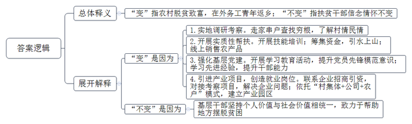

# 2020年0822公务员多省联考《申论》题（黑龙江省级卷）

<!-- gwy:overview:start -->
> **黑龙江 · 2020 · 申论 · 省级卷** ｜ 4 题 · 图片 4 处 · 答案随题折叠

导航：[题目](#题目) · [材料 1](#材料-1)
<!-- gwy:overview:end -->

> 候选采集稿。参考答案及解析来自粉笔页面，不代表官方答案或真实高分答卷；来源使用许可与原卷对应关系仍需人工核实。

## 给定材料

### 材料 1

“我们都在努力奔跑，我们都是追梦人。”是的，我们都是追梦人。追梦，我们收获满满；追梦，我们希望满满。

正如习近平总书记所说，中国人民具有伟大梦想精神。改革开放40多年的征程，就是一个追梦之旅。改革开放之初，我们党以非凡的胆略、坚定的自信设计了用70多年、分三步走，基本实现社会主义现代化的宏伟蓝图。改革开放40多年的追梦路上，我们咬定青山不放松，风雨无阻朝着这个伟大目标前进。

从站起来、富起来到强起来，这是奋斗的力量，也是梦想的力量。

党的十九大对我国发展提出了更高的奋斗目标，形成了从全面建成小康社会到基本实现现代化、再到全面建成社会主义现代化强国的战略安排，发出了实现中华民族伟大复兴中国梦的最强音。

但是，船到中流浪更急，人到半山路更陡，并且“愈进愈难、愈进愈险而又不进则退、非进不可”。在这样的关键时刻，我们要心怀梦想、奋勇拼搏，一步一个脚印，一棒接着一棒，在新时代创造中华民族新的更大奇迹！

梦想是拼出来的，奇迹是干出来的。改革开放的辉煌成就背后，是40多年的不懈努力。未来中国梦的实现，同样需要汗水的浇灌。没有人能随随便便成功。改革开放40多年的历程告诉我们：伟大事业都始于梦想，基于创新，成于实干。梦想是激发活力的源泉，只要有梦想，就会有力量。只要有梦想，则时光不弃，未来可期。

### 材料 2

T市新城，环湖公园已全景亮相，湖畔绿道成为健身爱好者的乐园，文化艺术中心正紧锣密鼓建设之中，国际秀场首秀在即……人居环境不断改善，城市功能不断优化，用高品质筑就生态宜居之城，这个新城规划时的梦想正在变成现实。

“今年六月份到年底，国家级和国际级的大型秀场活动都排满了。”国际秀场招商负责人的言语中透着自信与骄傲。国际秀场位于T市新城的时尚小镇内，是时尚小镇中的地标建筑，建设目标是成为中国时尚文化新窗口。目前，国际秀场已竣工，即将迎来“首秀”。

与国际秀场毗邻的是T市新城的文化艺术中心。这个拥有几何立面和斜面屋顶的建筑矗立在湖畔，自成姿态。T市人从此又多了一个看话剧、歌剧的好去处。“家门口就可以看戏、看话剧，梦寐以求的事情实现了。”小吴家住新城，以前看戏，他都要去主城区。“听说文化艺术中心的硬件设施是世界顶级的，”他充满了期待，“希望引进的剧种能多样化、多层次，既有经典又有流行。”

近两年，T市新城加速打造品质之城。人文是这座新城的“心”，沉淀着这个城市的故事，孕育出这个城市的灵气。

城心湖占地面积大，风景优美，历代文人墨客在此题咏。T市新城围绕城心湖而建，这座湖是新城的“肺”。如今，一条环湖的绿道已经建成。环湖绿道是T市新城打造的自然景观之一，全线滨水，视野开阔。从早上六点半到晚上八点半，环湖绿道上随处可见晨练、夜跑的人。中午时分，周边写字楼里的白领们也常常在绿道边漫步休闲，“听着鸟鸣，闻着花香，很舒服。”

未来，这条绿道将向整个新城延伸，设计有骑行道和步行道，还有VR体验馆，满足人们多样的需求。绿道不仅连接新城所有的公园和景点，还将城市与乡村紧密相连，走在绿道中，仿佛走在画中。绿道就像是新城的“脉”，通过绿道串起来的是一个大写的“融”字。绿道建设负责人说，“我们希望这条路连起所有新城人的梦想和记忆。”

城市如人，也要健康、好看。有心灵的跃动，脉搏的畅通，还要有肌肤的美丽。公园就是新城的肌肤。

藕花再现，湖泊复兴。新城将在环湖公园实现全域亮灯，呈现全线夜景灯光秀，一个“越夜越美丽”的环湖公园就要来到市民的生活中。环湖公园之美，靠的是技术和规划。环湖公园水生态养护的负责人说：“我们已经在湖中建成了一套成熟的水下生态系统。”水生态技术让这里的夏天再现“藕花满汀洲”的盛景。陆地上也有一套完整、科学的植被规划，以自然景观为基调形态，突出四季变化。春季赏花，夏季绿荫，秋季观叶，冬季葱郁，营造出充满活力的自然生态树林景观。

相较于环湖公园的自然与人文，体育公园的针对性更强。全民体育，乐跑体育，以运动促健康，是这里的主题。动与静、开放与私密、艺术与自然相结合的运动环境，满足了各年龄段人群健康、休闲、品质的运动需求。距离体育公园不远的花海公园则以“新城潮生活”为主题，怒放的花海让这里变得浪漫温馨。

公园让城市变得美丽光鲜，它为我们建造了一个“桃花源”，安放新城人生态宜居的梦想。

### 材料 3

只因看了一眼岩山，从此她就与岩山结缘。她就是D市岩山驻村帮扶工作组组长、驻村第一书记小孙。几年前，小孙从一所名牌大学硕士研究生毕业，来到A省商务厅工作。有一次，省委、省政府组织“机关干部下基层”社会实践活动，她随着实践小组来到了岩山。“太美了！”小孙被岩山美丽的风景深深震撼，花红柳绿，山清水秀，真是如诗如画。当地淳朴的民风，热情好客的村民令她印象深刻。不过，令她同样印象深刻的还有岩山的贫困。岩山共有1345户、4130口人，其中贫困户占60%，人均耕地不足0.8亩，村民收入主要依靠传统农业和外出务工，是典型的国家级贫困村。脱贫是这里的村民一代又一代的梦想。如果能帮助岩山村这样长期贫困的地方摆脱贫困，人生该是多么有价值啊！小孙的心里涌起一个强烈的念头。

此时，D市正深入开展脱贫攻坚行动，巧合的是，岩山村正是商务局的对口扶贫村。小孙主动请缨，担任岩山驻村帮扶工作组组长。“作为名校研究生，有更好的机会，为什么选择到偏远乡村？”面对不解的目光，小孙没有回答，只是报以微笑。

从驻村工作开始的第一天起，帮助岩山这个贫困村脱贫致富的沉甸甸的责任，便落在了小孙的肩上。刚入村时，小孙准备先找村民了解情况，但却听到了这样的风凉话：“咋还派个女干部？一个城里女人能干啥？”

为了开好头，获取村民的信任，她和工作组同事，田间地头了解情况，走家串户查找穷根。入村不到两个月，就完成了全村所有贫困户的走访，做到村里的“大事小情、家长里短”都了然于心。

随后，小孙与工作组同事组织村民参加手工纺织、月嫂服务等培训班。与此同时，他们筹集资金，在全村开工建设引水上山工程，彻底改变了村里几十年来缺水的落后状况。刚去的那一年，小孙注意到各家都用自家喂养的土猪腌制成腊肉，味道非常鲜美。除自己食用外，每年各家都会有可观的剩余。小孙与工作组同事在那年春节前，瞅准节日期间市场供货量增加的机会，积极利用微信朋友圈、联系微商等方式，全程参与推销，不仅给村民换来了“过年钱”，还使岩山的腊肉小有“名”气。一连串雪中送炭的实质性帮扶拉近了村民和工作组的距离，村民们被小孙这位“女干部”的真情付出深深打动。

“农村富不富，关键在支部。如何发挥基层党组织的战斗堡垒作用是驻村帮扶的首要工作。”小孙深有感触地说。为此，她和工作组同事带着村民党员积极开展学习教育活动，提升党员的先锋模范意识。为了提高村干部、村民代表引领产业发展、带领群众致富的能力，小孙多次组织大家到周边先进地区学习考察，“明显感觉到岩山的民心齐了，村干部的干劲足了、水平高了。”小孙帮助村民脱贫致富的信心更强了。

如何用工业化理念改变村民传统的生产生活方式，尽快引进增收产业项目为村民创造具有长期稳定收益的就业岗位，实现更多人的致富奔小康，是驻村帮扶工作组和村两委班子都要琢磨的“大事情”。在得知外省一家大型现代纺织企业老总是A省人，有回乡投资的想法后，小孙和工作组便第一时间与他取得联系，进行对接和项目考察。在充分了解到该纺织项目是非常适合岩山村的好项目后，小孙便积极与企业负责人沟通招商想法。针对企业提出的十几条落实投资的实际问题，小孙带领工作组到市、县、乡各项目主管单位咨询政策、寻求支持。仅仅5个多月的时间，小孙和工作组就协助企业完成了项目选址、各项手续办理、厂房建设、员工培训等一系列重要工作。村干部介绍说，目前，一个依托“村集体+公司+农户”模式形成的纺织产业园区已建立起来。村民不仅可以在家门口就业，而且可以实现既拿薪金又领股金还得租金的长效增收，岩山村的脱贫梦正在逐步实现。

“咱们岩山再也不是那个靠天吃饭的穷地方了，现在不少在外打工的年轻人都回来了。”村民喜滋滋地指着驻村工作组的办公室说，“变化就是从孙书记和她的组员到咱村来的那一天开始的。”

“我们的目标是成为北方最大的坯布集散地。”一个更大的梦想在小孙心中一点点描绘。环境越来越好，梦想越来越大，“但是，作为一个共产党员，我的信念和情怀不会变。”

### 材料 4

因为早就敏锐地发现了农村创业的机遇，2010年小张在大学一毕业就果断选择了返乡创业，投身农村电商业务。如今小张已成为村里的“创业榜样”，家里的奖状堆满了一箱。

小张的父亲做了30多年的乡村医生，希望他能接班，所以把他送进了一所医学院。但对自己的未来，小张有不一样的梦想，他觉得自己不适合做医生，应该做点和父亲不一样的事情，才能更好地实现自己的价值。其实在高考填志愿时，他就想学电子商务专业，但被父亲阻止了。毕业后，没人能再反对他干自己想干的事儿，他决定开网店。

当时电子商务还没有那么火。小张的家乡是N县的楼家村，这是个传统意义上的农业村。当时整个村子接入宽带的都没有几户人家，也没有工业基础。90年代后期，村子里有人开始做起影楼服饰的生意，以家庭作坊居多，并未规模化。销售方式也都是在村里做好后，送到城里去卖，这种上门推销的手工作坊模式发展非常缓慢。

小张最初想把这种影楼服饰搬到网上去卖。于是，他购买了几台缝纫机和一台电脑，租赁了门面进行服装加工，并在电商平台上注册了网店。刚开始，由于缺乏经验，生意并没有做起来。“我原来是学医的，专业离这个比较远。而且在学校也没学过如何创业，我对此非常陌生，完全是凭着一股热情闯进来的。”小张说，自己一开始并没有对影楼服饰的市场进行过调查，后来才发现影楼服饰市场很小，3个月下来，小张并没有赚到钱，还一度到了交不起房租的窘境。

不过，这个年轻人不服输，他决定去南方看看，了解不同地区的服装制造市场。经过考察，他发现相比于原先狭窄的影楼服饰市场，演出服装要好做得多，类型比较多样，市场能拓展开。就这样，小张调整思路，铆着一股劲，开始转做演出服装的生意。4年过去了，小张成立了自己的公司，建起了2000余平方米的车间，光各类服装设备就有106台。

小张带起的星星之火逐渐发展成了燎原之势。眼看着小张生意越做越好，同村的很多年轻人也陆续仿照着开起了网店。目前，全村300户家庭全都开有网店，年销售收入100万元的服饰加工户30多家，青年回乡创业，除了带来新想法，还有年轻人的生机和活力，留守儿童，空巢老人的问题不复存在。与电子商务相关的周边产业，配套设施也被带动起来，最大的改变是快递物流的出现。一家大型物流公司在村里设点，每天定时收发快件。这也给村里人生活带来了极大的便利。回首过去，小张觉得当初返乡创业是一个非常恰当的选择，顺应了农村产业结构调整和电子商务蓬勃发展的时代潮流。他认为农村为大学生提供了追逐梦想的广阔天地，大学生返乡创业不仅经济收入可观，还能和家人团聚，同时也为农村带来了活力和人才。

不过，返乡创业的大学生们享受着家乡电子商务“野蛮发展”带来的红利时，也有了新的烦恼。小张明显感觉生意没以前好做了。“前两年一件演出服装能赚20至30块钱，现在10块钱吧。”与其他村依山靠山卖土特产不同，楼家村的演出服装似乎没有那么接地气，而开服装网店成本低，一台电脑，再找到一家可靠的代加工厂商就可以“创业”了，很容易造成同质化竞争。小张认为目前保持竞争力的唯一方法就是不停地开发新品，让别人赶不上。“演出服装想创新难，你得自己设计、打板，抄袭成本却很低。”凑巧的是，小张的妻子是服装学院毕业的，妻子便成为家里创新的主力，但小张说：“这显然是不够的，我现在迫切需要专业的设计师过来帮助做创新。”

N县也在类似楼家村这样的村子带动下，发展出了很多“网店村”。这种飞快的发展速度也引起了县委县政府的关注，县委县政府明确提出把引导“网店村”健康发展作为政府服务增效的重要工作内容。“我们正在联系一家大型电商平台，争取双方在跨境电子商务、人才培训、云计算和大数据应用等方面早日开展深入合作。”县委负责人说。

### 材料 5

BD药业是一家在全球肿瘤药物领域拥有多项核心自主知识产权的高科技公司。说起BD药业的故事和梦想，公司董事长兼首席执行官丁先生有很多的感慨。

2002年，借着国家政策鼓励留学生回国创新创业的东风，留洋十年的丁先生怀着“做创新药”的梦想，背起行囊，与几位合伙人一道回国创业。就在第二年，BD药业成立。有人说，丁先生的这个抉择很有勇气。回国之前丁先生已是国外著名大学的医学博士和执业医师，回国创业就意味着放弃了优渥的生活条件、高额的薪水，还要白手起家。然而在丁先生看来，这个选择顺理成章。“像我们这些知识分子，大多数还是有故土情结的，梦想着做出一份自己的事业，也希望用自己的知识为国家医药事业发展出份力。”除了游子的思乡情结，还有一点对丁先生来说非常重要——“国家鼓励海归创新创业，在国内可以做到在国外做不到的事”。他说，在国外，科学家只能做药物研发的其中某一段的研发，很少有几个科学家合作完成一个新药所有的研究，并将其产业化，只有在中国有这种机会。

与很多企业选择做仿制药不同，BD药业一开始就立志做新药，要在全球药业竞争中拥有完全知识产权。尽管BD药业现在已成为一家在全球肿瘤药物领域拥有多项核心自主知识产权的高科技公司，但回想企业初创时，丁先生有很多感慨，当时面临各种技术难题、无休止试药及资金链断裂等“生死劫”，但有志者事竟成，BD药业克服了重重困难，最终成功了。他们研制的抗癌药获得国家颁发的新药证书，成为我国首个具有完全自主知识产权的同类抗癌新药。该药还被列入国际权威机构发布的新药研发年度报告，成为第一个获得国际机构认可的中国创制新药。

2016年1月8日对于丁先生来说很特别，也很难忘。这一天他作为BD药业相关项目的第一完成人，在2015年度国家科学技术奖励大会上捧起了光荣的奖杯。“这是奋斗者的奖杯，这个奖杯上不仅有我的名字，还有我们团队的名字，其实还应该有国家的名字。”当时，在深冬北京的暖阳中，丁先生郑重地一手拿着大红证书，一手举起奖杯，站在北京人民大会堂前拍了一张照片。这是国家对BD药业创新能力的巨大肯定。

“拥有自主创新，才能拥有话语权”，丁先生常说，“要真正把中国的医药产业发展起来，得把中国用药的话语权掌握在自己手里。”

近年来，BD药业跑得飞快，源源不绝的动力就来自“创新”二字。自主研发是BD药业的看家本领。丁先生表示，今年，截至目前创新研发投入已经超过10亿元。“我们正不断加强自主研发这一块，有自主研发做保证，我们就有底气开拓市场和开展合作。”BD药业把眼光投向全球，通过与国际知名医药企业合作，及时掌握国际市场信息，在全球的抗肿瘤药物市场中奋勇开拓。

如今，BD药业又种下了一颗新的梦想种子——以自家企业为基础，打造一座“医药梦工场”，搭建更大的创新平台，为全国医药产业的快速发展打造新引擎。丁先生说，这是一个为科学家、创业者造梦圆梦的项目，目标是打造一个具有国际先进水准的生物医药专业众创空间。未来，这里也将集聚一批医药领域的创业者。

研制新药去拯救病患，搭建创新平台去服务全行业。丁先生说这些都是出自一个企业家的担当。作为过来人，丁先生还想告诉创业者的是，企业家要有企业家的担当，企业家既要有仰望星空的格局与胸襟，也要有坐住板凳的定力和意志。“就拿我们医药行业来说，与一般的制造业不同的是，医药行业一方面与老百姓的身体健康密切相关，另一方面新产品的研发时间长、投入大、失败的风险高，要成功很难。”经历了风风雨雨，丁先生一直坚持“做老百姓吃得起的好药”，还对符合相关条件的患者进行免费赠药，赠药数量甚至超过了销售数量，这就是一位企业家的社会责任心。胸怀远方，迎接岁月的磨砺，才有了如今的BD药业。

## 题目

### 第 1 题

**根据“给定资料2”，总结（概括）T市新城生态宜居建设的主要理念和做法。（15分）**

关联材料：材料 2

作答要求：

要求：准确、全面、有条理，不超过200字。

第 1 题 · 答案与解析

**参考答案（粉笔题库参考内容）**

理念：改善人居环境，优化城市功能，提高新城品质。

做法：1.打造文化设施，优化文化服务。打造时尚小镇，建设国际秀场、文化艺术中心；举办大型活动，开展话剧、歌剧演出。2.打造环湖绿道，连接新城脉络。向新城延伸，设计骑行、步行道等，满足多样化需求；连接城内公园景点，串联城乡。3.建设城市公园，美化新城环境。环湖公园依靠技术、规划打造灯光秀及生态景观；主题公园营造运动环境，营造温馨浪漫生活氛围。

**解析**

**参考答案说明：**答案先指出了T市新城生态宜居建设的主要理念，又从“打造文化设施，优化文化服务”“打造环湖绿道，连接新城脉络”“建设城市公园，美化新城环境”三个方面对具体做法进行了分条撰写。各条要点之间在内容上是并列关系，无交叉。

**考点**：多要素组合类

**来源**：2020年0822公务员多省联考《申论》题（黑龙江省级卷）

### 第 2 题

**给定资料3中提到村民眼中的变和小孙心中的不变，请谈谈“变与不变”的理解。（20分）**

关联材料：材料 3

作答要求：

要求：分析透彻，表达准确，简明扼要；不超过250字。

第 2 题 · 答案与解析

**参考答案（粉笔题库参考内容）**

“变”指农村脱贫致富，在外务工青年返乡；“不变”指扶贫干部信念情怀不变。

一、“变”是因为：1.实地调研考察。走家串户查找穷根，了解村情民情。2.开展实质性帮扶。开展技能培训；筹集资金，引水上山；线上销售农产品。3.强化基层党建。开展学习教育活动，提升党员先锋模范意识；学习先进经验，提升干部能力。4.引进产业项目，创造就业岗位。联系企业招商引资，对接考察项目，解决企业问题；依托“村集体+公司+农户”模式，建立产业园区。

二、“不变”是因为：基层干部坚持个人价值与社会价值相统一，致力于帮助地方摆脱贫困。

**解析**

**参考答案说明：**思路方面，本参考答案按照词句解释题“总体释义+展开解释+总结”的一般答题思路展开。内容方面，本参考答案先结合资料对题干中的“变与不变”进行了总体释义；“展开解释”部分先解释了“变”产生的原因，接着解释了“不变”的原因。词句表达方面，本参考答案加上了“是因为……”等连接语来承接上下文，使得答案各部分在逻辑上联系更紧密。

**考点**：词句解释类

**来源**：2020年0822公务员多省联考《申论》题（黑龙江省级卷）

### 第 3 题

**根据“给定资料4”，假如小张的母校拟举办一场大学生返乡创业座谈会，邀请小张出席，请你为小张写一篇发言提纲。（25分）**

关联材料：材料 4

作答要求：

要求：

（1）紧扣资料，内容具体；

（2）语言准确，有逻辑性；

（3）不超过300字。

第 3 题 · 答案与解析

**参考答案（粉笔题库参考内容）**

返乡创业 实现价值

一、情况简介：张XX，楼家村人，创办了演出服装公司。

二、创业优势及前景：1.农村处于产业结构调整、电子商务蓬勃发展时期。2.县里将引导农村电商健康发展作为工作重点。3.能增加收入、与家人团聚；为家乡发展带来新想法、活力和人才，解决留守儿童、空巢老人问题，带动快递物流业发展。

三、经验分享：1.坚持梦想。做自己想做的事，不被周围人左右，本科学医，后投身农村电商。2.找准方向。对比不同地区市场，调整思路，选择类型多、前景广的创业项目。3.注重创新。持续开发新产品，避免同质化竞争，吸引创新型专业人才，保持竞争力。

四、呼吁号召：希望大家能去农村的广阔天地里追逐梦想。

**解析**

**参考答案说明：**（1）本题虽然是“提纲”，不必考虑格式，但是为了保险起见，建议加上标题。（2）正文部分，一方面从内容来看，围绕着“大学生返乡创业”这一主题，本参考答案从“情况简介”“创业优势及前景”“经验分享”“呼吁号召”四个方面展开。其中“经验分享”从“坚持梦想”“找准方向”“注重创新”三个层次进行说明。另一方面，形式上，本参考答案做到了分条撰写、标清了序号，整体上条理较为清晰。

**考点**：宣传类

**来源**：2020年0822公务员多省联考《申论》题（黑龙江省级卷）

### 第 4 题

**“给定资料5”中提到，“这是奋斗者的奖杯，这个奖杯上不仅有我的名字，还有我们团队的名字，其实还应该有国家的名字。”根据你的理解，参考给定资料，以“人生的奖杯”为主题，联系实际，自拟题目，写一篇文章。（40分）**

关联材料：材料 1、材料 2、材料 3、材料 4、材料 5

作答要求：

要求：

（1）自选角度，立意明确；

（2）思路清晰，语言流畅；

（3）参考给定资料，但不拘泥于“给定资料”；

（4）总字数1000—1200字。

第 4 题 · 答案与解析

**参考答案（粉笔题库参考内容）**

**勇敢追逐梦想，托起人生奖杯**

**这是一个追梦的时代，我们都是追梦人**。梦想，是我们人生起航的方向，是追梦路上星星点点的希望，亦是华夏儿女不懈奋斗的最终目标。正如习总书记所说，中国人民具有伟大梦想精神。只要有梦想，就会有改革的活力；只要有梦想，就会有发展的动力；只要有梦想，则时光不弃，未来可期。**在追梦的路上，个人、企业、国家都需要积极作为，勇敢前行，共同托起人生的奖杯。**

**为梦想不懈奋斗者，向来都不乏从头开始的勇气，他们充满家国情怀，敢于担当，无私又无畏，用厚重的社会责任心托起沉甸甸的人生奖杯。**王安石为梦想变法革新，不畏权贵；玄奘为梦想万里跋涉，西天取经；王淦昌为梦想隐姓埋名，以身许国；丁先生为梦想放弃高薪，毅然回国……凡此种种，都在告诉我们，追梦途中要有奉献一切的担当与勇气。放眼当下，正因为胸怀天下，心系百姓，才会有“甘于寂寞勇创新”的科研工作者，才会有“黄沙百战穿金甲”的最美逆行者，才会有“不胜疫情终不还”的医务工作者。

**为梦想奋斗不止于个人的无私无畏，企业也要奋勇开拓，埋头实干，以创新为抓手，坚持自主研发，百折不挠，加强合作，凝聚力量，不断提升市场竞争力。**奋勇开拓不是单打独斗的蛮干，也不是追随大流的盲从，而是要跟随时代前行的脚步，学会合作，善于创新。面对美国的多次打压，华为之所以能够顶住压力，绝地求生，正是在于其团结一心，持续创新。然而，当下很多企业只愿做跟随者，而不愿做开拓者，长此以往必将无法适应竞争激烈的外部环境，更不利于创新氛围的形成。面向未来，企业应该凝聚力量，加强自主研发，积极寻求合作，实干苦干，以超凡的格局迎接风险和挑战。

“人民有梦想，国家有力量。”中华民族生生不息，恰在于人们追梦的脚步从未停滞。在追梦的路上，政府更要积极作为，为个人和企业的发展护航。

**除了提供政策扶持外，政府还要营造良好环境，激励大众创新创业，为奋斗者保驾护航**。当前社会环境复杂，如果干事创业只凭一腔热血，缺少规划和引导，很可能会滑入失败的深渊。为此，国家要加大扶持力度，出台减税降费、证照合一等政策，营造公平的竞争环境，打造良好的科研环境，以创业园区、创业孵化器等为创业者提供发展空间，以创业培训、创业贷款等缓解他们资金上的燃眉之急。良好的政策环境不仅可以提升效率，促进创新成果的转化，还可以使创业创新者保持定力，增强信心，让创新源泉充分涌流，不断为国家高质量发展提供动力。

作为新时代的追梦人，我们要不忘初心和使命，勇敢前行，奋勇开拓，携手唱响“我辈岂是蓬蒿人”的时代颂歌。

**文章分析**

**勇敢追逐梦想，托起人生奖杯**

【**标题的优点：**标题中含有“梦想”“人生奖杯”等主题词，使文章主题更突出、清晰。】

**这是一个追梦的时代，我们都是追梦人**。（1）<u>梦想</u>，<u>是我们人生起航的方向</u>，<u>是追梦路上星星点点的希望</u>，<u>亦是华夏儿女不懈奋斗的最终目标</u>。正如习总书记所说，<u>中国人民具有伟大梦想精神</u>。<u>只要有梦想</u>，<u>就会有改革的活力</u>；<u>只要有梦想</u>，<u>就会有发展的动力</u>；<u>只要有梦想</u>，<u>则时光不弃</u>，<u>未来可期</u>。（2）<u>在追梦的路上</u>，<u>个人</u>、<u>企业</u>、<u>国家都需要积极作为</u>，<u>勇敢前行</u>，<u>共同托起人生的奖杯</u>。

【**开头的优点：**★内容方面：范文的开头是紧扣“人生的奖杯（梦想）”这一主题展开的。首先，开篇点出主题，做到了主题明确。其次，对“人生的奖杯（梦想）”这一主题进行了分析阐述：（1）指出梦想的重要性和意义；（2）指出追梦路上需要个人、企业和政府的积极作为。★文字表达方面：使用了“……是……亦是……”“只要……就会……”等句式，使语言表达有逻辑性。】

**为梦想不懈奋斗者，向来都不乏从头开始的勇气，他们充满家国情怀，敢于担当，无私又无畏，用厚重的社会责任心托起沉甸甸的人生奖杯。**王安石为梦想变法革新，不畏权贵；玄奘为梦想万里跋涉，西天取经；王淦昌为梦想隐姓埋名，以身许国；丁先生为梦想放弃高薪，毅然回国……凡此种种，都在告诉我们，（1）<u>追梦途中要有奉献一切的担当与勇气</u>。（2）<u>放眼当下</u>，<u>正因为胸怀天下</u>，<u>心系百姓</u>，<u>才会有</u>“<u>甘于寂寞勇创新</u>”<u>的科研工作者</u>，<u>才会有</u>“<u>黄沙百战穿金甲</u>”<u>的最美逆行者</u>，<u>才会有</u>“<u>不胜疫情终不还</u>”<u>的医务工作者</u>。

【**论述段1的优点**：★观点句：范文的观点句是紧扣“人生的奖杯（梦想）”这一文章主题提出的。形式上，它在段首处直接写出，位置突出，容易发现；内容上，关键词突出，内容要点明确，可以明显看出它是从“勇气”“家国情怀”“担当”“无私无畏”“社会责任心”等角度入手，指出追梦路上个人应如何作为。★论述内容：（1）追梦要有奉献一切的担当与勇气；（2）当下涌现出大量为梦想奋斗的先进典型。注意：以上两个方面的内容都是紧扣观点句“为梦想不懈奋斗者，向来都不乏从头开始的勇气，他们充满家国情怀，敢于担当，无私又无畏，用厚重的社会责任心托起沉甸甸的人生奖杯”进行分析论述的，针对性强、内容层次丰富。】

**为梦想奋斗不止于个人的无私无畏，企业也要奋勇开拓，埋头实干，以创新为抓手，坚持自主研发，百折不挠，加强合作，凝聚力量，不断提升市场竞争力。**（1）<u>奋勇开拓不是单打独斗的蛮干</u>，<u>也不是追随大流的盲从</u>，<u>而是要跟随时代前行的脚步</u>，<u>学会合作</u>，<u>善于创新</u>。面对美国的多次打压，华为之所以能够顶住压力，绝地求生，正是在于其团结一心，持续创新。然而，（2）<u>当下很多企业只愿做跟随者</u>，<u>而不愿做开拓者</u>，<u>长此以往必将无法适应竞争激烈的外部环境</u>，<u>更不利于创新氛围的形成</u>。面向未来，（3）<u>企业应该凝**聚**力量</u>，<u>加强自主研发</u>，<u>积极寻求合作</u>，<u>实干苦干</u>，<u>以超凡的格局迎接风险和挑战</u>。

【**论述段2的优点**：★观点句：范文的观点句是紧扣“人生的奖杯（梦想）”这一文章主题提出的。形式上，它在段首处直接写出，位置突出，容易发现；内容上，关键词突出，内容要点明确，可以明显看出它是从“奋勇开拓”“实干”“创新”“百折不挠”“合作”等角度入手，指出追梦路上企业应如何作为。★论述内容：（1）奋勇开拓的含义；（2）当下企业存在的问题及其危害；（3）企业应采取的措施。注意：以上三个方面的内容都是紧扣观点句“为梦想奋斗不止于个人的无私无畏，企业也要奋勇开拓，埋头实干，以创新为抓手，坚持自主研发，百折不挠，加强合作，凝聚力量，不断提升市场竞争力”进行分析论述的，针对性强、内容层次丰富。】

“人民有梦想，国家有力量。”中华民族生生不息，恰在于人们追梦的脚步从未停滞。在追梦的路上，政府更要积极作为，为个人和企业的发展护航。

【**过渡段的优点**：过渡段承上启下，先指出了人们追梦的脚步从未停止，然后用“在追梦的路上，政府更要积极作为，为个人和企业的发展护航”引出下文政府方面的对策。】

**除了提供政策扶持外，政府还要营造良好环境，激励大众创新创业，为奋斗者保驾护航。**（1）<u>当前社会环境复杂</u>，<u>如果干事创业只凭一腔热血</u>，<u>缺少规划和引导</u>，<u>很可能会滑入失败的深渊</u>。为此，（2）<u>国家要加大扶持力度</u>，<u>出台减税降费</u>、<u>证照合一等政策</u>，<u>营造公平的竞争环境</u>，<u>打造良好的科研环境</u>，<u>以创业园区</u>、<u>创业孵化器等为创业者提供发展空间</u>，<u>以创业培训</u>、<u>创业贷款等缓解他们资金上的燃眉之急</u>。（3）<u>良好的政策环境不仅可以提升效率</u>，<u>促进创新成果的转化</u>，<u>还可以使创业创新者保持定力</u>，<u>增强信心</u>，<u>让创新源泉充分涌流</u>，<u>不断为国家高质量发展提供动力</u>。

【**论述段3的优点**：★观点句：范文的观点句是紧扣“人生的奖杯（梦想）”这一文章主题提出的。形式上，它在段首处直接写出，位置突出，容易发现；内容上，关键词突出，内容要点明确，可以明显看出它是从“政策扶持”“营造良好环境”“激励大众创新创业”等角度入手，指出追梦路上政府要为奋斗者保驾护航。★论述内容：（1）政府为奋斗者保驾护航的必要性；（2）政府应如何积极作为；（3）政府积极作为的意义。注意：以上三个方面的内容都是紧扣观点句“除了提供政策扶持外，政府还要营造良好环境，激励大众创新创业，为奋斗者保驾护航”进行分析论述的，针对性强、内容层次丰富。】

【**论述段之间的关系**：★内在逻辑上：范文的论述段之间呈现递进关系，按照“先说个人，再说企业，最后说国家”的逻辑展开的。★外在衔接上：论述段2开头处的“为梦想奋斗不止于个人的无私无畏，企业也要……”，起到了承接论述段1，引出论述段2的作用；论述段2之后的过渡段“‘人民有梦想，国家有力量。’中华民族生生不息，恰在于人们追梦的脚步从未停滞。在追梦的路上，政府更要积极作为，为个人和企业的发展护航”，起到了承接论述段1、2，引出论述段3的作用。】

作为新时代的追梦人，我们要不忘初心和使命，勇敢前行，奋勇开拓，携手唱响“我辈岂是蓬蒿人”的时代颂歌。

【**结尾的优点**：范文的结尾回扣了“人生的奖杯（追梦）”这一主题词，语言精悍，不拖沓。】

**解析状态：unknown（来源未提供）**

**考点**：文章写作题

**来源**：2020年0822公务员多省联考《申论》题（黑龙江省级卷）

