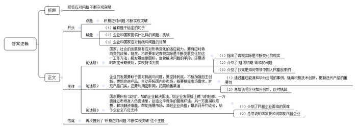

# 2021年黑龙江省公考 《申论》试题（省级卷）

<!-- gwy:overview:start -->
> **黑龙江 · 2021 · 申论 · 省级** ｜ 4 题 · 图片 1 处 · 答案随题折叠

导航：[题目](#题目) · [材料 1](#材料-1)
<!-- gwy:overview:end -->

<!-- R7 reading guide -->

## 参考作答与范文导读

> 小题看要点与文种，大作文看立意、结构和论证。机构、教师、考生的同题作答可作为不同版本对照；未经核实的实考得分不作高分承诺。

文内识别 4 道作答题；其中 0 题已有可读取的参考版本。该统计是收录与篇幅检查，不代表分数鉴定或原卷完整认证。

| 题号 | 阅读类型 | 当前收录情况 | 入口 |
|---|---|---|---|
| 1 | 小题参考作答 | 待补同题全文 | 暂未收录 |
| 2 | 小题参考作答 | 待补同题全文 | 暂未收录 |
| 3 | 小题参考作答 | 待补同题全文 | 暂未收录 |
| 4 | 小题参考作答 | 待补同题全文 | 暂未收录 |

**范文使用方式：** 先自行作答，再对照材料覆盖、论证展开与表达。来源中的参考例文不是唯一写法；原文附带的解析和其他版本一并保留。

<!-- /R7 reading guide -->

> 申论 · 4 题 · 黑龙江 2021

## 给定材料

### 材料 1

      习近平总书记指出，“以数千年大历史观之，变革和开放总体上是中国的历史常态。”这让我们的制度具有应对形势变化的适应能力，能够根据时与势的不同而灵活调整政策，做到因势而谋，因势而动，顺势而为。

      “变化者，乃天地之自然。”是《抱朴子·内篇·黄白》中充满哲学思想的古语，说明客观实际不是一成不变，而是不断发展变化的，准确把握我国不同发展阶段的新变化新特点，使主观世界更符合客观实际，按照实际决定工作方针，是我们必须牢记的工作方法。

      中国能够快速发展，同时保持社会大局稳定，一个重要的原因就在于不仅把发展当作目标，更要把发展当作解决问题的手段，正是在持续发展中，中国展现出强大的发展能力，彰显了社会主义制度的优越性。

      2020年10月，党的19届五中全会审议通过了《中共中央关于制定国民经济和社会发展第十四个五年规划和二〇三五年远景目标的建议》。五年规划属于宏观性、全局性、综合性、引领性的中长期规划，既是年度规划和专项规划的依据，又是实现长远目标和长期规划的基础和阶梯，地位和重要性不言而喻。

      一个又一个五年，见证了中国现代化的风雨历程，持续带给中国和世界惊喜与希望，诠释着中国制度和中国之治独特而巨大的魅力，体现了中国共产党“一茬接着一茬干，一棒接着一棒跑，一张蓝图干到底”的执政理念，引导全国人民心往一处想，劲往一处使。

### 材料 2

      这天，老王正巧经过F省老年医院，心想最近血压波动比较大，不如到医院问问医生需不需要调整用药。进入医院，他询问导诊员：“我今天没带医保卡，能不能用医保电子凭证二维码（以下简称医保码）看病？”“当然可以！”在导诊员的指引下，老王通过手机关注医院微信公众号，对着机器扫医保码，完成了挂号、诊间结算、取药取报告、预约复诊等就医环节，全程不到半小时。他高兴地说：“太方便了，不用再到窗口排队缴费，省时省事多了。”

      随着医保码落地，F省从“卡时代”跨入“码时代”，“码”不仅运用于院内的就医流程，还可用于院外买药。据省医疗保障局统计，医生花费数秒扫码的时间，就可为患者平均节省在医院就医等待的时间约43分钟。截至去年底，全省已有630万余名参保人员开通了医保码，推广使用量在全国位居前列，有236家医院、近7500家药店实现了医保码结算。

      蔡先生首次体验到了“云医疗”的便捷。这天，他通过省级机关医院客户端微信小程序，向省级机关医院心内科张主任发起了复诊高血压病的申请。通过视频问诊，张主任在线为蔡先生开出了一张电子处方，经过药师在线审方，就完成医保在线结算了。接下来，蔡先生在家就能收到由医院寄来的药品。“根据患者之前的检查结果和线下就诊记录，我可以延续之前的处方，直接在线为他开电子处方，指导他用药剂量和服用周期。这样他就不用为了开个药，特意跑趟医院了。”张主任说。这家医院是全国首家使用医保码实现医保在线结算的互联网医院。截至去年底，F省已有多家医院开通线上医保结算权限。市民开通了医保码，只要近3个月在互联网医院所属的实体医院有就诊记录，就可以在互联网医院进行在线复诊、慢病续方、医保自动结算等。实行医保码扫码结算，不仅优化了结算流程，解决了人们线上看病买药不能报销的痛点，还有效降低了线下就诊感染风险，改善了老百姓的就医体验。

      “我丈夫帮我绑定了他的医保卡，说是能用他卡里的钱，怎么用呢？”64岁的黄阿姨正在某连锁药店询问店员。黄阿姨是城乡居民医保参保人。在店员的指点下，她凭借微信上的医保码，用丈夫医保个人账户里的钱买了药。省医保中心信息科项科长介绍，2020年7月以来，F省在全国率先实现医保个人账户家庭共济，家庭成员在省内不同地方的，也支持加入共济账户。加入家庭共济账户后，参保人员还可以和家人一起分享共济账户里的个人账户资金。

      60岁的林阿姨到广州帮儿子照顾孩子已有10年，这些年因大小疾病在广州的医院做过多次手术。她说，住院治疗所产生的医疗费用垫付压力大，而且可选择的省外定点医疗机构也不多，每年她都要奔波一千多公里往返广州与F省，还要准备各种证明材料，才能报销医保，十分麻烦。随着医保码落地，流动人口或随迁人员再也不用垫付医疗费，也不用大老远奔波报销医保了。一方面，参保人可以通过医保码在全国办理有关医保业务；另一方面，通过电子政务平台政务通App，F省居民可在线办理跨省异地就医备案、参保关系转移、参保缴费证明打印等多项医保经办业务，同时可以自助查询个人账户、个人待遇、消费明细、报销结果等个人数据。

### 材料 3

      进工厂曾是一代人的梦想。时移世易，今年33岁的小孙2018年7月到省城当外卖员，他曾是家乡县城一家汽车工厂的喷漆工人，小孙不是科班出身，最早由师傅带入行，工作四年，月工资从3500元涨到了5000元左右。到省城当外卖员，每月到手收入一度维持在8000元到10000元之间，他很满意，“这相当于我们当地一家4S店高级汽修技师的收入了。”当高级汽修技师曾是小孙的梦想，但由于理论知识、技能证书等门槛，初中文化的小孙并未选择这条路。数据显示，2018年，外卖骑手平均月薪为7750元左右，制造业员工平均月薪在6000元左右。几乎无门槛的外卖行业成为吸纳就业的重要蓄水池。不过，今年以来，小孙送外卖的收入再没有回到从前的高峰期。谈及未来，小孙说：“先干着，攒点钱，以后看看能不能返乡开个汽车美容店。”

      在23岁的小王看来，工厂工人和外卖员的工作体验是完全不一样的，他曾在一个工厂做过装卸工，“每天都待在厂子里，搬东西很累，还被呼来喝去。”小王坦言，“我们这个年纪的，谁会喜欢这样的工作呢？”转行两个月，作为外卖新手的小王并没有实现传说中“月入过万”，小王很无奈，“5月份订单量刚涨起来，又新来了很多兼职外卖员。”数据显示，56%的外卖骑手有第二职业。“我们没有基本的社会保障，只能多赚点算点，为以后早做打算。”在他看来，返乡是最后一条路，但也是最现实的一条路。“像我这样只有高中文化的人，在互联网时代很难在大城市找到满意的工作了。”言语间，小王的无奈与心酸尽显。

      时至今日，机器虽然已经替代了工厂流水线上的基础岗位，但并未能完全替代快递外卖配送线上的基础岗位。在配送线上的“最后一公里”，在面对面的服务环节，依然需要依赖人工。S大学林教授认为，未来中国服务业的增加值比重和就业份额将继续稳步提升。但一个残酷的现实是，“服务业中的高端知识型岗位和低端劳动密集型岗位之间的收入差距将会进一步扩大。”

      相比小王和小孙，小李是一所知名大学财经专业的毕业生。2015年，他从深圳一家生产自动取款机的公司离职，返回家乡创业，现在发展得很好。“行业已经要变天了，我必须早做打算。公司当时营业收入、利润增长还不错，但我心里没底，移动支付发展太快了！”小李如此解释自己当时的担忧。

      现金时代，一台台自动取款机就是其生产厂商的“印钞机”。上世纪90年代，存取款都只能在固定的储蓄所；2005年前后，自动取款机开始遍布街头巷尾；2015年，中国成为全球最大的自动取款机销售市场。当年年末，全球自动取款机行业协会会长充满激情地预言，盛宴即将开始。但事后回看，这已是盛宴的尾声。

      就在2015年，银行纷纷推出互联网金融战略，并开始减少自助银行、自动取款机，用户使用自动取款机的频次也大幅下滑。与此同时，各个银行的网络金融业务占比大幅提升。根据上市公司的财报，2018年多家自动取款机厂商从净利润下滑开始转向大幅度亏损，2019年亏损进一步加剧，小李感叹：“时代在抛弃你时，连一声招呼都不会打。”他也为自己此前的决定感到庆幸。

### 材料 4

      “每天不是在开会，就是在开会的路上。”频繁又非必要的会议，让C市柳云村党支部书记老文很是头疼。老文工作的村子地处沿海，夏秋之际，台风频繁。“大家白天入户排查情况、宣传防台政策，还得抽时间应付各种会议。”老文告诉记者，“有的会议只是花几分钟传达一下文件精神，其实用电话或者材料就能通知到位。”

      “刚刚签订战略合作协议，实质项目还没落地，就要准备一堆汇报材料。”C市大华街道干部小李对报送“材料”的苦恼，也引起了扶贫干部小吴的共鸣。小吴2018年起驻村负责57户建档立卡贫困户的工作。回想近两年的工作，小吴说，驻村扶贫工作不易，但最让人头疼的，却是应付各项检查以及反复整理、填写、修改各种资料和表格。“最多的时候，我手里同时有20多个表格要填。有一个表，因为不同要求反复修改，弄了大半年。”如果遇到过于重视迎检资料的领导，可能出现以资料多寡、“痕迹”是否明显来定绩效的情况，基层干部就不得不加班加点找资料，熬更守夜补台账。

      2020年，C市纪检监察机关紧扣“四风”问题，设立了转变作风“曝光台”。采取有奖举报、外聘专家、记者采访等形式，对工作不实、作风漂浮的给予定期曝光。被曝光的单位或个人，市纪委监委将回访跟踪、督促整改。市新区小学师生则是这一举措的直接受益者。该小学位于上塘路交叉口，2018年新建了一座高架桥，由于未设置隔音屏，800多名师生不得不在滚滚车流带来的噪音中上课。工程完成伊始，学校和学生家长就多次反映问题，希望加装隔音屏。该街道住建科负责人表示，隔音屏属于高架桥附属工程，高架桥是谁建的，隔音屏就该谁来建。而建设主体市建委则表示，该段高架已移交市城管委养护，应由该委负责加装隔音屏。市城管委称，隔音屏在工程建设过程中，是由原建设单位负责实施的，需要增补应由属地政府负责落实。这一次上“曝光台”，市建委马上邀请市信访、城管、环保等部门和街道进行协调。一个多月后，长达近两年的问题得以解决。

      市纪委张副书记说，在作风建设方面，今年C市一举推出了多项措施，重点整饬形式主义顽疾。“我对这样的做法表示肯定。”C市党校刘教授说。不少面向群众的基层政府人员，依然存在不作为、慢作为等现象，而这绝不是小事，甚至会在一定程度上影响政府威信，甚至丧失民心，动摇执政基础。

### 材料 5

      “刚和老婆谈恋爱时，我打趣说自己家是做罐头的，快结婚的时候才告诉她家里做的‘罐头’，其实是煤气罐。”小李介绍道。他口中羞于说出口的煤气罐，也有过辉煌的过往。随着天然气管道开始进入千家万户，如今哪个小区还用煤气罐做饭，这个小区就显得不够上档次。

      李家30多年前就和煤气罐结缘。上世纪90年代，小李的爷爷看准时机收购了一家集体企业，成立了鑫旺能源公司，开始生产煤气罐。当时的市场行情看好，需求旺盛，小李的爷爷和父亲也能吃苦，上管生产狠抓质量，下找销路稳定客源，逐渐打开市场并一步步把公司做成了市里的知名企业。“2010年，煤气罐热销，爸爸眼红钱太好赚，赶紧扩大产能，但两年后产能扩大了，煤气罐需求和价格却是直线往下掉。”小李说。    2010年的超级换瓶潮，成了这个行业最后的疯狂，也让公司“套在了高位”。小李回忆，他2015年大学毕业时，“煤气罐单个成本100多元，卖80元才能出手，做的越多，亏的越多。”

      鑫旺能源发展受阻后，市里相关部门积极帮助寻求解决办法，按照有关政策，尽最大可能减税降费，联系银行和其他企业解决融资问题，帮助联系市场拓展销路。但大环境难以改变，投入的资金见不到回报，那几年的经营可以说是惨淡。看到花费大量心血的企业陷入停滞状态，祖辈父辈一筹莫展。大学一毕业，小李不得不回家接手家族产业。“现在你很难找到国内煤气罐市场资料，因为已经没什么价值了。”小李说，跑遍了国内市场，他发现有同行通过网络往国外卖煤气罐。是啊，世界很大，中国市场萎缩，不代表国外没人用。思考一番，他认定外贸是趋势：海外市场是多层次的，一些欠发达地区，一定需要煤气罐。

      2015年10月，小李开通了第一个网上店铺，但忙活了5个月，期待中的滚滚订单并没有实现。国外市场靠谱吗？小李的父亲对此表示怀疑。小李逐渐发现了门道：国内煤气罐只有4种型号，但全球有200多个型号，很多细节与使用习惯和国内不一样。必须根据国外市场的标准，做生产端的改造。再次摸索后，小李在2016年年底做成了第一笔外贸订单。他清楚地记得：“下单的人打电话问我是不是一个真实的工厂。我打开直播在厂里转了一圈，当国外客户看到我们完整的生产线和各种型号的煤气罐成品后，对方立马签了一集装箱货。”

      鑫旺能源地处内陆，且长期专注本土加工制造，不像深圳等地的工厂国际视野较好，从建厂开始就做外贸订单。互联网的普及降低了外贸门槛，让鑫旺能源可以依靠优秀的产品，跨越式地拉平了与传统外贸工厂的距离，实现了从濒临倒闭到销售额节节攀升的巨大转变。

      近年来，国家对扶持民营企业发展“大招”不断。从建立市场准入负面清单，不断优化营商环境，给民营企业营造更加公平的发展空间；到实施大规模减税降费，为民营企业切实减轻负担；再到召开民营企业约谈会，给予民营企业全方位的支持，这些惠企政策陆续推出，给民营企业发展插上了腾飞的翅膀。

      小李为自己能赶上民营企业大发展的黄金时代感到庆幸，也为自己家族面对困境时敢于坚持到底感到自豪。如今，他又融资扩充产品门类，准备复制煤气罐销售的成功经验，通过线上销售平台向海外售卖燃气灶等厨房用品。小李说，他很喜欢一句诗：“风后面是风，天空上面是天空，道路的前面还是道路。”是的，路在远方，路在脚下，在这个崭新的时代，让我们迈开大步向前走！

## 题目

> 以下参考答案与解析补自粉笔题库同卷（源试卷ID 126981）：4 道题的题干已逐题比对一致。材料以本文件全文为准，答案里若引用到粉笔缓存特有的表述，可能与本地材料措辞不同。

作答要求

### 第 1 题

      第&#12032;题：根据“给定材料2”，概括F省医保从“卡时代”跨&#12042;“码时代”发&#12131;的变化。（15分）

      要求：全&#12207;、准确、有条理，字数200字以内。

第 1 题 · 答案与解析

**参考答案（粉笔题库参考内容）**

1.就医购药方式变化。从窗口排队到关注公众号，扫码完成院内就医和院外买药，实现医保码结算，省时省事。

2.就诊方式变化。从实体医院就诊到依托互联网，实现在线复诊、慢病续方、医保自动结算，安全便捷。

3.资金使用范围变化。从本人使用到医保账户家庭共济，省内参保人员可与家人分享个人账户资金。

4.报销流程变化。从在医保所在地报销，到可在全国办理医保业务，或通过政务通APP，在线办理多项医保经办业务，自助查询个人数据。

**考点**：变化类

**来源**：2021年公务员多省联考《申论》题（黑龙江省级卷）

粉笔申论页面对本题只提供「解析视频」入口，该入口是会员推广位，页面无视频地址与文字解析。

### 第 2 题

      第&#12038;题：根据“给定材料3”，&#12073;王、&#12073;孙、&#12073;李三&#12040;打算“返乡”的想法有何不同，并分析原因。（20分）

      要求：全&#12207;、准确，深&#12042;，有条理，字数300字以内。

第 2 题 · 答案与解析

**参考答案（粉笔题库参考内容）**

返乡打算不同：小王将返乡视为最后出路，对返乡后的工作没有想法；小孙初步打算先积攒资金，再返乡选择熟悉的行业创业；小李职业规划明确，主动返乡换行创业。

原因：1.行业前景层面。小王与小孙从事低端劳动密集型岗位，就业门槛低，竞争压力大，没有社保，收入不理想，不被重视，使小王与小孙无奈选择返乡；小李危机意识强，在公司经营良好情况下，预见行业衰败，决定返乡。2.文化水平层面。小王与小孙低学历，视野窄，可选的职业有限；小李学历高，见识广，适应能力强，可选的职业较多。3.工作经验层面。小王较年轻，社会经验不足，对返乡后的发展不明确；小孙有一定职业技能，选择熟悉领域创业；小李认清原有行业兴衰，及时跳出原行业。

**考点**：多要素组合类

**来源**：2021年公务员多省联考《申论》题（黑龙江省级卷）

粉笔申论页面对本题只提供「解析视频」入口，该入口是会员推广位，页面无视频地址与文字解析。

### 第 3 题

      第三题：阅读“给定材料4”，反映了C市个别部&#11988;、单位在&#12079;作作&#11995;建设&#12101;&#12207;存在的问题，梳理问题，并提出对策。（25分）

      要求：紧扣资料，准确全&#12207;；分析透彻，条理清晰；字数400字以内。

第 3 题 · 答案与解析

**参考答案（粉笔题库参考内容）**

问题：1.非必要会议频繁，损耗基层干部时间和精力。2.报送材料繁杂，要求多变，反复修改、整理，过度“留痕管理”。3.工作不实、作风漂浮，推诿责任。4.部分人员不作为、慢作为，存在官僚主义。

建议：1.精简会议安排。建立会议统筹和审批机制，推行“无会日”制度，严控会议总量与频率；对用电话或材料能够通知到位的事项，采用非会议形式通知，取消非必要会议。2.优化材料报送。项目管理事前报批事后汇报，中间环节不频繁索要材料；梳理整合各类表格，统一格式要求，形成在线文档，实现数据共享；制定科学评定机制，不以资料多寡、痕迹定绩效，注重实效。3.强化监督整改。持续发挥“曝光台”作用，通过有奖举报等多种形式，加强对作风问题的监督；对被曝光的单位或个人，纪委部门进行回访跟踪、督促整改。4.加强人员管理。建立考核评价体系，科学设定绩效评估指标，倒逼工作人员树立正确政绩观；定期开展作风建设学习，提升责任意识与服务意识。

**考点**：提出对策类

**来源**：2021年公务员多省联考《申论》题（黑龙江省级卷）

粉笔申论页面对本题只提供「解析视频」入口，该入口是会员推广位，页面无视频地址与文字解析。

### 第 4 题

      第四题：“给定材料5”中提到“&#11995;后&#12207;是&#11995;，天空上&#12207;是天空，道路的前&#12207;还是道路”，深&#12042;思考这句话，联系实际，&#12163;拟题&#12140;，写&#12032;篇&#12098;章。（40分）

      要求：（1）观点明确，&#11973;解深刻；（2）思路清晰，语&#12180;流畅；

               （3）参考“给定资料”，但不拘泥于“给定资料”；（4）1000-1200字。

第 4 题 · 答案与解析

**参考答案（粉笔题库参考内容）**

**积极应对问题 不断实现突破**

“风后面是风，天空上面是天空，道路的前面还是道路”指的是要用发展眼光看问题，不断解决新问题，不断寻求新突破。的确，时代在发展，社会在前行，问题和挑战也在不断涌现，每个阶段都有每个阶段的新问题、新挑战。国家发展是如此，企业发展亦是如此。资源短缺、市场饱和……这些难题都或多或少制约企业发展；世界变局、世纪疫情……这些“风雨”历程，也会影响着国家的发展。但我们要坚信，克服危即是机，国家的适时而变的执行理念、制度规划，企业发展向前的眼光，都为解决问题、抓住良机、应对突变危机打下基础。

**国家、社会的发展要有应对形势变化的适应能力，要有应时势而变的政策、制度。不仅要牢记客观实际是不断发展变化的这一工作方法，把发展当做目标，当做解决问题的手段；还要适时制定长期规划，实现持续发展。**客观实际是不断发展变化的，国家社会的发展在不同的发展阶段也会有不同的特点。建国初期，政治上，国民党残余势力妄图卷土重来，颠覆新生政权；经济上，生产萎缩，交通梗阻，失业众多；国际上，妄图称霸全球的美国，妄图孤立、封锁、包围中国。面对这种错综复杂的国内外形势和繁重艰巨的任务，我党勇于担当，因势而谋，应势而动，顺势而为，一直秉承“发展是解决一切问题的基础和关键”，适时制定计划、策略，带领中国人民从站起来到富起来再到强起来。

**企业的发展要敢于面对挑战与问题，要坚持到底，不断加强自主创新，更新改进产品，主动开拓国内外市场。既要根据市场需求，扩充产品门类，还要利用互联网，拓展销售渠道。**鑫旺能源公司在面对国内煤气罐市场萧条时，开拓思维，利用直播网店，拓宽销售渠道，及时抓住海外市场；在面对国内外煤气罐型号不同、使用习惯不同时，积极根据国际市场标准，改造生产端，适应国外新市场。再观华为公司的发展，坚持技术投入，自主研发系统，不仅打破西方国家的技术封锁，还让产品不断更新迭代，实现持续发展。可见，企业要应对挑战与问题，需不懈努力，主动拥抱机遇与挑战，最终实现每一次“蝶变”。

**国家要积极“出招”，帮助企业解决困境，给企业发展插上腾飞的翅膀。一方面建立市场准入负面清单，创造公平竞争的营商环境；另一方面减税降费，解决融资难题，帮助拓展市场，减轻企业负担；最后召开约谈会，给予企业全方位支持。**民营企业在发展中困难重重，比如社会化服务体系的不健全，财政、金融等部门的支持力度小，管理咨询、技术开发、市场营销等方面都需要一步步摸索，加上企业间的协作关系未完全建立，大中小企业不能和谐共享配套生产、设备等等。这就需要国家牵针引线，拉好风筝线，在良好的“放飞”环境下，给与适宜“飞翔”的政策。

面对新问题、新挑战，唯有用发展的眼光发现问题、解决问题，才能做到“任凭风浪起，稳坐钓鱼船”，才能在构建新发展格局中承担起重大使命，才能实现经济的高质量发展，夯实大国强国的根基！

**解析**

**文章分析**

**积极应对问题** **不断实现突破**

【**标题的优点：**首先，范文的标题“积极应对问题 不断实现突破”突出了“积极应对挑战与问题，不断实现突破”这一主题。其次，形式上，文字简洁明快。】

（1）“风后面是风，天空上面是天空，道路的前面还是道路”指的是要<u>用发展眼光看问题</u>，<u>不断解决新问题</u>，<u>不断寻求新突破</u>。（2）的确，时代在发展，社会在前行，<u>问题和挑战也在不断涌现</u>，每个阶段都有每个阶段的<u>新问题</u>、<u>新挑战</u>。国家发展是如此，企业发展亦是如此。资源短缺、市场饱和……<u>这些难题都或多或少制约企业发展</u>；世界变局、世纪疫情……这些“风雨”历程，<u>也会影响着国家的发展</u>。（3）**但我们要坚信，**<u><b>克服危即是机</b></u>**，国家的**<u><b>适时而变的执行理念</b></u>**、**<u><b>制度规划</b></u>**，企业**<u><b>发展向前的眼光</b></u>**，都为解决问题、抓住良机、应对突变危机打下基础**。

【**开头的优点：**★内容方面：范文的开头是紧扣“积极应对挑战与问题，不断实现突破”这一主题展开的。首先，开头第一句话点出主题，做到了主题明确。其次，对“积极应对挑战与问题，不断实现突破”这一主题进行了分析阐述，指出了（1）题干给定的句子的含义。（2）企业和国家发展各自会面临什么样的问题、挑战。（3）企业和国家应对挑战与问题的对策。★文字表达方面：使用了“的确”“但”等连接词，使语言表达有逻辑性，使文字表达更加形象、有力。】

**国家、社会的发展要有应对形势变化的适应能力，要有应时势而变的政策、制度。不仅要牢记客观实际是不断发展变化的这一工作方法，把发展当做目标，当做解决问题的手段；还要适时制定长期规划，实现持续发展。**（1）客观实际是<u>不断发展变化的</u>，国家社会的发展在不同的发展阶段也会有不同的特点。（2）建国初期，政治上，<u>国民党残余势力妄图卷土重来</u>，<u>颠覆新生政权</u>；经济上，<u>生产萎缩</u>，<u>交通梗阻</u>，<u>失业众多</u>；国际上，<u>妄图称霸全球的美国</u>，<u>妄图孤立</u>、<u>封锁</u>、<u>包围中国</u>。（3）面对这种错综复杂的国内外形势和繁重艰巨的任务，<u>我党勇于担当</u>，<u>因势而谋</u>，<u>应势而动</u>，<u>顺势而为</u>，一直秉承“<u>发展是解决一切问题的基础和关键</u>”，<u>适时制定计划、策略</u>，带领中国人民从站起来到富起来再到强起来。

【**论述段****1****的优点：**★观点句：范文的观点句是紧扣“积极应对挑战与问题，不断实现突破”这一文章主题提出的。形式上，它在段首处直接写出，位置突出，容易被发现；内容上，关键词突出，内容要点明确，可以明显看出它是从“国家社会的发展”这一角度出发，指出了国家、社会如何应对问题与挑战。★论述内容：（1）指出了客观实际是不断变化的现实。（2）介绍了“建国初期”该时间段面临的问题。（3）介绍了我党是如何从错综复杂的国内外形势和繁重艰巨的任务中带领中国人民富起来的。注意：以上三个方面的内容都是紧扣观点句“要有应对形势变化的适应能力，要有应时势而变的政策、制度。不仅要牢记客观实际是不断发展变化的这一工作方法，把发展当做目标，当做解决问题的手段；还要适时制定长期规划，实现持续发展”进行分析论述的，针对性强、内容层次丰富。最后，在论述方法上采取了摆事实、讲道理的方式进行展开，做到了论述有力。】

**企业的发展要敢于面对挑战与问题，要坚持到底，不断加强自主创新，更新改进产品，主动开拓国内外市场。既要根据市场需求，扩充产品门类，还要利用互联网，拓展销售渠道。**（1）<u>鑫旺能源</u>公司在面对国内煤气罐市场萧条时，<u>开拓思维</u>，利用直播网店，拓宽销售渠道，<u>及时抓住海外市场</u>；在面对国内外煤气罐型号不同、使用习惯不同时，<u>积极根据国际市场标准</u>，<u>改造生产端</u>，适应国外新市场。再观华为公司的发展，<u>坚持技术投入</u>，<u>自主研发系统</u>，不仅<u>打破</u>西方国家的<u>技术封锁</u>，还让产品不断<u>更新迭代</u>，<u>实现持续发展</u>。（2）可见，企业要应对挑战与问题，<u>需不懈努力</u>，<u>主动拥抱机遇与挑战</u>，最终实现每一次“蝶变”。

【**论述段****2****的优点：**★观点句：范文的观点句是紧扣“积极应对挑战与问题，不断实现突破”这一文章主题提出的。形式上，它在段首处直接写出，位置突出，容易被发现；内容上，关键词突出，内容要点明确，可以明显看出它是从“企业的发展”这一角度出发，指出了企业如何应对问题与挑战。★论述内容：（1）通过鑫旺能源和华为公司的事例，强调积极技术创新，更新迭代产品的重要性。（2）总结说明企业如何创新，应对挑战。注意：以上两个方面的内容都是紧扣观点句“要坚持到底，不断加强自主创新，更新改进产品，主动开拓国内外市场。既要根据市场需求，扩充产品门类，还要利用互联网，拓展销售渠道”进行分析论述的，针对性强、内容层次丰富。最后，在论述方法上采取了摆事实、讲道理的方式进行展开，做到了论述有力。】

**国家要积极****“出招”，帮助企业解决困境，给企业发展插上腾飞的翅膀。一方面建立市场准入负面清单，创造公平竞争的营商环境；另一方面减税降费，解决融资难题，帮助拓展市场，减轻企业负担；最后召开约谈会，给予企业全方位支持。**（1）民营企业在发展中<u>困难重重</u>，比如<u>社会化服务体系的不健全</u>，财政、金融等部门的支持力度小，管理咨询、技术开发、市场营销等<u>方面都需要一步步摸索</u>，<u>加上企业间的协作关系未完全建立</u>，大中小企业不能和谐共享配套生产、设备等等。（2）<u>这就需要国家牵针引线</u>，<u>拉好风筝线</u>，在良好的“放飞”环境下，给与适宜“飞翔”的政策。

【**论述段****3****的优点：**★观点句：范文的观点句是紧扣“积极应对挑战与问题，不断实现突破”这一文章主题提出的。形式上，它在段首处直接写出，位置突出，容易被发现；内容上，关键词突出，内容要点明确，可以明显看出它是从“国家要积极‘出招’，帮助企业解决困境”这一角度出发。★论述内容：（1）介绍了民营企业面临的困难。（2）总结说明国家要如何帮助民营企业。注意：以上两个方面的内容都是紧扣观点句“国家要积极‘出招’，帮助企业解决困境，给企业发展插上腾飞的翅膀。一方面建立市场准入负面清单，创造公平竞争的营商环境；另一方面减税降费，解决融资难题，帮助拓展市场，减轻企业负担；最后召开约谈会，给予企业全方位支持”进行分析论述的，针对性强、内容层次丰富。最后，在论述方法上采取了摆事实、讲道理的方式进行展开，做到了论述有力。】

【**论述段之间的关系：**★内容的内在逻辑：范文的论述段之间是依照并列逻辑展开的。论述段1先写了“国家、社会的发展要有应对形势变化的适应能力，要有应时势而变的政策、制度”，论述段2又写了“要坚持到底，不断加强自主创新，更新改进产品”，论述段3又写了“国家要积极‘出招’，帮助企业解决困境，给企业发展插上腾飞的翅膀”。★段与段的外在衔接：论述段1、2、3都在开头直接点题，用“适应能力”“创新产品”“解决困境”这样的表述，直接点明具体做法，使文章整体上看起来逻辑清晰。】

<u>面对新问题</u>、<u>新挑战</u>，唯有<u>用发展的眼光发现问题</u>、<u>解决问题</u>，才能做到“任凭风浪起，稳坐钓鱼船”，才能在构建新发展格局中承担起重大使命，才能实现经济的高质量发展，夯实大国强国的根基！

【**结尾的优点：**范文的结尾回扣了“积极应对挑战与问题，不断实现突破”这一主题。】

**考点**：文章写作题

**来源**：2021年公务员多省联考《申论》题（黑龙江省级卷）

粉笔申论页面对本题只提供「解析视频」入口，该入口是会员推广位，页面无视频地址与文字解析。

