# 2021年黑龙江公检法司系统及边境县（市、区）急需紧缺专业岗公务员考试《行测》题

<!-- gwy:overview:start -->
> **黑龙江 · 2021 · 行测 · 公检法** ｜ 120 题 · 图片 138 处 · 答案随题折叠

| 题型模块 | 题量 | 题号 |
| --- | ---: | ---: |
| 常识判断 | 20 | 1–20 |
| 言语理解与表达 | 40 | 21–60 |
| 数量关系 | 10 | 61–70 |
| 判断推理 | 35 | 71–105 |
| 资料分析 | 15 | 106–120 |
| **合计** | **120** | |

导航：[题型与作答说明](#题型与作答说明) · [题目](#题目) · [材料 1](#材料-1)
<!-- gwy:overview:end -->

> 候选采集稿。参考答案及解析来自粉笔页面，不代表官方答案或真实高分答卷；来源使用许可与原卷对应关系仍需人工核实。

## 题型与作答说明

常识判断

（20题）

第一部分 常识判断。 根据题目要求，在四个选项中选出一个最恰当的答案。

言语理解与表达

（40题）

第二部分 言语理解与表达。 本部分包括表达与理解两方面的内容。请根据题目要求，在四个选项中选出一个最恰当的答案。

数量关系

（10题）

第三部分 数量关系。 在这部分试题中，每道题呈现一段表述数字关系的文字，要求你迅速、准确地计算出答案。

判断推理

（35题）

第四部分 判断推理。 本部分包括图形推理、定义判断、类比推理与逻辑判断四种类型的试题，在四个选项中选出一个最恰当的答案。

资料分析

（15题）

第五部分 资料分析。 所给出的图、表、文字或综合性资料均有若干个问题要你回答。你应根据资料提供的信息进行分析、比较、计算和判断处理。

## 题目

### 第 1 题

习近平总书记在中国-东盟建立对话关系30周年纪念峰会上发表了题为《命运与共 共建家园》的重要讲话。下列选项中，与该讲话内容不一致的是：

A. 合作共赢，走和平发展道路

B. 守望相助，践行亲诚惠容理念

C. 相互尊重，坚守国际关系基本准则

D. 包容互鉴，共建友好的区域主义

第 1 题 · 答案与解析

**参考答案（粉笔题库参考内容）**

D

**解析**

本题考查政治常识。

A项正确，习近平在《命运与共 共建家园》的讲话中指出：“二是合作共赢，走和平发展道路。中国和东盟国家有相似历史遭遇，实现国家安定和人民幸福是我们的共同目标。我们坚定维护地区和平稳定，始终聚焦发展主题，率先建立自由贸易区，高质量共建‘一带一路’，共同推动签署《区域全面经济伙伴关系协定》，促进了地区融合发展和人民福祉。”

B项正确，习近平在《命运与共 共建家园》的讲话中指出：“三是守望相助，践行亲诚惠容理念。中国和东盟比邻而居，互帮互助是我们的共同传统。中国和文莱谚语都讲‘有福同享，有难同当’。我们像亲戚一样常来常往，重情义，讲信义，遇到喜事共庆贺，遇到难事互帮衬。通过携手应对亚洲金融危机、国际金融危机、新冠肺炎疫情等挑战，强化了命运共同体意识。”

C项正确，习近平在《命运与共 共建家园》的讲话中指出：“一是相互尊重，坚守国际关系基本准则。东方文化讲究‘己所不欲，勿施于人’，平等相待、和合与共是我们的共同诉求。我们率先倡导和平共处五项原则和‘万隆精神’，中国在东盟对话伙伴中最先加入《东南亚友好合作条约》。我们照顾彼此重大关切，尊重各自发展路径，以真诚沟通增进理解和信任，以求同存异妥处分歧和问题，共同维护和弘扬亚洲价值观。”

D项错误，习近平在《命运与共 共建家园》的讲话中指出：“四是包容互鉴，共建开放的区域主义。中国和东盟民族文化宗教多姿多彩，多元包容是我们的共同基因。我们从东亚文明中汲取智慧，以开放理念引领地区经济一体化，以平等协商推进东盟主导的地区合作，以包容心态构建开放而非排他的朋友圈，落实了共商共建共享原则。”

本题为选非题，故正确答案为D。

**考点**：重要会议讲话、其他建设

**来源**：2021年黑龙江公检法司系统及边境县（市、区）急需紧缺专业岗公务员考试《行测》题第1题

### 第 2 题

党的十九届六中全会审议通过了《中共中央关于党的百年奋斗重大成就和历史经验的决议》（以下简称《决议》），下列选项中，关于《决议》的说法正确的是：

A. 《决议》以“十二个坚持”总结党百年奋斗的历史经验

B. 《决议》是党的历史上的第二个历史决议

C. 《决议》提出习近平新时代中国特色社会主义思想实现了马克思主义中国化新的飞跃

D. 《决议》用“八个明确”对习近平新时代中国特色社会主义思想的核心内容作了进一步概括

第 2 题 · 答案与解析

**参考答案（粉笔题库参考内容）**

C

**解析**

本题考查政治常识。

A项错误，《决议》在“四、开创中国特色社会主义新时代”部分提出了“十个坚持”，即坚持党的领导，坚持人民至上，坚持理论创新，坚持独立自主，坚持中国道路，坚持胸怀天下，坚持开拓创新，坚持敢于斗争，坚持统一战线，坚持自我革命。

B项错误，在党的历史上共通过了三个决议，分别是1945年党的六届七中全会通过的《关于若干历史问题的决议》、1981年党的十一届六中全会通过的《关于建国以来党的若干历史问题的决议》和2021年党的十九届六中全会通过的《中共中央关于党的百年奋斗重大成就和历史经验的决议》。

C项正确，《决议》在“四、开创中国特色社会主义新时代”部分指出：“习近平新时代中国特色社会主义思想是当代中国马克思主义、二十一世纪马克思主义，是中华文化和中国精神的时代精华，实现了马克思主义中国化新的飞跃。”

D项错误，《决议》中用“十个明确”对习近平新时代中国特色社会主义思想的核心内容作了进一步概括，新增的两个明确分别为：“明确必须坚持和完善社会主义基本经济制度，使市场在资源配置中起决定性作用，更好发挥政府作用，把握新发展阶段，贯彻创新、协调、绿色、开放、共享的新发展理念，加快构建以国内大循环为主体、国内国际双循环相互促进的新发展格局，推动高质量发展，统筹发展和安全。”和“明确全面从严治党的战略方针，提出新时代党的建设总要求，全面推进党的政治建设、思想建设、组织建设、作风建设、纪律建设，把制度建设贯穿其中，深入推进反腐败斗争，落实管党治党政治责任，以伟大自我革命引领伟大社会革命。”

故正确答案为C。

**考点**：其他建设、重要文件

**来源**：2021年黑龙江公检法司系统及边境县（市、区）急需紧缺专业岗公务员考试《行测》题第2题

### 第 3 题

下列选项中，与习近平总书记在2021年9月中央人才工作会议上的讲话精神不相符的是：

A. 发挥用人主体在人才培养、引进、使用中的积极作用

B. 加快建立以创新价值、能力、贡献为导向的人才评价体系

C. 坚持党对人才工作的全面领导

D. 加快建设我国重要人才中心和创新高地，做好顶层设计和战略谋划

第 3 题 · 答案与解析

**参考答案（粉笔题库参考内容）**

D

**解析**

本题考查政治常识。

2021年9月，中央人才工作会议在北京召开，习近平总书记发表了题为《深入实施新时代人才强国战略 加快建设世界重要人才中心和创新高地》的讲话。

A项正确，习近平总书记在讲话的“三、深化人才发展体制机制改革”部分指出：“第一，向用人主体授权。人才怎样用好，用人单位最有发言权。当务之急是要根据需要和实际向用人主体充分授权，真授、授到位。行政部门应该下放的权力都要下放，用人单位可以自己决定的事情都应该由用人单位决定，发挥用人主体在人才培养、引进、使用中的积极作用。”

B项正确，习近平总书记在讲话的“三、深化人才发展体制机制改革”部分指出：“第三，完善人才评价体系。我国人才发展体制机制一个突出问题是人才评价体系不合理，‘四唯’现象仍然严重，人才‘帽子’满天飞，滋长急功近利、浮躁浮夸等不良风气。要加快建立以创新价值、能力、贡献为导向的人才评价体系，基础前沿研究突出原创导向，社会公益性研究突出需求导向，应用技术开发和成果转化评价突出市场导向，形成并实施有利于科技人才潜心研究和创新的评价体系。”

C项正确，习近平总书记在讲话的“一、全面贯彻新时代人才工作新理念新战略新举措”部分指出：“一是坚持党对人才工作的全面领导。这是做好人才工作的根本保证。千秋基业，人才为本。党管人才就是党要领导实施人才强国战略、推进高水平科技自立自强，加强对人才工作的政治引领，全方位支持人才、帮助人才，千方百计造就人才、成就人才，以识才的慧眼、爱才的诚意、用才的胆识、容才的雅量、聚才的良方，着力把党内和党外、国内和国外各方面优秀人才集聚到党和人民的伟大奋斗中来，努力建设一支规模宏大、结构合理、素质优良的人才队伍。”

D项错误，习近平总书记在讲话的“二、加快建设世界重要人才中心和创新高地”部分指出：“加快建设世界重要人才中心和创新高地，必须把握战略主动，做好顶层设计和战略谋划。我们的目标是：到2025年，全社会研发经费投入大幅增长，科技创新主力军队伍建设取得重要进展，顶尖科学家集聚水平明显提高，人才自主培养能力不断增强，在关键核心技术领域拥有一大批战略科技人才、一流科技领军人才和创新团队；到2030年，适应高质量发展的人才制度体系基本形成，创新人才自主培养能力显著提升，对世界优秀人才的吸引力明显增强，在主要科技领域有一批领跑者，在新兴前沿交叉领域有一批开拓者；到2035年，形成我国在诸多领域人才竞争比较优势，国家战略科技力量和高水平人才队伍位居世界前列。”

本题为选非题，故正确答案为D。

**考点**：重要会议讲话、社会建设

**来源**：2021年黑龙江公检法司系统及边境县（市、区）急需紧缺专业岗公务员考试《行测》题第3题

### 第 4 题

下列选项中，关于党的十九大以来，审议通过的文件，按时间先后排序正确的是：

①《中共中央关于坚持和完善中国特色社会主义制度、推进国家治理体系和治理能力现代化若干重大问题的决定》

②《中共中央政治局关于加强和维护党中央集中统一领导的若干规定》

③《中共中央关于深化党和国家机构改革的决定》

④《中共中央关于制定国民经济和社会发展第十四个五年规划和二〇三五年远景目标的建议》

A. ①②④③

B. ②③①④

C. ③①④②

D. ③②①④

第 4 题 · 答案与解析

**参考答案（粉笔题库参考内容）**

B

**解析**

本题考查政治常识。

①2019年10月31日，中国共产党第十九届中央委员会第四次全体会议通过了《中共中央关于坚持和完善中国特色社会主义制度、推进国家治理体系和治理能力现代化若干重大问题的决定》。

②2017年10月27日，十九届中共中央政治局会议审议通过了《中共中央政治局关于加强和维护党中央集中统一领导的若干规定》。

③2018年2月28日，中国共产党第十九届中央委员会第三次全体会议通过了《中共中央关于深化党和国家机构改革的决定》。

④2020年10月29日，中国共产党第十九届中央委员会第五次全体会议通过了《中共中央关于制定国民经济和社会发展第十四个五年规划和二〇三五年远景目标的建议》。

故正确顺序为②③①④。

故正确答案为B。

**考点**：其他建设、重要文件

**来源**：2021年黑龙江公检法司系统及边境县（市、区）急需紧缺专业岗公务员考试《行测》题第4题

### 第 5 题

在新时代强军战略的丰富实践中，习近平强军思想应运而生，下列选项中与习近平新时代军队建设的论述不相符的是：

A. 创新是引领军队建设发展的第一动力

B. 军队建设要把思想政治建设摆在首位

C. 建设具有铁一般信仰、铁一般信念、铁一般纪律、铁一般担当的过硬部队

D. 听党指挥、能打胜仗、作风优良、装备精良是新形势下的强军目标

第 5 题 · 答案与解析

**参考答案（粉笔题库参考内容）**

D

**解析**

本题考查政治常识。

A项正确，2017年10月18日，习近平总书记在中国共产党第十九次全国代表大会上的报告指出创新是引领发展的第一动力，是建设现代化经济体系的战略支撑。要瞄准世界科技前沿，强化基础研究，实现前瞻性基础研究、引领性原创成果重大突破。

B项正确，2012年11月16日，习近平总书记在中央军委扩大会议上的讲话指出要始终把思想政治建设摆在军队各项建设首位，加强理论武装，强化军魂教育，持续深入培育当代革命军人核心价值观，组织官兵认真学习党史军史，使坚持党对军队的绝对领导在官兵思想中深深扎根，确保全军在任何时候任何情况下都坚决听从党中央、中央军委指挥。

C项正确，2016年1月5日，习近平总书记到第13集团军视察时强调，努力培养有灵魂、有本事、有血性、有品德的新一代革命军人，锻造具有铁一般信仰、铁一般信念、铁一般纪律、铁一般担当的过硬部队。

D项错误，2013年3月11日，习近平总书记在出席十二届全国人大一次会议解放军代表团全体会议并发表了重要讲话，指出建设一支听党指挥、能打胜仗、作风优良的人民军队，是党在新形势下的强军目标。

本题为选非题，故正确答案为D。

**考点**：重要会议讲话、其他建设

**来源**：2021年黑龙江公检法司系统及边境县（市、区）急需紧缺专业岗公务员考试《行测》题第5题

### 第 6 题

一百年来，中国共产党弘扬伟大建党精神，在长期奋斗中构建起中国共产党人的精神谱系，锤炼出鲜明的政治品格，下列关于建党精神及其对应表述不恰当的是：

A. 抗美援朝精神——以“钢少气多”力克“钢多气少”

B. “两弹一星”精神——星空浩瀚无比，探索永无止境

C. 延安精神——培育了一代代中国共产党人

D. 红岩精神——不折不挠、宁死不屈

第 6 题 · 答案与解析

**参考答案（粉笔题库参考内容）**

B

**解析**

本题考查政治常识。

A项正确，抗美援朝精神是祖国和人民利益高于一切、为了祖国和民族的尊严而奋不顾身的爱国主义精神，英勇顽强、舍生忘死的革命英雄主义精神，不畏艰难困苦、始终保持高昂士气的革命乐观主义精神，为完成祖国和人民赋予的使命、慷慨奉献自己一切的革命忠诚精神，为了人类和平与正义事业而奋斗的国际主义精神。抗美援朝战争结束后，毛主席用诗意的语言总结胜利之道：敌人是钢多气少，我们是钢少气多。

B项错误，“两弹一星”精神的内涵是热爱祖国、无私奉献，自力更生、艰苦奋斗，大力协同、勇于登攀。2020年4月23日，习近平总书记给参与“东方红一号”任务的老科学家的回信中写道：新时代的航天工作者要以老一代航天人为榜样，大力弘扬“两弹一星”精神，敢于战胜一切艰难险阻，勇于攀登航天科技高峰，让中国人探索太空的脚步迈得更稳更远，早日实现建设航天强国的伟大梦想。2016年12月20日，习近平总书记在北京人民大会堂会见天宫二号和神舟十一号载人飞行任务航天员及参研参试人员代表时强调，星空浩瀚无比，探索永无止境，只有不断创新，中华民族才能更好走向未来。

C项正确，延安精神是坚定正确的政治方向、解放思想实事求是的思想路线、全心全意为人民服务的根本宗旨、自力更生艰苦奋斗的创业精神。2020年4月，习近平总书记在陕西考察时指出，延安精神培育了一代代中国共产党人，是我们党的宝贵精神财富。要坚持不懈用延安精神教育广大党员、干部，用以滋养初心、淬炼灵魂，从中汲取信仰的力量、查找党性的差距、校准前进的方向。

D项正确，红岩精神的内涵是崇高思想境界、坚定理想信念、巨大人格力量和浩然革命正气。2019年4月，习近平总书记在重庆考察时的讲话指出，解放战争时期，众多被关押在渣滓洞、白公馆的中国共产党人，经受住种种酷刑折磨，不折不挠、宁死不屈，为中国人民解放事业献出了宝贵生命，凝结成“红岩精神”。

本题为选非题，故正确答案为B。

**考点**：时事政治-其他、其他建设

**来源**：2021年黑龙江公检法司系统及边境县（市、区）急需紧缺专业岗公务员考试《行测》题第6题

### 第 7 题

下列选项中关于我国航天事业，说法错误的是：

A. 我国探月工程规划为“绕、落、回”三个阶段

B. “快舟”一号固体运载火箭是我国设计的首个“星箭一体化”小型固体运载火箭

C. 我国已全面掌握空间交会对接技术

D. 王亚平是我国第一位进入太空的女航天员

第 7 题 · 答案与解析

**参考答案（粉笔题库参考内容）**

D

**解析**

本题考查科技常识。

A项正确，中国探月工程规划为“绕、落、回”三期。探月工程一期的任务是实现环绕月球探测，嫦娥一号卫星于2007年10月24日发射；探月工程二期的任务是实现月面软着陆和自动巡视勘察；探月工程三期的任务是实现无人采样返回。2020年12月17日嫦娥五号返回器在内蒙古四子王旗预定区域成功着陆，标志着中国首次月球采样返回任务圆满完成。嫦娥五号任务的成功标志着我国探月工程“绕、落、回”三步走规划如期完成。

B项正确，“快舟”一号固体运载火箭是我国首个“星箭一体化”设计的小型固体运载火箭，具有快速集成、快速入轨等特点。主要应用于自然灾害突发和通信系统发生故障时，实现卫星的快速发射和空间部署，及时获取灾害情况信息，以最大限度地减少灾害损失并组织抗灾救灾。

C项正确，2012年6月24日，神舟九号航天员成功驾驶飞船与天宫一号目标飞行器对接，这标志着中国成为世界上第三个完整掌握空间交会对接技术的国家。

D项错误，刘洋是我国第一位进入太空的女航天员。2012年6月16日18时56分，执行我国首次载人交会对接任务的神舟九号载人飞船，在酒泉卫星发射中心发射升空后准确进入预定轨道，顺利将航天员景海鹏、刘旺和刘洋送上太空。2021年10月16日，搭载神舟十三号载人飞船的长征二号F遥十三运载火箭，在酒泉卫星发射中心点火升空，顺利将翟志刚、王亚平、叶光富3名航天员送入太空。王亚平是我国第一位进入天宫空间站的女航天员。

本题为选非题，故正确答案为D。

**考点**：科技理论与成就

**来源**：2021年黑龙江公检法司系统及边境县（市、区）急需紧缺专业岗公务员考试《行测》题第7题

### 第 8 题

十八大以来，加快完善社会主义市场经济体制，将“看不见的手”同“看得见的手”两者优势融合起来，党和政府分别在更好发挥政府作用方面发挥市场配置资源的决定性作用方面出台了一系列政策措施，下列选项中，属于在发挥市场配置资源的决定性方面的政策措施是：

A. 明确要素市场制度建设的方向及重要改革任务，出台关于要素市场化配置

B. 进一步聚焦市场主体关切，完善优化要素环境长效机制

C. 出行“放管服”的改革部署，强调要推动简政放权，放管结合，优化服务改革向纵深发展

D. 取消简化一大批不必要的证明和繁琐手续，减少企业群众奔波之苦

第 8 题 · 答案与解析

**参考答案（粉笔题库参考内容）**

A

**解析**

本题考查经济常识。

A项正确，《中共中央 国务院关于构建更加完善的要素市场化配置体制机制的意见》指出：“充分发挥市场配置资源的决定性作用，畅通要素流动渠道，保障不同市场主体平等获取生产要素，推动要素配置依据市场规则、市场价格、市场竞争实现效益最大化和效率最优化。”与题干表述一致。

B、C、D三项错误，均属于进一步优化营商环境、更好服务市场主体的措施，与发挥市场配置资源的决定性作用无关。

故正确答案为A。

**考点**：市场经济

**来源**：2021年黑龙江公检法司系统及边境县（市、区）急需紧缺专业岗公务员考试《行测》题第8题

### 第 9 题

从不完整的身份证号码310114\*\*\*\*\*\*\*8321\*（\*表示未知号码）中，可以确认该人的相关信息有：

①性别

②目前户籍所在地

③身份证有效期限

④身份证签发机关编号

A. ①

B. ①②

C. ②④

D. ③④

第 9 题 · 答案与解析

**参考答案（粉笔题库参考内容）**

A

**解析**

本题考查法律常识。

①正确，②③④错误。根据《中华人民共和国居民身份证法》第三条第二款规定：“公民身份号码是每个公民唯一的、终身不变的身份代码，由公安机关按照公民身份号码国家标准编制。”根据《中华人民共和国国家标准GB 11643-1999》“5.1号码的结构”部分规定：“公民身份号码是特征组合码，由十七位数字本体码和一位数字校验码组成。排列顺序从左至右依次为：六位数字地址码，八位数字出生日期码，三位数字顺序码和一位数字校验码。”“5.1.3顺序码”部分规定：“表示在同一地址码所标识的区域范围内，对同年、同月、同日出生的人编定的顺序号，顺序码的奇数分配给男性，偶数分配给女性。”题中，通过前六位数字“310114”可以确认该人出生时户籍所在地，但若户籍所在地变更，该数不变，则无法知晓目前的户籍所在地；因“321”是奇数，通过“8321”中“321”可以确认该人为男性。

故正确答案为A。

**考点**：其他法律法规

**来源**：2021年黑龙江公检法司系统及边境县（市、区）急需紧缺专业岗公务员考试《行测》题第9题

### 第 10 题

下列诗句中，描述秋天的是：

A. 更无柳絮因风起，惟有葵花向日倾

B. 中庭地白树栖鸦，冷露无声湿桂花

C. 小荷才露尖尖角，早有蜻蜓立上头

D. 梅子留酸软齿牙，芭蕉分绿与窗纱

第 10 题 · 答案与解析

**参考答案（粉笔题库参考内容）**

B

**解析**

本题考查人文常识。

A项错误，诗句出自北宋司马光的《客中初夏》，意为春去夏来，眼前已没有了那随风飞舞的柳絮，只有自始至终向着明媚阳光的葵花。描写的是初夏的景象。

B项正确，诗句出自唐代王建的《十五夜望月寄杜郎中》，意思是庭院地面雪白树上栖息着鹊鸦，秋露无声无息打湿了院中桂花。描写的是中秋夜。

C项错误，诗句出自宋代杨万里的《小池》，意思是小荷叶刚从水面露出尖尖的角，早就有一只小蜻蜓立在它的上头。描写了初夏池塘的美丽景色。

D项错误，诗句出自宋代杨万里的《闲居初夏午睡起·其一》，意思是吃过梅子后，余酸还残留在牙齿之间，芭蕉的绿色映照在纱窗上。描写了初夏时节的景象。

故正确答案为B。

**考点**：文学常识

**来源**：2021年黑龙江公检法司系统及边境县（市、区）急需紧缺专业岗公务员考试《行测》题第10题

### 第 11 题

北京高铁到广州，里程最短的是：

A. 北京—太原—西安—重庆—贵阳—广州

B. 北京—济南—河北—杭州—福州—广州

C. 北京—石家庄—郑州—武汉—长沙—广州

D. 北京—济南—南京—杭州—南昌—广州

第 11 题 · 答案与解析

**参考答案（粉笔题库参考内容）**

C

**解析**

本题考查科技常识。

我国的铁路线路图如下图所示，由图可知北京高铁到广州，北京—石家庄—郑州—武汉—长沙—广州里程最短（京广线）。

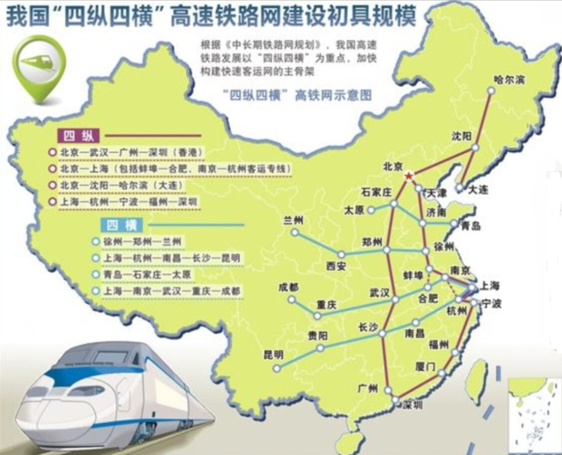

故正确答案为C。

**考点**：生活常识

**来源**：2021年黑龙江公检法司系统及边境县（市、区）急需紧缺专业岗公务员考试《行测》题第11题

### 第 12 题

下列选项中，关于短跑技术说法正确的是：

A. 现代短跑技术，以膝盖为轴进行转动

B. 古代奥林匹克采用蹲踞式起跑

C. 短跑中，人体以有氧代谢为主要供能方式

D. 苏炳添是奥运会百米决赛中国第一人

第 12 题 · 答案与解析

**参考答案（粉笔题库参考内容）**

D

**解析**

本题考查科技常识。

A项错误，现代短跑中，途中跑是短跑全程中，距离最长，速度最快的一段。其任务是继续发挥和保持高速度跑，摆动腿的膝关节，迅速有力地向前上方摆出，支撑腿在摆动腿积极前摆的配合下，快速有力地伸展髋、膝和踝关节，蹬离地面，形成支撑腿与摆动腿协调配合动作，以髋关节为轴进行转动。

B项错误，古代奥林匹克运动，起源于古希腊，当时跑的姿势是躯干前倾较大，大腿抬得很高，脚落地离重心较近，步幅较小的"踏步式"跑法。起跑是采用"站立式"姿势，并把大石块置于脚后，借推蹬巨石之力来加快起跑的速度。1896年雅典奥运会上美国田径运动员托玛斯·伯克用近似“蹲踞式”的起跑方法，创造了这个项目的第一个现代奥运会纪录，伯克的成功使田径界在短跑比赛中开始普遍采用“蹲踞式”的起跑技术。

C项错误，短跑是田径径赛项目的其中一类，一般包括：50米跑、60米跑、100米跑、200米跑、400米跑、4×100米接力跑等几项。短跑是人们同时以最快的速度，在田径跑道上跑完规定的距离，并以最先跑完者为获胜者的项目。在人体机能供能方面，短跑表现为人体以最大限度地发挥人的速度极限本能，并以无氧代谢供能的方式供能。

D项正确，北京时间2021年8月1日晚，在2020东京奥运会田径男子100米决赛中，中国选手苏炳添以9秒98的成绩获得第六名。苏炳添第一枪预赛以10秒05轻松进入半决赛，第二枪半决赛以9秒83成功晋级决赛，成为电子计时时代第一位闯入奥运百米决赛的亚洲选手，最终他以9秒98的成绩获得第六名，被称为“中国百米第一人”。

故正确答案为D。

**考点**：生活常识

**来源**：2021年黑龙江公检法司系统及边境县（市、区）急需紧缺专业岗公务员考试《行测》题第12题

### 第 13 题

关于世界上最年轻的高原的说法，正确的是：

A. 地热资源丰富，可发电

B. 在这个高原上可看到极光

C. 世界第一长河发源地

D. 有世界上最高的瀑布

第 13 题 · 答案与解析

**参考答案（粉笔题库参考内容）**

A

**解析**

本题考查地理国情。

世界上最年轻的高原是青藏高原。青藏高原的自然历史发育极其年轻，是由于近几千万年来亚欧板块和印度洋板块不断挤压碰撞抬高而形成。

A项正确，青藏高原的地热资源特点是热田多、分布广、热储量高。其中许多都是高温沸泉，温度超过了当地的沸点，特别是藏南沿雅鲁藏布江及其两侧，大量的高温沸泉、间歇泉和喷气孔广泛分布。羊八井地热田成为中国较早开发的一个地热田，被用来发电、取暖和温室灌溉等。

B项错误，极光是一种绚丽多彩的等离子体现象，其发生是由于太阳带电粒子流（太阳风）进入地球磁场，在地球南北两极附近地区的高空，夜间出现的灿烂美丽的光辉。青藏高原，介于北纬26°00'～39°47'，看不到极光现象。

C项错误，尼罗河是一条流经非洲东部与北部的河流，自南向北注入地中海，尼罗河长6670公里，是世界上最长的河流，发源地为非洲东北部布隆迪高原。

D项错误，安赫尔瀑布，亦称丘伦梅鲁瀑布，是位于委内瑞拉玻利瓦尔州圭亚那高原卡罗尼河支流丘伦河上的瀑布，落差979米，为世界上落差第一大的瀑布。

故正确答案为A。

**考点**：世界地理

**来源**：2021年黑龙江公检法司系统及边境县（市、区）急需紧缺专业岗公务员考试《行测》题第13题

### 第 14 题

一位古希腊科学家，在城市即将被攻破之际，依然孜孜不倦地研究问题，当士兵闯入他的住宅后，他脱口而出：“别动我的圆！”下列选项中与这位科学家有关的是：

A. 发明圆周率

B. 撰写了《几何原本》

C. 发明了望远镜

D. 提出了日心说

第 14 题 · 答案与解析

**参考答案（粉笔题库参考内容）**

A

**解析**

本题考查科技常识。

“别动我的圆”是阿基米德临终前的话。

A项正确，古希腊作为古代几何王国对圆周率的贡献尤为突出。古希腊大数学家阿基米德开创了人类历史上通过理论计算圆周率近似值的先河。阿基米德从单位圆出发，先用内接正六边形求出圆周率的下界为3，再用外接正六边形并借助勾股定理求出圆周率的上界小于4。

B项错误，《几何原本》的作者是古希腊数学家欧几里得，大约生活在公元前300年左右。当时希腊科学发展处于鼎盛时期，代表埃及、希腊数学成就最高水平的就是《几何原本》。

C项错误，望远镜是一种利用透镜或反射镜以及其他光学器件观测遥远物体的光学仪器。1608年，荷兰的一位眼镜商汉斯·利伯希偶然发现用两块镜片可以看清远处的景物，受此启发，他制造了人类历史上的第一架望远镜。1609年意大利佛罗伦萨人伽利略·伽利雷发明了40倍双镜望远镜，这是第一部投入科学应用的实用望远镜。

D项错误，日心说，也称为地动说，是关于天体运动的和地心说相对立的学说，由文艺复兴时期波兰天文学家哥白尼提出。

故正确答案为A。

**考点**：科技理论与成就

**来源**：2021年黑龙江公检法司系统及边境县（市、区）急需紧缺专业岗公务员考试《行测》题第14题

### 第 15 题

下列情况可能发生的是：

A. 唐代军事家李靖平定了安史之乱

B. 《九章算术》的作者与祖冲之讨论问题

C. 清代名医叶天士给诗人龚自珍看病

D. 宋徽宗欣赏《清明上河图》

第 15 题 · 答案与解析

**参考答案（粉笔题库参考内容）**

D

**解析**

本题考查人文常识。

A项错误，安史之乱是中国唐代玄宗末年-代宗初年（755年12月16日-763年2月17日）由唐朝将领安禄山与史思明背叛唐朝后发动的战争，为唐由盛而衰的转折点。而李靖是隋末至初唐时期杰出的军事家。故李靖不可能平定了安史之乱。

B项错误，《九章算术》是《算经十书》中最重要的一部，西汉的张苍、耿寿昌做过增补和整理，其时大体已成定本。而祖冲之是南北朝时期杰出的数学家。故《九章算术》的作者不可能与祖冲之讨论问题。

C项错误，叶天士（1666年-1745年）是清代中期著名医学家，是中国最早发现猩红热的人，“温病四大家”之一。而龚自珍（1792年8月22日-1841年9月26日）是清代晚期的思想家、诗人、文学家和改良主义的先驱者，曾全力支持林则徐禁除鸦片。故清代名医叶天士不可能给诗人龚自珍看病。

D项正确，《清明上河图》，为北宋风俗画，北宋画家张择端仅见的存世精品。张择端在宋徽宗时供职翰林图画院，专攻界画宫室，后“以失位家居，卖画为生，写有《西湖争标图》《清明上河图》”。故宋徽宗有可能欣赏《清明上河图》。

故正确答案为D。

**考点**：中国历史

**来源**：2021年黑龙江公检法司系统及边境县（市、区）急需紧缺专业岗公务员考试《行测》题第15题

### 第 16 题

关于我国高速公路说法错误的是：

A. 当前我国已经实现市市通高速

B. 全国高速公路省界收费站全部取消

C. 我国高速公路通车里程全世界第一

D. 京新高速是世界上穿越沙漠里程最长的高速

第 16 题 · 答案与解析

**参考答案（粉笔题库参考内容）**

A

**解析**

本题考查政治常识。

A项错误，根据《国家公路网规划（2013年—2030年）》，中国2030年前实现“县县通国道、地市通高速”。截至2021年11月，11个省级行政区完全实现，17个省级行政区官宣实现。省级行政区中的香港特别行政区、澳门特别行政区未参与统计。

B项正确，2020年1月1日零点，位于上海与江苏交界的高速安亭收费站正式撤销。与此同时，全国其他各地的486处省界收费站也全部取消，至此全国高速公路迈入了一张网时代。

C项正确，交通运输部部长李小鹏在国新办举行的新闻发布会上表示，截至2020年，我国高速公路通车里程16.10万公里，稳居世界第一；高速公路对20万以上人口城市覆盖率超过98%。

D项正确，2021年6月30日，（北）京新（疆）高速（G7）“最后一公里”梧桐大泉至木垒段公路项目正式通车，标志着世界上穿越沙漠戈壁里程最长的京新高速公路全线建成通车。

本题为选非题，故正确答案为A。

**考点**：重要文件、社会建设

**来源**：2021年黑龙江公检法司系统及边境县（市、区）急需紧缺专业岗公务员考试《行测》题第16题

### 第 17 题

关于数字人民币说法正确的是：

A. 匿名性采取的是小额匿名、大额依法可溯的原则

B. 发行权属于国家，仅能由中国人民银行发行及运行

C. 支付仅能在连接互联网的情况下运行

D. 计付利息，以加强与银行存款的竞争

第 17 题 · 答案与解析

**参考答案（粉笔题库参考内容）**

A

**解析**

本题考查经济常识。

A项正确，数字人民币遵循“小额匿名、大额依法可溯”的原则，高度重视个人信息与隐私保护，充分考虑现有电子支付体系下业务风险特征及信息处理逻辑，满足公众对小额匿名支付服务需求。同时，防范数字人民币被用于电信诈骗、网络赌博、洗钱、逃税等违法犯罪行为，确保相关交易遵守反洗钱、反恐怖融资等要求。

B项错误，数字人民币采取中心化管理、双层运营。发行权属于国家，人民银行在运营体系中处于中心地位，负责向作为指定运营机构的商业银行发行数字人民币并进行全生命周期管理，指定运营机构及相关商业机构负责向社会公众提供数字人民币兑换和流通服务。

C项错误，相较于目前的移动支付工具，数字人民币支持“离线”支付功能，在飞机客舱中、快速行驶的高铁上、地下室里等无网或弱网场所，数字人民币仍然可以正常使用。

D项错误，数字人民币主要定位于流通中现金（M0），是央行向公众提供的公共产品，不计付利息。

故正确答案为A。

**考点**：宏观经济与调控政策

**来源**：2021年黑龙江公检法司系统及边境县（市、区）急需紧缺专业岗公务员考试《行测》题第17题

### 第 18 题

张某在火车站偷了李某的信用卡，并且持卡消费五万元，张某涉嫌的罪名是：

A. 盗窃罪

B. 诈骗罪

C. 信用卡诈骗罪

D. 盗窃罪与信用卡诈骗罪

第 18 题 · 答案与解析

**参考答案（粉笔题库参考内容）**

A

**解析**

本题考查法律常识。

A项正确，C、D两项错误，根据《中华人民共和国刑法》第一百九十六条规定：“【信用卡诈骗罪】有下列情形之一，进行信用卡诈骗活动，数额较大的，处五年以下有期徒刑或者拘役，并处二万元以上二十万元以下罚金；数额巨大或者有其他严重情节的，处五年以上十年以下有期徒刑，并处五万元以上五十万元以下罚金；数额特别巨大或者有其他特别严重情节的，处十年以上有期徒刑或者无期徒刑，并处五万元以上五十万元以下罚金或者没收财产：（一）使用伪造的信用卡，或者使用以虚假的身份证明骗领的信用卡的；（二）使用作废的信用卡的；（三）冒用他人信用卡的；（四）恶意透支的。前款所称恶意透支，是指持卡人以非法占有为目的，超过规定限额或者规定期限透支，并且经发卡银行催收后仍不归还的行为。【盗窃罪】盗窃信用卡并使用的，依照本法第二百六十四条的规定定罪处罚。”《刑法》第二百六十四条是关于盗窃罪的规定。题中，张某偷信用卡并使用的行为应依法被认定为盗窃罪。

B项错误，根据《中华人民共和国刑法》第二百六十六条规定：“【诈骗罪】诈骗公私财物，数额较大的，处三年以下有期徒刑、拘役或者管制，并处或者单处罚金；数额巨大或者有其他严重情节的，处三年以上十年以下有期徒刑，并处罚金；数额特别巨大或者有其他特别严重情节的，处十年以上有期徒刑或者无期徒刑，并处罚金或者没收财产。本法另有规定的，依照规定。”题中，张某并没有采用虚构事实或隐瞒真相的欺诈手段骗取财物，不符合诈骗罪的构成要件。

故正确答案为A。

**考点**：刑法

**来源**：2021年黑龙江公检法司系统及边境县（市、区）急需紧缺专业岗公务员考试《行测》题第18题

### 第 19 题

下列诗词与所描写人物对应错误的是：

A. 君不见沙场征战苦，至今犹忆李将军——李广

B. 冯公岂不伟，白首不见招——冯唐

C. 可怜夜半虚前席，不问苍生问鬼神——李商隐

D. 年少万兜鍪，坐断东南战未休——孙权

第 19 题 · 答案与解析

**参考答案（粉笔题库参考内容）**

C

**解析**

本题考查人文常识。

A项正确，诗句出自唐代高适的《燕歌行》，意为你没看见拼杀在沙场战斗多惨苦，现在还在思念有勇有谋的李将军。诗句中的李将军指汉朝李广，匈奴称他为汉之飞将军。

B项正确，诗句出自魏晋左思的《咏史》，意为冯唐难道还不算是个奇伟的人才吗？可就因为出身微寒，等到白头仍不被重用。诗句中的冯公指汉代冯唐，他曾指责汉文帝不会用人，年老了还做中郎署长的小官。

C项错误，诗句出自唐代李商隐的《贾生》，意为可惜文帝半夜移膝靠近贾谊听讲，不问百姓生机只问起鬼神之事。诗句涉及的人物为西汉政论家、文学家贾谊和汉文帝。

D项正确，词句出自宋代辛弃疾的《南乡子·登京口北固亭有怀》，意为想当年孙权在青年时代，已统领着千军万马。坐镇东南，连年征战，没有向敌人低过头。诗句涉及的人物为孙权。

本题为选非题，故正确答案为C。

**考点**：文学常识

**来源**：2021年黑龙江公检法司系统及边境县（市、区）急需紧缺专业岗公务员考试《行测》题第19题

### 第 20 题

下列成语中能体现经济学的沉没成本的是：

A. 去本就末

B. 寅吃卯粮

C. 覆水难收

D. 九牛一毛

第 20 题 · 答案与解析

**参考答案（粉笔题库参考内容）**

C

**解析**

本题考查经济常识。

C项正确，A、B、D三项错误，沉没成本是指已经付出并且不可收回的成本。覆水难收的意思是：倒在地上的水难以收回，比喻事情已成定局，无法挽回。“倒在地上的水”都是已经发生的并且无法收回的，属于沉没成本。因此，“覆水难收”对应沉没成本。

故正确答案为C。

**考点**：微观经济

**来源**：2021年黑龙江公检法司系统及边境县（市、区）急需紧缺专业岗公务员考试《行测》题第20题

### 第 21 题

计算机可以帮助学者在            的信息中快速发现和定位议题，新兴数字技术正在加速数字中国的构建进程，以数字媒介和人工智能为基础的新兴文化形态和知识生产体系正            ，数字人文正在积极引领文化时空的数字化转换，并展现出广阔的发展前景。

依次填入画横线部分最恰当的一项是：

A. 浩如烟海 如日中天

B. 纷繁芜杂 日见雏形

C. 汗牛充栋 方兴未艾

D. 鳞次栉比 如火如荼

第 21 题 · 答案与解析

**参考答案（粉笔题库参考内容）**

B

**解析**

第一空，搭配“信息”，A项“浩如烟海”形容书籍、资料等数量繁多，十分丰富，B项“纷繁芜杂”指多而杂乱，没有条理，均与“信息”搭配恰当，且能体现计算机对学者的作用，符合文意，保留。C项“汗牛充栋”形容藏书非常多，常搭配藏书、典籍等，D项“鳞次栉比”多用来形容房屋或船只等排列得很密很整齐，多搭配房屋、船只，均与“信息”搭配不当，排除。

第二空，横线处搭配“形态”和“体系”，根据“新兴数字技术正在加速数字中国的构建进程”与“广阔的发展前景”可知，横线处应体现“形态”和“体系”正在构建，处于刚刚起步的状态。B项“日见雏形”强调已经可以看见的、未定型的大致样子，符合文意，当选。A项“如日中天”比喻事物正发展到最兴盛的阶段，与文意不符，排除。

故正确答案为B。

【文段出处】人民网《数字人文打开文化新视野（高峰之路）》

**考点**：词的辨析-搭配对象、对应关系-前后呼应、成语填空

**来源**：2021年黑龙江公检法司系统及边境县（市、区）急需紧缺专业岗公务员考试《行测》题第21题

### 第 22 题

甲米是位于泰国南部的热带半岛，被称为“潜水的天堂”，如果潜水和攀岩都太过        ，你可以找一处僻静的海湾去喂鱼，水清得动人蓝得彻底，有成群黄绿相间的热带鱼，洒下一片面包，它们就            。

依次填入画横线部分最恰当的一项是：

A. 强烈 一拥而上

B. 热烈 趋之若鹜

C. 猛烈 争先恐后

D. 剧烈 蜂拥而至

第 22 题 · 答案与解析

**参考答案（粉笔题库参考内容）**

D

**解析**

第一空，搭配“潜水和攀岩”，结合后文“僻静的海湾去喂鱼”可知，横线处需要体现“潜水和攀岩”运动强度大之意，C项“猛烈”指急剧的，激烈，D项“剧烈”指猛烈，均搭配恰当，体现“潜水和攀岩”运动强度大之意，符合文意，保留。A项“强烈”指力量很大的，程度很高的，鲜明的，B项“热烈”多形容情绪高昂、激动，均无法与“潜水和攀岩”构成搭配，排除。

第二空，根据“一处僻静的海湾去喂鱼······有成群黄绿相间的热带鱼，洒下一片面包”可知，横线处应体现洒下面包后热带鱼一下子聚拢过来，D项“蜂拥而至”指很多人乱哄哄地朝一个地方聚拢，能够很好的体现洒下面包后热带鱼一下子聚拢过来的场景，符合文意，当选。C项“争先恐后”指争着向前，惟恐落后，一般用法为“争先恐后地做某事”，填入文中“它们就争先恐后”，用法不当，排除。

故正确答案为D。

【文段出处】《“泰美丽”，泰国人少好玩的海岛》

**考点**：词的辨析-搭配对象、对应关系-前后呼应、混搭填空

**来源**：2021年黑龙江公检法司系统及边境县（市、区）急需紧缺专业岗公务员考试《行测》题第22题

### 第 23 题

云南15头亚洲象的向北迁移之旅，吸引着国内外关注的目光。这群被称为“短鼻家族”的亚洲象来自西双版纳国家级自然保护区勐养片区。一年前，它们就        保护区，直至今年6月，            北上500公里到达昆明市晋宁区，“象”临城下。

依次填入画横线部分最恰当的一项是：

A. 走出 跋山涉水

B. 逃出 翻山越岭

C. 逃离 餐风露宿

D. 迈出 风尘仆仆

第 23 题 · 答案与解析

**参考答案（粉笔题库参考内容）**

A

**解析**

第一空，根据“北上500公里到达昆明市晋宁区”可知，横线处表达象群离开了自然保护区，A项“走出”指离开，符合文意，保留。B项“逃出”、C项“逃离”意思均是潜逃离开，而文段并无“潜逃”之意，不符合文意，排除；D项“迈出”指跨出，并无离开之意，与“保护区”搭配不当，排除。

第二空，代入验证，A项“跋山涉水”指翻山越岭，趟水过河，置于此处形容象群迁移艰苦，符合文意，当选。

故正确答案为A。

【文段出处】《给亚洲象一个温馨的家园——滇西南亚洲象栖息地保护透视》

**考点**：词的辨析-搭配对象、对应关系-前后呼应、混搭填空

**来源**：2021年黑龙江公检法司系统及边境县（市、区）急需紧缺专业岗公务员考试《行测》题第23题

### 第 24 题

大众化、流行化的再创作，使得经典        生活，激发了更多人对古典诗词、传统文化的热爱；高品质的电视综艺，使得观众对古典诗词的印象，由可读延伸为可观。古典诗词，不只属于            的学者，不只拥有枯燥、高冷的气质，它们也能以可爱、亲切的面貌和形式，出现在手机歌单里，一键点开便瞬间抵达耳畔，让我们随着旋律轻轻哼唱。

依次填入画横线部分最恰当的一项是：

A. 进入 皓首苍颜

B. 侵入 孜孜以求

C. 融入 皓首穷经

D. 汇入 白首相知

第 24 题 · 答案与解析

**参考答案（粉笔题库参考内容）**

C

**解析**

第一空，搭配“生活”，A项“进入”指进到某个范围或某个时期里，C项“融入”指融合、混入，D项“汇入”指汇合进入，均与“生活”搭配恰当，保留。B项“侵入”指（外来的或有害的事物）进入（内部），带有一定侵略性，感情色彩偏消极，与文段感情色彩不符，排除。

第二空，搭配“学者”，C项“皓首穷经”指一直到年老头白之时还在深入钻研经书和古籍，与“学者”身份相符，搭配恰当，当选。A项“皓首苍颜”形容老年人的容貌，D项“白首相知”指老年知己，均无法形容“学者”的特点，排除。

故正确答案为C。

【文段出处】《<经典咏流传>的坚守与创新》

**考点**：词的辨析-搭配对象、词的辨析-感情色彩、混搭填空

**来源**：2021年黑龙江公检法司系统及边境县（市、区）急需紧缺专业岗公务员考试《行测》题第24题

### 第 25 题

事情的进展，并非            ，没有想象那么顺利。一户一户做工作，反反复复做工作，是镇村干部及驻村工作组采取的“笨办法”。但在做工作的过程中，发现不少村民持        态度，既不明确支持，也不明确反对，仿佛在等待着一个触发点。后来发现，这个触发点不是来自别处，而是潜藏在村“两委”干部中间。

依次填入画横线部分最恰当的一项是：

A. 阪上走丸 观望

B. 易如反掌 模糊

C. 探囊取物 中庸

D. 轻而易举 旁观

第 25 题 · 答案与解析

**参考答案（粉笔题库参考内容）**

A

**解析**

本题从第二空入手，根据后文“既不明确支持，也不明确反对，仿佛在等待着一个触发点”可知，所填词语应体现村民态度不够明确之意。A项“观望”指静观事变，以待决定，B项“模糊”指不清楚，不明显，均符合文意，保留。C项“中庸”指儒家的道德标准，形容待人处事不偏不倚，无过无不及，并无态度不明确之意，排除；D项“旁观”指置身事外，在一旁观看，侧重强调事不关己，根据后文“仿佛在等待着一个触发点”可知，事情并非与村民毫无关联，而是态度不明确，与文意不符，排除。

第一空，搭配“事情的进展”，且根据横线前的“并非”以及横线后的“没有想象那么顺利”可知，横线处所填成语应体现顺利的意思。A项“阪上走丸”比喻形势发展非常迅速或工作进行顺利，符合文意且搭配恰当，当选。B项“易如反掌”比喻事情很简单，非常容易完成，与A项相比，侧重容易，而文段强调顺利，且与“事情的进展”搭配不当，排除。

故正确答案为A。

【文段出处】人民网《荷桥之路》

**考点**：词的辨析-词义侧重、词的辨析-搭配对象、对应关系-前后呼应、混搭填空

**来源**：2021年黑龙江公检法司系统及边境县（市、区）急需紧缺专业岗公务员考试《行测》题第25题

### 第 26 题

战术上的后退有时是为了战略上的前进，战术上的前进有时也可能造成战略上的被动。作战时，指挥员应            ，巧妙掌握作战节奏，把握战略上的主动权。东晋守将谢石本认为前秦军强大，决定坚守不战，待敌疲惫再伺机反攻。而被迫投降前秦的东晋将领朱序在被派来劝降时，建议东晋乘前秦军尚未全部抵达前线的时机            。于是东晋主动出击，在洛涧大败前秦，成功挫敌锐气。

依次填入画横线部分最恰当的一项是：

A. 度德量力 先声夺人

B. 审时度势 先发制人

C. 揆时度势 旗开得胜

D. 运筹帷幄 出奇制胜

第 26 题 · 答案与解析

**参考答案（粉笔题库参考内容）**

B

**解析**

第一空，根据“有时是为了战略上的前进······有时也可能造成战略上的被动”“巧妙掌握作战节奏”可知，横线处所填成语表示指挥员应根据形势作出相应的战略部署。B项“审时度势”、C项“揆时度势”均指观察分析时势，估计情况的变化，D项“运筹帷幄”常指在后方决定作战方案，也泛指主持大计，均符合文意，保留。A项“度德量力”指衡量自己的德行是否能够服人，估计自己的能力是否能够胜任，横线处强调指挥员对战争形势的分析，而非对自己德行和能力的判断，与文意不符，排除。

第二空，根据横线前“尚未”可知，横线处所填成语表示在敌人未到达时，提前部署，抢先行动。B项“先发制人”指争取主动，先动手来制服对方，符合文意，当选。C项“旗开得胜”指战旗一展开就取胜，比喻一举成功或事情一开始就取得成果，D项“出奇制胜”泛指用新奇的、出人意料的办法获胜，侧重新奇，二者均无法体现抢先行动之意，与文意不符，排除。

故正确答案为B。

【文段出处】《国虽大，好战必亡 淝水之战与朝鲜战争》

**考点**：对应关系-前后呼应、成语填空

**来源**：2021年黑龙江公检法司系统及边境县（市、区）急需紧缺专业岗公务员考试《行测》题第26题

### 第 27 题

抬头仰望，天边云卷云舒，心儿随着无边的思绪飘飞。捧一品香茗，在        的缭绕中翻阅一本好书，在宁静中去书里解读生活和情感。也可以播放轻缓温柔的小夜曲，静静地赖在床上，什么都不想，什么都不做，让身心此刻回归本真，默默地享受音乐带来心灵片刻的        。

依次填入画横线部分最恰当的一项是：

A. 氤氲 栖息

B. 磅礴 安定

C. 满盈 孤独

D. 弥漫 寂寥

第 27 题 · 答案与解析

**参考答案（粉笔题库参考内容）**

A

**解析**

本题可从第二空入手，由横线前“什么都不想，什么都不做，让身心此刻回归本真”可知，横线处所填词语应体现心灵得到歇息、放松的含义。A项“栖息”指歇息、暂住，B项“安定”的意思是平静稳定，置于文段均可表达心灵在音乐中得到歇息、放松的语义，符合文意，保留。C项“孤独”指孤单，独自一个人，D项“寂寥”指寂静、空旷，均与文意无关，排除。

第一空，由横线前后“捧一品香茗”“缭绕中翻阅一本好书，在宁静中去书里解读生活和情感”可知，横线处所填词语应体现茶气袅袅、气氛安宁的含义。A项“氤氲”形容烟或云气浓郁，符合文段所述的意境，当选。B项“磅礴”指气势盛大、雄伟，与文意不符，排除。

故正确答案为A。

【文段出处】《独处，一种真实的美丽》

**考点**：实词填空、对应关系-前后呼应

**来源**：2021年黑龙江公检法司系统及边境县（市、区）急需紧缺专业岗公务员考试《行测》题第27题

### 第 28 题

无论是很早就离开了家乡，还是在家乡生活了较长时间，名人对自己家乡的风土人情总是            ，对家乡的特色产品无不            。

依次填入画横线部分最恰当的一项是（ ）。

A. 高谈阔论 不赞一词

B. 滔滔不绝 拍案叫绝

C. 喋喋不休 娓娓道来

D. 津津乐道 如数家珍

第 28 题 · 答案与解析

**参考答案（粉笔题库参考内容）**

D

**解析**

第一空，根据“无论是······较长时间”可知，横线处所填成语要体现出不管留在家乡的时间长还是短，名人对自己家乡的风土人情都很熟悉的含义，B项“滔滔不绝”形容说话很多，连续不断，D项“津津乐道”指很有兴趣地谈论，均符合文意，保留。A项“高谈阔论”指漫无边际地大发议论，C项“喋喋不休”指唠唠叨叨，没完没了，均含贬义，与文段感情色彩不符，排除。

第二空，根据文意可知，横线处所填成语同样要体现出名人对家乡的特色产品很熟悉的含义，D项“如数家珍”比喻对所讲的事情非常熟悉，符合文意，当选。B项“拍案叫绝”形容非常赞赏，不符合文意，排除。

故正确答案为D。

【文段出处】《名人直播为家乡带货 信用更高责任更大》

**考点**：词的辨析-感情色彩、对应关系-前后呼应、成语填空

**来源**：2021年黑龙江公检法司系统及边境县（市、区）急需紧缺专业岗公务员考试《行测》题第28题

### 第 29 题

在一个选择多样化的年代，消费者的心理是非常脆弱的，对某一个品牌的情感        相对比较弱，一旦企业        了消费者的基本利益，就很难挽回消费者的信心。

依次填入画横线部分最恰当的一项是：

A. 依靠 侵害

B. 依附 损害

C. 依托 破坏

D. 依赖 伤害

第 29 题 · 答案与解析

**参考答案（粉笔题库参考内容）**

B

**解析**

第一空，搭配“情感”，且根据文意可知，横线处所填词语需表达消费者对品牌的情感联结，B项“依附”意为依赖、附着，D项“依赖”意为依靠某种人或事物而不能自立或自给，均与“情感”搭配恰当，保留。A项“依靠”、C项“依托”均指凭借别的人或事物来达到一定目的，文段中消费者并不是借助情感达到某种目的，与文意不符，排除。

第二空，搭配“利益”，B项“损害”指在利益、健康、名誉等上使遭受损失，与“利益”搭配恰当，当选。D项“伤害”指使心理或身体等方面受到损伤，一般搭配“身体”“自尊心”等，与“利益”搭配不当，排除。

故正确答案为B。

【文段出处】《牛奶有“毒”，消费者何去何从？》

**考点**：词的辨析-搭配对象、实词填空

**来源**：2021年黑龙江公检法司系统及边境县（市、区）急需紧缺专业岗公务员考试《行测》题第29题

### 第 30 题

古往今来的事实足以证明，            ，不求变革，不求创新，社会的进步就无法实现。历史长河            ，时代的车轮滚滚向前，推动着人类社会生生不息。

依次填入画横线部分最恰当的一项是：

A. 恪守成规 川流不息

B. 得过且过 亘古不变

C. 因循守旧 奔腾不息

D. 泥古拘方 源远流长

第 30 题 · 答案与解析

**参考答案（粉笔题库参考内容）**

C

**解析**

第一空，横线处与“不求变革，不求创新”构成近义并列，故横线处所填成语应体现守旧、不创新之意。C项“因循守旧”指不求变革，沿袭老的一套，D项“泥古拘方”指拘守成规、旧说而不知变通，均可体现守旧、不创新之意，保留。A项“恪守成规”指谨守既定的法令，毫不通融，侧重“不通融”，文段侧重“不创新”，与文意不符，排除；B项“得过且过”指马马虎虎地混日子，也指对工作敷衍了事，不负责任，与文意无关，排除。

第二空，根据横线后“时代的车轮滚滚向前，推动着人类社会生生不息”可知，横线处应体现历史长河不断向前之意。C项“奔腾不息”意思是奔跑跳跃，不停息，泛指江河，可体现历史长河向前之意，且与“长河”构成形象表达对应，当选。D项“源远流长”比喻历史悠久，不能体现向前发展之意，排除。

故正确答案为C。

**考点**：词的辨析-词义侧重、成语填空、对应关系-形象表达、关联关系-并列关系

**来源**：2021年黑龙江公检法司系统及边境县（市、区）急需紧缺专业岗公务员考试《行测》题第30题

### 第 31 题

近年来，网络文学呈现出题材多元、创作内容边界持续拓宽的特点。网络文学作品从早期的玄幻、仙侠、修真题材占据主流，到都市、网游、科幻等题材爆发        ，再到现在多元题材            ，已形成玄幻、奇幻、武侠、仙侠、都市、现实、科幻、言情、历史、游戏、体育、悬疑推理、轻小说等20余个大类型、200多种内容品类的格局。

依次填入画横线部分最恰当的一项是：

A. 崛起 百花齐放

B. 突起 各显神通

C. 兴旺 层出不穷

D. 兴盛 推而广之

第 31 题 · 答案与解析

**参考答案（粉笔题库参考内容）**

A

**解析**

本题可从第二空入手，根据横线后“已形成······的格局”可知，横线处所填成语应表达网络文学多元题材发展得都很好之意，A项“百花齐放”比喻各具特色的不同事物一齐出现，或同一事物以不同方式同时出现，符合文意，保留。B项“各显神通”比喻在各自工作中显身手，C项“层出不穷”指接连不断地出现，没有穷尽，D项“推而广之”指推展开来而且把它扩大，也指由一件事推及其他，均与文意无关，排除。

第一空，代入验证，A项“崛起”指兴起，置于横线处表达网络文学中的都市、网游、科幻等题材突然兴起之意，符合文意，当选。

故正确答案为A。

【文段出处】《网络文学成数字文化产业活水之源》

**考点**：对应关系-前后呼应、混搭填空

**来源**：2021年黑龙江公检法司系统及边境县（市、区）急需紧缺专业岗公务员考试《行测》题第31题

### 第 32 题

当时的电影只是对原生态生活的        ，侧重的是电影的照相本性。这些“活动相机”带有        风格，最初的观众得以带着惊奇的目光从银幕上辨认出“自己”和日常生活世界，由此获得崭新的体验。

依次填入画横线部分最恰当的一项是：

A. 描述 纪事

B. 描写 记录

C. 描摹 纪实

D. 描绘 纪事

第 32 题 · 答案与解析

**参考答案（粉笔题库参考内容）**

C

**解析**

第一空，后文“侧重的是电影的照相本性”是对所填词语的解释说明，强调当时的电影是原生态生活什么样，电影就拍摄成怎样的，不加修饰。C项“描摹”侧重于“摹”，即临摹，强调照着底样写和画，能呼应“照相本性”，体现出对原生态生活不加修饰的意思，保留。A项“描述”侧重于“述”，指形象地叙述，描写叙述，B项“描写”侧重于“写”，指用语言文字等把事物的形象或客观的事实表现出来，D项“描绘”侧重于“绘”，指描画，均体现不出“电影的照相本性”，与语境不符，排除。

第二空，代入验证。“这些‘活动相机’”指代前文“侧重‘照相本性’的电影”，且结合后文“最初的观众得以带着惊奇的目光从银幕上辨认出‘自己’和日常生活世界”可知，这些“活动相机”的风格是和实际情况保持一致。C项“纪实”指记录真实情况，符合语境，当选。

故正确答案为C。

**考点**：词的辨析-词义侧重、实词填空、对应关系-前后呼应

**来源**：2021年黑龙江公检法司系统及边境县（市、区）急需紧缺专业岗公务员考试《行测》题第32题

### 第 33 题

“创作瓶颈”是非常令人        的一种状态，深陷其中的创作者往往会想要超越而难以前行。因此《韦氏词典》把            解释为“一种阻碍了作家继续创作的心理障碍”。

依次填入画横线部分最恰当的一项是：

A. 气馁 文思不畅

B. 迷惑 无从下手

C. 恐惧 力不从心

D. 厌弃 不通文墨

第 33 题 · 答案与解析

**参考答案（粉笔题库参考内容）**

A

**解析**

本题可从第二空入手，根据《韦氏词典》及“解释为‘一种阻碍了作家继续创作的心理障碍’”可知，横线处所填成语应与“作家创作”这一话题相关，体现作家创作过程中遇到的瓶颈，A项“文思不畅”指写作的思路不畅通，符合文意，保留。B项“无从下手”指没有任何途径没法着手去办，C项“力不从心”指心里想做而力量不够，均无法与“作家创作”这一话题对应，排除；D项“不通文墨”指人文化水平不高或识字不多，无法用于形容作家，排除。

第一空，代入验证，A项“气馁”指灰心丧气，置于横线处体现了作家遇到“创作瓶颈”后灰心丧气的状态，符合文意，当选。

故正确答案为A。

【文段出处】《利维坦：为何生命的意义是荒谬的》

**考点**：混搭填空、对应关系-主题词

**来源**：2021年黑龙江公检法司系统及边境县（市、区）急需紧缺专业岗公务员考试《行测》题第33题

### 第 34 题

“什么样的人最适合讲‘一带一路’故事？”有人说，“他们应该是那些天天在路上，总是倒时差，老是换水土，不停找思路，时时被刺痛，但经常被感动的人”。的确，不管是走出国门、用脚步        大地的企业员工，还是深谙掌故、已经融入当地社会的华侨华人，很多人身上都有着            的故事。

依次填入画横线部分最恰当的一项是：

A. 衡量 感人至深

B. 丈量 动人心扉

C. 度量 别有用心

D. 测量 沁人心脾

第 34 题 · 答案与解析

**参考答案（粉笔题库参考内容）**

B

**解析**

第一空，横线处既搭配前文“脚步”又搭配后文“大地”。B项“丈量”意为用步弓、皮尺等量土地面积或距离，C项“度量”意为计量长短，均与前后文搭配恰当，且与文意相符，保留。A项“衡量”意为比较、评定或考虑、斟酌，与文意不符，且与“脚步”“大地”搭配不当，排除；D项“测量”意为用仪器确定空间、时间、温度、速度、功能等的有关数值，一般与“仪器”搭配，与“脚步”搭配不当，排除。

第二空，根据“有人说，‘他们应该是那些天天在路上，总是倒时差，老是换水土，不停找思路，时时被刺痛，但经常被感动的人’”可知，他们的故事是令人感动的。B项“动人心扉”意为打动人的心门，与文意相符，当选。C项“别有用心”意为言论或行动中另有不可告人的企图，感情色彩偏消极，与文段感情色彩不符，排除。

故正确答案为B。

【文段出处】《在光影传奇中感受丝路脉动》

**考点**：词的辨析-搭配对象、词的辨析-感情色彩、混搭填空、对应关系-形象表达

**来源**：2021年黑龙江公检法司系统及边境县（市、区）急需紧缺专业岗公务员考试《行测》题第34题

### 第 35 题

在讨论疫情会给经济社会带来什么变化时，有人认为一些企业会            ，一些行业会破茧成蝶。比如，远程协同办公软件迎来新机遇，网络视频步入发展的黄金时期，医疗健康网络应用            ，因此，可以说危机与风险中也蕴含着机遇。

依次填入画横线部分最恰当的一项是：

A. 振翅高飞 方兴未艾

B. 浴火重生 蓬勃发展

C. 脱胎换骨 欣欣向荣

D. 凤凰涅槃 愈挫愈勇

第 35 题 · 答案与解析

**参考答案（粉笔题库参考内容）**

B

**解析**

第一空，根据“一些行业会破茧成蝶”可知，横线处要体现历经磨难，重获新生之意，B项“浴火重生”比喻经历劫难，重新获得生命或发现新的生命契机，D项“凤凰涅槃”指凤凰浴火燃烧，向死而生，在火中燃烧后重生重现并得到永生，均符合文意，保留。A项“振翅高飞”比喻飞黄腾达、前程无量，无法体现出重获新生之意，C项“脱胎换骨”比喻思想得到彻底改造，但无法体现历经磨难，均与文意不符，排除。

第二空，根据“远程协同办公软件迎来新机遇，网络视频步入发展的黄金时期”可知，横线处需体现发展势态良好之意，B项“蓬勃发展”指发展的势态很迅速、很积极，符合文意，当选。D项“愈挫愈勇”指越遇挫折斗志越坚强、勇往直前，文段中的“医疗健康网络应用”是一种在线的医疗方式，在疫情期间并未受到过多挫折，与文意不符，排除。

故正确答案为B。

【文段出处】《从“宅生活”到“宅经济”》

**考点**：对应关系-前后呼应、成语填空、对应关系-形象表达

**来源**：2021年黑龙江公检法司系统及边境县（市、区）急需紧缺专业岗公务员考试《行测》题第35题

### 第 36 题

横向比较，看到差距与不足，这样才不会            、夜郎自大；纵向比较，看到成绩与进步，才能总结经验、继续前行。这样我们才能较为全面地、        地看待事物，处理问题。

依次填入画横线部分最恰当的一项是：

A. 闭目塞听 辩证

B. 茫然失措 客观

C. 举棋不定 透彻

D. 自以为是 正确

第 36 题 · 答案与解析

**参考答案（粉笔题库参考内容）**

A

**解析**

第一空，横线处与“夜郎自大”构成并列，应体现出看不到自身不足之意，A项“闭目塞听”指闭上眼睛不看，堵住耳朵不听，形容对外界事物不闻不问，D项“自以为是”指认为自己的观点和做法都正确，不接受他人意见，均符合文意，保留。B项“茫然失措”指慌张得不知如何是好，C项“举棋不定”比喻做事犹豫不决，拿不定主意，均无法与“夜郎自大”构成并列，排除。

第二空，根据前文可知，通过横纵两个角度的分析，既要看到差距与不足也要看到成绩与进步，横线处与“全面”构成并列，应体现能从多角度分析问题之意，A项“辩证”指辩析考证，形容看问题的眼光全面，符合文意，当选。D项“正确”无法体现能从多角度分析问题之意，不符合文意，排除。

故正确答案为A。

【文段出处】读《第三只小板凳》

**考点**：对应关系-前后呼应、混搭填空、关联关系-并列关系

**来源**：2021年黑龙江公检法司系统及边境县（市、区）急需紧缺专业岗公务员考试《行测》题第36题

### 第 37 题

参加动漫节高峰论坛的专家            中国动漫发展的软肋：动画的本质特征就是丰富的想象力，但这在国产动画片中却很少能够看到。反而美国的《功夫熊猫》为我们提供了一个很好的例证。在多处巨大的反差中发挥丰富的想象，让故事情节            、精彩纷呈。

依次填入画横线部分最恰当的一项是：

A. 一语中的 波涛起伏

B. 开门见山 跌宕起伏

C. 一语道破 一波三折

D. 一针见血 艰难曲折

第 37 题 · 答案与解析

**参考答案（粉笔题库参考内容）**

C

**解析**

本题可以从第二空入手，搭配“故事情节”，且和“精彩纷呈”构成近义并列，体现故事情节设计得巧妙。B项“跌宕起伏”形容事物多变，不稳定，也比喻音乐声忽大忽小和故事情节的曲折，C项“一波三折”比喻文章的结构起伏曲折，或事情进行中意外的变化很多，均搭配恰当，保留。A项“波涛起伏”指海面上风浪大，常比喻情况万分危急，常搭配内心、历史、大海等，D项“艰难曲折”指困难和周折，均与“故事情节”搭配不当，且无法与“精彩纷呈”构成近义并列，排除。

第一空，搭配“中国动漫发展的软肋”。C项“一语道破”指一句话就说穿了，搭配恰当，当选。B项“开门见山”比喻说话或写文章直截了当谈本题，不拐弯抹角，不能直接搭配“软肋”，排除。

故正确答案为C。

【文段出处】《新华调查：原版孙悟空缘何难敌“模仿版”》

**考点**：词的辨析-搭配对象、成语填空、关联关系-并列关系

**来源**：2021年黑龙江公检法司系统及边境县（市、区）急需紧缺专业岗公务员考试《行测》题第37题

### 第 38 题

从古至今，靠苦读起家的事例            。然而，正如著名学者彼得拉克所说：“书籍使人博学多识，但也使一些食而不化之人疯疯癫癫。”历史上，由苦读而弄得“疯疯癫癫”的也            ，名家笔下的范进、孔乙己，正是被“死读书”坑了一辈子的        。

依次填入画横线部分最恰当的一项是：

A. 如数家珍 星罗棋布 代表

B. 举不胜举 不乏其人 典型

C. 汗牛充栋 不胜枚举 标杆

D. 多如牛毛 凤毛麟角 范例

第 38 题 · 答案与解析

**参考答案（粉笔题库参考内容）**

B

**解析**

第一空，搭配“事例”，B项“举不胜举”形容列举不完，数量极多，D项“多如牛毛”形容极多，均可与“事例”搭配，保留。A项“如数家珍”比喻对所讲的事情十分熟悉，C项“汗牛充栋”形容书籍极多，均与“事例”搭配不当，排除。

第二空，根据横线后列举的“名家笔下的范进、孔乙己”可知，横线处要体现历史上有不少“由苦读而弄得‘疯疯癫癫’”的人。B项“不乏其人”指那样的人不少，符合文意，保留。D项“凤毛麟角”比喻稀罕珍贵的人、物，文段并无“珍贵”之意，与文意不符，排除。

第三空，代入验证，“范进、孔乙己”正是由“苦读”“死读书”而变得“疯疯癫癫”的例子，B项“典型”指具有代表性的人或事物，符合文意，当选。

故正确答案为B。

【文段出处】《小议“读书”与“行路”》

**考点**：词的辨析-搭配对象、混搭填空、对应关系-解释说明

**来源**：2021年黑龙江公检法司系统及边境县（市、区）急需紧缺专业岗公务员考试《行测》题第38题

### 第 39 题

缜密的逻辑思维能力让人更加        地认识这个世界，在思考过程中，我们通过推理得出一种比较        的结论，只有在这种结论或认识的指导下，我们才能把握事物的规律，才能更好适应世界的        去生存或创造。

依次填入画横线部分最恰当的一项是：

A. 准确 客观 原则

B. 理性 科学 规则

C. 完整 主观 制度

D. 清晰 成熟 规律

第 39 题 · 答案与解析

**参考答案（粉笔题库参考内容）**

B

**解析**

第一空，根据文意，“缜密的逻辑思维能力”可以让我们通过缜密的推理得出结论，让我们对世界的认识更有逻辑，A项“准确”指正确、精确，B项“理性”指属于判断、推理的思想活动，与感性相对，均符合文意，保留。C项“完整”意思是具有或保持着应有的各部分，没有损坏或残缺，“缜密的逻辑思维”强调对世界的认知更有逻辑，而非没有残缺，排除。D项“清晰”指清楚明晰，而非“缜密”、有“逻辑”，排除。

第二空，形容人们通过缜密的推理得到的结论。A项“客观”指在意识之外，不依赖主观意识而存在的，B项“科学”指符合科学的，均可以体现出结论是理性的，符合语境，保留。

第三空，横线处搭配“适应”且由前文“把握事物的规律”可知，横线处应与“规律”对应，也要体现出事物之间的内在的本质联系。B项“规则”指规律、法则，符合文意，当选。A项“原则”指说话或行事所依据的法则或标准，无法对应“规律”，且“原则”多与“符合”“坚持”等构成搭配，与“适应”搭配不当，排除。

故正确答案为B。

【文段出处】《极限挑战：逻辑推理游戏精选300例》

**考点**：词的辨析-搭配对象、实词填空、对应关系-前后呼应

**来源**：2021年黑龙江公检法司系统及边境县（市、区）急需紧缺专业岗公务员考试《行测》题第39题

### 第 40 题

从远古走到今天，从        走到文明，千万年沧海桑田，千万年风风雨雨，这片        的热土终于造就出了万物之灵——人类。当机器的轮盘飞快地转动，当一颗颗卫星打破蓝天的        ，人类开始强烈地感到另一种力量的驱使——竞争。

依次填入画横线部分最恰当的一项是：

A. 无知 宽广 宁静

B. 愚昧 辽远 安静

C. 笨拙 广阔 寂寞

D. 蒙昧 广袤 沉寂

第 40 题 · 答案与解析

**参考答案（粉笔题库参考内容）**

D

**解析**

第一空，由横线前“从远古走到今天”可知，横线处与“文明”语义相反，B项“愚昧”意为蒙昧，D项“蒙昧”意为未开化，不懂事理，均与“文明”语义相反，保留。A项“无知”意为缺乏知识，其反义通常为“博学”，与“文明”的反义对应不及B、D两项，排除；C项“笨拙”意为动作不灵巧，无法与“文明”构成语义相反，排除。

第二空，搭配“热土”，即土地，D项“广袤”意为广阔，搭配恰当，保留。B项“辽远”意为遥远，与“热土”搭配不当，排除。

第三空，代入验证，D项“沉寂”指十分寂静，“打破蓝天的沉寂”搭配恰当，当选。

故正确答案为D。

【文段出处】《说竞争》

**考点**：词的辨析-搭配对象、实词填空

**来源**：2021年黑龙江公检法司系统及边境县（市、区）急需紧缺专业岗公务员考试《行测》题第40题

### 第 41 题

①这些进入环境中的油是致癌的苯类、酚类和萘类等石油残毒

②从而对海洋生态系统产生长远的影响

③海洋石油污染不是简单地将油捞回去就能解决的

④它们不仅对海洋生物危害巨大，而且会通过食物链传递积累

⑤漏入海洋的石油有的是不能被回收的

将以上5个句子重新排列，语序正确的是：

A. ③⑤①④②

B. ①③④⑤②

C. ⑤③①②④

D. ③①⑤④②

第 41 题 · 答案与解析

**参考答案（粉笔题库参考内容）**

A

**解析**

对比选项，确定首句。③句指出海洋石油污染不会简单地被解决，⑤句指出漏入海洋的石油有不能被回收的可能性，均适合作首句，保留A、C、D三项。①句出现指代词“这些”，指代不明，故①句不适合作首句，排除B项。

继续观察文段，④句中出现指代词“它们”，并且在说明他们对海洋生物有危害且会通过食物链传递积累，对比选项，①句指出环境中存在哪些石油残留，可以作为④句的指代对象，故①④两句构成捆绑，A项当选。

②句给出结果，指出对海洋生态系统有影响，按照逻辑顺序，应先阐述对海洋生物有危害，再论述对生态系统的影响，故②④两句不能构成捆绑，排除C项。⑤句指出漏入海洋的石油有不能被回收的可能性，论述的是石油本身，根据④句中指代对象会通过食物链传递积累，石油本身无法传递积累，故⑤④两句不能构成捆绑，排除D项。

故正确答案为A。

【文段出处】《大连湾的生态灾难》

**考点**：确定首句-非首句特征、确定捆绑

**来源**：2021年黑龙江公检法司系统及边境县（市、区）急需紧缺专业岗公务员考试《行测》题第41题

### 第 42 题

①现有的公共服务水平和广大人民群众的要求还有较大差距

②公共产品供给总是持续增长

③但由于多种因素的制约

④公共服务总量形势仍然不容忽视

⑤近年来，我国公共服务体系建设不断加强

将以上5个句子重新排列，语序正确的是：

A. ②③⑤④①

B. ⑤②③④①

C. ②⑤③①④

D. ⑤③④②①

第 42 题 · 答案与解析

**参考答案（粉笔题库参考内容）**

B

**解析**

对比选项，确定首句。②句介绍公共产品供给总是持续增长，⑤句通过“近年来”介绍我国公共服务体系建设不断加强的背景，所以⑤句更适合作首句，排除A、C两项。继续对比选项，③句出现转折关联词“但”，转折之后交代不好的情况，②句交代公共产品供给增长，为积极的情况，故②句应在③句之前，对应B项。

故正确答案为B。

**考点**：确定首句-首句特征、确定捆绑

**来源**：2021年黑龙江公检法司系统及边境县（市、区）急需紧缺专业岗公务员考试《行测》题第42题

### 第 43 题

网络是个虚拟的世界，但它与现实世界一样摒弃色情、暴力等一切不健康的东西。如果网民都变成了“战士”，网络和网络技术就成为了相互攻击的武器。

根据文段理解正确的是：

A. 网络不应该成为人们相互攻击的武器

B. 好的技术可以入侵其他网站

C. 网络技术可以使人类相互攻击

D. 网络是不现实的

第 43 题 · 答案与解析

**参考答案（粉笔题库参考内容）**

A

**解析**

A项，根据文意可知，作者对“网络和网络技术就成为了相互攻击的武器”持否定态度，故“网络不应该成为人们相互攻击的武器”表述正确，当选；

B项，文段并未提及如何入侵其他网站，无中生有，排除；

C项，根据“如果网民都变成了‘战士’，网络和网络技术就成为了相互攻击的武器”可知，文段仅是一种假设的情况，表述错误，排除；

D项，根据“网络是个虚拟的世界，但它与现实世界一样摒弃色情、暴力等一切不健康的东西”可知，网络虽然是虚拟的，但是其和现实有相似之处，具有现实属性，表述错误，排除。

故正确答案为A。

**考点**：细节判断题

**来源**：2021年黑龙江公检法司系统及边境县（市、区）急需紧缺专业岗公务员考试《行测》题第43题

### 第 44 题

一提到防火涂料，很多人首先想到的就是防火漆。其实，防火漆只是防火涂料的一种，防火涂料所涵盖的范围要远远大于防火漆。它是防火建筑材料中的重要组成部分，用于可燃性基材表面，能降低被涂材料表面的可燃性、阻滞火灾的迅速蔓延或能隔离火源；用以提高被涂材料耐火极限，延长基材着火时间或增加绝热性能，以推迟结构破坏时间的一种特殊涂料。

下列选项与文段不相符的是：

A. 防火涂料起到隔离火源的作用

B. 防火漆和防火涂料是包含关系

C. 正确使用防火涂料可以消除火灾

D. 防火涂料可以阻滞火灾的蔓延速度

第 44 题 · 答案与解析

**参考答案（粉笔题库参考内容）**

C

**解析**

A、D两项，根据“能降低被涂材料表面的可燃性、阻滞火灾的迅速蔓延或能隔离火源”可知，均表述正确，排除；

B项，根据“防火漆只是防火涂料的一种，防火涂料所涵盖的范围要远远大于防火漆”可知，两者确属“包含关系”，表述正确，排除；

C项，根据“用以提高被涂材料耐火极限，延长基材着火时间或增加绝热性能，以推迟结构破坏时间的一种特殊涂料”可知，消除火灾文段并未涉及，且“消除”表述绝对，当选。

本题为选非题，故正确答案为C。

【文段出处】《防火涂料来了》

**考点**：细节判断题

**来源**：2021年黑龙江公检法司系统及边境县（市、区）急需紧缺专业岗公务员考试《行测》题第44题

### 第 45 题

关于汉字我们好像知道挺多实际上并不尽然。汉字很重要，它是我们生活中一天都离不开的东西。汉字很神奇，迄今为止，自源的、古老的表意字只有汉字。汉字绵延数千年，岿然独存成为表意字的典范。汉字历史悠久，考古研究可以证明汉字历史，最少3300多年，难怪有学者说汉字就是一部文化史。

以上这段文字主要强调的是：

A. 汉字的魅力和悠久的历史使其成为一部文化史

B. 汉字既古老又内涵丰富，值得深入研究与阐释

C. 汉字在我们生活中的重要性

D. 我们对汉字缺少深入了解

第 45 题 · 答案与解析

**参考答案（粉笔题库参考内容）**

B

**解析**

文段开篇提出关于汉字我们知道得不多的问题，之后开始对汉字的重要性进行分析，介绍了汉字悠久历史，是一部文化史，故文段为提出问题+分析问题的结构，故选项应针对问题给出对策，即我们现在对汉字知之甚少，值得更深入了解，对应B项。

A项“文化史”及C项“重要性”均属于文段分析问题部分的内容，非重点，排除；

D项，“缺少深入了解”对应文段首句，为问题表述，非重点，排除。

故正确答案为B。

【文段出处】《讲好每一个汉字故事》

**考点**：关联词-对策

**来源**：2021年黑龙江公检法司系统及边境县（市、区）急需紧缺专业岗公务员考试《行测》题第45题

### 第 46 题

自从原始海洋诞生后，荒凉死寂的地球就别开生面，特别是原始生命在海中出现之后，地球就成了宇宙中的一颗明珠。可以毫不夸张的说，没有水就没有生命。水参与生命物质的构成，而表现生命特征的各种新陈代谢过程，如吸收、排泄及一切生物化学反应，都需要在水溶液中才能进行。

这段文字主要论述的是：

A. 海水对地球的重要性

B. 生命是由水构成的

C. 海水是生命的摇篮

D. 水对生物的重要性

第 46 题 · 答案与解析

**参考答案（粉笔题库参考内容）**

C

**解析**

文段开篇论述海洋使得地球别开生面，并通过程度词“特别是”强调原始生命在海中诞生，接着，文段再次强调水对于生命的重要性，后文通过具体介绍水参与生命物质的构成及生物化学反应对前文观点进行论证。故整个文段为“总—分”结构，主题词为“海水”和“生命”，重在强调生命诞生于海水之中，对应C项。

A项，未提及文段主题词“生命”，偏离文段中心，排除；

B项，“由水构成的”对应文段尾句解释说明的内容，非重点，排除；

D项，文段强调的是生命诞生于海水之中，“重要性”不能突出“诞生”这一点，故与C项相比，表述不明确，且文段主题词为“海水”和“生命”，该项范围扩大，排除。

故正确答案为C。

【文段出处】《自然科学向导丛书 海洋卷》

**考点**：主题词

**来源**：2021年黑龙江公检法司系统及边境县（市、区）急需紧缺专业岗公务员考试《行测》题第46题

### 第 47 题

五代后唐长兴三年（932）明宗敕令国子监雕印“九经三传”，史称“五代监本”，被视为官刻之始。官刻，尤其是中央政府主持的刻书，往往会令官员精加校勘，慎选手书写版样，刊印精良。王国维《两浙古刊本考》中载有至正六年（1346）刊本《宋史》的牒文，从中可以看到：元代政府为了保证刊刻质量，甚至不远千里送到江浙等处行中书省来刊印，所动用的提调官、儒官多达19人。尽管当时国家财政困难，无专款拨给，只能利用江浙行省的贡士庄钱作为刻印费用，仍雇佣良工巧匠，不惜工本，初印也不惜使用上等纸。

这段文字意在强调：

A. 官刻过程十分繁琐

B. 元代政府重视文化

C. 官刻发展历史很悠久

D. 政府重视文献的官刻

第 47 题 · 答案与解析

**参考答案（粉笔题库参考内容）**

D

**解析**

文段开篇首先交代官刻发轫的背景，紧接着通过程度词“尤其”引出重点，强调中央政府主持的官刻“会令官员精加校勘，慎选手书写版样，刊印精良”，后文引用王国维《两浙古刊本考》中的记载进一步论证说明政府对待官刻的态度。故文段意在强调政府对待官刻十分重视，对应D项。

A项，未提及主题词“政府”，且文段中论述“官刻过程十分繁琐”意在强调政府对待官刻的重视态度，该项偏离文段重点，排除；

B项，“元代政府”对应后文解释说明部分，非重点，且未提及主题词“官刻”，排除；

C项，“历史悠久”对应首句背景引入，非重点，且未提及主题词“政府”，排除。

故正确答案为D。

【文段出处】《“康乾盛世”的精妙殿本》

**考点**：主题词

**来源**：2021年黑龙江公检法司系统及边境县（市、区）急需紧缺专业岗公务员考试《行测》题第47题

### 第 48 题

浪漫主义是一个意义庞杂、内涵宽泛的概念。在浪漫主义论题上，要想获得一个世上公众一致认可的、绝对精确的概念也是不可能的。但不能由此而拒绝了相对性的界定，至少在学科域限上可以作出界分。后者对于中国文学理论界来说显得尤其重要，因为，我们从未明确地在这一向度上做过辨析的工作，我们文学理论体系中的浪漫主义交织着政治学、社会学等多重内容，是政治学等和美学的混合体。

对这段文字理解正确的是：

A. 文学理论体系中的浪漫主义很简单

B. 人们对浪漫主义的研究现在才刚起步

C. 学术界已对浪漫主义作出相对性的界定

D. 关于浪漫主义，公众还没有达成共识

第 48 题 · 答案与解析

**参考答案（粉笔题库参考内容）**

D

**解析**

A项，根据“我们文学理论体系中的浪漫主义交织着政治学、社会学等多重内容，是政治学等和美学的混合体”可知，“很简单”与文意相悖，排除；

B项，“研究现在才刚起步”文段并未提及，无中生有，排除；

C项，根据“在浪漫主义论题上······但不能由此而拒绝了相对性的界定，至少在学科域限上可以作出界分”可知，对于浪漫主义作出相对性的界定我们是持肯定态度的，并向着这个方向努力，“已作出相对性的界定”偷换时态，排除；

D项，根据“在浪漫主义论题上，要想获得一个世上公众一致认可的、绝对精确的概念也是不可能的”可知，表述正确，当选。

故正确答案为D。

【文段出处】《美学的浪漫主义与政治学的浪漫主义》

**考点**：细节判断题

**来源**：2021年黑龙江公检法司系统及边境县（市、区）急需紧缺专业岗公务员考试《行测》题第48题

### 第 49 题

传说中汉武帝正月上辛夜在甘泉宫举行祭祀“太一”的活动，被后人视作正月十五祭祀天神的先声。正月十五真正作为民俗节日是在汉魏之后，东汉佛教文化的传入，对于形成过元宵节风俗有重要的推动意义。还有说法认为，汉武帝时听从谬忌之说，对于太一神十分虔诚，在甘泉宫修建太一祠坛，无论是伐南越、得天马，甚至冬至也要祭祀太一神，在正月十五日祭太一神最隆重，从黄昏开始，通宵达旦用盛大的灯火祭祀，加上夜晚常有流星经过祠坛之上，从此形成了正月十五张灯结彩的习俗。

这段文字主要介绍的是：

A. 元宵节的缘起和形成

B. 佛教对中国文化的影响

C. 汉武帝对太一神的祭祀

D. 汉武帝创立了元宵节

第 49 题 · 答案与解析

**参考答案（粉笔题库参考内容）**

A

**解析**

文段开篇介绍汉武帝祭祀“太一”的活动是正月十五祭祀天神的先声，接着提到佛教文化的传入对于形成过元宵节风俗有重要的推动意义，而后又以汉武帝时听从谬忌之说来说明元宵节张灯结彩习俗的形成，故文段通篇论述元宵节的缘起和形成，对应A项。

B、C两项，均未提及文段核心话题“元宵节”，排除；

D项，文段重点强调的是元宵节的“缘起和形成”，而非“汉武帝创立”，与文意不符，排除。

故正确答案为A。

【文段出处】《元宵：东风夜放花千树，更吹落、星如雨》

**考点**：关联词-并列

**来源**：2021年黑龙江公检法司系统及边境县（市、区）急需紧缺专业岗公务员考试《行测》题第49题

### 第 50 题

敦煌手卷较之之前的竹简、木简，就是把竹条、木条换成了纸条，把绳子换成了胶水。原来那时候的书写要远比我们想象的艰难。彼时活字印刷术的发明还看不到半点萌芽，雕版印刷术虽已产生，但它又贵又费事。在敦煌遗书中我们看到更多的是手写卷而非印刷品。更何况我们到现在也没发明毛笔字的涂改液，万一写错，而作为经书又力求美观整洁，那可怎么办？没问题，只要换张纸条就可以了。因此，手卷制作方式既方便工人分工抄写，又方便校刊。

对这段文字概括最准确的是：

A. 纸条在敦煌遗书成书过程中的重要作用

B. 敦煌手卷使用纸条和胶水的原因

C. 在敦煌手卷制作的年代，人们书写很困难

D. 敦煌手卷的制作为何比我们想象的复杂

第 50 题 · 答案与解析

**参考答案（粉笔题库参考内容）**

B

**解析**

文段开篇介绍了敦煌手卷的制作方式，即将制作材料换成了纸条和胶水，接着具体分析原因，当时人们书写较为困难、雕版印刷术又贵又费事，以及敦煌手卷有美观整洁的要求，尾句通过结论词“因此”总结前文，得出敦煌手卷的制作方式方便抄写与校刊这一结论。故文段重点强调的便是敦煌手卷使用纸条和胶水的原因，对应B项。

A项，文段主题词为“敦煌手卷”，“敦煌遗书”偏离文段核心话题，排除；

C项，“书写困难”为结论前的内容，非重点，排除；

D项，文段强调的是敦煌手卷的制作相对简便，选项与文意相悖，排除。

故正确答案为B。

【文段出处】《南京艺兰斋馆藏敦煌手卷揭秘千年前的纸上读写》

**考点**：关联词-因果

**来源**：2021年黑龙江公检法司系统及边境县（市、区）急需紧缺专业岗公务员考试《行测》题第50题

### 第 51 题

当代，大量边缘性学科、综合性学科和横向性学科犹如雨后春笋，破土而出。交叉学科的兴起，充分体现了现代科学技术横向整体化的趋势。同时，现代科学还加快了纵向整体化的进程，这就是基础研究、应用研究和技术开发相结合，科学技术的研究开发和生产实践相结合的进程。

下列说法与原文表达意思不相符的是∶

A. 基础研究、应用研究和技术开发相结合是现代科技横向整体化的表现

B. 当代，大量边缘性学科、综合性学科和横向性学科兴盛起来

C. 现代科学纵向整体化进程的表现之一是研究开发和生产实践相结合

D. 现代科学技术横向整体化趋势的表现是交叉学科的兴起

第 51 题 · 答案与解析

**参考答案（粉笔题库参考内容）**

A

**解析**

A项，根据“现代科学还加快了纵向整体化的进程，这就是基础研究、应用研究和技术开发相结合”可知，“横向整体化”表述错误，当选；

B项，根据“当代，大量边缘性学科、综合性学科和横向性学科犹如雨后春笋，破土而出”可知，表述正确，排除；

C项，根据“现代科学还加快了纵向整体化的进程······科学技术的研究开发和生产实践相结合的进程”可知，表述正确，排除；

D项，根据“交叉学科的兴起，充分体现了现代科学技术横向整体化的趋势”可知，表述正确，排除。

本题为选非题，故正确答案为A。

**考点**：细节判断题

**来源**：2021年黑龙江公检法司系统及边境县（市、区）急需紧缺专业岗公务员考试《行测》题第51题

### 第 52 题

最近几年，一些曾不愁收入的5A景区日渐冷清，而一些冷门景区，却因精心策划特色旅游线路、服务规范、旅游体验好而火爆。“上车睡觉，下车拍照”的快节奏简单观光游正在被加速淘汰，在新的旅游产业结构中，非景点旅游（到景点景区之外）的游客超过八成，想住农村民宿的比住宾馆饭店的人多。有业内机构通过大数据分析，发现春节个性化向导服务受到青睐，多个家庭一起旅游的订单大幅增长。这些为旅游目的地改进管理、配套更具针对性的服务，提供了值得深挖的观察角度。

对这段文字理解不恰当的是∶

A. 全面提升旅游品质是旅游产业转型升级的关键

B. 到景点游览的游客在新的旅游产业结构中仍占较大比重

C. 通过提升舒适性和趣味性，冷门景区可以走向火爆

D. 旅游供给侧改革应该注重刷新游客的出游体验

第 52 题 · 答案与解析

**参考答案（粉笔题库参考内容）**

B

**解析**

A项，根据“一些冷门景区，却因精心策划特色旅游线路、服务规范、旅游体验好而火爆”可知，“精心策划特色旅游线路、服务规范、旅游体验好”对应“全面提升旅游品质”，该项表述正确，排除；

B项，根据“非景点旅游（到景点景区之外）的游客超过八成”可知，“到景点游览的游客”偷换概念，当选；

C项，根据“一些冷门景区，却因精心策划特色旅游线路、服务规范、旅游体验好而火爆”“有业内机构通过大数据分析，发现今年春节个性化向导服务受到青睐”可知，该项表述正确，排除；

D项，根据“一些冷门景区······旅游体验好而火爆”“这些为旅游目的地改进管理、配套更具针对性的服务，提供了值得深挖的观察角度”可知，该项表述正确，排除。

本题为选非题，故正确答案为B。

【文段出处】《“旅游+”助力春节游》

**考点**：细节判断题

**来源**：2021年黑龙江公检法司系统及边境县（市、区）急需紧缺专业岗公务员考试《行测》题第52题

### 第 53 题

人们在比较多个并列选项时，优先考虑的因素往往与独立评价特定事件时不同。前者被称为联合评价心态，后者被称为独立评价心态。一项关于大学新生的研究针对宿舍分配问题探讨了这种差异。学生们在得知自己将被随机分入12间宿舍中的哪一间之前，大多更在意物理特征，如建筑物的位置和房间的大小。实际上这些属性最终都没有影响到他们对宿舍的满意程度。相反，一些体验上的因素，比如与室友的关系及宿舍的社交气氛，胜过了宿舍的任何物理因素。

这段文字中的“这种差异”是指：

A. 人们的期望与现实之间的差异

B. 评价心态和行动心态的差异

C. 联合评价心态与独立评价心态的差异

D. 物理特征属性与体验因素的差异

第 53 题 · 答案与解析

**参考答案（粉笔题库参考内容）**

C

**解析**

根据文段，“这种差异”出现在“一项关于大学新生的研究针对宿舍分配问题探讨了这种差异”中，指代词指代前文，“差异”即要体现不同之处，前文体现“差异”之处在于“前者被称为联合评价心态，后者被称为独立评价心态”，即“这种差异”指的是联合评价心态与独立评价心态两种不同心态的差异，对应C项。

A项“期望与现实”、B项“行动心态”文段中均没有提到，无中生有，排除；

D项，“物理特征属性与体验因素”对应后文举例内容，非指代词指代的内容，排除。

故正确答案为C。

【文段出处】《数字时代如何成功约会》

**考点**：代词

**来源**：2021年黑龙江公检法司系统及边境县（市、区）急需紧缺专业岗公务员考试《行测》题第53题

### 第 54 题

生态审美以人与自然的和谐关系为基础，这种关系是审美性的，是自由性的，是以保护我们赖以生存的环境为目的的。生态审美观更加注重人与自然的和谐共生，不侧重于以某一方面作为主宰，而是强调人与自然的平等。二者的生态审美关系是内在互动的而不是单方面的独奏。人们融入自然、顺应自然，保持人与自然的和谐共生，从而使得自己的生活充满诗意。

下列说法与原文表达意思不相符的是：

A. 应把自然万物当作与人平等的主体看待

B. 人与自然应该自由互动、和谐共生

C. 人与自然之间具有审美性关系

D. 自然万物与人有相关性、典通性

第 54 题 · 答案与解析

**参考答案（粉笔题库参考内容）**

D

**解析**

A项，根据“生态审美观更加注重人与自然的和谐共生，不侧重于以某一方面作为主宰，而是强调人与自然的平等”可知，“应把自然万物当作与人平等的主体看待”表述正确，排除；

B项，根据“二者的生态审美关系是内在互动的而不是单方面的独奏”“人们融入自然、顺应自然，保持人与自然的和谐共生”可知，“人与自然应该自由互动、和谐共生”表述正确，排除；

C项，根据“生态审美以人与自然的和谐关系为基础，这种关系是审美性的”可知，“人与自然之间具有审美性关系”表述正确，排除；

D项，“典通性”文段并未提及，无中生有，当选。

本题为选非题，故正确答案为D。

**考点**：细节判断题

**来源**：2021年黑龙江公检法司系统及边境县（市、区）急需紧缺专业岗公务员考试《行测》题第54题

### 第 55 题

恩格斯在《诗歌和散文中的德国社会主义》一文中，针对所谓“真正的社会主义”的代表人物格律恩对歌德的歪曲进行了批判，提出自己的批评原则。他说，“我们绝不是从道德的、党派的观点来责备歌德。而只是从美学和历史的观点来责备他。”1859年5月18日致斐·拉萨尔信中，恩格斯把这种观点称为文学批评的最高标准。

这段文字的主旨是：

A. 美学的观点和史学的观点是最高标准

B. 从美学和历史角度出发的批评被恩格斯称为文学批评的最高标准

C. 史学和美学的观点曾被恩格斯称为文学批评的最高标准

D. 美学的观点和史学的观点一直被称为文学批评的最高标准

第 55 题 · 答案与解析

**参考答案（粉笔题库参考内容）**

B

**解析**

文段开篇指出恩格斯针对格律恩对歌德的歪曲进行了批判，随后指出他的批判标准，即从美学和历史的观点来进行批判。尾句通过指代词“这种观点”进行总结，强调恩格斯的观点，即从美学和历史的观点进行责备是文学批评的最高标准。故文段为分总结构，B项为中心句的同义转述，当选。

A、D两项，均未涉及文段核心话题“恩格斯”，排除；

C项，文段强调的是“从美学和历史的观点来责备他”是最高标准，选项强调“史学和美学的观点”是最高标准，故与B项相比，表述不够准确，排除。

故正确答案为B。

【文段出处】中国作家网《恩格斯如何作文艺批评》

**考点**：关联词-因果、主题词

**来源**：2021年黑龙江公检法司系统及边境县（市、区）急需紧缺专业岗公务员考试《行测》题第55题

### 第 56 题

文学名篇精粹光润、千锤百炼、声情并茂、朗朗上口，具有久传远播的生命功能。一些属于上上品的短小篇章，比如李白的《静夜思》、王之涣的《登鹳雀楼》、孟浩然的《春晓》、李绅的《悯农》、杜牧的《清明》，几乎在某种意义上来说可用家喻户晓来形容。从屈原到鲁迅，二千余年间的不少名篇是蕴含着国魂的要素的，屈原的“路漫漫其修远兮，吾将上下而求索”一类的名句，长久激励着人们追求真理的意志。鲁迅的《阿Q正传》揭示的阿Q相也在暴露国民精神弱点上广为人知。由于文学名篇具有文化精神聚焦的特征和久传广播、深入人心的功能，不妨这样认为，                    。

填入画横线部分最恰当的一项是：

A. 它们是可以审视、可以触摸、可以呼吸、可以体味的

B. 它们是国魂与国民的一种极佳的精神契合点

C. 它们对人的主体精神世界的滋润，是多层次的

D. 它们表明的精神文化价值是难以估量的

第 56 题 · 答案与解析

**参考答案（粉笔题库参考内容）**

B

**解析**

横线在文段尾句，且横线前由“这样”指代前文，故横线处的句子要对前文进行总结。文段开篇引出“文学名篇”的话题，指出其有久传远播的生命功能，接着通过举例进行论述。之后指出不少名篇蕴含着国魂要素，可以激励人们的意志，接着通过并列关联词“也”指出部分名篇也可以暴露国民精神弱点。文段尾句通过“不妨这样认为”进行高度总结，得出结论，即具有文化精神聚焦特征和久传广播、深入人心功能的文学名篇将国魂与国民联系在一起，对应B项。

A项，“可以审视、触摸、呼吸、体味”文段并未提及，无中生有，排除；

C项，“人的主体精神世界”文段并未提及，无中生有，排除；

D项，“精神文化价值难以估量”文段并未体现，无中生有，排除。

故正确答案为B。

【文段出处】《古今文学名篇》

**考点**：横线在结尾

**来源**：2021年黑龙江公检法司系统及边境县（市、区）急需紧缺专业岗公务员考试《行测》题第56题

### 第 57 题

中医典籍《神农本草经》《本草经集注》《名医别录》收载了十多味西域药物，如葡萄、胡麻、戎盐等，可见这些西域植物药材丰富了中医药学的内容。张仲景《金匮要略》载有“诃黎勒丸”之方。诃黎勒是西域常用药物，诃黎勒丸又是西域常用复方。张仲景著作中出现“诃黎勒丸”，可见东汉时西域与中原在药物和方剂方面已有交流，西域方药特色已渗入中原。至魏晋南北朝时，西域药物在中原应用更为广阔。据这一时期的史书及中医典籍记载，共计有诃黎勒、苏合香、安息香、胡桐、无食子（没食子）等46味西域药物。

下列说法与原文表达意思不相符的是：

A. 诃黎勒丸是传入中国的西域特色方药

B. 魏晋南北朝以前，西域药物在中原应用更为广阔

C. 诃黎勒属于西域常用药物并记载于《金匮要略》

D. 东汉时，西域与中原在药物和方剂方面已有交流

第 57 题 · 答案与解析

**参考答案（粉笔题库参考内容）**

B

**解析**

A项，根据“诃黎勒是西域常用药物，诃黎勒丸又是西域常用复方”可知，诃黎勒丸是传入中国的西域特色方药，表述正确，排除；

B项，根据“至魏晋南北朝时，西域药物在中原应用更为广阔”可知，“魏晋南北朝以前”表述错误，当选；

C项，根据“张仲景《金匮要略》载有‘诃黎勒丸’之方。诃黎勒是西域常用药物，诃黎勒丸又是西域常用复方”可知，表述正确，排除；

D项，根据“可见东汉时西域与中原在药物和方剂方面已有交流”可知，表述正确，排除。

本题为选非题，故正确答案为B。

【文段出处】《略论汉代西域医药学对中医药学的影响》

**考点**：细节判断题

**来源**：2021年黑龙江公检法司系统及边境县（市、区）急需紧缺专业岗公务员考试《行测》题第57题

### 第 58 题

目前，由于支持行业企业办学的财税优惠政策缺乏实施细则，激励不够，行业企业举办职业教育面临诸多实际困难，举办职业教育和培训的功能正在被弱化。国有企业曾经是举办职业教育的重要力量，在国企改革中，一些职业院校被视为不良资产列为剥离对象，经费支出没有对应的支出科目，公共财政拨款和相应的政策支持没有渠道。同时，不少社会力量办职业教育发展也面临民办教育和职业教育的双重困境与双重压力，毕业生普遍存在就业、用人等歧视，社会认同度低、吸引力较差。

这个文段接下来最有可能讲述的是：

A. 如何办好高质量的职业院校

B. 国家鼓励行业企业的职业教育

C. 国有企业应依法履行实施职业教育的义务

D. 校企合作是现代职业教育的发展方向

第 58 题 · 答案与解析

**参考答案（粉笔题库参考内容）**

A

**解析**

文段开篇介绍了目前行业企业举办职业教育面临着诸多问题，接着通过两方面展开说明，即一方面，国有企业经历了国企改革，一些职业院校失去了公共财政拨款和相应的政策支持；另一方面，社会力量办的职业教育也面临着双重困境和压力，其毕业生面临着就业歧视、社会认同度低等问题。故前文主要介绍举办职业教育面临的具体问题，接下来应围绕解决问题展开，即接下来应介绍办好职业教育的具体对策，对应A项。

B项“国家鼓励”、C项“依法履行实施职业教育的义务”、D项“校企合作”文段均未提及，衔接不当，排除。

故正确答案为A。

【文段出处】《鼓励国企带头 促进行业企业举办职业教育》

**考点**：接语选择题

**来源**：2021年黑龙江公检法司系统及边境县（市、区）急需紧缺专业岗公务员考试《行测》题第58题

### 第 59 题

恒星中心迅速的聚合反应在经历数百万年后，逐渐耗尽自身的氢元素。此时，恒星的中心坍缩产生更高的温度，直到氦原子开始聚合，产生更复杂的元素，比如碳。经历一系列这样的剧烈坍缩，新的元素不断诞生，直至出现原子核中拥有26个质子的铁元素。产生含有更多质子的元素需要更高的温度。没有恒星（无论其体积大小）能达到如此高的温度。当一颗体型巨大的恒星坍缩时，它会在巨大的爆炸中走向消亡，成为一颗“超新星”。正是在此过程中产生了各种重元素，直到最重的元素铀，其原子核中含有92个质子。超新星使得化学反应成为可能，没有它们，人类就不会存在，地球也不会存在。第一批超新星很可能是在大爆炸发生10亿年内消亡的。从那时起，超新星就一直将更复杂的化学元素抛撒到星际空间。尽管氢和氦仍是宇宙中占绝对优势的主导元素，但是其他元素的储量也有了显著的积累和提高。这些元素可以通过各种复杂的方式合成化合物。

根据这段文字推论正确的是：

A. 足够高的温度是星际空间产生新元素的必要条件之一

B. 碳、铁、铀等元素都是在恒星的聚合坍缩中产生的

C. 超新星时期，宇宙中占优势的化学元素不再是氢和氦

D. 超新星的消亡使宇宙中更加复杂的物质化合成人类

第 59 题 · 答案与解析

**参考答案（粉笔题库参考内容）**

A

**解析**

A项，根据“恒星的中心坍缩产生更高的温度······产生含有更多质子的元素需要更高的温度”可知，表述正确，当选；

B项，根据“当一颗体型巨大的恒星坍缩时，它会在巨大的爆炸中走向消亡，成为一颗‘超新星’。正是在此过程中产生了各种重元素，直到最重的元素铀”可知，铀元素产生于恒星成为“超新星”的过程，而非“坍缩”过程，表述错误，且“聚合坍缩”偷换概念，文段中关于“聚合”的表述仅为氦元素聚合，而非恒星聚合，表述错误，排除；

C项，根据“尽管氢和氦仍是宇宙中占绝对优势的主导元素”可知，“占优势的化学元素不再是氢和氦”表述错误，排除；

D项，根据“超新星使得化学反应成为可能，没有它们，人类就不会存在”可知，超新星使得化学反应成为可能，并非“超新星的消亡”，偷换概念，排除。

故正确答案为A。

【文段出处】《人类的出现》

**考点**：细节判断题

**来源**：2021年黑龙江公检法司系统及边境县（市、区）急需紧缺专业岗公务员考试《行测》题第59题

### 第 60 题

不久前，一个收获颇丰的考古队发现了一个来自伦敦泰晤士河泥泞河岸的玩具骑士。据悉，它已有1300年左右的历史。这个玩具为我们展现了中世纪儿童童年的一些面貌。中世纪的人们和现在一样，有自己的文化。这个玩具骑士是使用模具批量生产而成。它可能流传于商人、店主、工匠、贵族和绅士家庭。

最适合做这段文字标题的是：

A. 玩具是了解中世纪儿童童年的一扇窗户

B. 中世纪父母对孩子的爱传承到今天

C. 中世纪玩具的起源

D. 中世纪玩具的考古价值

第 60 题 · 答案与解析

**参考答案（粉笔题库参考内容）**

D

**解析**

文段开头引出考古队发现了中世纪玩具的话题，随后表示该玩具可再现中世纪儿童童年的部分生活面貌，并蕴涵相应文化，接着论述该玩具由模具批量生产，流传在各个阶层的家庭，故文段为并列结构，开头引出玩具话题，随后从儿童童年生活面貌、生活文化、制作工艺、流传范围不同角度，强调从该玩具可获知的关于中世纪的历史信息，对应D项。

A项，“了解中世纪儿童童年”对应文段“展现了中世纪儿童童年的一些面貌”，表述片面，排除；

B项，“父母对孩子的爱”文段未提及，无中生有，排除；

C项，“起源”文段未提及，无中生有，排除。

故正确答案为D。

**考点**：标题填入题

**来源**：2021年黑龙江公检法司系统及边境县（市、区）急需紧缺专业岗公务员考试《行测》题第60题

### 第 61 题

在某次班级活动中，所有学生围成一圈做游戏，恰好每个学生左右相邻的两个同学性别均不相同。问该班可能有多少个学生？

A. 52

B. 53

C. 54

D. 55

第 61 题 · 答案与解析

**参考答案（粉笔题库参考内容）**

A

**解析**

每个学生左右相邻的两个同学性别均不相同，即每人两边均为一男一女。可将情况列举如下：

①某人为男生，左边为男生，右边为女生，即排列为：男、男、女、女、男、男、女、女、男、男、女、女······，即每4人为一个循环；

②某人为男生，左边为女生，右边为男生，即排列为：女、男、男、女、女、男、男、女、女、男、男、女······，也是每4人为一个循环；

③某人为女生，左边为男生，右边为女生，即排列为：男、女、女、男、男、女、女、男、男、女、女、男······，同样每4人为一个循环；

④某人为女生，左边为女生，右边为男生，即排列为：女、女、男、男、女、女、男、男、女、女、男、男······，同样每4人为一个循环。

无论按照哪种情况进行排列，均是4人为一个循环，可知总人数应为4的倍数，结合选项，只有A项符合。

故正确答案为A。

**考点**：周期问题-其他

**来源**：2021年黑龙江公检法司系统及边境县（市、区）急需紧缺专业岗公务员考试《行测》题第61题

### 第 62 题

甲乙丙三个志愿者共同照顾李奶奶，甲每4天去一次，乙每5天去一次，丙每6天去一次。如果他们三个于5月5日在李奶奶家同时见面，则他们三人下次在李奶奶家同时见面的时间是：

A. 7月4日

B. 7月5日

C. 9月1日

D. 9月2日

第 62 题 · 答案与解析

**参考答案（粉笔题库参考内容）**

A

**解析**

甲乙丙三人的周期天数分别为4、5、6天，三人周期的最小公倍数为60天，即5月5日三人在李奶奶家同时见面后，再过60天三人再次相遇。5月份还剩31-5=26天，26+30+4=60，则他们在7月4日再次在李奶奶家同时见面。

故正确答案为A。

**考点**：周期相遇问题

**来源**：2021年黑龙江公检法司系统及边境县（市、区）急需紧缺专业岗公务员考试《行测》题第62题

### 第 63 题

某圆形跑道长为400米，甲从跑道上A点以6米/秒的速度顺时针跑步前行。乙在A点对应直径的另一端B点同时以5米/秒的速度逆时针跑步前行，问在14分钟内，他们共相遇了多少次？

A. 22

B. 23

C. 24

D. 25

第 63 题 · 答案与解析

**参考答案（粉笔题库参考内容）**

B

**解析**

如图1所示，A点对应直径的另一端为B点，则甲乙第一次相遇时共走了半个跑道，即两人路程和为200米，则第一次相遇需要的时间为：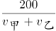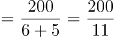秒。如图2所示，第一次相遇后甲乙两人为同点异向出发的环形运动，每次相遇的路程和为整个跑道长度，需要时间为：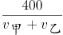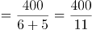秒。第一次相遇后，剩余秒，还能再相遇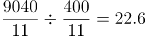次，次数必须取整即还能相遇22次。则14分钟内共相遇1+22=23次。

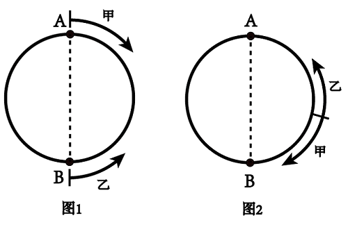

故正确答案为B。

**考点**：相遇追及

**来源**：2021年黑龙江公检法司系统及边境县（市、区）急需紧缺专业岗公务员考试《行测》题第63题

### 第 64 题

有一列数，第1个数是16，第二个数是8，第3个数开始，每一个数都是它前面两个数的平均数，则第2021个数的整数部分是：

A. 9

B. 10

C. 11

D. 12

第 64 题 · 答案与解析

**参考答案（粉笔题库参考内容）**

B

**解析**

根据题意，该数列从第3个数开始分别是：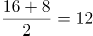，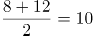，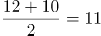，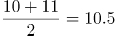，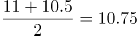，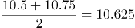······观察发现，从第6个数开始每个数的整数部分均为10。之后的数取平均时，整数部分取平均后保持不变，只有小数部分发生变化，则第2021个数的整数部分应为10。

故正确答案为B。

**考点**：平均数问题

**来源**：2021年黑龙江公检法司系统及边境县（市、区）急需紧缺专业岗公务员考试《行测》题第64题

### 第 65 题

一杯浓度为50%的糖水，加入一定量的水后浓度变为40%，再加入与上一次等量的水后，糖水变为60克，问糖水中的糖有多少克？

A. 18

B. 20

C. 24

D. 30

第 65 题 · 答案与解析

**参考答案（粉笔题库参考内容）**

B

**解析**

设浓度为50%的糖水共有x克，在糖水中加入了y克水。糖水加入一定量的水后浓度变为40%，过程中溶质质量不变，根据公式：溶质=溶液×浓度，可列方程：50%×x=40%×(x+y)······①；根据“再加入与上一次等量的水后，糖水变为60克”，可列方程：x+y+y=60······②，联立①②，解得x=40，y=10，可得糖水中的糖=40×50%=20克。

故正确答案为B。

**考点**：两溶液混合

**来源**：2021年黑龙江公检法司系统及边境县（市、区）急需紧缺专业岗公务员考试《行测》题第65题

### 第 66 题

某商店购进一批篮球，定价为进价的125%，在售出进货量的20%后，商店决定打折促销。篮球全部卖完后，商家在该批篮球上总获利15%，问该商店这次促销价为定价的多少折？

A. 8

B. 8.5

C. 9

D. 9.5

第 66 题 · 答案与解析

**参考答案（粉笔题库参考内容）**

C

**解析**

根据题意，赋值篮球进货量为10个，则按定价销售10×20%=2个，打折销售10-2=8个。设进价为x元，定价为1.25x元，促销价为定价的a。根据公式：售价=进价×（1+利润率），则总售价=1.25x×2+1.25x×a×8=10x×（1+15%），解得a=0.9，即该商店这次促销价为定价的9折。

故正确答案为C。

**考点**：经济利润问题

**来源**：2021年黑龙江公检法司系统及边境县（市、区）急需紧缺专业岗公务员考试《行测》题第66题

### 第 67 题

英语小组成员小明、小红、小花、小白、小玲坐成一排，小玲和小红挨着坐，而小红和小花不挨着坐的概率是多少？

A. 1/10

B. 1/5

C. 3/10

D. 9/10

第 67 题 · 答案与解析

**参考答案（粉笔题库参考内容）**

C

**解析**

根据概率P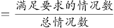，五个人坐成一排的总情况数为种。满足要求的情况数为：小玲和小红挨着的情况数-小玲与小红挨着时小红与小花也挨着的情况数。小玲和小红挨着的情况数为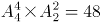种；小玲、小红挨着时小花只能选择在小红的另一侧，则情况数为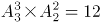种，则满足要求的情况数=48-12=36种。故题目所求概率P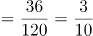。

故正确答案为C。

**考点**：相邻问题、给情况求概率

**来源**：2021年黑龙江公检法司系统及边境县（市、区）急需紧缺专业岗公务员考试《行测》题第67题

### 第 68 题

某智能设备满电情况下不接外部电源，可以开机使用3小时或者待机51小时，现在满电且不接外部电源情况下，开机使用N分钟后，剩余电量的待机时长也是N分钟，问N是多少？

A. 140

B. 150

C. 160

D. 170

第 68 题 · 答案与解析

**参考答案（粉笔题库参考内容）**

D

**解析**

由题意可知，开机使用3小时＝3×60＝180分钟，待机51小时＝51×60＝3060分钟。赋值智能设备的总电量为3060（180和3060的最小公倍数）。则开机使用的单位时间耗电量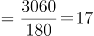/分钟，待机的单位时间耗电量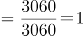/分钟。根据题意列式为17×N＋1×N＝3060，解得N＝170。

故正确答案为D。

**考点**：给完工时间型

**来源**：2021年黑龙江公检法司系统及边境县（市、区）急需紧缺专业岗公务员考试《行测》题第68题

### 第 69 题

幼儿园需采购春联、窗花、小狗玩偶三种新年用品，已知大班采购春联7幅，窗花12对、小狗玩偶5个，共花费200元，中班采购春联9幅、窗花19对、小狗玩偶5个，共花费224元。问小班采购春联10幅，窗花10对，小狗玩偶10个需花费多少元？

A. 170

B. 176

C. 340

D. 352

第 69 题 · 答案与解析

**参考答案（粉笔题库参考内容）**

D

**解析**

设春联、窗花、小狗玩偶的单价分别为x、y、z元，根据题意则有：7x+12y+5z=200······①，9x+19y+5z=224······②。

方法一：②-①可得：2x+7y=24······③；①-③可得：5x+5y+5z=176······④。则所求小班采购金额=10x+10y+10z=2（5x+5y+5z）=2×176=352元；

方法二：因为x、y、z是钱数，故不一定是整数，所以本题属于非限定性不定方程。可以采用赋零法，赋窗花的价格为0元，即y=0。原方程组转化为：7x+5z=200······③，9x+5z=224······④，联立③④，解得x=12，5z=116。则所求小班采购金额=10x+10y+10z=10×12+116×2=352元。

故正确答案为D。

**考点**：不定方程组

**来源**：2021年黑龙江公检法司系统及边境县（市、区）急需紧缺专业岗公务员考试《行测》题第69题

### 第 70 题

某公司人事部门，拟将新招聘的10名实习生分配给3个部门，问这3个部门分到的实习生人数相差不超过2人的方案有多少种？

A. 4200

B. 7350

C. 22050

D. 44100

第 70 题 · 答案与解析

**参考答案（粉笔题库参考内容）**

C

**解析**

由题意可知：3个部门分到的实习生人数相差不超过2人，则有两种分配方式：

①按照（3、3、4）分配：先从3个部门中任选出1个部门分配4名实习生，则其余2个部门均分配3名实习生，则共有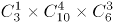种分配方式；

②按照（4、4、2）分配：先从3个部门中任选出1个部门分配2名实习生，则其余2个部门均分配4名实习生，则共有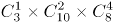种分配方式。

则题干所求=12600+9450=22050种。

故正确答案为C。

**考点**：基础排列组合

**来源**：2021年黑龙江公检法司系统及边境县（市、区）急需紧缺专业岗公务员考试《行测》题第70题

### 第 71 题

从所给四个选项中，选择最合适的一项填入问号处，使之呈现一定的规律性：

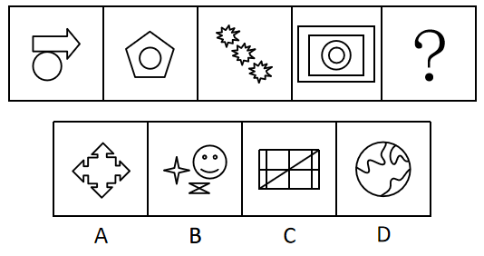

A. A

B. B

C. C

D. D

第 71 题 · 答案与解析

**参考答案（粉笔题库参考内容）**

C

**解析**

元素组成不同，且无明显属性规律，考虑数量规律。观察发现，题干第一幅图为两个图形相切，其他几幅图均由多个部分构成，可以考虑部分数和笔画数，但考虑部分数无答案，题干四幅图形的笔画数依次为1、2、3、4，故“？”处选一个5笔画的图形，只有C项符合。

故正确答案为C。

**考点**：数量规律-线

**来源**：2021年黑龙江公检法司系统及边境县（市、区）急需紧缺专业岗公务员考试《行测》题第71题

### 第 72 题

从所给四个选项中，选择最合适的一项填入问号处，使之呈现一定的规律性：

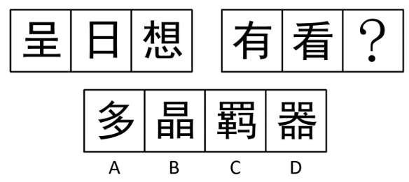

A. A

B. B

C. C

D. D

第 72 题 · 答案与解析

**参考答案（粉笔题库参考内容）**

D

**解析**

元素组成不同，没有明显的属性规律，考虑数量规律。观察发现，题干所有图形中均存在空白区域，考虑面数量。第一组图形的面数量依次为1、2、3，第二组图形的面数量依次为2、3、？，故？处应该填入一个面数量为4的图形，选项的面数量依次为0、6、6、4，只有D项符合规律。

故正确答案为D。

**考点**：数量规律-面、文字/字母/数字类

**来源**：2021年黑龙江公检法司系统及边境县（市、区）急需紧缺专业岗公务员考试《行测》题第72题

### 第 73 题

从所给的四个选项中，选择最合适的一个填入问号处，使之呈现一定的规律性：

A. A

B. B

C. C

D. D

第 73 题 · 答案与解析

**参考答案（粉笔题库参考内容）**

D

**解析**

元素组成相同，优先考虑位置规律。九宫格优先横向观察，第一行中，每个小黑块均依次向右平移一格，且平移到最右侧时反弹方向改变继续向左平移。第二行中，发现每个小黑块均依次向右平移了两格，且平移到最右侧时反弹方向改变继续向左平移。第三行中，每个小黑块向右平移了三格，且平移到最右侧时反弹方向改变继续向左平移，故？处图形应在第三行图2的基础上继续遵循此规律，只有D项符合。

故正确答案为D。

**考点**：位置规律-平移

**来源**：2021年黑龙江公检法司系统及边境县（市、区）急需紧缺专业岗公务员考试《行测》题第73题

### 第 74 题

左边给定的是纸盒的外表面，右边哪一项不能由左边折成？

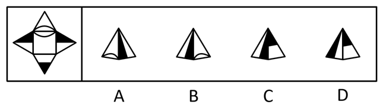

A. A

B. B

C. C

D. D

第 74 题 · 答案与解析

**参考答案（粉笔题库参考内容）**

C

**解析**

将题干展开图标上序号，如下图所示，逐一进行分析。

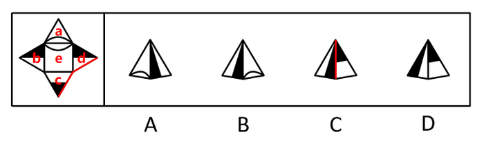

A项：左面为面a，右面为面d，选项与题干展开图一致，排除；

B项：左面为面b，右面为面a，选项与题干展开图一致，排除；

C项：左面为面d，右面为面c，根据题干展开图中面c和d面的公共边可知（如上图红线所示），面c应该与面d中的白色三角形相邻，而选项中面c与面d中的黑色三角形相邻，选项与题干展开图不一致，当选；

D项：左面为面d，右面为面c，选项与题干展开图一致，排除。

本题为选非题，故正确答案为C。

**考点**：空间类-多面体折叠

**来源**：2021年黑龙江公检法司系统及边境县（市、区）急需紧缺专业岗公务员考试《行测》题第74题

### 第 75 题

符合俯视图的是：

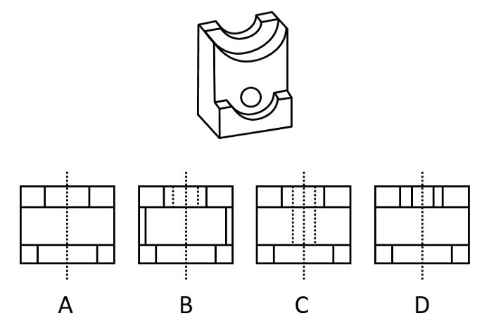

A. A

B. B

C. C

D. D

第 75 题 · 答案与解析

**参考答案（粉笔题库参考内容）**

C

**解析**

本题考查俯视图。需要对立体图形从上往下看。从上往下看立体图形的最后一排只有三个面，排除D项。从上往下看立体图形的中间一排只有一个面，排除B项。比较A、C两项，均有中轴的虚线，但是C项比A项多两条短虚线，观察题干发现立体图形中间有中空的小圆，从上往下看看不到圆的轮廓，故应出现两条短虚线。

故正确答案为C。

**考点**：空间类-三视图

**来源**：2021年黑龙江公检法司系统及边境县（市、区）急需紧缺专业岗公务员考试《行测》题第75题

### 第 76 题

动量，是物体在一个运动方向上存在运动趋势，是与物体的质量和速度相关的物理量。

根据上述定义，下列需要用动量概念进行解释的是：

A. 关闭家用电器之后，指示灯会继续闪烁一段时间

B. 俯身隔着一段距离，用嘴吹灭蜡烛

C. 货车与轿车的起步与刹车，货车会相对较为缓慢

D. 子弹击中目标时冲击力比人扔铅球大

第 76 题 · 答案与解析

**参考答案（粉笔题库参考内容）**

D

**解析**

第一步：找出定义关键词。

“物体在一个运动方向上存在运动趋势”、“与物体的质量和速度相关的物理量”。

第二步：逐一分析选项。

A项：家用电器的指示灯闪烁并不存在运动，不符合“物体在一个运动方向上存在运动趋势”，不符合定义，排除；

B项：俯身用嘴吹灭蜡烛，人和蜡烛均没有运动，不符合“物体在一个运动方向上存在运动趋势”，不符合定义，排除；

C项：货车的起步与刹车较为缓慢是因为货车的质量大，惯性大，且起步与刹车的快慢体现的是加速度而不是速度，不符合“与物体的质量和速度相关的物理量”，不符合定义，排除；

D项：子弹和铅球击中目标具有冲击力是因为它们在飞行的方向上存在一个向前的运动趋势，符合“物体在一个运动方向上存在运动趋势”，子弹和铅球都具有一定的质量和速度，符合“与物体的质量和速度相关的物理量”，符合定义，当选。

故正确答案为D。

**考点**：单定义-其他句式

**来源**：2021年黑龙江公检法司系统及边境县（市、区）急需紧缺专业岗公务员考试《行测》题第76题

### 第 77 题

单方法律行为是指只要一方当事人的意思表示就可成立的民事法律行为。

下列不属于单方法律行为的是：

A. 刘某因和林某之间的情感，免除了林某的债务

B. 张某放弃继承权

C. 林某变更遗嘱

D. 老王将所获得的稿费用于鼓励新人

第 77 题 · 答案与解析

**参考答案（粉笔题库参考内容）**

D

**解析**

第一步：找出定义关键词。

“只要一方当事人的意思表示就可成立”、“民事法律行为”。

第二步：逐一分析选项。

A项：刘某免除林某的债务，仅凭刘某单方面的意思表示即可成立，且免除债务是民事法律行为，符合“只要一方当事人的意思表示就可成立”、“民事法律行为”，符合定义，排除；

B项：张某放弃继承权，仅凭张某单方面的意思表示即可成立，且放弃继承权是民事法律行为，符合“只要一方当事人的意思表示就可成立”、“民事法律行为”，符合定义，排除；

C项：林某变更遗嘱，仅凭林某单方面的意思表示即可成立，且变更遗嘱是民事法律行为，符合“只要一方当事人的意思表示就可成立”、“民事法律行为”，符合定义，排除；

D项：老王将自己的稿费用于鼓励新人，这是对他人的赠予，赠予行为需要当事人双方一致的意思表示才能成立，不符合“只要一方当事人的意思表示就可成立”，不符合定义，当选。

本题为选非题，故正确答案为D。

**考点**：单定义-其他句式

**来源**：2021年黑龙江公检法司系统及边境县（市、区）急需紧缺专业岗公务员考试《行测》题第77题

### 第 78 题

羊群效应是个人的观念或行为由于真实的或想象的群体的影响或压力，而向与多数人相一致的方向变化的现象。表现为对特定的或临时的情境中的优势观念和行为方式的采纳，表现为对长期性的占优势地位的观念和行为方式的接受。

根据上述定义，下列不属于羊群效应的是：

A. 张某去超市，发现已经排起长队，遂自觉去排队，到最后才发现自己排的是隔壁网红店的队伍

B. 民警孙某，发现大量市民朝一个方向奔跑，遂与众人一起跑上前去，一探究竟

C. 陈某和王某注册了多个微信号，在微信群里发布虚假信息，诱导他人购买

D. 张某本来没有买车的意愿，但发现周围的朋友都在买车摇号，遂也随大流摇号

第 78 题 · 答案与解析

**参考答案（粉笔题库参考内容）**

C

**解析**

第一步：找出定义关键词。

“由于真实的或想象的群体的影响或压力”、“向与多数人相一致的方向变化”。

第二步：逐一分析选项。

A项：张某因为看到他人排队而自觉排队，符合“由于真实的或想象的群体的影响或压力”、“向与多数人相一致的方向变化”，符合定义，排除；

B项：孙某因为看到市民朝一个方向奔跑也一起跑过去，符合“由于真实的或想象的群体的影响或压力”、“向与多数人相一致的方向变化”，符合定义，排除；

C项：陈某和王某通过发布虚假消息诱导他人购买，是两个人自发的行为，不存在群体的影响，不符合“由于真实的或想象的群体的影响或压力”，不符合定义，当选；

D项：张某因为周围的朋友都在买车摇号而改变了自己的意愿，符合“由于真实的或想象的群体的影响或压力”，之后他随大流摇号，符合“向与多数人相一致的方向变化”，符合定义，排除。

本题为选非题，故正确答案为C。

**考点**：原因结果

**来源**：2021年黑龙江公检法司系统及边境县（市、区）急需紧缺专业岗公务员考试《行测》题第78题

### 第 79 题

玩具思维，是指超越产品基本功能需求，赋予消费者感官刺激、情感享受，满足其玩乐欲望的产品战略观。

根据上述定义，下列属于玩具思维的是：

A. 某手机品牌针对青少年群体，专门推出具有青少年模式的手机

B. 某英语公众号通过每天发布一篇英语美文，来提升付费用户的英语阅读水平

C. 为鼓励用户多走楼梯，某地铁口修建了音乐楼梯，每踩一级阶梯就会发出一个声音

D. 某饭店为了招揽顾客，在菜单上增加了亲子套餐、儿童套餐等多种形式的菜品组合

第 79 题 · 答案与解析

**参考答案（粉笔题库参考内容）**

C

**解析**

第一步：找出定义关键词。

“超越产品基本功能需求”、“赋予消费者感官刺激、情感享受”、“满足玩乐欲望”。

第二步：逐一分析选项。

A项：手机的青少年模式是对手机中部分不适合青少年的功能和手机的使用时间等加以限制，此类手机没有“超越产品基本功能需求”，且可以对青少年玩手机起到一定的限制作用，不符合“满足玩乐欲望”，不符合定义，排除；

B项：英语公众号发布英语美文的目的是提升付费用户的英语阅读水平，可以满足使用者对于阅读能力提升的需求，不符合“满足玩乐欲望”，不符合定义，排除；

C项：音乐楼梯的音乐功能已经超越了楼梯的基本功能，且音乐可以增添娱乐性，满足玩乐的需求，符合“超越产品基本功能需求”、“赋予消费者感官刺激、情感享受”、“满足玩乐欲望”，符合定义，当选；

D项：饭店的套餐是由菜品组成，没有内容体现具有其他功能，不符合“超越产品基本功能需求”，也无法判断这些套餐是否能赋予消费者感官刺激、情感享受，且菜品满足的是食欲，不符合“赋予消费者感官刺激、情感享受”、“满足玩乐欲望”，不符合定义，排除。

故正确答案为C。

**考点**：单定义-其他句式

**来源**：2021年黑龙江公检法司系统及边境县（市、区）急需紧缺专业岗公务员考试《行测》题第79题

### 第 80 题

变文，在行文中用不同的文词以表达相同的意思。

下列属于变文的是：

A. 十旬休假，胜友如云。千里逢迎，高朋满座

B. 居庙堂之高则忧其民，处江湖之远则忧其君

C. 信言不美，美言不信

D. 开我东阁门，坐我西阁床

第 80 题 · 答案与解析

**参考答案（粉笔题库参考内容）**

B

**解析**

第一步：找出定义关键词。

“在行文中用不同的文词以表达相同的意思”。

第二步：逐一分析选项。

A项：出自唐代王勃的《滕王阁序》，意思是每逢十日一旬的假期，来了很多的良友，迎接远客，高贵的朋友坐满了席位，诗句中没有体现用不同的文词表达相同的意思，不符合定义，排除；

B项：出自宋朝诗人范仲淹的《岳阳楼记》，意思是处在朝廷里做高官就心系百姓，处在僻远的江湖间就为国君忧虑，诗句中的“居”和“处”均有“处在······”的意思，符合“用不同的文词以表达相同的意思”，符合定义，当选；

C项：出自《老子·德经·第八十一章》，意思是真实可信的话不美妙动听，美妙的言辞不真实，句中的“信言、美言”分别指真实可信的话和美妙动听的话，没有用不同的文词表达相同的意思，不符合定义，排除；

D项：出自南北朝乐府诗集的《木兰辞》，意思是打开我东屋的闺门，坐在我西屋的床上，没有用不同的文词表达相同的意思，不符合定义，排除。

故正确答案为B。

注：如下图所示，通过查询相关文献，B项属于变文。

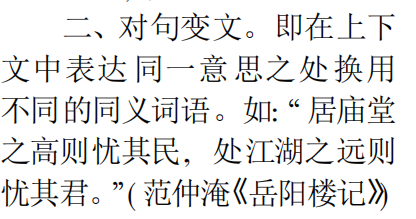

**考点**：方式目的

**来源**：2021年黑龙江公检法司系统及边境县（市、区）急需紧缺专业岗公务员考试《行测》题第80题

### 第 81 题

分量，由数字和英文字母组成的一串字符，1、对于数字来说，右面的数字大于左面的数字。2、当数字与字母相邻时，下一个出现的数字是偶数。3、字母与数字，个数相等。

下列属于分量的是：

①24661kh

②sd34b6x8

③axx124d

④n2b4689gha

⑤53hgfk76f8

⑥3p56gd

⑦2345abcde6

⑧ddf24k68

A. ②⑥⑦⑧

B. ②④⑦⑧

C. ①③④⑥

D. ②③⑤⑦

第 81 题 · 答案与解析

**参考答案（粉笔题库参考内容）**

B

**解析**

第一步：找出定义关键词。

“对于数字来说，右面的数字大于左面的数字”、“当数字与字母相邻时，下一个出现的数字是偶数”、“字母与数字，个数相等”。

第二步：逐一分析选项。

①24661kh中位置3和位置4上的数字相等，不符合“对于数字来说，右面的数字大于左面的数字”，不属于分量；

③axx124d中字母个数为4，数字个数为3，不符合“字母与数字，个数相等”，不属于分量；

⑤53hgfk76f8中位置1上的数字大于位置2上的数字，左面的数字大于右面的数字，不符合“对于数字来说，右面的数字大于左面的数字”，不属于分量；

⑥3p56gd中位置1上是数字，位置2上是字母，而位置3上是奇数不是偶数，不符合“当数字与字母相邻时，下一个出现的数字是偶数”，不属于分量；

②④⑦⑧均符合“对于数字来说，右面的数字大于左面的数字”、“当数字与字母相邻时，下一个出现的数字是偶数”、“字母与数字，个数相等”，属于分量。

故正确答案为B。

**考点**：单定义-其他句式

**来源**：2021年黑龙江公检法司系统及边境县（市、区）急需紧缺专业岗公务员考试《行测》题第81题

### 第 82 题

无因管理，是指没有法定的或约定的义务，为避免他人利益受损失，自愿管理他人事务或为他人提供服务的行为。

下列不属于无因管理的是：

A. 刘某捡到一条狗，将其抚养，为其寻找失主

B. 姜某发现邻居家里着火，拿出自己家的灭火器，帮邻居灭火

C. 张某取快递时，发现快递员不在，帮助快递员看管电动车和货物

D. 王某装修房子时，错把邻居的房子当成自己的房子装修

第 82 题 · 答案与解析

**参考答案（粉笔题库参考内容）**

D

**解析**

第一步：找出定义关键词。

“没有法定的或约定的义务”、“为避免他人利益受损失”、“自愿管理他人事务或为他人提供服务”。

第二步：逐一分析选项。

A项：狗是刘某捡到的，符合“没有法定的或约定的义务”，刘某抚养狗并寻找失主，符合“为避免他人利益受损失”、“自愿管理他人事务或为他人提供服务”，符合定义，排除；

B项：姜某的邻居家着火，符合“没有法定的或约定的义务”，姜某拿出自己家的灭火器帮助邻居灭火，符合“为避免他人利益受损失”、“自愿管理他人事务或为他人提供服务”，符合定义，排除；

C项：张某只是取快递，符合“没有法定的或约定的义务”，快递员不在，张某主动帮快递员看管电动车和货物，符合“为避免他人利益受损失”、“自愿管理他人事务或为他人提供服务”，符合定义，排除；

D项：王某装修邻居的房子，符合“没有法定的或约定的义务”，但王某把邻居的房子错认成是自己的房子，说明其本意是想装修自己的房子，不符合“为避免他人利益受损失”、“自愿管理他人事务或为他人提供服务”，不符合定义，当选。

本题为选非题，故正确答案为D。

**考点**：方式目的

**来源**：2021年黑龙江公检法司系统及边境县（市、区）急需紧缺专业岗公务员考试《行测》题第82题

### 第 83 题

不当类比是指使用不恰当的类比推论而得出不恰当的结论的一种谬误。类比时，必须是将不具有或缺少可比性的事物，简单地放在一起加以比较，并据此较为荒唐地进行推论，如简单随意抽取两类对象的某些属性进行类比，就会出现不当类比的谬误。

根据上述定义，下列不属于不当类比的是:

A. 鲸鱼在水中生活，鲨鱼也在水中生活，且两者都有脊椎，所以它们属于同一种脊椎动物

B. 医生做手术时可以参考X光片，律师辩护时可以查看法律条文，由此学生考试时也可以查看参考书

C. 百姓无粟米充饥，何不食肉糜

D. 基层法院参考最高人民法院已生效判决，由此进行类案类判

第 83 题 · 答案与解析

**参考答案（粉笔题库参考内容）**

D

**解析**

第一步：找出定义关键词。

“不具有或缺少可比性的事物简单放在一起比较”、“据此较为荒唐的进行推论”。

第二步：逐一分析选项。

A项：根据鲸鱼和鲨鱼都在水里生活且都有脊椎的属性，就将鲸鱼和鲨鱼放在一起类比，却忽略了二者在身体构造和生理特征上都具有本质性的差异，不具有可比性，符合“不具有或缺少可比性的事物简单放在一起比较”，据此错误地推论出二者是同一种脊椎动物，符合“据此较为荒唐的进行推论”，符合定义，排除；

B项：根据医生手术时参考X光片、律师辩护时看法律条文的特点，就将学生考试时查看参考书与前者放在一起类比，却忽略了手术、辩护和考试在规则和目的上都存在着的本质性的差异，不具有可比性，符合“不具有或缺少可比性的事物简单放在一起比较”，据此错误地推论出学生考试的时候也可以查看参考书，符合“据此较为荒唐的进行推论”，符合定义，排除；

C项：根据粟米和肉糜都是食物并可以充饥的属性，就将两者放在一起类比，却忽略了晋惠帝与饥饿的百姓在生存环境上具有本质性的差异，不具有可比性，符合“不具有或缺少可比性的事物简单放在一起比较”，据此错误地推论出百姓可以食肉糜充饥，符合“据此较为荒唐的进行推论”，符合定义，排除；

D项：类案指与待决案件在基本事实、争议焦点、法律适用问题等方面具有相似性、已经人民法院裁判生效的案件，根据类案的相似性，将基层法院的待决案件与最高法院的已裁判案件放在一起类比，具有可比性，不符合“不具有或缺少可比性的事物简单放在一起比较”，且类案类判符合最高人民法院的指导意见，并不是荒唐的推论，不符合“据此较为荒唐的进行推论”，不符合定义，当选。

本题为选非题，故正确答案为D。

**考点**：单定义-其他句式

**来源**：2021年黑龙江公检法司系统及边境县（市、区）急需紧缺专业岗公务员考试《行测》题第83题

### 第 84 题

授权是指领导者把部分处理问题的权限委派给某些下属的行为。

下列不属于授权的是：

A. 某公司财务专员因事外出，遂将内部报账相关事项交由出纳代为处理

B. 某公司为优化内部审批流程，部分需要董事长签字的文件由其秘书盖章予以处理

C. 某公司总经理因病住院期间，公司各项工作由常务副总经理代为主持

D. 某公司员工在出差期间，代表公司与客户签订了一项订单合同

第 84 题 · 答案与解析

**参考答案（粉笔题库参考内容）**

A

**解析**

第一步：找出定义关键词。

“领导者把部分处理问题的权限委派给某些下属”。

第二步：逐一分析选项。

A项：财务专员将内部报账相关事项交给出纳，财务泛指财务活动和财务关系，财务专员不是出纳的领导，不符合“领导者把部分处理问题的权限委派给某些下属”，不符合定义，当选；

B项：董事长将需要董事长签字的文件交给秘书，董事长是秘书的领导，符合“领导者把部分处理问题的权限委派给某些下属”，符合定义，排除；

C项：总经理将各项工作交给常务副总经理，总经理是常务副总经理的领导，符合“领导者把部分处理问题的权限委派给某些下属”，符合定义，排除；

D项：员工代表公司签订合同，签订合同的权利一般是公司领导的，所以可能是领导把代表公司签订合同的权利委派给了该员工，符合“领导者把部分处理问题的权限委派给某些下属”，符合定义，排除。

本题为选非题，故正确答案为A。

**考点**：主客体

**来源**：2021年黑龙江公检法司系统及边境县（市、区）急需紧缺专业岗公务员考试《行测》题第84题

### 第 85 题

同步性营销也称协调性营销，是指面对由于季节、时点等变化造成的某些产品或服务需求波动时企业的营销对策。

根据上述定义，下列不属于同步性营销的是：

A. 圣诞节来临，美发店推出充值会员卡满300送100的活动

B. KTV的下午和晚上，价格不同，但是晚上的生意相对红火

C. 餐厅推出了时令水果套餐，深受顾客的喜爱

D. 由于疫情原因，某口罩生产商决定加大口罩的生产量

第 85 题 · 答案与解析

**参考答案（粉笔题库参考内容）**

D

**解析**

第一步：找出定义关键词。

“由于季节、时点等变化”、“造成需求波动时企业的营销对策”。

第二步：逐一分析选项。

A项：圣诞节来临，符合“由于时点等变化”，美发店会抓住各种节日商机推出优惠活动，符合“造成需求波动时企业的营销对策”，符合定义，排除；

B项：KTV的下午和晚上价格不同，符合“由于时点等变化”，因为人们一般下午要学习或上班，晚上娱乐，故晚上对KTV的需求比下午更多，KTV为此设置了不同的价格，符合“造成需求波动时企业的营销对策”，符合定义，排除；

C项：时令水果有一定的时间限制，一旦超过水果的特定季节，就会变得不常见，故餐厅推出时令水果套餐，符合“由于季节、时点等变化”，也符合“造成需求波动时企业的营销对策”，符合定义，排除；

D项：因为疫情现在人人出行都必须带口罩，口罩生产商决定加大口罩的生产量，是大环境的要求，而不是企业主动的营销对策，综上，ABC三项都是在面对季节或时点的不同，企业针对需求波动做的营销策略，只有D项不是企业的营销对策，不符合定义，当选。

本题为选非题，故正确答案为D。

**考点**：原因结果

**来源**：2021年黑龙江公检法司系统及边境县（市、区）急需紧缺专业岗公务员考试《行测》题第85题

### 第 86 题

麒∶麟

A. 鲲∶鹏

B. 凤∶凰

C. 玄∶武

D. 龙∶凤

第 86 题 · 答案与解析

**参考答案（粉笔题库参考内容）**

B

**解析**

第一步：判断题干词语间逻辑关系。

“麒麟”是中国古代神话传说中用以象征祥瑞的神兽，公兽为“麒”，母兽为“麟”，二者为并列关系中的矛盾关系。

第二步：判断选项词语间逻辑关系。

A项：“鲲鹏”是中国古代神话传说中出现的神兽，是奇大无比的两种生物，“鲲”指的是传说中的大鱼，“鹏”指的是传说中的大鸟，二者为并列关系中的反对关系，与题干逻辑关系不一致，排除；

B项：“凤凰”是中国古代传说中的百鸟之王，在中华文化中具有极高地位，凤凰中“凤”为雄性，“凰”为雌性，二者为并列关系中的矛盾关系，与题干逻辑关系一致，当选；

C项：“玄武”是中国古代神话中的天之四灵之一，但玄和武不构成并列关系，与题干逻辑关系不一致，排除；

D项：“龙、凤、麟、龟”并称为礼记四灵，所以“龙”和“凤”为并列关系中的反对关系，与题干逻辑关系不一致，排除。

故正确答案为B。

**考点**：逻辑关系-并列关系

**来源**：2021年黑龙江公检法司系统及边境县（市、区）急需紧缺专业岗公务员考试《行测》题第86题

### 第 87 题

乾：坤

A. 秦：汉

B. 中：外

C. 纵：横

D. 宇：宙

第 87 题 · 答案与解析

**参考答案（粉笔题库参考内容）**

C

**解析**

第一步：判断题干词语间逻辑关系。

乾和坤是两种不同的八卦名称，除这两者之外，八卦还有震、巽、艮、兑、坎、离，即乾和坤为并列关系中的反对关系，且乾代表天，坤代表地，二者也是意思相反的词语。

第二步：判断选项词语间逻辑关系。

A项：秦和汉是两种不同的朝代名称，除两者之外，朝代还有唐、宋、元、明、清等，即秦和汉为并列关系中的反对关系，但二者不是意思相反的词语，与题干逻辑关系不一致，排除；

B项：中和外是两种不同的国家称呼，且仅有中国和外国，二者为并列关系中的矛盾关系，与题干逻辑关系不一致，排除；

C项：纵和横是两种不同的方位，除两者之外，还有其他方位，二者为并列关系中的反对关系，且二者为意思相反的词语，与题干逻辑关系一致，当选；

D项：宇和宙是时空中的两个不同的概念，宇指无限空间，宙指无限时间，即宇和宙为并列关系，但二者不是意思相反的词语，与题干逻辑关系不一致，排除。

故正确答案为C。

**考点**：逻辑关系-并列关系

**来源**：2021年黑龙江公检法司系统及边境县（市、区）急需紧缺专业岗公务员考试《行测》题第87题

### 第 88 题

马车：汽车

A. 青铜：黄金

B. 刺绣：缂丝

C. 煤：石油

D. 刻漏：手表

第 88 题 · 答案与解析

**参考答案（粉笔题库参考内容）**

D

**解析**

第一步：判断题干词语间逻辑关系。

马车和汽车都是交通工具，二者为并列关系，且马车是古代出现的交通工具，汽车是近现代出现的交通工具。

第二步：判断选项词语间逻辑关系。

A项：青铜和黄金都是金属，二者为并列关系，但没有古代和近现代出现的区别，与题干逻辑关系不一致，排除；

B项：刺绣和缂丝都是装饰性的织物，二者为并列关系，但没有古代和近现代出现的区别，与题干逻辑关系不一致，排除；

C项：煤和石油都是化石燃料，二者为并列关系，但没有古代和近现代出现的区别，与题干逻辑关系不一致，排除；

D项：刻漏和手表都是计时器，二者是并列关系，且刻漏是古代出现的计时器，手表是近现代出现的计时器，与题干逻辑关系一致，当选。

故正确答案为D。

**考点**：逻辑关系-并列关系

**来源**：2021年黑龙江公检法司系统及边境县（市、区）急需紧缺专业岗公务员考试《行测》题第88题

### 第 89 题

消除：矛盾

A. 提升：效果

B. 开拓：进取

C. 战争：和平

D. 扶贫：富裕

第 89 题 · 答案与解析

**参考答案（粉笔题库参考内容）**

A

**解析**

第一步：判断题干词语间逻辑关系。

消除矛盾，二者是动宾关系。

第二步：判断选项词语间逻辑关系。

A项：提升效果，二者是动宾关系，与题干逻辑关系一致，当选；

B项：开拓与进取，二者是并列关系，与题干逻辑关系不一致，排除；

C项：战争与和平是反义关系，与题干逻辑关系不一致，排除；

D项：扶贫是为了实现富裕，二者为方式目的对应关系，与题干逻辑关系不一致，排除。

故正确答案为A。

**考点**：语法关系

**来源**：2021年黑龙江公检法司系统及边境县（市、区）急需紧缺专业岗公务员考试《行测》题第89题

### 第 90 题

《桃花扇》：李香君

A. 《牡丹亭》：柳梦梅

B. 《汉宫秋》：王昭君

C. 《西厢记》：张君瑞

D. 《琵琶记》：蔡伯喈

第 90 题 · 答案与解析

**参考答案（粉笔题库参考内容）**

B

**解析**

第一步：判断题干词语间逻辑关系。

《桃花扇》是清代文学家孔尚任创作的历史剧，李香君是剧中的女主人公，二者是剧本与女主人公的对应关系。

第二步：判断选项词语间逻辑关系。

A项：《牡丹亭》是明代汤显祖创作的剧本，柳梦梅是剧中的男主人公，二者是剧本与男主人公的对应关系，与题干逻辑关系不一致，排除；

B项：《汉宫秋》是元代马致远创作的历史剧，王昭君是剧中的女主人公，二者是剧本与女主人公的对应关系，与题干逻辑关系一致，当选；

C项：《西厢记》是元代王实甫创作的剧本，张君瑞是剧中的男主人公，二者是剧本与男主人公的对应关系，与题干逻辑关系不一致，排除；

D项：《琵琶记》是元末高明创作的南戏，蔡伯喈是剧中的男主人公，二者是剧本与男主人公的对应关系，与题干逻辑关系不一致，排除。

故正确答案为B。

**考点**：逻辑关系-对应关系

**来源**：2021年黑龙江公检法司系统及边境县（市、区）急需紧缺专业岗公务员考试《行测》题第90题

### 第 91 题

《望天门山》:《独坐敬亭山》

A. 《春望》:《登高》

B. 《将进酒》:《对酒》

C. 《琵琶行》:《钱塘湖春行》

D. 《蜀相》:《长恨歌》

第 91 题 · 答案与解析

**参考答案（粉笔题库参考内容）**

B

**解析**

第一步：判断题干词语间逻辑关系。

《望天门山》与《独坐敬亭山》的作者相同，均为唐代诗人李白。

第二步：判断选项词语间逻辑关系。

A项：《春望》与《登高》的作者相同，均为唐代诗人杜甫，而非李白，与题干逻辑关系不一致，排除；

B项：《将进酒》与《对酒》的作者相同，均为唐代诗人李白，与题干逻辑关系一致，当选；

C项：《琵琶行》与《钱塘湖春行》的作者相同，均为唐代诗人白居易，而非李白，与题干逻辑关系不一致，排除；

D项：《蜀相》的作者为唐代诗人杜甫，《长恨歌》的作者为唐代诗人白居易，与题干逻辑关系不一致，排除。

故正确答案为B。

**考点**：逻辑关系-对应关系

**来源**：2021年黑龙江公检法司系统及边境县（市、区）急需紧缺专业岗公务员考试《行测》题第91题

### 第 92 题

惨绿少年：翩翩公子

A. 再作冯妇：破镜重圆

B. 汗牛充栋：凤毛麟角

C. 明月清风：风花雪月

D. 博士买驴：不得要领

第 92 题 · 答案与解析

**参考答案（粉笔题库参考内容）**

D

**解析**

第一步：判断题干词语间逻辑关系。

“惨绿少年”原指穿浅绿衣服的少年，后指讲究装饰的青年男子，引申为风度翩翩的青年男子，与“翩翩公子”为近义关系。

第二步：判断选项词语间逻辑关系。

A项：“再作冯妇”比喻再干旧行业；“破镜重圆”比喻夫妻失散后重新团聚或决裂后重新和好，二者不是近义关系，与题干逻辑关系不一致，排除；

B项：“汗牛充栋”形容藏书很多；“凤毛麟角”比喻难得而宝贵的人或事物，二者为反义关系，与题干逻辑关系不一致，排除；

C项：“明月清风”意思是只与清风、明月为伴，比喻不随便结交朋友，也比喻清闲无事；“风花雪月”比喻堆砌词藻、内容贫乏空洞的诗文，也指爱情之事或花天酒地的荒淫生活，二者不是近义关系，与题干逻辑关系不一致，排除；

D项：“博士买驴”比喻写文章废话连篇，不得要领，与“不得要领”为近义关系，与题干逻辑关系一致，当选。

故正确答案为D。

**考点**：语义关系-近义关系

**来源**：2021年黑龙江公检法司系统及边境县（市、区）急需紧缺专业岗公务员考试《行测》题第92题

### 第 93 题

帕斯卡：牛顿：平方米

A. 瓦特：焦耳：分

B. 欧姆：焦耳：安培

C. 特斯拉：韦伯：牛顿

D. 焦耳：欧姆：秒

第 93 题 · 答案与解析

**参考答案（粉笔题库参考内容）**

A

**解析**

第一步：判断题干词语间逻辑关系。

帕斯卡是压强（P）的单位，牛顿是力（F）的单位，平方米是面积（S）的单位，压强的计算公式为：P=F/S，三者之间存在换算的对应关系。

第二步：判断选项词语间逻辑关系。

A项：瓦特是功率（P）的单位，焦耳是功（W）的单位，分是时间（t）的单位，功率的计算公式为：P=W/t，与题干逻辑关系一致，当选；

B项：欧姆是电阻（R）的单位，焦耳是能量、功或热量（Q）的单位，安培是电流（I）的单位，但是R≠Q/I，与题干逻辑关系不一致，排除；

C项：特斯拉是磁感应强度（B）的单位，韦伯是磁通量（φ）的单位，牛顿是力（F）的单位，但B≠φ/F，与题干逻辑关系不一致，排除；

D项：焦耳是能量、功或热量（Q）的单位，欧姆是电阻（R）的单位，秒是时间（t）的单位，但是Q≠R/t，与题干逻辑关系不一致，排除。

故正确答案为A。

**考点**：逻辑关系-对应关系

**来源**：2021年黑龙江公检法司系统及边境县（市、区）急需紧缺专业岗公务员考试《行测》题第93题

### 第 94 题

棉签：碘伏：消毒

A. 医院：患者：治疗

B. 面试：招聘：录用

C. 纱布：酒精：降温

D. 牛奶：补钙：杀菌

第 94 题 · 答案与解析

**参考答案（粉笔题库参考内容）**

C

**解析**

第一步：判断题干词语间逻辑关系。

棉签蘸取碘伏可以用来消毒，棉签与碘伏搭配使用，二者为配套对应关系，碘伏具有消毒的功能，二者为功能对应关系。

第二步：判断选项词语间逻辑关系。

A项：患者在医院接受治疗，医院是患者接受治疗的地点，与题干逻辑关系不一致，排除；

B项：面试和录用是招聘的不同环节，与题干逻辑关系不一致，排除；

C项：纱布蘸取酒精可以用来降温，纱布与酒精搭配使用，二者为配套对应关系，酒精具有降温的功能，二者为功能对应关系，与题干逻辑关系一致，当选；

D项：牛奶具有补钙的功能，二者为功能对应关系，牛奶在饮用之前需要对其进行杀菌，二者为对应关系，与题干逻辑关系不一致，排除。

故正确答案为C。

**考点**：逻辑关系-对应关系

**来源**：2021年黑龙江公检法司系统及边境县（市、区）急需紧缺专业岗公务员考试《行测》题第94题

### 第 95 题

阳春白雪 对于 （ ） 相当于 （ ） 对于 度日如年

A. 曲高和寡；浮光掠影

B. 余音绕梁；潜移默化

C. 靡靡之音；如隔三秋

D. 下里巴人；白驹过隙

第 95 题 · 答案与解析

**参考答案（粉笔题库参考内容）**

D

**解析**

逐一代入选项。

A项：“阳春白雪”比喻高深的不通俗的文学艺术，“曲高和寡”原指知音难得，现比喻言论或作品不通俗，能了解的人很少，二者为近义关系；而“浮光掠影”比喻观察不细致，学习不深入，印象不深刻，“度日如年”是指过一天像过一年那样长，形容日子很不好过，二者无明显逻辑关系，前后逻辑关系不一致，排除；

B项：“阳春白雪”比喻高深的不通俗的文学艺术，“余音绕梁”形容歌声优美，给人留下深刻的印象，二者无明显逻辑关系；“潜移默化”是指人的思想或性格不知不觉受到感染、影响而发生了变化，“度日如年”是指过一天像过一年那样长，形容日子很不好过，二者无明显逻辑关系，前后逻辑关系不一致，排除；

C项：“阳春白雪”比喻高深的不通俗的文学艺术，“靡靡之音”是指使人萎靡不振的音乐，比如使人颓废的、低级趣味的乐曲，二者无明显逻辑关系；“如隔三秋”形容情人之间思慕殷切或是良师益友之间的思念之情，“度日如年”是指过一天像过一年那样长，形容日子很不好过，二者无明显逻辑关系，前后逻辑关系不一致，排除；

D项：“阳春白雪”比喻高深的不通俗的文学艺术，“下里巴人”比喻通俗的文学艺术，二者为反义关系；“白驹过隙”形容时间过得极快，“度日如年”是指过一天像过一年那样长，形容日子很不好过，二者为反义关系，前后逻辑关系一致，当选。

故正确答案为D。

**考点**：语义关系-反义关系

**来源**：2021年黑龙江公检法司系统及边境县（市、区）急需紧缺专业岗公务员考试《行测》题第95题

### 第 96 题

有专家认为网络游戏行业的高速发展是导致青少年网瘾问题增多的主要原因。

以下哪项如果为真，最能反驳该专家的观点？

A. 青少年网瘾人群上网目的排行榜前三名分别是网络社交、浏览短视频和网络追星，三者总和占比75%

B. 高额税费将导致游戏平台提高游戏价格

C. 青少年玩同一款网络游戏的时间通常在6-12个月之间，其后若没有新玩法推出，他们将放弃该游戏

D. 青少年受家长限制，通常没有经济能力购买付费游戏

第 96 题 · 答案与解析

**参考答案（粉笔题库参考内容）**

A

**解析**

第一步：找出论点和论据。

论点：网络游戏行业的高速发展是导致青少年网瘾问题增多的主要原因。

论据：无。

本题只有论点没有论据，削弱可以考虑直接削弱论点，即指出网络游戏行业的高速发展不是导致青少年网瘾问题增多的主要原因。

第二步：逐一分析选项。

A项：青少年网瘾人群上网的目的主要是网络社交、浏览短视频和网络追星，并不是网络游戏，说明网络游戏不是导致青少年网瘾问题增多的主要原因，而是网络社交、浏览短视频和网络追星，削弱论点，可以削弱，当选；

B项：游戏平台提高游戏价格和网络游戏是否会导致青少年网瘾问题增多无关，无关项，无法削弱，排除；

C项：青少年玩一款网络游戏时间的长短和网络游戏是否会导致青少年网瘾问题增多无关，无关项，无法削弱，排除；

D项：青少年有没有经济能力购买付费游戏和网络游戏是否会导致青少年网瘾问题增多无关，无关项，无法削弱，排除。

故正确答案为A。

**考点**：削弱论点

**来源**：2021年黑龙江公检法司系统及边境县（市、区）急需紧缺专业岗公务员考试《行测》题第96题

### 第 97 题

国外有专家提出以“群体免疫”的方式应对新冠疫情，即大部分人群相继感染新冠病毒后治愈，形成抗体，继而阻断病毒传播链条。

以下哪一说法，不能达到质疑该专家观点的目的？

A. 新冠病毒变异迅速，针对原病毒形成的抗体不能保证对变异病毒有效

B. 人体形成的新冠病毒抗体将在6~12个月内逐渐失效

C. 大量人群感染新冠病毒将加速病毒变异，突破既有抗体防护

D. 形成“群体免疫”需要耗费较长的周期

第 97 题 · 答案与解析

**参考答案（粉笔题库参考内容）**

D

**解析**

第一步：找出论点和论据。

论点：以“群体免疫”的方式应对新冠疫情。

论据：大部分人群相继感染新冠病毒后治愈，形成抗体，继而阻断病毒传播链条。

本题为选非题，找出三个削弱项排除，剩下的选项即为正确答案。

第二步：逐一分析选项。

A项：指出新冠病毒变异迅速，而针对原病毒形成的抗体对变异病毒不一定有效，说明即使形成抗体也无法对抗变异病毒，也就无法以“群体免疫”的方式应对新冠疫情，削弱论据，可以削弱，排除；

B项：指出人体形成的新冠病毒抗体将在6~12个月内逐渐失效，说明形成的抗体会在一定时期内失效，也就无法以“群体免疫”的方式应对新冠疫情，削弱论据，可以削弱，排除；

C项：指出大量人群感染新冠病毒后会加速病毒变异，突破既有抗体防护，说明通过群体感染形成抗体的方法是无效的，也就无法以“群体免疫”的方式应对新冠疫情，削弱论据，可以削弱，排除；

D项：指出形成“群体免疫”的周期比较长，而“群体免疫”形成周期的长短无法说明“群体免疫”的效果是否能实现，不明确选项，无法削弱，当选。

本题为选非题，故正确答案为D。

**考点**：削弱选非题

**来源**：2021年黑龙江公检法司系统及边境县（市、区）急需紧缺专业岗公务员考试《行测》题第97题

### 第 98 题

所有猪是动物，这个东西是动物，所以这个东西是猪。

与题干推理结构最相似的是：

A. 所有猪是动物，这个动物吃草，所以猪吃草

B. 所有鸟会飞，这个动物会飞，所以这个动物是鸟

C. 所有牛都耕地，这个动物不耕地，所以这个动物不是牛

D. 所有老虎都吃人，这个动物不吃人，所以这个动物不是老虎

第 98 题 · 答案与解析

**参考答案（粉笔题库参考内容）**

B

**解析**

第一步：分析题干推理形式。

题干翻译为：猪→动物，这个东西→动物，所以，这个东西→猪，即a→b，c→b，所以，c→a。

第二步：逐一分析选项。

A项：翻译为：猪→动物，这个动物→吃草，所以，猪→吃草，即a→b，c→d，所以，a→d，与题干推理形式不一致，排除；

B项：翻译为：鸟→会飞，这个动物→会飞，所以，这个动物→鸟，即a→b，c→b，所以，c→a，与题干推理形式一致，当选；

C项：翻译为：牛→耕地，这个动物→不耕地，所以，这个动物→不是牛，即a→b，c→b，所以，c→a，与题干推理形式不一致，排除；

D项：翻译为：老虎→吃人，这个动物→不吃人，所以，这个动物→不是老虎，即a→b，c→b，所以，c→a，与题干推理形式不一致，排除。

故正确答案为B。

**考点**：推理形式

**来源**：2021年黑龙江公检法司系统及边境县（市、区）急需紧缺专业岗公务员考试《行测》题第98题

### 第 99 题

一个电路通过5个开关控制一组灯泡，必须遵循下列规则：

①若闭合1号开关，那么必须同时闭合2号开关并且断开5号开关；

②若闭合2号开关或5号开关，则要断开4号开关；

③不能同时断开3号开关和4号开关。

如果现在要闭合1号开关，同时要闭合的开关是：

A. 2号开关和3号开关

B. 2号开关和4号开关

C. 3号开关和5号开关

D. 4号开关和5号开关

第 99 题 · 答案与解析

**参考答案（粉笔题库参考内容）**

A

**解析**

第一步：翻译题干。

①闭合1号开关→闭合2号开关 且 断开5号开关；

②闭合2号开关 或 闭合5号开关→断开4号开关；

③-（断开3号开关 且 断开4号开关) = 闭合3号开关 或 闭合4号开关；

④闭合1号开关。

第二步：根据题干条件进行推理。

从确定信息条件④入手，闭合1号开关是对条件①的肯前，肯前必肯后，可以得出闭合2号开关且断开5号开关；闭合2号开关是对条件②肯前，肯前必肯后，可以得出断开4号开关；而断开4号开关是对条件③或关系的后半部分进行否定，根据“或关系否一推一”，可以得出闭合3号开关，故除了闭合1号开关，还需要闭合的是2号开关和3号开关。

故正确答案为A。

**考点**：常规翻译

**来源**：2021年黑龙江公检法司系统及边境县（市、区）急需紧缺专业岗公务员考试《行测》题第99题

### 第 100 题

某餐馆推出“凡是救治过新冠肺炎患者的一线医护人员都可以打五折”的优惠。

下列说法正确的是：

A. 不参与救治新冠肺炎患者的医护人员不可以打五折

B. 能打五折的都是参与救治新冠肺炎患者的医护人员

C. 给小周打了五折，所以他是参与救治新冠肺炎患者的一线医护人员

D. 小周是参与救治新冠肺炎患者的一线医护人员，所以可以打五折

第 100 题 · 答案与解析

**参考答案（粉笔题库参考内容）**

D

**解析**

第一步：翻译题干。

救治过新冠肺炎患者的一线医护人员→打五折。

第二步：逐一分析选项。

A项：翻译为：-参与救治新冠肺炎患者的医护人员→打五折，是对题干条件的否前，否前无必然结论，无法推出，排除；

B项：翻译为：打五折→参与救治新冠肺炎患者的医护人员，是对题干条件的肯后，肯后无必然结论，无法推出，排除；

C项：翻译为：打五折→参与救治新冠肺炎患者的一线医护人员，是对题干条件的肯后，肯后无必然结论，无法推出，排除；

D项：翻译为：参与救治新冠肺炎患者的一线医护人员→打五折，是对题干条件的肯前，肯前必肯后，可以推出，当选。

故正确答案为D。

**考点**：常规翻译

**来源**：2021年黑龙江公检法司系统及边境县（市、区）急需紧缺专业岗公务员考试《行测》题第100题

### 第 101 题

（1）既去南京，又去深圳。（2）只有去广州，才去深圳。（3）如果南京和深圳都去，那么去广州。

如果只采纳一个人的建议，可以推出的是：

A. 去南京和广州，不去深圳

B. 去广州和深圳，不去南京

C. 去广州，但不去南京和深圳

D. 去南京和深圳，但不去广州

第 101 题 · 答案与解析

**参考答案（粉笔题库参考内容）**

D

**解析**

第一步：分析题干条件。

（1）去南京 且 去深圳；

（2）去深圳→去广州；

（3）（去南京 且 去深圳）→去广州。

第二步：看其余，根据题干推理。

题干中只采纳一个人的建议，说明只有一真。分析条件（2）（3）可知，两个都涉及到推出关系，且后半部分相同，如果（2）成立，那么（3）一定成立，又题干条件只有一真，所以（2）一定错，即（2）的矛盾“去深圳且不去广州”一定对，排除A、B、C三项。

故正确答案为D。

说明：本题在理清条件（2）和条件（3）之间的逻辑关系上有一定难度，下面提供一些思路供参考。题干三个条件中没有很明显的矛盾关系，但条件（2）和条件（3）同为推出关系，且后半部分相同，因此可以通过判定条件（2）和条件（3）之间的逻辑关系来推理。条件（2）为“去深圳→去广州”，如果该条件为真（理解为去深圳就会去广州），那么条件（3）“（去南京 且 去深圳）→去广州”也必定为真，这是因为在条件（2）中已经指明“去深圳就会去广州”，且条件（3）中的前半部分包含了“去深圳”，那么无论是否去南京，都可以得到条件（3）后半部分的结果，即去广州，此时说明条件（3）为真。但反之则不成立，如果条件（3）为真，说明“去广州”的前提必须有“去南京”和“去深圳”这两个要素，那么条件（2）中的前半部分只有“去深圳”，是无法直接推出后半部分“去广州”的结果，此时条件（2）不一定为真。当然，也存在另一个思考的角度，利用“A→B等价于-A 或 B”，将条件（2）和条件（3）分别转化为：（2）-去深圳 或 去广州；（3）-去南京 或 -去深圳 或 去广州，如果将“-去深圳 或 去广州”看成一个整体，从“或真且假”的角度来说，对于条件（2）和条件（3）也可以判定为：如果条件（2）成立，那么条件（3）一定成立。

**考点**：真假推理-其他

**来源**：2021年黑龙江公检法司系统及边境县（市、区）急需紧缺专业岗公务员考试《行测》题第101题

### 第 102 题

小赵、小钱、小孙他们有不同的兴趣爱好，分别是打篮球、滑旱冰、踢足球，甲、乙、丙分别有如下猜测：

甲：小赵喜欢滑旱冰，小钱喜欢打篮球；

乙：小赵喜欢打篮球，小孙喜欢滑旱冰；

丙：小赵喜欢踢足球，小钱喜欢滑旱冰。

已知他们的猜测都对了一半，可以推出：

A. 小赵喜欢打篮球，小钱喜欢踢足球，小孙喜欢滑旱冰

B. 小赵喜欢滑旱冰，小钱喜欢踢足球，小孙喜欢打篮球

C. 小赵喜欢踢足球，小钱喜欢滑旱冰，小孙喜欢打篮球

D. 小赵喜欢踢足球，小钱喜欢打篮球，小孙喜欢滑旱冰

第 102 题 · 答案与解析

**参考答案（粉笔题库参考内容）**

D

**解析**

题干信息不确定，优先考虑代入法。

A项：代入到题干中，甲猜测的都是错的，不符合题干要求，排除；

B项：代入到题干中，乙猜测的都是错的，不符合题干要求，排除；

C项：代入到题干中，甲猜测的都是错的，不符合题干要求，排除；

D项：代入到题干中，每个人的猜测都对了一半，符合题干要求，当选。

故正确答案为D。

**考点**：框架题

**来源**：2021年黑龙江公检法司系统及边境县（市、区）急需紧缺专业岗公务员考试《行测》题第102题

### 第 103 题

只有缴纳会费，才能办理会员；只有办理会员才可以随便使用体育设备；如果不注册使用信用卡，就不能成为会员。

以下哪个不一定为真？

A. 只有缴纳会费才能随便使用体育设备

B. 如果是会员，那么可以随便使用体育设备

C. 开通信用卡，未必可以随便使用体育设备

D. 如果可以随便使用体育设备，那么一定开通了信用卡

第 103 题 · 答案与解析

**参考答案（粉笔题库参考内容）**

B

**解析**

第一步：翻译题干。

①会员→缴纳会费；

②随便使用体育设备→会员；

③-信用卡→会员；

①和②可以递推出：④随便使用体育设备→会员→缴纳会费；

②和③逆否可以递推出：⑤随便使用体育设备→会员→信用卡。

第二步：逐一分析选项。

A项：翻译为：随便使用体育设备→缴纳会费，是对④的肯前，肯前必肯后，可以推出，排除；

B项：翻译为：会员→随便使用体育设备，是对②的肯后，肯后得不出必然结论，无法推出，当选；

C项：信用卡是对⑤的肯后，肯后得不出必然结论，所以是未必可以随便使用体育设备，可以推出，排除；

D项：翻译为：随便使用体育设备→信用卡，是对⑤的肯前，肯前必肯后，可以推出，排除。

本题为选非题，故正确答案为B。

**考点**：常规翻译

**来源**：2021年黑龙江公检法司系统及边境县（市、区）急需紧缺专业岗公务员考试《行测》题第103题

### 第 104 题

某位牙科专家在周一到周六的上午和下午安排约见病人或指导研究生，必须留出连续两个整天来指导研究生，其余时间用来约见病人赵某、钱某、孙某、李某、王某和吴某，每个病人只约见一次，每次约见占用一整个上午或一整个下午，除了赵某和钱某被同时约见外，其他病人都被单独约见。日程安排还需要符合以下条件：李某必须在周四上午约见；赵某必须在李某之前被约见；孙某必须在钱某之前被约见；吴某必须在李某和王某之后被约见。

如果吴某在周六上午被该专家约见，下列哪项可能为真？

A. 周三用来指导研究生

B. 周五用来指导研究生

C. 钱某在周四被约见

D. 王某在周二被约见

第 104 题 · 答案与解析

**参考答案（粉笔题库参考内容）**

A

**解析**

第一步：分析题干条件。

（1）必须留出连续两个整天来指导研究生；

（2）只有赵某和钱某同时被约见；

（3）李某必须在周四上午约见；

（4）赵某必须在李某之前被约见；

（5）孙某必须在钱某之前被约见；

（6）吴某必须在李某和王某之后被约见；

（7）吴某在周六上午被该专家约见。

第二步：根据题干条件进行推理。

提问给出了确定信息，可以从确定信息开始推理。

从确定信息入手，结合条件（3）和（7）可确定周四、周六肯定会约见病人，此时为满足条件（1），那么只能选择周一周二或周二周三指导研究生，排除B、D两项；

根据条件（2）（4）可知，赵某和钱某同时被约见，且二者都在李某之前，结合条件（3）可知，李某在周四上午被约见，则赵某、钱某均在周四之前被约见，排除C项。

故正确答案为A。

**考点**：从确定信息开始推

**来源**：2021年黑龙江公检法司系统及边境县（市、区）急需紧缺专业岗公务员考试《行测》题第104题

### 第 105 题

自动启停系统通过控制汽车的发动机，在车辆短时间停止时熄火、需要继续前进时再自动启动，从而达到省油的目的。随着自动启停系统的快速发展，但是自动启停系统也提高了车辆的制造和维护成本。另外也有许多消费者因为不喜欢车辆反复启动的震动而选择关闭自动启停系统。

由此可以推出：

A. 消费者购买带有自动启停系统的车辆是为了省油

B. 若其他配置相同，则带有自动启停系统的车辆更昂贵

C. 车辆的自动启停系统是因为油耗规定而被强制安装的

D. 许多安装自动启停系统的车辆在现实中并没有更省油

第 105 题 · 答案与解析

**参考答案（粉笔题库参考内容）**

D

**解析**

日常结论题，根据题干信息逐一分析选项。

A项：题干第一句指出自动启停系统可以达到省油的目的，但是没有提及消费者购买带有这种系统的车辆是出于什么目的，无法推出，排除；

B项：题干第二句指出自动启停系统提高了车辆的制造和维护成本，但是制造和维护成本高不代表车辆价格更昂贵，偷换概念，无法推出，排除；

C项：题干中没有提及自动启停系统是因为何种原因而被要求安装，无中生有，无法推出，排除；

D项：题干第一句指出自动启停系统可以达到省油的目的，同时最后一句也提到很多消费者会选择关闭自动启停系统，说明在现实中有些安装了该系统的车辆也并没有发挥出省油的功能，可以推出，当选。

故正确答案为D。

**考点**：日常结论

**来源**：2021年黑龙江公检法司系统及边境县（市、区）急需紧缺专业岗公务员考试《行测》题第105题

## 材料 1

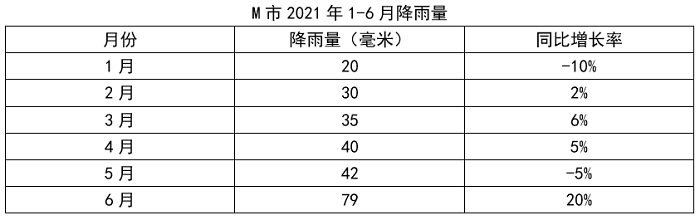

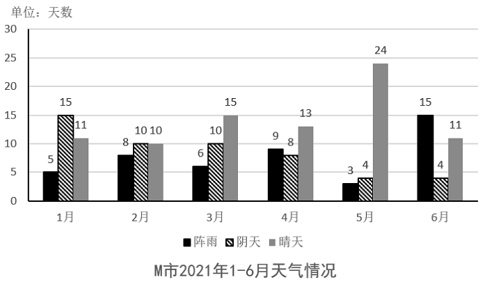

### 第 106 题

M市2021年6月的降雨量约是1月的多少倍？

A. 1

B. 2

C. 3

D. 4

第 106 题 · 答案与解析

**参考答案（粉笔题库参考内容）**

D

**解析**

根据题干“M市2021年6月的······约是1月的多少倍”，结合材料时间为2021年，可判定本题为现期倍数问题。定位表格材料可知，2021年6月M市降雨量为79毫米，1月为20毫米。故所求倍数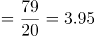倍，与D项最接近。

故正确答案为D。

**考点**：现期倍数、综合资料

**来源**：2021年黑龙江公检法司系统及边境县（市、区）急需紧缺专业岗公务员考试《行测》题第106题

### 第 107 题

M市2021年1-6月的天气情况中，每月的晴天比率高于45%的月份有多少个？

A. 1

B. 2

C. 3

D. 4

第 107 题 · 答案与解析

**参考答案（粉笔题库参考内容）**

B

**解析**

根据题干“······2021年1-6月······比率高于45%的月份有多少个”，可判定本题为比值计算问题。定位图形材料可知2021年1-6月各月晴天天数。根据“当月晴天比率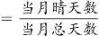”，则2021年1-6月M市各月晴天比率分别为：1月，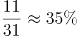；2月，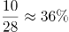；3月，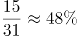；4月，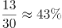；5月，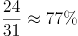；6月，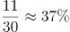。只有3月和5月的晴天比率高于45%，有2个月满足。

故正确答案为B。

**考点**：比值计算、综合资料

**来源**：2021年黑龙江公检法司系统及边境县（市、区）急需紧缺专业岗公务员考试《行测》题第107题

### 第 108 题

M市2020年6月的降雨量比同年1月的约高多少毫米？

A. 43.6

B. 45.8

C. 47.7

D. 56.8

第 108 题 · 答案与解析

**参考答案（粉笔题库参考内容）**

A

**解析**

根据题干“M市2020年6月的······比同年1月的约高多少毫米”，结合材料时间为2021年，可判定本题为基期和差问题。定位统计表可得：2021年6月M市降雨量为79毫米，同比增长率为20%；1月M市降雨量为20毫米，同比增长率为-10%。根据公式：基期量，故题干所求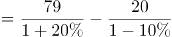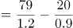毫米。

故正确答案为A。

**考点**：基期和差、综合资料

**来源**：2021年黑龙江公检法司系统及边境县（市、区）急需紧缺专业岗公务员考试《行测》题第108题

### 第 109 题

下列折线图能够准确反映M市2020年1—6月降雨量的是：

A. 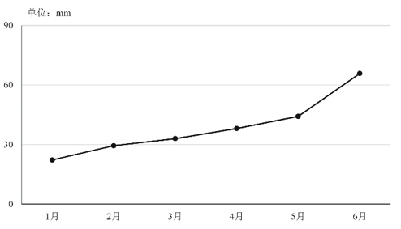

B. 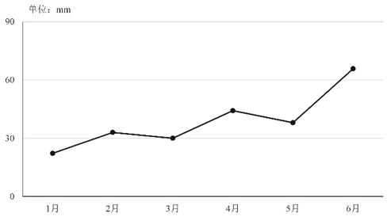

C. 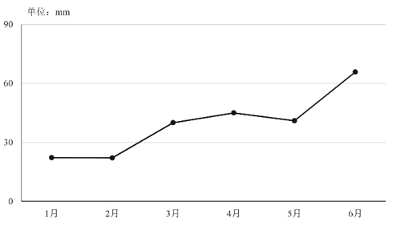

D. 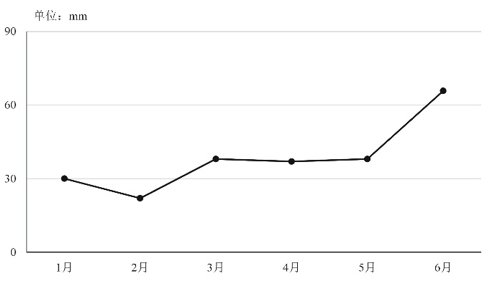

第 109 题 · 答案与解析

**参考答案（粉笔题库参考内容）**

A

**解析**

根据题干“······2020年1—6月降雨量的是”，结合材料时间为2021年，可判定本题为基期计算问题。定位表格材料可得，M市2021年1—6月降雨量分别为20毫米、30毫米、35毫米、40毫米、42毫米、79毫米，同比增长率分别为-10%、2%、6%、5%、-5%、20%。根据公式：，则M市2020年1月降雨量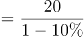=20/0.9≈22毫米，明显低于30毫米，排除D项；2020年2月降雨量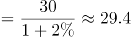毫米，略低于30毫米，排除B项；且2020年1月降雨量低于2020年2月降雨量，排除C项。

故正确答案为A。

**考点**：综合资料、基期计算

**来源**：2021年黑龙江公检法司系统及边境县（市、区）急需紧缺专业岗公务员考试《行测》题第109题

### 第 110 题

能够从上述资料中推出的是：

A. 每月的阵雨天数越多，降雨量就越大

B. M市2020年1—6月的降雨总量超过2021年1—6月的

C. M市2021年1—6月的晴天数逐月递增

D. M市2021年2—6月降雨量环比增长率最大的是6月

第 110 题 · 答案与解析

**参考答案（粉笔题库参考内容）**

D

**解析**

A项：定位统计图和统计表可知，M市2021年2月的阵雨天数（8天）多于3月的阵雨天数（6天），但2月的降雨量（30毫米）小于3月的降雨量（35毫米），阵雨天数多的反而降雨量更小，错误；

B项：定位统计表可知，M市2021年1—6月降雨量分别为20毫米、30毫米、35毫米、40毫米、42毫米、79毫米；同比增长率分别为-10%、2%、6%、5%、-5%、20%。根据公式：增长量，1月降雨量的同比增量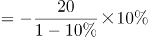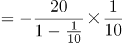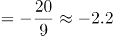毫米，5月的同比增量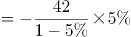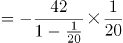毫米，6月的同比增量毫米，1月增量+5月增量+6月增量=-2.2+（-2.2）+13.2＞0，2月、3月、4月增长率均＞0，即增长量＞0，则2021年1—6月增量之和＞0，说明2021年1—6月总降雨量＞2020年1—6月总降雨量，错误；

C项：定位统计图可知，M市2021年2月的晴天数（10天）小于1月的晴天数（11天），故M市2021年1—6月的晴天数并不是逐月递增，错误；

D项：定位统计表可知，M市2021年1—6月降雨量分别为20毫米、30毫米、35毫米、40毫米、42毫米、79毫米。根据公式：增长率，可得M市2021年2月降雨量环比增速；3月：(35-30)/30；4月：(40-35)/35；5月：；6月：(79-42)/42。故6月降雨量的环比增长率最大，正确。

故正确答案为D。

**考点**：综合分析、综合资料

**来源**：2021年黑龙江公检法司系统及边境县（市、区）急需紧缺专业岗公务员考试《行测》题第110题

## 材料 2

### 第 111 题

2020年1—7月，中、西部地区住宅开发投资总额约为多少亿元？

A. 11584

B. 11942

C. 24109

D. 24671

第 111 题 · 答案与解析

**参考答案（粉笔题库参考内容）**

C

**解析**

根据题干“2020年1—7月，中、西部地区住宅开发投资总额······”，结合材料时间为2021年1—7月，可判定本题为基期和差问题。定位表1可得，2021年1—7月，中部地区住宅开发投资额为14330亿元，同比增长23.7%；西部地区住宅开发投资额为14002亿元，同比增长11.8%。根据公式：基期量，则2020年1—7月，中、西部地区住宅开发投资总额为亿元，与C项最接近。

故正确答案为C。

**考点**：基期和差、统计表

**来源**：2021年黑龙江公检法司系统及边境县（市、区）急需紧缺专业岗公务员考试《行测》题第111题

### 第 112 题

2021年1—7月，住宅投资额较去年同时期增长量最大的地区是：

A. 东部地区

B. 中部地区

C. 西部地区

D. 东北地区

第 112 题 · 答案与解析

**参考答案（粉笔题库参考内容）**

A

**解析**

根据题干“······较去年同时期增长量最大的地区是”，可判定本题为增长量比较问题。定位表1可得：2021年1—7月东部地区住宅投资额为33231亿元，同比增长13.3%；中部地区住宅投资额为14330亿元，同比增长23.7%；西部地区住宅投资额为14002亿元，同比增长11.8%；东北地区住宅投资额为2417亿元，同比增长7.6%。由于东部地区住宅投资额的现期量和增长率均高于西部地区、东北地区，由“大大则大”的原则可知，东部地区住宅投资额的同比增量高于西部地区、东北地区，排除C、D两项。东部地区和中部地区可代入公式：增长量。东部地区：亿元；中部地区： 亿元。则东部地区住宅投资额的同比增量最大。

故正确答案为A。

**考点**：增长量比较、统计表

**来源**：2021年黑龙江公检法司系统及边境县（市、区）急需紧缺专业岗公务员考试《行测》题第112题

### 第 113 题

2020年1—7月，按照商品房销售面积从大到小的顺序排列，排第1的地区的商品房销售额比第2的约多：

A. 27982亿元

B. 29255亿元

C. 40521亿元

D. 41787亿元

第 113 题 · 答案与解析

**参考答案（粉笔题库参考内容）**

A

**解析**

根据题干“2020年1—7月······排第1的地区的商品房销售额比第2的约多”，结合选项单位为亿元，材料时间为2021年1—7月，可判定本题为基期和差问题。定位表2可得2021年1—7月各地区商品房销售面积的现期量和增长率，根据基期量，可得2020年1—7月四个地区的商品房销售面积，分别为东部地区万平方米、中部地区万平方米、西部地区万平方米、东北地区万平方米，则2020年1—7月商品房销售面积排第1和第2的地区分别为东部地区和西部地区。定位表2可得，2021年1—7月东部地区商品房销售额为61943亿元，同比增长36.7%；西部地区商品房销售额为20156亿元，同比增长16.3%。则2020年1—7月东部地区商品房销售额比西部地区多亿元，与A项最接近。

故正确答案为A。

**考点**：基期和差、统计表

**来源**：2021年黑龙江公检法司系统及边境县（市、区）急需紧缺专业岗公务员考试《行测》题第113题

### 第 114 题

2021年1—7月，商品房平均销售单价同比变化幅度在1%-3%区间的地区有多少个？

A. 0

B. 1

C. 2

D. 3

第 114 题 · 答案与解析

**参考答案（粉笔题库参考内容）**

C

**解析**

根据题干“2021年1—7月，商品房平均销售单价同比变化幅度······”，可判定本题为平均数的增长率问题。定位表2可得：2021年1—7月，东部地区商品房销售额同比增长36.7%（a_1），销售面积同比增长24.1%（b_1）；中部地区商品房销售额同比增长33.4%（a_2），销售面积同比增长27.1%（b_2）；西部地区商品房销售额同比增长16.3%（a_3），销售面积同比增长14.3%（b_3）；东北地区商品房销售额同比增长6.9%（a_4），销售面积同比增长8.8%（b_4）。根据平均数的增长率公式：，则2021年1—7月东部地区商品房平均销售单价的同比增长率，中部地区商品房平均销售单价的同比增长率，西部地区商品房平均销售单价的同比增长率，东北地区商品房平均销售单价的同比增长率。变化幅度即增长率的绝对值，故变化幅度在1%-3%区间的地区有西部地区、东北地区，共2个。

故正确答案为C。

**考点**：平均数的增长率、统计表

**来源**：2021年黑龙江公检法司系统及边境县（市、区）急需紧缺专业岗公务员考试《行测》题第114题

### 第 115 题

能够从上述资料中推出的是：

A. 2021年，只有东北地区的房地产开发投资额同比增速大于住宅投资同比增速

B. 2020年1—7月，2个地区的住宅投资额占房地产开发投资额比重高于全国的

C. 2021年1—7月，西部地区商品房销售面积较去年同时期增长量是东北地区的8倍

D. 2021年1—7月，全国商品房平均销售单价同比增长11.9%

第 115 题 · 答案与解析

**参考答案（粉笔题库参考内容）**

B

**解析**

A项：定位表1可知材料中只给出2021年1—7月相关数据，未给出2021年全年的数据，无法判断，错误；

B项：定位表1可知2021年1—7月全国及各个地区的住宅投资额及其同比增长率，和房地产开发投资额及其同比增长率。根据公式：基期比重，则2020年1—7月全国及各个地区的住宅投资额占房地产开发投资额的比重分别为：

全国：；

东部地区：；

中部地区：；

西部地区：；

东北地区：，即满足条件的有中部地区和东北地区，共2个地区，正确；

C项：定位表2可知，2021年1—7月，西部地区商品房销售面积为26965万平方米，同比增长14.3%；东北地区商品房销售面积为3483万平方米，同比增长8.8%。根据公式：增长量，则2021年1—7月，西部地区商品房销售面积的同比增长量万平方米；2021年1—7月，东北地区商品房销售面积的同比增长量万平方米，则所求倍数约为倍，错误；

D项：定位表2可知，2021年1—7月，全国商品房销售面积的同比增长率为21.5%，商品房销售额的同比增长率为30.7%。根据公式： 平均数增长率=(a-b)/(1+b)，代入数据，则2021年1—7月，全国商品房平均销售单价的同比增长率，错误。

故正确答案为B。

**考点**：综合分析、统计表

**来源**：2021年黑龙江公检法司系统及边境县（市、区）急需紧缺专业岗公务员考试《行测》题第115题

## 材料 3

2021年3—5月某市共享单车使用情况如下：

2021年3—5月全市共投入120万辆共享单车，其维修率约为10%。维修量同比减少5%，其平均使用率为92%，同比增长2个百分点。

2021年3月，甲公司共投入12万辆共享单车，其占全市当月投入共享单车总量的比率比乙公司的高3个百分点；甲公司当月投入共享单车的使用率为90%，比乙公司的低2个百分点。

2021年4月，乙公司当月投入的共享单车维修了0.9万辆，其维修率为9%，环比减少了2个百分点。甲公司当月投入的共享单车维修了1.1万辆，其维修率为12%，环比增长了4个百分点。

2021年5月，乙公司当月投入共享单车13.5万辆，占全市当月投入共享单车总量的30%，环比增长1个百分点，乙公司当月投入共享单车的使用率为95%，环比增长3个百分点。

### 第 116 题

2020年3—5月，该市投入的共享单车中维修了约多少万辆？

A. 11.4

B. 12

C. 12.6

D. 13

第 116 题 · 答案与解析

**参考答案（粉笔题库参考内容）**

C

**解析**

根据题干“2020年3—5月，该市投入的共享单车中维修了约多少万辆”，结合材料时间为2021年3—5月，可判定本题为基期计算问题。定位文字材料第一段可得：2021年3—5月全市共投入120万辆共享单车，其维修率约为10%，维修量同比减少5%。根据公式：部分量=总体量×比重，可得2021年3—5月，该市投入的共享单车中维修的车辆数=120×10%=12万辆。则2020年3—5月，该市投入的共享单车中维修的车辆数万辆。

故正确答案为C。

**考点**：文字资料、基期计算

**来源**：2021年黑龙江公检法司系统及边境县（市、区）急需紧缺专业岗公务员考试《行测》题第116题

### 第 117 题

2021年4—5月，乙公司在该市共投入共享单车多少万辆？

A. 10

B. 13.5

C. 21.6

D. 23.5

第 117 题 · 答案与解析

**参考答案（粉笔题库参考内容）**

D

**解析**

根据题干“2021年4—5月，乙公司在该市共投入共享单车多少万辆”，结合材料给出2021年4月乙公司维修单车数量及其维修率，可判定本题为现期比重计算问题。定位文字材料第三段可得：2021年4月，乙公司当月投入的共享单车维修了0.9万辆，其维修率为9%；定位文字材料第四段可得：2021年5月，乙公司当月投入共享单车13.5万辆。根据公式：，可得2021年4月乙公司在该市投入共享单车总量万辆，则2021年4—5月乙公司投入共享单车总量=10万+13.5万=23.5万辆。

故正确答案为D。

**考点**：文字资料、现期比重

**来源**：2021年黑龙江公检法司系统及边境县（市、区）急需紧缺专业岗公务员考试《行测》题第117题

### 第 118 题

2021年4月，该市当月投入共享单车约为多少万辆？

A. 30

B. 34.5

C. 40.5

D. 45

第 118 题 · 答案与解析

**参考答案（粉笔题库参考内容）**

B

**解析**

根据题干“2021年4月······约为多少万辆”，结合材料已给出2021年4月乙公司共享单车的维修数量和维修率，并且可推出乙公司投入共享单车占全市的比重，可判定本题为现期比重计算问题。定位文字材料第三段可得：2021年4月，乙公司当月投入的共享单车维修了0.9万辆，其维修率为9%。根据公式：，可知2021年4月乙公司投入共享单车为万辆。定位文字材料第四段可得：2021年5月，乙公司当月投入共享单车13.5万辆，占全市当月投入共享单车总量的30%，环比增长1个百分点。因此2021年4月乙公司投入共享单车占全市当月投入共享单车总量的30%-1%=29%。根据公式：，可知2021年4月该市投入共享单车为万辆。

故正确答案为B。

**考点**：文字资料、现期比重

**来源**：2021年黑龙江公检法司系统及边境县（市、区）急需紧缺专业岗公务员考试《行测》题第118题

### 第 119 题

乙公司3月、4月、5月在该市投入共享单车占全市投入共享单车的比重由高到低排序，正确的是：

A. 5月，4月，3月

B. 5月，3月，4月

C. 3月，5月，4月

D. 3月，4月，5月

第 119 题 · 答案与解析

**参考答案（粉笔题库参考内容）**

A

**解析**

根据题干“乙公司3月、4月、5月······占······的比重由高到低排序······”，可判定本题为现期比重问题。定位材料第一、二、四段可得：3—5月全市共投入120万辆共享单车；3月甲公司共投入12万辆共享单车，其占全市当月投入共享单车总量的比率比乙公司的高3个百分点；5月乙公司投入共享单车13.5万辆，占全市当月投入共享单车总量的30%，环比增长1个百分点。根据公式：，则5月全市投入共享单车总量万辆。根据本篇材料第3题可知，4月全市投入共享单车约34.5万辆，故3月全市投入共享单车总量万辆。3月甲公司投入共享单车所占比重，则3月份乙公司投入共享单车占比=29.6%-3%＝26.6%。5月份乙公司投入共享单车占比为30%，4月份为30%-1%=29%。比较可知，5月（30%）＞4月（29%）＞3月（26.6%）。

故正确答案为A。

**考点**：文字资料、现期比重

**来源**：2021年黑龙江公检法司系统及边境县（市、区）急需紧缺专业岗公务员考试《行测》题第119题

### 第 120 题

能够从上述资料中推出的是：

A. 2021年3—5月，甲公司在该市投入的共享单车的数量比乙公司的多

B. 2020年3—5月，该市约有108万辆共享单车被使用

C. 2021年3—5月，乙公司投入共享单车的使用率超过全市投入共享单车的平均使用率

D. 2021年3月，甲公司当月投入共享单车的维修率高于乙公司的

第 120 题 · 答案与解析

**参考答案（粉笔题库参考内容）**

C

**解析**

A项：定位文字材料第四段：未给出5月甲公司投入共享单车数量的相关信息，故无法比较，错误；

B项：定位文字材料第一段：2021年3—5月全市共投入120万辆共享单车，其平均使用率为92%，同比增长2个百分点。可知2020年3—5月平均使用率为92%-2%=90%，但是数据不足，2020年3—5月全市共投入共享单车数量无法求出，故共享单车被使用数量也无法求出，错误；

C项：定位文字材料第一、二、四段：2021年3—5月全市共投入共享单车平均使用率为92%；2021年3月，甲公司当月投入共享单车的使用率为90%，比乙公司的低2个百分点；2021年5月，乙公司当月投入共享单车的使用率为95%，环比增长3个百分点。可得2021年3月，乙公司投入共享单车的使用率为90%+2%=92%，2021年4月，乙公司投入共享单车的使用率为95%-3%=92%。根据混合比重：混合后居中，可知92%<2021年3—5月乙公司投入共享单车的使用率<95%。2021年3—5月全市共投入共享单车平均使用率为92%，所以2021年3—5月，乙公司投入共享单车的使用率超过全市投入共享单车的平均使用率，正确；

D项：定位文字材料第三段：2021年4月，乙公司维修率为9%，环比减少了2个百分点。甲公司维修率为12%，环比增长了4个百分点。可知：2021年3月，甲公司维修率为12%-4%=8%，2021年3月，乙公司维修率为9%+2%=11%，8%<11%，则2021年3月，甲公司当月投入共享单车的维修率低于乙公司的，错误。

故正确答案为C。

**考点**：文字资料、综合分析

**来源**：2021年黑龙江公检法司系统及边境县（市、区）急需紧缺专业岗公务员考试《行测》题第120题

