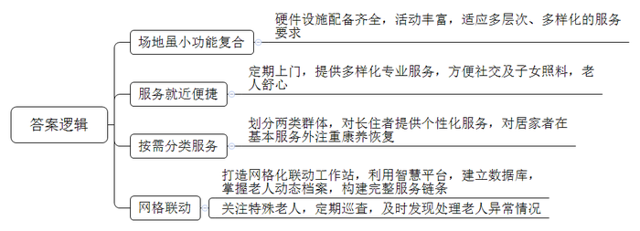
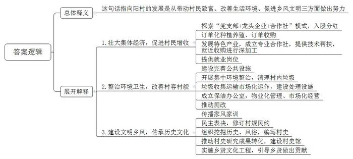
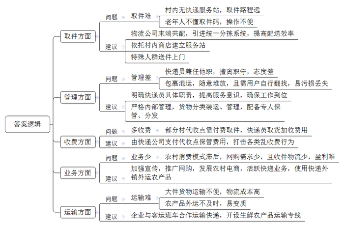

# 2022年公务员多省联考《申论》题（黑龙江县乡、普通选调卷）

> 候选采集稿。参考答案及解析来自粉笔页面，不代表官方答案或真实高分答卷；来源使用许可与原卷对应关系仍需人工核实。

## 给定材料

### 材料 material-a705a11545e65b45

这天，在胡城街道驿道社区，30多名老人在社工的带领下，围在一起放风筝，76岁的赵大爷正专心致志地给风筝涂上自己喜欢的颜色。赵大爷说：“我们不出社区，就能与老伙伴摆摆龙门阵、唱唱歌、跳跳舞，感觉日子过得很充实，越活越精神，越活越高兴。”

“螺蛳壳里做道场”。驿道社区嵌入式养老服务中心场地虽小但功能复合，配套了无障碍通道、理疗间、多功能室、助餐室、护理室等，满足了养老服务多层次、多样化的需求。“我们积极开设老年课堂，每个星期都会提前把每一课堂的时间和内容以课程表的方式排好，轮流开展。我们的活动有趣味运动会、画画、舞蹈比赛等。同时，联系社会上的志愿者或社区医院，嵌入整个活动流程，不断丰富老年人生活，让老人老有所养，老有所乐。”中心社工部赖主任说。

在这个中心，社工团队还会定期上门为老人开展义剪、足浴和健康检查等嵌入式服务，为辖区老人提供更多便利。“早上八点半跳舞，然后搞活动，还给我们检查眼睛和血压，我很高兴。”社区居民熊大姐说。“20多年前我老伴儿去世，两个女儿嫁得比较远，长年不在身边，我在家很孤单。”80岁的曹奶奶说，“现在，我们在家附近就能享受到服务，他们的照顾很专业，还能与街坊邻居拉家常，这样的养老方式让我觉得很舒心。”谈起入住中心以来的生活，曹奶奶乐得合不拢嘴。

端午节这天，社区居民张叔在家煲好鸽子汤，送到中心给中风卧床多年的老母亲尝尝鲜，不烫不凉，正好入口。他说：“我们双职工家庭无法长期留人在家看护老母亲，幸好中心就在家边上，下班后过来探视，送点吃的喝的都挺方便。”

不仅如此，中心将所服务的老人分为了两个群体，一个是住在里面的，一个是需要上门服务的。对于住在里面的，中心对每一位老人都有一套个性化服务方案。针对晚上睡眠不好的老人，会安排工作人员通过睡觉前按摩等方式帮助老人放松心情，更好入睡；针对一些情绪经常波动的老人，会安排工作人员陪老人聊天谈心，帮助他们找出原因，平复情绪。“大家对中心评价都非常高。我们每月只交不多的钱，就可以享受用餐、定期体检、心理咨询等一系列服务。现在生活规律、开心，感谢党的好政策。”91岁的刘奶奶高兴地说。

而对于需要上门服务的，除了基本服务外，考虑到这一部分人大都是失能失智人员，中心则主要在康养恢复上下功夫，“我老伴儿已经卧床多年，许多功能逐渐退化，中心工作人员不仅没嫌弃，还专门为她订做了一套理疗方案，包括定时派人来针灸、按摩等。”居民老倪说。

除此之外，中心还积极打造网格化联动工作站，运用智慧网格化管理平台，建立人脸3D信息库，通过信息系统掌握社区老人的动态档案，包括基本情况、服务动态等，构建起完整的服务链条。75岁的陈大妈患有阿尔兹海默症，子女因工作原因不在身边，老人常常一出门就找不到回家的路，中心工作人员对她给予特别关注，并与亲属、保安、警察、热心居民等形成联络网，以便发生走失意外时及时处理。

“我们现在所在的是中控室，相当于我们的大脑，电脑大屏上是我们掌握的老人数据库，能够体现社区所有老人的基本信息，定制需求和服务情况等，当然我们也为这些信息都做好了保密工作。同时，这些数据我们做到了每天及时更新。”驿道社区党支部秦书记介绍说。

中心在系统的帮助下，会定期对社区老人进行巡查。去年7月，中心工作人员巡查时，发现有位独居老人躺在床上，呼其不应，身体僵硬且无法动弹。工作人员立即拨打应急救援电话，并第一时间通知其在外地的子女，由于现场应急处理措施得当，老人家得到了及时救治，转危为安。

秦书记说：“今后我们将进一步探索这种‘自家的养老院’嵌入式养老模式，将老人们的个体行动无缝嵌入整个服务网络，让他们在情感上更容易接受，为他们提供更完善的养老服务。”

### 材料 material-518032dab2dc8bf6

对于家乡的旧貌，土生土长的田园镇向阳村村民老陶仍记忆犹新。“我们村虽然有得天独厚的优美山水，但过去，村里污水横流，垃圾满地。‘室内现代化，室外脏乱差’，说的就是我们这里。我们村经常被隔壁村的人看不起。”时隔两年，再次走进向阳村，老陶发现，村里荒废的角落建起了休闲广场，健身器材、文化走廊、公共洗手间样样俱全，泥泞的乡间小路变成了宽阔的水泥路，农户房前整齐地种着各种蔬菜和绿植，村容村貌焕然一新。“我们村开展环境卫生整治后，村庄道路宽了，出行更方便了，我家房前屋后也变得越来越整洁。乡亲们吃完饭，就在休闲广场上散步聊天，生活质量比以前提高了不少，‘腰杆子’都挺直了。”村民老李自豪地说。

2021年以来，向阳村已经开展了10余次集中环境整治，组织党员干部、村民、返乡大学生对村里的垃圾、牛羊粪、废弃建筑材料等进行了全面清理。村党支部吴书记介绍：“我们还通过招标方式实现生活垃圾收集运输市场化运作，建立了小型微动力污水处理系统，生活垃圾处理站的两台焚烧炉每天能‘吃掉’6吨生活垃圾，有效解决了村里的生活垃圾和污水处理难题。”

村里还成立了保洁办公室，将人居环境整治转向物业化管理、市场化经营。在保洁办公室的推动下，村里陆续对村民家里的旱厕进行了水冲厕所改造。村民老张家的卫生间已经改造完成，新安装的马桶上贴着一张用户联系卡，上面标有维修、监督和村级联系人的电话。

村里环境改观了，如何增加收入又是一个问题。为壮大村集体经济，村里积极探索“党支部+龙头企业+合作社”的模式，以入股的方式增加村集体收入，带动村民增收。吴书记介绍道，向阳村在镇里的农产品开发公司投入股金80万元，按占股比例分红，村集体经济每年保底收益为5万元。同时，公司还通过订单种植养殖、订单收购带动240户农户增收致富。

今年，村里将以发展肉鸭养殖项目为主，推动村民收入水平再上新台阶。村民老刘忙得不亦乐乎，每天不仅要饲养好自己养的5000多只鸭子，还要忙着把收捡好的鸭蛋送到附近的合作社加工。而就在几年前，他还只是一个养鸭规模不大的农户。“过去养殖规模很小，现在一年收入有10万元左右，这得益于产业发展的带动。”老刘高兴地说。为了更好地带动群众增收，村里还引导村民成立了专业的养殖合作社，不仅免费为像老刘这样的养殖户提供更多的养殖技术，还就近收购他们的产品进行深加工。合作社在壮大集体经济的同时，也为村民提供了更多的就业岗位。

“村子近年来变化很大，房子漂亮，住着舒服，每天都有专门的人打扫公共卫生，村容村貌改善非常明显，更重要的是邻里关系和睦，家家户户门口都挂有彰显家风家训的匾牌。”村民老张说，村里建设的“家风家训一条街”对教育后代帮助很大，村里的孩子现在都能把家风家训背出来了。

今年年初，在村党支部的指导下，向阳村召开了村民代表大会，大家一致举手通过了新修订的村规民约。此外，村里还组织大学生返乡开展社会实践，通过实地走访老前辈、查阅文史资料，挖掘向阳村的历史文化，探究过去的风俗习惯，编写了一本图文并茂的《向阳村史》。下一步，村里还要推进村史研究成果转化，建设村史馆，并进一步实施乡贤文化工程，引导乡贤为本村的发展建言献策、出资助力。这些举措得到了镇政府的肯定，多次组织镇村干部前来“取经”。吴书记高兴地跟大家说道：“村里的发展，既要摘掉‘穷帽子’，又要改变‘老样子’，还要留住‘好根子’。”

### 材料 material-59e1ae8c052e1ce5

农村寄递物流是农产品出村进城、消费品下乡进村的重要渠道之一。近年来，Z县农村寄递物流体系建设取得了长足进步，但与群众的期待尚存在“最后一公里”不顺畅的问题。日前，Z县在线上开展了关于Z县农村寄递物流体系建设意见征集活动，网友们纷纷留言反映意见建议。

●我常年在外面打工，有时会网购一些生活用品给家里的老人和小孩，但村里没有收发快递的服务站，需要自己到镇上取，路途遥远，十分麻烦，此外，老人也不懂“取件码”，取快递存在很多困难，请邻居帮忙取件也不是长久之计。

●快递可以到镇里，但我们村到镇里还很远，遇到农忙时节，根本没时间去取。而且快递代收员还兼做其他事情，经常不在，有时态度也不好，过去一趟要提前预约，有时还要在那里等很久。这样一来，包裹长期存放在那里，很容易损坏或丢失。

●快递虽然可以到村，但经常把我们的包裹和农药、化肥等一同装车，包裹被压坏、摔坏、污染，甚至丢失。寄来的东西随意堆放，也没人管，还要我们自己去找，翻来找去，还容易把别人的东西弄坏了。

●这两年，村里虽然有了快递代收点，但普遍需要付费。有一次，我收到短信说快递已经送到镇上，便赶到快递站取，没想到工作人员却告诉我必须到村代收点付费收取。他们就是为了赚这笔钱，这不是强制收费吗？

●我所在的乡镇快递站连公司规定发件率的20%都无法完成，加上派件收费较低，送件入村很不划算，送货到村民家中，基本是“送一单赔一单”，所以只要是寄往农村的快递，都是通知收件人自取。其实，这里农村出产葡萄、蔬菜等优质农产品，但多数农民还不善于使用快递外销外运农产品。如果村民能够用快递物流运输农产品，对于村民和快递企业将是双赢。

●我们镇里的农村道路比较窄，大货车进出困难，经常有大件货物，只能依靠面包车多次往返运输，成本增加不少。村里曾经与客运班车开展合作运输农产品，由于班车的班次和空间有限，农产品往往不能及时发出，新鲜农产品面临变质的风险，如果能够与快递企业合作，这些难题应该可以得到解决。

●多个快递公司末端共同配送是当前“快递进村”的一种方式，可以在快递到达县级网点后，共同发放到村级站点，节约人力物力，也提升了派送效率，但是整合快递资源却不是一件易事，市场上大多数末端共配公司，没有使用同一套分拣系统，在操作上也不尽相同，统一起来难度较大。

●留守村民文化程度往往不高，消费模式相对滞后，而且物流主要是送货单向物流，缺乏收件物流，农村物流量小，快递公司很难盈利甚至亏本经营。建议应该广泛宣传和推动“快递进村”，只有货件货源多起来，快递业务才能活跃起来。

●我们村的电商服务站就设在村里的一个小卖部那，村民们把自己的农产品定点送往服务站，由服务站统一收取发往乡镇的集散中心，小卖部对村里的情况很了解，同时人流为小卖部带来人气，也降低了小卖部的服务成本。

●村里的板栗、核桃、鸡蛋、蘑菇等农特产品要往外发，不到乡镇网点，根本办不成。如果请快递员来“取货”，每一单都要加收费用，有的干脆嫌远，或嫌路难走，根本不愿意进村来。一些售价低廉的农产品，其本身价格可能还不如物流费高。

●我是乡镇快递网点的，我们也想为大家服务，可是有些村子只住着几十户人家，甚至是“单家独户”，一个星期才十多单快递，进村的道路又不像城里那么好走，如果快递到站就跑一趟，成本实在太高。因为跑一趟，有时就一件东西；不跑呢，有些食品类的东西又不能放太久。所以，在客户允许的情况下，我们往往会托人把快递有偿捎带过去。

## 题目

### 第 1 题

**根据****“给定资料**1**”，请谈谈胡城街道驿道社区嵌入式养老服务模式的特点。（15分）**

关联材料：材料 material-a705a11545e65b45

作答要求：

要求：全面、准确、有条理。不超过200字。

### 第 2 题

**根据****“给定资料**2**”，谈谈对“村里的发展，既要摘掉‘穷帽子’，又要改变‘老样子’，还要留住‘好根子’”的理解。（20分）**

关联材料：材料 material-518032dab2dc8bf6

作答要求：

要求：

（1）理解准确；

（2）分析透彻；

（3）简明扼要；

（4）不超过300字。

### 第 3 题

**根据****“给定资料**3**”，请梳理Z县农村寄送物流体系存在的问题，并提出相应的改进建议。（25分）**

关联材料：材料 material-59e1ae8c052e1ce5

作答要求：

要求：

（1）问题梳理全面、准确、有条理；

（2）所提建议与问题相对应，具体明确，切实可行；

（3）不超过400字。

### 第 4 题

**“给定资料**4**”中提到，“‘村村通’变成了‘村村痛’”“‘村村痛’又变成了‘村村通’”。从“通”到“痛”，又从“痛”到“通”，这样的变化带给我们很多思考。请深刻理解“给定资料”，联系实际，自选角度，自拟题目，写一篇文章。（40分）**

关联材料：材料 material-a705a11545e65b45

作答要求：

要求：

（1）观点明确，见解深刻；

（2）参考“给定资料”，但不拘泥于“给定资料”；

（3）思路清晰，语言流畅；

（4）总字数800\-1000字。

## 答案与解析

第 1 题

**参考答案（粉笔题库参考内容）**

1.场地虽小功能复合。硬件设施配备齐全，活动丰富，适应多层次、多样化的服务要求。

2.服务就近便捷。定期上门，提供多样化专业服务，方便社交及子女照料，老人舒心。

3.按需分类服务。划分两类群体，对长住者提供个性化服务，对居家者在基本服务外注重康养恢复。

4.网格联动。打造网格化联动工作站，利用智慧平台，建立数据库，掌握老人动态档案，构建完整服务链条；关注特殊老人，定期巡查，及时发现处理老人异常情况。

**解析**

**参考答案说明：**本参考答案从“场地虽小功能复合”“服务就近便捷”“按需分类服务”“网格联动”这四个方面进行了分条撰写。各条答案要点之间在内容上相互并列，没有交叉。

**考点**：考点特点类

**来源**：来源2022年公务员多省联考《申论》题（黑龙江县乡、普通选调卷）

粉笔申论页面对本题只提供「解析视频」入口，该入口是会员推广位，页面无视频地址与文字解析。

第 2 题

**参考答案（粉笔题库参考内容）**

这句话指向阳村的发展是从带动村民致富、改善生活环境、促进乡风文明三方面做出努力。

1.壮大集体经济，促进村民增收。探索“党支部+龙头企业+合作社”模式，入股分红；订单化种植养殖、订单收购；发展特色产业，成立专业合作社，提供技术帮扶，就近收购进行深加工；提供就业岗位。

2.整治环境卫生，改善村容村貌。建设完善公共设施；开展集中环境整治，清理村内垃圾；垃圾收集运输市场化运作，建设处理设施；成立保洁办公室，物业化管理、市场化经营；推动厕改。

3.建设文明乡风，传承历史文化。传播家风家训；民主表决，修订村规民约；组织挖掘历史、风俗，编写村史；推动村史研究成果转化，建设村史馆；实施乡贤文化工程，引导乡贤做出贡献。

**解析**

**参考答案说明：**（1）思路方面，本参考答案按照词句解释题“总体释义+展开解释+总结”的思路展开。（2）内容方面，本答案首先对句子的含义作出了解释；接着“展开解释”部分从“壮大集体经济，促进村民增收”“整治环境卫生，改善村容村貌”“建设文明乡风，传承历史文化”这三个方面进行分析。词句表达方面，参考答案加上了“这句话指”等连接词来承接上下文。

**考点**：考点词句解释类

**来源**：来源2022年公务员多省联考《申论》题（黑龙江县乡、普通选调卷）

粉笔申论页面对本题只提供「解析视频」入口，该入口是会员推广位，页面无视频地址与文字解析。

第 3 题

**参考答案（粉笔题库参考内容）**

1.问题：取件难。村内无快递服务站，取件路程远；老年人不懂取件码，操作不便。建议：物流公司末端共配，引进统一分拣系统，提高配送效率；依托村内商店建立服务站；特殊人群送件上门。

2.问题：管理差。快递员兼任他职，擅离职守，态度差；包裹混运，随意堆放，且需用户自行翻找，易污损丢失。建议：明确快递员具体职责，提高服务意识，确保工作到位；严格内部管理，货物分类装运、管理，配备专人保管、分发。

3.问题：多收费。部分村代收点需付费取件，快递员取货加收费用。建议：由快递公司支付代收点保管费用，打击各类乱收费行为。

4.问题：业务少。农村消费模式滞后，网购需求少，且收件物流少，盈利难。建议：加强宣传，推广网购，发展农村电商，活跃快递业务，使用快递外销外运农产品。

5.问题：运输难。大件货物运输不便，物流成本高；农产品外运不及时，易变质。建议：企业与客运班车合作运输快递，开设生鲜农产品运输专线。

**解析**

**参考答案说明：**本参考答案分别围绕“取件”“管理”“收费”“业务”“运输”五个方面的问题及对应的建议展开，进行了分条撰写；各条具体要点之间在内容上相互并列，没有交叉。

**考点**：考点提出对策类

**来源**：来源2022年公务员多省联考《申论》题（黑龙江县乡、普通选调卷）

粉笔申论页面对本题只提供「解析视频」入口，该入口是会员推广位，页面无视频地址与文字解析。

第 4 题

**参考答案（粉笔题库参考内容）**

**农村公路****“通”与“痛”的启示**

农村要发展，交通是基础。近年来，各地积极推行“村村通”工程，让一条条公路将乡村与城市相连，打破了农村发展的交通瓶颈，缓解了居民的出行难题。然而，“村村通”也曾一度变成了“村村痛”，如公路修建宽度过窄、错车困难，路面缺乏维护，坑坑洼洼、颠簸不平……因此，**加强农村公路建设，各地要充分认识到规划设计的重要性，增强规划前瞻性，强化公路日常维护，确保其长效运行，进而更好发挥****“公路+”的综合作用。**

**“从通到痛”启示我们，农村公路的建设要注重前瞻性，既立足实际、实事求是，又适度超前、尽力而为。**当前，一些农村实施“村村通”工程时，未提前考虑到私家车、大型农机具等在农村日渐普及，导致后期道路拥挤、运行状况频发。因此，农村公路建设需瞻前顾后，科学规划，合理布局，既要做好前期调查研究，充分考虑当下和未来的发展情况，也要把规划权交给村民，广泛征求群众意见，了解其内在需求。如此，方能引领性地把党的好政策落实到位，避免后期返工，耗时耗力，劳民伤财。

**“从通到痛”还启示我们，农村公路的建设要注重长效性，关注后续问题，做好改造提升、养护运维工作，确保路网畅通、有序。**近年来，由于重建设，轻管护，导致农村公路耗损快，直接影响着公路的行车安全和长远发展。因此，一方面，要明确农村公路建、管、养责任主体，设立道路专管员，给每条农村公路配上“管家”，开展日常巡查检修。另一方面，也要根据农村发展需要，积极开展乡村公路升级改造工程，比如拓宽、加固路面，提高通行的通达性、舒适性。

**“从痛到通”启示我们，要发挥好“农村公路+”的综合作用，畅通物流体系，带动农村产业发展，促进城乡之间人、物、资金等要素自由流通。**所谓“修建一条公路，串联一路风景，带动一方产业”。农村公路不仅是农村居民便捷出行的保障，也是农村产业发展和经济增长的基础。一条条延伸的公路，串联的是城市与农村，打通的却是偏僻与繁华、贫困与富足。因此，要积极借助四通八达的农村公路，帮助农业生产经营者畅通农产品外销渠道，同时吸引城市资本下乡，优秀人才下沉，让深山里的绿水青山变成金山银山，让守住一方秀丽山水的农民吃上“旅游饭”。农村公路唯有变成产业路、旅游路、致富路，才算真正通到了群众的心里面啊！

建好乡村路，踏上新征程。希望各地在规划好、管护好乡村公路的基础上，不断发挥“公路+”的综合作用，真正让乡村公路成为乡村振兴的“幸福路”！

**解析**

**文章分析**

**农村公路****“通”与“痛”的启示**

【**标题的优点：**首先，范文的标题突出了“农村公路建设”这一主题。其次，形式上，文字简洁明快。】

（1）农村要发展，交通是基础。近年来，各地积极推行“村村通”工程，让一条条公路将乡村与城市相连，打破了农村发展的交通瓶颈，缓解了居民的出行难题。然而，（2）“村村通”也曾一度变成了“村村痛”，如公路修建宽度过窄、错车困难，路面缺乏维护，坑坑洼洼、颠簸不平……因此，（3）**加强农村公路建设****，各地要充分认识到****规划设计****的重要性，增强****规划前瞻性****，强化****公路日常维护****，确保其****长效运行****，进而更好****发挥****“公路+”的综合作用****。**

【**开头的优点：**★内容方面：范文的开头是紧扣题目给定的“‘村村通’变成了‘村村痛’”“‘村村痛’又变成了‘村村通’”这两句话展开的。首先，开头点出主题，做到了主题明确。其次，对“农村公路建设”这一主题进行了分析阐述，指出了（1）推行“村村通”工程，建设农村公路的意义。（2）农村公路建设过程中存在的问题。（3）引出文章的核心观点。★文字表达方面：使用了“然而”“因此”等关联词，使语言表达有逻辑性。】

**“从通到痛”启示我们，农村公路的建设要注重前瞻性，既立足实际、实事求是，又适度超前、尽力而为。**（1）当前，一些农村实施“村村通”工程时，未提前考虑到私家车、大型农机具等在农村日渐普及，导致后期道路拥挤、运行状况频发。因此，（2）农村公路建设需瞻前顾后，科学规划，合理布局，既要做好前期调查研究，充分考虑当下和未来的发展情况，也要把规划权交给村民，广泛征求群众意见，了解其内在需求。如此，方能引领性地把党的好政策落实到位，避免后期返工，耗时耗力，劳民伤财。

【**论述段****1的优点：**★观点句：范文的观点句是紧扣“农村公路建设”这一文章主题提出的。形式上，它在段首处直接写出，位置突出，容易发现。内容上，关键词突出，内容要点明确，可以明显看出它是从“农村公路建设要注重前瞻性”入手，指出了解决“农村公路建设‘痛点’”的对策。★论述内容：（1）先介绍了农村公路建设缺乏前瞻性的问题；（2）再介绍了农村公路建设要注重前瞻性的具体对策。注意：以上两个方面的内容都是紧扣“‘从通到痛’启示我们，农村公路的建设要注重前瞻性，既立足实际、实事求是，又适度超前、尽力而为”这个观点句进行分析论述的，论述的针对性强，内容层次丰富。在论述方法上主要采用了讲道理的方式，做到了见解深刻。】

**“从通到痛”还启示我们，农村公路的建设要注重长效性，关注后续问题，做好改造提升、养护运维工作，确保路网畅通、有序。**（1）近年来，由于重建设，轻管护，导致农村公路耗损快，直接影响着公路的行车安全和长远发展。因此，（2）一方面，要明确农村公路建、管、养责任主体，设立道路专管员，给每条农村公路配上“管家”，开展日常巡查检修。另一方面，也要根据农村发展需要，积极开展乡村公路升级改造工程，比如拓宽、加固路面，提高通行的通达性、舒适性。

【**论述段****2****的优点：**★观点句：范文的观点句是紧扣“农村公路建设”这一文章主题提出的。形式上，它在段首处直接写出，位置突出，容易发现。内容上，关键词突出，内容要点明确，可以明显看出它是从“农村公路建设要注重长效性”入手，指出了解决“农村公路建设‘痛点’”的对策。★论述内容：（1）先介绍了农村公路建设重建轻管、缺乏长效性的问题；（2）再介绍了农村公路建设要注重长效性的具体对策。注意：以上两个方面的内容都是紧扣“‘从通到痛’还启示我们，农村公路的建设要注重长效性，关注后续问题，做好改造提升、养护运维工作，确保路网畅通、有序”这个观点句进行分析论述的，论述的针对性强，内容层次丰富。在论述方法上主要采用了讲道理的方式，做到了见解深刻。】

**“从痛到通”启示我们，要发挥好“农村公路+”的综合作用，畅通物流体系，带动农村产业发展，促进城乡之间人、物、资金等要素自由流通。**（1）所谓“修建一条公路，串联一路风景，带动一方产业”。农村公路不仅是农村居民便捷出行的保障，也是农村产业发展和经济增长的基础。一条条延伸的公路，串联的是城市与农村，打通的却是偏僻与繁华、贫困与富足。因此，（2）要积极借助四通八达的农村公路，帮助农业生产经营者畅通农产品外销渠道，同时吸引城市资本下乡，优秀人才下沉，让深山里的绿水青山变成金山银山，让守住一方秀丽山水的农民吃上“旅游饭”。农村公路唯有变成产业路、旅游路、致富路，才算真正通到了群众的心里面啊！

【**论述段****3****的优点：**★观点句：范文的观点句是紧扣“农村公路建设”这一文章主题提出的。形式上，它在段首处直接写出，位置突出，容易发现。内容上，关键词突出，内容要点明确，可以明显看出它是从“要发挥好‘农村公路+’的综合作用”入手，指出了“从痛到通”的对策。★论述内容：（1）先介绍了农村公路建设的重要性；（2）再介绍了让农村公路带动产业发展、村民致富的对策。注意：以上两个方面的内容都是紧扣“‘从痛到通’启示我们，要发挥好‘农村公路+’的综合作用，畅通物流体系，带动农村产业发展，促进城乡之间人、物、资金等要素自由流通”这个观点句进行分析论述的，论述的针对性强，内容层次丰富。在论述方法上主要采用了讲道理的方式，做到了见解深刻。】

【**论述段之间的关系**：★内容的内在逻辑：范文的论述段之间有两层逻辑。第一层，整体上是从“从通到痛”到“从痛到通”的逻辑展开的。第二层，其中观点1和观点2又是从“从通到痛”出发，论述段1先写了“‘从通到痛’启示我们，农村公路的建设要注重前瞻性，既立足实际、实事求是，又适度超前、尽力而为”，论述段2再写了“‘从通到痛’还启示我们，农村公路的建设要注重长效性，关注后续问题，做好改造提升、养护运维工作，确保路网畅通、有序”。★段与段的外在衔接：论述段1、2、3都在段首处直接点题，引出观点，使文章整体上看起来逻辑思路清晰。】

建好乡村路，踏上新征程。希望各地在规划好、管护好乡村公路的基础上，不断发挥“公路+”的综合作用，真正让乡村公路成为乡村振兴的“幸福路”！

【**结尾的优点**：范文的结尾回扣了“农村公路建设”这一主题，总结了文章的观点，做到了首尾呼应。】

**考点**：考点文章写作题

**来源**：来源2022年公务员多省联考《申论》题（黑龙江县乡、普通选调卷）

粉笔申论页面对本题只提供「解析视频」入口，该入口是会员推广位，页面无视频地址与文字解析。

