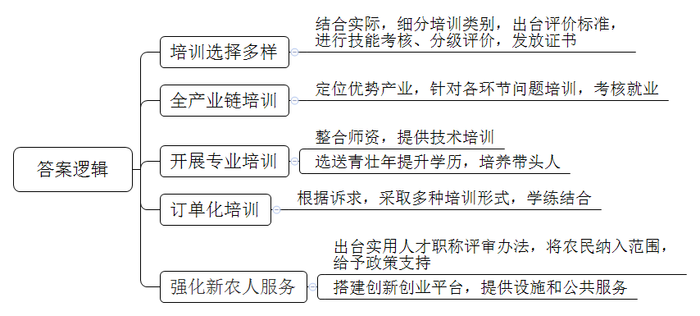
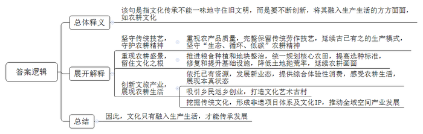
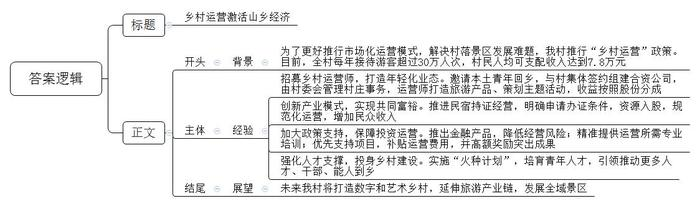
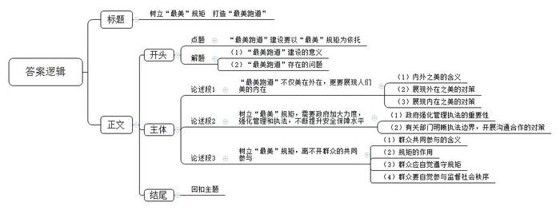

# 2023年公务员多省联考《申论》题（黑龙江县乡、普通选调卷）

<!-- gwy:overview:start -->
> **黑龙江 · 2023 · 申论 · 县乡卷** ｜ 4 题 · 图片 4 处 · 答案随题折叠

导航：[题目](#题目) · [材料 1](#材料-1)
<!-- gwy:overview:end -->

> 候选采集稿。参考答案及解析来自粉笔页面，不代表官方答案或真实高分答卷；来源使用许可与原卷对应关系仍需人工核实。

## 给定材料

### 材料 1

在S省数字农业人才培训基地直播间里，61岁的农民“八哥”操着乡音，对着手机屏幕介绍着当地的土特产。“八哥”在现实生活中被唤做“老陈”，是古家庄乡的农民，因对短视频直播有兴趣，就报名参加了当地的“数字新农人”直播培训班。拿到技能证书的“八哥”和老伴一起直播分享农家生活，销售小米、葵花等土特产，一年能挣十五六万元。

近年来，S省实施“人才持证、技能社会”工程，大量传统农人通过培训、考核，掌握一技之长，成为“新农人”。老陈所在的D市，结合当地产业发展、考虑农民兴趣诉求、调研市场情况，把培养目标分为农业经理人、返乡下乡创新创业者、新型农业经营与服务主体、种养加技术能手等类别。还先后出台20多个技能评价的地方标准，对参训农民进行技能考核与分级评价。不同的培训项目，不同的课程内容和培训时长，高、中、初三个等级的证书，为广大农民提供了多元选择。

S省农业发展的一个突破口在“特”与“优”，不同地方根据地域特色，逐步形成优势产业。比如F市聚焦小杂粮、菌类种植；C市重点发展药茶、红枣产业；D市高素质农民培训学院依托国民企业，针对黄花种植、采摘、加工、物流等全产业链问题展开培训，农民考核通过后可直接进入相关企业工作。

X市的郝大姐曾是贫困户，在参加培训班后学会了木耳吊袋种植技术。如今，她办起了合作社，年收入过百万，带动几十户村民就业。她说：“没有政策的支持和老师们的帮助，我走不到今天。”X市整合农科院的学者、农业部门农技专家等师资，对农民进行培训，还选送一批农村青壮年到涉农大中专院校参加学历教育。青年农民创业者小邵在取得技能证书后，积极尝试学到的新种植方法，还经常回培训班交流经验，带动了不少人增收致富。

“我们坚持‘缺什么补什么’，采取‘订单式’‘菜单式’模式，实现‘农民下单、专家配菜’，通过课堂教学、线上培训、跟踪辅导、实习实践等形式，让农民在学中干、在干中学。”S省农业农村厅科教处许处长说，“无论是专业教师还是身边榜样，都是培养高素质农民的‘好老师’，都是可以动员起来的力量。”

S省出台了农村实用人才职称评审办法，将农民纳入职称评定范围，并在项目扶持、资金贷款、培训、招聘等方面享受倾斜支持。“农民可以评职称，我们感觉特自豪，干劲儿更足了。”刚获得中级职称的水稻种植大户老田说起这个很兴奋。

5年前，T市龙湖镇的小方从IT行业转战农村。多年的农业创业经历，让他感受到了新农人的不易。“做农业，投入大、回本慢，招人用工遇到困难更是家常便饭。”T市的“星创天地”应运而生，这个半公益性质的农业孵化器，通过资源整合，面向入驻新农人，提供现代农机作业、技能培训、用工推荐、商业资源对接等服务，几年时间见证了不少项目从雏形成长为营业额超千万元的“潜力股”。

“我们以培育省级农村创新创业园区和孵化实训基地为抓手，搭建返乡下乡人员创新创业平台，为新农人创新创业提供完备的基础设施和更高效便捷的公共服务。”许处长说，“截至2022年底，全省已培育省级以上农村创新创业园区和孵化实训基地184个。”

### 材料 2

盛夏时节，位于崇头镇的云和梯田层层叠叠，绿意盎然，高举红色绸带的祈福巡游队伍穿梭在田间，锣鼓声声。“祈福巡游是村里的特色民俗活动，每年开犁的时候都要举行，在各地工作生活的村民们会回到村里参加活动，祈求国泰民安、风调雨顺、五谷丰登。”村民老雷笑呵呵地说。

“芒种忙种，一人、一牛、一架犁；梅雨期期，蓑衣斗笠添稻香”——这鲜活的传统农耕画面，历经千年依然在这里代代相传。然而，这样的传统农耕场景一度险些消失在历史中。现代农业兴起后，由于地块狭小，难以使用大型农机的梯田遭遇产粮瓶颈，加上农村劳动力流失，云和梯田核心区内土地抛荒率一度高达45%。

为留住千年梯田农耕文化之根，重现梯田农耕盛景，梯田核心区所在地崇头镇对土地进行流转复垦，通过引入外来承包主体，推进粮食种植和地块整治。“从2018年开始，梯田核心区农田的耕作就开始实行统一规划，水稻选种标准也一年比一年高，目前选育的品种生长期比一般稻米久，这既能满足景观建设的需求，也能提升稻米口感，切实提高了农产品质量安全水平。”崇头镇赵副镇长介绍道。2021年以来，作为国家湿地公园的云和梯田，全面开启湿地保护“云上智控”系统的建设。这套系统实现了湿地基础网络、小气候环境监测、鸟类监测识别等湿地监测智控管理，有效保护了湿地植被、维护了湿地生物多样性。“云上智控”项目让云和梯田国家湿地公园锦上添花，仅2021年前三季度，云和梯田景区营业收入就达3322万元。目前，核心区内土地抛荒率下降到5%，累计生态修复梯田超5000亩。“我们还将借力云和梯田国家湿地公园梯田修复工程，修复和提升多村粮食功能区的基础设施，建设内容包括给农耕道路修复、灌溉与排水修复和荒废梯田修复等。”赵副镇长说。

海拔的巨大差异，成就了梯田的四季变换。不断刷新着人们对自然之美的感官体验，也吸引着越来越多的人前来云和梯田摄影观光、自驾游玩，体验田园生活。几年前，游客小高来坑道村游玩，被这里的原石村貌吸引，最终选择留下创业，他陆续把村里的灰寮、牛栏等改造成咖啡屋、山野杂货铺、木玩工坊等新业态，从单纯住宿升级到综合体验性消费，让游客能更全面地感受当地农耕生活。“我们客房以耕、读、渔、樵命名，日常餐食的食材也都是当地农家种植的新鲜瓜果蔬菜，展现农耕生活中最本真的生活状态。”

“去年，村里农家乐、民宿营业收入达800多万元，生态直播间带动农户增收100多万元，越来越多的人选择返乡创业。”坑道村党支部倪书记说，“如今全村有100余人从事民宿行业，我们正邀请专业设计团队做整体规划，打造一个‘梯田上的文化艺术古村’。”

梯田景区在创建过程中，还挖掘农耕文化、银矿文化和畲族文化，形成以开犁节为代表的非遗项目体系及“梯田十味”“稻草草、木积积”等文化IP，其中，“稻草草、木积积”被列入省文化和旅游IP库，受到大家的喜爱。

崇头镇的成功并非个例，自梯田景区创建以来，周边乡村都发展得风生水起，实现了全域空间产业发展。比如，以观看星空为特色的梅竹露营基地，一经投入运营，立即赢得了都市游客的青睐，每年可为梅竹村增加15万的固定收益，成为村集体经营经济的源头活水。位于海拔980米高山上的黄家畲村，则凭借夏季的凉爽气候，每天吸引300多名城市居民前来避暑打卡，顺势开启了高端民宿产业。

时至今日，当地农人种植梯田稻米，仍完整保留着传统的插秧、收割、筛选、晾晒技艺，并延续着古已有之的稻鱼共生、稻鸭共育等模式，守护“生态、循环、低碳”的传统农耕精神。这近乎严苛的坚守，并非简单源自对仪式感的执着，更是出于对稻米外形、口感和营养的一丝不苟。在此前省里举办的好稻米活动中，云和稻田大米从众多竞争对手中脱颖而出，一举夺魁。

云和梯田从最初的籍籍无名，到如今通过国家5A级旅游景区景观质量评审，拿到了5A级旅游景区的“入场券”，辐射带动了大批山区农民增收致富，实现了从“藏在深山人未识”到“声名鹊起他乡知”的美丽蝶变。“一味守住旧的文明，不去创新，不能称之为文化传承。”一位文化研究者以云和梯田为例谈道，<u>“文化不是‘摆拍’，文化应该体现在民众的日常生活中。”</u>

### 材料 3

转入Z村，溯溪而上，一家充满想象力的创意生活一体店，让人眼前一亮。“谁能想到这样的山坞里会有全国各地的游客专门跑来发呆、拍照。”Z村党支部白书记的介绍，幽默中透着骄傲。原来通过旧房流转、整体招商，Z村被专业文创团队打造成“乡村艺术化实验场”，胶囊旅馆、创意书房、雅致餐厅等融入土墙、青砖、原木，过去卖炭为生的穷乡村，如今通过“乡村运营”成了远近闻名的“网红村”。目前，全村每年接待游客超过30万人次，村民人均可支配收入达到7.8万元。

Z村的变迁起源于A县提出的“村落景区”概念：走市场化运营模式，将乡村资源优势、生态优势转化为经济优势、发展优势。2016年，Z村被首批规划为“天门秘境”景区，短短数月，环保整治、房屋外立面改造、旅游集散中心建设等工作全部完成，村庄面貌焕然一新。然而，随着美丽乡村建设的大规模铺开，发展的阵痛也随之出现。内容同质、千村一面，单一的旅游业态、偏远的交通区位，很难吸引游客，乡村建设缺乏鲜明的定位和个性，缺乏专业的管理和运营，很大程度上影响了乡村自我造血功能。像Z村这样的景区型旅游村，仅靠单纯贩卖“吃农家饭、住农家院、摘农家果”的老套路，不可避免地陷入了“审美疲劳”。同时，随着旅游方式加速迭代，年轻一代成为消费主力，固守赏山水、品土菜、忆乡愁“老三篇”的旅游村，已难以满足青年人的新需求。

改变始于“乡村运营”政策的推出，一批土生土长的青年受邀回乡，当起了“乡村运营师”。“青年人流失、老龄化加剧等问题，使乡村的内生活力减弱。反映到乡村旅游层面就是运营不善、创新不够、业态不活、年轻人不喜欢、不买账。”白书记直言。几经调查研究后，Z村人达成了一个基本共识：未来乡村形态必然是“青年友好型乡村”，要以青年人视角审视乡村，以年轻化业态引流消费。白书记介绍，乡村运营师和村集体自愿签约，双方组建合资公司，村委会管理村庄事务，乡村运营师负责打造旅游产品、策划主题活动，形成具有一定盈利能力的乡村业态，最终收益按照公司股份分成。

小叶是首批入驻Z村的乡村运营师之一。为了充分盘活山水资源，形成产业链，激活乡村经济，她先后投入了大量资金流转闲置的农房和土地，打造“垄上行”民宿、茶花基地、高山蔬菜基地等。不到3年时间，Z村“天门秘境”景区吸引大量慕名而来的游客争相打卡，村集体经济年收入达到60万元。通过乡村运营，A县已有14家村落景区与运营商签约合作，完成落户项目53个。

在Z村，“乡村运营”带来的不但是乡村旅游，更探索出了乡村振兴、实现共同富裕的有效途径。漫步在Z村的“两山大道”，一边是苍翠山坡下清澈的溪水，一边是一字排开的美丽民宿。26岁的小辛大学毕业后回到家乡，将家里两栋旧宅改造成了民宿。“守着家，一年收入就有20多万元。今年我准备增加房间数，在原先的民宿附近再开一家分店。”小辛还是“农民之家”创业服务社的理事，服务社从集体土地、管理用房等资源折价入股至民宿。小辛的目标很清晰，就是让当地百姓既做“房东”又做“股东”。

小辛的“底气”源于政府不断创新的产业模式。早在2018年，A县就率先推进民宿持证经营，申请办证条件包括经营用房、卫生安全、环境保护、食品安全等7个方面。A县农业农村部副局长表示，这一举措促使A县民宿产业走向规范化运营，并为今后的集聚式发展奠定了基础。

“只要青年有志于乡村运营，我们就愿意给机会、给平台、给政策。”柳副局长说。近年来，A县向签约入驻的乡村运营师及其团队送上政策大礼包，保障运营主体放心投资、安心运营。在金融支持上，A县推出“乡贤贷”金融产品，设立1000万元融资担保风险补偿金，30万元以下贷款免担保；在技能培训上，聚焦乡村运营所需，精准提供民宿管理，研学导师等专业培训；在运营奖励上，策划项目政府优先支持，运营费用政府给予补贴，运营突出政府给予高额奖励，有效激励运营主体献计献策。

A县强化乡村人才支撑，持续推动人才下乡，干部返乡，能人回乡。当下，A县乡村运营青年CEO培育“火种计划”正在形成“雁阵效应”。“火种计划”着眼于乡村青年人才振兴，旨在为乡村培育一批有情怀、有热情的青年人才，以他们为“种子”，引领更多人投身乡村建设，加入乡村振兴行列。小叶的“垄上行”以一个小院品牌成长为集设计、施工、运营、培训于一体的产业品牌，汇聚了一批民宿运营人才。小叶表示：“乡村振兴的相关项目是一个很好的创业方向，与乡村振兴在人才上的需求，与青年当前巨大的就业压力都是适配的。项目要想取得成功，就需要创业者能够真正在乡村扎下根来，愿意深入到乡村内部。”

随着乡村振兴向纵深发展，打造数字乡村和艺术乡村，拉长A县乡村旅游产业链，正在成为A县政府引导乡村运营的新方向，也是发展全域景区的新推手。

### 材料 4

说起H县的滨江路，附近居民都是满满的幸福感。这是一条与沿途浪漫的樱花、青春洋溢的彩虹跑道、一览无余的江景联系在一起的“最美跑道”。

这条“最美跑道”全名为滨江路慢性系统，全长约13公里，分为靠近堤坝内侧的人行跑道和外侧的骑行道，分别用蓝色和红色进行区分。骑行道约3.5米宽，并排行驶两辆非机动车，空间仍很充足。

记者在走访中发现，这里已经成了周边居民运动休闲和纳凉放松的好去处。一路上，老老少少或停或走，或跑或骑，各有所乐。骑行的周女士高兴地表示：“这一带江景夜色多美啊，骑着车慢慢看，实在是一种享受。”

居民李先生却对“骑行道”产生了一丝担忧：“每天我从益民路去东江大桥附近坐车，发现骑行道上来来往往的车很多，车速也很快，还有不少逆行的，太不安全了。整条路都没有红绿灯，在一些路口和转变的地方自行车和老人相撞的情况常常发生。有关部门是不是可以加强管理，让骑行道变得安全些。”

“我经常傍晚来走路，滨江路一直人气很旺，这个蓝色的人行跑道是不允许自行车上来的，傍晚的人一多，就有不少电瓶车、自行车骑上来，车速不慢，边上还有孩子在玩，很不安全。而且还容易缩短跑道的使用年限，这么好的跑道，需要大家一起维护。”正在人行跑道上散步的林先生说。

“毫无疑问，这条跑道建成后大大提升了市民的运动热情。但对热衷于竞速的发烧友群体来说，确实也存在一些遗憾。”H县自行车运动推广人老曲说，“骑着各种普通自行车的市民，在骑行道上来来往往，速度大多不快。骑行道和人行跑道之间没有隔离栏，因为天热，不少人选择在有树荫的骑行道上跑步，最危险的是孩子们骑着童车在骑行道上歪歪扭扭地嬉戏打闹，自行车和电瓶车就在身边来来回回，很不安全。发烧友们很难在骑行道上竞速驰骋。”

对“最美跑道”中存在的安全问题，H县城市管理综合执法局负责人表示：“对于这些问题，我们一直在管理和处罚，但有些问题执法边界比较模糊，管理上存在一定难度。接下来我们会加大管理力度，加强多部门之间的沟通，联合进行管理和执法，争取让骑行道和人行跑道都越来越安全、越来越规范，也欢迎热心市民监督，并提出宝贵建议。”

“‘最美跑道’就该有最美的规矩，美的不光是外在，更要展现人们美的内在。这样的‘最美’，需要大家一起努力维护。”H县委党校鲁教授表示。

## 题目

### 第 1 题

**请根据“给定资料1”，概括S省在帮扶“新农人”工作中的主要做法。（15分）**

关联材料：材料 1

作答要求：表述准确、全面、有条理，不超过200字。

第 1 题 · 答案与解析

**参考答案（粉笔题库参考内容）**

1.培训选择多样。结合实际，细分培训类别，出台评价标准，进行技能考核、分级评价，发放证书。

2.全产业链培训。定位优势产业，针对各环节问题培训，考核就业。

3.开展专业培训。整合师资，提供技术培训；选送青壮年提升学历，培养带头人。

4.订单化培训。根据诉求，采取多种培训形式，学练结合。

5.强化新农人服务。出台实用人才职称评审办法，将农民纳入范围，给予政策支持；搭建创新创业平台，提供设施和公共服务。

**解析**

**参考答案说明**：本参考答案从“培训选择多样”“全产业链培训”“开展专业培训”“订单化培训”“强化新农人服务”五个方面展开，各条答案要点之间在内容上相互并列，没有交叉。

**考点**：概括措施类

**来源**：2023年公务员多省联考《申论》题（黑龙江县乡、普通选调卷）

### 第 2 题

**给定资料2中提到“文化不是‘摆拍’，文化应该体现在民众的日常生活中”，请谈谈你对这句话的理解。（20分）**

关联材料：材料 1、材料 2、材料 3、材料 4

作答要求：理解准确，分析透彻，条理清晰，不超过300字。

第 2 题 · 答案与解析

**参考答案（粉笔题库参考内容）**

该句是指文化传承不能一味地守住旧文明，而是要不断创新，将其融入生产生活的方方面面，如农耕文化。

1.坚守传统技艺，守护农耕精神。重视农产品质量，完整保留传统劳作技艺，延续古已有之的生产模式，坚守“生态、循环、低碳”农耕精神。

2.重现农耕盛景，留住文化之根。推进粮食种植和地块整治，统一规划核心农田，提高选种标准，修复和提升基础设施，降低土地抛荒率，延续农耕画面。

3.创新文旅产业，展现农耕生活。依托已有资源，发展新业态，提供综合体验性消费，感受农耕生活，展现本真状态；吸引乡民返乡创业，打造文化艺术古村；挖掘传统文化，形成非遗项目体系及文化IP，推动全域空间产业发展。

因此，文化只有融入生产生活，才能传承发展。

**解析**

**参考答案说明：**思路方面，本参考答案按照词句解释题“总体释义+展开解释+总结”的答题思路展开。内容方面，参考答案先对题干给定句进行了总体的解释；然后分别通过“坚守传统技艺，守护农耕精神”“重现农耕盛景，留住文化之根”“创新文旅产业，展现农耕生活”这三个方面展开解释。词句表达方面，参考答案加上了“因此”等连接词来承接上下文。

**考点**：词句解释类

**来源**：2023年公务员多省联考《申论》题（黑龙江县乡、普通选调卷）

### 第 3 题

**A县拟于近日召开全县实施乡村振兴战略工作推进会，假如你是Z村党支部白书记，受邀参会并交流经验，请根据“给定资料3”，以“乡村运营激活山乡经济”为题，撰写一份发言提纲。（25分）**

关联材料：材料 3

作答要求：紧扣资料，内容全面，准确简洁，条理清晰，不超过400字。

第 3 题 · 答案与解析

**参考答案（粉笔题库参考内容）**

乡村运营激活山乡经济

背景：为了更好推行市场化运营模式，解决村落景区发展难题，我村推行“乡村运营”政策。目前，全村每年接待游客超过30万人次，村民人均可支配收入达到7.8万元。

经验：一、招募乡村运营师，打造年轻化业态。邀请本土青年回乡，与村集体签约组建合资公司，由村委会管理村庄事务，运营师打造旅游产品、策划主题活动，收益按照股份分成。二、创新产业模式，实现共同富裕。推进民宿持证经营，明确申请办证条件，资源入股，规范化运营，增加民众收入。三、加大政策支持，保障投资运营。推出金融产品，降低经营风险；精准提供运营所需专业培训；优先支持项目，补贴运营费用，并高额奖励突出成果。四、强化人才支撑，投身乡村建设。实施“火种计划”，培育青年人才，引领推动更多人才、干部、能人到乡。

展望：未来我村将打造数字和艺术乡村，延伸旅游产业链，发展全域景区。

**解析**

**参考答案说明：**（1）本题虽然不要求写格式，但为了保险起见，建议加上标题。（2）正文部分，一方面从内容来看，围绕着“乡村运营激活山乡经济”这一主题，本参考答案的开头写到了“乡村运营”政策的出台背景、实施成效等；主体部分从“招募乡村运营师，打造年轻化业态”“创新产业模式，实现共同富裕”“加大政策支持，保障投资运营”“强化人才支撑，投身乡村建设”这四个方面给出了具体的经验；结尾对未来发出了展望。另一方面，形式上，本参考答案做到了分段、分条撰写，整体上条理较为清晰。

**考点**：总结类

**来源**：2023年公务员多省联考《申论》题（黑龙江县乡、普通选调卷）

### 第 4 题

**请深入思考“给定资料4”中H县委党校鲁教授说的一段话，联系实际，自拟题目，写一篇文章。（40分）**

关联材料：材料 1、材料 2、材料 3、材料 4

作答要求：

（1）观点明确，见解深刻；

（2）思路清晰，语言流畅；

（3）参考给定资料，但不拘泥于给定资料；

（4）字数800-1000字。

第 4 题 · 答案与解析

**参考答案（粉笔题库参考内容）**

**树立“最美”规矩 打造“最美跑道”**

南京的明城墙绿道，杭州的滨江跑道，成都的天府绿道……近年来，许多城市都大力推行城市慢行系统建设，既满足了人们休闲健身的需求，也提升了城市形象，滋养了城市发展。遗憾的是，“最美跑道”在成为人们休闲好去处的同时，也出现了人车混行、车辆逆行、骑行道打闹等一系列安全问题。唯有安全，才有“最美”，“最美跑道”的建设必须要以“最美”的规矩为依托。

**“最美跑道”不仅美在外在，更要展现人们美的内在。**我们不仅仅追求外在的美景和设施，更需要注重培养市民的公共意识、道德水准和责任感。要积极向“外”延展，科学规划线路，升级景观布置和周边设施，将绿道建设与自然景色相融合，塑造新的城市景观。同时，更要大力向“内”深挖，注重精神文化建设，强化规矩意识，展现居民积极健康的精神风貌，体现城市文明和谐的社会氛围，更好地宣传城市文化，擦亮最美“金名片”。因此，社会多方要唱好“大合唱”，共同树立“最美”规矩。

**树立“最美”规矩，需要政府加大力度，强化管理和执法，不断提升安全保障水平。**只有对群众反映强烈的重点突出问题，重拳出击、整治到底，才能起到震慑和警示的作用，维护规矩的严肃性和权威性，倒逼人们遵守规矩。因此，有关部门要明晰执法边界，增强多部门沟通联合，强化刚性约束。一方面，要进一步制定更加明确的权力清单，细化执法要求，厘清执法的边界线，帮助各执法部门守好自己的“责任田”；另一方面，各部门要密切开展执法合作，推动常态化沟通机制落实落细，加强综合执法、联合执法、协作执法，“联动”出手下好治理“一盘棋”。

**树立“最美”规矩，离不开群众的共同参与。**人们应强化规则意识，提升道德素质水平，也要能够主动参与监督，建言献策，共同维护文明有序的城市环境。规矩不仅是个人的文明水准和素质高低的反馈，更是让社会正常运转的“润滑剂”。在“最美跑道”建设中，只有每位居民都自觉遵守规矩，才能共享安全、有序的休闲空间。此外，人们还需要自觉参与监督社会秩序，对于违规行为进行举报，为政府和相关机构提供更多的意见和建议。只有通过群众的共同努力，才能创造出一个更美好、更文明的城市。

不以规矩，不能成方圆。只要将讲规矩内化于心，外化于行，定能点亮你我生活，凝聚全社会的文明共识，助力美丽中国建设！

**解析**

**文章分析**

**树立“最美”规矩 打造“最美跑道”**

【**标题的优点：**首先，标题中含有主题词，使文章主题更突出、清晰。其次，形式上采用对称式结构，使标题更加完整、饱满。】

南京的明城墙绿道，杭州的滨江跑道，成都的天府绿道……（1）近年来，许多城市都大力推行<u>城市慢行系统建设</u>，既<u>满足了人们休闲健身的需求</u>，也<u>提升了城市形象</u>，<u>滋养了城市发展</u>。遗憾的是，“最美跑道”在<u>成为人们休闲好去处</u>的同时，（2）也出现了<u>人车混行</u>、<u>车辆逆行</u>、<u>骑行道打闹</u>等一系列<u>安全问题</u>。（3）唯有安全，才有“最美”，<u>“最美跑道”的建设必须要以“最美”的规矩为依托</u>。

【**开头的优点：**★内容方面。范文的开头是紧扣“‘最美跑道’要有最美的规矩”这一主题展开的。首先，开头点出主题，做到了主题明确。其次，对“‘最美跑道’要有最美的规矩”这一主题进行了分析阐述，指出了：（1）“最美跑道”建设的意义。（2）“最美跑道”存在的问题。（3）“最美跑道”建设要以“最美”规矩为依托。★文字表达方面：使用了“既……也……”“同时”等关联词，使语言表达有逻辑性。】

**“最美跑道”不仅美在外在，更要展现人们美的内在。**（1）我们不仅仅<u>追求外在的美景和设施</u>，更需要注重<u>培养市民的公共意识、道德水准和责任感</u>。（2）要积极向“外”延展，<u>科学规划线路</u>，<u>升级景观布置和周边设施</u>，<u>将绿道建设与自然景色相融合</u>，<u>塑造新的城市景观</u>。同时，（3）更要大力向“内”深挖，<u>注重精神文化建设</u>，<u>强化规矩意识</u>，展现<u>居民积极健康的精神风貌</u>，体现<u>城市文明和谐的社会氛围</u>，更好地宣传<u>城市文化</u>，擦亮最美“金名片”。因此，社会多方要唱好“大合唱”，共同树立“最美”规矩。

【**论述段1的优点：**★观点句：范文的观点句是紧扣“‘最美跑道’要有最美的规矩”这一文章主题提出的。形式上，它在段首处直接写出，位置突出，容易发现。内容上，关键词突出，内容要点明确，可以明显看出主要从“展现内外之美”的角度展开论述。★论述内容：（1）内外之美的含义；（2）展现外在之美的对策；（3）展现内在之美的对策。注意：以上三个方面的内容都是紧扣“‘最美跑道’不仅美在外在，更要展现人们美的内在”这个观点句进行分析论述的，论述的针对性强，内容层次丰富。在论述方法上主要采用了讲道理的方式，论述清晰深刻。】

**树立“最美”规矩，需要政府加大力度，强化管理和执法，不断提升安全保障水平。**（1）只有对群众反映强烈的<u>重点突出问题</u>，<u>重拳出击、整治到底</u>，才能起到<u>震慑和警示的作用</u>，<u>维护规矩的严肃性和权威性</u>，<u>倒逼人们遵守规矩</u>。因此，（2）有关部门要<u>明晰执法边界</u>，增强<u>多部门沟通联合</u>，<u>强化刚性约束</u>。一方面，要进一步<u>制定更加明确的权力清单</u>，<u>细化执法要求</u>，<u>厘清执法的边界线</u>，帮助各执法部门守好自己的“责任田”；另一方面，<u>各部门要密切开展执法合作</u>，推动<u>常态化沟通机制</u>落实落细，加强<u>综合执法、联合执法、协作执法</u>，“联动”出手下好治理“一盘棋”。

【**论述段2的优点：**★观点句：范文的观点句是紧扣“‘最美跑道’要有最美的规矩”这一文章主题提出的。形式上，它在段首处直接写出，位置突出，容易发现。内容上，关键词突出，内容要点明确，可以明显看出主要从“政府强化管理执法”的角度展开论述。★论述内容：（1）政府强化管理执法的重要性；（2）有关部门明晰执法边界，开展沟通合作的对策。注意：以上两个方面的内容都是紧扣“树立‘最美’规矩，需要政府加大力度，强化管理和执法，不断提升安全保障水平”这个观点句进行分析论述的，论述的针对性强，内容层次丰富。在论述方法上主要采用了讲道理的方式，论述清晰透彻。】

**树立“最美”规矩，离不开群众的共同参与。**（1）人们应<u>强化规则意识</u>，<u>提升道德素质水平</u>，也要能够<u>主动参与监督</u>，<u>建言献策</u>，共同<u>维护文明有序的城市环境</u>。（2）<u>规矩</u>不仅<u>是个人的文明水准和素质高低的反馈</u>，更是让<u>社会正常运转</u>的“润滑剂”。（3）在“最美跑道”建设中，只有<u>每位居民都自觉遵守规矩</u>，才能<u>共享安全、有序的休闲空间</u>。此外，（4）人们还需要<u>自觉参与监督社会秩序</u>，对于<u>违规行为进行举报</u>，为政府和相关机构<u>提供更多的意见和建议</u>。只有通过<u>群众的共同努力</u>，才能创造出一个更美好、更文明的城市。

【**论述段3的优点：**★观点句：范文的观点句是紧扣“‘最美跑道’要有最美的规矩”这一文章主题提出的。形式上，它在段首处直接写出，位置突出，容易发现。内容上，关键词突出，内容要点明确，可以明显看出主要从“群众共同参与”的角度展开论述。★论述内容：（1）群众共同参与的含义；（2）规矩的作用；（3）群众应自觉遵守规矩；（4）群众要自觉参与监督社会秩序。注意：以上四个方面的内容都是紧扣“树立‘最美’规矩，离不开群众的共同参与”这个观点句进行分析论述的，论述的针对性强，内容层次丰富。在论述方法上主要采用了讲道理的方式，论述清晰到位。】

【**论述段之间的关系：**★内容的内在逻辑：范文的论述段之间是依照“并列”的逻辑展开的。论述段1先写了“‘最美跑道’不仅美在外在，更要展现人们美的内在”，论述段2再写了“树立‘最美’规矩，需要政府加大力度，强化管理和执法，不断提升安全保障水平”，论述段3接着写了“树立‘最美’规矩，离不开群众的共同参与”。★段与段的外在衔接：论述段1的段尾处的过渡句“社会多方要唱好‘大合唱’，共同树立‘最美’规矩”，起到了引出论述段2和论述段3的作用。】

不以规矩，不能成方圆。只要将讲规矩内化于心，外化于行，定能点亮你我生活，凝聚全社会的文明共识，助力美丽中国建设！

【**结尾的优点：**范文的结尾回扣了“‘最美跑道’要有最美的规矩”这一主题，语言简练，不拖沓。】

**考点**：文章写作题

**来源**：2023年公务员多省联考《申论》题（黑龙江县乡、普通选调卷）

