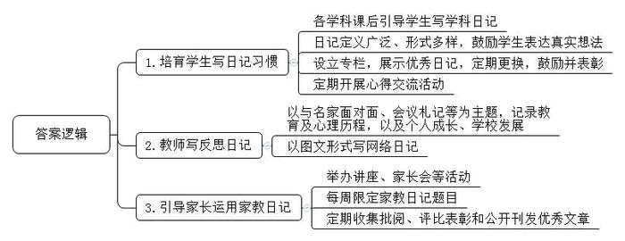
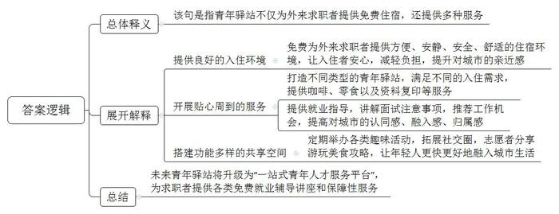
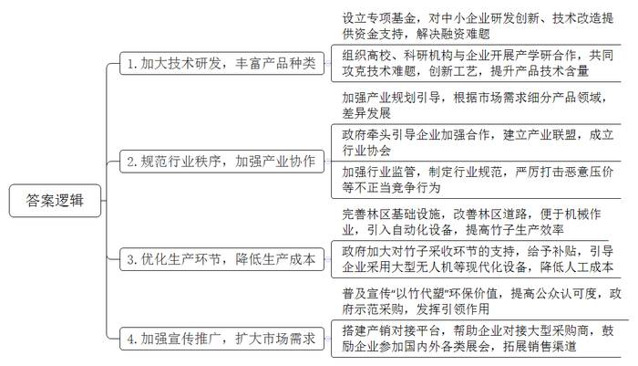
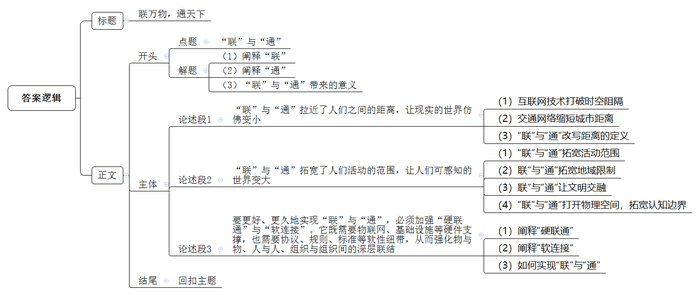

# 2024年公务员多省联考《申论》题（黑龙江省市卷）

> 候选采集稿。参考答案及解析来自粉笔页面，不代表官方答案或真实高分答卷；来源使用许可与原卷对应关系仍需人工核实。

## 给定材料

### 材料 material-dda599f3625a9ef3

“春耕、夏耘、秋收、冬藏，四者不失时。”如何让农村孩子记住农时四季？“锄禾日当午，汗滴禾下土。”如何让他们体会到父母劳作的辛苦？践行好立德树人，是每一所学校、每一位教育工作者都在思考的重要问题。基于当前学生学习与思考脱节、学习与生活割裂现象比较普遍，H市南山小学从2017年10月开始，筹划开展日记写作校园特色活动，让孩子记录农时四季，让他们体会到父母的劳作辛苦。用日记写作这根线，努力牵引学生从课本中走出来，从手机、电脑、网络游戏中跳出来，与音体美握手、与综合实践活动拥抱、与大自然和社会接轨，成为自然人、社会人，从而努力实现教育要培养德、智、体、美、劳全面发展的社会主义建设者和接班人的根本目标。

南山小学江校长说：“写日记就是对生活最好的牵挂方式，也是对自己、对工作最负责的方法。”多年来，江校长一直有写日记的习惯。他的日记涵盖专业成长、读书心得、教育教学反思、时政要闻等，收集和梳理教育碎片，并在书写和思考中实现教育思想升华，坚持写日记让他受益良多。担任南山小学校长后，他在坚持校长写管理日记的基础上，开始推行日记教育。经过反复论证、实践和修订，从最初的语文日记到全科日记，再到今天的日记教育，南山小学日记教育经历了从小到大、从简单到丰富、从外到内提升发展的一个历程。

在五年一班的数学课堂上，学生们交出了不同寻常的“数学作业”：有的是记录了生活中的应用数学体会和感想，有的是写下了自己发现的数学奥秘趣事，有的是利用数学知识解释生活中的某些现象……这些“数学日记”，记录和见证着学生们对生活中的观察感悟和理解。“数学日记”是南山小学的创新思路，是该校开展特色校园活动的一个缩影。走进南山小学，语文、数学、英语、道德与法治、科学等学科的课后，老师都会引导学生写日记，实现全员育人、全方位育人。

好习惯源自平时的教育，南山小学以日记教育为突破口，践行好习惯的培养。在这里，“日记”的定义很广泛，学校鼓励学生写自己的真实想法，分享自己的喜怒哀乐。通过这种形式，学生在学习上的兴趣日益浓厚，习惯向好发展，自信心普遍增强。在这里，日记的形式也不拘一格，记事日记、观察日记、诗歌日记、读报日记、照片日记、漫画日记、专题日记等等，给学生以最大的写作自由度。还有循环日记，即一个日记本在小组内循环，每名学生既是作者又是读者和评论者，大家互相学习，共同提高。在这里，班级展示墙上辟有日记专栏，展示学生的优秀日记，定期更换，及时反馈鼓励并进行表彰。在这里，定期开展“日记促我成长”心得交流等活动，让学生在交流中拓展思维、端正认识。日记教育不仅增加了学生的练笔机会，提高了学生的习作水平，而且以练笔来育人，也有助于培养精神生活丰富、人格健全、具有良好素养的创造型人才。

教师写反思日记是为自己的教育生命保鲜的极佳方式。在南山小学，每位教师手中都有几个本子：与名家面对面、会议札记、工作日志、学思悟，这几个本子真实地记录着教师一年来的教育历程和心理历程，记录着教师成长和学校发展的点点滴滴。有的教师在自己的博客上写网络日记，不光有文字的记录，还有图片的记录，让难忘的瞬间永远定格。如今，写日记已经内化为南山小学教师的自觉行为。

学校倡导家长写陪伴日记，就是让家长时刻关注孩子的点点滴滴。坚持引导家长有效地运用家教日记，这也是南山小学的特色。学校通过专家讲座、家长会、家长沙龙等，引导家长运用家教日记有效地和孩子沟通，家长用日记表达对孩子的爱，用日记来表现自己的教育思想，用日记来教育“问题”孩子，用日记来提醒自己要有耐心、要细心……学校每周都会有一至两个限定的家教日记题目，如“如何改变自己，再改变孩子”“如何打造书香家庭”“孩子当一天家”等等，启发家长引起思考、参与讨论。班主任每周收集、批阅家教日记，及时了解家长的心声，及时发现问题、解决问题。班级、学校定期评比表彰优秀家教陪伴日记，并精选优秀文章在家委会杂志《心桥》展示，使越来越多的家长重视并认真进行家教陪伴日记的写作。

一位学生的妈妈说：“每天坚持写教育日记，它首先提醒了自己，教育好孩子是应尽的职责；其次也约束了自己的言行，有助于提高自己的各种修养；再次，使孩子和自己的心理沟通有了一个极好的平台，利于孩子的健康成长。”

在南山小学，走在“忆墨长廊”感受墨香飘动，书架上摆满了校长日记、教学日记、成长日记和育儿日记，反思日记就像生命的阶梯，日积月累，更上一层楼，就能看到不一样的风景。

### 材料 material-d7ef6b50c754098c

“同学您好，2023年R市国有企业青年人才优选面试通知如下……温馨提醒：R市青年驿站为外来求职高校毕业生提供最长免费3天住宿……”2023年4月的一天，大四学生小柳收到了来自求职单位的面试通知。这条附带温馨提示的通知，让小柳对即将到来的R市之行，多了一份期待。她根据短信提示，登录了该市共青团微信公众号下方的“青年驿站”小程序，填写信息，提交了入住青年驿站申请。

第二天一早，小柳就接到了审核通过的电话通知，当天下午，她来到了R市运动公园附近的一家青年驿站，“我申请的这家青年驿站离我的面试单位不足500米，而且酒店在小区里，门口有保安站岗，刷门禁卡才能乘坐电梯，让人一进来就安心。”推开房门的小柳很惊喜，“面朝大海，环境美得出乎意料！而且很安静，适合备考。”

工作人员还专门提醒：“房间里有免费的充电线和矿泉水，如果有需要，可以延长住宿时间。”来之前，小柳特意在网上查过，这家酒店正常入住一天要300元，而附近另一家酒店则要500元左右。如果没有青年驿站免费住宿的政策，她只能选择离面试单位远一点的地方，找个便宜点的酒店。“驿站给我提供了一个舒适的‘避风港’，一下子就对这个城市产生了亲近感。”小柳说。

小柳入住的这所青年驿站是R市第一家青年驿站。“一方面，我们是市青年企业家协会秘书长单位，服务青年是我们的社会责任。另一方面，我们希望展示我们的服务，增强青年人才对R市的认同感、融入感、归属感。”驿站负责人说。考虑到求职青年的学习需求，酒店会专门挑选光线好的朝阳房间供他们入住，此外还会免费提供咖啡、饮用水和零食以及资料复印等服务。

“对市级青年驿站实际发生的入住，市财政按照每天90元的标准给予补贴，用于青年驿站设施配套、升级改造、安全管理。”共青团R市委书记介绍，R市依托不同类型的驿站资源，重点打造三类青年驿站：“酒店型”青年驿站，依托优质酒店宾馆资源，重点服务短时驻留R市的青年；“公寓型”青年驿站，将符合条件的长租公寓纳入青年驿站范围，青年在免费期满后可享受优惠续租服务，重点服务有后续入住需求的青年；“保障型”青年驿站，推动符合条件的保租房项目开展青年驿站试点，重点服务有后续长租需求的青年。

2022年9月，小慧和同学结伴来到R市找工作，从S人才集团微信公众号上看到青年驿站并顺利入住。如今，她已成为该集团的工作人员，为更多和她一样的求职青年提供服务。“刚毕业，我对自己的就业方向不清楚，青年驿站的负责老师会给我们就业指导，讲解面试的注意事项。”小慧说，入住驿站期间，她找到了第一份工作，后来辞职，驿站的工作人员继续帮她推荐工作机会。机缘巧合之下，她入职了S人才集团，岗位是人才招聘。

“青年驿站不仅是我们到这个城市的落脚点。”曾入住海兰公寓并找到工作的小榕，如今成了这里的青年志愿者。海兰公寓不仅为求职、实习大学生提供免费住宿，还搭建了近2000平方米的共享空间，配备餐厅、洗衣房、书吧、KTV、青年会客厅、路演厅等，定期举办“剧本杀”“无结果沙龙”等趣味活动，邀请来R市的青年参加。入住时正赶上青年驿站举办演说活动，小榕就去参加了。趣味自我介绍、跟同龄人一起玩游戏、唱歌跳舞，她玩得不亦乐乎，还认识了两个朋友，至今一直保持联系。工作以后，青年驿站周末活动，小榕也会收到邀请。渐渐地她就成了这里的志愿者，为初来乍到的年轻人介绍周边企业情况，提供详细的游玩、美食攻略，让他们更快更好地融入城市生活。

目前，R市正着力将青年驿站升级为“一站式青年人才服务平台”，届时，驿站将为来R市求职的青年人提供择业心理、面试技巧、政策法规、新入职员工注意事项等各类免费就业辅导讲座，提供免费体检、免费公交卡、免费意外伤害保险等保障性服务。

### 材料 material-d5be6cef92255fb4

随着白色污染日益成为威胁环境的突出问题，寻找塑料的替代材料日益紧迫。竹子是高度可再生资源，一片管理良好的竹林，成熟后可以反复收割40到70年。竹制品能降解成为二氧化碳回到大气之中，不像塑料制品难以降解；再加上竹子力学性能优良，完全可以作为塑料的替代品，这就是“以竹代塑”。“以竹代塑”不仅涉及日用品，还涉及工业制造和建材，如发电机冷却塔的填料、给排水管道等，选用竹子作原料，成本更低、耐用性更好。此外，“以竹代塑”还有一层内涵，就是用从竹子中提取出的成分如竹纤维等生产各种物件，这属于广义的“以竹代塑”。

T市竹资源丰富，全市竹林面积约有3.28万亩，目前有竹类加工企业近500家，其中省级龙头企业4家、国家级龙头企业1家，年加工原竹约70万吨，竹产业一年创造的产值占据T市经济的半壁江山。不过，T市“以竹代塑”产业在取得显著成绩的同时，也开始面临产品同质化高、附加值低等发展的瓶颈。2023年10月，国家发改委出台的《加快“以竹代塑”发展三年行动计划》要求，要牢固树立和践行绿水青山就是金山银山的发展理念，以构建“以竹代塑”产业体系为重点，着力抓好竹林资源培育、竹材精深加工、产品设计制造、市场应用拓展等全链条全要素协调发展，有效提升“以竹代塑”动能、产能、效能，推动“以竹代塑”高质量发展，助力减少塑料污染。这为T市竹产业突破发展瓶颈提供了难得的发展机遇。为深入落实《加快“以竹代塑”发展三年行动计划》，引导T市“以竹代塑”产业实现高质量发展，T市发改委组织了竹制品企业、竹农、消费者等各方面的代表以及有关专家学者参加座谈会，以下是座谈会部分实录：

熊有公司林经理：我们公司原先的主营业务是竹地板，这几年我们开始转型生产竹计算器、竹电子秤、竹音箱，就是用竹外壳代替塑料外壳，不过竹材和电子元件结合起来有难度，我们就组织公司员工通过技术改造、创新工艺，解决了这一技术难题。现在我们的产品远销海外，不断有知名高校、企业来公司洽谈合作事宜。

萌萌幼儿园园长：我们园去年把所有塑料玩具全换成了竹制玩具，这些新玩具更有光泽，手感更好。自从购进了竹制玩具，来我们园的孩子也多了不少，家长们都特别看重安全环保，竹制玩具能让家长更放心。

美哉竹业品经理：我们公司规模小，融资困难，拿不出那么多钱来支持研发，特别是在技术含量高的“以竹代塑”产品上研发跟不上，就只能生产技术含量低的“以竹代塑”产品。另外，我了解到，在T市，像我们公司这样小规模的竹制品企业不是少数，而且生产“以竹代塑”产品往往是一哄而上，要么都生产竹制盘子，要么都生产竹制勺子，“卷”得厉害！

丛记小吃店丛老板：我可不想用“以竹代塑”产品，实在是太贵了！一个一次性竹勺0.1元，塑料勺才0.01元，我做的是小本生意，实在用不起啊。

竹农老冯：“以竹代塑”产品为啥贵？我看是竹子贵！以一吨毛竹为例，砍伐装车全得靠人工，成本近450元，而这一吨毛竹平均市场价格还不足600元，你说种竹子能挣多少钱？我们不想机械作业吗？大家可以去看看竹林里的路，两个人并排走都嫌挤，路面除了坑就是包，往里运机械都挺费劲，而塑料制品呢，生产全是靠机械，当然便宜了。

T市农业大学汤教授：和兄弟地区相比，我市发展“以竹代塑”产业的优势和成绩都是有目共睹的，但目前我市“以竹代塑”企业尚处在各自为战、野蛮生长的状态，有些企业之间相互压价、恶性竞争，产业内耗较为严重，最终吃亏的还是我市“以竹代塑”产业。

白乡长：我乡今年租用了大型无人机设备，将采下的竹子收起，产生的费用全部由政府承担，不但解决了竹子采收难的问题，还把竹子的成本降低了30%，我觉得这会对降低“以竹代塑”产品成本有很大帮助。

T市竹业企业联合会周理事：我要为我市生产“以竹代塑”产品的同仁说几句话。我们希望有人能给我们的产品撑撑腰、吆喝吆喝，竹制品企业需要的不是“小打小闹”的客户，而是“大进大出”的客户，毕竟企业需要生存、发展。

T市农业农村局孙处长：“以竹代塑”利国利民，是大势所趋，要把这个产业做大做强，最根本的是立足长远、授人以渔。在这方面，我们政府部门责无旁贷。

## 题目

### 第 1 题

**根据“给定资料**1**”****，****请谈谈****H****市南山小学是怎样开展日记教育的。（****15****分）**

关联材料：material-dda599f3625a9ef3

作答要求：

要求：表述全面，准确，有条理，不超过200字。

### 第 2 题

**“给定资料**2**”中提到“青年驿站不仅是我们到这个城市的落脚点”，请你根据“给定资料**2**”，谈谈对这句话的理解。（****20****分）**

关联材料：material-d7ef6b50c754098c

作答要求：

要求：理解准确，分析透彻，条理清晰；不超过300字。

### 第 3 题

**假如你是****T****市发改委的工作人员，请根据“给定资料**3**”，对****T****市“以竹代塑”产业实现高质量发展提出建议。（****25****分）**

关联材料：material-d5be6cef92255fb4

作答要求：

要求：紧扣资料，内容全面；所提建议有针对性、可行性；准确简明，有条理；不超过400字。

### 第 4 题

**根据“给定资料**4**”中学者的一段话，请深入思考，联系实际，写一篇文章。（****40****分）**

关联材料：material-dda599f3625a9ef3

作答要求：

要求：观点明确，见解深刻；思路清晰，语言流畅；参考给定资料，但不拘泥于给定资料；800-1000字。

## 答案与解析

第 1 题

**参考答案（粉笔题库参考内容）**

1.培育学生写日记习惯。各学科课后引导学生写学科日记；日记定义广泛、形式多样，鼓励学生表达真实想法；设立专栏，展示优秀日记，定期更换，鼓励并表彰；定期开展心得交流活动。

2.教师写反思日记。以与名家面对面、会议札记等为主题，记录教育及心理历程，以及个人成长、学校发展；以图文形式写网络日记。

3.引导家长运用家教日记。举办讲座、家长会等活动；每周限定家教日记题目；定期收集批阅、评比表彰和公开刊发优秀文章。

**解析**

**参考答案说明：**围绕“日记教育”这一主题，本参考答案从“培育学生写日记习惯”“教师写反思日记”“引导家长运用家教日记”这三个方面进行介绍，本参考答案做到了分条撰写，整体上条理较为清晰。

**考点**：考点概括措施类

**来源**：来源2024年公务员多省联考《申论》题（黑龙江省市卷）

粉笔申论页面对本题只提供「解析视频」入口，该入口是会员推广位，页面无视频地址与文字解析。

第 2 题

**参考答案（粉笔题库参考内容）**

该句是指青年驿站不仅为外来求职者提供免费住宿，还提供多种服务。具体表现在：

1.提供良好的入住环境。免费为外来求职者提供方便、安静、安全、舒适的住宿环境，让入住者安心，减轻负担，提升对城市的亲近感。

2.开展贴心周到的服务。打造不同类型的青年驿站，满足不同的入住需求，提供咖啡、零食以及资料复印等服务；提供就业指导，讲解面试注意事项，推荐工作机会，提高对城市的认同感、融入感、归属感。

3.搭建功能多样的共享空间。定期举办各类趣味活动，拓展社交圈，志愿者分享游玩美食攻略，让年轻人更快更好地融入城市生活。

未来青年驿站将升级为“一站式青年人才服务平台”，为求职者提供各类免费就业辅导讲座和保障性服务。

**解析**

**参考答案说明****：**（1）思路方面，本参考答案按照词句解释题“总体释义+展开解释+总结”的一般答题思路展开。（2）内容方面，本参考答案首先对句子进行总体释义，再分别从“提供良好的入住环境”“开展贴心周到的服务”“搭建功能多样的共享空间”这三个层面展开解释，最后用建设“青年驿站”的对策进行总结。（3）词句表达方面，本参考答案加上了“具体表现在”等连接词来承接上下文，使上下衔接更顺畅。

**考点**：考点词句解释类

**来源**：来源2024年公务员多省联考《申论》题（黑龙江省市卷）

粉笔申论页面对本题只提供「解析视频」入口，该入口是会员推广位，页面无视频地址与文字解析。

第 3 题

**参考答案（粉笔题库参考内容）**

1.加大技术研发，丰富产品种类。设立专项基金，对中小企业研发创新、技术改造提供资金支持，解决融资难题；组织高校、科研机构与企业开展产学研合作，共同攻克技术难题，创新工艺，提升产品技术含量。

2.规范行业秩序，加强产业协作。加强产业规划引导，根据市场需求细分产品领域，差异发展；政府牵头引导企业加强合作，建立产业联盟，成立行业协会；加强行业监管，制定行业规范，严厉打击恶意压价等不正当竞争行为。

3.优化生产环节，降低生产成本。完善林区基础设施，改善林区道路，便于机械作业，引入自动化设备，提高竹子生产效率；政府加大对竹子采收环节的支持，给予补贴，引导企业采用大型无人机等现代化设备，降低人工成本。

4.加强宣传推广，扩大市场需求。普及宣传“以竹代塑”环保价值，提高公众认可度，政府示范采购，发挥引领作用；搭建产销对接平台，帮助企业对接大型采购商，鼓励企业参加国内外各类展会，拓展销售渠道。

**解析**

**参考答案说明：**本参考答案从“加大技术研发，丰富产品种类”“规范行业秩序，加强产业协作”“优化生产环节，降低生产成本”“加强宣传推广，扩大市场需求”四个方面进行了分条撰写。各条要点之间在内容上相互并列，没有交叉。

**考点**：考点提出对策类

**来源**：来源2024年公务员多省联考《申论》题（黑龙江省市卷）

粉笔申论页面对本题只提供「解析视频」入口，该入口是会员推广位，页面无视频地址与文字解析。

第 4 题

**参考答案（粉笔题库参考内容）**

**联万物****，****通天下**

“联”是纽带，勾连起空间的经纬、物质的流转与信息的交织；“通”是坦途，意味着阻碍的消解、隔阂的消融。当下社会，“联”与“通”正以奇妙的张力重塑世界：它让山海阻隔化作指尖距离，使地球在互联互通中“变小”；又突破地域与认知的边界，让人类可触及的疆域不断“变大”。在这一收一放之间，个体生活、社会结构乃至全球秩序，都在悄然酝酿着新的变革。

**“联”与“通”拉近了人们之间的距离，让现实的世界仿佛变小。**“联”与“通”重塑着空间感知，让世界在浓缩中贴近。互联网技术撕开时空壁垒，将科幻想象熔铸成日常图景：腾讯会议的虚拟会场消弭千里阻隔，微信视频的即时互动压缩物理距离，智能家居的远程操控淡化空间边界。交通网络的迭代更让“朝发夕至”成为常态，高铁穿梭于城市脉络，航班勾连起洲际经纬，昔日“千里江陵”的慨叹，如今已化作说走就走的从容。这种变革悄然改写着距离的定义——从丈量山河的地理刻度，转向指尖轻触的“点击距离”，让人类在互联互通中相拥更近。

**“联”与“通”拓宽了人们活动的范围，让人们可感知的世界变大。**“联”与“通”拓展着生存疆域，让世界在延伸中壮阔。技术赋能打破活动桎梏——旅行博客可以带我们云端漫步极地，VR设备能让深海的秘密展露在我们眼前；经贸流动跨越地域藩篱——我们可以在家品尝智利车厘子，欣赏外国大片，体验到海的另一侧、世界另一端的风物；国际协作深化文明交融，“一带一路”的驼铃摇响共赢乐章，将孤立的经济体编织成命运共同体。这把无形的钥匙，既打开了物理空间的枷锁，更拓宽了认知边界的维度，让人类在更广阔的天地间探索前行。

**要更好、更久地实现“联”与“通”，必须加强“硬联通”与“软连接”。**它既需要物联网、基础设施等硬件支撑，也需要协议、规则、标准等软性纽带，从而强化物与物、人与人、组织与组织间的深层联结。“硬联通”是互联互通的物理骨骼，决定了连接的广度与可能；“软连接”则是其神经血脉，决定了连接的深度与效能。未来发展中，我们要推进高速铁路、城际铁路、市域铁路和城市轨道交通“四网融合”，优化枢纽布局，还要推进5G网络深度覆盖，加快千兆光网建设部署，更要加强国际规则与政策协同，为“一带一路”共建国家的深度合作提供制度保障。

“联”与“通”既重构了时空尺度，也重塑了文明格局。在这张由技术编织、规则校准的全球网络中，人类正共同书写着“天涯若比邻”的新篇章。

**解析**

**文章分析**

**联万物，通天下**

【**标题的优点：**标题中含有主题词“‘联’与‘通’”，使文章主题更突出、清晰。】

（1）“联”是纽带，勾连起空间的经纬、物质的流转与信息的交织；（2）“通”是坦途，意味着阻碍的消解、隔阂的消融。（3）当下社会，“联”与“通”正以奇妙的张力重塑世界：它让山海阻隔化作指尖距离，使地球在互联互通中“变小”；又突破地域与认知的边界，让人类可触及的疆域不断“变大”。在这一收一放之间，个体生活、社会结构乃至全球秩序，都在悄然酝酿着新的变革。

【**开头的优点：**★内容方面。范文的开头是紧扣“‘联’与‘通’”这一主题展开的。具体表现为：（1）阐释“联”；（2）阐释“通”；（3）“联”与“通”带来的意义。★文字表达方面。使用了“又……”等关联词，使语言表达有逻辑性；长短句配合使用，使得语言表达有节奏感。】

**“联”与“通”拉近了人们之间的距离，让现实的世界仿佛变小。**“联”与“通”重塑着空间感知，让世界在浓缩中贴近。（1）互联网技术撕开时空壁垒，将科幻想象熔铸成日常图景：腾讯会议的虚拟会场消弭千里阻隔，微信视频的即时互动压缩物理距离，智能家居的远程操控淡化空间边界。（2）交通网络的迭代更让“朝发夕至”成为常态，高铁穿梭于城市脉络，航班勾连起洲际经纬，昔日“千里江陵”的慨叹，如今已化作说走就走的从容。（3）这种变革悄然改写着距离的定义——从丈量山河的地理刻度，转向指尖轻触的“点击距离”，让人类在互联互通中相拥更近。

【**论述段****1的优点：**★观点句：范文的观点句是紧扣“‘联’与‘通’”这一文章主题提出的。形式上，它在段首处直接写出，位置突出，容易发现。内容上，关键词突出，内容要点明确，可以明显看出主要论述“‘联’与‘通’拉近了人们之间的距离”。★论述内容：（1）互联网技术打破时空阻隔；（2）交通网络缩短城市距离；（3）“联”与“通”改写距离的定义。注意：以上几个方面的内容都是紧扣“‘联’与‘通’拉近了人们之间的距离，让现实的世界仿佛变小”这个观点句进行分析论述的，论述的针对性强，内容层次丰富。在论述方法上主要采用了讲道理、举例子相结合的方式，论述充实深刻。】

**“联”与“通”拓宽了人们活动的范围，让人们可感知的世界变大。**“联”与“通”拓展着生存疆域，让世界在延伸中壮阔。（1）技术赋能打破活动桎梏——旅行博客可以带我们云端漫步极地，VR设备能让深海的秘密展露在我们眼前；（2）经贸流动跨越地域藩篱——我们可以在家品尝智利车厘子，欣赏外国大片，体验到海的另一侧、世界另一端的风物；（3）国际协作深化文明交融，“一带一路”的驼铃摇响共赢乐章，将孤立的经济体编织成命运共同体。（4）这把无形的钥匙，既打开了物理空间的枷锁，更拓宽了认知边界的维度，让人类在更广阔的天地间探索前行。

【**论述段****2****的优点：**★观点句：范文的观点句是紧扣“‘联’与‘通’”这一文章主题提出的。形式上，它在段首处直接写出，位置突出，容易发现。内容上，关键词突出，内容要点明确，可以明显看出主要论述“‘联’与‘通’拓宽人们的活动范围”。★论述内容：（1）“联”与“通”拓宽活动范围；（2）联”与“通”拓宽地域限制；（3）联”与“通”让文明交融；（4）“联”与“通”打开物理空间，拓宽认知边界。注意：以上几个方面的内容都是紧扣“‘联’与‘通’拉拓宽了人们活动的范围，让人们可感知的世界变大”这个观点句进行分析论述的，论述的针对性强，内容层次丰富。在论述方法上主要采用了讲道理、举例子相结合的方式，论述充实深刻。】

**要更好、更久地实现****“联”与“通”，必须加强“硬联通”与“软连接”。它既需要物联网、基础设施等硬件支撑，也需要协议、规则、标准等软性纽带，从而强化物与物、人与人、组织与组织间的深层联结**。（1）“硬联通”是互联互通的物理骨骼，决定了连接的广度与可能；（2）“软连接”则是其神经血脉，决定了连接的深度与效能。（3）未来发展中，我们要推进高速铁路、城际铁路、市域铁路和城市轨道交通“四网融合”，优化枢纽布局，还要推进5G网络深度覆盖，加快千兆光网建设部署，更要加强国际规则与政策协同，为“一带一路”共建国家的深度合作提供制度保障。

【**论述段****3****的优点：**★观点句：范文的观点句是紧扣“‘联’与‘通’”这一文章主题提出的。形式上，它在段首处直接写出，位置突出，容易发现。内容上，关键词突出，内容要点明确，可以明显看出主要论述“如何实现‘联’与‘通’”。★论述内容：（1）阐释“硬联通”；（2）阐释“软连接”；（3）如何实现“联”与“通”。注意：以上几个方面的内容都是紧扣“要更好、更久地实现‘联’与‘通’，必须加强‘硬联通’与‘软连接’。它既需要物联网、基础设施等硬件支撑，也需要协议、规则、标准等软性纽带，从而强化物与物、人与人、组织与组织间的深层联结”这个观点句进行分析论述的，论述的针对性强，内容层次丰富。在论述方法上主要采用了讲道理、举例子相结合的方式，论述充实深刻。】

【**论述段之间的关系**：★内在逻辑上：文章先论述“‘联’与‘通’拉近人们的距离”，再论述“‘联’与‘通’拓宽人们活动的范围”，最后论述“如何实现‘联’与‘通’”，逻辑清晰严谨。】

“联”与“通”既重构了时空尺度，也重塑了文明格局。在这张由技术编织、规则校准的全球网络中，人类正共同书写着“天涯若比邻”的新篇章。

【**结尾的优点：**范文的结尾回扣了“‘联’与‘通’”这个主题，并且进行了展望，发出了号召。】

**考点**：考点文章写作题

**来源**：来源2024年公务员多省联考《申论》题（黑龙江省市卷）

粉笔申论页面对本题只提供「解析视频」入口，该入口是会员推广位，页面无视频地址与文字解析。

