# 2024年黑龙江省公安机关人民警察专项录用考试《行测》题（网友回忆版）

<!-- gwy:overview:start -->
> **黑龙江 · 2024 · 行测 · 公安** ｜ 120 题 · 图片 134 处 · 答案随题折叠

| 题型模块 | 题量 | 题号 |
| --- | ---: | ---: |
| 常识判断 | 20 | 1–20 |
| 言语理解与表达 | 35 | 21–55 |
| 数量关系 | 15 | 56–70 |
| 判断推理 | 35 | 71–105 |
| 资料分析 | 15 | 106–120 |
| **合计** | **120** | |

导航：[题型与作答说明](#题型与作答说明) · [题目](#题目) · [材料 1](#材料-1)
<!-- gwy:overview:end -->

> 候选采集稿。参考答案及解析来自粉笔页面，不代表官方答案或真实高分答卷；来源使用许可与原卷对应关系仍需人工核实。

## 题型与作答说明

常识判断

（20题）

根据题目要求，在四个选项中选出一个最恰当的答案。

言语理解与表达

（35题）

本部分包括表达与理解两方面的内容。请根据题目要求，在四个选项中选出一个最恰当的答案。

数量关系

（15题）

在这部分试题中，每道题呈现一段表述数字关系的文字，要求你迅速、准确地计算出答案。

判断推理

（35题）

本部分包括图形推理、定义判断、类比推理与逻辑判断四种类型的试题，在四个选项中选出一个最恰当的答案。

资料分析

（15题）

所给出的图、表、文字或综合性资料均有若干个问题要你回答。你应根据资料提供的信息进行分析、比较、计算和判断处理。

## 题目

### 第 1 题

2024年9月1日，《求是》杂志发表了习近平总书记的重要文章《培养德智体美劳全面发展的社会主义建设者和接班人》，文章强调，培养什么人是教育的首要问题。要健全全员育人、全过程育人、全方位育人的体制机制，不断培养一代又一代社会主义建设者和接班人。关于全员，全过程，全方位育人，下列说法正确的是：（ ）

①要以立德树人贯穿到教育的各个环节和各个领域

②教材是教育的物质载体，是教育的决定性因素

③学校和教师承担着育人的全部重任，是教育育人的主导力量

④必须以培养社会主义建设者和接班人作为教育的根本任务

A. ①②

B. ①④

C. ①②④

D. ①②③④

第 1 题 · 答案与解析

**参考答案（粉笔题库参考内容）**

B

**解析**

本题考查政治常识。

①正确，《培养德智体美劳全面发展的社会主义建设者和接班人》中指出：“要努力构建德智体美劳全面培养的教育体系，形成更高水平的人才培养体系。要把立德树人融入思想道德教育、文化知识教育、社会实践教育各环节，贯穿基础教育、职业教育、高等教育各领域，学科体系、教学体系、教材体系、管理体系要围绕这个目标来设计，教师要围绕这个目标来教，学生要围绕这个目标来学。”

②错误，《培养德智体美劳全面发展的社会主义建设者和接班人》中指出：“教材是传播知识的主要载体，体现着一个国家、一个民族的价值观念体系，是老师教学、学生学习的重要工具。”另外，光明日报《与时俱进推进教材建设》中指出：“教材是人才培养的主要手段，是传播知识的重要载体，是落实立德树人的关键要素，对保证教学质量、人才培养质量都起着基础性作用。”故教材不是教育的决定性因素。

③错误，《培养德智体美劳全面发展的社会主义建设者和接班人》中无相关表述。另外，教育部等十三部门发布了《关于健全学校家庭社会协同育人机制的意见》，指出“学校充分发挥协同育人主导作用”“家长切实履行家庭教育主体责任”“社会有效支持服务全面育人”等。故育人责任由学校、家庭和社会共同承担。

④正确，《培养德智体美劳全面发展的社会主义建设者和接班人》中指出：“我国是中国共产党领导的社会主义国家，这就决定了我们的教育必须把培养社会主义建设者和接班人作为根本任务，培养一代又一代拥护中国共产党领导和我国社会主义制度、立志为中国特色社会主义奋斗终身的有用人才。”

故①④表述正确。

故正确答案为B。

**考点**：重要会议讲话、社会建设

**来源**：2024年黑龙江省公安机关人民警察专项录用考试《行测》题（网友回忆版）第1题

### 第 2 题

习近平新时代中国特色社会主义思想作为马克思主义中国化最新成果，坚持和运用马克思主义基本原理，对马克思主义哲学、政治经济学、科学社会主义作出了许多重大原理性创新。关于习近平新时代中国特色社会主义思想，下列表述不正确的是：（ ）

A. 提出新时代我国社会主要矛盾发生变化的思想，是对马克思主义社会矛盾学说的新发展

B. 强调要坚持系统观念，要强化问题导向，要抓重点、抓关键、抓“牛鼻子”等，是对马克思主义认识论、实践论的新发展

C. 提出坚持和加强党的全面领导、推进党的自我革命的思想，是对马克思主义建党学说的新发展

D. 提出坚持和完善中国特色社会主义制度、推进国家治理体系和治理能力现代化的思想，是对马克思主义世界历史理论的新发展

第 2 题 · 答案与解析

**参考答案（粉笔题库参考内容）**

D

**解析**

本题考查政治常识。

A、B、C三项正确，D项错误，《习近平新时代中国特色社会主义思想学习问答》中指出：“习近平新时代中国特色社会主义思想与时俱进发展马克思主义，在当代中国、在21世纪的世界开辟了马克思主义的崭新境界······比如，在马克思主义哲学方面，提出新时代我国社会主要矛盾发生变化的思想，是对马克思主义社会矛盾学说的新发展；强调要提高科学思维能力，要观大势、定大局、谋大事，要坚持系统观念，要强化问题导向，要抓重点、抓关键、抓牛鼻子等，是对马克思主义认识论、实践论的新发展······在科学社会主义方面，提出坚持和加强党的全面领导、推进党的自我革命的思想，是对马克思主义建党学说的新发展；提出坚持和完善中国特色社会主义制度、推进国家治理体系和治理能力现代化的思想，是对马克思主义国家学说的新发展；提出构建人类命运共同体的思想，是对马克思主义世界历史理论的新发展等等。”

本题为选非题，故正确答案为D。

**考点**：新思想总论

**来源**：2024年黑龙江省公安机关人民警察专项录用考试《行测》题（网友回忆版）第2题

### 第 3 题

党的二十届三中全会，高度评价新时代以来全面深化改革的成功实践和伟大成就，研究了进一步全面深化改革、推进中国式现代化问题，认为当前和今后一个时期是以中国式现代化全面推进强国建设、民族复兴伟业的关键时期。关于中国式现代化与改革的关系，下列说法不正确的是：（ ）

A. 中国式现代化是在改革开放中不断推进的，也必将在改革开放中开辟广阔前景

B. 进一步全面深化改革的总目标是继续完善和发展中国特色社会主义制度，推进国家治理体系和治理能力现代化

C. 必须自觉把改革摆在更加突出位置，紧紧围绕推进中国式现代化进一步全面深化改革

D. 改革越是彻底，中国式现代化就越早实现，推进中国式现代化建设的进度取决于改革的力度

第 3 题 · 答案与解析

**参考答案（粉笔题库参考内容）**

D

**解析**

本题考查政治常识。

中国共产党第二十届中央委员会第三次全体会议，于2024年7月15日至18日在北京举行。

A、C两项正确，全会高度评价新时代以来全面深化改革的成功实践和伟大成就，研究了进一步全面深化改革、推进中国式现代化问题，认为当前和今后一个时期是以中国式现代化全面推进强国建设、民族复兴伟业的关键时期。中国式现代化是在改革开放中不断推进的，也必将在改革开放中开辟广阔前景。面对纷繁复杂的国际国内形势，面对新一轮科技革命和产业变革，面对人民群众新期待，必须自觉把改革摆在更加突出位置，紧紧围绕推进中国式现代化进一步全面深化改革。

B项正确，全会指出，进一步全面深化改革的总目标是继续完善和发展中国特色社会主义制度，推进国家治理体系和治理能力现代化。到二〇三五年，全面建成高水平社会主义市场经济体制，中国特色社会主义制度更加完善，基本实现国家治理体系和治理能力现代化，基本实现社会主义现代化，为到本世纪中叶全面建成社会主义现代化强国奠定坚实基础。要聚焦构建高水平社会主义市场经济体制，聚焦发展全过程人民民主，聚焦建设社会主义文化强国，聚焦提高人民生活品质，聚焦建设美丽中国，聚焦建设更高水平平安中国，聚焦提高党的领导水平和长期执政能力，继续把改革推向前进。到二〇二九年中华人民共和国成立八十周年时，完成本决定提出的改革任务。

D项错误，全会强调，进一步全面深化改革，必须坚持马克思列宁主义、毛泽东思想、邓小平理论、“三个代表”重要思想、科学发展观，全面贯彻习近平新时代中国特色社会主义思想，深入学习贯彻习近平总书记关于全面深化改革的一系列新思想、新观点、新论断，完整准确全面贯彻新发展理念，坚持稳中求进工作总基调，坚持解放思想、实事求是、与时俱进、求真务实，进一步解放和发展社会生产力、激发和增强社会活力，统筹国内国际两个大局，统筹推进“五位一体”总体布局，协调推进“四个全面”战略布局，以经济体制改革为牵引，以促进社会公平正义、增进人民福祉为出发点和落脚点，更加注重系统集成，更加注重突出重点，更加注重改革实效，推动生产关系和生产力、上层建筑和经济基础、国家治理和社会发展更好相适应，为中国式现代化提供强大动力和制度保障。该项中，“改革越是彻底，中国式现代化就越早实现”的观点违背了稳中求进的工作总基调，“推进中国式现代化建设的进度取决于改革的力度”的说法也过于绝对，不符合“更加注重系统集成”的指导思想。

本题为选非题，故正确答案为D。

**考点**：新思想总论、重要会议讲话

**来源**：2024年黑龙江省公安机关人民警察专项录用考试《行测》题（网友回忆版）第3题

### 第 4 题

党的二十大报告鲜明提出要健全党统一领导、全面覆盖、权威高效的监督体系。关于党和国家监督体系，下列说法正确的是：（ ）

①党的十九大后，逐步形成纪律监督、监察监督、派驻监督、巡视监督“四项监督”全覆盖总体格局

②党和国家监督体系以党内监督为主导

③党统一领导是健全党和国家监督体系的目标任务

④全面覆盖是健全党和国家监督体系的目标任务

⑤权威高效是健全党和国家监督体系的实践要求

A. ①②③⑤

B. ②③④⑤

C. ①③④⑤

D. ①②④⑤

第 4 题 · 答案与解析

**参考答案（粉笔题库参考内容）**

D

**解析**

本题考查政治常识。

①正确，2021年1月，中央纪委国家监委在《知信行|如何正确理解四项监督逻辑关系》中指出：“党的十九大以来，纪律监督、监察监督、派驻监督、巡视监督‘四项监督’全覆盖总体格局逐步形成，监督合力不断增强，在党和国家监督体系中的支柱作用日益彰显。”

②正确，党的二十大报告在“十五、坚定不移全面从严治党，深入推进新时代党的建设新的伟大工程”中的“（三）完善党的自我革命制度规范体系”部分指出：“健全党统一领导、全面覆盖、权威高效的监督体系，完善权力监督制约机制，以党内监督为主导，促进各类监督贯通协调，让权力在阳光下运行。”

③错误，④正确，2023年12月，中央纪委国家监委在《新视野|坚持完善党和国家监督体系》中指出：“坚持完善党和国家监督体系的目标任务是实现对权力运行的监督全覆盖，所有党员干部和行使公权力的公职人员都是党和国家监督体系的覆盖对象。”

⑤正确，2020年4月，中央纪委国家监委在《健全党和国家监督体系的要求》中指出：“‘党统一领导’是基本前提，强调党和国家监督必须在党中央直接领导下开展工作。‘全面覆盖’是监督范围，要求监督监察职能覆盖各级党组织和党员、覆盖所有行使公权力的公职人员，消除权力监督的真空地带。‘权威高效’是运行机制，要求把制度优势转化为治理效能。纪检监察机关必须围绕监督体系要求，统筹推进纪检监察体制改革。”

故①②④⑤表述正确。

故正确答案为D。

**考点**：其他建设

**来源**：2024年黑龙江省公安机关人民警察专项录用考试《行测》题（网友回忆版）第4题

### 第 5 题

根据《民法典》，下列活动能获得法律支持的是：（ ）

A. 赵某夫妇已育有两个儿子，求女心切的他们申请收养一个女儿

B. 胡某因抢救落水儿童而被河里的粗树枝划伤脸部，向被救儿童父母索要就医费用

C. 老李早就立下公证遗嘱，后老李改了主意，重新口头立了一份遗嘱，其子女坚持以公证遗嘱为准

D. 呈某通过中介公司看中了房子（张某正在售卖），三方签订了《购房意向合同》后，呈某绕开中介公司私下与张某协商购得此房

第 5 题 · 答案与解析

**参考答案（粉笔题库参考内容）**

B

**解析**

本题考查法律常识。

A项错误，根据《中华人民共和国民法典》第一千零九十八条第一项规定：“收养人应当同时具备下列条件：（一）无子女或者只有一名子女。”题中，赵某夫妇已育有两个儿子，不符合收养条件。

B项正确，根据《中华人民共和国民法典》第一百八十三条规定：“因保护他人民事权益使自己受到损害的，由侵权人承担民事责任，受益人可以给予适当补偿。没有侵权人、侵权人逃逸或者无力承担民事责任，受害人请求补偿的，受益人应当给予适当补偿。”题中，胡某抢救落水儿童受到损害，该儿童父母应当给予补偿。

C项错误，根据《中华人民共和国民法典》第一千一百四十二条第三款规定：“立有数份遗嘱，内容相抵触的，以最后的遗嘱为准。”题中，口头遗嘱在后，应以口头遗嘱为准。

D项错误，根据《中华人民共和国民法典》第九百六十五条规定：“委托人在接受中介人的服务后，利用中介人提供的交易机会或者媒介服务，绕开中介人直接订立合同的，应当向中介人支付报酬。”题中，呈某作为委托人绕开中介公司直接与张某购买房屋，应当向中介人支付报酬。

故正确答案为B。

**考点**：民法典

**来源**：2024年黑龙江省公安机关人民警察专项录用考试《行测》题（网友回忆版）第5题

### 第 6 题

新发展理念是我国新时代发展思路、发展方向、发展着力点的集中体现，是管全局、管根本、管长远的导向。下列城市发展建设的做法没有体现新发展理念的是：（ ）

A. 甲市推动老城区与新城区协调发展，由“单中心”向“多中心”转变

B. 乙市允许符合条件的“四新经济”企业在材料缺失的情况下，先办理企业登记

C. 丙市发展坚持人民至上的原则，发展规划充分尊重市民的普遍意见

D. 丁市规定新科技产品需要经过长期的技术审核才能进入政府采购体系

第 6 题 · 答案与解析

**参考答案（粉笔题库参考内容）**

D

**解析**

本题考查政治常识。

新发展理念即创新、协调、绿色、开放、共享的发展理念，是习近平于2015年10月在党的十八届五中全会上提出的。

A项正确，协调发展注重的是解决发展不平衡问题。甲市通过优化城市空间布局，推动老城区与新城区协调发展，避免单一中心带来的城市问题，体现了新发展理念中的协调发展理念。

B项正确，创新发展注重的是解决发展动力问题。乙市通过简化企业登记流程，鼓励和支持“四新经济”企业的发展，有助于激发市场活力和创新动力，体现了新发展理念中的创新发展理念。

C项正确，共享发展注重的是解决社会公平正义问题。丙市发展规划充分尊重市民的普遍意见，确保发展成果惠及全体人民，体现了新发展理念中的共享发展理念。

D项错误，技术审核虽然是确保产品质量和安全的重要环节，但“长期的技术审核”可能会阻碍新科技产品的及时应用和推广，不利于创新发展。

本题为选非题，故正确答案为D。

**考点**：经济建设

**来源**：2024年黑龙江省公安机关人民警察专项录用考试《行测》题（网友回忆版）第6题

### 第 7 题

国人爱花，无论是城市中的小巷子，还是僻静的山村，总会看到很多人家门口养着各种花木，如腊梅、山茶、月季、石榴、桂花等。下列诗句中，描写桂花的是：（ ）

A. 疏影横斜水清浅，暗香浮动月黄昏

B. 身在广寒香世界，觉来帘外木犀风

C. 菡萏新花晓并开，浓妆美笑面相隈

D. 西风寒露深林下，任是无人也自香

第 7 题 · 答案与解析

**参考答案（粉笔题库参考内容）**

B

**解析**

本题考查人文常识。

A项错误，“疏影横斜水清浅，暗香浮动月黄昏”出自宋代林逋的《山园小梅·其一》，意思是稀疏的影儿，横斜在清浅的水中，清幽的芬芳浮动在黄昏的月光之下。描写的是梅花。

B项正确，“身在广寒香世界，觉来帘外木犀风”出自宋代杨万里的《凝露堂木犀恶人二首·其一》，意思是以为身处广寒宫，香满世界，一觉醒来，原来是木犀花随风飘来的香气。其中“木犀”指的是桂花，桂花是木犀科木犀属下的一个物种。

C项错误，“菡萏新花晓并开，浓妆美笑面相隈”出自唐代刘商的《咏双开莲花》，意思是荷花的花苞，双双对对在天亮前开放。它们浓妆艳抹，脸含笑意，面对面相互依偎在一起。描写的是荷花。

D项错误，“西风寒露深林下，任是无人也自香”出自明代薛纲的《题徐明德墨兰》，意思是在寒风凛冽的深林之中，即使无人欣赏也能够自己散发芬芳。描写的是兰花。

故正确答案为B。

**考点**：文学常识

**来源**：2024年黑龙江省公安机关人民警察专项录用考试《行测》题（网友回忆版）第7题

### 第 8 题

关于我国少数民族，下列说法正确的是：（ ）

A. 回族主要聚居在宁夏、甘肃、河南地区，是我国少数民族中人口最多的民族

B. 芦笙舞是苗族人民非常喜爱的舞蹈，芦笙是苗族最有代表性的乐器

C. 蒙古文化中的《阿诗玛》、马头琴、呼麦等已被列入国家级非物质文化遗产名录

D. 藏族人民热爱舞蹈，其中比较著名的舞蹈有锅庄舞和孔雀舞

第 8 题 · 答案与解析

**参考答案（粉笔题库参考内容）**

B

**解析**

本题考查人文常识。

A项错误，回族主要聚居于宁夏回族自治区，在甘肃、青海以及河南、河北、山东、云南等省分布也较多，有大小不等的聚居区。回族是中国少数民族中散居全国、分布最广的民族。我国少数民族中人口最多的民族是壮族，主要分布在广西壮族自治区。

B项正确，芦笙舞，又名“踩芦笙”、“踩歌堂”等，因用芦笙为舞蹈伴奏和自吹自舞而得名，是苗族人民的传统舞蹈。芦笙是苗族传统的簧管乐器，在苗族地区广为流传。

C项错误，呼麦和马头琴都是被列入世界非物质文化遗产名录的我国蒙古族传统艺术形式。《阿诗玛》是流传于云南省石林彝族自治县彝族支系撒尼人的叙事长诗，2006年被列入第一批国家级非物质文化遗产项目。

D项错误，锅庄舞是流行于藏族地区的一个民间舞蹈类型，它随着藏民族社会历史的发展而不断变化。孔雀舞是我国傣族民间舞中最负盛名的传统表演性舞蹈，流传于云南省德宏傣族景颇族自治州的瑞丽、潞西及西双版纳、孟定、孟达、景谷、沧源等傣族聚居区，其中以云南西部瑞丽市的孔雀舞（傣语为“嘎洛勇”）最具代表性。

故正确答案为B。

**考点**：文化常识

**来源**：2024年黑龙江省公安机关人民警察专项录用考试《行测》题（网友回忆版）第8题

### 第 9 题

农历新年是中华民族最隆重的传统节日，凝聚着中华传统文化精华。下列有关说法正确的是：（ ）

A. 春节与元宵节、端午节均被列入第一批国家级非物质文化遗产名录

B. 《大明历》确定了以孟春正月为岁首的历法制度

C. 将农历新年称为“春节”始于民国时期

D. “火树银花合，星桥铁锁开”描绘了古人庆祝农历新年的场景

第 9 题 · 答案与解析

**参考答案（粉笔题库参考内容）**

C

**解析**

本题考查人文常识。

A项错误，第一批国家级非物质文化遗产名录由中华人民共和国国务院于2006年5月20日公布，共计518项。这些项目涵盖了民间文学、民间音乐、民间舞蹈、传统戏剧、曲艺、杂技竞技、民间美术、传统手工、传统医药和民俗等多个门类。其中民俗类包括春节、清明节、端午节等。元宵节在2008年6月被选入中国第二批国家级非物质文化遗产名录。

B项错误，西汉太初元年（公元前104年）颁布施行《太初历》，恢复了夏历即农历，以正月为岁首，把二十四节气订入历法。这一改革标志着以孟春正月为岁首的历法制度正式确立。

C项正确，1912年1月1日，孙中山在南京就任临时大总统后，正式宣布使用“中华民国”之国号，并引进西洋历法，改变传统的正朔，以公历为标准纪年，将1912年1月1日定为民国元年元旦。1913年7月，大总统袁世凯批准以农历新年为春节，并从1914年开始实施，例行放假。这一决定标志着农历新年正式改称为“春节”，并成为重要的法定节假日。

D项错误，“火树银花合，星桥铁锁开”出自唐代苏味道的《正月十五夜》，意思是明灯错落，园林深处映射出璀璨的光芒，犹如娇艳的花朵一般，由于四处都可通行，所以城门的铁锁也打开了。描绘的是正月十五元宵节而非农历新年。

故正确答案为C。

**考点**：文化常识

**来源**：2024年黑龙江省公安机关人民警察专项录用考试《行测》题（网友回忆版）第9题

### 第 10 题

关于宋代历史，下列说法错误的是：（ ）

A. 以汴梁为东京，以洛阳为西京

B. 在唐科举考试的基础上，始创武举制

C. “杯酒释兵权”发生在宋太祖时期

D. 宋仁宗支持范仲淹推行庆历新政

第 10 题 · 答案与解析

**参考答案（粉笔题库参考内容）**

B

**解析**

本题考查人文常识。

A项正确，宋太祖赵匡胤结束五代乱局后建都汴梁，称之为汴京，又称东京，并以洛阳为西京。

B项错误，中国历史上的武举制度创始于武周，武则天于长安二年（702年）开设“武举”，选拔有武艺的人，次年又令天下各州教人习武，此后每年与明经进士一同考试，成为常科。

C项正确，“杯酒释兵权”是指宋初宋太祖赵匡胤通过酒宴威逼利诱高阶军官交出兵权的一次政治事件。建隆二年（961年）七月初九日，宋太祖赵匡胤为防止历史重演，采纳赵普的建议，在一次宴会上对石守信等大将威逼利诱，迫使其交出兵权，回家养老，从而收回了大将的兵权。

D项正确，庆历新政是发生在北宋仁宗庆历年间的改革，宋仁宗支持范仲淹发动的旨在改变北宋建国以来积贫积弱局面的一场政治改革运动。

本题为选非题，故正确答案为B。

**考点**：中国历史

**来源**：2024年黑龙江省公安机关人民警察专项录用考试《行测》题（网友回忆版）第10题

### 第 11 题

许多民用技术是从军用技术转移过来的。下列有关说法错误的是：（ ）

A. 发明世界上第一台电子计算机的目的是帮助军事技术的研发

B. 通过语言进行实时翻译的技术最初用于战争中获取敌方通讯信息

C. GPS定位系统，最早用于为地面部队指明道路，也为精确制造导弹提供打击方向

D. 最早的汽车是用于战争中快速追赶并歼灭敌人

第 11 题 · 答案与解析

**参考答案（粉笔题库参考内容）**

D

**解析**

本题考查科技常识。

A项正确，世界上第一台现代电子数字计算机是埃尼阿克（ENIAC），在美国军方大力支持下，于1942年开始研制。ENIAC是美国奥伯丁武器试验场为了满足计算弹道需要而研制成的。因此，发明世界上第一台电子计算机的目的是帮助军事技术的研发。

B项正确，1954年，在IBM纽约总部启动了Georgetown-IBM实验。IBM的701型计算机将60个俄语句子自动翻译成英语，这是历史上首次的机器翻译。冷战时期，美国为了军事需要而投入大量资金进行机器翻译的研究。因此，通过语言进行实时翻译的技术最初是用于战争中获取敌方通讯信息的。

C项正确，全球定位系统（GPS），是美国研制发射的一种以人造地球卫星为基础的高精度无线电导航的定位系统。GPS最早也是来自于军用，为地面部队指明道路，并且应用到精确制导导弹上，提供精确的打击方向。

D项错误，普遍认为，‌最早的汽车是由德国人‌卡尔·本茨在1886年制造的三轮汽车，最初是用于运输人员或货物，而不是用于战争。‌‌

本题为选非题，故正确答案为D。

**考点**：科技理论与成就

**来源**：2024年黑龙江省公安机关人民警察专项录用考试《行测》题（网友回忆版）第11题

### 第 12 题

下列古装剧场景中，没有常识性错误的是：（ ）

A. 唐代的官廷宴会上，精美的果盘装着又红又大的苹果

B. 汉代宫女在厨房为皇帝精心熬粥，配菜有胡萝卜

C. 先秦时期，人们在室内席地而坐，深聊趣闻轶事

D. 战国时期，人们把信息写在纸上密封成蜡丸进行传递

第 12 题 · 答案与解析

**参考答案（粉笔题库参考内容）**

C

**解析**

本题考查人文常识。

A项错误，据文献记载，最早的栽培苹果是在元朝（1271年—1368年）传入中国的。当时，苹果从欧洲引入，最初在山东烟台广兴果园种植，后来逐步扩展到其他地区，如河北、河南和山西等。因此，古装剧场景中，唐代的宫廷宴会上出现苹果存在常识性错误。

B项错误，胡萝卜又称甘荀，原产亚洲西南部，在阿富汗的栽培历史可追溯到2000年前。胡萝卜引入中国是在13世纪的宋元时期。因此，古装剧场景中，汉代宫女为皇帝准备的配菜有胡萝卜存在常识性错误。

C项正确，席地而坐是中国古代的一种常见坐姿，其特点是在地面上铺席，人跪坐在上面。席地而坐的习俗可以追溯到先秦时期，到汉代，这种坐姿得到了广泛普及，成为人们日常生活中的主要坐姿方式，正因为这样的生活方式，才有了“筵席”“寝不安席”这些词汇。因此，古装剧场景中，先秦时期的人们席地而坐、深聊趣闻轶事是可能出现的，没有常识性错误。

D项错误，最早的纸制品可以追溯到公元前2世纪的西汉时期。到东汉时期，蔡伦改进了造纸术，才使得纸张大规模生产和使用成为可能。因此，古装剧场景中，战国时期的人们把信息写在纸上进行传递存在常识性错误。

故正确答案为C。

**考点**：中国历史

**来源**：2024年黑龙江省公安机关人民警察专项录用考试《行测》题（网友回忆版）第12题

### 第 13 题

白居易是唐代现实主义诗人，常表现出为国为民的可贵情怀，下列诗句最能体现这一情怀的是：（ ）

A. 天长地久有时尽，此恨绵绵无绝期

B. 百姓多寒无可救，一身独暖亦何情

C. 时难年荒世业空，弟兄羁旅各西东

D. 试玉要烧三日满，辨材须待七年期

第 13 题 · 答案与解析

**参考答案（粉笔题库参考内容）**

B

**解析**

本题考查人文常识。

A项错误，“天长地久有时尽，此恨绵绵无绝期”出自唐代白居易的《长恨歌》，意思是即使是天长地久，也总会有尽头，但这生死遗恨，却永远没有尽期。《长恨歌》的中心思想是批评唐玄宗重色误国导致安史之乱，同时又同情唐玄宗和杨贵妃的爱情悲剧，歌颂他们生死不渝的爱情。

B项正确，“百姓多寒无可救，一身独暖亦何情”出自唐代白居易的《新制绫袄成感而有咏》，意思是民众大多饥寒交迫却无力拯救，一人独享荣华让人情何以堪。该诗是白居易晚年创作的一首排律，因新缝制的绫袄而想到农民劳作的艰辛，仿佛听到了民众在饥寒交迫中挣扎的呼号。

C项错误，“时难年荒世业空，弟兄羁旅各西东”出自唐代白居易的《望月有感》，原题为《自河南经乱关内阻饥兄弟离散各在一处因望月有感聊书所怀寄上浮梁大兄於潜七兄乌江十五兄兼示符离及下邽弟妹》，意思是家业在灾年中荡然一空，兄弟分散各自你西我东。此诗描写了动乱时期田园荒芜、骨肉分离的情景，表现了战乱给人民带来的灾难，抒发了兄弟姐妹间的思念之情。

D项错误，“试玉要烧三日满，辨材须待七年期”出自唐代白居易的《放言五首·其三》，意思是检验玉真假还需要烧满三天，辨别木材还要等到七年以后。诗人表示像他自己以及友人元稹这样受诬陷的人，是经得起时间考验的，因而应当多加保重，等待“试玉”“辨材”期满，自然会澄清事实，辨明事伪。这是用诗的形式对他自身遭遇进行总结。

故正确答案为B。

**考点**：文学常识

**来源**：2024年黑龙江省公安机关人民警察专项录用考试《行测》题（网友回忆版）第13题

### 第 14 题

下列情景不可能发生的是：（ ）

A. 文艺复兴时期的画家达芬奇用水银温度计测量体温

B. 湖广总督张之洞奏请发行彩票

C. 末代皇帝溥仪观看卓别林的电影《摩登时代》

D. 南非前总统曼德拉用智能手机浏览网站

第 14 题 · 答案与解析

**参考答案（粉笔题库参考内容）**

A

**解析**

本题考查人文常识。

A项错误，列奥纳多·达·芬奇（1452年-1519年），意大利文艺复兴时期画家、自然科学家、工程师。最早的水银体温计是在1714年由荷兰人华伦海特发明的，因其测量准确，价格便宜，携带方便而广受欢迎。故文艺复兴时期的画家达芬奇不可能用水银温度计测量体温。

B项正确，张之洞（1837年-1909年），中国晚清重臣、后期洋务派代表人物。1899年，中国有史以来第一家彩票公司——广济公司在上海成立，所发行的彩票名为“江南义赈票”，是中国政府允许发行的第一种彩票。故湖广总督张之洞奏请发行彩票可能发生。

C项正确，爱新觉罗·溥仪（1906年-1967年），清朝末代皇帝。《摩登时代》是由查理·卓别林编剧、执导并主演的喜剧电影，于1936年2月25日上映。故末代皇帝溥仪观看卓别林的电影《摩登时代》可能发生。

D项正确，纳尔逊·罗利赫拉赫拉·曼德拉（1918年-2013年），于1994年至1999年间任南非总统，是南非首位黑人总统，被尊称为“南非国父”。早在上世纪90年代初，智能手机的概念就开始萌芽。进入21世纪，智能手机的发展进入了快车道。2007年，第一代iPhone的发布，重新定义了智能手机的概念。同年，谷歌公司也推出了Android操作系统，为智能手机的发展注入了新的活力。故南非前总统曼德拉用智能手机浏览网站可能发生。

本题为选非题，故正确答案为A。

**考点**：世界历史

**来源**：2024年黑龙江省公安机关人民警察专项录用考试《行测》题（网友回忆版）第14题

### 第 15 题

下列人物、剧名及剧作者完全正确的是：（ ）

A. 红娘——《红牡丹》——汤显祖

B. 杨玉环——《梧桐雨》——孔尚任

C. 赵五娘——《桃花扇》——白朴

D. 王昭君——《汉宫秋》——马致远

第 15 题 · 答案与解析

**参考答案（粉笔题库参考内容）**

D

**解析**

本题人文常识。

A项错误，红娘，元代杂剧家王实甫创作的《崔莺莺待月西厢记》中的角色。《红牡丹》是长春电影制片厂出品的剧情片，主要讲述了旧社会马戏明星红牡丹及其师妹的坎坷经历和悲惨命运的故事，于1980年上映。汤显祖的代表作“临川四梦”（《牡丹亭》《紫钗记》《南柯记》和《邯郸记》）是昆曲的代表性剧目。

B项错误，杨玉环，元代文学家白朴创作的《梧桐雨》中的角色。《梧桐雨》的全名为《唐明皇秋夜梧桐雨》，是元曲四大悲剧之一，讲述的是安史之乱前后唐明皇李隆基与杨贵妃悲欢离合的爱情故事。

C项错误，赵五娘，元代杂剧家高明创作的《琵琶记》中的角色。《桃花扇》是清代剧作家孔尚任的代表作，是一部通过明末复社文人侯方域与秦淮名妓李香君的爱情故事来反映南明一代兴亡的历史剧。

D项正确，王昭君，元代文学家马致远创作的《汉宫秋》中的角色。《汉宫秋》是元曲四大悲剧之一，主要描写了西汉元帝受匈奴威胁，被迫送爱妃王昭君出塞和亲的故事。

故正确答案为D。

**考点**：文学常识

**来源**：2024年黑龙江省公安机关人民警察专项录用考试《行测》题（网友回忆版）第15题

### 第 16 题

关于信息技术，下列说法错误的是：（ ）

A. ChatGPT是一种自然语言处理工具

B. IPv6可有效解决IPv4地址匮乏问题

C. Web3.0的核心理念是“中心化”

D. 使用云服务器的用户无需提前购买硬件

第 16 题 · 答案与解析

**参考答案（粉笔题库参考内容）**

C

**解析**

本题考查科技常识。

A项正确，ChatGPT是OpenAI研发的一款聊天机器人程序，于2022年11月30日发布。ChatGPT是人工智能技术驱动的自然语言处理工具，它能够基于在预训练阶段所见的模式和统计规律来生成回答，还能根据聊天的上下文进行互动，真正像人类一样来聊天交流，甚至能完成撰写论文、邮件、脚本、文案、翻译、代码等任务。

B项正确，IPv6是英文“Internet Protocol Version 6”（互联网协议第6版）的缩写，是互联网工程任务组（IETF）设计的用于替代IPv4的下一代IP协议。由于IPv4最大的问题在于网络地址资源不足，严重制约了互联网的应用和发展。IPv6的使用，不仅能解决网络地址资源数量的问题，而且也解决了多种接入设备连入互联网的障碍。

C项错误，Web3.0是对Web2.0的改进，在此环境下，用户不必在不同中心化的平台创建多种身份，而是能打造一个去中心化的通用数字身份体系，通行各个平台。Web3.0的核心理念是“去中心化”，而不是“中心化”。

D项正确，云服务器是一种简单高效、安全可靠、处理能力可弹性伸缩的计算服务。其管理方式比物理服务器更简单高效。用户无需提前购买硬件，即可迅速创建或释放任意多台云服务器。

本题为选非题，故正确答案为C。

**考点**：科技理论与成就

**来源**：2024年黑龙江省公安机关人民警察专项录用考试《行测》题（网友回忆版）第16题

### 第 17 题

粉笔暂未收录本题（来源缺题，题位保留）

第 17 题 · 答案与解析

**答案状态：unknown（来源未提供）**

**解析状态：unknown（来源未提供）**

### 第 18 题

粉笔暂未收录本题（来源缺题，题位保留）

第 18 题 · 答案与解析

**答案状态：unknown（来源未提供）**

**解析状态：unknown（来源未提供）**

### 第 19 题

关于常用食物的储存知识，下列说法正确的是：（ ）

A. 新鲜的红薯放在冰箱里，冰冻保存可以保持新鲜美味

B. 大白菜、土豆、洋葱、萝卜均比较耐储存

C. 巴氏消菌奶一般在0−4℃环境中密封保存饮用

D. 罐头保存时间长是因为添加了较多的防腐剂

第 19 题 · 答案与解析

**参考答案（粉笔题库参考内容）**

B

**解析**

本题考查科技常识。

A项错误，红薯是一种喜温的蔬菜，适宜的贮藏温度范围。冰箱冷冻的温度通常在-18°C，远远低于红薯的贮藏温度，因此冰冻保存的红薯会出现冷害的情况，出现口感变差、变质等问题。因此，不建议将红薯冰冻保存。

B项正确，大白菜、土豆、洋葱、萝卜等蔬菜的耐储性较好，可以用软纸简单包一下，然后放进保鲜袋中，储存在没有暖气、较阴凉的地方。

C项错误，巴氏杀菌奶是以新鲜牛奶为原料，采用巴氏杀菌法加工而成的牛奶，特点是采用左右的低温杀菌，在杀灭牛奶中有害菌群的同时完好地保存了营养物质和纯正口感。巴氏消菌奶一般在温度下保存饮用，货架期一般是7天左右。

D项错误，罐头食品是指食品原料经预处理后密封在容器或包装袋中，通过杀菌工艺杀灭了大部分的微生物，在维持密闭和真空的条件下，得以在室温下长期保存的加工食品。细菌是造成食物变质的原因，罐头之所以保存时间长，主要是因为密封和杀菌这两个关键技术，而非防腐剂。

故正确答案为B。

**考点**：生活常识

**来源**：2024年黑龙江省公安机关人民警察专项录用考试《行测》题（网友回忆版）第19题

### 第 20 题

粉笔暂未收录本题（来源缺题，题位保留）

第 20 题 · 答案与解析

**答案状态：unknown（来源未提供）**

**解析状态：unknown（来源未提供）**

### 第 21 题

事实证明，博物馆不是一个            的建筑，而是会说话、能说话、说得好话的“讲师”，告诉我们史之所来、将至何往，启迪人们昨之何兮、今之何在、明之何归。

填入画横线部分最恰当的一项是：

A. 死气沉沉

B. 枯燥无味

C. 沉寂不语

D. 百无聊赖

第 21 题 · 答案与解析

**参考答案（粉笔题库参考内容）**

C

**解析**

“不是······而是······”引导反义并列关系，故横线处所填词语应与“会说话、能说话、说得好话”语义相反，表达“沉默不说话”之意。C项“沉寂不语”形容非常安静，没有声音，也不说话，符合文意，当选。A项“死气沉沉”形容气氛不活跃或人没有生气；B项“枯燥无味”形容单调呆板，没有趣味；D项“百无聊赖”指精神无所依托，感到非常无聊。文段强调的是“不说话”，而非“没有生气”“没趣味”“无聊”，故三项均与文意不符，排除。

故正确答案为C。

【文段出处】人民网《人民网评：国际博物馆日＠你，文博魅力在招手》

**考点**：成语填空、关联关系-并列关系

**来源**：2024年黑龙江省公安机关人民警察专项录用考试《行测》题（网友回忆版）第21题

### 第 22 题

战略管理体系，既是军队组织形态现代化的重要支撑，也是军队组织形态现代化的关键任务。紧紧扭住健全完善战略管理体系，就牢牢抓住了推进军队组织形态现代化的“牛鼻子”，可以起到            的作用。

填入画横线部分最恰当的一项是：

A. 标本兼治

B. 立竿见影

C. 高屋建瓴

D. 纲举目张

第 22 题 · 答案与解析

**参考答案（粉笔题库参考内容）**

D

**解析**

根据前文“就牢牢抓住了推进军队组织形态现代化的‘牛鼻子’”及后文“作用”可知，横线处应体现抓住“牛鼻子”所具有的作用，“牛鼻子”比喻事物的要害或关键，故横线处需表达抓住要害或关键所起到的作用。D项“纲举目张”比喻做事抓住主要的环节，带动次要的环节，符合文意，当选。A项“标本兼治”指对事物的枝节和根本都加以治理，与文段语境不符，排除。B项“立竿见影”比喻行事能马上看到效果或付出能马上得到收获；C项“高屋建瓴”形容居高临下，势不可当，也指对事物把握全面，了解透彻，均不能体现出抓住要害或者关键所起到的作用，与文意不符，排除。

故正确答案为D。

【文段出处】解放军报《重视发挥战略管理驱动作用》

**考点**：对应关系-前后呼应、成语填空

**来源**：2024年黑龙江省公安机关人民警察专项录用考试《行测》题（网友回忆版）第22题

### 第 23 题

产品走红是一个口碑自然传播的过程，放松对品质的追求，专注走营销的捷径，无异于            。就此而言，抓好质量、修炼内功，才是赢得消费者的长久之计。

填入画横线部分最恰当的一项是：

A. 舍本逐末

B. 因小失大

C. 缘木求鱼

D. 南辕北辙

第 23 题 · 答案与解析

**参考答案（粉笔题库参考内容）**

A

**解析**

根据“无异于”可知，前文内容对横线处所填成语起到解释说明的作用，且根据后文“抓好质量、修炼内功，才是赢得消费者的长久之计”可知，产品的质量是根本，但有一些商家放松对品质的要求，想要通过营销等其他方式使产品走红，故横线处所填成语应体现出舍弃根本的方法、选择次要的方法达到目的之意。A项“舍本逐末”比喻轻重主次颠倒，做事不从根本的、主要的方面着手，而去追求细枝末节，符合文意，当选。B项“因小失大”指为了小的利益而造成大的损失，文段未提及“小利益”，文段强调的是在实现“产品走红”的过程中舍弃了根本的方法，选择了次要的方法，该项与文意不符，排除。C项“缘木求鱼”指爬到树上去找鱼，比喻方向或方法不对，不可能达到目的，与文意不符，排除。D项“南辕北辙”比喻行动和目的正好相反，侧重目的与行动的相反关系，文段中并未体现行动和目的的相反关系，与文意不符，排除。

故正确答案为A。

【文段出处】光明日报《网红产品应将流量转化为口碑》

**考点**：成语填空、对应关系-解释说明

**来源**：2024年黑龙江省公安机关人民警察专项录用考试《行测》题（网友回忆版）第23题

### 第 24 题

汽车货运作为物流行业的一个分支，其自身运行充分遵循市场调节这只“看不见的手”。然而，货车司机只是市场链条上的一环，当整个市场链条出现问题时，如果单就链条上的某一环节着力无异于            。

填入画横线部分最恰当的一项是：

A. 抱薪救火

B. 扬汤止沸

C. 饮鸩止渴

D. 刻舟求剑

第 24 题 · 答案与解析

**参考答案（粉笔题库参考内容）**

B

**解析**

根据“无异于”可知，前文内容对横线处所填成语起到解释说明的作用，货车司机只是市场链条上的一环，当整个市场链条出现问题时，只针对某一环节着力的做法是无法真正解决问题的。B项“扬汤止沸”比喻办法不对头，不能从根本上解决问题，符合文意，当选。A项“抱薪救火”比喻用错误的方法去消除灾祸，结果反而使灾祸扩大，题干并没有强调使问题变得更严重，与文意不符，排除。C项“饮鸩止渴”比喻只求解决眼前的困难而不顾严重后果，题干没有涉及不顾严重后果的情况，与文意不符，排除。D项“刻舟求剑”比喻人的眼光未与客观世界的发展变化同步，也比喻办事刻板，拘泥成例而不知变通，与文意无关，排除。

故正确答案为B。

【文段出处】人民网《根治货运超载须多方形成治理合力》

**考点**：成语填空、对应关系-解释说明

**来源**：2024年黑龙江省公安机关人民警察专项录用考试《行测》题（网友回忆版）第24题

### 第 25 题

龙王庙是清代初年布满盛京的几百座庙宇中最        的一座，只是由于一位名人在里面寄宿过很长一段时间，才使它            ，在史书上留下了名字。

依次填入画横线部分最恰当的一项是：

A. 普通 与众不同

B. 朴素 一鸣惊人

C. 独特 闻名遐迩

D. 沉寂 跃然纸上

第 25 题 · 答案与解析

**参考答案（粉笔题库参考内容）**

A

**解析**

第一空，根据“只是由于一位名人在里面寄宿过很长一段时间······在史书上留下了名字”可知，横线处应体现龙王庙本身并无特别之处，不突出，单靠自己不足以留名青史。A项“普通”指平常的、一般的，符合文意，保留。B项“朴素”指质朴、无纹饰，侧重不华丽，与文意无关，排除。C项“独特”指独有的、特别的，与文意相悖，排除。D项“沉寂”指十分寂静或一点消息也没有，侧重寂静或毫无音信，而非无特别之处，不突出，与文意不符，排除。

第二空，代入验证。根据文意可知，横线处应体现名人寄宿给龙王庙带来的积极影响，即使其在史书上留下了名字，且应与第一空构成语义相反的关系。A项“与众不同”指与其他人不一样，符合文意，当选。

故正确答案为A。

【文段出处】《王充闾：灵魂的拷问》

**考点**：对应关系-前后呼应、混搭填空

**来源**：2024年黑龙江省公安机关人民警察专项录用考试《行测》题（网友回忆版）第25题

### 第 26 题

中国式现代化是        古老文明的现代化，而不是消灭古老文明的现代化；是从中华大地长出来的现代化，不是照搬照抄其他国家的现代化；是文明更新的结果，不是文明        的产物。

依次填入画横线部分最恰当的一项是：

A. 赓续 断裂

B. 承接 倒退

C. 发扬 停滞

D. 绵延 固化

第 26 题 · 答案与解析

**参考答案（粉笔题库参考内容）**

A

**解析**

第一空，根据文意可知，横线处所填词语形容“中国式现代化”和“古老文明”之间的关系，且由“是······而不是······”可知，横线处与“消灭”语义相反，应体现延续、继续的意思。A项“赓续”指不间断地延续下去，含有传承并发扬光大的意味，常用于形容某种精神或文化、品质持续传承下去，置于此处准确地传达了持续不断地传承古老文明的意思，符合文意，且“赓续文明”为惯用搭配，保留。B项“承接”虽然也有接续的意思，但更侧重体现两个事件或动作前后相连，置于此处仅能体现与古老文明相连接，但体现不出延续发展之意，相比之下，“赓续”更能表达中国式现代化与古老文明的连续性和传承性，排除。C项“发扬”多指发展、扩大，而文段强调的是中国式现代化与古老文明的连续性，而非其发展的程度或范围，排除。D项“绵延”指延续不断，一般用于形容自然事物的连续不断，与“古老文明的现代化”搭配不当，排除。

第二空，代入验证。由前文“不是消灭古老文明的现代化”“是从中华大地长出来的现代化”“是文明更新的结果”可知，文段一直强调中国式现代化是文明的延续，且“是······不是······”表示反义并列，故横线处所填词语与“更新”语义相反。A项“断裂”表示断开、不连续，置于此处表达在中国式现代化中文明没有断层，与前文内容呼应，且“文明断裂”与“文明更新”语义相反，符合文意，当选。

故正确答案为A。

【文段出处】求是《习近平：在文化传承发展座谈会上的讲话》

**考点**：词的辨析-搭配对象、实词填空、对应关系-主题词、关联关系-并列关系

**来源**：2024年黑龙江省公安机关人民警察专项录用考试《行测》题（网友回忆版）第26题

### 第 27 题

互联网时代提出了许多新的技术伦理问题，如何看待流量是其中之一。近年来，政府监管、舆论监管、平台自律，挤去了不少流量泡沫，人们对流量的认知也越来越        。流量是流动的、变化的，有其峰值，也有其生命周期。凭借品质和价值的支撑，流量才有长久的生命力；        着正向价值的流量，才值得被不断涵养和传播。流量向善，方能长流。

依次填入画横线部分最恰当的一项是：

A. 明确 蕴含

B. 精确 传递

C. 理性 承载

D. 到位 体现

第 27 题 · 答案与解析

**参考答案（粉笔题库参考内容）**

C

**解析**

第一空，搭配“认知”，且根据文意可知，政府、舆论、平台挤去流量泡沫后，人们对流量的认知变得更加客观、合理。C项“理性”指冷静、客观，符合文意，且与“认知”搭配恰当，保留。A项“明确”指清晰明白而确定不移，无法准确体现人们对流量认知的具体变化方向，排除。B项“精确”指非常准确，多形容数据等，D项“到位”指达到合适或令人满意的程度，均与文意不符，排除。

第二空，代入验证。C项“承载”指托着物体，承受它的重量，置于此处可表达流量体现、携带正向价值，符合文段语境，当选。

故正确答案为C。

【文段出处】人民日报《让正能量成为大流量》

**考点**：词的辨析-搭配对象、实词填空、对应关系-前后呼应

**来源**：2024年黑龙江省公安机关人民警察专项录用考试《行测》题（网友回忆版）第27题

### 第 28 题

新兴科技和数字经济的发展，改变了社会的“时空体制”。社会亲近性与物理邻近性、社会相关性与空间邻近性开始        ，空间位置或环境对大多社会过程而言已不再重要或不再具有        性。时间和空间已经“脱嵌”并获得重构。

依次填入画横线部分最恰当的一项是：

A. 解构 排他

B. 剥离 决定

C. 重塑 任意

D. 变换 唯一

第 28 题 · 答案与解析

**参考答案（粉笔题库参考内容）**

B

**解析**

第一空，根据“空间位置或环境对大多社会过程而言已不再重要”可知，横线处表达空间位置或环境与大多社会过程之间的联系已不再紧密。A项“解构”指对某种事物的结构和内容进行剖析，也可形容使结构分解，B项“剥离”指使脱落、分开，均可体现联系不再紧密之意，符合文意，保留。C项“重塑”意为重新塑造，D项“变换”指事物的一种形式或内容换成另一种，均与文意不符，排除。

第二空，根据“不再重要”“已经‘脱嵌’”可知，横线所在句子应体现不再具有重要作用之意。B项“决定”指起主导作用，符合文意，当选。A项“排他”指在同一范围内不允许另一事物与自己并存，与文意不符，排除。

故正确答案为B。

【文段出处】《数字法治时代专稿：司法人工智能的重塑效应及其限度》

**考点**：实词填空、对应关系-前后呼应

**来源**：2024年黑龙江省公安机关人民警察专项录用考试《行测》题（网友回忆版）第28题

### 第 29 题

“二创”是指以某艺术作品为素材，用仿作、改编、解说、混剪等手法进行再创作，从而产生新作品的行为。同时，二创作品正在逐渐        单一表达形式，甚至突破原作圈际，将影视、歌曲、曲艺、动漫、脱口秀等不同形态跨界        ，形成一种杂而有序、不断迭代的表达样态。

依次填入画横线部分最恰当的一项是：

A. 改变 搭配

B. 摒弃 拼接

C. 摆脱 组合

D. 陷入 融合

第 29 题 · 答案与解析

**参考答案（粉笔题库参考内容）**

C

**解析**

第一空，根据后文“甚至突破原作圈际······形成一种杂而有序、不断迭代的表达样态”可知，横线处表达现在的二创作品正在突破单一表达形式之意。B项“摒弃”指舍弃、放弃，C项“摆脱”指脱离（牵制、束缚、困难等不利的情况），均符合文意，保留。A项“改变”指使发生变化、改动，置于此处程度过轻，排除。D项“陷入”比喻深深地进入（某种境界或思想活动中），与文意相悖，排除。

第二空，根据后文“形成一种杂而有序、不断迭代的表达样态”可知，横线处表达将不同形态融合在一起，形成一种新的表达样态之意。C项“组合”指组织成为整体，符合文意，当选。B项“拼接”指拼合连接，强调连接在一起，与文意不符，排除。

故正确答案为C。

【文段出处】《“二创”短视频如何常创常新》

**考点**：词的辨析-程度轻重、实词填空、对应关系-前后呼应

**来源**：2024年黑龙江省公安机关人民警察专项录用考试《行测》题（网友回忆版）第29题

### 第 30 题

梵高远离了传统审美的藩篱，以空阔的气势和才力俯瞰当代、睥睨千秋，从而一扫艺术界的平庸浅薄和乡愿惰性。他有着崭新的、            的、前所未有的艺术感觉，有着颤栗着的、流动着的、闪耀着的绚烂光彩。这种画风一旦        ，美术史就必须重写，色彩学乃至美学就必须修正，这正是梵高撒向人间的、永恒的、不易解的谜。

依次填入画横线部分最恰当的一项是：

A. 惊世骇俗 问世

B. 妙不可言 显现

C. 妙趣横生 改造

D. 不可名状 形成

第 30 题 · 答案与解析

**参考答案（粉笔题库参考内容）**

A

**解析**

第一空，根据顿号表示并列可知，横线处应与“崭新的”“前所未有的”对应，体现梵高有着全新的、不同于以往的艺术感觉之意。A项“惊世骇俗”指思想、言行不同于世俗，让人震惊，符合文意，保留。B项“妙不可言”形容美妙到了极点，无法用言语表达；C项“妙趣横生”指充满了美妙的情趣、意味；D项“不可名状”指无法用言语描绘。三项均无法体现全新的、不同于以往之意，排除。

第二空，代入验证。根据文意可知，横线所在语句应体现这种画风一旦出现，美术史就必须重写之意。A项“问世”指新产品等跟世人见面，符合文意，当选。

故正确答案为A。

【文段出处】范曾散文《梵高的坟茔》

**考点**：对应关系-前后呼应、混搭填空、关联关系-并列关系

**来源**：2024年黑龙江省公安机关人民警察专项录用考试《行测》题（网友回忆版）第30题

### 第 31 题

面对古罗马文明的废墟，罗马人没有用推土机去把它们推倒和铲平，也没有在废墟上去恢复和        古罗马的壮丽辉煌，而是            地将废墟原封不动地保存起来。只有尊重废墟，才能超越废墟，去创造新的辉煌。正因为废墟有着永恒的巨大的魅力，罗马也就成了全世界都向往的地方。

依次填入画横线部分最恰当的一项是：

A. 还原 巧夺天工

B. 超越 另辟蹊径

C. 模拟 小心翼翼

D. 重现 独具匠心

第 31 题 · 答案与解析

**参考答案（粉笔题库参考内容）**

D

**解析**

第一空，根据“和”可知，横线处与前文构成近义并列，故横线处应与“恢复”语义相近，体现出复原古罗马的壮丽辉煌之意。A项“还原”指事物恢复原状，D项“重现”指（过去的事情）重新显现，二者均符合文意，保留。B项“超越”指超出、越过，C项“模拟”指模仿，均与文意无关，排除。

第二空，横线处用来形容“保存废墟”这一做法，且根据“面对古罗马文明的废墟，罗马人没有用推土机去把它们推倒和铲平，也没有在废墟上去恢复和······古罗马的壮丽辉煌，而是······”可知，罗马人对待废墟的方式是与众不同的。D项“独具匠心”指具有与众不同的巧妙的构思，符合文意，当选。A项“巧夺天工”指精巧的人工胜过天然，形容技艺极其精巧，文段并未涉及“技艺”相关内容，排除。

故正确答案为D。

【文段出处】《废墟的辉煌》

**考点**：对应关系-前后呼应、混搭填空、关联关系-并列关系

**来源**：2024年黑龙江省公安机关人民警察专项录用考试《行测》题（网友回忆版）第31题

### 第 32 题

儿童影视作品是家校之外培根铸魂的重要园地，是孩子们的灵魂天空和精神运动场。通过文艺的力量            ，帮助未成年人锻炼出强健的人格，为民族、为未来培育全面发展的时代新人，这是所有文艺工作者的使命担当。期待当代少儿影视焕发生机，在银幕荧屏上        出有时代特色的少儿形象，为历史留下当代少年儿童的身影。

依次填入画横线部分最恰当的一项是：

A. 春风化雨 塑造

B. 潜移默化 渲染

C. 推波助澜 树立

D. 润物无声 凸显

第 32 题 · 答案与解析

**参考答案（粉笔题库参考内容）**

A

**解析**

第一空，根据“儿童影视作品是家校之外培根铸魂的重要园地，是孩子们的灵魂天空和精神运动场”可知，横线处所填成语需体现文艺力量对未成年人的重要教育作用。A项“春风化雨”比喻良好的熏陶和教育，B项“潜移默化”指人的思想或性格受其他方面的感染而不知不觉发生了变化，均可以用来形容影视作品等文艺力量对未成年人的影响，保留。C项“推波助澜”比喻从旁鼓动、助长事物（多指坏的事物）的声势和发展，使扩大影响，感情色彩偏消极，与文段感情色彩不符，排除。D项“润物无声”指如毛毛雨般无声无息地滋润万物，比喻默默奉献不张扬，文段并未体现出“默默奉献”之意，与文意不符，且与A项对比，“春风化雨”更能体现文艺的积极教育作用，排除。

第二空，搭配“少儿形象”，A项“塑造”指用语言文字或其他艺术手段表现人物形象，与“少儿形象”搭配恰当，且符合文意，当选。B项“渲染”为国画的一种画法，也比喻夸大地形容，与“少儿形象”搭配不当，排除。

故正确答案为A。

【文段出处】人民日报《儿童影视作品的题材现实感和艺术内涵（艺海观澜·文艺热点怎么看（5））》

**考点**：词的辨析-搭配对象、词的辨析-感情色彩、对应关系-前后呼应、混搭填空

**来源**：2024年黑龙江省公安机关人民警察专项录用考试《行测》题（网友回忆版）第32题

### 第 33 题

随着南迁人流而来的，还有文化。科举取士的南北方比重至宋代开始易置，至明清，长江一线的士子们更是            ；自宋以来，陆九渊、朱熹、张栻、叶适、王守仁、顾炎武、黄宗羲、王夫之，学术贤达            ，楷模辈出。

依次填入画横线部分最恰当的一项是：

A. 后来居上 前赴后继

B. 遥遥领先 前后相继

C. 一枝独秀 薪火相传

D. 独占鳌头 一脉相传

第 33 题 · 答案与解析

**参考答案（粉笔题库参考内容）**

B

**解析**

本题可从第二空入手。根据“，”可知，横线处所填成语应与“楷模辈出”语义相近，体现自宋以来学术贤达不断出现之意。A项“前赴后继”指前面的人上去，后面的人就跟上去，形容奋勇前进，连续不断，B项“前后相继”指先后连接不断，均符合文意，保留。C项“薪火相传”比喻学问和技艺一代代地继承下去，也比喻种族、文化等代代相传，D项“一脉相传”指由一个血统或一个派别传下来，均侧重传承而非不断出现，与文意不符，排除。

第一空，根据横线前的“更是”可知，横线处所填成语应比“南北方比重至宋代开始易置”程度更重，体现明清时期长江一线的士子们在科举取士中人数更多之意。B项“遥遥领先”指远远地走在最前面，符合文意，当选。A项“后来居上”指后起的超过先前的，不能与“开始易置”形成程度上的递进，排除。

故正确答案为B。

【文段出处】光明日报《带着文化情怀守护长江》

**考点**：词的辨析-程度轻重、成语填空、关联关系-并列关系

**来源**：2024年黑龙江省公安机关人民警察专项录用考试《行测》题（网友回忆版）第33题

### 第 34 题

创作者、观众和动画行业对传统文化题材动画电影抱有深切        。对传统文化资源进行合理开发与使用，将其创造性地        为人们喜闻乐见的动画作品，是国产动画电影一项既重要又长期的课题，中国动画人            。

依次填入画横线部分最恰当的一项是：

A. 期盼 改造 当仁不让

B. 期许 录制 义不容辞

C. 期望 制作 任重道远

D. 期许 转化 责无旁贷

第 34 题 · 答案与解析

**参考答案（粉笔题库参考内容）**

D

**解析**

第一空，文段强调人们对传统文化题材动画电影充满期待。A项“期盼”指期待、盼望；B、D两项“期许”指期望；C项“期望”指对未来的事物或人的前途有所希望和等待。四项均符合文意，保留。

第二空，搭配“传统文化资源”，应体现对传统文化资源进行形式上的转变，使其成为动画作品。D“转化”指转变、改变，符合文意，且“创造性地转化”为常用搭配，保留。A项“改造”指就原有的事物加以修改或变更，使适应需要，而传统文化资源和动画作品是两种不同性质的事物，并非在传统文化资源上直接修改便可得到动画作品，排除。B项“录制”指用录音机或录像机把声音或形象记录下来，加工制成某种作品，传统文化资源并非直接用录音机录音或录像机拍摄就能够变成动画作品，排除。C项“制作”指制造，强调从无到有的创造过程，相比之下，D项“转化”更加契合文段中“转变”的含义，排除。

第三空，代入验证。根据前文“是国产动画电影一项既重要又长期的课题”可知，中国动画人应承担起发展国产动画电影的责任。D项“责无旁贷”指自己应尽的责任，不能推卸给旁人，符合文意，当选。

故正确答案为D。

【文段出处】人民日报《动画电影彰显中国韵味》

**考点**：词的辨析-搭配对象、对应关系-前后呼应、混搭填空

**来源**：2024年黑龙江省公安机关人民警察专项录用考试《行测》题（网友回忆版）第34题

### 第 35 题

新时代十年，我国文化建设            ，文化事业、文化产业蓬勃发展。从建成中国共产党历史展览馆、中国国家版本馆，推进《复兴文库》等重大文化工程，到《觉醒年代》《山海情》《只此青绿》等优秀文艺作品不断涌现；从“非遗热”“考古热”“博物馆热”等            ，到群众歌咏、广场舞展演、乡村“村晚”等文化活动            ······日益丰富的文化产品，不断兴起的文化风尚，见证着我国文化建设迈向新高度，推动着人们的精神文化生活再上新台阶。

依次填入画横线部分最恰当的一项是：

A. 包罗万象 风靡一时 方兴未艾

B. 如火如荼 风起云涌 百花齐放

C. 气象万千 蔚然成风 精彩纷呈

D. 蔚为大观 异军突起 叹为观止

第 35 题 · 答案与解析

**参考答案（粉笔题库参考内容）**

C

**解析**

本题可从第二空入手。横线处应体现“非遗热”“考古热”“博物馆热”等文化现象的状态。C项“蔚然成风”形容某种事物逐渐发展、流行，形成风气，置于此处可体现“非遗热”“考古热”“博物馆热”等文化现象的兴起，符合文意，保留。A项“风靡一时”形容某事物在一个时期非常盛行，“非遗热”等文化现象并非只是一时盛行，排除。B项“风起云涌”形容雄浑磅礴之势，也比喻事物迅速发展，声势浩大，侧重描述大规模、快速的变化，不符合文段语境，排除。D项“异军突起”比喻新的派别或新的力量突然兴起，“非遗”“考古”“博物馆”并非新派别或新力量，不符合文段语境，排除。

第一空，代入验证。C项“气象万千”形容景色和事物多种多样，富于变化，非常壮观，置于此处可体现文化建设蓬勃发展的状态，符合文意，保留。

第三空，代入验证。C项“精彩纷呈”形容美好的场景和事物纷纷呈现在眼前，置于此处可体现文化活动的多样性和丰富性，符合文意，当选。

故正确答案为C。

【文段出处】人民网《把文化的灯火拨得更亮（人民论坛）》

**考点**：对应关系-前后呼应、成语填空

**来源**：2024年黑龙江省公安机关人民警察专项录用考试《行测》题（网友回忆版）第35题

### 第 36 题

在冰天雪地的北极，几乎终年严寒，然而生长在那里的植物却能在冰雪中开花结果。科学家惊奇地发现，这些植物的花朵温度总要比外界温度高一些。他们认为植物花朵发热，可以促进花香四溢，引诱昆虫前来传粉。另外，发热植物多生长于寒冷的地方。发热有利于植物体内营养物质的传输和生化反应的进行，从而提高植物对严寒的抵抗能力。

文段意在说明：

A. 发热植物比普通植物生命力更强

B. 北极地区发热植物成为科研重点

C. 植物发热的生物机制值得研究

D. 植物发热有助于适应寒冷环境

第 36 题 · 答案与解析

**参考答案（粉笔题库参考内容）**

D

**解析**

文段开篇指出北极终年严寒，接着通过“然而”进行转折，指出生长在那里的植物能在冰雪中开花结果，后文论述科学家认为植物花朵发热有利于引诱昆虫前来传粉，尾句通过“另外”引导并列结构，再次强调植物发热可以提高对严寒的抵抗能力。故文段重点在于并列结构强调的结论，即植物发热有利于其在严寒环境中生存，对应D项。

A项，文段并未论述发热植物比普通植物生命力更强，该项为无关对比，排除。

B、C两项，B项“成为科研重点”、C项“生物机制值得研究”文段均未提及，无中生有，排除。

故正确答案为D。

【文段出处】阅读（科学探秘）《植物发热的奥秘》

**考点**：关联词-并列

**来源**：2024年黑龙江省公安机关人民警察专项录用考试《行测》题（网友回忆版）第36题

### 第 37 题

“情绪”的研究在心理学界“门派林立”，但基本都认为“负面情绪”可被通俗地看作那些内心渴望逃离的情绪。如同人类的祖先遇见猛兽，因恐惧驱使而逃跑，才能将物种延续，负面情绪始终是一个提醒的信号，告诉人们需要做出调整。成熟的人面对负面情绪，能够寻到根源，或是排解、转化，而不影响自我评价和正常活动。一个心理健康的人面对负面情绪，应该像感受四季起伏，它能来了又走。

以下表述文段没有涉及的是：

A. “负面情绪”是心理学研究的热门领域

B. 如何正确面对和处理负面情绪

C. 成熟的人会较少受到负面情绪的影响

D. 负面情绪能起到警示的作用

第 37 题 · 答案与解析

**参考答案（粉笔题库参考内容）**

A

**解析**

A项，文段仅指出“‘情绪’的研究在心理学界‘门派林立’，但基本都认为‘负面情绪’可被通俗地看作那些内心渴望逃离的情绪”，并未明确表示“‘负面情绪’是心理学研究的热门领域”，该项无中生有，当选。

B项，根据“成熟的人面对负面情绪，能够寻到根源，或是排解、转化，而不影响自我评价和正常活动。一个心理健康的人面对负面情绪，应该像感受四季起伏，它能来了又走”可知，该项表述文段有所提及，排除。

C项，根据“成熟的人面对负面情绪，能够寻到根源，或是排解、转化，而不影响自我评价和正常活动”可知，该项表述文段有所提及，排除。

D项，根据“负面情绪始终是一个提醒的信号，告诉人们需要做出调整”可知，该项表述文段有所提及，排除。

本题为选非题，故正确答案为A。

【文段出处】《面对负面情绪 如何与家庭、朋友、工作、自我相处》

**考点**：细节判断题

**来源**：2024年黑龙江省公安机关人民警察专项录用考试《行测》题（网友回忆版）第37题

### 第 38 题

我国东部的湿润和半湿润地区空气中往往会含有大量水汽，当温度迅速下降且在有风的天气时，空气中的水汽就会与草木等地表物体接触，一旦遇到物体表面极为微小的尘埃凝结核，水汽便会快速凝华成结晶体，生成雾凇。瀚海（指代广阔无垠的沙漠和戈壁）雾凇的形成原理没有不同，与湿润地区不同的是干旱区的水汽有限，错过在适宜的温度区间凝华，水汽就会消散。因植被稀疏对风的阻挡较弱，风速偏大，水汽就会与植被擦肩而过，来不及凝华就消散了。

文段意在说明：

A. 不同地区雾凇形成的原理相同

B. 瀚海雾凇的形成条件更苛刻

C. 沙漠和戈壁也可以形成雾凇

D. 雾凇的形成需要多种条件促成

第 38 题 · 答案与解析

**参考答案（粉笔题库参考内容）**

B

**解析**

文段先阐述我国东部的湿润和半湿润地区，在特定天气条件下，水汽会快速凝华，随后指出瀚海雾凇的形成原理也是如此，不同的是干旱地区水汽有限，错过适宜的温度区间或风速偏大，则无法凝华。故文段重在强调相比于湿润地区，瀚海雾凇的形成更加困难，对应B项。

A项，文段通过将瀚海地区和湿润地区进行对比，重在强调瀚海雾凇的形成更难，而非强调原理相同，排除。

C项，文段强调沙漠和戈壁雾凇形成更困难，而非也可以形成雾凇，排除。

D项，仅对应文段前半部分提到的雾凇形成的原理，非重点，排除。

故正确答案为B。

【文段出处】《中国哪里的雾凇最好看？》

**考点**：分述句特征-引入铺垫

**来源**：2024年黑龙江省公安机关人民警察专项录用考试《行测》题（网友回忆版）第38题

### 第 39 题

景泰蓝的制作原料多为天然矿物晶体，其熔点温度不一，在高温火炉中加热这些原料时，一些熔点低的原料先熔解，并形成低共熔混合物，该混合物再去熔接熔点较高的晶体。当原料被加热至1300℃左右再冷却时，便形成了半透明的玻璃体，其被研磨成粉末状后，即成为珐琅釉料。

以上文字主要介绍了：

A. 景泰蓝的制作原料

B. 珐琅釉料的制作流程

C. 制作景泰蓝时出现的物理变化

D. 不同天然矿物晶体的熔点区别

第 39 题 · 答案与解析

**参考答案（粉笔题库参考内容）**

B

**解析**

文段开篇介绍景泰蓝的制作原料，并论述其在高温火炉中加热会先形成低共熔混合物，然后该混合物会熔接熔点较高的晶体，接着指出当火炉中的原料被加热到一定温度再冷却后便形成了半透明的玻璃体，将其研磨成粉末状后，即成为珐琅釉料。故文段为层层递进的“分—总”结构，主要介绍珐琅釉料的整体制作流程，对应B项。

A项，“景泰蓝的制作原料”对应文段开篇背景引入的内容，非重点，且缺少文段主题词“珐琅釉料”，排除。

C、D两项，均缺少文段主题词“珐琅釉料”，排除。

故正确答案为B。

【文段出处】光明网《故宫景泰蓝藏品中蕴含的古代科学》

**考点**：主题词、分述句特征-引入铺垫

**来源**：2024年黑龙江省公安机关人民警察专项录用考试《行测》题（网友回忆版）第39题

### 第 40 题

经过3年整治，渤海综合治理核心目标任务全部高质量完成，初步遏制了渤海生态环境恶化趋势，推动渤海生态环境质量持续向好。2020年，渤海近岸海域水质优良（一、二类）面积比例达到82.3%，较攻坚战实施前的2017年大幅提升15.3个百分点。到了2023年，渤海近岸海域水质优良比例达到83.5%，比2018年增长了18.1个百分点。2021年起，在巩固深化渤海综合治理攻坚战成果基础上，中国将攻坚战范围扩大到长江口—杭州湾、珠江口邻近海域，作为“十四五”深入打好污染防治攻坚战的标志性战役之一，对三大重点海域8个沿海省（市）和24个沿海地市进行系统部署。从成效来看，重点海域水质整体向好，渤海、长江口—杭州湾、珠江口综合治理攻坚战海域2023年水质优良（一、二类）面积比例为67.5%，较2020年提升了8.8个百分点。三年中，共排查整治沿海环境风险隐患4万余处，检查海洋石油勘探开发设施244座，建成国家船舶溢油应急设备库8座。

根据这段文字概括渤海综合治理工作成效，最准确的一项是：

①实现了近岸海域水质劣V类水体清零

②陆海统筹污染防治成效显著

③超额完成入海排污口检查整治任务

④海洋生态保护和修复持续加强

⑤环境风险防范和应急能力不断加强

A. ①③④

B. ①③⑤

C. ②④⑤

D. ②③⑤

第 40 题 · 答案与解析

**参考答案（粉笔题库参考内容）**

C

**解析**

根据“经过3年整治，渤海综合治理核心目标任务全部高质量完成，初步遏制了渤海生态环境恶化趋势，推动渤海生态环境质量持续向好”“从成效来看，重点海域水质整体向好······建成国家船舶溢油应急设备库8座”可知，“②陆海统筹污染防治成效显著”“④海洋生态保护和修复持续加强”“⑤环境风险防范和应急能力不断加强”均是渤海综合治理工作成效，对应C项。

A、B、D三项，“①实现了近岸海域水质劣V类水体清零”“③超额完成入海排污口检查整治任务”文段均未提及，无中生有，排除。

故正确答案为C。

【文段出处】国务院新闻办公室《中国的海洋生态环境保护》

**考点**：细节判断题

**来源**：2024年黑龙江省公安机关人民警察专项录用考试《行测》题（网友回忆版）第40题

### 第 41 题

城市的发展靠创新，创新靠人才。但这几年一些城市间愈演愈烈的人才争夺战，是否真能够吸引并留住城市所需要的人才？地方政府是否真有能力准确判断自己的城市需要什么样的人才？如果政府想对本地产业发展提供支持，各个城市要先对当地实际进行调研与分析，找到自身特色与长处，客观而言，各大城市纷纷研拟、出台人才政策，体现了对于人才的高度重视，也有助于吸引人才、助力城市创新发展。但是，从低门槛落户到购房补贴再到创业补助，各城市人才政策的同质化倾向明显，折射出城市人才战略的诸多不足。从长远来看，若想真正留住人才，实现城市可持续发展，必须提升城市人才战略的深度和广度。

关于引进人才这段文字不涉及：

A. 制定科学的人才评判标准

B. 借鉴人才引进经验

C. 尊重人才流动的客观规律

D. 研究人才引进策略

第 41 题 · 答案与解析

**参考答案（粉笔题库参考内容）**

B

**解析**

A项，根据“地方政府是否真有能力准确判断自己的城市需要什么样的人才”可知，文段有提及引进人才时能否制定科学的人才评判标准的问题，排除。

B项，文段并未提及与“借鉴人才引进经验”相关的内容，当选。

C项，根据“这几年一些城市间愈演愈烈的人才争夺战，是否真能够吸引并留住城市所需要的人才”“若想真正留住人才······必须提升城市人才战略的深度和广度”可知，“人才争夺”“真正留住人才”可体现出尊重人才流动的客观规律，该项内容文段有所涉及，排除。

D项，根据“如果政府想对本地产业发展提供支持，各个城市要先对当地实际进行调研与分析······出台人才政策”“必须提升城市人才战略的深度和广度”可知，“研究人才引进策略”文段有提及，排除。

本题为选非题，故正确答案为B。

【文段出处】人民论坛网《城市人才战略的提升路径》

**考点**：细节判断题

**来源**：2024年黑龙江省公安机关人民警察专项录用考试《行测》题（网友回忆版）第41题

### 第 42 题

“充电”方式千千万，在网上付费学习课程、获取知识成为近年来不少人的选择。尤其伴随着直播平台的兴起，知识分享这把火烧得更旺了。事实上，知识分享的盛行并不仅仅因为它提供了人们所需的知识。一些人为知识买单，也是为生活、事业上的迷茫以及如何去应对它们而买单，通过更高效的学习为自己求得一颗“定心丸”。此外，当身边有朋友在观摩、学习付费课程时，一些人也会担心自己是否会落伍或无法融入圈子，这种焦虑促使他们寻找突破口，选择加入其中。

文段意在说明人们加入知识付费课程是因为这一课程能够：

A. 实现知识迁移

B. 节约学习时间

C. 满足生活需求

D. 提供情绪价值

第 42 题 · 答案与解析

**参考答案（粉笔题库参考内容）**

D

**解析**

文段开篇引出近年来不少人通过在网上付费学习课程、获取知识来为自身“充电”的话题，接着通过“尤其”指出伴随着直播平台的兴起，知识分享更加盛行，随后通过转折标志词“事实上”强调知识分享的盛行并不仅仅因为其可提供人们所需的知识，还有一些人想通过更高效的学习来为自己生活、事业上的迷茫求得一颗“定心丸”，最后通过“此外”引出并列结构的其他方面，指出也有一些人因担心自己会落伍或无法融入圈子而选择加入知识分享的行列。故文段重在强调知识分享盛行是因为其可为一些人提供缓解自身“迷茫”和“焦虑”的情绪价值，对应D项。

A项，“实现知识迁移”文段未提及，无中生有，排除。

B项，“节约学习时间”偏离文段中心，且仅能对应“此外”之前的部分内容，表述片面，排除。

C项，“满足生活需求”仅能对应“生活上的迷茫”，表述片面，排除。

故正确答案为D。

【文段出处】浙江宣传《知识分享的“风”如何继续吹》

**考点**：关联词-并列、关联词-转折

**来源**：2024年黑龙江省公安机关人民警察专项录用考试《行测》题（网友回忆版）第42题

### 第 43 题

液体表面张力是分子间作用力的一种表现，主要发生在液体和气体接触的表面。这种力使得液体表面层的水分子受到液体内部分子向里拉的力，导致液体表面有自动缩小的趋势，就像一个紧绷的橡皮膜一样。液体内部的水分子受到周围分子对它的作用力，由于内部分子处于周围分子的包围之中，周围分子对它的作用力大小相等，方向相反，因而相互抵消，合力为零，所以内部分子受力平衡。表面层的水分子，由于空气一侧气体分子稀疏，对水分子的作用力要比液体内部分子的作用力小很多，合力的结果就是表面层水分子受到液体内部分子向里拉的力，使得液体表面犹如张紧的橡皮膜，尽可能缩小表面积。因此，由于表面张力的作用，液滴总是力图保持球形。

关于表面张力，下列说法与原文相符的是：

A. 对液体内部不产生分子作用力

B. 只发生在水滴和气体接触的表面

C. 由于表面水分子受力较小所产生

D. 促使树叶上的水滴往往呈球形

第 43 题 · 答案与解析

**参考答案（粉笔题库参考内容）**

D

**解析**

A项，根据“液体内部的水分子受到周围分子对它的作用力”可知，“对液体内部不产生分子作用力”与文意相悖，排除。

B项，根据“液体表面张力是分子间作用力的一种表现，主要发生在液体和气体接触的表面”可知，“只发生在水滴和气体接触的表面”表述过于绝对，与文意不符，排除。

C项，根据“表面层的水分子，由于空气一侧气体分子稀疏，对水分子的作用力要比液体内部分子的作用力小很多，合力的结果就是表面层水分子受到液体内部分子向里拉的力，使得液体表面犹如张紧的橡皮膜，尽可能缩小表面积”可知，表面张力产生的原因是内外压力差，并非只是“表面水分子受力较小”，该项表述错误，排除。

D项，根据“由于表面张力的作用，液滴总是力图保持球形”可知，“树叶上的水滴”属于“液滴”，呈球形，该项表述正确，当选。

故正确答案为D。

【文段出处】科普中国《露珠为什么是球形的？这是表面张力的作用》

**考点**：细节判断题

**来源**：2024年黑龙江省公安机关人民警察专项录用考试《行测》题（网友回忆版）第43题

### 第 44 题

知识产权侵权假冒行为还具有形式上跨区域、实质上链条化的特点。而随着物流体系的发达，网上销售已遍及城乡甚至跨越国界。因此，虽然侵权假冒商品的生产制造者、网络销售者、电商平台、消费者往往不在同一行政区域，但知识产权侵权假冒者往往是生产、流通、销售链条化、一体化运作。然而，在执法管辖上，由于行政执法的管辖区域限制，行政执法机关只能就本区域内的侵权假冒行为进行查处；在执法调查取证上，往往需要执法行政机关跨区域调查取证，这就影响了知识产权行政执法的效率和效果。

针对这段文字中出现的问题，下列应对方法最有效的是：

A. 运用信息化、智能化手段为执法办案赋能，强化行政执法技术支撑

B. 健全网络知识产权保护的相关法律，建立线上线下一体化立法机制

C. 建立多元化沟通机制，加强执法部门与权利人以及平台的沟通合作

D. 树立全链条办案理念，建立上下联动、区域协作的全链条执法机制

第 44 题 · 答案与解析

**参考答案（粉笔题库参考内容）**

D

**解析**

文段开篇提到知识产权侵权假冒行为具有形式上跨区域、实质上链条化的特点，随后对这一特点进行具体解释说明，接着通过转折关联词“然而”指出行政执法受管辖区域限制，行政执法机关只能对本区域内的侵权假冒行为进行查处，并通过分号引导并列关系，引出另外一个问题，即在执法调查取证上，执法行政机关需跨区域调查取证，这会影响知识产权行政执法的效率和效果。故文段重在强调由于管辖区域限制，知识产权行政执法和调查取证存在困难，结合知识产权侵权行为形式上跨区域、实质上链条化的特点，有效的解决办法是建立区域协作的全链条执法机制，对应D项。

A、B、C三项，A项“强化行政执法技术支撑”、B项“健全网络知识产权保护的相关法律，建立线上线下一体化立法机制”、C项“建立多元化沟通机制，加强执法部门与权利人以及平台的沟通合作”均无法解决知识产权行政执法存在区域限制的问题，排除。

故正确答案为D。

【文段出处】法治日报《创新机制让知产行政保护更有力》

**考点**：关联词-对策、关联词-转折

**来源**：2024年黑龙江省公安机关人民警察专项录用考试《行测》题（网友回忆版）第44题

### 第 45 题

在现阶段的中国，                    ：从技术上，人形机器人的发展高度依赖于机器人、人工智能等技术，而我国在这些领域的积累都十分深厚。我国是世界第一的工业机器人应用大国，工业机器人的装机量超过全球的50%，在机器人的研发、制造和应用上已经有了大量的技术和经验储备。而在人工智能领域，我国的技术实力居于世界领先水平。这些技术条件足以为我国的人形机器人发展提供有力的支持。在供给上，我国制造业的产业门类齐全、产业体系完整，这使得中国在人形机器人的制造上具有强大的潜力。而在需求上，我国大规模、多层次、多需求的市场为人形机器人的应用提供了广阔的部署环境和测试空间，并有望催生巨大的市场需求。所有的这些因素都将有助于人形机器人产业在我国的高速发展。

填入横线处最恰当的一项是：

A. 人形机器人产业有望迎来高速发展

B. 发展人形机器人产业具有很多的先天优势

C. 支持人形机器人发展需完善相关产业链和供应链的建设

D. 人形机器人迅速发展对经济和社会发展起到积极作用

第 45 题 · 答案与解析

**参考答案（粉笔题库参考内容）**

B

**解析**

横线出现在文段开头，需结合后文内容分析。文段首先指出人形机器人的发展高度依赖于机器人、人工智能等技术，而我国在这些领域的积累都十分深厚，这些技术条件可以为我国人形机器人的发展提供有力的支持。接着从供给的产业体系和巨大的市场需求两方面阐述我国发展人形机器人产业的优势。故横线处所填内容应强调我国发展人形机器人产业具有优势，对应B项。

A项，“人形机器人产业有望迎来高速发展”虽然后文有所提及，但依据冒号所引导的解释说明内容可知，横线处所填内容应强调我国发展人形机器人具有优势，该项与后文分句衔接不够紧密，排除。

C项，依据“在供给上，我国制造业的产业门类齐全、产业体系完整，这使得中国在人形机器人的制造上具有强大的潜力”可知，我国产业链和供应链的建设已经很完善，无需再进行建设，该项与文意相悖，排除。

D项，“对经济和社会发展起到积极作用”文段未提及，无中生有，排除。

故正确答案为B。

【文段出处】学习时报《如何迎接人形机器人时代？》

**考点**：横线在开头

**来源**：2024年黑龙江省公安机关人民警察专项录用考试《行测》题（网友回忆版）第45题

### 第 46 题

病毒有上千万种，但无论哪一种病毒入侵机体的基本原理都是一样的。即其自身遗传物质（如DNA等）会不可避免地被带入到宿主细胞中，继而导致机体针对这些外源遗传物质迅速做出强烈的免疫应答以清除病毒感染，甚至不惜以伤及自身为代价，这是病毒感染导致致死性炎症的主要原因。

文段中画横线的“其”指代的是：

A. 机体

B. 病毒

C. 宿主

D. 细胞

第 46 题 · 答案与解析

**参考答案（粉笔题库参考内容）**

B

**解析**

指代词“其”出现在文段中间。文段开篇指出病毒入侵机体的基本原理都是一样的，后文通过“即”进行解释说明，具体介绍了病毒入侵机体的原理，故“其”指代的是“病毒”，对应B项。

A、C、D三项，A项“机体”、C项“宿主”、D项“细胞”均非“其”指代的内容，排除。

故正确答案为B。

【文段出处】科技日报《细胞“门神”抵抗病毒感染调控机理揭示》

**考点**：代词

**来源**：2024年黑龙江省公安机关人民警察专项录用考试《行测》题（网友回忆版）第46题

### 第 47 题

“形人而我无形”是中国古代军事家转化敌我兵力强弱办法的关键之一，意思是：用假象掩盖己方兵力的真实状态，不露任何痕迹。这种隐真示假的策略，如果运用巧妙，就会赢得“我专而敌分”的优势，即：己方部队在种种假象的掩盖下悄悄集中，变成一个“拳头”；敌方部队在种种假象诱骗下分散，变成10根“指头”，进而形成敌寡我众的有利态势。

文段中“拳头”“指头”分别指：

A. 由优转劣 由劣转优

B. 沉重打击 各个击破

C. 实力增强 实力减弱

D. 兵力集中 兵力分散

第 47 题 · 答案与解析

**参考答案（粉笔题库参考内容）**

D

**解析**

“拳头”和“指头”均位于文段结尾，需结合前文分析。根据“拳头”和“指头”前的“即”可知，“拳头”和“指头”所在语句是对前文的解释说明，前文论述了敌我兵力强弱转化的办法，通过隐真示假的策略可以让己方部队兵力集中，让敌方部队兵力分散，故“拳头”是指兵力集中，“指头”是指兵力分散，对应D项。

A、C两项，文段论述兵力的集中和分散，“由优转劣”“由劣转优”“实力增强”“实力减弱”是兵力集中或分散之后的结果，且未体现文段核心话题“兵力”，排除。

B项，文段并未论述打击方式，该项无中生有，排除。

故正确答案为D。

【文段出处】知乎网《在“水”“火”“城”中观以少胜多》

**考点**：实词

**来源**：2024年黑龙江省公安机关人民警察专项录用考试《行测》题（网友回忆版）第47题

### 第 48 题

核聚变发电的研究始于1950年前后，科学家们致力于研究如何控制核聚变反应，使其能够安全、有效地为人类提供能源。核聚变的研发过程充满了挑战，需要满足极高的温度、一定的密度和足够的能量约束时间等苛刻条件。尽管如此，科学家们仍对磁约束技术抱有信心，认为这是最具发展潜力的技术路线，因为它能够高效地约束高温聚变物质，延长可控聚变反应时间。尽管核聚变发电的技术和安全挑战仍然需要克服，但其巨大的潜力使得它成为绿色未来能源的有力竞争者，备受科学界和公众的期待，核聚变研究在这几年内出现了前所未有的高潮。

文段接下来最有可能说的是：

A. 核聚变和核裂变的关系

B. 核聚变研究的阶段性成果

C. 绿色能源相关的研究历程

D. 核聚变并非指日可待的原因

第 48 题 · 答案与解析

**参考答案（粉笔题库参考内容）**

B

**解析**

本题为接语选择题，需通读全文，重点关注文段最后谈论的核心话题。文段首先引入话题，介绍核聚变发电研究的起始时间、研究目的及其困难之处，接着通过“尽管如此”进行转折，指出科学家们对磁约束技术仍有信心并阐述原因，尾句进一步强调，核聚变发电虽然有很多困难，但巨大的潜力使得核聚变研究前景广阔，在近几年发展势头强劲。文段最后围绕“核聚变研究”这一话题进行讨论，故后文应进一步介绍“核聚变研究”近年来发展得好的具体表现，对应B项。

A项，“核裂变”前文并未提及，无中生有，与文段最后谈论的核心话题不一致，排除。

C项，“绿色能源”范围扩大，且文段最后谈论的核心话题是“核聚变研究”，该项与文段最后谈论的核心话题不一致，排除。

D项，“核聚变并非指日可待的原因”即解释核聚变为什么不是很快就可以实现的，核聚变研发过程中存在的困难在文段中已有所论述，后文不会再重复论述，排除。

故正确答案为B。

**考点**：接语选择题

**来源**：2024年黑龙江省公安机关人民警察专项录用考试《行测》题（网友回忆版）第48题

### 第 49 题

在中国现当代文学中，乡村题材作品占据着举足轻重的地位。深邃厚重的乡土文化底蕴，源远流长的现实主义写作传统以及充盈丰饶的农村生活经验，孕育了众多蜚声文坛的乡土名家，催生出一系列脍炙人口的精品力作。这些作家提供的经典文本范式，也可能成为当下乡村题材创作的桎梏，形成写作惯性。我们既要从伟大的文学传统中汲取力量，同时也要警惕“依葫芦画瓢”的做法，要用双眼去洞察今日乡村的巨变，用双脚去丈量乡村的每一寸土地，用心灵去感受当下农民火热的内心。毕竟，文艺创作的方法有一百条、一千条，但最根本、最关键、最牢靠的办法是扎根人民、扎根生活。

文段意在说明：

A. 乡村文学创作应以乡村观照中国，肩负起时代重任

B. 众多作家为当代乡村题材创作提供了宝贵的写作经验

C. 乡村文学创作要扎根生活，打破写作惯性

D. 文学创作应在继承传统的基础上突破创作瓶颈

第 49 题 · 答案与解析

**参考答案（粉笔题库参考内容）**

C

**解析**

文段开篇引出“乡村题材作品”的话题，强调其具有重要地位，接着指出乡土文化底蕴、现实主义写作传统和农村生活经验孕育了许多乡土名家，催生出许多精品力作，随后指出这些作家提供的文本范式可能形成写作惯性，而我们要从这些伟大的作品中汲取力量，同时也要警惕“依葫芦画瓢”的做法，并通过“要”提出对策，强调应该用双眼双脚切实感受乡村的巨变，用心灵感受农民火热的内心，尾句再次强调文艺创作的根本方法就是扎根人民和生活。故文段重在强调乡村文学创作应打破写作惯性，扎根人民和生活，对应C项。

A项，“以乡村观照中国，肩负起时代重任”文段并未提及，无中生有，排除。

B项，“提供了宝贵的写作经验”对应解释说明部分的内容，非重点，排除。

D项，“突破创作瓶颈”表述不明确，文段强调要打破写作惯性，扎根人民和生活，排除。

故正确答案为C。

【文段出处】光明网《乡村题材创作：拿出反映时代巨变的文学表达》

**考点**：关联词-对策

**来源**：2024年黑龙江省公安机关人民警察专项录用考试《行测》题（网友回忆版）第49题

### 第 50 题

主权平等的关键在于国家不分大小、强弱、贫富，主权和尊严必须得到尊重，内政不容干涉，国家有权自主选择社会制度和发展道路。坚持主权平等，才能进一步推动各国权利平等、机会平等、规则平等。联合国宪章确认主权平等原则，反对任意干涉别国内政，对于保证国际关系正常发展、促进国际和平与合作，特别是保护广大发展中国家的正当权益具有重要意义。

这段文字接下来最有可能说的是：

A. 重要作用

B. 理念渊源

C. 实现条件

D. 概念内涵

第 50 题 · 答案与解析

**参考答案（粉笔题库参考内容）**

C

**解析**

根据提问方式可知，本题为接语选择题，需通读全文，重点关注文段最后谈论的核心话题。文段开篇介绍主权平等的关键，接着指出坚持主权平等的意义，最后提出联合国宪章确认主权平等原则的意义。故后文应继续围绕“主权平等”的话题，具体阐述如何实现主权平等，对应C项。

A、D两项，A项“重要作用”对应文段第二、三句的内容、D项“概念内涵”对应文段第一句的内容，均为前文已经论述过的内容，后文不会再继续论述，排除。

B项，“理念渊源”指某一理论的根源或起源，按照行文逻辑，一般会在论述该理论的重要性之前进行阐述，文段结尾详细论述了主权平等的重要性，后文不应再论述“理念渊源”，排除。

故正确答案为C。

【文段出处】人民日报2021-02-02《坚持主权平等才能更好维护国际秩序》

**考点**：接语选择题

**来源**：2024年黑龙江省公安机关人民警察专项录用考试《行测》题（网友回忆版）第50题

### 第 51 题

甲骨文中有这样一个字，左边为器皿，右边则像一个脸面向器皿且跪坐的人，表现出人用器皿里的水照视自己面容的含义。这个字就是“监”。“监”的金文较甲骨文发生了一些变化——右边跪坐的人形变为站立，弯腰俯视，将面部与盛有水的器皿平行，用水照面。“监”是“鑑”的本字，“鑑”又是“鉴”的异体字，这三个字都有照、视及察的含义。虽然今天的我们已难以从“监”字外形上看出其取意所在，但这个字诞生之初的样子，还是向我们传达了                    。

下列选项填入横线处最恰当的一项是：

A. 千年来汉字字体的传承与演化

B. 古人造字过程中闪现的智慧与灵光

C. 千年之前人们初创此字时的逻辑

D. 中国文化中“立象”以“尽意”的思维特点

第 51 题 · 答案与解析

**参考答案（粉笔题库参考内容）**

C

**解析**

横线位于文段结尾，且由“但”引导，故横线处所填语句应与前文构成转折关系。前文首先介绍甲骨文中有个表示人用器皿里的水照视自己面容的“监”字，随后介绍“监”的金文较甲骨文发生的字形上的变化，然后继续介绍“监”“鑑”“鉴”三个字都有照、视及察的含义，尾句先指出今天的我们已难以从“监”字外形上看出其取意所在，又通过转折词“但”引出后文，根据转折前后语义相反可知，转折后横线处所填语句应表达“监”这个字诞生之初还是向我们传达了其造字逻辑，对应C项。

A项，文段主要介绍“监”字的变化，“汉字字体”范围扩大，排除。

B项，“造字过程中闪现的智慧与灵光”文段并未提及，无中生有，排除。

D项，文段主要介绍“监”字的变化，“中国文化”范围扩大，且“‘立象’以‘尽意’的思维特点”表述不明确，排除。

故正确答案为C。

【文段出处】《古人照镜子，主打一个仪式感》

**考点**：横线在结尾

**来源**：2024年黑龙江省公安机关人民警察专项录用考试《行测》题（网友回忆版）第51题

### 第 52 题

比起线下，人们对自己在线上的言行更不加以控制。这种偏差被称作“线上去抑制化效应”。这个效应的理论基础是，人们在线下的日常生活中实际上是处在一种“抑制”状态，因为在社会化的过程中，人们逐渐学会去抑制一些不太合适的行为，比如隐藏情绪，不会暴露自己太多的脆弱，更不会暴露自己的攻击性。但在线上，这种抑制化现象会被削弱：人们会和陌生人分享最私密的事情、最脆弱的情绪，也会把最恶毒、最凶狠的一面释放出来。                    ，人们在线上可能表现得更有同情心、更乐于助人，也会出现对自己的恶意、恶行更不加以控制的情况。

下列选项填入横线处最恰当的一项是：

A. 线上行为有别于线下真人互动

B. 去抑制本身其实没有好坏之分

C. 这其实是网络霸凌行为的根源

D. 线上与线下的人可能判若两人

第 52 题 · 答案与解析

**参考答案（粉笔题库参考内容）**

B

**解析**

横线位于文段结尾，且为尾句中的分句，故横线处所填内容应总结前文或提出对策，且与横线前后分句衔接恰当。文段开篇引出“线上去抑制化效应”，即人们对自己在线上的言行更不加以控制，接着介绍该效应的理论基础，后文通过“但”进行转折，指出在线上这种抑制化现象会被削弱，即人们会分享私密、脆弱的一面，也会释放恶的一面，横线后分句同样指出这一点。故文段尾句对前文进行总结，横线处应围绕“去抑制化现象”展开，并说明去抑制化现象既有好的一面，也有坏的一面，对应B项。

A项，缺少文段核心话题“去抑制”，排除。

C项，“网络霸凌”仅能对应“恶的一面”，表述片面，排除。

D项，文段仅表达有些人线上、线下表现不一致，“判若两人”程度过重，排除。

故正确答案为B。

【文段出处】网易《青少年网络霸凌：因为自己淋过雨，所以折断了别人的伞》

**考点**：横线在结尾

**来源**：2024年黑龙江省公安机关人民警察专项录用考试《行测》题（网友回忆版）第52题

### 第 53 题

。我国古代先贤提出了隆礼重法的治国策略、民为邦本的民本理念、以和为贵的价值追求、任法而治的执法原则、明德慎罚的慎刑思想、法不阿贵的平等观念，颁布了汉律、唐律、大明律、清律等律典，形成了世界法制史上独树一帜的中华法系，彰显了中华民族的伟大创造力和中华法制文明的高超智慧，成为中华文明和中华法文化生生不息、从未中断的基础支撑。古代先贤还认为，没有法律不行，固守旧法不变革也不行。这种变法思想与中华文明革故鼎新的文化特质密切相关。

填入画横线部分最恰当的一项是：

A. 天下有定理而无定法

B. 徒善不足以为政，徒法不足以自行

C. 治国无其法则乱，守法而不变则衰

D. 一民之轨，莫如法

第 53 题 · 答案与解析

**参考答案（粉笔题库参考内容）**

C

**解析**

横线位于文段开头，需结合后文内容进行分析。横线后首先指出我国古代先贤颁布了众多律典，形成了中华法系，是中华法文化的基础支撑，充分证明了中国古代对于法的重视，随后又介绍了古代先贤认为固守旧法不可行，强调法律要不断变革。横线处对后文进行总结，重点介绍法的重要性和固守旧法不变革行不通。C项“治国无其法则乱，守法而不变则衰”的意思是治理国家若没有法度就会混乱，固守法度而不知变革就会衰落，符合文意，当选。

A项，“天下有定理而无定法”指的是天下存在固定不变的原理、规律，但是具体的实施方法却不是固定不变的，并未强调“法”的重要性，排除。

B项，“徒善不足以为政，徒法不足以自行”指的是只有善政不足以处理国家的政务，只有法令不能使法令自己发生效力，必须将善政与法令相结合，文段并未提及“善政”，排除。

D项，“一民之轨，莫如法”指的是统一民众的行为规范，没有比法律更好的手段，仅强调了法律的重要性，并未提及“变革”的重要性，排除。

故正确答案为C。

【文段出处】光明网《治国无其法则乱，守法而不变则衰》

**考点**：横线在开头

**来源**：2024年黑龙江省公安机关人民警察专项录用考试《行测》题（网友回忆版）第53题

### 第 54 题

：他们都是革新词派的领袖，在对词的观念和功能的看法上，在题材的扩大和内涵的深化上，在对词风中阳刚之美的追求上，特别是使词脱离音乐的附庸进而发展成一种以抒情为主的长短句格律诗，他们之间有着明显的继承和发展关系。但是，超过这个范围，他们之间的相异点往往大于相同点，因而成为各具面目的词中双子星。

填入画横线部分最恰当的一项是：

A. 苏辛对后世词坛产生了深远影响

B. 中国词史中苏辛并称是有充分理由的

C. 苏辛二人同为豪放词派的代表人物

D. 苏辛在诗文词书方面都取得了极大成就

第 54 题 · 答案与解析

**参考答案（粉笔题库参考内容）**

B

**解析**

横线出现在文段首句，需结合全文综合分析。后文首先从多个方面具体分析了苏辛二人存在明显的继承和发展关系，随后通过转折词“但是”指出在这个范围之外他们之间的相异点更多，最后通过“因而”引导结论，即他们成为各有面目的词中双子星，与B项“苏辛并称”对应恰当，当选。

A项，“对后世词坛产生了深远影响”与后文衔接不当，后文重点强调苏辛并称的理由，而非他们对后世词坛的影响，排除。

C项，文段重点阐述苏辛二人成为各具面目的词中双子星，而“同为豪放词派的代表人物”对应转折前介绍苏辛二人的共同点的内容，非文段重点，排除。

D项，文段仅论述“词”，并未提及“诗文书”，“诗文词书”范围扩大，排除。

故正确答案为B。

【文段出处】王水照《苏、辛退居时期的心态平议》

**考点**：横线在开头

**来源**：2024年黑龙江省公安机关人民警察专项录用考试《行测》题（网友回忆版）第54题

### 第 55 题

①西夏文及其文献是中华优秀传统文化的组成部分，其中蕴含着丰富的中华文明元素

②西夏文是宋辽夏金时期西夏王朝创制的文字，记录西夏统治民族党项族的语言

③20世纪初以来，在内蒙古黑水城遗址，甘肃武威、敦煌，宁夏贺兰山等处陆续出土了大量西夏文文献

④西夏灭亡后，党项族与其他民族融合的步伐加快，于明清之际消亡，融入汉族以及其他民族之中，西夏文便成为无人能识的死文字

⑤揭开西夏文密码，寻根探源，认真梳理、发掘，展示其中蕴含的中华传统文化内涵，意义深远

⑥百余年来，国内外专家不断解析文字，译释文献，取得了巨大进展，催生了西夏学的形成和发展

将以上6个句子重新排列，语序正确的是：

A. ②④③⑥①⑤

B. ①②④③⑥⑤

C. ①③④②⑤⑥

D. ②④③⑤①⑥

第 55 题 · 答案与解析

**参考答案（粉笔题库参考内容）**

A

**解析**

对比选项，确定首句。①句介绍西夏文及其文献具有的意义，②句对“西夏文”下定义，指出其是西夏王朝创制的文字，记录党项族的语言。按照逻辑顺序，应先引出“西夏文”的话题，再介绍西夏文及其文献的意义，故②句应在①句之前，排除B、C两项。

继续观察，寻找解题线索。A、D两项的区别在于③句后面接⑤句还是⑥句，③句介绍20世纪初以来陆续出土了大量的西夏文文献，⑥句介绍百余年来，国内外专家不断研究西夏文文献，⑤句介绍揭开西夏文密码的意义。按照逻辑顺序，应先出土大量西夏文文献，再研究西夏文文献，最后介绍揭开西夏文密码的意义，因此③⑥两句衔接更为恰当，排除D项，A项当选。

故正确答案为A。

【文段出处】光明日报《西夏文中的中华文明》

**考点**：确定首句-首句特征、确定顺序

**来源**：2024年黑龙江省公安机关人民警察专项录用考试《行测》题（网友回忆版）第55题

### 第 56 题

某地一项大型工程由甲、乙、丙、丁四家公司共同参与完成，已知乙公司完成的工程量是甲公司的4倍，是丙公司的2倍，丁公司完成的工程量是丙公司的1.5倍，问甲、丁两家公司完成的工程量之间的关系？

A. 甲公司的工程量是丁公司的3倍

B. 甲公司的工程量是丁公司的2倍

C. 丁公司的工程量是甲公司的2倍

D. 丁公司的工程量是甲公司的3倍

第 56 题 · 答案与解析

**参考答案（粉笔题库参考内容）**

D

**解析**

方法一：根据题意可列式：乙=4甲=2丙······①，丁=1.5丙······②。将②式化简可得：丙=2/3T，代入①式可得，即丁=3甲，对应D项。

方法二：赋值丙公司的工程量为2，则丁公司的工程量=1.5倍×丙公司的工程量=1.5×2=3，乙公司的工程量=2倍×丙公司的工程量=2×2=4，甲公司的工程量=4/4=1。因此，丁公司的工程量是甲公司的3/1=3倍，对应D项。

故正确答案为D。

**考点**：和差倍比问题

**来源**：2024年黑龙江省公安机关人民警察专项录用考试《行测》题（网友回忆版）第56题

### 第 57 题

某商店购入500件服装，第一个月按成本的1.5倍定价，售出300件，第二个月按成本的1.3倍定价，售出剩余服装的一半，第三个月按成本的0.7倍定价出售剩余的所有服装，共获利1.5万元，问这批服装单件成本为多少元？

A. 100

B. 120

C. 150

D. 180

第 57 题 · 答案与解析

**参考答案（粉笔题库参考内容）**

A

**解析**

设这批服装单件成本为x元，则第一个月定价为1.5x元，第二个月定价为1.3x元，第三个月定价为0.7x元。第二个月售出件，第三个月售出500-300-100=100件，根据公式：总利润=总售价-总成本，可列式：15000=1.5x×300+1.3x×100+0.7x×100-500x，解得x=100。

故正确答案为A。

**考点**：经济利润问题

**来源**：2024年黑龙江省公安机关人民警察专项录用考试《行测》题（网友回忆版）第57题

### 第 58 题

某篮球队队长买饮料，发现某品牌汽水正在促销，每三个空瓶可换一瓶汽水，队长计算后发现，只要买7瓶就能保证篮球队每个人都能喝到2瓶汽水，该篮球队共有多少人？

A. 4

B. 5

C. 6

D. 7

第 58 题 · 答案与解析

**参考答案（粉笔题库参考内容）**

B

**解析**

根据空瓶换酒公式：n个酒瓶可以换1瓶酒，x个空瓶最多可以换到x/(n-1)瓶酒。根据题意，三个空瓶换一瓶汽水，队长买7瓶汽水产生7个空瓶，最多可以喝到瓶汽水，汽水瓶数一定是整数，故最多可以喝到10瓶汽水，则该篮球队共有人。

故正确答案为B。

**考点**：计数模型-其他

**来源**：2024年黑龙江省公安机关人民警察专项录用考试《行测》题（网友回忆版）第58题

### 第 59 题

单位组织职工周六周日两天植树，已知13人仅周六参加，有20人两天都参加，周六参加的比周日参加的人数少6人，且周六参加的人数比周六未参加的人数多4/7，问多少人两天都未参加？

A. 2

B. 3

C. 4

D. 5

第 59 题 · 答案与解析

**参考答案（粉笔题库参考内容）**

A

**解析**

根据“周六参加的比周日参加的人数少6人”，可知仅周六参加的比仅周日参加的人数少6人，即仅周日参加的人数为13+6=19人，如下图所示：

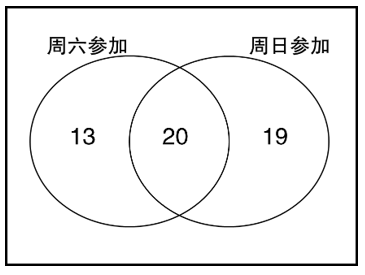

设有x人两天都未参加，根据“周六参加的人数比周六未参加的人数多4/7”，可列方程：，解得x=2，即有2人两天都未参加。

故正确答案为A。

**考点**：两集合

**来源**：2024年黑龙江省公安机关人民警察专项录用考试《行测》题（网友回忆版）第59题

### 第 60 题

6个水果礼盒中，分别装有5，6，7，8，9，10个橙子，现从中随机抽选出3盒，问正好有一盒中橙子的个数与这三盒中橙子个数的平均值相等的概率为多少？

A. 0.2

B. 0.25

C. 0.3

D. 0.35

第 60 题 · 答案与解析

**参考答案（粉笔题库参考内容）**

C

**解析**

要满足正好有一盒中橙子的个数与三盒中橙子个数的平均值相等，即三盒橙子个数为等差数列，中位数即三盒橙子个数的平均值。满足条件的情况数有（5，6，7）、（6，7，8）、（7，8，9）、（8，9，10）、（5，7，9）、（6，8，10），共6种情况；总情况数为种。根据公式：，可得所求概率。

故正确答案为C。

**考点**：给情况求概率

**来源**：2024年黑龙江省公安机关人民警察专项录用考试《行测》题（网友回忆版）第60题

### 第 61 题

甲乙二人在同一条环形跑道上各自匀速慢跑健身。已知甲按顺时针跑，若乙按逆时针跑时每3分钟和甲相遇一次，若乙按顺时针跑时每12分钟追上甲一次，问甲跑一圈需要多少分钟？

A. 7

B. 8

C. 9

D. 10

第 61 题 · 答案与解析

**参考答案（粉笔题库参考内容）**

B

**解析**

设该环形跑道的周长为S，根据相遇追及公式：，，且结合题意可列式：，，整理可得：。赋值，，则该环形跑道的周长为（3+5）×3=24，故甲跑一圈需要分钟。

故正确答案为B。

**考点**：相遇追及

**来源**：2024年黑龙江省公安机关人民警察专项录用考试《行测》题（网友回忆版）第61题

### 第 62 题

2024年1月份，某市有10天的日最高气温高于当月每日最高气温的平均值，且平均高2.4摄氏度，有5天的日最高气温恰好为当月每日最高气温的平均值。问其余天数的日最高气温平均值比当月每日最高气温的平均值低多少？

A. 1.5摄氏度

B. 1.6摄氏度

C. 1.8摄氏度

D. 2.0摄氏度

第 62 题 · 答案与解析

**参考答案（粉笔题库参考内容）**

A

**解析**

设该市2024年1月份每日最高气温的平均值为x摄氏度。1月有31天，所以其余天数为31-10-5=16天，设这16天的日最高气温平均值为y摄氏度。

方法一：根据题意可列方程：10（x+2.4）+5x+16y=31x，化简可得x-y=1.5，即其余天数的日最高气温平均值比当月每日最高气温的平均值低1.5摄氏度。

方法二：有5天的日最高气温恰好为当月每日最高气温的平均值，则其余天数的日最高气温的平均值也恰好为x摄氏度。混合平均数可以利用线段法解题，根据口诀“距离与量成反比”，可得2.4：（x-y）=16：10，化简可得x-y=1.5，即其余天数的日最高气温平均值比当月每日最高气温的平均值低1.5摄氏度。

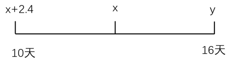

故正确答案为A。

**考点**：平均数问题

**来源**：2024年黑龙江省公安机关人民警察专项录用考试《行测》题（网友回忆版）第62题

### 第 63 题

甲、乙两货车每天分别以60千米/小时和45千米/小时的速度，从两个固定的地点同时出发相向而行，途中相遇时交接货物，某天因需要提前1个小时交货且相遇地点不变，那么需要将甲车的速度调整为80千米/小时，并按原时间出发，乙车需要按原速度且比原时间提前1小时出发。问甲、乙两车的出发地相距多少千米？

A. 420

B. 450

C. 480

D. 510

第 63 题 · 答案与解析

**参考答案（粉笔题库参考内容）**

A

**解析**

设每天甲、乙从出发到相遇行驶的时间为t小时，某天提前1小时交货且甲出发时间和相遇地点均不变，故甲行驶路程不变，根据题意可列方程：60t=80（t-1），解得t=4小时。根据相遇公式：，则甲、乙两车的出发地相距（60+45）×4=420千米。

故正确答案为A。

**考点**：相遇追及

**来源**：2024年黑龙江省公安机关人民警察专项录用考试《行测》题（网友回忆版）第63题

### 第 64 题

某工厂生产一批零件，已知第1天每名工人只能生产10个，往后每天都比前一天多生产1个。若安排100名工人生产，25天正好完成这项生产任务。问若要在15天内完成这项生产任务，至少需要安排多少名工人？

A. 256

B. 243

C. 225

D. 216

第 64 题 · 答案与解析

**参考答案（粉笔题库参考内容）**

D

**解析**

根据题意可知，每名工人每天的零件产量构成等差数列，，d=1。根据等差数列求和公式：，可得每名工人工作25天的零件总产量个；每名工人工作15天的零件总产量个。根据安排100名工人工作25天正好完成生产任务，则这项生产任务的零件总产量=100×550=55000个。若要在15天内完成这项生产任务，需要安排名工人，向上取整，即至少需要安排216名工人。

故正确答案为D。

**考点**：非典型最值问题、给具体单位型、数列问题

**来源**：2024年黑龙江省公安机关人民警察专项录用考试《行测》题（网友回忆版）第64题

### 第 65 题

甲、乙两工程队承担某个项目的施工任务，甲、乙同时施工5小时后，甲单独施工5小时，或者甲、乙同时施工4小时后，乙单独施工9小时，均可完成整个任务。已知甲、乙每小时的工费分别为1000元、600元，则全程由甲完成比全程由乙完成（ ）。

A. 高3000元以上

B. 高不到3000元

C. 低3000元以上

D. 低不到3000元

第 65 题 · 答案与解析

**参考答案（粉笔题库参考内容）**

B

**解析**

根据题意可知：工作总量=5×（甲+乙）+5甲=4×（甲+乙）+9乙，整理可得6甲=8乙，则。赋值甲、乙的效率分别为4、3，则工作总量=5×（4+3）+5×4=55，故全程由甲、乙完成的时间分别为55/4小时、55/3小时。根据“甲、乙每小时的工费分别为1000元、600元”，则全程由甲完成的工费为元，全程由乙完成的工费为元。因此，全程由甲完成比全程由乙完成高13750-11000=2750元，即高不到3000元。

故正确答案为B。

**考点**：给效率比例型

**来源**：2024年黑龙江省公安机关人民警察专项录用考试《行测》题（网友回忆版）第65题

### 第 66 题

有三种浓度分别为30%、50%、80%的酒精溶液。现在要用这三种溶液调配出150克浓度为60%的酒精溶液，要求每种溶液至少用30克，问80%的溶液最多使用多少克？

A. 70

B. 72

C. 78

D. 90

第 66 题 · 答案与解析

**参考答案（粉笔题库参考内容）**

C

**解析**

三种溶液调配出150克浓度为60%的酒精溶液，则三种溶液的溶液总量一定、溶质总量一定。又因三种溶液中，只有浓度为80%的酒精溶液浓度高于混合溶液，要想其尽量多地使用，则低于混合溶液浓度的30%、50%酒精溶液中，浓度为30%的酒精溶液尽量多地使用，浓度为50%的酒精溶液尽量少地使用。因“每种溶液至少用30克”，则浓度为50%的酒精溶液最少使用30克。

设浓度为80%的酒精溶液最多使用x克，则浓度为30%的酒精溶液使用150-30-x=120-x克，根据混合前后溶质总量不变，则，解得x=78，即浓度为80%的酒精溶液最多使用78克。

故正确答案为C。

**考点**：非典型最值问题、多溶液混合

**来源**：2024年黑龙江省公安机关人民警察专项录用考试《行测》题（网友回忆版）第66题

### 第 67 题

一艘缉私船位于走私船正西30海里位置，走私船以25海里/小时的速度往正东偏北60°的方向匀速行驶，如缉私船的速度为35海里/小时，问至少需要多长时间才能追上走私船？

A. 1.5小时

B. 2小时

C. 2.5小时

D. 3小时

第 67 题 · 答案与解析

**参考答案（粉笔题库参考内容）**

B

**解析**

如图所示，走私船从O点沿着OB方向匀速行驶，缉私船从A点沿着AB方向追及，在B点追上走私船，此时用时最短。设经过t小时，缉私船追上走私船，因缉私船、走私船的速度分别为35海里/小时、25海里/小时，则AB=35t海里，OB=25t海里。从B点向下作垂线交横轴于C点，因走私船往正东偏北60°的方向匀速行驶，故在直角三角形BCO中，，海里，海里。根据勾股定理，在直角三角形ACB中，，即，正向求解比较复杂，可考虑代入选项验证，优先代入比较容易计算的B项。

B项，当t=2时，，符合题意，正确。

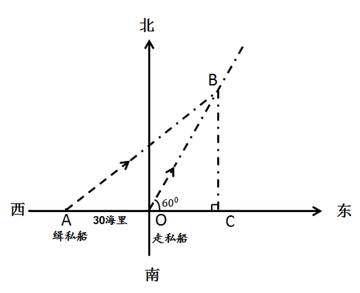

故正确答案为B。

**考点**：几何结论类-三角形相关、几何公式类-平面图形、普通行程

**来源**：2024年黑龙江省公安机关人民警察专项录用考试《行测》题（网友回忆版）第67题

### 第 68 题

张、王、刘、赵、陈、李6人分别订了A、B、C、D、E、F这6种刊物中的一种或多种，已知张、王、刘、赵、陈分别订了3种、2种、4种、3种、3种，而6人中订阅A、B、C、D、E这5种刊物的分别有2、3、2、3、1人，问李订阅的刊物有多少种不同的组合？

A. 1

B. 3

C. 11

D. 20

第 68 题 · 答案与解析

**参考答案（粉笔题库参考内容）**

C

**解析**

设李订阅了x种刊物，F刊物有y人订阅，根据题意可列等式：3+2+4+3+3+x=2+3+2+3+1+y，化简为x+4=y。由于且，则有两组解满足题意：x=1、y=5或x=2、y=6，分类讨论如下：

①当x=1、y=5时，李订阅了1种刊物，可以是6种刊物中的任意一种，则情况数为6种；

①当x=2、y=6时，李订阅了2种刊物，且F刊物6人都订阅了，即李订阅了F刊物以及其余5种刊物中的任意一种，则情况数为5种。

分类用加法，则李订阅的刊物有6+5=11种不同的组合。

故正确答案为C。

**考点**：基础排列组合

**来源**：2024年黑龙江省公安机关人民警察专项录用考试《行测》题（网友回忆版）第68题

### 第 69 题

商场开展促销活动，当天消费每满100元可以抽奖1次，每次有0.5的概率获得纪念品一份，小张希望在促销当天能以0.95以上的概率获得至少2份纪念品，问他当天至少需要消费多少元？

A. 500

B. 600

C. 700

D. 800

第 69 题 · 答案与解析

**参考答案（粉笔题库参考内容）**

D

**解析**

正面情况较多，计算量大，从反面考虑，反面情况为仅获得1份纪念品或没有获得纪念品，若抽奖次数为n，则获得至少2份纪念品的概率=1-仅获得1份纪念品的概率-没有获得纪念品的概率。求至少消费多少元，从最小的选项逐一代入验证，各项获得至少2份纪念品概率分别为：

A项：消费500元时，，所求概率为，不满足题意，排除；

B项：消费600元时，，所求概率为，不满足题意，排除；

C项：消费700元时，，所求概率为，不满足题意，排除；

D项：消费800元时，，所求概率为，满足题意，当选。

故正确答案为D。

**考点**：给概率求概率

**来源**：2024年黑龙江省公安机关人民警察专项录用考试《行测》题（网友回忆版）第69题

### 第 70 题

参加乒乓球比赛的两队，均由男、女球员各3名组成。现从每队随机选择男、女球员各1名参加混双比赛。已知甲队有男、女球员各1名年龄不超过20岁，乙队有2名女球员年龄不超过20岁。问混双比赛的4名参赛选手中至少有2名年龄不超过20岁的概率为多少？

A. 1/3

B. 10/27

C. 11/27

D. 4/9

第 70 题 · 答案与解析

**参考答案（粉笔题库参考内容）**

C

**解析**

甲队随机选择男、女球员各1名的情况数有种，乙队情况数有种，则总情况数有9×9=81种。满足要求的情况较复杂，优先考虑反面情况，“至少有2名年龄不超过20岁”的反面情况为“有0名或1名年龄不超过20岁”。

（1）当4名参赛选手中有0名年龄不超过20岁时：甲队情况数有种，乙队情况数有种，则有4×3=12种；

（2）当4名参赛选手中有1名年龄不超过20岁时：①若该名参赛选手出现在甲队，甲队情况数有种，乙队情况数有种，则有4×3=12种；②若该名参赛选手出现在乙队，甲队情况数有种，乙队情况数有种，则有4×6=24种。因此有12+24=36种。

综上，反面情况数有12+36=48种。故题干所求概率=1-反面情况概率。

故正确答案为C。

**考点**：给情况求概率

**来源**：2024年黑龙江省公安机关人民警察专项录用考试《行测》题（网友回忆版）第70题

### 第 71 题

从所给四个选项中，选择最合适的一个填入问号处，使之呈现一定的规律性：

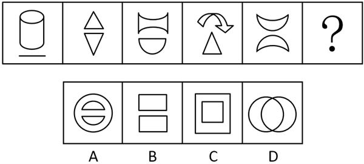

A. A

B. B

C. C

D. D

第 71 题 · 答案与解析

**参考答案（粉笔题库参考内容）**

B

**解析**

元素组成不同，且无明显属性规律，考虑数量规律。观察发现，题干图形均分为上下两部分，故？处图形应符合此规律，只有B项符合。

故正确答案B。

**考点**：数量规律-素

**来源**：2024年黑龙江省公安机关人民警察专项录用考试《行测》题（网友回忆版）第71题

### 第 72 题

从所给四个选项中，选择最合适的一个填入问号处，使之呈现一定的规律性：

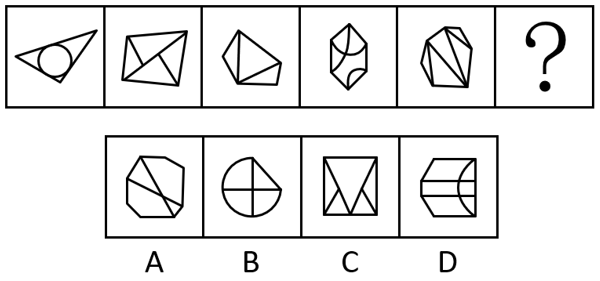

A. A

B. B

C. C

D. D

第 72 题 · 答案与解析

**参考答案（粉笔题库参考内容）**

A

**解析**

元素组成不同，且无明显属性规律，考虑数量规律。观察发现，题干图形均有明显外框，外框的直线数依次为3、4、5、6、7、？，故？处图形外框的直线数应为8，只有A项符合。

故正确答案为A。

**考点**：数量规律-线

**来源**：2024年黑龙江省公安机关人民警察专项录用考试《行测》题（网友回忆版）第72题

### 第 73 题

从所给四个选项中，选择最合适的一个填入问号处，使之呈现一定的规律性：

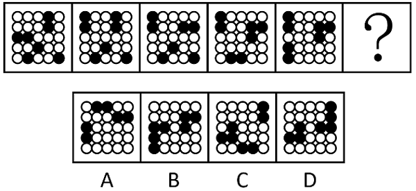

A. A

B. B

C. C

D. D

第 73 题 · 答案与解析

**参考答案（粉笔题库参考内容）**

B

**解析**

元素组成相同，优先考虑位置规律。观察发现，题干相邻两幅图形中，图1与图2只有两行黑白球的位置相同（第四、五行）；图2与图3只有三行黑白球的位置相同（第三、四、五行）；图3与图4只有两行黑白球的位置相同（第一、二行）；图4与图5只有三行黑白球的位置相同（第一、二、三行）。即相邻两幅图形中，黑白球位置相同的行数分别为2、3、2、3，故？处应选择一个与图5只有两行黑白球位置相同的图形，只有B项符合。

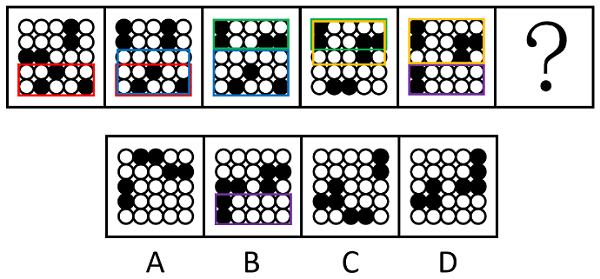

故正确答案为B。

**考点**：位置规律-平移

**来源**：2024年黑龙江省公安机关人民警察专项录用考试《行测》题（网友回忆版）第73题

### 第 74 题

从所给四个选项中，选择最合适的一个填入问号处，使之呈现一定的规律性：

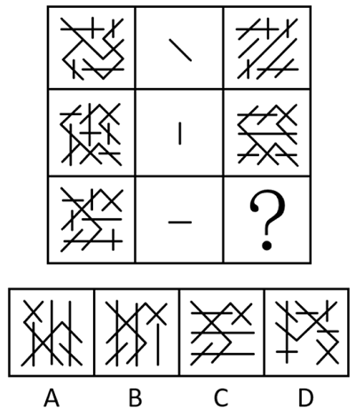

A. A

B. B

C. C

D. D

第 74 题 · 答案与解析

**参考答案（粉笔题库参考内容）**

B

**解析**

元素组成相同，优先考虑位置规律。九宫格优先横向看，第一行图形中，图2中的线段方向为左上到右下，图1中所有方向为左上到右下的线段旋转90°后得到图3；第二行图形经验证符合此规律，图2中的线段为竖线，图1中所有竖线旋转90°后得到图3；第三行图形应用此规律，图2中的线段为横线，图1中所有横线旋转90°后得到图3，只有B项符合。

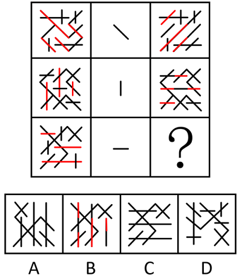

故正确答案为B。

**考点**：位置规律-旋转

**来源**：2024年黑龙江省公安机关人民警察专项录用考试《行测》题（网友回忆版）第74题

### 第 75 题

以下哪两个图调换位置之后，新形成的图形序列具有一定的规律性？

A. ①⑤

B. ②⑥

C. ①④

D. ②⑤

第 75 题 · 答案与解析

**参考答案（粉笔题库参考内容）**

D

**解析**

元素组成不同，且无明显属性规律，考虑数量规律。观察发现，题干图形出现明显封闭区域，优先考虑面数量。题干图形面数量依次为0、4、2、3、1、5，将②和⑤调换位置后，面数量依次为0、1、2、3、4、5，依次递增。

故正确答案为D。

**考点**：数量规律-面

**来源**：2024年黑龙江省公安机关人民警察专项录用考试《行测》题（网友回忆版）第75题

### 第 76 题

政府质量监管指政府主管的行政部门在市场机制框架内，为矫正市场失灵，依据质量、法律、法规及相关标准对市场主体的经济活动以及伴随其经济活动而产生的社会问题的微观层面上的干预和控制活动。

根据上述定义，下列没有涉及政府质量监管的是：

A. 从事产品生产加工的公民、法人或其他组织，必须具备保证产品质量安全的基本生产条件，按规定程序获得《工业产品生产许可证》

B. 为保障人体的健康、人身安全，从事食品生产的企业要在政府的监管下，严格执行强制性的国家标准

C. 某省产品质量监督管理部门依据国家法律法规规定，对生产领域、流通领域的产品实施质量监督

D. 某市政府组织评选市政府质量奖，对获奖企业奖励人民币100万元，并颁发证书和奖牌

第 76 题 · 答案与解析

**参考答案（粉笔题库参考内容）**

D

**解析**

第一步：找出定义关键词。

“政府主管的行政部门”、“为矫正市场失灵”、“对市场主体的经济活动进行干预和控制”。

第二步：逐一分析选项。

A项：从事产品生产加工必须按规定程序获得《工业产品生产许可证》，且从事产品生产加工与市场主体的经济活动相关，符合“政府主管的行政部门”、“为矫正市场失灵”、“对市场主体的经济活动进行干预和控制”，符合定义，排除；

B项：从事食品生产的企业要在政府的监管下，严格执行强制性的国家标准，其中食品生产与市场主体的经济活动相关，符合“政府主管的行政部门”、“为矫正市场失灵”、“对市场主体的经济活动进行干预和控制”，符合定义，排除；

C项：省产品质量监督管理部门对生产领域、流通领域的产品实施质量监督，且产品的生产、流通与市场主体的经济活动相关，符合“政府主管的行政部门”、“为矫正市场失灵”、“对市场主体的经济活动进行干预和控制”，符合定义，排除；

D项：市政府组织评选市政府质量奖，并对获奖企业给予奖励，不涉及政府部门对市场主体的经济活动进行干预和控制，不符合“为矫正市场失灵”、“对市场主体的经济活动进行干预和控制”，不符合定义，当选。

本题为选非题，故正确答案为D。

**考点**：方式目的

**来源**：2024年黑龙江省公安机关人民警察专项录用考试《行测》题（网友回忆版）第76题

### 第 77 题

“鞭打快牛”是指在工作中越是积极肯干、能力越强的人，越容易分配到更多、更繁重工作任务的一种现象。

根据上述定义，下列属于“鞭打快牛”的是：

A. 秘书小刘入职后工作积极，领导对他的要求和期望很高。经常勉励他加强理论和业务学习，他也经常牺牲休息时间学习到很晚才离开办公室

B. 作为设计师的小王，因为施工图设计质量较高、完成时间快，深受甲方信任，甲方将后续工程项目与设计任务全部委托给他去做

C. 小李因为业务能力强、肯吃苦而备受领导信任，领导将很多不属于其职责范围的工作任务也交给他去做

D. 公司生产经营部选派精兵强将，深入工作一线，积极协调组织生产，解决生产难题，超额完成本年度预期目标

第 77 题 · 答案与解析

**参考答案（粉笔题库参考内容）**

C

**解析**

第一步：找出定义关键词。

“工作中越是积极肯干、能力越强的人”、“越容易分配到更多、更繁重的工作任务”。

第二步：逐一分析选项。

A项：秘书小刘入职后工作积极，牺牲休息时间学习到很晚是为了加强自身的理论和业务能力，不涉及分配到更多的工作任务，不符合“越容易分配到更多、更繁重的工作任务”，不符合定义，排除；

B项：设计师小王因为工作能力突出而深受甲方信任，甲方将后续工程项目与设计任务全部委托给他去做，委托说明是双方合作，而不是被分配工作任务，且不明确后续的项目对小王来说是否是更多、更繁重的工作任务，不符合“工作中越是积极肯干、能力越强的人”、“越容易分配到更多、更繁重的工作任务”，不符合定义，排除；

C项：小李因为业务能力强、肯吃苦受到领导信任，领导将很多不属于其职责范围的工作任务也交给他，符合“工作中越是积极肯干、能力越强的人”、“越容易分配到更多、更繁重的工作任务”，符合定义，当选；

D项：公司生产经营部积极协调组织生产，超额完成本年度预期目标，没有提及分配到更多的工作任务，不符合“工作中越是积极肯干、能力越强的人”、“越容易分配到更多、更繁重的工作任务”，不符合定义，排除。

故正确答案为C。

**考点**：单定义-其他句式

**来源**：2024年黑龙江省公安机关人民警察专项录用考试《行测》题（网友回忆版）第77题

### 第 78 题

关系具有确定性性质是指对于某一关系R，如果对于特定论域中三个对象a、b、c而言，当对象a与对象b之间具有R关系。并且对象a与对象c之间也具有R关系时，则b=c。

根据上述定义，下列关系具有确定性性质的是：

A. 数与数之间的倒数关系

B. 国与国之间的联盟关系

C. 集合与集合之间的包含关系

D. 事物与事物之间的因果关系

第 78 题 · 答案与解析

**参考答案（粉笔题库参考内容）**

A

**解析**

第一步：找出定义关键词。

“当对象a与对象b之间具有R关系，且对象a与对象c之间也具有R关系，则b=c”。

第二步：逐一分析选项。

A项：对于数与数之间的倒数（乘积为1的两个数互为倒数）关系来说，如果数a和数b是倒数关系，且数a和数c也是倒数关系，那么数b和数c就是同一个数，符合“当对象a与对象b之间具有R关系，且对象a与对象c之间也具有R关系，则b=c”，符合定义，当选；

B项：对于国与国之间的联盟关系来说，如果国家a和国家b是联盟关系，且国家a和国家c也是联盟关系，并不能得出国家b和国家c是同一个国家，不符合“当对象a与对象b之间具有R关系，且对象a与对象c之间也具有R关系，则b=c”，不符合定义，排除；

C项：对于集合与集合之间的包含关系来说，如果集合a和集合b是包含关系，且集合a和集合c也是包含关系，并不能得出集合b和集合c是同一个集合，不符合“当对象a与对象b之间具有R关系，且对象a与对象c之间也具有R关系，则b=c”，不符合定义，排除；

D项：对于事物与事物之间的因果关系来说，如果事物a和事物b是因果关系，且事物a和事物c也是因果关系，并不能得出事物b和事物c是同一个事物，不符合“当对象a与对象b之间具有R关系，且对象a与对象c之间也具有R关系，则b=c”，不符合定义，排除。

故正确答案为A。

**考点**：单定义-其他句式

**来源**：2024年黑龙江省公安机关人民警察专项录用考试《行测》题（网友回忆版）第78题

### 第 79 题

新节俭主义是指一种用尽量少的钱，获取尽量多享受、满足尽量多需求的方式。它区别于我们传统意义上的节俭，强调量入为出、“把钱用在刀刃上”，在理性消费的同时享受生活，是一种返璞归真、更成熟、更健康的消费理念。

根据上述定义，下列体现了新节俭主义的是：

A. 方女士很少买新衣服，上星期参加同学聚会时，她把以前的经典款翻出来重新搭配一下，别有一番味道

B. 王先生平时开小汽车上班，周末骑电动自行车接送孩子上兴趣班，避免堵车和找不到停车位

C. 李女士习惯把需购的东西列一个清单，趁打折时一次性购买，一年下来，用省下的钱给妈妈买了一台按摩椅

D. 老赵家中虽还存有不少食用油，但看到一家超市开业促销，仍购买了两桶特价食用油，并排队3小时领取了10个鸡蛋

第 79 题 · 答案与解析

**参考答案（粉笔题库参考内容）**

C

**解析**

第一步：找出定义关键词。

“用尽量少的钱”、“获取尽量多享受、满足尽量多需求”、“把钱用在刀刃上”、“在理性消费的同时享受生活”。

第二步：逐一分析选项。

A项：方女士为了参加同学聚会，把以前的衣服拿出来重新搭配，不涉及消费，不符合“用尽量少的钱”、“把钱用在刀刃上”、“在理性消费的同时享受生活”，不符合定义，排除；

B项：王先生平时开小汽车上班，周末骑电动车接送孩子上兴趣班，目的是避免堵车和找不到停车位，说明不是对消费的理性规划，不符合“用尽量少的钱”、“把钱用在刀刃上”、“在理性消费的同时享受生活”，不符合定义，排除；

C项：李女士习惯将需要购置的物品列成清单，会在打折时一次性购买，说明用更少的钱买了更多的物品，对消费有理性的规划，符合“用尽量少的钱”、“获取尽量多享受、满足尽量多需求”、“把钱用在刀刃上”，一年省下的钱用来购买了一台按摩椅，符合“在理性消费的同时享受生活”，符合定义，当选；

D项：老赵家虽然有不少食用油，但看到超市开业促销，仍然购买了特价食用油，说明仅是在贪便宜购买某种特价商品，不符合“获取尽量多享受、满足尽量多需求”，排队3个小时领取了10个鸡蛋，说明对消费没有理性的规划，也不属于享受生活，不符合“在理性消费的同时享受生活”，不符合定义，排除。

故正确答案为C。

**考点**：方式目的

**来源**：2024年黑龙江省公安机关人民警察专项录用考试《行测》题（网友回忆版）第79题

### 第 80 题

广告识记是受众获得广告的印象并成为经验的过程，分为无意识记和有意识记。广告无意识记是指在预先无明确目的和自觉的动机，不借助任何有助识记的方法和特殊的意志努力的前提下产生的一种识记。广告有意识记是指预先有明确动机，并运用一定的手段，经过一定的意志努力所产生的一种广告识记。

根据上述定义，下列属于广告有意识记的是：

A. 某牛奶厂商在电梯里投放广告，反复强调广告词“今天你喝了吗？”，儿童听多了就能脱口而出

B. 甲想买一台洗衣机，在看到洗衣机的广告时就会格外注意，几天下来对广告内容烂熟于心

C. 某太阳帽的广告上写的“炎热之下请戴此帽，它使你舒适。”，让消费者联想到夏日戴上太阳帽旅游的乐趣

D. 某款新推出的饮料品牌在各大媒体上大规模投放广告。由于广告词朗朗上口，不久之后，该饮料品牌便家喻户晓

第 80 题 · 答案与解析

**参考答案（粉笔题库参考内容）**

B

**解析**

第一步：找出定义关键词。

广告识记：“受众获得广告的印象并成为经验的过程”；

广告无意识记：“预先无明确目的和自觉的动机”、“不借助任何有助识记的方法和特殊的意志努力”；

广告有意识记：“预先有明确动机”、“经过一定的意志努力”。

第二步：逐一分析选项。

A项：儿童在电梯里听多了该牛奶厂商投放的广告，就能将广告词脱口而出，说明儿童对广告的识记不存在目的性，符合“预先无明确目的和自觉的动机”、“不借助任何有助识记的方法和特殊的意志努力”，符合“广告无意识记”定义，不符合“广告有意识记”定义，排除；

B项：甲想买洗衣机，符合“预先有明确动机”，在看到洗衣机广告时会格外注意，于是对广告内容很熟悉，说明甲是有意识地关注洗衣机广告，符合“经过一定的意志努力”，符合“广告有意识记”定义，当选；

C项：某太阳帽的广告会让消费者联想到夏日戴上太阳帽旅游的乐趣，不涉及广告受众对广告的识记过程，不符合“受众获得广告的印象并成为经验的过程”，不符合“广告识记”定义，也不符合“广告有意识记”定义，排除；

D项：新款饮料品牌在媒体上投放大量广告，因广告词朗朗上口而家喻户晓，说明大众对广告的识记不存在目的性，符合“预先无明确目的和自觉的动机”、“不借助任何有助识记的方法和特殊的意志努力”，符合“广告无意识记”定义，不符合“广告有意识记”定义，排除。

故正确答案为B。

**考点**：常规问法

**来源**：2024年黑龙江省公安机关人民警察专项录用考试《行测》题（网友回忆版）第80题

### 第 81 题

边界感就是指个体能觉察出人际界限的感知力，标志着对人际交往边界感的重视程度。

根据上述定义，下列不属于边界感模糊的是：

A. 父母未经同意擅自进入子女房间，翻看子女日记

B. 朋友之间关系要好，交往中可谓“兄弟之间不分你我”

C. 同事甲经常在工作时间来办公室找乙聊天，还随意查阅乙的电脑文件

D. 备考中颇感孤独的两个同学约好一起参加辅导班，学习中相互监督

第 81 题 · 答案与解析

**参考答案（粉笔题库参考内容）**

D

**解析**

第一步：找出定义关键词。

边界感：“个体能觉察出人际界限的感知力”；

边界感模糊：“对人际交往边界感不重视”。

第二步：逐一分析选项。

A项：父母未经同意擅自进入子女房间并翻看日记，说明父母没有尊重子女的个人界限，符合“对人际交往边界感不重视”，属于“边界感模糊”，排除；

B项：朋友之间关系要好，不分你我，说明朋友之间不重视彼此的界限，符合“对人际交往边界感不重视”，属于“边界感模糊”，排除；

C项：甲经常在工作时间找乙聊天，且随意查阅乙的电脑文件，说明甲没有重视乙的工作空间和隐私，符合“对人际交往边界感不重视”，属于“边界感模糊”，排除；

D项：备考的两个同学一起参加辅导班，学习中相互监督，说明二人是基于共同目标的相互支持，没有体现不重视任何一方的个人界限，不符合“对人际交往边界感不重视”，不属于“边界感模糊”，当选。

本题为选非题，故正确答案为D。

**考点**：单定义-其他句式

**来源**：2024年黑龙江省公安机关人民警察专项录用考试《行测》题（网友回忆版）第81题

### 第 82 题

再社会化是指个体从原有的价值标准和生活方式向另一种新的价值标准和生活方式的转变、适应和不断内化的过程。

根据上述定义，下列不属于再社会化的是：

A. 散漫的小李在部队接受训练，努力成为合格的军人

B. 某少年因偷盗财物进入少管所后接受思想改造

C. 某同学大学毕业前进入当地企业进行岗前学习

D. 小敏随父母移居国外后，重新适应新的价值观念

第 82 题 · 答案与解析

**参考答案（粉笔题库参考内容）**

C

**解析**

第一步：找出定义关键词。

“个体”、“从原有的价值标准和生活方式向另一种新的价值标准和生活方式的转变、适应和不断内化”。

第二步：逐一分析选项。

A项：散漫的小李在部队接受训练，努力成为合格的军人，通过接受部队的训练可以改变小李散漫的生活方式，符合“个体”、“从原有的价值标准和生活方式向另一种新的价值标准和生活方式的转变、适应和不断内化”，符合定义，排除；

B项：偷盗财物的少年进入少管所后接受思想改造，目的是为了加强其社会责任感，改变过去的恶习，符合“个体”、“从原有的价值标准和生活方式向另一种新的价值标准和生活方式的转变、适应和不断内化”，符合定义，排除；

C项：某同学在大学毕业前进入企业进行岗前学习，没有明确体现价值标准和生活方式的转变及适应过程，不符合“从原有的价值标准和生活方式向另一种新的价值标准和生活方式的转变、适应和不断内化”，不符合定义，当选；

D项：小敏移居国外后重新适应新的价值观念，符合“个体”、“从原有的价值标准和生活方式向另一种新的价值标准和生活方式的转变、适应和不断内化”，符合定义，排除。

本题为选非题，故正确答案为C。

**考点**：单定义-其他句式

**来源**：2024年黑龙江省公安机关人民警察专项录用考试《行测》题（网友回忆版）第82题

### 第 83 题

道德绑架在伦理学界又被称为胁迫行善，以道德名义即从某种道德上的理由强制当事人行善，并以人们对社会道德舆论的畏惧或对自身形象、名誉受损的担忧，迫使当事人选择牺牲自己利益来行善的社会现象。

根据上述定义，下列不属于道德绑架的是：

A. 一富豪在珠宝拍卖会上出手阔绰，舆论指责他应该更多地把钱用于慈善事业

B. 一学生给王老师发来一个捐款链接，说是某同学得了白血病，希望王老师捐款

C. 小张在公交车上因肚子疼没给老人让座，老人斥责小张没素质

D. 某媒体灾后炒作捐赠排行榜，榜中一名人看到自己捐款靠后，只好追捐20万元

第 83 题 · 答案与解析

**参考答案（粉笔题库参考内容）**

B

**解析**

第一步：找出定义关键词。

“他人或舆论以道德名义强制当事人行善”、“以人们对社会道德舆论的畏惧或对自身形象、名誉受损的担忧，迫使当事人选择牺牲自己利益来行善”。

第二步：逐一分析选项。

A项：舆论指责富豪应该把更多的钱用于慈善事业，符合“他人或舆论以道德名义强制当事人行善”，符合定义，排除；

B项：学生发来捐款链接，希望王老师给患白血病的同学捐款，其中学生的行为并非强制性的，不符合“他人或舆论以道德名义强制当事人行善”，不符合定义，当选；

C项：老人斥责在公交车上没有让座的小张没素质，符合“他人或舆论以道德名义强制当事人行善”，符合定义，排除；

D项：媒体灾后炒作捐赠排行榜，排名靠后的名人只能追捐，说明名人是担忧舆论压力或自身形象、名誉受损，符合“以人们对社会道德舆论的畏惧或对自身形象、名誉受损的担忧，迫使当事人选择牺牲自己利益来行善”，符合定义，排除。

本题为选非题，故正确答案为B。

**考点**：方式目的

**来源**：2024年黑龙江省公安机关人民警察专项录用考试《行测》题（网友回忆版）第83题

### 第 84 题

营运统计是对运营数量资料的搜集、整理、分析和推断，内容包括一定时期各种运输工具的现实情况、运用状况及动态变化。反映各种运输工具的实存数量、构成情况、所完成的工作量及运用效率情况、消耗能源情况及检修情况。

根据上述定义，下列不属于营运统计的是：

A. 长江干线省际普通货船平均每趟运输5000吨

B. 一辆公交车平均每百公里油耗为32.3L

C. 某出租车公司中车况良好的车辆在全部车辆中占比86%

D. 某地铁公司在早高峰时段搭载的乘客中70%以上是上班族

第 84 题 · 答案与解析

**参考答案（粉笔题库参考内容）**

D

**解析**

第一步：找出定义关键词。

“一定时期各种运输工具的现实情况、运用状况及动态变化”、“反映各种运输工具的实存数量、构成情况、所完成的工作量及运用效率情况、消耗能源情况及检修情况”。

第二步：逐一分析选项。

A项：长江干线省际普通货船平均每趟运输5000吨，描述了货船现实中的运用效率，符合“一定时期各种运输工具的现实情况、运用状况及动态变化”、“反映各种运输工具的实存数量、构成情况、所完成的工作量及运用效率情况、消耗能源情况及检修情况”，符合定义，排除；

B项：一辆公交车平均每百公里油耗为32.3L，描述了公交车现实中的能源消耗情况，符合“一定时期各种运输工具的现实情况、运用状况及动态变化”、“反映各种运输工具的实存数量、构成情况、所完成的工作量及运用效率情况、消耗能源情况及检修情况”，符合定义，排除；

C项：车况良好的车辆在全部车辆中占比86%，描述了出租车现实中的质量构成情况，符合“一定时期各种运输工具的现实情况、运用状况及动态变化”、“反映各种运输工具的实存数量、构成情况、所完成的工作量及运用效率情况、消耗能源情况及检修情况”，符合定义，排除；

D项：某地铁公司在早高峰时段搭载的乘客中70%以上是上班族，描述了乘客的构成情况，不涉及对地铁本身的描述，不符合“一定时期各种运输工具的现实情况、运用状况及动态变化”，不符合定义，当选。

本题为选非题，故正确答案为D。

**考点**：主客体

**来源**：2024年黑龙江省公安机关人民警察专项录用考试《行测》题（网友回忆版）第84题

### 第 85 题

台风眼效应是指在自然灾害下台风中心区往往会比周围更加平静，即靠近危险的人多次经历高风险，会比外部的人心理更平静，甚至是麻木。

根据上述定义，下列属于台风眼效应的是：

A. 在二战中饱受战火的人往往会比远离战争的人看得开

B. 刚刚经历过地震的灾民们，在空旷地带聚在一起吃饭、打牌

C. 在长江岸边居住的人们总被洪水冲毁住宅后搬到附近的山里，而远离长江岸边的人们却很担心被冲毁房屋

D. 某地多年遭受蝗灾，当地农科院研制出针对蝗灾的特效药，但是给村民应用时却无人理会

第 85 题 · 答案与解析

**参考答案（粉笔题库参考内容）**

A

**解析**

第一步：找出定义关键词。

“靠近危险的人多次经历高风险，会比外部的人心理更平静，甚至是麻木”。

第二步：逐一分析选项。

A项：“二战中饱受战火的人”即经历了多次高风险的人，“比远离战争的人看得开”，说明他们心理会更平静，符合“靠近危险的人多次经历高风险，会比外部的人心理更平静，甚至是麻木”，符合定义，当选；

B项：“经历过地震的灾民们聚在一起吃饭、打牌”，只能体现出靠近危险的人的情况，缺少与外部的人的对比，不符合“靠近危险的人多次经历高风险，会比外部的人心理更平静，甚至是麻木”，不符合定义，排除；

C项：“长江岸边居住的人们被洪水冲毁住宅后搬到附近的山里”，只说明了自然灾害后人们的居住选择，并没有体现出这些人心理更平静和麻木，不符合“靠近危险的人多次经历高风险，会比外部的人心理更平静，甚至是麻木”，不符合定义，排除；

D项：“将研制出的针对蝗灾的特效药给村民应用时却无人理会”，只能体现出靠近危险的人的情况，缺少与外部的人的对比，不符合“靠近危险的人多次经历高风险，会比外部的人心理更平静，甚至是麻木”，不符合定义，排除。

故正确答案为A。

**考点**：单定义-其他句式

**来源**：2024年黑龙江省公安机关人民警察专项录用考试《行测》题（网友回忆版）第85题

### 第 86 题

张嘴：喝水

A. 洗手：吃饭

B. 睡觉：做梦

C. 开门：通风

D. 复习：考试

第 86 题 · 答案与解析

**参考答案（粉笔题库参考内容）**

B

**解析**

第一步：判断题干词语间逻辑关系。

不张嘴就无法喝水，张嘴是喝水的必要条件，二者是条件的对应关系。

第二步：判断选项词语间逻辑关系。

A项：不洗手也可以吃饭，洗手并非吃饭的必要条件，二者不是条件的对应关系，与题干逻辑关系不一致，排除；

B项：不睡觉就无法做梦，睡觉是做梦的必要条件，二者是条件的对应关系，与题干逻辑关系一致，当选；

C项：不开门也可以通风，开门并非通风的必要条件，二者不是条件的对应关系，与题干逻辑关系不一致，排除；

D项：先复习，再考试，二者是动作先后顺序的对应关系，与题干逻辑关系不一致，排除。

故正确答案为B。

**考点**：逻辑关系-对应关系

**来源**：2024年黑龙江省公安机关人民警察专项录用考试《行测》题（网友回忆版）第86题

### 第 87 题

病毒：疾病

A. 愉悦：满足

B. 锻炼：健康

C. 心高：气傲

D. 年龄：衰老

第 87 题 · 答案与解析

**参考答案（粉笔题库参考内容）**

B

**解析**

第一步：判断题干词语间逻辑关系。

因为“病毒”，所以可能会得“疾病”，二者是因果的对应关系。

第二步：判断选项词语间逻辑关系。

A项：因为“满足”，所以可能会感到“愉悦”，二者是因果的对应关系，但词语顺序与题干相反，与题干逻辑关系不一致，排除；

B项：因为“锻炼”，所以“健康”，二者是因果的对应关系，与题干逻辑关系一致，当选；

C项：“心高气傲”指心里自高自大，神气十分傲慢，二者是并列关系，与题干逻辑关系不一致，排除；

D项：“年龄”会影响“衰老”的程度，因为“年龄越大”，所以“衰老程度越重”，而非“年龄”导致“衰老”，二者不是因果的对应关系，与题干逻辑关系不一致，排除。

故正确答案为B。

**考点**：逻辑关系-对应关系

**来源**：2024年黑龙江省公安机关人民警察专项录用考试《行测》题（网友回忆版）第87题

### 第 88 题

除暴：安良

A. 见贤：思齐

B. 水到：渠成

C. 激浊：扬清

D. 风平：浪静

第 88 题 · 答案与解析

**参考答案（粉笔题库参考内容）**

C

**解析**

第一步：判断题干词语间逻辑关系。

“除暴”指铲除强暴黑恶势力，“安良”指安抚善良的人民，二者为并列关系，且“除暴”和“安良”均为动宾结构。

第二步：判断选项词语间逻辑关系。

A项：“见贤”指见到有才德的人，“思齐”指想着与他齐平，二者不是并列关系，与题干逻辑关系不一致，排除；

B项：“水到”指水一流到，“渠成”指沟渠自然形成，因为“水到”所以“渠成”，二者为因果对应关系，与题干逻辑关系不一致，排除；

C项：“激浊”指冲去污水，“扬清”指扬起清水，二者为并列关系，且“激浊”和“扬清”均为动宾结构，与题干逻辑关系一致，当选；

D项：“风平”指没有风，“浪静”指没有浪，二者为并列关系，但“风平”和“浪静”均不是动宾结构，与题干逻辑关系不一致，排除。

故正确答案为C。

**考点**：逻辑关系-并列关系、拆分思维

**来源**：2024年黑龙江省公安机关人民警察专项录用考试《行测》题（网友回忆版）第88题

### 第 89 题

明月：松间：照

A. 青霭：入看：无

B. 野旷：天低：树

C. 绿树：村边：合

D. 春风：花草：香

第 89 题 · 答案与解析

**参考答案（粉笔题库参考内容）**

C

**解析**

第一步：判断题干词语间逻辑关系。

“明月松间照”的意思是明月映照着幽静的松林间，“明月”“照”“松间”构成主谓宾关系。

第二步：判断选项词语间逻辑关系。

A项：“青霭入看无”的意思是青霭迷茫进入山中都不见，“无”不是动词，“青霭”“无”“入看”不构成主谓宾关系，与题干逻辑关系不一致，排除；

B项：“野旷天低树”的意思是原野广阔无边看上去比树还低，“树”不是动词，“野旷”“树”“天低”不构成主谓宾关系，与题干逻辑关系不一致，排除；

C项：“绿树村边合”的意思是翠绿的树林围绕着村落，“绿树”“合”“村边”构成主谓宾关系，与题干逻辑关系一致，当选；

D项：“春风花草香”的意思是春风送来花草的芳香，“香”不是动词，“春风”“香”“花草”不构成主谓宾关系，与题干逻辑关系不一致，排除。

故正确答案为C。

**考点**：语法关系

**来源**：2024年黑龙江省公安机关人民警察专项录用考试《行测》题（网友回忆版）第89题

### 第 90 题

聊天：朋友：茶馆

A. 批驳：专家：质疑

B. 陈列：商品：卖场

C. 治疗：病人：医院

D. 竞技：健将：赛场

第 90 题 · 答案与解析

**参考答案（粉笔题库参考内容）**

D

**解析**

第一步：判断题干词语间逻辑关系。

在“茶馆”和“朋友”“聊天”，三者为地点、人物和活动的对应关系。

第二步：判断选项词语间逻辑关系。

A项：“专家”可以“质疑”和“批驳”，三者不是地点、人物和活动的对应关系，与题干逻辑关系不一致，排除；

B项：“商品”在“卖场”“陈列”，但“商品”不是人物，三者不是地点、人物和活动的对应关系，与题干逻辑关系不一致，排除；

C项：在“医院”和“病人”“治疗”不通顺，应为“治疗”“病人”，三者仅为地点和工作内容的对应关系，与题干逻辑关系不一致，排除；

D项：在“赛场”和“健将”“竞技”，三者为地点、人物和活动的对应关系，与题干逻辑关系一致，当选。

故正确答案为D。

**考点**：逻辑关系-对应关系

**来源**：2024年黑龙江省公安机关人民警察专项录用考试《行测》题（网友回忆版）第90题

### 第 91 题

葡萄酒：桂花酿：酒

A. 醉翁亭：黄鹤楼：亭

B. 狼毫笔：鹅毛笔：笔

C. 工作室：衣帽间：室

D. 孔明灯：钨丝灯：灯

第 91 题 · 答案与解析

**参考答案（粉笔题库参考内容）**

B

**解析**

第一步：判断题干词语间逻辑关系。

“葡萄酒”和“桂花酿”是两种不同的“酒”，前两词为反对关系，均与第三词构成种属关系。

第二步：判断选项词语间逻辑关系。

A项：“醉翁亭”和“黄鹤楼”是两种不同的建筑，前两词为反对关系，但其中只有“醉翁亭”是“亭”，“黄鹤楼”并不是“亭”而是“楼阁”，与题干逻辑关系不一致，排除；

B项：“狼毫笔”和“鹅毛笔”是两种不同的“笔”，前两词为反对关系，均与第三词构成种属关系，与题干逻辑关系一致，保留；

C项：“工作室”和“衣帽间”是室内两种不同功能的空间，前两词为反对关系，但其中只有“工作室”是“室”，“衣帽间”并不是“室”而是“间”，与题干逻辑关系不一致，排除；

D项：“孔明灯”和“钨丝灯”是两种不同的“灯”，前两词为反对关系，均与第三词构成种属关系，与题干逻辑关系一致，保留。

对比B、D两项，题干的前两词“葡萄酒”“桂花酿”与B项的前两词“狼毫笔”“鹅毛笔”均是以原材料的角度命名，而D项中“孔明灯”则是基于历史和文化的角度命名，故B项逻辑关系与题干更为一致，当选。

故正确答案为B。

**考点**：逻辑关系-并列关系、逻辑关系-包容关系

**来源**：2024年黑龙江省公安机关人民警察专项录用考试《行测》题（网友回忆版）第91题

### 第 92 题

跳远：三级跳远：田赛

A. 桌子：餐桌：家具

B. 游泳：自行车：长跑

C. 电视：冰箱：家电

D. 竞走：马拉松：径赛

第 92 题 · 答案与解析

**参考答案（粉笔题库参考内容）**

D

**解析**

第一步：判断题干词语间逻辑关系。

跳远和三级跳远是两种不同的田赛项目，二者为并列关系，且均与第三词构成种属关系。

第二步：判断选项词语间逻辑关系。

A项：餐桌是桌子的一种，二者为种属关系，与题干逻辑关系不一致，排除；

B项：游泳和长跑是两种不同的运动项目，二者为并列关系，与题干逻辑关系不一致，排除；

C项：电视和冰箱是两种不同的家电，二者为并列关系，且均与第三词构成种属关系，与题干逻辑关系一致，保留；

D项：竞走和马拉松是两种不同的径赛项目，二者为并列关系，且均与第三词构成种属关系，与题干逻辑关系一致，保留。

比较C、D两项，C项为家电，而D项与题干均为体育项目，故D项逻辑关系与题干更为一致，当选。

故正确答案为D。

**考点**：逻辑关系-并列关系、逻辑关系-包容关系

**来源**：2024年黑龙江省公安机关人民警察专项录用考试《行测》题（网友回忆版）第92题

### 第 93 题

抓改革：促发展：保稳定

A. 稳预期：把方向：定政策

B. 无禁区：全覆盖：零容忍

C. 不敢腐：不能腐：不想腐

D. 谋全局：谱新篇：惠民生

第 93 题 · 答案与解析

**参考答案（粉笔题库参考内容）**

D

**解析**

第一步：判断题干词语间逻辑关系。

抓改革、促发展和保稳定三者均为动宾结构。

第二步：判断选项词语间逻辑关系。

A项：稳预期、把方向和定政策三者均为动宾结构，与题干逻辑关系一致，保留；

B项：无禁区是动宾结构，但全覆盖意思是全部范围都覆盖，零容忍意思是不容忍，二者均不是动宾结构，与题干逻辑关系不一致，排除；

C项：不敢腐、不能腐和不想腐三者均不是动宾结构，与题干逻辑关系不一致，排除；

D项：谋全局、谱新篇和惠民生三者均为动宾结构，与题干逻辑关系一致，保留。

对比A、D两项，题干中“保稳定”和D项中“惠民生”是目的，而A项中“定政策”是方式，故D项与题干逻辑关系更为一致，当选。

故正确答案为D。

**考点**：语法关系

**来源**：2024年黑龙江省公安机关人民警察专项录用考试《行测》题（网友回忆版）第93题

### 第 94 题

气缸 对于 （ ） 相当于 （ ） 对于 灯泡

A. 发动机 灯丝

B. 机件 灯罩

C. 汽油 电

D. 活塞 灯座

第 94 题 · 答案与解析

**参考答案（粉笔题库参考内容）**

A

**解析**

逐一代入选项。

A项：气缸是发动机的组成部分，二者为组成关系，灯丝是灯泡的组成部分，二者为组成关系，前后逻辑关系一致，当选；

B项：气缸是一种机件，二者为种属关系，灯罩和灯泡均为组成灯具的部件，二者为并列关系，前后逻辑关系不一致，排除；

C项：汽油可作为燃料为气缸工作提供能量，二者为对应关系，电可为灯泡发亮提供能量，二者为对应关系，但词语前后顺序相反，前后逻辑关系不一致，排除；

D项：活塞是气缸的组成部分，二者为组成关系，灯座和灯泡均为组成灯具的部件，二者为并列关系，前后逻辑关系不一致，排除。

故正确答案为A。

**考点**：逻辑关系-包容关系

**来源**：2024年黑龙江省公安机关人民警察专项录用考试《行测》题（网友回忆版）第94题

### 第 95 题

舍生取义 对于 （ ） 相当于 （ ） 对于 驾轻就熟

A. 宁死不屈 游刃有余

B. 精忠报国 并驾齐驱

C. 赤胆忠心 炉火纯青

D. 刚正不阿 惟妙惟肖

第 95 题 · 答案与解析

**参考答案（粉笔题库参考内容）**

A

**解析**

逐一代入选项。

A项：“舍生取义”指为正义而牺牲生命，“宁死不屈”指宁可死去，也不屈服，二者为近义关系；“游刃有余”形容做事熟练，轻而易举，“驾轻就熟”指驾轻车，走熟路，比喻承担熟悉、轻松的事务，二者为近义关系，前后逻辑关系一致，当选；

B项：“舍生取义”指为正义而牺牲生命，“精忠报国”指对（国家、民族）极其忠诚，为国家效力尽忠，二者无明显逻辑关系；“并驾齐驱”比喻齐头并进，不分前后，也比喻地位或程度相等，不分高下，“驾轻就熟”指驾轻车，走熟路，比喻承担熟悉、轻松的事务，二者无明显逻辑关系，前后逻辑关系不一致，排除；

C项：“舍生取义”指为正义而牺牲生命，“赤胆忠心”形容十分忠诚，二者无明显逻辑关系；“炉火纯青”比喻学问、技术等达到了纯熟完美的地步，“驾轻就熟”指驾轻车，走熟路，比喻承担熟悉、轻松的事务，二者无明显逻辑关系，前后逻辑关系不一致，排除；

D项：“舍生取义”指为正义而牺牲生命，“刚正不阿”指刚强正直，不阿谀奉迎，二者无明显逻辑关系；“惟妙惟肖”形容描写或模仿得非常好，非常逼真，“驾轻就熟”指驾轻车，走熟路，比喻承担熟悉、轻松的事务，二者无明显逻辑关系，前后逻辑关系不一致，排除。

故正确答案为A。

**考点**：语义关系-近义关系

**来源**：2024年黑龙江省公安机关人民警察专项录用考试《行测》题（网友回忆版）第95题

### 第 96 题

粉笔暂未收录本题（来源缺题，题位保留）

第 96 题 · 答案与解析

**答案状态：unknown（来源未提供）**

**解析状态：unknown（来源未提供）**

### 第 97 题

粉笔暂未收录本题（来源缺题，题位保留）

第 97 题 · 答案与解析

**答案状态：unknown（来源未提供）**

**解析状态：unknown（来源未提供）**

### 第 98 题

粉笔暂未收录本题（来源缺题，题位保留）

第 98 题 · 答案与解析

**答案状态：unknown（来源未提供）**

**解析状态：unknown（来源未提供）**

### 第 99 题

粉笔暂未收录本题（来源缺题，题位保留）

第 99 题 · 答案与解析

**答案状态：unknown（来源未提供）**

**解析状态：unknown（来源未提供）**

### 第 100 题

粉笔暂未收录本题（来源缺题，题位保留）

第 100 题 · 答案与解析

**答案状态：unknown（来源未提供）**

**解析状态：unknown（来源未提供）**

### 第 101 题

粉笔暂未收录本题（来源缺题，题位保留）

第 101 题 · 答案与解析

**答案状态：unknown（来源未提供）**

**解析状态：unknown（来源未提供）**

### 第 102 题

专家1说“甲这个商品可以用”；专家2说：“乙这个商品不可以用”；专家3说：“乙或者丙这个商品可以用”。三个专家中只有一个专家的话被采纳了，且只有一个商品可以用。

由此可以推出：

A. 甲商品可以用

B. 丙商品可以用

C. 第二个专家说的是正确的

D. 第三个专家说的是正确的

第 102 题 · 答案与解析

**参考答案（粉笔题库参考内容）**

D

**解析**

第一步：分析题干找关系。

（1）甲；

（2）-乙；

（3）乙 或 丙；

（4）只有一个专家的话被采纳；

（5）只有一个商品可以用。

第二步：根据题干条件进行推理。

题干没有明显的矛盾关系和反对关系，且“只有一个专家的话被采纳（只有一真）”，故用假设法进行推理。

情况一：假设专家1的话为真，根据条件（5）可知专家2说的话一定为真 ，与条件（4）冲突，故专家1说的话为假；

情况二：假设专家2的话为真，即乙商品不可以用，根据条件（5）可知甲和丙中有一个可以用，此时专家1和专家3的话必然有一个为真， 与条件（4）冲突，故专家2的话为假。

综上所述，专家1和专家2的话一定为假，那么专家3的话一定为真，D项当选。

故正确答案为D。

**考点**：真假推理-其他

**来源**：2024年黑龙江省公安机关人民警察专项录用考试《行测》题（网友回忆版）第102题

### 第 103 题

某单位根据自身业务性质设置时政、信息、管理、法律、传媒五门课程，要求甲乙丙丁四个员工小组在这五门课程中任选2门进行学习，其中必须有一门是结业考试课程。已知：

（1）时政、信息没有结业考试；

（2）甲小组没选信息；

（3）只有乙小组选了传媒，只有丙小组选了管理；

（4）没有哪两个小组选完全一样的课程。

根据以上信息可以推出：

A. 乙选了传媒和法律

B. 丙选了管理和法律

C. 丁选了信息和法律

D. 四个小组同时选了法律

第 103 题 · 答案与解析

**参考答案（粉笔题库参考内容）**

C

**解析**

第一步：分析题干条件。

（1）时政、信息没有结业考试；

（2）甲小组没选信息；

（3）只有乙小组选了传媒，只有丙小组选了管理；

（4）没有哪两个小组选完全一样的课程；

（5）五门课程中任选2门，其中必须有一门是结业考试课程。

第二步：根据题干条件进行推理。

题干条件（3）为确定信息，故由此入手进行推理。

根据条件（3）可以推出，甲小组和丁小组都没选传媒和管理；结合条件（1）和（5）可知，甲小组和丁小组都选了法律；再根据条件（2）可知，甲小组另外一门课程选择的是时政；结合条件（4）可知，丁小组另外一门课程选择的是信息，对应C项。

故正确答案为C。

**考点**：从确定信息开始推

**来源**：2024年黑龙江省公安机关人民警察专项录用考试《行测》题（网友回忆版）第103题

### 第 104 题

所谓“惊蛰”字面意思是春雷始鸣，惊醒蛰伏于地下越冬的蛰虫，故有“春雷惊百虫”之说。对此有气象、农业专家指出，“春雷惊百虫”之说，实际上是古人对物候现象成因的一种误解。

要使上述论证成立，还需基于以下哪一前提？

A. 惊蛰节气前后，大多地区气温回升加快，雨水增多，寒冷的日子即将过去

B. 惊蛰节气前后，频繁的春雷“叫醒”了冬眠的昆虫，过冬的虫卵也开始孵化

C. 地下冬眠的昆虫是听不到雷声的，真正让它们结束冬眠，爬出地面的原因是气温回升

D. 我国幅员辽阔，各地春雷发生时间并不一致，纬度越高，大气越干冷，春雷发生越迟

第 104 题 · 答案与解析

**参考答案（粉笔题库参考内容）**

C

**解析**

第一步：找出论点和论据。

论点：“春雷惊百虫”之说，实际上是古人对物候现象成因的一种误解。

论据：无。

本题只有论点，没有论据，加强优先考虑补充论据。

第二步：逐一分析选项。

A项：该项指出惊蛰节气前后，寒冷的日子即将过去，而论点说的是“春雷惊百虫”实际上是古人对物候现象成因的一种误解，二者话题不一致，无法加强，排除；

B项：该项指出惊蛰节气前后，春雷“叫醒”了冬眠的昆虫，过冬的虫卵也开始孵化，证明“春雷惊百虫”是成立的，并不是一种误解，具有削弱作用，无法加强，排除；

C项：该项指出地下冬眠的昆虫听不到雷声，以及昆虫结束冬眠爬出地面的原因是气温回升，证明“春雷惊百虫”是不成立的，解释了为什么“春雷惊百虫”是一种误解，补充论据，可以加强，当选；

D项：该项指出我国幅员辽阔，各地春雷发生时间不同，而论点说的是“春雷惊百虫”实际上是古人对物候现象成因的一种误解，二者话题不一致，无法加强，排除。

故正确答案为C。

**考点**：补充论据

**来源**：2024年黑龙江省公安机关人民警察专项录用考试《行测》题（网友回忆版）第104题

### 第 105 题

在知识经济时代，如果要推动社会可持续发展，就要提高人才培养质量，而要提高人才培养质量，就必须提升高校的办学水平。如果要提升高校的办学水平，就要提升大学教师的整体素养。

根据以上陈述可以得出以下哪项？

A. 只有提升大学教师的整体素养，才能推动社会可持续发展

B. 只有提高人才培养质量，才能提升大学教师的整体素养

C. 如果提升高校的办学水平，就能推动社会的可持续发展

D. 如果不提升高校的办学水平，就不能提升大学教师的整体素养

第 105 题 · 答案与解析

**参考答案（粉笔题库参考内容）**

A

**解析**

第一步：翻译题干。

①推动社会可持续发展→提高人才培养质量；

②提高人才培养质量→提升高校的办学水平；

③提升高校的办学水平→提升大学教师的整体素养。

将①②③串联可得到④：推动社会可持续发展→提高人才培养质量→提升高校的办学水平→提升大学教师的整体素养。

第二步：逐一分析选项。

A项：翻译为“推动社会可持续发展→提升大学教师的整体素养”，“推动社会可持续发展”是对④的肯前，肯前必肯后，可以推出“提升大学教师的整体素养”，当选；

B项：翻译为“提升大学教师的整体素养→提高人才培养质量”，“提升大学教师的整体素养”是对④的肯后，肯后无法推出确定性结论，无法推出，排除；

C项：翻译为“提升高校的办学水平→推动社会可持续发展”，“提升高校的办学水平”是对④的肯后，肯后无法推出确定性结论，无法推出，排除；

D项：翻译为“-提升高校的办学水平→-提升大学教师的整体素养”，“-提升高校的办学水平”是对③的否前，否前无法推出确定性结论，无法推出，排除。

故正确答案为A。

**考点**：常规翻译

**来源**：2024年黑龙江省公安机关人民警察专项录用考试《行测》题（网友回忆版）第105题

## 材料 1

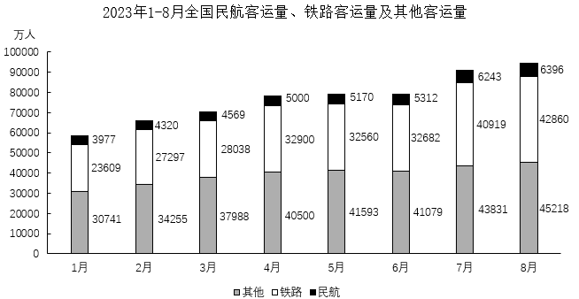

### 第 106 题

2023年8月全国客运量环比增速在以下哪个范围？

A. 超过5%

B. 3%-5%之间

C. 1%-3%之间

D. 不到1%

第 106 题 · 答案与解析

**参考答案（粉笔题库参考内容）**

B

**解析**

根据题干“2023年8月······环比增速在以下哪个范围”，可判定本题为一般增长率问题。定位统计图可得：2023年7月全国民航客运量、铁路客运量及其他客运量分别为6243万人、40919万人、43831万人；2023年8月全国民航客运量、铁路客运量及其他客运量分别为6396万人、42860万人、45218万人。则2023年7月全国客运量为万人，2023年8月全国客运量为万人。根据公式：增长率，可得所求为，在B项范围内。

故正确答案为B。

**考点**：一般增长率、统计图

**来源**：2024年黑龙江省公安机关人民警察专项录用考试《行测》题（网友回忆版）第106题

### 第 107 题

2023年上半年全国铁路客运量约是全国民航客运量的多少倍？

A. 不到5倍

B. 5-6倍之间

C. 6-7倍之间

D. 7倍以上

第 107 题 · 答案与解析

**参考答案（粉笔题库参考内容）**

C

**解析**

根据题干“2023年上半年······是······的多少倍”，可判定本题为现期倍数问题。定位统计图可知2023年1-6月各月的铁路客运量及民航客运量。2023年上半年全国铁路客运量为万人；2023年上半年全国民航客运量为万人。故2023年上半年全国铁路客运量是全国民航客运量的倍，在C项范围内。

故正确答案为C。

**考点**：现期倍数、统计图

**来源**：2024年黑龙江省公安机关人民警察专项录用考试《行测》题（网友回忆版）第107题

### 第 108 题

2023年第二季度全国民航客运量比第一季度增长了：

A. 2616万人

B. 3156万人

C. 3482万人

D. 4054万人

第 108 题 · 答案与解析

**参考答案（粉笔题库参考内容）**

A

**解析**

根据题干“2023年第二季度······比第一季度增长了”，结合选项为具体单位，可判定本题为增长量计算问题。定位统计图可得：2023年1-6月，全国民航客运量分别为3977万人、4320万人、4569万人、5000万人、5170万人、5312万人。根据公式：增长量=现期量-基期量，则所求为（5000+5170+5312）-（3977+4320+4569）=15482-12866=2616万人。

故正确答案为A。

**考点**：增长量计算、统计图

**来源**：2024年黑龙江省公安机关人民警察专项录用考试《行测》题（网友回忆版）第108题

### 第 109 题

2023年上半年全国除民航、铁路外的其他客运量的日均超过1300万人的月份有几个？（ ）

A. 3

B. 4

C. 5

D. 6

第 109 题 · 答案与解析

**参考答案（粉笔题库参考内容）**

A

**解析**

根据题干“2023年上半年······日均超过1300万人的月份有······”，结合材料时间为2023年1-8月，可判定本题为现期平均数问题。定位统计图可知2023年上半年各月全国除民航、铁路外的其他客运量。根据公式：日均客运量，则2023年上半年各月全国除民航、铁路外的其他客运量的日均值分别为：1月，万人；2月，万人；3月，万人；4月，万人；5月，万人；6月，万人。综上可知，2023年上半年全国除民航、铁路外的其他客运量的日均超过1300万人的月份有4月、5月、6月，共3个。

故正确答案为A。

**考点**：现期平均数、统计图

**来源**：2024年黑龙江省公安机关人民警察专项录用考试《行测》题（网友回忆版）第109题

### 第 110 题

2023年2-4月全国铁路客运量占全国客运量的比重呈现以下哪种趋势？

A. 持续上升

B. 持续下降

C. 先升后降

D. 先降后升

第 110 题 · 答案与解析

**参考答案（粉笔题库参考内容）**

D

**解析**

根据题干“2023年2-4月······占······比重呈现以下哪种趋势”，结合材料时间为2023年1-8月，可判定本题为现期比重问题。定位统计图可得2023年2-4月全国铁路客运量、民航客运量及其他客运量。根据公式：比重，则2023年2-4月全国铁路客运量占全国客运量的比重分别为：2月，；3月，；4月，。故2023年2-4月全国铁路客运量占全国客运量的比重呈现先降后升的变化趋势。

故正确答案为D。

**考点**：现期比重、统计图

**来源**：2024年黑龙江省公安机关人民警察专项录用考试《行测》题（网友回忆版）第110题

## 材料 2

2022年全国居民人均可支配收入36883元，分城乡看，城镇居民人均可支配收入49283元，增长3.9%，农村居民人均可支配收入20133元，增长6.3%。

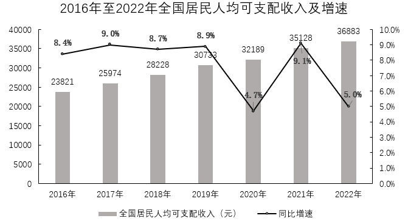

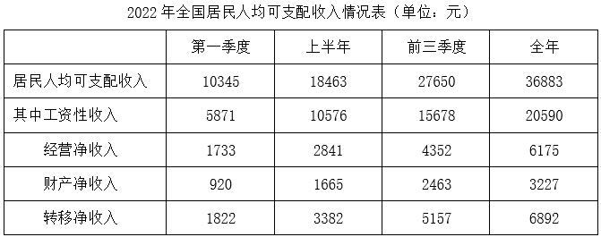

### 第 111 题

2022年全国居民人均可支配收入比2015年增长了？

A. 不到40%

B. 40%-60%之间

C. 60%-80%之间

D. 80%以上

第 111 题 · 答案与解析

**参考答案（粉笔题库参考内容）**

C

**解析**

根据题干“2022年······比2015年增长了”，结合选项均为百分数，可判定本题为一般增长率问题。定位统计图可得：2016年全国居民人均可支配收入23821元，同比增速8.4%；2022年全国居民人均可支配收入36883元。根据公式：基期量，则2015年全国居民人均可支配收入元。根据公式：增长率，则2022年全国居民人均可支配收入比2015年增长了，在C项范围内。

故正确答案为C。

**考点**：一般增长率、综合资料

**来源**：2024年黑龙江省公安机关人民警察专项录用考试《行测》题（网友回忆版）第111题

### 第 112 题

2022年全国城镇居民人均可支配收入同比增量比农村居民人均可支配收入同比增量：

A. 低不到500元

B. 低500元以上

C. 高不到500元

D. 高500元以上

第 112 题 · 答案与解析

**参考答案（粉笔题库参考内容）**

D

**解析**

根据题干“2022年······同比增量比······同比增量”，可判定本题为增长量计算问题。定位文字材料可知，2022年全国城镇居民人均可支配收入49283元，增长3.9%，农村居民人均可支配收入20133元，增长6.3%。根据公式：增长量，则2022年全国城镇居民人均可支配收入同比增量元，农村居民人均可支配收入同比增量元。故2022年全国城镇居民人均可支配收入同比增量比农村居民人均可支配收入同比增量高1900-1180=720元，在D项范围内。

故正确答案为D。

**考点**：增长量计算、综合资料

**来源**：2024年黑龙江省公安机关人民警察专项录用考试《行测》题（网友回忆版）第112题

### 第 113 题

2022年下半年全国居民人均经营净收入比上半年：

A. 高128元

B. 高493元

C. 低128元

D. 低493元

第 113 题 · 答案与解析

**参考答案（粉笔题库参考内容）**

B

**解析**

定位统计表可得：2022年上半年全国居民人均经营净收入2841元，2022年全年全国居民人均经营净收入6175元。则2022年下半年全国居民人均经营净收入=6175-2841=3334元，题目所求=3334-2841=493元，即高493元。

故正确答案为B。

**考点**：综合资料、简单加减计算

**来源**：2024年黑龙江省公安机关人民警察专项录用考试《行测》题（网友回忆版）第113题

### 第 114 题

2022年四个季度中，全国居民人均工资性收入最高的是？

A. 第一季度

B. 第二季度

C. 第三季度

D. 第四季度

第 114 题 · 答案与解析

**参考答案（粉笔题库参考内容）**

A

**解析**

定位统计表可得2022年全国居民人均工资性收入每季度累计金额。2022年四个季度全国居民人均工资性收入分别为：第一季度，5871元；第二季度，10576-5871=4705元；第三季度，15678-10576=5102元；第四季度，20590-15678=4912元。比较可得，2022年四个季度中全国居民人均工资性收入最高的是第一季度。

故正确答案为A。

**考点**：综合资料、简单加减计算

**来源**：2024年黑龙江省公安机关人民警察专项录用考试《行测》题（网友回忆版）第114题

### 第 115 题

能够从上述资料中推出的是？

A. 2022年第二季度全国居民人均财产净收入环比增速在20%以上

B. 2016-2022年全国居民人均可支配收入同比增速均在5%以上

C. 2022年第一季度至第四季度全国居民人均经营净收入均在1500元以上

D. 2022年第三季度全国居民人均转移净收入占全国居民人均可支配收入的比重超过15%

第 115 题 · 答案与解析

**参考答案（粉笔题库参考内容）**

D

**解析**

A项：定位统计表可知，2022年第一季度和上半年全国居民人均财产净收入分别为920元、1665元。则2022年第二季度全国居民人均财产净收入=1665-920=745元，根据公式：增长率=，可得2022年第二季度全国居民人均财产净收入环比增速=＜0，在20%以下，错误；

B项：定位统计图可知2016-2022年全国居民人均可支配收入同比增速。2020年全国居民人均可支配收入同比增速为4.7%，在5%以下，错误；

C项：定位统计表可知，2022年第一季度、上半年、前三季度、全年全国居民人均经营净收入分别为1733元、2841元、4352元、6175元。则2022年第二季度全国居民人均经营净收入=2841-1733=1108元，在1500元以下，错误；

D项：定位统计表可知，2022年上半年和前三季度全国居民人均可支配收入分别为18463元、27650元；2022年上半年和前三季度全国居民人均转移净收入分别为3382元、5157元。则2022年第三季度全国居民人均可支配收入=27650-18463=9187元，2022年第三季度全国居民人均转移净收入=5157-3382=1775元，根据公式：比重=部分/整体，可得2022年第三季度全国居民人均转移净收入占全国居民人均可支配收入的比重=，正确。

故正确答案为D。

**考点**：综合分析、综合资料

**来源**：2024年黑龙江省公安机关人民警察专项录用考试《行测》题（网友回忆版）第115题

## 材料 3

2022年全年全国批发和零售业增加值114518亿元，同比增长0.9%；交通运输、仓储和邮政业增加值49674亿元，同比下降0.8%；住宿和餐饮业增加值17855亿元，同比下降2.3%；金融业增加值96811亿元，同比增长5.6%；房地产业增加值73821亿元，同比下降5.1%；信息传输、软件和信息技术服务业增加值47934亿元，同比增长9.1%；租赁和商务服务业增加值39153亿元，同比增长3.4%。

2022年末，全国民用汽车保有量31903万辆，比上年末增加1752万辆，其中私有汽车保有量27873万辆，增加1627万辆。民用轿车保有量17740万辆，增加1003万辆，其中私人轿车保有量16685万辆，增加954万辆。

2022年全年，全国完成邮政行业业务总量14317亿元，同比增长4.5%，全年完成电信业务总量17498亿元，同比增长21.3%，年末移动电话基站数1083万个，其中4G基站603万个，5G基站231万个，年末固定互联网宽带接入用户58965万户，比上年末增加5386万户，其中100M速率及以上的宽带接入用户55380万户，增加5513万户，蜂窝物联网终端用户18.45亿户，增加4.47亿户。

### 第 116 题

2021年全国住宿和餐饮业增加值约为：

A. 17454亿元

B. 18275亿元

C. 18775亿元

D. 19264亿元

第 116 题 · 答案与解析

**参考答案（粉笔题库参考内容）**

B

**解析**

根据题干“2021年······增加值约为”，结合材料时间为2022年，可判定本题为基期计算问题。定位文字材料第一段可得：2022年全年全国住宿和餐饮业增加值17855亿元，同比下降2.3%。根据公式：基期量，则2021年全国住宿和餐饮业增加值亿元，与B项最接近。

故正确答案为B。

**考点**：文字资料、基期计算

**来源**：2024年黑龙江省公安机关人民警察专项录用考试《行测》题（网友回忆版）第116题

### 第 117 题

2022年全年，全国下列服务业增加值中同比增量最多的是：

A. 批发和零售业

B. 金融业

C. 信息传输、软件和信息技术服务业

D. 租赁和商务服务业

第 117 题 · 答案与解析

**参考答案（粉笔题库参考内容）**

B

**解析**

根据题干“2022年全年······同比增量最多的是”，可判定本题为增长量比较问题。定位文字材料第一段可得：2022年全年全国批发和零售业增加值114518亿元，同比增长0.9%；金融业增加值96811亿元，同比增长5.6%；信息传输、软件和信息技术服务业增加值47934亿元，同比增长9.1%；租赁和商务服务业增加值39153亿元，同比增长3.4%。因2022年全年信息传输、软件和信息技术服务业增加值的现期量和同比增速均大于租赁和商务服务业，根据增长量比较口诀“大大则大”，可得前者同比增量大于后者，排除D项。根据公式：增长量，可得批发和零售业增加值同比增量亿元，金融业增加值同比增量亿元，信息传输、软件和信息技术服务业增加值同比增量亿元，则同比增量最多的是金融业。

故正确答案为B。

**考点**：增长量比较、文字资料

**来源**：2024年黑龙江省公安机关人民警察专项录用考试《行测》题（网友回忆版）第117题

### 第 118 题

2021年末，全国私人轿车保有量占民用轿车保有量的比重在以下哪个范围？

A. 不到70%

B. 70%-80%之间

C. 80%-90%之间

D. 90%以上

第 118 题 · 答案与解析

**参考答案（粉笔题库参考内容）**

D

**解析**

根据题干“2021年末······占······的比重在以下哪个范围”，结合材料时间为2022年末，可判定本题为基期比重问题。定位文字材料第二段可得：2022年末，全国民用轿车保有量17740万辆，增加1003万辆，其中私人轿车保有量16685万辆，增加954万辆。根据公式：基期量=现期量-增长量，则2021年末，全国民用轿车保有量为17740-1003=16737万辆，私人轿车保有量为16685-954=15731万辆；根据公式：比重，则所求为，在D项范围内。

故正确答案为D。

**考点**：文字资料、基期比重

**来源**：2024年黑龙江省公安机关人民警察专项录用考试《行测》题（网友回忆版）第118题

### 第 119 题

2022年末，全国蜂窝物联网终端用户的同比增速约为：

A. 24%

B. 28%

C. 32%

D. 36%

第 119 题 · 答案与解析

**参考答案（粉笔题库参考内容）**

C

**解析**

根据题干“2022年末······同比增速约为”，可判定本题为一般增长率问题。定位文字材料第三段可得：2022年末，全国蜂窝物联网终端用户18.45亿户，增加4.47亿户。根据公式：增长率，则所求。

故正确答案为C。

**考点**：文字资料、一般增长率

**来源**：2024年黑龙江省公安机关人民警察专项录用考试《行测》题（网友回忆版）第119题

### 第 120 题

以下说法中能够从上述资料中推出的有几项？

①2021年全年，全国完成邮政行业业务总量不到1.3万亿元

②2022年末，全国5G基站数占移动电话基站数的20%以上

③2021年末，全国固定互联网宽带接入用户超过5亿户

A. 0项

B. 1项

C. 2项

D. 3项

第 120 题 · 答案与解析

**参考答案（粉笔题库参考内容）**

C

**解析**

①定位文字材料第三段可得：2022年全年，全国完成邮政行业业务总量14317亿元，同比增长4.5%。根据公式：，则2021年全年全国完成邮政行业业务总量为\>1.3万亿元，错误。

②定位文字材料第三段可得：2022年末，移动电话基站数1083万个，其中5G基站231万个。根据公式：，则2022年末全国5G基站数占移动电话基站数的比重为\>20%，正确。

③定位文字材料第三段可得：2022年末，固定互联网宽带接入用户58965万户，比上年末增加5386万户。根据公式：基期量=现期量-增长量，则2021年末全国固定互联网宽带接入用户数为58965-5386=53579万户=5.3579亿户>5亿户，正确。

综上可知，能推出的是②③，共2项。

故正确答案为C。

**考点**：文字资料、综合分析

**来源**：2024年黑龙江省公安机关人民警察专项录用考试《行测》题（网友回忆版）第120题

