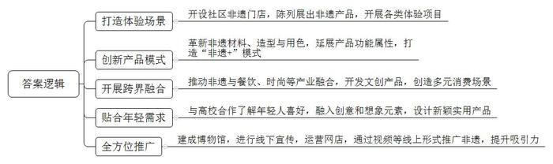
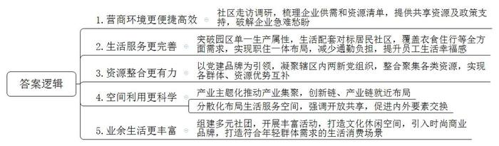
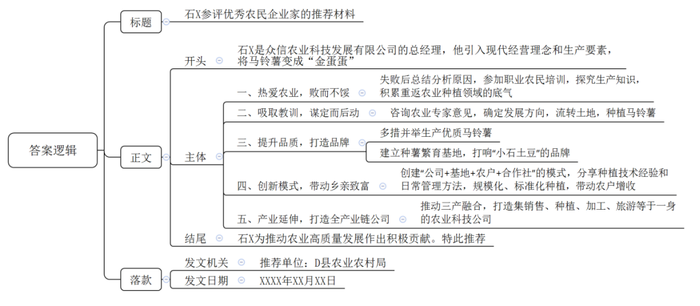
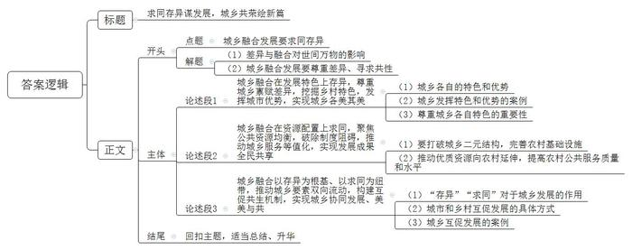

# 2025年公务员多省联考《申论》题（黑龙江县乡卷、普通选调卷）

<!-- gwy:overview:start -->
> **黑龙江 · 2025 · 申论 · 县乡卷** ｜ 4 题 · 图片 4 处 · 答案随题折叠

导航：[题目](#题目) · [材料 1](#材料-1)
<!-- gwy:overview:end -->

> 候选采集稿。参考答案及解析来自粉笔页面，不代表官方答案或真实高分答卷；来源使用许可与原卷对应关系仍需人工核实。

## 给定材料

### 材料 1

非遗之美，美就美在其携带的历史印记和传统元素，对一些非遗传承人来说，是一心坚守传统还是寻求多元发展，他们正在努力思考和探索。

位于S市城区的悦红非遗门店，在夜色之中吸引了不少游人，人们常常在周末三三两两相约到这里，花费几十或数百元就可以一起体验穿越古代的时光。玩投壶游戏，用青瓷杯品悦红茶，还可以边欣赏唐风歌舞边吃一顿精致的红梅玉燕，悦红茶、青瓷、竹编……数十种非遗产品在悦红非遗空间陈列展出，迎恩书场、戏曲表演、彩灯表演等项目轮番上演。像悦红非遗门店一样，根植在社区里、生活中的非遗门店还有许多，正成为与人们朝夕相处的展示地、旅游体验地。市非遗保护中心郭主任表示，最好的传承就是让非遗活起来，适应人们的需求。

吴山泥人传承了数百年，古朴的造型早已深入人心，但在多元化的现代社会要想赢得受众的喜爱，还要花心思在材料革新、造型创新以及用色上作出突破。2020年，吴山泥人开始结合节庆活动、传统民俗等探索非遗保护与创新的新路径，延展产品的功能属性。从此，市面上与吴山泥人相关的文创产品逐渐多了起来，如泥人笔记本、泥人咖啡杯等，高达四五十种之多，吴山泥人还与一些地方品牌联名，为牛奶厂、吐司店、饮品店设计泥人形象，形成“泥人+”模式。

吴山泥人还将3D打印技术与泥人捏塑技艺结合，重新设计了阿福和阿喜的造型，并为之取名为——NANI和MOMO。“倷泥摩摩（NANIMOMO）是吴山泥人的吴语发音，叫这个名字，既贴切又有潮流感。”传承人小范说，结合吴州特产与景点开发的倷泥摩摩系列盲盒以及周边文创产品一经推出，便大受欢迎，月销量最高达1万盒。在吴州，一家倷泥摩摩咖啡店紧邻古运河而开，店内陈列着一排排文创专柜。翻开菜单，上面罗列着“阿福卡布奇诺”“阿喜拿铁”……客人在这里可以点上一杯以泥人命名的咖啡，也可以了解吴山泥人文化，顺便再买上一个喜爱的泥人，非遗在这里真正地融入了生活。

像吴山泥人一样，越来越多的非遗传承人通过打造“行走的艺术课堂”等形式，做出一系列与时俱进的改变。2007年，小宋从设计系毕业后返乡创业，以“更时尚、更跨界、更好玩”的理念创立了品牌，专注于优秀文创产品的开发。从20多岁创业开始，小宋便致力于将时尚与跨界融合，让产品更具观赏性的同时，让泥人朝着“好玩”发展：与年轻一代保持紧密联系，融入更多创意和想象元素。在产品设计和开发过程中，他积极与年轻人沟通，通过与高校合作来了解年轻一代的喜好，设计出既新颖又实用的产品。经过17年的探索，公司已经发展成拥有商务礼品、IP文创、ODM（原始设计制造商）三大板块的企业，其产品更是登上了北京时装周、纽约时装周等国际舞台。

在K市灯笼张彩灯博物馆里，担任讲解人的小张，一遍又一遍地给游客介绍造型各异的灯笼。作为“灯笼张”的传承人，小张在父亲去世后，辞去高薪工作专心推广“灯笼张”的灯笼。2011年，他把祖宅四合院腾了出来，建成彩灯博物馆。他还将推广的眼光转向线上，名片上印着“灯笼张”的网店，从作品展示到视频，他全方位地将彩灯记忆呈现在网上。许多人通过浏览网站知道了非遗的彩灯如此的美轮美奂，非遗的彩灯吸引了更多人来K市参观彩灯博物馆。

传统与现代的结合与碰撞可以打破人们对非遗的传统认知，被公众认识、欣赏与消费，赢得广大群众，尤其是当代年轻人的喜爱，这是非遗火热传承的一个选择。民俗研究专家坦言：唯有全社会共同参与非遗传承保护、共享非遗保护成果，非遗文化才能活在百姓心中，活在百姓生活中，只有这样非遗才能有效地传承下去。对非物质文化遗产的保护，要尊重民间自己的传统方式。新场古镇的锣鼓书、江南丝竹，以前都是民间弹唱的形式，成为非遗之后，更不能束之高阁，而应变得更加“开放”，要让其在居民的日常休闲中能用起来。只有自身的生命力强了，才能成为文化产品不断输出。

### 材料 2

手机点一点，就能预约一间共享会议室——如此便捷高效的营商环境，就在滨河区星辰产业社区。“95后”员工小周是一位项目经理，正打算带着自己的团队搞一场小小的联谊会，刚刚预定成功的共享会议室刚好解决了“找场地”的难题。

这几天，安全能源股份有限公司的员工小黎解决了一桩“烦心事”——今年9月，3岁的儿子就可以在公司附近的幼儿园上托班了。“没有户籍限制，公司就近托育，上班路上顺便送娃上学，真的是幸福感满满。没有了后顾之忧，也能更好地投入工作了。”小黎说，自从产业社区成立，原来在居民社区里才能享受到的生活配套，在这里也能享受了。

星辰产业社区分布着1350家企业，其中上市企业15家，总市值近千亿元，产业人口有5万余人。从空间形态判断，它与产业园区并无差异。但是，进到产业社区里，高高低低的商业楼宇内，除了大大小小的企业，还冒出了议事厅、常青树健康屋、咖啡馆、中餐厅、洗衣坊、四点半课堂、心灵驿站等生活配套，涵盖衣、食、住、行等方方面面。

“我们公司成立于2023年5月，社区来访时，正值我们创业的初期。了解到相关诉求后，社区第一时间为我们链接了辖区内多家银行资源，并提供政策等多方面的支持，帮助解决了初创期的诸多难题。”某医药公司负责人说。

“与传统的居民社区不同，产业社区的‘居民’是企业和企业员工，他们不仅对生活服务有需求，也有产业方面和政务方面的需求。”火炬产业社区党委戴书记说，他们通过走访和调研，梳理了企业供需清单和资源清单，从破解一件件急难愁盼的小事，到“挖”出一个个可以共享的资源，在产业社区建设推进的过程中，得到了企业和员工的认同。就在上周，火炬产业社区发布“凝‘炬’力”党建品牌，凝聚辖区数十家两新党组织，整合省知识产权保护中心、高校和银行等资源，聚场地、聚人才、聚服务，实现各类群体、各项资源的优势互补。

“这里既是高效便捷的发展空间，也是温馨舒适的生活家园。”说起和传统产业园区的区别，滨河区委崔书记一语破的，产业社区让“上下班不用长途通勤，左右手就是合作伙伴”成为可能，是企业成长的沃土。

为此，滨河区在产业聚集区块建设了包括星辰产业社区、火炬产业社区在内的14个不同类型的现代产业社区。通过产业主题化，做到产业集聚发展，创新链、产业链就在“上下楼”和“隔壁栋”。通过园区人才、技术、资金、信息、物流和配套企业等要素集聚，形成产业自行调节、资源有效共享、企业核心竞争力充分发挥的一种多维网络体系。在生活服务空间设置方面，幼儿园设立在海兴园区；健身中心和羽毛球馆设立在聚立科技二期；四点半课堂、咖啡馆和洗衣坊设立在智慧e谷……强调空间开放和资源共享，以促进内部要素与外部环境的交换交流。

针对辖区内年轻人众多的特点，各个产业社区积极打通社区、企业、楼宇间的信息关系网，逐步盘活各类资源，并根据企业的特点和员工的要求，组建了直播协会、骑行俱乐部等12个社团，开展了联谊交友、轮滑跑步、非遗手工等丰富多彩的党群、社交、文体活动90余场。在产业社区打造艺术中心、雕塑广场、山丘广场等，并引入时尚商业品牌，打造科技白领、年轻精英与周边家庭首选的生活消费目的地，力争社区产业时序上同步演进、空间上有序布局、功能上产城一体。

滨河区委党校赵研究员认为，城市发展逻辑已从过去“人才跟着产业走”转为“产业跟着人才走，人才跟着环境走”。产业社区改变了原有单一的产业空间发展观念，更多地面向城市的需要、生活的需要，能够吸引、留住人们在此工作和生活，并激发人的活力和能量，带来创造力。<u><u>产业社区是产业园</u></u><u><u>区</u></u><u><u>的升级版，不仅要重视产业发展，还要关注人的需求</u></u>。

### 材料 3

金秋时节，瓜果飘香，五谷满仓。第四届“中国新农民”故事会在C市举办。活动期间，14位来自全国各地的“中国新农民”分享了自己的酸甜苦辣。其中就包括W省D县众信农业科技发展有限公司的总经理石X。他向与会者分享了自己把马铃薯变成“金蛋蛋”的故事：

大家好，我叫石X。1995年高中毕业后，和大多数农村学子一样无法继续上学，挑起了养家糊口的重任。当时很多农村青年选择外出打工，我的同学和朋友也叫我出去打工，走出这个贫困的村庄。但我想，难道我的家乡就这样一直贫困下去吗？所以我选择留下来探索致富之路。

我是土生土长的农民，我热爱农业，就得干跟农业相关的行当。所以我先是在县城办起了一个40多平的农资小店，2008年，销售额已超过千万元。有了钱，我觉得终于可以接着回去“种地”了。

2010年，当我看到大批农村劳动力进城、农村土地开始撂荒时，我意识到粮食生产将要走规模化、标准化生产发展道路，我的机会来了。所以当年我就在D县流转了300亩土地种植马铃薯，没想到的是，当年亩产只有1200多公斤，不仅没赚钱，还亏损严重。我只能偃旗息鼓，退还了承包流转的土地，接着从事农资经营。

但是我也总结分析了失败的原因，主要是盲目种植，缺乏市场经营理念和现代化农业种植管理技术。2012年，当得知县农业农村局要开展职业农民培训时，我报了名，参加了初级职业农民培训。在培训过程中，我认真听讲，细心观察，虚心向老师请教。同时，向市农科院专家请教，探究农作物种植和植保知识。培训完后继续深造，参加了中、高级职业农民培训。有了这些垫底儿，我觉得有了底气，准备重返农业种植领域。

不过这回，我没有打算再打无准备之仗。光是种什么，我就咨询了省内外十几位农业专家。他们告诉我，必须找最适合当地的东西，在资源上有特色，在品种上有特色。我们这个地方土层比较厚，而且是沙土地，比较适合马铃薯生长，所以我决定还是种植马铃薯。2013年，我们农业公司就在D县海盐镇流转了3000多亩土地种植马铃薯。为了选用优质品种，我跑遍了全国马铃薯的主要种植区，解决了良种问题，还在种植过程中采用科学管理的办法：播种的时候，我们用机械化、导航定位的播种模式；灌溉用喷灌，减少水的用量；少量多次施有机肥，严格控制农药的使用量……通过多种措施，我们生产出来的马铃薯色泽金黄鲜艳、薯皮光滑、薯形圆润、块大整齐、干物质含量高、营养物质丰富、无污染、耐储运、商品性好，成功打上了绿色安全食品的标签，当年就取得了良好的经济效益。为了把马铃薯的品牌打出去，2014年，我又建立了马铃薯种薯繁育基地。你们现在上网上查，要是专门打我的名字或者公司名字，都查不到。但只要打“小石土豆”，就能够快速地查到。

为了带动周边的乡亲们一起致富，我创建了马铃薯生产的“公司+基地+农户+合作社”模式，把我们公司摸索出来的马铃薯标准化种植技术和种植经验告诉农民，让他们用我们的马铃薯种子，按照我们的标准种植，还教他们怎么样进行日常管理。这些年通过示范引领，我们公司带动农民一起发展，规模化、标准化种植面积达10万多亩，每户年收入增加一万多元。我们公司也在这个过程中发展成为以农资销售、农作物种植、农资配送、技术服务为一体的农业公司。

马铃薯种植是农业，但要想做好马铃薯产业，从传统土豆变成现代土豆，从传统农业变成现代农业，从一般的土蛋蛋变成值钱的金蛋蛋，就得引进现代企业的经营理念，引进现代产业要素，改变传统的农民一家一户的生产经营模式，改变以前“就几亩地，拉着马铃薯、背着背篓到市场上去卖”的这种传统的格局。让马铃薯经济从资源经济变成产业经济，从产业经济变成品牌经济。

刚才大家在我们公司展示的视频里都看到了：那一望无际的土豆花本身就是风景，是可以“卖”的，所以我们就发展了跟马铃薯相关的乡村旅游。目前，我们公司已经成为一个往前覆盖马铃薯生资供应、信息共享、农业试验示范、标准化生产，往后涉及马铃薯储藏、运输、保鲜、包装、加工、销售、品牌打造等一系列全产业体系的农业科技公司，并同国际知名品牌合作，为D县现代农业技术推广起到了举足轻重的作用。

通过十多年的生产经营，更加坚定了我的信念，我将咬定青山不放松，以帮助农民、提高农民、富裕农民为目标，继续搞好马铃薯产业，把土豆都变成金蛋蛋，为推动农业高质量发展作出更大的贡献。

最后，祝全国农民朋友们五谷丰登，阖家欢乐，祖国繁荣昌盛！

### 材料 4

当前，H市作为省级城乡融合发展的试验区目标，走城乡融合发展之路，以工促农、以城带乡，促进发展成果更多更公平地惠及城乡一体化建设，城乡融合发展的火热实践在这里一幕幕上演，下面是省融媒体中心记者小魏来H市的暗访片段：

秋日的H市，一望无际的天空、一条条美观的公路成了绿水青山间一道美丽的风景线。萝卜、花菜、辣椒……家住青山镇龙坎村的孙大姐一早就挑着自家种的新鲜蔬菜，乘坐着公交车，35分钟就能到市区售卖，卖完再坐公交车回去。“以前城乡交通不方便，进趟城很麻烦，现在有了城乡公交，进城方便多了。”孙大姐开心地说。“我们把城乡道路内畅外联，作为统筹城乡发展、推进富民强村、助推乡村振兴的重要保障工程。现在物流发达了，城里有的我们也有，我们还有清新空气和新鲜蔬菜，我们这比城里生活好。”青山镇镇长介绍。该镇持续优化农村公路网“毛细血管”，实现了全乡镇通县道、建制村通乡道、相邻建制村间通村道，构建起城乡半小时经济圈。

城乡融合是城乡关系的高级形态和必然趋势，“我们不仅要在看得见的融合上下功夫，更要着手于不可见层面的深度融合。”H市研究所赵研究员说。城乡融合发展不是彼此消除和博弈的过程，而是共享发展成果的共生过程，推进城乡融合发展就是让不论进城人群还是下乡人群，既没有制度和政策的约束，还能实现社会接纳和推动发展的认同，不能“只合不融”。

小魏了解到这里所处区域以前是城乡接合部，被H市人叫作“弯腰村”，意思是土地不肥沃，长起来的树是弯的。但社区党委们反复研究后，抓住H市的车管所在社区的优势，引进汽车销售、维修等产业，建成聚龙汽车城等实体经济，为城乡融合发展筑牢坚实的产业基础。“一业为主，做强产业；一地不闲，发展产业；一人不少，参与产业。”这是江县社区在做强产业支撑上总结的经验。

走进江县社区党群服务中心，大厅里除了群众办事吧台，还设立了阅读空间和亲子空间等多功能生活区域。“这里之前是个楼盘的售楼部，后来政府花钱买下，既可以作为以后发展融资的基础，又能设置更多为民服务的场景。”社区邱主任介绍。

“老师，这道数学题这样做对吗？”“老师，科普文怎么写？”在江县社区的托管课堂上，孩子们围在课桌前认真做作业。遇到不会的题、不懂的问题，老师们耐心引导他们解题。江县社区开办托管班已有五年，在周末和学生放假的时候均会开班，优先服务辖区内有托管服务需求的家庭，托管班除了辅导外还开设各种活动，如红色研学、拓展训练、工艺绘画、安全教育、家庭教育指导等。

小魏又来到上虞县谷平镇。镇卫生院冯院长问诊后，为患者开了一张CT平扫检查单，他告诉患者，今天人少，半小时就可以开具报告单。虽然位于乡镇，但卫生院却是一家不打折扣的一级甲等医院，这里可做胃镜、彩超、全自动血液分析等检查，有些检查直接与县人民医院联网联机，并由县医院的医生作出检查结果报告。这得益于上虞县人民医院、中医院、妇幼保健院与重点乡镇卫生院等构建的紧密型县域医共体，医院间在信息、财务、药物、管理等方面实行“八统一”。

84岁的高大爷前几天被烫伤了，未引起重视导致伤口感染，目前正在镇中心卫生院三楼住院病房输液。陪老人住院的儿媳妇马兴英告诉记者：“以前生病了，我们都爱往上虞县人民医院跑，现在都来镇卫生院，这里医术提高了，看病吃药也可以省钱，医疗保险可报销95%左右。”

“基本公共服务的下沉，让我们乡镇卫生院的医疗水平提升了，高质量的服务把患者留下来了，我们医务人员待遇也提高了，这几年我们有研究生来应聘，现在周边村镇都愿意来我们这儿看病。”冯院长说。

<u><u>“</u></u><u><u>和实生物，同则不</u></u><u><u>继</u></u><u><u>。城乡融合发展不是要消除城乡之间的差异，而是要消除城乡公共资源配置</u></u><u><u>、</u></u><u><u>公共服务享有和基本权益保障方面的差距，</u></u><u><u>这</u></u><u><u>就要形成一种尊重差异的系统，让城和乡的优点和特长都能得到最好的发挥，从而在总体上形成一种齐心协力</u></u><u><u>、</u></u><u><u>欣欣向荣的局面。</u></u><u><u>”</u></u>H市社科院肖院长说。

## 题目

### 第 1 题

**根据给定资料**1**，谈谈非遗传承者们是如何让非遗技艺更好地融入当代生活的。（15分）**

关联材料：材料 1

作答要求：

要求：

（1）全面、准确、有条理；

（2）不超过200字。

第 1 题 · 答案与解析

**参考答案（粉笔题库参考内容）**

1.打造体验场景。开设社区非遗门店，陈列展出非遗产品，开展各类体验项目。

2.创新产品模式。革新非遗材料、造型与用色，延展产品功能属性，打造“非遗+”模式。

3.开展跨界融合。推动非遗与餐饮、时尚等产业融合，开发文创产品，创造多元消费场景。

4.贴合年轻需求。与高校合作了解年轻人喜好，融入创意和想象元素，设计新颖实用产品。

5.全方位推广。建成博物馆，进行线下宣传，运营网店，通过视频等线上形式推广非遗，提升吸引力。

**解析**

**参考答案说明：**本参考答案从“打造体验场景”“创新产品模式”“开展跨界融合”“贴合年轻需求”“全方位推广”等不同的方面进行了分条撰写。各条要点之间在内容上相互并列，没有交叉。

### 第 2 题

**给定资料**2**中提到“产业社区是产业园区的升级版，不仅要重视产业发展，还要关注人的需求”，请谈谈为什么说“产业社区是产业园区的升级版”？（20分）**

关联材料：材料 2

作答要求：

要求：

（1）理解准确，分析全面，逻辑清晰；

（2）不超过300字。

第 2 题 · 答案与解析

**参考答案（粉笔题库参考内容）**

1.营商环境更便捷高效。社区走访调研，梳理企业供需和资源清单，提供共享资源及政策支持，破解企业急难愁盼。

2.生活服务更完善。突破园区单一生产属性，生活配套对标居民社区，覆盖衣食住行等全方面需求，实现职住一体布局，减少通勤负担，提升员工生活幸福感。

3.资源整合更有力。以党建品牌为引领，凝聚辖区内两新党组织，整合聚集各类资源，实现各群体、资源优势互补。

4.空间利用更科学。产业主题化推动产业集聚，创新链、产业链就近布局；分散化布局生活服务空间，强调开放共享，促进内外要素交换。

5.业余生活更丰富。组建多元社团，开展丰富活动，打造文化休闲空间，引入时尚商业品牌，打造符合年轻群体需求的生活消费场景。

**解析**

**参考答案说明：**本参考答案从“营商环境更便捷高效”“生活服务更完善”“资源整合更有力”“空间利用更科学”和“业余生活更丰富”这五个方面进行了分条撰写。各条要点之间在内容上相互并列，没有交叉。

### 第 3 题

**D县拟推荐众信农业科技发展有限公司的总经理石X参加W省优秀农民企业家评选，请根据给定资料**3**，以D县农业农村局的名义为其写一份参评推荐材料。（25分）**

关联材料：材料 3

作答要求：

要求：

（1）紧扣资料，内容全面；

（2）条理清晰，语言生动；

（3）不超过400字。

第 3 题 · 答案与解析

**参考答案（粉笔题库参考内容）**

石X参评优秀农民企业家的推荐材料

石X是众信农业科技发展有限公司的总经理，他引入现代经营理念和生产要素，将马铃薯变成“金蛋蛋”。

一、热爱农业，败而不馁。失败后总结分析原因，参加职业农民培训，探究生产知识，积累重返农业种植领域的底气。二、吸取教训，谋定而后动。咨询农业专家意见，确定发展方向，流转土地，种植马铃薯。三、提升品质，打造品牌。多措并举生产优质马铃薯；建立种薯繁育基地，打响“小石土豆”的品牌。四、创新模式，带动乡亲致富。创建“公司+基地+农户+合作社”的模式，分享种植技术经验和日常管理方法，规模化、标准化种植，带动农户增收。五、产业延伸，打造全产业链公司。推动三产融合，打造集销售、种植、加工、旅游等于一身的农业科技公司。

石X为推动农业高质量发展作出积极贡献。特此推荐！

推荐单位：D县农业农村局

XXXX年XX月XX日

**解析**

**参考答案说明：**（1）格式方面，本参考答案写到了“标题”“正文”“落款”三个部分。（2）正文部分，一方面从内容上来看，围绕“石X参加W省优秀农民企业家评选”这一主题，本参考答案的开头先介绍了石X的背景情况；接着主体部分从“热爱农业，败而不馁”“吸取教训，谋定而后动”“提升品质，打造品牌”“创新模式，带动乡亲致富”“产业延伸，打造全产业链公司”五个方面给出了推荐理由。另一方面，形式上，本参考答案做到了分段分条撰写，整体上条理较为清晰。

### 第 4 题

**请深入思考给定资料**4**中划线的一段话，联系实际，自选角度，自拟题目，写一篇文章。（40分）**

关联材料：材料 1、材料 2、材料 3、材料 4

作答要求：

要求：

（1）观点明确，见解深刻，内容充实；

（2）参考给定资料，但不拘泥于给定资料；

（3）思路清晰，语言流畅；

（4）字数800-1000字。

第 4 题 · 答案与解析

**参考答案（粉笔题库参考内容）**

**求同存异谋发展，城乡共荣绘新篇**

“和实生物，同则不继。”世间万物，因差异而共生，因融合而繁荣。正如五味杂陈，方有佳肴之美；八音合奏，才成黄钟大吕。城乡融合发展亦需秉持“和”之理念，尊重城乡差异，寻求发展共性，让城与乡携手共进，绘就美美与共的时代新篇。

**城乡融合在发展特色上存异，尊重城乡禀赋差异，挖掘乡村特色，发挥城市优势，实现城乡各美其美。**乡村有其独特的自然生态、民俗文化与农耕文明，是诗意栖居的家园；城市则汇聚先进科技、多元人才与丰富业态，充满创新活力。正如浙江余村依托绿水青山，发展生态旅游，从“卖石头”转型为“卖风景”，让乡村的生态价值得以彰显；深圳凭借创新基因，打造高新技术产业集群，引领科技变革潮流。城乡各自的特色是发展的宝贵财富，只有尊重并发挥这些差异，才能让城乡在不同赛道上绽放光彩。

**城乡融合在资源配置上求同，聚焦公共资源均衡，破除制度阻碍****，推动****城乡服务****等值化，实现发展成果全民共享。**长期以来，城乡二元结构导致公共资源在城乡之间分配不均，推进城乡融合发展，必须打破这一壁垒，加大对农村基础设施建设的投入，完善农村水、电、路、气、通信等基础设施，提升农村基础设施的完备度。同时，推动优质教育、医疗、文化等资源向农村延伸，通过建立城乡学校共同体、医共体等方式，提高农村公共服务的质量和水平，让农村居民也能享受到与城市居民同等的公共服务。

**城乡融合以存异为根基、以求同为纽带，推动城乡要素双向流动，构建互促共生机制，实现城乡协同发展、美美与共。**乡村生态文化与城市科技产业天然互补，此为“存异”赋予的发展动能；公共服务均等化打破要素流动壁垒，则是“求同”搭建的融合通路。城市资金、技术流入乡村，推动特色农业与文旅产业升级，乡村生态产品、优质劳动力反哺城市需求，形成要素循环的良性生态。以浙江德清为例，其借乡村生态资源吸引城市资本发展高端民宿，农民经培训进入城市服务业，既盘活乡村资源，又填补城市人才缺口，让城乡在差异互补中实现美美与共。

存异，是尊重自然与历史的馈赠；求同，是追求公平与发展的担当；共生，是实现城乡繁荣的愿景。在新时代的征程中，唯有坚持存异求同，才能奏响城乡融合共生的美妙乐章，让城市与乡村携手走向更加美好的未来。

**文章分析**

**求同存异谋发展，城乡共荣绘新篇**

【**标题的优点：**首先，范文的标题突出了“城乡融合发展要求同存异”这一主题。其次，形式上采用对称式结构，使标题更加完整饱满。】

（1）“和实生物，同则不继。”<u>世间万物</u>，<u>因差异而共生</u>，<u>因融合而繁荣</u>。正如五味杂陈，方有佳肴之美；八音合奏，才成黄钟大吕。（2）城乡融合发展<u>亦需秉持</u>“<u>和</u>”<u>之理念</u>，<u>尊重城乡差异</u>，<u>寻求发展共性</u>，让城与乡携手共进，绘就美美与共的时代新篇。

【**开头的优点：**★内容方面。范文的开头是紧扣“城乡融合发展要求同存异”这一主题展开的。首先，开头点出主题，做到了主题明确。其次，对“城乡融合发展要求同存异”这一主题进行了分析阐述，指出了：（1）差异与融合对世间万物的影响；（2）城乡融合发展要尊重差异、寻求共性。★文字表达方面。使用了“因……而……”“正如……才……”等连接词，使语言表达更有逻辑性。】

**城乡融合在发展特色上存异，尊重城乡禀赋差异，挖掘乡村特色，发挥城市优势，实现城乡各美其美。**（1）<u>乡村有其独特的自然生态</u>、<u>民俗文化与农耕文明</u>，是诗意栖居的家园；<u>城市则汇聚先进科技</u>、<u>多元人才与丰富业态</u>，充满创新活力。（2）正如<u>浙江余村依托绿水青山</u>，<u>发展生态旅游</u>，从“卖石头”转型为“卖风景”，让乡村的生态价值得以彰显；<u>深圳凭借创新基因</u>，<u>打造高新技术产业集群</u>，<u>引领科技变革潮流</u>。（3）<u>城乡各自的特色是发展的宝贵财富</u>，<u>只有尊重并发挥这些差异</u>，<u>才能让城乡在不同赛道上绽放光彩</u>。

【**论述段****1的优点：**★观点句：范文的观点句是紧扣“城乡融合发展要求同存异”这一文章主题提出的。形式上，它在段首处直接写出，位置突出，容易发现。内容上，关键词突出，内容要点明确，可以明显看出是从“城乡融合在发展特色上存异”的角度展开论述。★论述内容：（1）城乡各自的特色和优势；（2）城乡发挥特色和优势的案例；（3）尊重城乡各自特色的重要性。注意：以上三个方面的内容都是紧扣“城乡融合在发展特色上存异，尊重城乡禀赋差异，挖掘乡村特色，发挥城市优势，实现城乡各美其美”这个观点句进行分析论述的，论述的针对性强，内容层次丰富。在论述方法上采用了讲道理、举例子相结合的方式，论述充实清晰。】

**城乡融合在资源配置上求同，聚焦公共资源均衡，破除制度阻碍，推动城乡服务等值化，实现发展成果全民共享。**（1）长期以来，<u>城乡二元结构导致公共资源在城乡之间分配不均</u>，推进城乡融合发展，<u>必须打破这一壁垒</u>，<u>加大对农村基础设施建设的投入</u>，<u>完善农村</u>水、电、路、气、通信<u>等基础设施</u>，<u>提升农村基础设施的完备度</u>。（2）同时，<u>推动优质</u>教育、医疗、文化<u>等资源向农村延伸</u>，通过<u>建立城乡学校共同体</u>、<u>医共体等方式</u>，<u>提高农村公共服务的质量和水平</u>，<u>让农村居民也能享受到与城市居民同等的公共服务</u>。

【**论述段****2的优点：**★观点句：范文的观点句是紧扣“城乡融合发展要求同存异”这一文章主题提出的。形式上，它在段首处直接写出，位置突出，容易发现。内容上，关键词突出，内容要点明确，可以明显看出是从“城乡融合在资源配置上求同”的角度展开论述。★论述内容：（1）要打破城乡二元结构，完善农村基础设施；（2）推动优质资源向农村延伸，提高农村公共服务质量和水平。注意：以上两个方面的内容都是紧扣“城乡融合在资源配置上求同，聚焦公共资源均衡，破除制度阻碍，推动城乡服务等值化，实现发展成果全民共享”这个观点句进行分析论述的，论述的针对性强，内容层次丰富。在论述方法上主要采用了讲道理的方式，论述清晰透彻。】

**城乡融合以存异为根基、以求同为纽带，推动城乡要素双向流动，构建互促共生机制，实现城乡协同发展、美美与共。**（1）<u>乡村生态文化与城市科技产业天然互补</u>，此为“<u>存异</u>”<u>赋予的发展动能</u>；<u>公共服务均等化打破要素流动壁垒</u>，则是“<u>求同</u>”<u>搭建的融合通路</u>。（2）<u>城市资金</u>、<u>技术流入乡村</u>，推动特色农业与文旅产业升级，<u>乡村生态产品</u>、<u>优质劳动力反哺城市需求</u>，形成要素循环的良性生态。（3）以<u>浙江德清</u>为例，其<u>借乡村生态资源吸引城市资本发展高端民宿</u>，<u>农民经培训进入城市服务业</u>，既<u>盘活乡村资源</u>，又<u>填补城市人才缺口</u>，让城乡在差异互补中实现美美与共。

【**论述段****3的优点：**★观点句：范文的观点句是紧扣“城乡融合发展要求同存异”这一文章主题提出的。形式上，它在段首处直接写出，位置突出，容易发现。内容上，关键词突出，内容要点明确，可以明显看出是从“城乡融合要以存异为根基、以求同为纽带”的角度展开论述。★论述内容：（1）“存异”“求同”对于城乡发展的作用；（2）城市和乡村互促发展的具体方式；（3）城乡互促发展的案例。注意：以上三个方面的内容都是紧扣“城乡融合以存异为根基、以求同为纽带，推动城乡要素双向流动，构建互促共生机制，实现城乡协同发展、美美与共”这个观点句进行分析论述的，论述的针对性强，内容层次丰富。在论述方法上采用了讲道理、举例子相结合的方式，论述充实深刻。】

【**论述段之间的关系：**★内容的内在逻辑：范文的论述段之间是依照“并列”的逻辑展开的。论述段1先写了“城乡融合在发展特色上存异”，论述段2再写了“城乡融合在资源配置上求同”，论述段3最后写了“城乡融合要以存异为根基、以求同为纽带”，文章整体论述思路清晰。】

存异，是尊重自然与历史的馈赠；求同，是追求公平与发展的担当；共生，是实现城乡繁荣的愿景。在新时代的征程中，唯有坚持存异求同，才能奏响城乡融合共生的美妙乐章，让城市与乡村携手走向更加美好的未来。

【**结尾的优点：**范文的结尾回扣了“城乡融合发展要求同存异”这个主题，并且进行了总结升华。】

**解析状态：unknown（来源未提供）**

